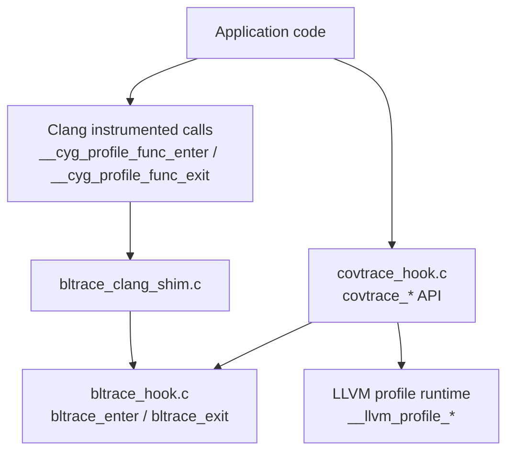
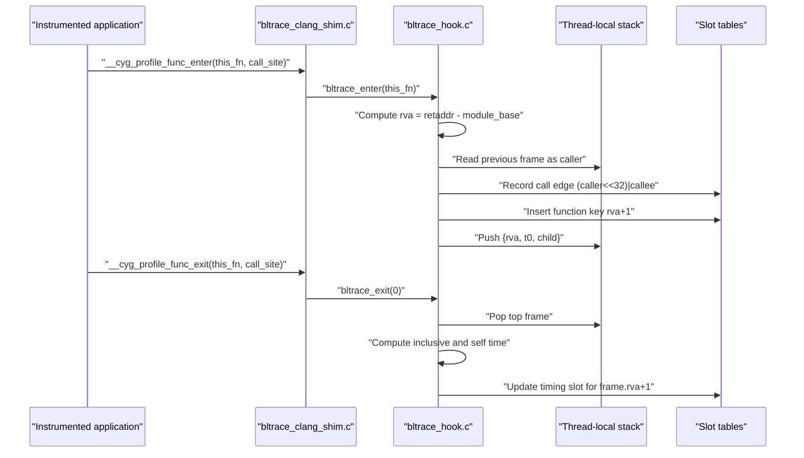
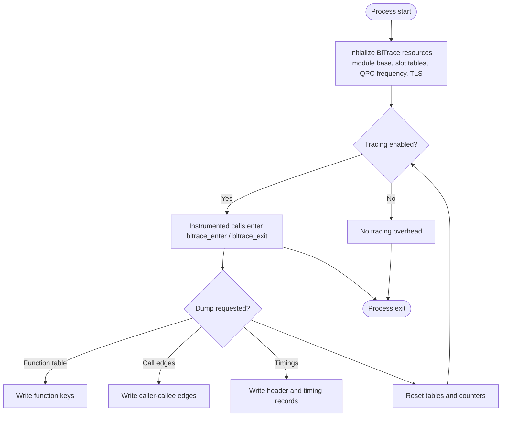

# API Reference

<cite>
**Referenced Files in This Document**
- [bltrace_hook.c](file://bltrace/bltrace_hook.c)
- [bltrace_clang_shim.c](file://bltrace/bltrace_clang_shim.c)
- [covtrace_hook.c](file://covtrace/covtrace_hook.c)
</cite>

## Table of Contents
1. [Introduction](#introduction)
2. [Project Structure](#project-structure)
3. [Core Components](#core-components)
4. [Architecture Overview](#architecture-overview)
5. [Detailed Component Analysis](#detailed-component-analysis)
6. [Data Formats](#data-formats)
7. [Performance Considerations](#performance-considerations)
8. [Troubleshooting Guide](#troubleshooting-guide)
9. [Conclusion](#conclusion)

## Introduction
This document describes the public instrumentation interfaces provided by the Blender Build Instrumentation Extension. It covers:

- **BlTrace**: function-entry and call/return tracing with optional timing, edge counting, and file-based dump APIs.
- **CovTrace**: a thin coverage-window control layer that integrates LLVM profile data collection with BlTrace.

The documentation specifies each function’s parameters, return values, preconditions, postconditions, thread-safety guarantees, error conditions, usage patterns, and performance implications. Concrete examples are described narratively; code snippets are referenced by source location rather than reproduced here.

## Project Structure
The relevant implementation is split across three files:

| File | Responsibility |
|---|---|
| `bltrace/bltrace_hook.c` | Core BlTrace runtime: armed state, slot tables, TLS stack, timing slots, entry/exit hooks, reset, counters, and dump functions. |
| `bltrace/bltrace_clang_shim.c` | Clang `-finstrument-functions` shims that forward to BlTrace entry/exit. |
| `covtrace/covtrace_hook.c` | CovTrace window-control API and LLVM profile integration; also re-exports selected BlTrace symbols. |

**Diagram sources**
- [bltrace_clang_shim.c:15-27](file://bltrace/bltrace_clang_shim.c#L15-L27)
- [bltrace_hook.c:120-200](file://bltrace/bltrace_hook.c#L120-L200)
- [covtrace_hook.c:1-85](file://covtrace/covtrace_hook.c#L1-L85)

**Section sources**
- [bltrace_hook.c:1-376](file://bltrace/bltrace_hook.c#L1-L376)
- [bltrace_clang_shim.c:1-27](file://bltrace/bltrace_clang_shim.c#L1-L27)
- [covtrace_hook.c:1-85](file://covtrace/covtrace_hook.c#L1-L85)

## Core Components

### BlTrace Function Entry and Exit Semantics
BlTrace instruments function entries through either MSVC `/Gh` or Clang `-finstrument-functions`. The common runtime is `bltrace_enter(retaddr)` and `bltrace_exit(retaddr)`:

- `retaddr` is expected to be the address returned by the call-site instrumentation. For MSVC `/Gh`, this is the return address after the five-byte `_penter` trampoline; for Clang, it is the function entry point forwarded from `this_fn`.
- During entry, BlTrace computes an RVA relative to the module base, records the function key as `rva + 1`, and pushes a frame onto per-thread TLS storage for timing.
- Call edges are recorded as `(caller_rva << 32) | callee_rva`, where the caller is the previous TLS frame. If there is no previous frame, the caller is zero.
- Return edges are not recorded; only call direction is captured.
- Timing accumulates inclusive time (time spent in the function plus its descendants) and self time (inclusive minus accumulated child time).

**Diagram sources**
- [bltrace_clang_shim.c:15-27](file://bltrace/bltrace_clang_shim.c#L15-L27)
- [bltrace_hook.c:120-300](file://bltrace/bltrace_hook.c#L120-L300)

**Section sources**
- [bltrace_hook.c:1-119](file://bltrace/bltrace_hook.c#L1-L119)
- [bltrace_hook.c:120-300](file://bltrace/bltrace_hook.c#L120-L300)
- [bltrace_clang_shim.c:1-27](file://bltrace/bltrace_clang_shim.c#L1-L27)

### Thread Safety and Concurrency Model
- Global armed state, function count, edge count, and timing record count are updated with atomic operations.
- Slot insertion uses compare-exchange on hash-table indices, so concurrent entries are safe but may collide when the table fills.
- Per-thread TLS state stores call depth, timestamps, and child timing accumulation.
- Dump and reset functions do not synchronize with live tracing threads. Calling them while another thread is tracing can race with slot writes and counter updates.

**Thread-safety summary:**

| Operation | Thread-safe behavior |
|---|---|
| `bltrace_arm()` | Safe to call once during initialization; multiple calls are idempotent. |
| `bltrace_enter()` | Safe under concurrent execution; uses atomics and TLS. |
| `bltrace_exit()` | Safe under concurrent execution; reads/writes TLS and timing slots. |
| `bltrace_reset()` | Not synchronized with live tracing; should be called only when tracing is disabled or when races are acceptable. |
| `bltrace_dump*()` | Not synchronized with live tracing; should be called when tracing is disabled or when races are acceptable. |
| Counter queries (`count`, `edge_count`, `timing_count`) | Read current atomic counters; values are snapshots and may change immediately afterward. |

**Section sources**
- [bltrace_hook.c:1-119](file://bltrace/bltrace_hook.c#L1-L119)
- [bltrace_hook.c:120-300](file://bltrace/bltrace_hook.c#L120-L300)

## Architecture Overview

**Diagram sources**
- [bltrace_hook.c:120-376](file://bltrace/bltrace_hook.c#L120-L376)

**Section sources**
- [bltrace_hook.c:120-376](file://bltrace/bltrace_hook.c#L120-L376)

## Detailed Component Analysis

### BlTrace Control Functions

#### `bltrace_arm(void)`
- **Purpose**: Enable tracing and allocate internal resources if needed.
- **Parameters**: None.
- **Return value**: Previous armed state. Returns non-zero if tracing was already armed before this call; returns zero otherwise.
- **Preconditions**: Should be called early in process initialization.
- **Postconditions**: Subsequent `bltrace_enter()` calls will record function keys, call edges, and timing.
- **Resource effects**: Allocates function slot table, edge slot table, timing slot table, QPC frequency cache, and TLS index if not already allocated.
- **Thread safety**: Atomic update of global armed flag.
- **Error conditions**: Allocation failures leave resources uninitialized; tracing remains inactive until allocation succeeds.
- **Usage pattern**: Call once at startup before enabling instrumentation.

**Section sources**
- [bltrace_hook.c:120-159](file://bltrace/bltrace_hook.c#L120-L159)

#### `bltrace_disarm(void)`
- **Purpose**: Disable tracing.
- **Parameters**: None.
- **Return value**: Previous armed state. Non-zero means tracing was previously armed.
- **Preconditions**: Tracing should have been armed.
- **Postconditions**: `bltrace_enter()` becomes a fast path that returns immediately.
- **Thread safety**: Atomic update of armed flag.
- **Error conditions**: None documented.
- **Usage pattern**: Call before dumping or resetting to minimize races.

**Section sources**
- [bltrace_hook.c:160-169](file://bltrace/bltrace_hook.c#L160-L169)

#### `bltrace_reset(void)`
- **Purpose**: Clear collected data.
- **Parameters**: None.
- **Return value**: None.
- **Preconditions**: Prefer calling while tracing is disarmed to avoid races.
- **Postconditions**: Function slot table, edge slot table, timing slot table, counts, and TLS stack depth are cleared.
- **Thread safety**: Not synchronized with live tracing.
- **Error conditions**: None documented.
- **Usage pattern**: Call between profiling windows to discard previous data.

**Section sources**
- [bltrace_hook.c:286-314](file://bltrace/bltrace_hook.c#L286-L314)

### BlTrace Counters

#### `bltrace_count(void)`
- **Purpose**: Query the number of unique function keys inserted into the function table.
- **Parameters**: None.
- **Return value**: 32-bit count of inserted function keys.
- **Thread safety**: Reads an atomic counter.
- **Error conditions**: None documented.
- **Usage pattern**: Use to estimate function-table pressure before dumping.

**Section sources**
- [bltrace_hook.c:161-167](file://bltrace/bltrace_hook.c#L161-L167)

#### `bltrace_edge_count(void)`
- **Purpose**: Query the number of unique call edges inserted into the edge table.
- **Parameters**: None.
- **Return value**: 32-bit count of inserted edges.
- **Thread safety**: Reads an atomic counter.
- **Error conditions**: None documented.
- **Usage pattern**: Use to estimate edge-table pressure.

**Section sources**
- [bltrace_hook.c:372-376](file://bltrace/bltrace_hook.c#L372-L376)

#### `bltrace_timing_count(void)`
- **Purpose**: Query the number of timing slots occupied.
- **Parameters**: None.
- **Return value**: 32-bit count of timing slots with a non-zero key.
- **Thread safety**: Reads an atomic counter incremented when a new timing slot is claimed.
- **Error conditions**: None documented.
- **Usage pattern**: Use to size downstream consumers of timing output.

**Section sources**
- [bltrace_hook.c:356-359](file://bltrace/bltrace_hook.c#L356-L359)

### BlTrace Entry and Exit Hooks

#### `bltrace_enter(void *retaddr)`
- **Purpose**: Record function entry, call edge, timing frame, and function key.
- **Parameters**: `retaddr` — the return address supplied by instrumentation.
- **Return value**: None.
- **Preconditions**: Must be called with a valid instrumentation-provided address. For MSVC `/Gh`, this is the address after the entry hook; for Clang, it is the function entry point.
- **Postconditions**:
  - If armed and initialized, records the call edge and inserts the function key.
  - Pushes a timing frame onto TLS.
- **Thread safety**: Uses TLS and atomic slot insertion.
- **Error conditions**: Silently returns if not armed, module base not initialized, or invalid address.
- **Usage pattern**: Called automatically by instrumentation; users normally do not call it directly.

**Section sources**
- [bltrace_hook.c:170-239](file://bltrace/bltrace_hook.c#L170-L239)

#### `bltrace_exit(void *retaddr)`
- **Purpose**: Record timing for the returning function and pop TLS.
- **Parameters**: `retaddr` — ignored by implementation; Clang shim passes zero.
- **Return value**: None.
- **Preconditions**: Must correspond to a prior `bltrace_enter()`.
- **Postconditions**: Updates timing slot counts and times; accumulates child time into the parent frame.
- **Thread safety**: Uses TLS and atomic timing-slot updates.
- **Error conditions**: Silently returns if not armed, TLS unavailable, or stack empty.
- **Usage pattern**: Called automatically by instrumentation; users normally do not call it directly.

**Section sources**
- [bltrace_hook.c:240-285](file://bltrace/bltrace_hook.c#L240-L285)

### BlTrace Dump Functions

#### `bltrace_dump(const char *path)`
- **Purpose**: Write the function table to a file.
- **Parameters**: `path` — destination file path.
- **Return value**: None.
- **Preconditions**: Tracing must have recorded function entries.
- **Postconditions**: Writes serialized function keys for every non-zero slot.
- **Thread safety**: Not synchronized with live tracing.
- **Error conditions**: Returns silently if tables are missing or file creation fails.
- **Output format**: See [Data Formats](#data-formats).

**Section sources**
- [bltrace_hook.c:315-334](file://bltrace/bltrace_hook.c#L315-L334)

#### `bltrace_dump_edges(const char *path)`
- **Purpose**: Write the call-edge table to a file.
- **Parameters**: `path` — destination file path.
- **Return value**: None.
- **Preconditions**: Tracing must have recorded call edges.
- **Postconditions**: Writes serialized `(caller_rva << 32) | callee_rva` for every non-zero edge slot.
- **Thread safety**: Not synchronized with live tracing.
- **Error conditions**: Returns silently if tables are missing or file creation fails.
- **Output format**: See [Data Formats](#data-formats).

**Section sources**
- [bltrace_hook.c:335-355](file://bltrace/bltrace_hook.c#L335-L355)

#### `bltrace_dump_timings(const char *path)`
- **Purpose**: Write timing metadata and timing records to a file.
- **Parameters**: `path` — destination file path.
- **Return value**: None.
- **Preconditions**: Timing slots must be allocated and populated.
- **Postconditions**: Writes a header followed by one timing record per occupied timing slot.
- **Thread safety**: Not synchronized with live tracing.
- **Error conditions**: Returns silently if timing table is missing or file creation fails.
- **Output format**: See [Data Formats](#data-formats).

**Section sources**
- [bltrace_hook.c:360-371](file://bltrace/bltrace_hook.c#L360-L371)

### CovTrace Coverage Window API

#### `covtrace_arm(const char *filename)`
- **Purpose**: Configure LLVM profile output filename and reset LLVM counters.
- **Parameters**: `filename` — target profile file path.
- **Return value**: None.
- **Preconditions**: LLVM profile runtime must be linked.
- **Postconditions**: Future LLVM profile writes use the specified filename; existing counters are reset.
- **Thread safety**: Depends on LLVM profile runtime; this wrapper does not add synchronization.
- **Error conditions**: None documented by the wrapper.
- **Usage pattern**: Call once before starting a coverage window.

**Section sources**
- [covtrace_hook.c:74-80](file://covtrace/covtrace_hook.c#L74-L80)

#### `covtrace_dump(const char *filename)`
- **Purpose**: Flush the current LLVM profile window and optionally redirect future writes.
- **Parameters**: `filename` — optional new filename for subsequent profile writes.
- **Return value**: Result from `__llvm_profile_write_file()`.
- **Preconditions**: Coverage has been enabled through LLVM profile instrumentation.
- **Postconditions**:
  - Current window is written.
  - If `filename` is non-empty, future writes are redirected to that path.
- **Thread safety**: Depends on LLVM profile runtime.
- **Error conditions**: Propagates LLVM write result.
- **Usage pattern**: Call between coverage windows; pass a new filename to start the next window.

**Section sources**
- [covtrace_hook.c:81-85](file://covtrace/covtrace_hook.c#L81-L85)

#### `covtrace_disarm(void)`
- **Purpose**: Disable BlTrace via the covtrace interface.
- **Parameters**: None.
- **Return value**: Same as `bltrace_disarm()` — previous armed state.
- **Preconditions**: Tracing should be armed.
- **Postconditions**: Tracing is disabled.
- **Thread safety**: Delegates to BlTrace.
- **Error conditions**: None documented.

**Section sources**
- [covtrace_hook.c:67-72](file://covtrace/covtrace_hook.c#L67-L72)

### CovTrace Call Tracing Wrappers

These functions wrap BlTrace call-tracing functionality and expose it under the covtrace namespace.

| Function | Behavior |
|---|---|
| `covtrace_calls_arm()` | Calls `bltrace_arm()` and always returns `1`. |
| `covtrace_calls_reset()` | Calls `bltrace_reset()`. |
| `covtrace_calls_dump(path)` | Calls `bltrace_dump(path)`. |
| `covtrace_calls_dump_edges(path)` | Calls `bltrace_dump_edges(path)`. |
| `covtrace_calls_dump_timings(path)` | Calls `bltrace_dump_timings(path)`. |
| `covtrace_calls_edge_count()` | Returns `bltrace_edge_count()`. |
| `covtrace_calls_timing_count()` | Returns `bltrace_timing_count()`. |
| `covtrace_calls_disarm()` | Returns `bltrace_disarm()`. |

**Important distinction**: Unlike `covtrace_arm()`, which configures LLVM profile output, `covtrace_calls_arm()` enables BlTrace call tracing.

**Section sources**
- [covtrace_hook.c:1-73](file://covtrace/covtrace_hook.c#L1-L73)

## Data Formats

All dump outputs are flat sequences of little-endian 64-bit values unless otherwise noted.

### Function Table Output
Produced by `bltrace_dump()`.

| Field | Type | Meaning |
|---|---|---|
| Serialized function key | 64-bit LE integer | Each non-zero slot value is written. The key is `rva + 1`, where `rva` is the instrumentation return address relative to the module base. |

- Zero-valued slots are skipped.
- The order corresponds to slot-table iteration order, not sorted by address.
- Consumers must deduplicate by key if needed.

**Section sources**
- [bltrace_hook.c:1-20](file://bltrace/bltrace_hook.c#L1-L20)
- [bltrace_hook.c:315-334](file://bltrace/bltrace_hook.c#L315-L334)

### Edge Table Output
Produced by `bltrace_dump_edges()`.

| Field | Type | Meaning |
|---|---|---|
| Serialized edge | 64-bit LE integer | `(caller_rva << 32) | callee_rva` |

- `caller_rva` is the previous TLS frame’s `rva`; it can be zero when the traced function is entered without a known caller frame.
- `callee_rva` is the current function’s computed `rva`.
- Zero-valued slots are skipped.

**Section sources**
- [bltrace_hook.c:1-20](file://bltrace/bltrace_hook.c#L1-L20)
- [bltrace_hook.c:170-239](file://bltrace/bltrace_hook.c#L170-L239)
- [bltrace_hook.c:335-355](file://bltrace/bltrace_hook.c#L335-L355)

### Timing Output
Produced by `bltrace_dump_timings()`.

#### Header
| Field | Type | Meaning |
|---|---|---|
| Magic | 32-bit LE | Fixed value `0x4D495442` (`BTIM`). |
| Version | 32-bit LE | Format version; currently `1`. |
| Frequency | 64-bit LE | QPC frequency used to interpret time fields. |
| Record size | 32-bit LE | Size of each timing record; equals the size of the internal timing record structure. |
| Count | 32-bit LE | Number of timing records following the header. |

#### Timing Record
| Field | Type | Meaning |
|---|---|---|
| Key | 64-bit LE | Function key, equal to `rva + 1`. |
| Count | 64-bit LE | Number of observed executions for this key. |
| Self time | 64-bit LE | Accumulated self time in QPC ticks. |
| Inclusive time | 64-real | Accumulated inclusive time in QPC ticks. |

- Only timing slots with a non-zero key are written.
- Time units are QPC ticks; divide by `frequency` to obtain seconds.
- `self` is inclusive time minus accumulated child time.
- `inclusive` includes time spent in descendant frames.

**Section sources**
- [bltrace_hook.c:21-69](file://bltrace/bltrace_hook.c#L21-L69)
- [bltrace_hook.c:360-371](file://bltrace/bltrace_hook.c#L360-L371)

## Performance Considerations

### Overhead Sources
- **Function entry**: Computes module-relative RVA, performs two hash-table insertions (function key and call edge), updates counters, and pushes TLS timing state.
- **Function exit**: Pops TLS, computes inclusive/self time using QPC, updates timing slot atomically, and accumulates child time into the parent frame.
- **Hash table contention**: Both function and edge tables use open addressing with probing. High cardinality increases collisions and retry loops.
- **Timing slot hashing**: Timing uses a separate fixed-size table; collisions cause additional probing.
- **QPC calls**: Every entry and exit reads high-resolution performance counters.
- **File I/O**: Dump functions iterate entire slot tables and perform many small `WriteFile` calls.

### Mitigation Best Practices
- Keep tracing disabled in production hot paths unless necessary.
- Use `bltrace_disarm()` around short critical sections if you need precise low-overhead regions.
- Prefer resetting and dumping between logical profiling windows rather than continuously.
- Monitor `bltrace_count()`, `bltrace_edge_count()`, and `bltrace_timing_count()` to detect table saturation.
- Avoid dumping while other threads are actively tracing.
- Use `covtrace_calls_reset()` between coverage windows to discard stale data.

[No sources needed since this section provides general guidance]

## Troubleshooting Guide

### Tracing Produces No Data
- Verify that `bltrace_arm()` or `covtrace_calls_arm()` has been called.
- Check whether the build actually instruments functions. For Clang builds, verify `-finstrument-functions`. For MSVC builds, verify `/Gh` support.
- Confirm that the instrumentation address passed to `bltrace_enter()` is valid and not zero.
- Ensure the module base has been resolved by `bltrace_arm()`.

**Section sources**
- [bltrace_hook.c:120-159](file://bltrace/bltrace_hook.c#L120-L159)
- [bltrace_hook.c:170-190](file://bltrace/bltrace_hook.c#L170-L190)

### Dump Files Are Empty
- `bltrace_dump*()` returns silently when tables are uninitialized or file creation fails.
- Confirm that tracing was armed long enough to populate tables.
- Check file permissions and disk space.
- For timing output, confirm that timing slots were allocated and that exits occurred.

**Section sources**
- [bltrace_hook.c:315-371](file://bltrace/bltrace_hook.c#L315-L371)

### Timing Values Are Zero or Incorrect
- Timing requires QPC availability; `QueryPerformanceFrequency` failure leaves frequency unset.
- Timing slots require memory allocation.
- Child-time accumulation depends on correct push/pop of TLS frames.
- Interpreting timing values requires dividing by the header frequency field.

**Section sources**
- [bltrace_hook.c:138-147](file://bltrace/bltrace_hook.c#L138-L147)
- [bltrace_hook.c:360-371](file://bltrace/bltrace_hook.c#L360-L371)

### LLVM Profile Files Are Not Written
- `covtrace_arm()` must be called to set the profile filename and reset counters.
- `covtrace_dump()` must be called to flush the current window.
- Verify that the process is linked with LLVM profile generation support.

**Section sources**
- [covtrace_hook.c:1-20](file://covtrace/covtrace_hook.c#L1-L20)
- [covtrace_hook.c:74-85](file://covtrace/covtrace_hook.c#L74-L85)

## Conclusion
The Blender Build Instrumentation Extension exposes two related layers:

- **BlTrace** provides lightweight call/return-aware tracing with function-key deduplication, call-edge recording, and per-function timing. Its primary public surface is `bltrace_enter`, `bltrace_exit`, `bltrace_arm`, `bltrace_disarm`, `bltrace_reset`, the three dump functions, and the three counter queries.
- **CovTrace** adds coverage-window management over LLVM profile data and re-exports BlTrace call-tracing functionality under a covtrace-oriented API.

For reliable results, enable tracing early, disable it before dumping or resetting, monitor counters, and treat all dump and reset operations as potentially unsafe against concurrent tracing threads.

[No sources needed since this section summarizes without analyzing specific files]