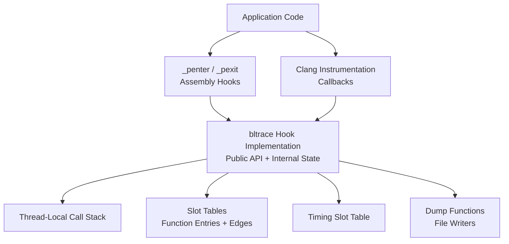
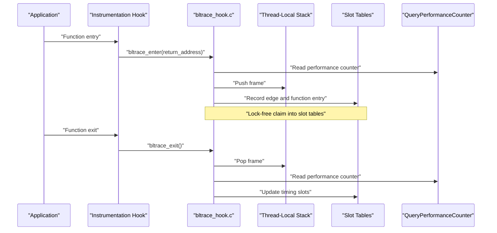
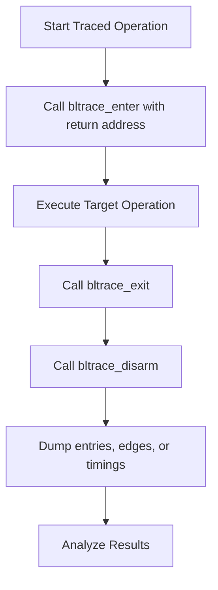

# Bltrace API

<cite>
**Referenced Files in This Document**
- [bltrace_hook.c](file://bltrace/bltrace_hook.c)
- [bltrace_clang_shim.c](file://bltrace/bltrace_clang_shim.c)
- [bltrace_penter.asm](file://bltrace/bltrace_penter.asm)
- [CMakeLists.txt](file://bltrace/CMakeLists.txt)
</cite>

## Table of Contents
1. [Introduction](#introduction)
2. [Project Structure](#project-structure)
3. [Core Components](#core-components)
4. [Architecture Overview](#architecture-overview)
5. [API Reference](#api-reference)
6. [Internal Data Structures](#internal-data-structures)
7. [Platform-Specific Behavior](#platform-specific-behavior)
8. [Performance and Memory Characteristics](#performance-and-memory-characteristics)
9. [Usage Patterns](#usage-patterns)
10. [Troubleshooting Guide](#troubleshooting-guide)
11. [Conclusion](#conclusion)

## Introduction
Bltrace is a Windows tracing library that records function entry counts, call edges, per-function timing statistics, and call stack state. It exposes a small public C API for enabling and disabling tracing, manually recording function entry and exit, dumping collected data to files, and querying counters. The implementation uses thread-local storage for call stacks, lock-free hash tables for slot-based counting, and platform-specific hooks to instrument function calls.

The library targets two main toolchain paths:
- MSVC with the `/Gh` and `/GH` compiler options, which inject `_penter` and `_pexit` hooks.
- Clang with `-finstrument-functions`, which invokes `__cyg_profile_func_enter` and `__cyg_profile_func_exit`.

## Project Structure
The bltrace module consists of three source files:

| File | Role |
|---|---|
| `bltrace_hook.c` | Implements all public C API functions, internal slot tables, TLS state, timing logic, and dump routines. |
| `bltrace_clang_shim.c` | Bridges Clang instrumentation callbacks to `bltrace_enter()` and `bltrace_exit()`. |
| `bltrace_penter.asm` | MSVC assembly entry/exit hooks that preserve CPU state and forward return addresses to the C API. |
| `CMakeLists.txt` | Builds the static library and selects between the Clang shim and MASM hook based on the compiler. |



**Diagram sources**
- [bltrace_penter.asm:1-108](file://bltrace/bltrace_penter.asm#L1-L108)
- [bltrace_clang_shim.c:1-27](file://bltrace/bltrace_clang_shim.c#L1-L27)
- [bltrace_hook.c:1-376](file://bltrace/bltrace_hook.c#L1-L376)
- [CMakeLists.txt:1-49](file://bltrace/CMakeLists.txt#L1-L49)

**Section sources**
- [bltrace_hook.c:1-376](file://bltrace/bltrace_hook.c#L1-L376)
- [bltrace_clang_shim.c:1-27](file://bltrace/bltrace_clang_shim.c#L1-L27)
- [bltrace_penter.asm:1-108](file://bltrace/bltrace_penter.asm#L1-L108)
- [CMakeLists.txt:1-49](file://bltrace/CMakeLists.txt#L1-L49)

## Core Components
The core component is the bltrace hook implementation. It manages:
- Global armed/disarmed state.
- Module base address resolution.
- Function-entry slot table.
- Call-edge slot table.
- Timing slot table.
- Thread-local call stack.
- Counters for entries, edges, and timing records.
- Query Performance Counter frequency caching.
- Public dump functions for entries, edges, and timings.

Key responsibilities by function group:
- Lifecycle control: `bltrace_arm()`, `bltrace_disarm()`, `bltrace_reset()`.
- Manual tracing: `bltrace_enter()`, `bltrace_exit()`.
- Statistics: `bltrace_count()`, `bltrace_edge_count()`, `bltrace_timing_count()`.
- Persistence: `bltrace_dump()`, `bltrace_dump_edges()`, `bltrace_dump_timings()`.

**Section sources**
- [bltrace_hook.c:1-376](file://bltrace/bltrace_hook.c#L1-L376)

## Architecture Overview
At runtime, every traced function may invoke an instrumentation callback depending on the toolchain:



**Diagram sources**
- [bltrace_penter.asm:1-108](file://bltrace/bltrace_penter.asm#L1-L108)
- [bltrace_clang_shim.c:1-27](file://bltrace/bltrace_clang_shim.c#L1-L27)
- [bltrace_hook.c:1-376](file://bltrace/bltrace_hook.c#L1-L376)

## API Reference

### `bltrace_arm`
Initializes tracing infrastructure and enables it.

**Declaration concept:**
```c
int bltrace_arm(void);
```

**Parameters:** None.

**Return value:**
- Returns the previous global armed state before this call. A nonzero value means tracing was already armed; zero means it was previously disarmed.

**Preconditions:**
- The process must be running on Windows because the implementation uses Windows APIs such as `GetModuleHandleA`, `VirtualAlloc`, `TlsAlloc`, `QueryPerformanceFrequency`, and `CreateFileA`.
- No explicit preconditions are enforced inside the function; calling it multiple times is safe.

**Postconditions after successful execution:**
- Module base address is cached if not already set.
- Function-entry slot table is allocated if null.
- Edge slot table is allocated if null.
- Timing slot table is allocated if null.
- Query Performance Counter frequency is cached if available.
- TLS index is allocated if not yet created.
- Global armed flag becomes 1.

**Thread safety:**
- Initialization steps check or allocate globals without external synchronization beyond the atomic exchange of the armed flag. Allocation of large buffers is not protected by a mutex, so callers should avoid concurrent first-time initialization from multiple threads unless the caller guarantees exclusive access.
- Once initialized, subsequent calls only change the armed flag atomically.

**Platform differences:**
- Works with both MSVC and Clang builds because it is part of the shared implementation.
- On Clang builds, the same function is used; the Clang shim routes instrumentation callbacks to `bltrace_enter`/`bltrace_exit`.

**Error behavior:**
- Does not return error codes for allocation failures. If `VirtualAlloc` returns null, later operations may observe null tables and behave conservatively.

**Typical usage pattern:**
- Call once early in application initialization.
- Compare the returned value to determine whether tracing was already enabled.

**Section sources**
- [bltrace_hook.c:1-376](file://bltrace/bltrace_hook.c#L1-L376)

---

### `bltrace_disarm`
Disables tracing.

**Declaration concept:**
```c
int bltrace_disarm(void);
```

**Parameters:** None.

**Return value:**
- Returns the previous global armed state. Nonzero means tracing was active; zero means it was already disabled.

**Preconditions:**
- None. Calling it when disarmed is safe.

**Postconditions after successful execution:**
- Global armed flag becomes 0.
- Existing slot tables, timing tables, and TLS state remain allocated.
- Tracing no longer increments entry or edge counters through normal instrumentation paths.

**Thread safety:**
- Uses an atomic exchange for the armed flag.

**Platform differences:**
- Shared across MSVC and Clang builds.

**Error behavior:**
- No error code; always succeeds.

**Typical usage pattern:**
- Call at the end of a tracing session.
- Use the return value to detect transitions between armed and disarmed states.

**Section sources**
- [bltrace_hook.c:1-376](file://bltrace/bltrace_hook.c#L1-L376)

---

### `bltrace_enter`
Records a function entry.

**Declaration concept:**
```c
void bltrace_enter(void *retaddr);
```

**Parameters:**
- `retaddr`: Pointer to the caller’s return address. For MSVC hooks, this is the address injected by `/Gh`; for Clang instrumentation, this is the function entry address supplied by `__cyg_profile_func_enter`.

**Return value:** None.

**Preconditions:**
- The pointer represents a valid return address within the current module.
- If called manually, the matching `bltrace_exit` must eventually be called to maintain correct timing stack state.

**Postconditions after successful execution:**
- If tracing is armed and the module base is known:
  - The function RVA is computed and recorded in the entry slot table.
  - If a caller frame exists in the TLS stack, the call edge is recorded.
  - A timing frame is pushed onto the TLS stack.
  - Entry and edge counters may be incremented.

**Thread safety:**
- Slot insertion uses a lock-free `claim` helper with interlocked compare-exchange.
- TLS stack updates are per-thread and do not require locks.
- Counters use atomic increment operations.

**Platform differences:**
- On MSVC, `_penter` passes the actual return address above the hook call.
- On Clang, `__cyg_profile_func_enter` receives the function entry address; the shim forwards it directly.

**Error behavior:**
- Silently returns if tracing is disarmed, the module base is unknown, or the computed RVA is zero.

**Typical usage pattern:**
- Normally invoked automatically by instrumentation hooks.
- Can be called manually around specific operations when automatic instrumentation is unavailable or undesirable.

**Section sources**
- [bltrace_hook.c:1-376](file://bltrace/bltrace_hook.c#L1-L376)
- [bltrace_clang_shim.c:1-27](file://bltrace/bltrace_clang_shim.c#L1-L27)
- [bltrace_penter.asm:1-108](file://bltrace/bltrace_penter.asm#L1-L108)

---

### `bltrace_exit`
Records a function exit.

**Declaration concept:**
```c
void bltrace_exit(void *retaddr);
```

**Parameters:**
- `retaddr`: Ignored by the implementation. Its purpose is to match the calling convention expected by hooks and manual callers.

**Return value:** None.

**Preconditions:**
- Must correspond to a prior `bltrace_enter` call for the same logical function scope.
- TLS state must exist and contain a non-empty stack; otherwise the call is ignored.

**Postconditions after successful execution:**
- The top TLS frame is popped.
- Inclusive and self timing values are computed using the stored start time and child timing.
- Timing slot counters and accumulated times are updated if timing tables exist.
- Parent frame child timing is updated when the stack depth is greater than one.

**Thread safety:**
- Operates on per-thread TLS state.
- Timing slot updates use 64-bit atomic operations.

**Platform differences:**
- On MSVC, `_pexit` pushes the saved CPU state and calls this function.
- On Clang, `__cyg_profile_func_exit` calls this function with a null-like argument; the parameter is ignored.

**Error behavior:**
- Silently returns if tracing is disarmed, TLS is unavailable, or the TLS stack is empty.

**Typical usage pattern:**
- Normally invoked automatically by instrumentation hooks.
- Should be paired with `bltrace_enter` when used manually.

**Section sources**
- [bltrace_hook.c:1-376](file://bltrace/bltrace_hook.c#L1-L376)
- [bltrace_penter.asm:1-108](file://bltrace/bltrace_penter.asm#L1-L108)
- [bltrace_clang_shim.c:1-27](file://bltrace/bltrace_clang_shim.c#L1-L27)

---

### `bltrace_dump`
Writes function-entry trace data to a file.

**Declaration concept:**
```c
void bltrace_dump(const char *path);
```

**Parameters:**
- `path`: Null-terminated ANSI path for the output file.

**Return value:** None.

**Output format:**
- A flat sequence of little-endian 64-bit values.
- Each nonzero value is an entry slot containing `rva + 1`.
- Zero values are skipped during iteration.

**Preconditions:**
- The file path must be writable by the process.
- The slot table must have been allocated by `bltrace_arm`.

**Postconditions after successful execution:**
- The file is created or overwritten.
- All nonzero entry slot values are written sequentially.
- The file handle is closed.

**Thread safety:**
- Iterates global slot tables without locking.
- Dumping while tracing is active may observe partially updated data.

**Platform differences:**
- Uses Windows file APIs.

**Error behavior:**
- Returns immediately if the slot table is null.
- Returns immediately if file creation fails.
- Does not report errors to the caller.

**Typical usage pattern:**
- Call after stopping tracing to export function entry counts.
- Combine with `bltrace_edge_count()` and `bltrace_count()` to validate data volume.

**Section sources**
- [bltrace_hook.c:1-376](file://bltrace/bltrace_hook.c#L1-L376)

---

### `bltrace_dump_edges`
Writes call-edge trace data to a file.

**Declaration concept:**
```c
void bltrace_dump_edges(const char *path);
```

**Parameters:**
- `path`: Null-terminated ANSI path for the output file.

**Return value:** None.

**Output format:**
- A flat sequence of little-endian 64-bit values.
- Each nonzero value encodes `(caller_rva << 32) | callee_rva`.
- Zero values are skipped during iteration.

**Preconditions:**
- The edge slot table must have been allocated by `bltrace_arm`.
- The file path must be writable.

**Postconditions after successful execution:**
- The file contains encoded call edges.
- The file handle is closed.

**Thread safety:**
- Not synchronized with concurrent tracing.

**Platform differences:**
- Uses Windows file APIs.

**Error behavior:**
- Returns immediately if the edge slot table is null.
- Returns immediately if file creation fails.

**Typical usage pattern:**
- Call after stopping tracing to export call graph information.
- Useful for reconstructing caller-callee relationships.

**Section sources**
- [bltrace_hook.c:1-376](file://bltrace/bltrace_hook.c#L1-L376)

---

### `bltrace_dump_timings`
Writes timing statistics to a file.

**Declaration concept:**
```c
void bltrace_dump_timings(const char *path);
```

**Parameters:**
- `path`: Null-terminated ANSI path for the output file.

**Return value:** None.

**Output format:**
- A header followed by one record per occupied timing slot.
- Header fields:
  - Magic constant identifying the format.
  - Version number.
  - Frequency from `QueryPerformanceFrequency`.
  - Record size.
  - Number of timing records.
- Record fields:
  - Key: `rva + 1`.
  - Count: number of timed entries.
  - Self time: time spent in the function excluding children.
  - Inclusive time: total time including children.

**Preconditions:**
- The timing slot table must have been allocated by `bltrace_arm`.
- The file path must be writable.

**Postconditions after successful execution:**
- The file contains a binary timing stream suitable for offline analysis.
- The file handle is closed.

**Thread safety:**
- Not synchronized with concurrent tracing.

**Platform differences:**
- Uses Windows file APIs.
- Timing depends on Query Performance Counter availability.

**Error behavior:**
- Returns immediately if the timing slot table is null.
- Returns immediately if file creation fails.

**Typical usage pattern:**
- Call after stopping tracing to export per-function timing statistics.
- Use the header frequency to convert raw ticks to seconds.

**Section sources**
- [bltrace_hook.c:1-376](file://bltrace/bltrace_hook.c#L1-L376)

---

### `bltrace_count`
Returns the total number of recorded function entries.

**Declaration concept:**
```c
uint32_t bltrace_count(void);
```

**Parameters:** None.

**Return value:**
- Current value of the global entry counter, cast to 32 bits.

**Preconditions:**
- None.

**Postconditions:**
- Returns a snapshot of the counter at the time of the call.

**Thread safety:**
- Reads a volatile long; not strictly atomic on all platforms, but intended as a fast counter snapshot.

**Platform differences:**
- Shared across toolchains.

**Error behavior:**
- No error code.

**Typical usage pattern:**
- Query how many unique functions have been entered.
- Use as a quick sanity check before dumping.

**Section sources**
- [bltrace_hook.c:1-376](file://bltrace/bltrace_hook.c#L1-L376)

---

### `bltrace_edge_count`
Returns the total number of recorded call edges.

**Declaration concept:**
```c
uint32_t bltrace_edge_count(void);
```

**Parameters:** None.

**Return value:**
- Current value of the global edge counter, cast to 32 bits.

**Preconditions:**
- None.

**Postconditions:**
- Returns a snapshot of the edge counter.

**Thread safety:**
- Reads a volatile long.

**Platform differences:**
- Shared across toolchains.

**Error behavior:**
- No error code.

**Typical usage pattern:**
- Estimate the size of edge dump output.
- Validate call graph coverage.

**Section sources**
- [bltrace_hook.c:1-376](file://bltrace/bltrace_hook.c#L1-L376)

---

### `bltrace_timing_count`
Returns the number of distinct timing slots occupied.

**Declaration concept:**
```c
uint32_t bltrace_timing_count(void);
```

**Parameters:** None.

**Return value:**
- Current count of timing slots that have been inserted.

**Preconditions:**
- None.

**Postconditions:**
- Returns the number of timing records that will appear in `bltrace_dump_timings`.

**Thread safety:**
- Reads a volatile long.

**Platform differences:**
- Shared across toolchains.

**Error behavior:**
- No error code.

**Typical usage pattern:**
- Check how many functions have accumulated timing data.
- Use to estimate timing dump size.

**Section sources**
- [bltrace_hook.c:1-376](file://bltrace/bltrace_hook.c#L1-L376)

---

### Additional Internal Helper: `bltrace_reset`
Although not requested in the original API list, the implementation exports `bltrace_reset`, which clears internal state.

**Purpose:**
- Clears slot tables.
- Clears timing slot table.
- Resets timing record count.
- Clears TLS stack depth.
- Resets entry and edge counters.

**Behavioral note:**
- This function is exported from the implementation but was not listed among the documented public functions in the objective. Treat it as an internal maintenance routine unless explicitly exposed by your build configuration.

**Section sources**
- [bltrace_hook.c:1-376](file://bltrace/bltrace_hook.c#L1-L376)

## Internal Data Structures

### Slot Tables
Function entries and call edges use fixed-size linear-probing hash tables.

| Concept | Meaning |
|---|---|
| `SLOT_COUNT` | Number of slots in the entry and edge tables. |
| `SLOT_MASK` | Hash mask derived from `SLOT_COUNT - 1`. |
| `TABLE_BYTES` | Total byte size of each slot table. |
| `claim` | Lock-free insertion helper that tries to insert a value into the first empty slot found by linear probing. |
| Entry slot value | `rva + 1`, where `rva` is the function return address relative to the module base. |
| Edge slot value | `(caller_rva << 32) | callee_rva`. |

Complexity:
- Insertion is O(1) average case with bounded worst-case scanning up to `SLOT_COUNT`.
- Collision resolution uses linear probing.
- Memory layout is compact and designed for efficient sequential iteration during dumps.

**Section sources**
- [bltrace_hook.c:1-376](file://bltrace/bltrace_hook.c#L1-L376)

### TLS Stack
Each thread has an optional TLS stack tracking active function frames.

| Field | Meaning |
|---|---|
| `count` | Number of frames currently on the stack. |
| `stack[]` | Fixed-capacity array of `TlsFrame`. |
| `TlsFrame.rva` | Function RVA. |
| `TlsFrame.t0` | Start timestamp in performance-counter ticks. |
| `TlsFrame.child` | Accumulated inclusive time contributed by child frames. |

Allocation policy:
- TLS state is lazily allocated on first use.
- If TLS allocation fails, tracing still continues for counters and slot tables, but timing and call-stack-dependent features are degraded.

Overflow handling:
- If the stack reaches its capacity, the implementation resets the stack depth rather than growing dynamically.

**Section sources**
- [bltrace_hook.c:1-376](file://bltrace/bltrace_hook.c#L1-L376)

### Timing Slot Table
Timing data is stored in a separate fixed-size table.

| Field | Meaning |
|---|---|
| `key` | Function key, typically `rva + 1`. Zero means empty. |
| `count` | Number of timed entries. |
| `self` | Self time accumulated in ticks. |
| `inclusive` | Inclusive time accumulated in ticks. |

Insertion:
- Uses a lock-free search-and-insert strategy.
- Increments the global timing slot count when a new key is inserted.

**Section sources**
- [bltrace_hook.c:1-376](file://bltrace/bltrace_hook.c#L1-L376)

### Timing Record and Header
The timing dump format uses these structures:

| Structure | Fields | Purpose |
|---|---|---|
| `TimingHeader` | Magic, version, frequency, record size, count | Identifies format and provides metadata for consumers. |
| `TimingRecord` | Key, count, self, inclusive | One row per tracked function. |

**Section sources**
- [bltrace_hook.c:1-376](file://bltrace/bltrace_hook.c#L1-L376)

## Platform-Specific Behavior

### MSVC Toolchain
- Uses `/Gh` and `/GH` compiler options to inject `_penter` and `_pexit`.
- `_penter` and `_pexit` are implemented in assembly and preserve all volatile registers, floating-point registers, flags, and 16-byte stack alignment.
- Both hooks pass the return address located above the hook call to `bltrace_enter` and `bltrace_exit`.
- The MASM object is built through a custom command and linked into the static library.

Implications:
- Low-level ABI compatibility is critical.
- Hook overhead includes saving/restoring registers and calling into C code.
- Exit hooks update timing but do not record return edges.

**Section sources**
- [bltrace_penter.asm:1-108](file://bltrace/bltrace_penter.asm#L1-L108)
- [CMakeLists.txt:1-49](file://bltrace/CMakeLists.txt#L1-L49)

### Clang Toolchain
- Uses `-finstrument-functions` to generate `__cyg_profile_func_enter` and `__cyg_profile_func_exit`.
- `bltrace_clang_shim.c` forwards these callbacks to `bltrace_enter` and `bltrace_exit`.
- The Clang translation unit is compiled with `-fno-instrument-functions` and related options to avoid recursive instrumentation and coverage pollution.
- No MASM assembly is used.

Implications:
- Callback arguments differ slightly from MSVC semantics, but the shim normalizes them.
- Clang instrumentation adds compiler-generated call sites around functions.
- Coverage and profiling flags are suppressed for the bltrace module when code coverage is enabled.

**Section sources**
- [bltrace_clang_shim.c:1-27](file://bltrace/bltrace_clang_shim.c#L1-L27)
- [CMakeLists.txt:1-49](file://bltrace/CMakeLists.txt#L1-L49)

## Performance and Memory Characteristics

### Allocation Patterns
- Large buffers are allocated lazily by `bltrace_arm`:
  - Function-entry slot table.
  - Edge slot table.
  - Timing slot table.
  - TLS index.
- TLS stack memory is allocated lazily per thread.
- Query Performance Counter frequency is cached once.

Memory footprint:
- Entry and edge tables grow with `SLOT_COUNT`.
- Timing table grows with `TIME_SLOT_COUNT`.
- Per-thread TLS stack is bounded by `STACK_CAP`.

### Runtime Overhead
- Every traced function entry may perform:
  - Performance counter read.
  - TLS lookup or allocation.
  - Linear probing into slot tables.
  - Atomic counter updates.
- Edge recording additionally computes a caller/callee pair and probes the edge table.
- Exit performs another performance counter read and updates timing slots.

Optimization considerations:
- Disabling tracing with `bltrace_disarm()` avoids most overhead because early checks return quickly.
- Avoid calling dump functions during hot loops; they iterate entire slot tables and write to disk.
- Use `bltrace_count()`, `bltrace_edge_count()`, and `bltrace_timing_count()` for lightweight statistics instead of full dumps.

### Concurrency Model
- Slot tables use lock-free insertion via interlocked compare-exchange.
- Counters are atomic or volatile.
- TLS state is per-thread.
- Dump functions are not synchronized with concurrent tracing; prefer stopping tracing before dumping for consistent snapshots.

**Section sources**
- [bltrace_hook.c:1-376](file://bltrace/bltrace_hook.c#L1-L376)

## Usage Patterns

### Enabling Tracing Around Specific Operations
Useful when automatic instrumentation is unavailable or too expensive for some modules.

Recommended flow:
1. Call `bltrace_arm()` early in initialization.
2. Wrap the operation with `bltrace_enter(retaddr)` and `bltrace_exit(retaddr)`.
3. Query counters or dump results after stopping tracing.

Conceptual sequence:



**Diagram sources**
- [bltrace_hook.c:1-376](file://bltrace/bltrace_hook.c#L1-L376)

### Dumping Trace Data to Files
After collecting data:

1. Stop tracing with `bltrace_disarm()`.
2. Call `bltrace_dump()` for function entries.
3. Call `bltrace_dump_edges()` for call edges.
4. Call `bltrace_dump_timings()` for timing statistics.
5. Inspect the resulting binary files.

Note:
- Entry and edge dumps are plain sequences of 64-bit values.
- Timing dumps include a structured header and records.

**Section sources**
- [bltrace_hook.c:1-376](file://bltrace/bltrace_hook.c#L1-L376)

### Managing Call Stack State Manually
Manual enter/exit calls must form balanced pairs. Unbalanced calls can cause:
- Missing timing updates.
- Incorrect parent-child timing accumulation.
- Potential stack overflow protection triggering due to repeated pushes without pops.

Best practice:
- Always pair `bltrace_enter` with `bltrace_exit` around the same logical scope.
- Do not assume that `_penter`/`_pexit` and manual calls can be mixed arbitrarily without understanding their combined effect on TLS state.

**Section sources**
- [bltrace_hook.c:1-376](file://bltrace/bltrace_hook.c#L1-L376)

### Querying Trace Statistics
Lightweight queries:
- `bltrace_count()` for function entry count.
- `bltrace_edge_count()` for call edge count.
- `bltrace_timing_count()` for timing record count.

These functions are appropriate for logging or diagnostics without allocating additional memory or writing files.

**Section sources**
- [bltrace_hook.c:1-376](file://bltrace/bltrace_hook.c#L1-L376)

## Troubleshooting Guide

### Tracing Has No Effect
Check the following:
- Ensure `bltrace_arm()` has been called.
- Verify that the compiled code uses either MSVC `/Gh`/`/GH` or Clang `-finstrument-functions`.
- Confirm that tracing is not immediately disarmed before meaningful work executes.
- Inspect `bltrace_count()` and `bltrace_edge_count()` to see whether counters increase.

**Section sources**
- [bltrace_hook.c:1-376](file://bltrace/bltrace_hook.c#L1-L376)
- [CMakeLists.txt:1-49](file://bltrace/CMakeLists.txt#L1-L49)

### Timing Data Is Missing
Possible causes:
- Timing slot table was not allocated because `bltrace_arm()` was never called.
- TLS allocation failed, causing timing updates to skip.
- Exit hooks did not run for some functions.
- Manual enter/exit calls were unbalanced.

Verification:
- Call `bltrace_timing_count()` to check whether timing slots were inserted.
- Compare `bltrace_dump_timings()` output with `bltrace_count()`.

**Section sources**
- [bltrace_hook.c:1-376](file://bltrace/bltrace_hook.c#L1-L376)

### Dump Files Are Empty
Possible causes:
- Slot tables were never allocated.
- Tracing was disarmed before any entries occurred.
- File creation failed silently.
- Dumped data contains only zero entries, which are skipped.

Verification:
- Check return values of lifecycle functions.
- Inspect counters before dumping.
- Validate file permissions and paths.

**Section sources**
- [bltrace_hook.c:1-376](file://bltrace/bltrace_hook.c#L1-L376)

### High Overhead in Production
Recommendations:
- Keep tracing disabled in production unless actively diagnosing.
- Use `bltrace_disarm()` around hot paths.
- Prefer lightweight counters over frequent dumps.
- Limit tracing duration to short diagnostic windows.
- Consider reducing instrumentation scope by avoiding unnecessary manual enter/exit calls.

[No sources needed since this section provides general guidance]

## Conclusion
The bltrace API provides a focused set of functions for enabling tracing, recording function entries and exits, collecting timing statistics, and exporting trace data. Its design favors low overhead through lazy allocation, lock-free slot tables, and per-thread TLS state. Understanding the relationship between `_penter`/`_pexit` hooks and manual `bltrace_enter`/`bltrace_exit` calls is essential for predictable behavior. For production systems, tracing should be carefully controlled and disabled when not needed to minimize performance impact.

[No sources needed since this section summarizes without analyzing specific files]