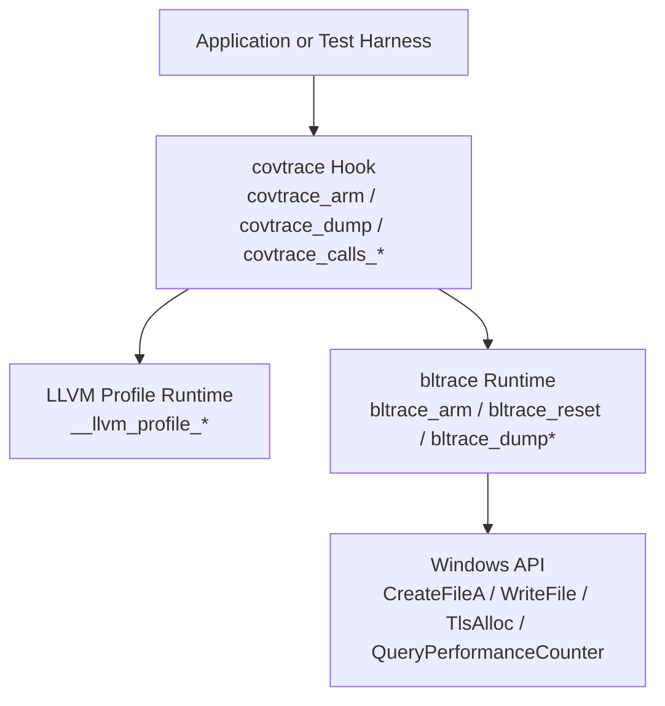
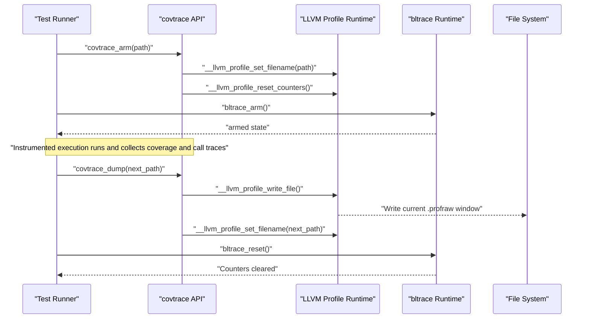
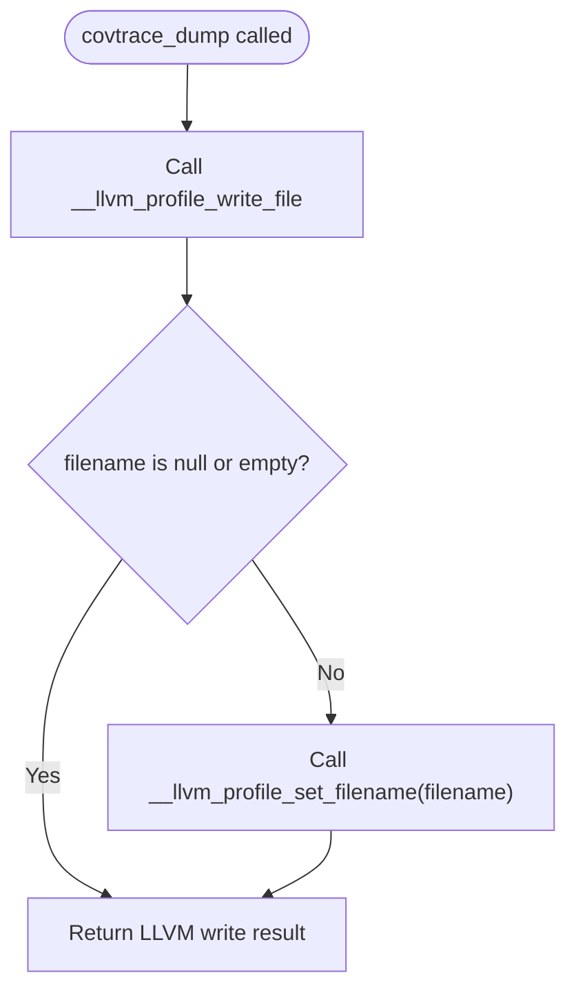
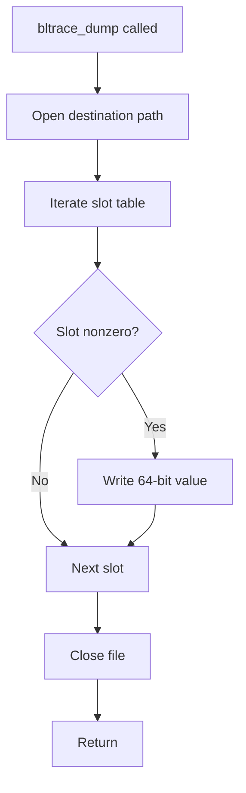
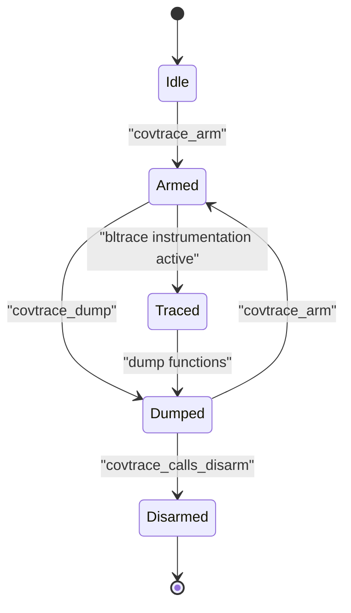
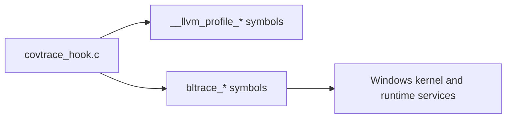

# Covtrace API

<cite>
**Referenced Files in This Document**
- [covtrace_hook.c](file://covtrace/covtrace_hook.c)
- [bltrace_hook.c](file://bltrace/bltrace_hook.c)
- [CMakeLists.txt](file://covtrace/CMakeLists.txt)
- [bltrace CMakeLists.txt](file://bltrace/CMakeLists.txt)
</cite>

## Table of Contents
1. [Introduction](#introduction)
2. [Project Structure](#project-structure)
3. [Core Components](#core-components)
4. [Architecture Overview](#architecture-overview)
5. [Detailed Component Analysis](#detailed-component-analysis)
6. [Dependency Analysis](#dependency-analysis)
7. [Performance Considerations](#performance-considerations)
8. [Troubleshooting Guide](#troubleshooting-guide)
9. [Conclusion](#conclusion)
10. [Appendices](#appendices)

## Introduction
This document describes the public coverage window management API exposed by the covtrace library and its relationship to the underlying bltrace function-tracing runtime. It focuses on:

- Coverage window control through `covtrace_arm()` and `covtrace_dump()`.
- Function-call tracing wrappers through the `covtrace_calls_*` family, which delegate to bltrace.
- The serialized output formats produced by dump functions.
- Thread-safety behavior derived from the implementation.
- Practical guidance for configuring profraw output, managing coverage windows during tests, dumping profiles at intervals, and integrating with application lifecycle events.
- Differences between LLVM profile-instrumentation-based coverage and pure function tracing via bltrace.

The covtrace API is intended for Windows builds where the application is linked against an LLVM instrumentation runtime or where a test harness needs to explicitly control when coverage data is written.

**Section sources**
- [covtrace_hook.c:1-85](file://covtrace/covtrace_hook.c#L1-L85)
- [bltrace_hook.c:1-40](file://bltrace/bltrace_hook.c#L1-L40)

## Project Structure
The repository contains two closely related subsystems:

| Path | Purpose |
|---|---|
| `covtrace/covtrace_hook.c` | Exposes the covtrace public API and bridges to the LLVM coverage runtime and bltrace runtime. |
| `bltrace/bltrace_hook.c` | Implements MSVC `/Gh` entry/exit tracing, edge tracking, timing collection, and serialization. |
| `covtrace/CMakeLists.txt` | Builds covtrace as an object library and disables self-instrumentation so resetting counters does not pollute coverage. |
| `bltrace/CMakeLists.txt` | Builds bltrace as a static library, adds Clang shim code or MASM entry hooks, and disables hook self-instrumentation. |

**Diagram sources**
- [covtrace_hook.c:1-85](file://covtrace/covtrace_hook.c#L1-L85)
- [bltrace_hook.c:1-40](file://bltrace/bltrace_hook.c#L1-L40)

**Section sources**
- [covtrace_hook.c:1-85](file://covtrace/covtrace_hook.c#L1-L85)
- [covtrace/CMakeLists.txt:1-14](file://covtrace/CMakeLists.txt#L1-L14)
- [bltrace/CMakeLists.txt:1-49](file://bltrace/CMakeLists.txt#L1-L49)

## Core Components
The covtrace layer provides two groups of functionality:

1. **Coverage window management:**
   - `covtrace_arm(filename)`
   - `covtrace_dump(filename)`

2. **Function-call tracing wrappers around bltrace:**
   - `covtrace_calls_arm()`
   - `covtrace_calls_reset()`
   - `covtrace_calls_dump(path)`
   - `covtrace_calls_dump_edges(path)`
   - `covtrace_calls_dump_timings(path)`
   - `covtrace_calls_edge_count()`
   - `covtrace_calls_timing_count()`
   - `covtrace_calls_disarm()`

These functions are exported from the covtrace object build and can be loaded dynamically or linked directly depending on how the surrounding build integrates them.

**Section sources**
- [covtrace_hook.c:1-85](file://covtrace/covtrace_hook.c#L1-L85)

## Architecture Overview
The architecture has three layers:

| Layer | Responsibility | Key Symbols |
|---|---|---|
| Covtrace API | Public surface for coverage window control and bltrace wrappers | `covtrace_arm`, `covtrace_dump`, `covtrace_calls_*` |
| LLVM coverage runtime | Manages `.profraw` filename, counter reset, and file writing | `__llvm_profile_set_filename`, `__llvm_profile_reset_counters`, `__llvm_profile_write_file` |
| Bltrace runtime | Tracks function calls, edges, and timings using TLS stacks and hash tables | `bltrace_arm`, `bltrace_reset`, `bltrace_dump*`, `bltrace_disarm` |

**Diagram sources**
- [covtrace_hook.c:1-85](file://covtrace/covtrace_hook.c#L1-L85)
- [bltrace_hook.c:201-376](file://bltrace/bltrace_hook.c#L201-L376)

## Detailed Component Analysis

### Coverage Window Functions

#### `covtrace_arm(const char *filename)`

| Property | Description |
|---|---|
| Purpose | Configure the next LLVM profile-instrumentation output path and reset coverage counters, starting a new coverage window. |
| Parameters | `filename`: Pointer to a null-terminated UTF-8 or ANSI path string accepted by the LLVM runtime. If the pointer is null or points to an empty string, the behavior depends on the LLVM runtime; the wrapper still resets counters. |
| Return value | None. |
| Error conditions | No direct error handling in this wrapper. A null pointer or invalid path may cause undefined behavior inside the LLVM runtime. |
| Thread safety | Not thread-safe for concurrent configuration. Call before instrumented work begins, and avoid calling it while other threads are collecting coverage. |
| Interaction with LLVM runtime | Calls `__llvm_profile_set_filename` followed by `__llvm_profile_reset_counters`. |
| Typical use | Called once at the start of a test case or benchmark to set the output file and clear previous coverage. |

Implementation notes:
- The function sets the LLVM profile filename and resets counters unconditionally.
- It does not write coverage data; that is done by `covtrace_dump`.

**Section sources**
- [covtrace_hook.c:53-61](file://covtrace/covtrace_hook.c#L53-L61)

#### `covtrace_dump(const char *filename)`

| Property | Description |
|---|---|
| Purpose | Write the current LLVM coverage window to the configured profraw file and optionally reconfigure the next output path. |
| Parameters | `filename`: Optional destination path for subsequent LLVM coverage writes. An empty string preserves the existing filename; a non-empty string updates the filename for future writes. |
| Return value | Returns the result of `__llvm_profile_write_file`. A nonzero return indicates failure according to the LLVM runtime. |
| Error conditions | Failure is delegated to the LLVM runtime. The wrapper does not inspect or translate the return code. |
| Thread safety | Not thread-safe for concurrent file writes. Ensure no other thread is writing coverage while this function executes. |
| Interaction with LLVM runtime | Writes the current window first, then updates the filename if provided. This prevents the default `atexit` writer from overwriting the explicitly dumped window. |

Important behavior:
- The current window is always written before any filename change.
- If `filename` is null or empty, the existing filename remains unchanged.
- If `filename` is nonempty, it becomes the next LLVM profile output path.

**Diagram sources**
- [covtrace_hook.c:63-85](file://covtrace/covtrace_hook.c#L63-L85)

**Section sources**
- [covtrace_hook.c:63-85](file://covtrace/covtrace_hook.c#L63-L85)

### Function-Call Tracing Wrappers Around bltrace

The `covtrace_calls_*` functions expose a stable covtrace surface while delegating to bltrace. Some wrappers adjust return semantics so callers receive more intuitive values.

| Function | Parameters | Return Value | Behavior |
|---|---|---|---|
| `covtrace_calls_arm()` | None | `int` | Calls `bltrace_arm()` and returns `1`. The actual armed state returned by bltrace is ignored because the wrapper’s documented purpose is to arm tracing, not report prior state. |
| `covtrace_calls_reset()` | None | `void` | Calls `bltrace_reset()` to clear tracked function entries, edges, and timing slots. |
| `covtrace_calls_dump(path)` | `path`: Destination path | `void` | Serializes function-entry records to `path`. |
| `covtrace_calls_dump_edges(path)` | `path`: Destination path | `void` | Serializes caller-to-callee edge records to `path`. |
| `covtrace_calls_dump_timings(path)` | `path`: Destination path | `void` | Serializes timing records with header metadata to `path`. |
| `covtrace_calls_edge_count()` | None | `uint32_t` | Returns the number of unique edges recorded by bltrace. |
| `covtrace_calls_timing_count()` | None | `uint32_t` | Returns the number of timing records currently stored. |
| `covtrace_calls_disarm()` | None | `int` | Delegates to `bltrace_disarm()` and returns the previous armed state. |

Thread-safety considerations:
- Arm/disarm operations manipulate global state and should not be called concurrently with instrumented function execution.
- Reset clears buffers atomically at the implementation level but should still be coordinated with application lifecycle.
- Dump functions open files sequentially and do not provide synchronization across multiple writers.

**Section sources**
- [covtrace_hook.c:18-51](file://covtrace/covtrace_hook.c#L18-L51)
- [bltrace_hook.c:133-376](file://bltrace/bltrace_hook.c#L133-L376)

### Output Formats

#### LLVM `.profraw` Profiles

The LLVM coverage runtime manages the exact format of `.profraw` files. The covtrace wrapper controls:

- Which file receives the next coverage window.
- When counters are reset.
- When the current window is flushed to disk.

Consumers should use the LLVM-provided tools to merge and analyze `.profraw` data rather than interpreting it manually.

Key properties:
- File naming is controlled through `__llvm_profile_set_filename`.
- Each call to `__llvm_profile_write_file` writes the accumulated window since the last reset or write.
- Multiple windows can be produced by repeatedly calling `covtrace_arm` and `covtrace_dump`.

#### bltrace Serialized Formats

The bltrace runtime writes flat binary streams. All numeric fields are little-endian 64-bit integers unless otherwise noted.

| Output Type | File Content | Notes |
|---|---|---|
| Function entries | Sequence of `rva + 1` values | `rva` is the instruction address after the five-byte `/Gh` call thunk minus the module base. |
| Edges | Sequence of `(caller_rva << 32) \| callee_rva` values | Caller and callee RVAs follow the same convention as function entries. |
| Timings | Header followed by fixed-size records | Header includes magic, version, frequency, record size, and record count. Each record has key, count, self time, and inclusive time. |

Timing header fields:

| Field | Size | Meaning |
|---|---:|---|
| `magic` | 32 bits | Magic value identifying the format. |
| `version` | 32 bits | Format version. |
| `freq` | 64 bits | QueryPerformanceCounter frequency used to measure elapsed time. |
| `record_size` | 32 bits | Size of each timing record. |
| `count` | 32 bits | Number of timing records written. |

Timing record fields:

| Field | Size | Meaning |
|---|---:|---|
| `key` | 64 bits | Function identifier, normally `rva + 1`. |
| `count` | 64 bits | Number of times the function was entered. |
| `self` | 64 bits | Self time in raw performance-counter units. |
| `inclusive` | 64 bits | Inclusive time in raw performance-counter units. |

Serialization behavior:
- `bltrace_dump` iterates all slot positions and writes only nonzero entries.
- `bltrace_dump_edges` iterates edge slots and writes only nonzero edges.
- `bltrace_dump_timings` writes the header first, then only occupied timing slots.
- Files are opened with exclusive write access and immediately closed after serialization.

**Diagram sources**
- [bltrace_hook.c:283-316](file://bltrace/bltrace_hook.c#L283-L316)

**Section sources**
- [bltrace_hook.c:1-40](file://bltrace/bltrace_hook.c#L1-L40)
- [bltrace_hook.c:283-376](file://bltrace/bltrace_hook.c#L283-L376)

### Practical Usage Patterns

#### Configuring Profraw Output Paths

Use `covtrace_arm` before starting a test to define where the first coverage window is written. Use `covtrace_dump` after the test to flush the window and optionally set the next output path.

Recommended pattern:
1. Call `covtrace_arm(output_path_1)`.
2. Run the test.
3. Call `covtrace_dump(output_path_2)` to flush the first window and prepare the second path.
4. Repeat steps 2–3 for additional windows.
5. Merge the resulting `.profraw` files with LLVM tooling.

#### Managing Coverage Windows During Test Execution

For long-running tests:
- Reset coverage with `covtrace_arm` at the beginning of each logical test phase.
- Dump intermediate windows with `covtrace_dump` if you need periodic snapshots.
- Avoid resetting while another thread is actively writing coverage.

For short tests:
- One `covtrace_arm` per test process or per test runner invocation may be sufficient.
- Use one final `covtrace_dump` to produce the complete profile.

#### Dumping Coverage Profiles at Specific Intervals

You can combine both APIs:
- Use `covtrace_dump` to flush LLVM coverage windows at regular checkpoints.
- Use `covtrace_calls_dump` to capture function-entry traces.
- Use `covtrace_calls_dump_edges` to capture caller-to-callee relationships.
- Use `covtrace_calls_dump_timings` to capture per-function timing data.

Example workflow without embedding code:
- At startup, arm both LLVM coverage and bltrace.
- Every N seconds or every K test cases, dump LLVM coverage and bltrace traces.
- At shutdown, disarm bltrace and perform a final LLVM coverage dump.

#### Integrating With Application Lifecycle Events

Typical integration points:
- **Process initialization:** Initialize bltrace and configure the initial LLVM profile filename.
- **Test suite setup:** Call `covtrace_arm` to reset counters and point to the first output file.
- **Per-test teardown:** Call `covtrace_dump` to flush coverage and update the next output path.
- **Process shutdown:** Call `covtrace_calls_disarm` and ensure all remaining coverage is flushed.

**Diagram sources**
- [covtrace_hook.c:18-85](file://covtrace/covtrace_hook.c#L18-L85)
- [bltrace_hook.c:133-376](file://bltrace/bltrace_hook.c#L133-L376)

## Dependency Analysis

Coupling characteristics:
- covtrace depends on external LLVM profile symbols declared with `extern`.
- covtrace also declares bltrace symbols externally and uses them directly.
- The covtrace object is built without profile instrumentation or function instrumentation so it does not pollute coverage or introduce recursion into its own hooks.
- bltrace owns its own memory allocation, TLS state, and file I/O.

Potential risks:
- External symbol linkage assumes the runtime environment supplies `__llvm_profile_*` and `bltrace_*` symbols.
- Concurrent calls to arm, disarm, reset, or dump functions can corrupt state or race with instrumented execution.

**Section sources**
- [covtrace_hook.c:1-85](file://covtrace/covtrace_hook.c#L1-L85)
- [covtrace/CMakeLists.txt:1-14](file://covtrace/CMakeLists.txt#L1-L14)
- [bltrace/CMakeLists.txt:1-49](file://bltrace/CMakeLists.txt#L1-L49)

## Performance Considerations

### Coverage Collection vs Pure Function Tracing

| Aspect | LLVM Coverage (`covtrace`) | Function Tracing (`bltrace`) |
|---|---|---|
| Primary cost | Instrumentation overhead from `-fprofile-instr-generate` and runtime counter updates. | Entry/exit hook overhead plus hash-table lookups and timing measurements. |
| Data granularity | Basic-block or function-level coverage counts stored in `.profraw`. | Function entry counts, caller-callee edges, and timing records. |
| Serialization cost | Managed by LLVM runtime; usually optimized for merging. | Custom flat binary serialization implemented in bltrace. |
| Memory usage | Managed by LLVM runtime. | Fixed-size slot tables, timing tables, and per-thread TLS stacks. |
| Recommended use | Code coverage analysis, test coverage reports, branch/function coverage metrics. | Low-level profiling, call-graph analysis, performance timing, regression detection for specific functions. |

### Implementation-Specific Costs

- bltrace uses fixed-size hash tables with linear probing and atomic operations for contention-free insertion.
- Timing data maintains a per-thread call stack to compute inclusive and self times.
- Edge recording tracks unique caller-callee pairs separately from function entries.
- The slot masks imply bounded capacity; collisions are handled by probing, and full slots may drop new entries.

Guidance:
- Use LLVM coverage when you need standard coverage reporting compatible with LLVM toolchains.
- Use bltrace when you need lightweight function-call statistics, edge information, or timing data independent of `.profraw`.
- Avoid enabling both aggressively in production; both add measurable overhead.
- For long-running benchmarks, prefer periodic dumps rather than continuous file writes.

[No sources needed since this section provides general guidance]

## Troubleshooting Guide

| Symptom | Likely Cause | Resolution |
|---|---|---|
| LLVM coverage file is missing or empty | `covtrace_dump` was never called, or the LLVM runtime failed to write. | Verify the output path passed to `covtrace_arm` and check the return value of `covtrace_dump`. |
| Coverage counters do not reset | `covtrace_arm` was not called between tests, or it was called too late. | Call `covtrace_arm` before instrumented work starts for each test window. |
| bltrace dump produces no output | Tracing was never armed, or the target path could not be created. | Call `bltrace_arm` or `covtrace_calls_arm` and verify the destination path exists and is writable. |
| Timing data is zero | Timing slots were not allocated or QPC frequency was unavailable. | Ensure bltrace was armed before instrumentation began and run on supported hardware/time sources. |
| Process crashes during dump | Another thread is writing coverage or the path is invalid. | Serialize all dump operations from a single thread and validate paths. |
| Coverage is polluted by covtrace itself | covtrace was compiled with instrumentation enabled. | Confirm the covtrace object is built with `-fno-profile-instr-generate` and related options disabled. |

**Section sources**
- [covtrace_hook.c:1-85](file://covtrace/covtrace_hook.c#L1-L85)
- [covtrace/CMakeLists.txt:7-14](file://covtrace/CMakeLists.txt#L7-L14)
- [bltrace_hook.c:133-376](file://bltrace/bltrace_hook.c#L133-L376)

## Conclusion
The covtrace API provides a focused interface for managing LLVM coverage windows and wrapping bltrace function-tracing capabilities. Use `covtrace_arm` and `covtrace_dump` when you need standard `.profraw` coverage managed by LLVM. Use the `covtrace_calls_*` wrappers when you need fine-grained function-entry, edge, and timing data from bltrace. Coordinate arm, reset, and dump calls with your test lifecycle, serialize file writes, and choose the appropriate strategy based on whether your goal is coverage reporting or low-level performance tracing.

[No sources needed since this section summarizes without analyzing specific files]

## Appendices

### API Reference Summary

| Function | Category | Parameter(s) | Return | Notes |
|---|---|---|---|---|
| `covtrace_arm` | Coverage window | `const char *filename` | `void` | Sets LLVM profile filename and resets counters. |
| `covtrace_dump` | Coverage window | `const char *filename` | `int` | Writes current LLVM window; nonzero means failure. |
| `covtrace_calls_arm` | bltrace wrapper | None | `int` | Arms bltrace; wrapper returns `1`. |
| `covtrace_calls_reset` | bltrace wrapper | None | `void` | Clears bltrace tables and counters. |
| `covtrace_calls_dump` | bltrace wrapper | `const char *path` | `void` | Dumps function-entry records. |
| `covtrace_calls_dump_edges` | bltrace wrapper | `const char *path` | `void` | Dumps caller-callee edge records. |
| `covtrace_calls_dump_timings` | bltrace wrapper | `const char *path` | `void` | Dumps timing header and records. |
| `covtrace_calls_edge_count` | bltrace wrapper | None | `uint32_t` | Returns unique edge count. |
| `covtrace_calls_timing_count` | bltrace wrapper | None | `uint32_t` | Returns timing record count. |
| `covtrace_calls_disarm` | bltrace wrapper | None | `int` | Disarms bltrace and returns previous armed state. |

**Section sources**
- [covtrace_hook.c:18-85](file://covtrace/covtrace_hook.c#L18-L85)