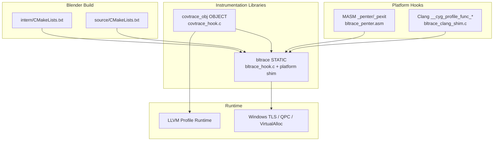
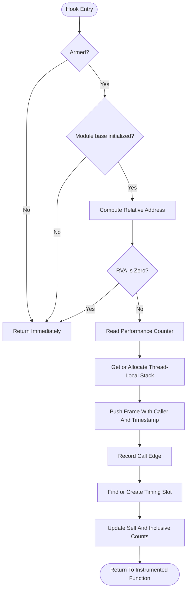
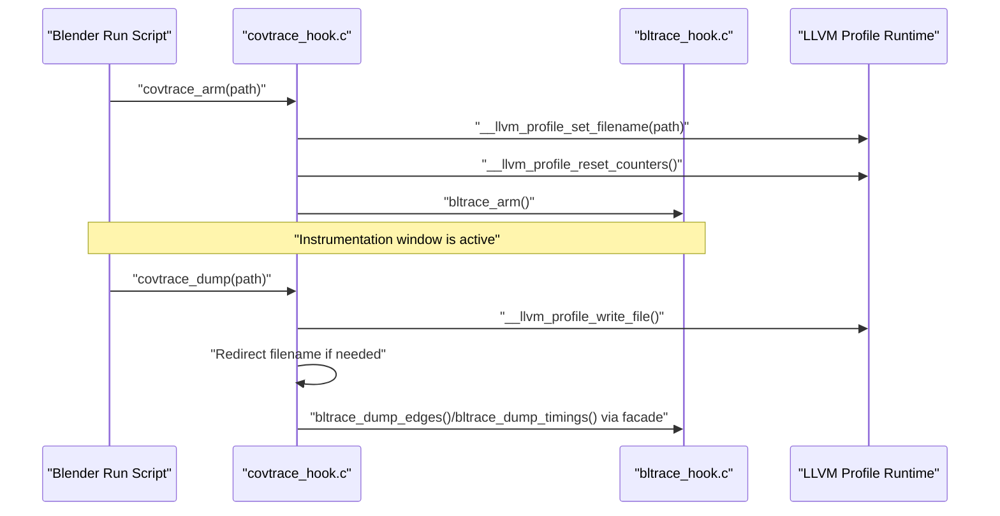
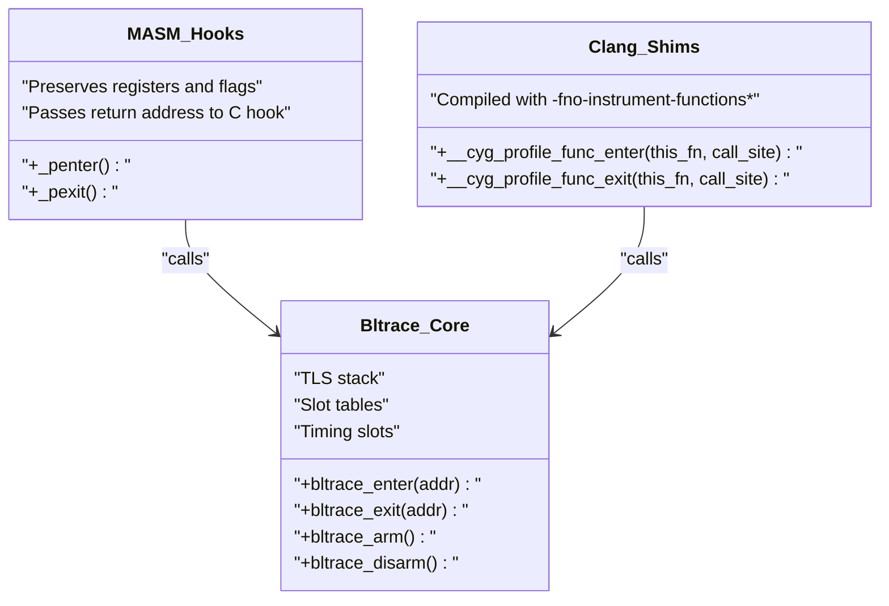
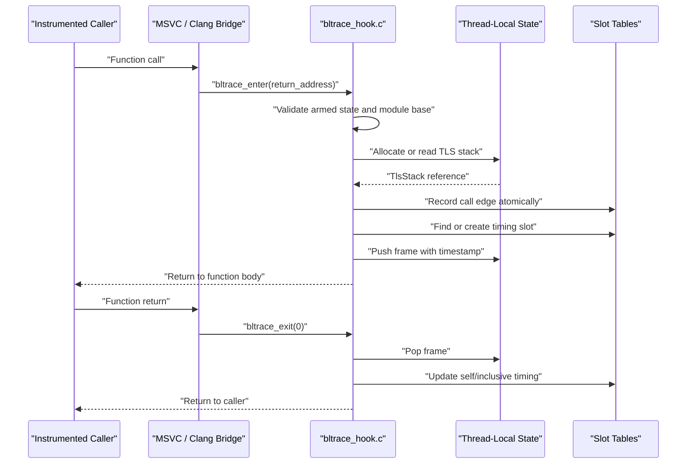
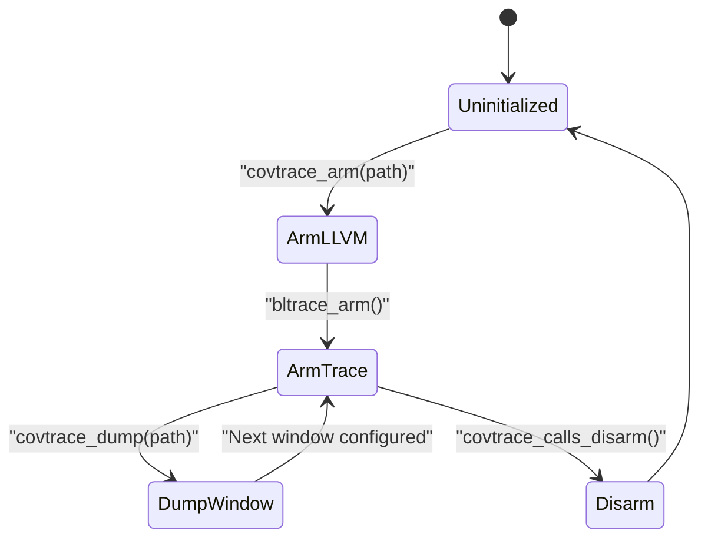
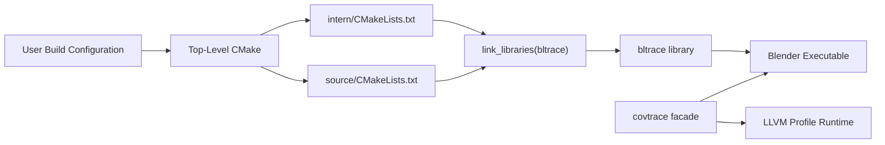
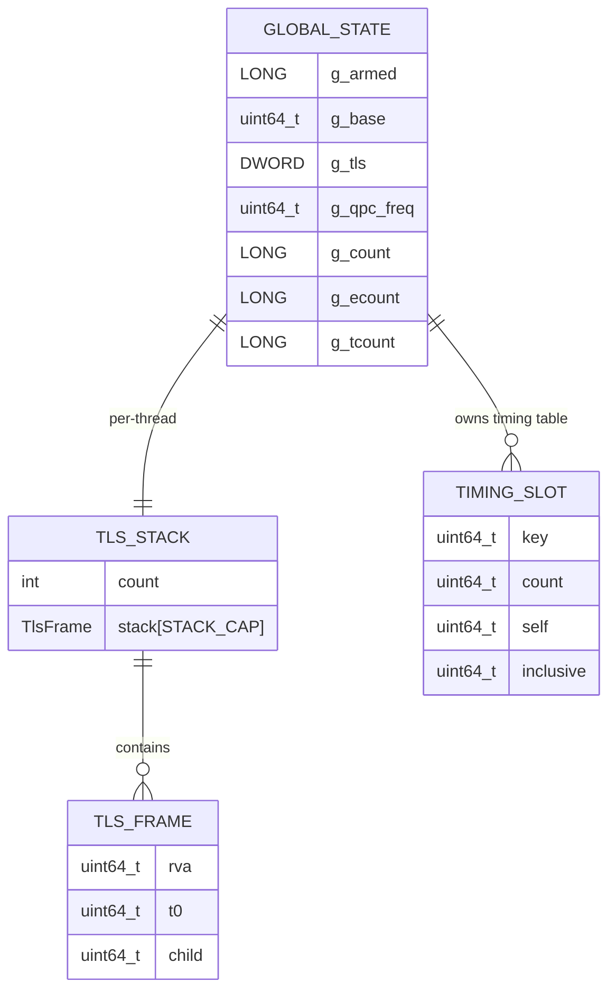
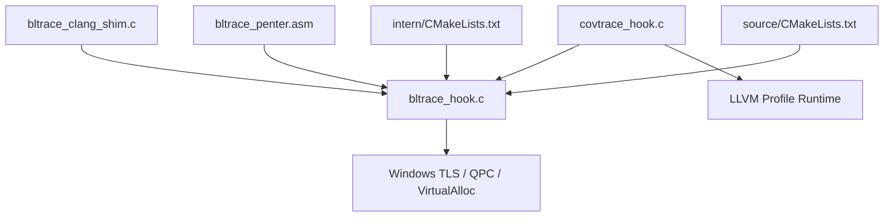

# Architecture Overview

<cite>
**Referenced Files in This Document**
- [bltrace_hook.c](file://bltrace/bltrace_hook.c)
- [bltrace_clang_shim.c](file://bltrace/bltrace_clang_shim.c)
- [bltrace_penter.asm](file://bltrace/bltrace_penter.asm)
- [CMakeLists.txt](file://bltrace/CMakeLists.txt)
- [covtrace_hook.c](file://covtrace/covtrace_hook.c)
- [CMakeLists.txt](file://covtrace/CMakeLists.txt)
- [CMakeLists.txt](file://intern/CMakeLists.txt)
- [CMakeLists.txt](file://source/CMakeLists.txt)
</cite>

## Table of Contents
1. [Introduction](#introduction)
2. [Project Structure](#project-structure)
3. [Core Components](#core-components)
4. [Architecture Overview](#architecture-overview)
5. [Detailed Component Analysis](#detailed-component-analysis)
6. [Dependency Analysis](#dependency-analysis)
7. [Performance Considerations](#performance-considerations)
8. [Troubleshooting Guide](#troubleshooting-guide)
9. [Conclusion](#conclusion)

## Introduction
The Blender Build Instrumentation Extension provides two complementary views into Blender’s runtime behavior:

- **Function call tracing**, implemented by `bltrace`, records which functions are called, their call/return edges, per-function timing, and thread-local execution state.
- **Coverage window control**, implemented by `covtrace`, exposes a stable API for scripts to configure LLVM profile-instrumentation output and coordinate windowed dumps with the underlying coverage runtime.

The design deliberately separates these concerns. `bltrace` owns the low-level interception logic and shared data structures; `covtrace` is a thin facade that translates run-script requests into calls against `bltrace` and the LLVM coverage runtime. The toolchain abstraction layer lets MSVC `/Gh` hooks and Clang `-finstrument-functions` share the same core implementation.

## Project Structure
At build time, CMake selects the appropriate hook path:

| Toolchain | Hook mechanism | Build configuration |
|---|---|---|
| MSVC (non-Clang) | MASM-generated `_penter` / `_pexit` stubs linked through `/Gh` / `/GH` | `bltrace_penter.asm` assembled into an external object |
| Clang | Compiler-generated `__cyg_profile_func_enter` / `__cyg_profile_func_exit` shims | `bltrace_clang_shim.c` compiled with `-fno-instrument-functions*` |
| Coverage script interface | `covtrace` exports `covtrace_arm` / `covtrace_dump` | Object library with coverage instrumentation disabled |

**Diagram sources**
- [CMakeLists.txt:1-49](file://bltrace/CMakeLists.txt#L1-L49)
- [CMakeLists.txt:1-14](file://covtrace/CMakeLists.txt#L1-L14)
- [CMakeLists.txt:1-20](file://intern/CMakeLists.txt#L1-L20)
- [CMakeLists.txt:1-29](file://source/CMakeLists.txt#L1-L29)

**Section sources**
- [CMakeLists.txt:1-49](file://bltrace/CMakeLists.txt#L1-L49)
- [CMakeLists.txt:1-14](file://covtrace/CMakeLists.txt#L1-L14)
- [CMakeLists.txt:1-20](file://intern/CMakeLists.txt#L1-L20)
- [CMakeLists.txt:1-29](file://source/CMakeLists.txt#L1-L29)

## Core Components

### bltrace: Core Tracing Library
`bltrace_hook.c` is the single shared tracing core. It implements:

- Global armed/disarmed state and initialization.
- Lock-free slot tables for function-call counts and edge recording.
- A fixed-capacity thread-local stack tracking active function frames.
- Per-slot timing accumulation using high-resolution performance counters.
- Public export functions used by both the coverage facade and dump interfaces.

Key responsibilities:
- **Arming**: Allocates slot tables, timing buffers, and TLS storage on first use.
- **Entry interception**: Computes module-relative address, pushes a frame onto the TLS stack, updates timing state, and records call edges.
- **Exit interception**: Pops the TLS frame, updates inclusive/self timing, and avoids recording return edges from the exit hook itself.
- **Slot management**: Uses linear probing with atomic compare-and-swap operations for contention-free insertion.

**Diagram sources**
- [bltrace_hook.c:1-200](file://bltrace/bltrace_hook.c#L1-L200)

**Section sources**
- [bltrace_hook.c:1-200](file://bltrace/bltrace_hook.c#L1-L200)

### covtrace: Coverage API Facade
`covtrace_hook.c` does not reimplement tracing. It:

- Exposes `covtrace_arm` and `covtrace_dump` as entry points callable from Blender’s run script.
- Delegates call-trace lifecycle to `bltrace_arm`, `bltrace_reset`, `bltrace_dump`, `bltrace_disarm`, and related helpers.
- Configures and writes the LLVM profile-instrumentation output file.
- Prevents the coverage window from being overwritten by redirecting the atexit-written file after an explicit dump.

This separation makes it possible to change the underlying coverage runtime or tracing implementation without forcing the run script to understand compiler-specific details.

**Diagram sources**
- [covtrace_hook.c:1-85](file://covtrace/covtrace_hook.c#L1-L85)

**Section sources**
- [covtrace_hook.c:1-85](file://covtrace/covtrace_hook.c#L1-L85)

## Architecture Overview

### Bridge Pattern for Toolchain Abstraction
The bridge pattern isolates platform-specific hook injection from the shared tracing core:

| Platform | Bridge Layer | Shared Core |
|---|---|---|
| MSVC with `/Gh` / `/GH` | `_penter` / `_pexit` stubs in `bltrace_penter.asm` | `bltrace_enter` / `bltrace_exit` |
| Clang with `-finstrument-functions` | `__cyg_profile_func_enter` / `__cyg_profile_func_exit` in `bltrace_clang_shim.c` | `bltrace_enter` / `bltrace_exit` |

Both bridges deliver the same contract:

- On function entry, pass the function entry address to `bltrace_enter`.
- On function exit, invoke `bltrace_exit` with a neutral pointer.
- Preserve caller registers, flags, and stack alignment.
- Avoid recursive instrumentation by disabling instrumentation inside the bridge translation units.

**Diagram sources**
- [bltrace_penter.asm:1-108](file://bltrace/bltrace_penter.asm#L1-L108)
- [bltrace_clang_shim.c:1-27](file://bltrace/bltrace_clang_shim.c#L1-L27)
- [bltrace_hook.c:1-200](file://bltrace/bltrace_hook.c#L1-L200)

**Section sources**
- [bltrace_penter.asm:1-108](file://bltrace/bltrace_penter.asm#L1-L108)
- [bltrace_clang_shim.c:1-27](file://bltrace/bltrace_clang_shim.c#L1-L27)
- [bltrace_hook.c:1-200](file://bltrace/bltrace_hook.c#L1-L200)

### Data Flow From Function Calls Through Hook Interception
The complete call-path flow is:

1. An instrumented function is called.
2. MSVC inserts a call to `_penter`; Clang inserts a call to `__cyg_profile_func_enter`.
3. The platform bridge computes the caller’s return address and invokes `bltrace_enter`.
4. `bltrace_enter` converts the address to a module-relative value, initializes TLS state if necessary, pushes a frame, records the call edge, and updates timing.
5. The instrumented function executes.
6. On return, MSVC calls `_pexit`; Clang calls `__cyg_profile_func_exit`.
7. The bridge invokes `bltrace_exit`, which pops the TLS frame and updates inclusive/self timing.

**Diagram sources**
- [bltrace_penter.asm:1-108](file://bltrace/bltrace_penter.asm#L1-L108)
- [bltrace_clang_shim.c:1-27](file://bltrace/bltrace_clang_shim.c#L1-L27)
- [bltrace_hook.c:1-200](file://bltrace/bltrace_hook.c#L1-L200)

**Section sources**
- [bltrace_penter.asm:1-108](file://bltrace/bltrace_penter.asm#L1-L108)
- [bltrace_clang_shim.c:1-27](file://bltrace/bltrace_clang_shim.c#L1-L27)
- [bltrace_hook.c:1-200](file://bltrace/bltrace_hook.c#L1-L200)

### Coordination Between Function Tracing and LLVM Coverage Runtime
`covtrace` coordinates two independent measurement systems:

- **Call tracing**: Managed entirely by `bltrace`.
- **Coverage profiling**: Managed by the LLVM profile runtime through `__llvm_profile_*` symbols.

The coordination model is sequential rather than tightly coupled:

- `covtrace_arm` configures the LLVM output path and resets its counters before enabling `bltrace`.
- `covtrace_dump` flushes the LLVM profile file, optionally reconfigures the next output path, and delegates trace dumping to `bltrace`.
- The run script controls when windows open and close; the libraries themselves do not schedule window boundaries.

**Diagram sources**
- [covtrace_hook.c:1-85](file://covtrace/covtrace_hook.c#L1-L85)

**Section sources**
- [covtrace_hook.c:1-85](file://covtrace/covtrace_hook.c#L1-L85)

### System Boundaries
The instrumentation extension integrates with Blender at three levels:

| Boundary | Integration Point | Purpose |
|---|---|---|
| Build system | `intern/CMakeLists.txt` and `source/CMakeLists.txt` | Adds `/Gh` / `/GH` or `-finstrument-functions-after-inlining` and links `bltrace` |
| Toolchain | MSVC assembler and Clang frontend | Generates or routes to hook entry points |
| Application lifecycle | `covtrace` exports | Allows run-time scripts to start, reset, dump, and stop the instrumentation window |

**Diagram sources**
- [CMakeLists.txt:1-20](file://intern/CMakeLists.txt#L1-L20)
- [CMakeLists.txt:1-29](file://source/CMakeLists.txt#L1-L29)
- [CMakeLists.txt:1-49](file://bltrace/CMakeLists.txt#L1-L49)
- [covtrace_hook.c:1-85](file://covtrace/covtrace_hook.c#L1-L85)

**Section sources**
- [CMakeLists.txt:1-20](file://intern/CMakeLists.txt#L1-L20)
- [CMakeLists.txt:1-29](file://source/CMakeLists.txt#L1-L29)
- [CMakeLists.txt:1-49](file://bltrace/CMakeLists.txt#L1-L49)
- [covtrace_hook.c:1-85](file://covtrace/covtrace_hook.c#L1-L85)

## Detailed Component Analysis

### bltrace Hook Core
The core is centered around three data regions:

1. **Call slot table**: Fixed-size array indexed by hash with linear probing. Each slot stores a key representing a function entry point.
2. **Edge slot table**: Separate fixed-size table storing packed caller/callee pairs.
3. **Timing slot table**: Hash table mapping function keys to timing records containing count, self time, and inclusive time.

Shared global state includes:

- `g_armed`: Atomic flag controlling whether hooks perform work.
- `g_base`: Module base address used to convert absolute addresses to relative virtual addresses.
- `g_tls`: TLS index for per-thread frame stacks.
- `g_qpc_freq`: High-resolution timer frequency cached once.

**Diagram sources**
- [bltrace_hook.c:1-200](file://bltrace/bltrace_hook.c#L1-L200)

#### Initialization and Arming
`bltrace_arm` performs lazy allocation:

- Initializes the module base.
- Allocates call and edge slot tables.
- Allocates the timing slot table.
- Reads the performance counter frequency.
- Allocates a TLS index.
- Sets the armed flag atomically.

This allows the application to start without immediately paying memory-allocation costs.

**Section sources**
- [bltrace_hook.c:1-200](file://bltrace/bltrace_hook.c#L1-L200)

#### Lock-Free Slot Allocation
The `claim` helper uses a hash-derived starting position and iterates up to the table mask size. For each slot, it performs an atomic compare-and-swap against zero:

- If the slot is empty, the value is claimed.
- If the slot already contains the same value, the caller returns success without duplicate insertion.
- If another value occupies the slot, probing continues.

This avoids locks but can degrade under extreme hash collisions or near-full tables.

**Section sources**
- [bltrace_hook.c:1-200](file://bltrace/bltrace_hook.c#L1-L200)

#### Timing Slot Lookup
Timing lookup is separate from simple slot claiming because timing records carry mutable counters. It:

- Computes the same hash-based index.
- Returns an existing slot when the key matches.
- Uses an atomic CAS to claim an empty slot only once.
- Increments the global timing record count when a new slot is successfully reserved.
- Falls back to `NULL` if no free timing slot is found.

**Section sources**
- [bltrace_hook.c:1-200](file://bltrace/bltrace_hook.c#L1-L200)

#### Thread-Local Stack Management
Each thread has a lazily allocated `TlsStack` structure. The stack:

- Tracks the current nesting depth.
- Stores per-frame relative virtual addresses, timestamps, and child timing information.
- Is allocated with `VirtualAlloc` when missing from TLS storage.
- Is read-only during normal hook processing except for push/pop operations within a single thread context.

This keeps call-stack state per-thread while avoiding global mutex overhead.

**Section sources**
- [bltrace_hook.c:1-200](file://bltrace/bltrace_hook.c#L1-L200)

### MASM Hook Stubs
`bltrace_penter.asm` implements the MSVC bridge. Its responsibilities include:

- Preserving all general-purpose and XMM registers.
- Saving and restoring RFLAGS.
- Maintaining 16-byte stack alignment.
- Extracting the caller’s return address from the stack frame created by MSVC’s `/Gh` hook.
- Calling `bltrace_enter` and `bltrace_exit`.

Because the stubs are compiled separately and marked as external/generated objects, they avoid polluting C++ compilation units with assembly and allow MSVC-specific behavior without affecting Clang builds.

**Section sources**
- [bltrace_penter.asm:1-108](file://bltrace/bltrace_penter.asm#L1-L108)

### Clang Shim
`bltrace_clang_shim.c` adapts Clang’s `-finstrument-functions` ABI to the shared core:

- `__cyg_profile_func_enter` forwards `this_fn` directly to `bltrace_enter`.
- `__cyg_profile_func_exit` calls `bltrace_exit` with a null-like argument.
- The translation unit is compiled with `-fno-instrument-functions` and `-fno-instrument-functions-after-inlining` to prevent recursion.
- It also disables LLVM profile instrumentation and coverage mapping when code coverage is enabled, keeping the shim out of coverage metrics.

**Section sources**
- [bltrace_clang_shim.c:1-27](file://bltrace/bltrace_clang_shim.c#L1-L27)
- [CMakeLists.txt:1-49](file://bltrace/CMakeLists.txt#L1-L49)

### Coverage Facade
`covtrace_hook.c` acts as the public boundary between Blender’s run-time control and the instrumentation libraries:

- `covtrace_calls_*` functions forward to corresponding `bltrace_*` helpers.
- `covtrace_arm` sets the LLVM profile output file and resets LLVM counters.
- `covtrace_dump` writes the LLVM profile file and reconfigures the destination so later atexit writes do not overwrite the captured window.
- Exported symbols are declared explicitly so the run script can locate them independently of how `bltrace` is linked.

**Section sources**
- [covtrace_hook.c:1-85](file://covtrace/covtrace_hook.c#L1-L85)

## Dependency Analysis

**Diagram sources**
- [bltrace_hook.c:1-200](file://bltrace/bltrace_hook.c#L1-L200)
- [bltrace_clang_shim.c:1-27](file://bltrace/bltrace_clang_shim.c#L1-L27)
- [bltrace_penter.asm:1-108](file://bltrace/bltrace_penter.asm#L1-L108)
- [covtrace_hook.c:1-85](file://covtrace/covtrace_hook.c#L1-L85)
- [CMakeLists.txt:1-20](file://intern/CMakeLists.txt#L1-L20)
- [CMakeLists.txt:1-29](file://source/CMakeLists.txt#L1-L29)

### Coupling and Cohesion
- `bltrace_hook.c` is cohesive around tracing state and data structures.
- `bltrace_clang_shim.c` and `bltrace_penter.asm` are intentionally small, platform-specific adapters.
- `covtrace_hook.c` is a thin facade with minimal logic beyond forwarding and LLVM runtime calls.
- External coupling is limited to Windows APIs, LLVM profile runtime symbols, and CMake-defined build options.

### Potential Circular Dependencies
There is no circular dependency among the instrumentation modules:

- `covtrace` depends on `bltrace`.
- `bltrace` depends only on Windows APIs.
- Neither `bltrace` nor `covtrace` depends on Blender application code.

**Section sources**
- [bltrace_hook.c:1-200](file://bltrace/bltrace_hook.c#L1-L200)
- [bltrace_clang_shim.c:1-27](file://bltrace/bltrace_clang_shim.c#L1-L27)
- [bltrace_penter.asm:1-108](file://bltrace/bltrace_penter.asm#L1-L108)
- [covtrace_hook.c:1-85](file://covtrace/covtrace_hook.c#L1-L85)

## Performance Considerations

### Lock-Free Design
The slot tables avoid mutexes by using atomic compare-and-swap operations. This reduces contention in multi-threaded scenarios but introduces trade-offs:

- Linear probing can scan many slots under collision pressure.
- Near-full tables may fail to insert values even when empty slots exist elsewhere.
- Timing slot creation uses CAS to ensure only one thread claims a newly discovered empty slot.

### Memory Layout
- Slot tables use fixed sizes (`SLOT_COUNT`, `TIME_SLOT_COUNT`) to avoid dynamic resizing during hot paths.
- TLS stacks are lazily allocated per thread and bounded by `STACK_CAP`.
- Global resources are allocated once on first arm, minimizing startup cost for non-instrumented runs.

### Timer Resolution
Timing uses Windows Query Performance Counter, with frequency cached once. This avoids repeated frequency queries in hot paths.

### Hook Overhead Controls
- The Clang shim and coverage object disable function instrumentation and coverage mapping to prevent recursive instrumentation and self-count pollution.
- The MSVC build excludes generated MASM objects from standard C/C++ definition contexts.

**Section sources**
- [bltrace_hook.c:1-200](file://bltrace/bltrace_hook.c#L1-L200)
- [bltrace_clang_shim.c:1-27](file://bltrace/bltrace_clang_shim.c#L1-L27)
- [CMakeLists.txt:1-49](file://bltrace/CMakeLists.txt#L1-L49)
- [CMakeLists.txt:1-14](file://covtrace/CMakeLists.txt#L1-L14)

## Troubleshooting Guide

### Symptom: No Traces Recorded
Likely causes:

- The instrumentation was never armed.
- The process was built without `/Gh` / `/GH` or `-finstrument-functions-after-inlining`.
- The module base was not initialized before the first hook.

Checks:

- Verify that `bltrace_arm` is called before any traced function executes.
- Confirm that the selected toolchain adds the correct compiler option and links `bltrace`.
- Ensure the executable is not stripped in a way that removes exported symbols required by the facade.

**Section sources**
- [CMakeLists.txt:1-20](file://intern/CMakeLists.txt#L1-L20)
- [CMakeLists.txt:1-29](file://source/CMakeLists.txt#L1-L29)
- [bltrace_hook.c:1-200](file://bltrace/bltrace_hook.c#L1-L200)

### Symptom: Crash Inside Hook
Likely causes:

- Corrupted TLS state due to mismatched entry/exit semantics.
- Recursive instrumentation caused by enabling instrumentation inside the bridge.
- Stack corruption from incorrect register or alignment handling in custom hook code.

Checks:

- Confirm the Clang shim and coverage object are compiled with instrumentation disabled.
- Do not modify the MASM stubs unless preserving all registers, flags, and 16-byte alignment.
- Validate that every entry path eventually reaches a matching exit path.

**Section sources**
- [bltrace_clang_shim.c:1-27](file://bltrace/bltrace_clang_shim.c#L1-L27)
- [bltrace_penter.asm:1-108](file://bltrace/bltrace_penter.asm#L1-L108)
- [CMakeLists.txt:1-49](file://bltrace/CMakeLists.txt#L1-L49)
- [CMakeLists.txt:1-14](file://covtrace/CMakeLists.txt#L1-L14)

### Symptom: LLVM Profile File Overwritten
Likely causes:

- Multiple windows are writing to the same output path.
- The atexit writer runs after the desired window dump.

Resolution:

- Use `covtrace_dump` to write the current window and then set a different filename for subsequent output.
- Avoid calling LLVM profile functions directly from user code while the facade manages the window.

**Section sources**
- [covtrace_hook.c:1-85](file://covtrace/covtrace_hook.c#L1-L85)

### Symptom: Missing Timing Records
Likely causes:

- Timing slot table is full.
- Timing slot reservation failed under contention.
- The timing table was not allocated because arming did not allocate it.

Resolution:

- Reduce concurrent unique function count or increase timing slot capacity if modifying internals.
- Ensure `bltrace_arm` completes before measuring timing.

**Section sources**
- [bltrace_hook.c:1-200](file://bltrace/bltrace_hook.c#L1-L200)

## Conclusion
The Blender Build Instrumentation Extension cleanly separates platform-specific hook injection from shared tracing logic and exposes a stable coverage-control facade. `bltrace` owns the critical path data structures and thread-local state, while `covtrace` coordinates those structures with the LLVM coverage runtime. The bridge pattern enables MSVC and Clang to share the same core without duplicating tracing logic, and the CMake configuration ensures the correct hook path is selected at build time.

For maintainers, the most important boundaries are:

- Keep platform-specific hook code outside `bltrace_hook.c`.
- Treat `covtrace` as the public API surface for run-time control.
- Preserve lock-free assumptions, TLS semantics, and hook ABI contracts.
- Disable instrumentation inside bridge and facade translation units to avoid recursion and self-pollution.