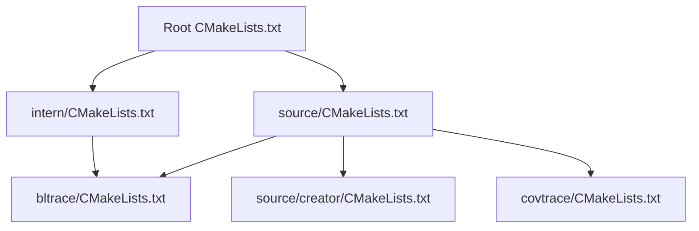
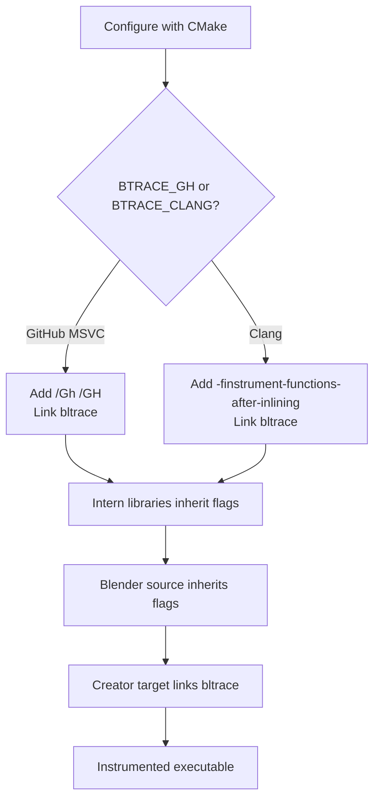
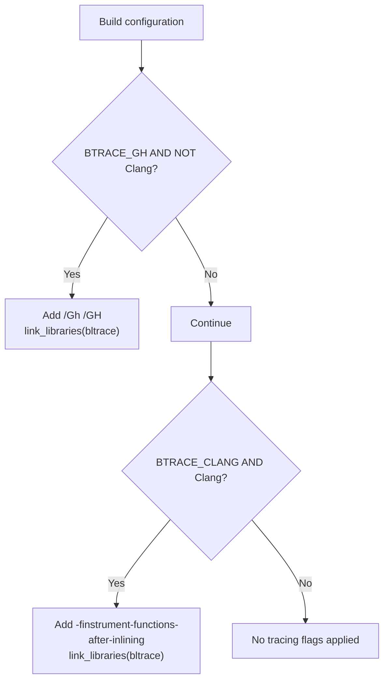
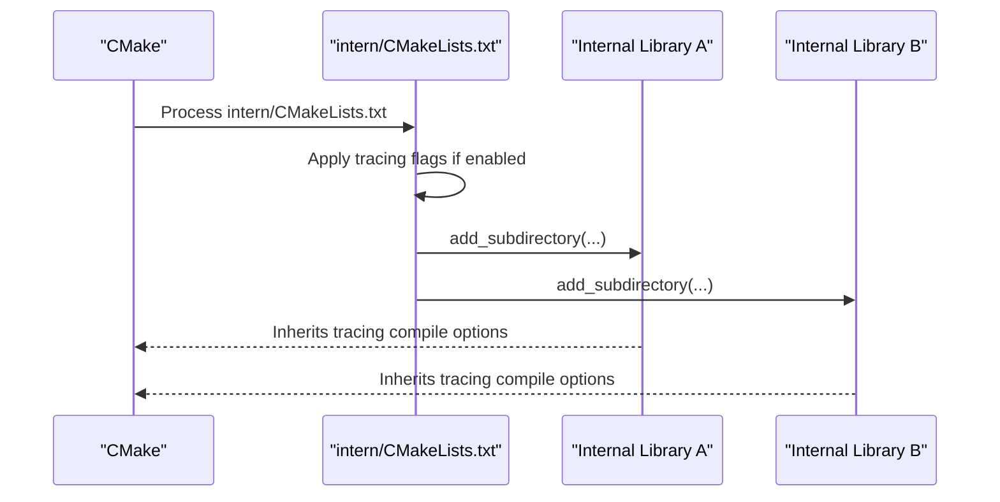
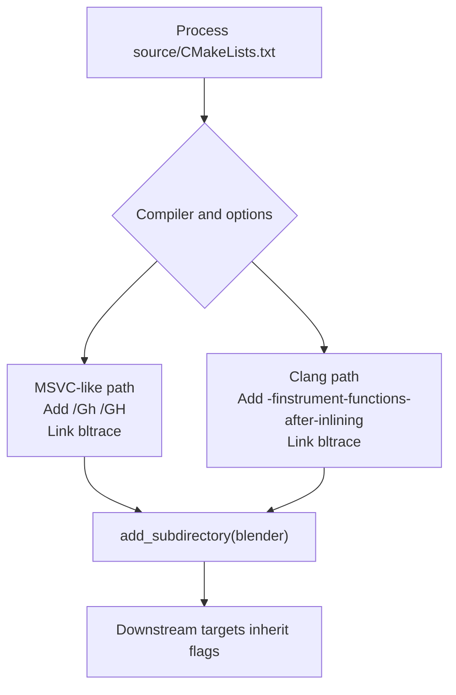
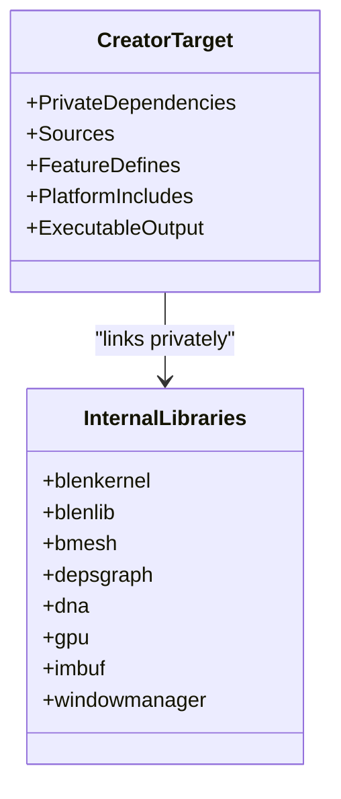
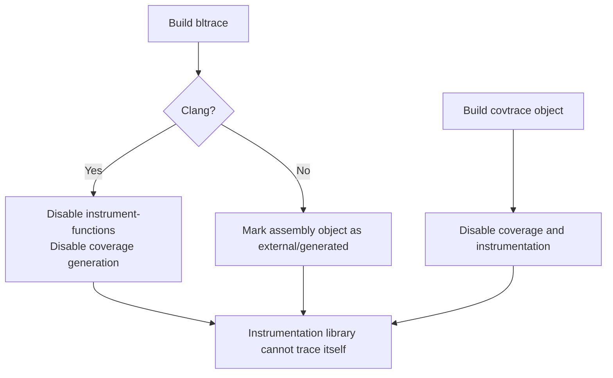
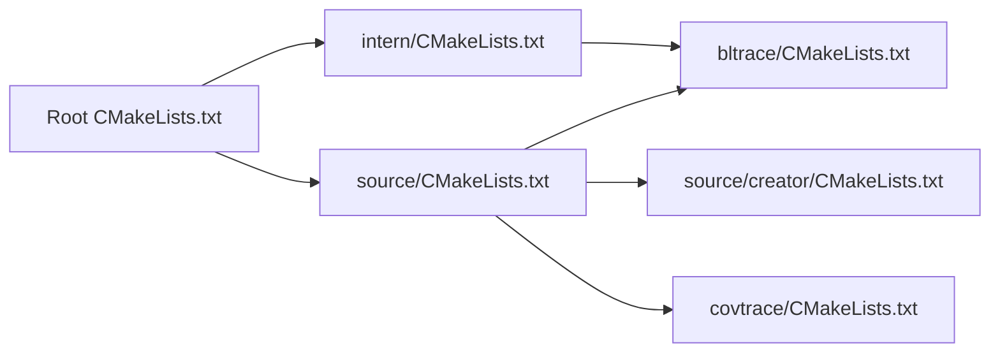
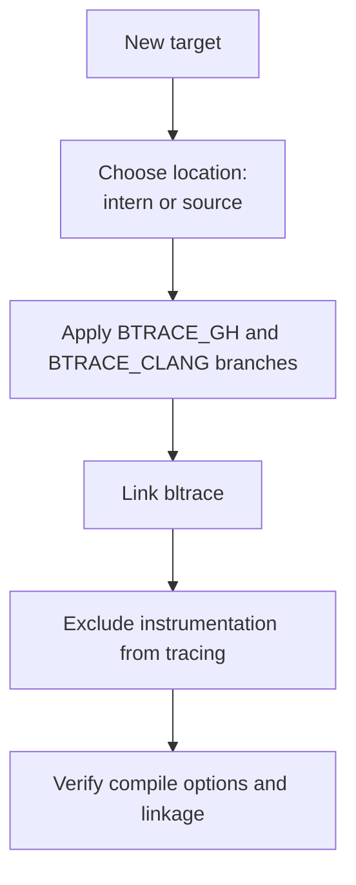

# Build System Integration

<cite>
**Referenced Files in This Document**   
- [CMakeLists.txt](file://CMakeLists.txt)
- [intern/CMakeLists.txt](file://intern/CMakeLists.txt)
- [source/CMakeLists.txt](file://source/CMakeLists.txt)
- [source/creator/CMakeLists.txt](file://source/creator/CMakeLists.txt)
- [bltrace/CMakeLists.txt](file://bltrace/CMakeLists.txt)
- [covtrace/CMakeLists.txt](file://covtrace/CMakeLists.txt)
</cite>

## Table of Contents
1. [Introduction](#introduction)
2. [Project Structure](#project-structure)
3. [Core Components](#core-components)
4. [Architecture Overview](#architecture-overview)
5. [Detailed Component Analysis](#detailed-component-analysis)
6. [Dependency Analysis](#dependency-analysis)
7. [Performance Considerations](#performance-considerations)
8. [Troubleshooting Guide](#troubleshooting-guide)
9. [Extending the Build Integration](#extending-the-build-integration)
10. [Conclusion](#conclusion)

## Introduction
This document explains how Blender’s CMake build system integrates tracing and instrumentation support for both GitHub Actions and Clang-based builds. It focuses on:

- How tracing flags propagate from the root CMake configuration through `intern` and `source`.
- How the creator target links against the instrumentation libraries.
- The roles of the `BTRACE_GH` and `BTRACE_CLANG` options.
- How the build prevents instrumentation code from being traced, avoiding infinite recursion.
- Guidance for adding new targets or custom instrumentation configurations.

The pattern is deliberately layered: global CMake logic selects compiler-specific instrumentation behavior, internal modules inherit it broadly, and the application executable explicitly links the instrumentation library.

## Project Structure
At a high level, the repository contains:

- A top-level CMake entry point that initializes policies, project metadata, output directories, and includes shared macros.
- An `intern` layer containing shared libraries and third-party components.
- A `source` layer containing user-facing applications, including the main Blender executable.
- Dedicated instrumentation subprojects under `bltrace` and `covtrace`.

**Diagram sources**
- [CMakeLists.txt:1-200](file://CMakeLists.txt#L1-L200)
- [intern/CMakeLists.txt:1-89](file://intern/CMakeLists.txt#L1-L89)
- [source/CMakeLists.txt:1-29](file://source/CMakeLists.txt#L1-L29)
- [source/creator/CMakeLists.txt:1-50](file://source/creator/CMakeLists.txt#L1-L50)
- [bltrace/CMakeLists.txt:1-49](file://bltrace/CMakeLists.txt#L1-L49)
- [covtrace/CMakeLists.txt:1-14](file://covtrace/CMakeLists.txt#L1-L14)

**Section sources**
- [CMakeLists.txt:1-200](file://CMakeLists.txt#L1-L200)

## Core Components
The build integration centers around four areas:

1. **Global CMake initialization:** Sets policies, project name, output paths, and includes shared macros.
2. **Tracing option handling:** Detects whether GitHub Actions tracing or Clang instrumentation should be enabled.
3. **Propagation to internal modules:** Applies compiler flags and links the instrumentation library across internal libraries.
4. **Application linking:** Ensures the final executable links the instrumentation library and uses the same conditional compilation path.

Key behaviors:

- `BTRACE_GH` enables Microsoft Visual C++ tracing flags (`/Gh /GH`) and links `bltrace`, but only when the compiler is not Clang.
- `BTRACE_CLANG` enables Clang instrumentation flags (`-finstrument-functions-after-inlining`) and links `bltrace`, but only when the compiler is Clang.
- Both branches link the `bltrace` static library so generated trace hooks can resolve at link time.
- The `bltrace` library itself disables instrumentation and coverage collection to avoid self-tracing.
- Coverage control objects in `covtrace` also disable instrumentation and coverage collection.

**Section sources**
- [CMakeLists.txt:1-200](file://CMakeLists.txt#L1-L200)
- [intern/CMakeLists.txt:1-20](file://intern/CMakeLists.txt#L1-L20)
- [source/CMakeLists.txt:1-20](file://source/CMakeLists.txt#L1-L20)
- [bltrace/CMakeLists.txt:1-49](file://bltrace/CMakeLists.txt#L1-L49)
- [covtrace/CMakeLists.txt:1-14](file://covtrace/CMakeLists.txt#L1-L14)

## Architecture Overview
The tracing integration follows a clear propagation chain.

**Diagram sources**
- [intern/CMakeLists.txt:1-20](file://intern/CMakeLists.txt#L1-L20)
- [source/CMakeLists.txt:1-20](file://source/CMakeLists.txt#L1-L20)
- [source/creator/CMakeLists.txt:1-50](file://source/creator/CMakeLists.txt#L1-L50)

## Detailed Component Analysis

### Tracing Options: BTRACE_GH and BTRACE_CLANG
The two options control which compiler instrumentation path is used:

- **BTRACE_GH:** Targets non-Clang compilers, typically Visual Studio toolchains. It adds `/Gh /GH` and links `bltrace`.
- **BTRACE_CLANG:** Targets Clang compilers. It adds `-finstrument-functions-after-inlining` and links `bltrace`.

Both conditions also check the active compiler ID to ensure the correct flags are applied.

**Diagram sources**
- [intern/CMakeLists.txt:1-20](file://intern/CMakeLists.txt#L1-L20)
- [source/CMakeLists.txt:1-20](file://source/CMakeLists.txt#L1-L20)

**Section sources**
- [intern/CMakeLists.txt:1-20](file://intern/CMakeLists.txt#L1-L20)
- [source/CMakeLists.txt:1-20](file://source/CMakeLists.txt#L1-L20)

### Propagation Through Internal Modules
The `intern` module applies tracing flags and links `bltrace` before adding its own subdirectories. Because `add_subdirectory` is called after these settings, all subsequent internal libraries inherit the same compile options and linkage unless overridden later.

**Diagram sources**
- [intern/CMakeLists.txt:1-20](file://intern/CMakeLists.txt#L1-L20)
- [intern/CMakeLists.txt:20-89](file://intern/CMakeLists.txt#L20-L89)

**Section sources**
- [intern/CMakeLists.txt:1-89](file://intern/CMakeLists.txt#L1-L89)

### Propagation Through Source Modules
The `source` module repeats the same conditional logic as `intern`:

- If `BTRACE_GH` is set and the compiler is not Clang, it adds `/Gh /GH` and links `bltrace`.
- If `BTRACE_CLANG` is set and the compiler is Clang, it adds `-finstrument-functions-after-inlining` and links `bltrace`.
- It then adds the `blender` application subdirectory, allowing downstream targets to inherit the instrumentation configuration.

**Diagram sources**
- [source/CMakeLists.txt:1-20](file://source/CMakeLists.txt#L1-L20)
- [source/CMakeLists.txt:20-29](file://source/CMakeLists.txt#L20-L29)

**Section sources**
- [source/CMakeLists.txt:1-29](file://source/CMakeLists.txt#L1-L29)

### Creator Target Linking Against Instrumentation Libraries
The creator target is the application target that links against many internal libraries and defines the final executable. Its CMake file shows:

- A list of private dependencies, such as `bf::blenkernel`, `bf::blenlib`, `bf::bmesh`, `bf::depsgraph`, `bf::dna`, `bf::gpu`, `bf::imbuf`, `bf::windowmanager`, and others.
- Feature-driven definitions and include paths.
- Conditional inclusion of platform-specific sources and resources.
- Optional features like Python, USD, cycles, OpenGL backend, Vulkan backend, and more.

Although tracing-related compile options are inherited from `source/CMakeLists.txt`, the creator target remains the primary consumer of those options because it is the final executable linked by the build.

**Diagram sources**
- [source/creator/CMakeLists.txt:1-50](file://source/creator/CMakeLists.txt#L1-L50)

**Section sources**
- [source/creator/CMakeLists.txt:1-50](file://source/creator/CMakeLists.txt#L1-L50)

### Excluding Instrumentation Code From Being Traced
To prevent infinite recursion, the instrumentation libraries themselves must not generate trace hooks.

The `bltrace` library:

- Creates a static library named `bltrace`.
- On Clang, compiles additional shim sources and disables function instrumentation and line coverage for the library.
- On non-Clang platforms, treats the assembled object as an external generated artifact.

The `covtrace` object library:

- Builds `covtrace_hook.c` as an object library.
- Disables profile instrumentation, coverage mapping, and function instrumentation to avoid counting itself.

**Diagram sources**
- [bltrace/CMakeLists.txt:1-49](file://bltrace/CMakeLists.txt#L1-L49)
- [covtrace/CMakeLists.txt:1-14](file://covtrace/CMakeLists.txt#L1-L14)

**Section sources**
- [bltrace/CMakeLists.txt:1-49](file://bltrace/CMakeLists.txt#L1-L49)
- [covtrace/CMakeLists.txt:1-14](file://covtrace/CMakeLists.txt#L1-L14)

## Dependency Analysis
The build dependencies for tracing form a small directed graph:

- The root CMake configuration initializes the project and includes shared macros.
- `intern/CMakeLists.txt` applies tracing flags early and adds internal libraries.
- `source/CMakeLists.txt` applies tracing flags and adds the Blender application.
- `source/creator/CMakeLists.txt` defines the executable target and links internal libraries.
- `bltrace/CMakeLists.txt` builds the instrumentation static library.
- `covtrace/CMakeLists.txt` builds a coverage-control object library.

**Diagram sources**
- [CMakeLists.txt:1-200](file://CMakeLists.txt#L1-L200)
- [intern/CMakeLists.txt:1-89](file://intern/CMakeLists.txt#L1-L89)
- [source/CMakeLists.txt:1-29](file://source/CMakeLists.txt#L1-L29)
- [source/creator/CMakeLists.txt:1-50](file://source/creator/CMakeLists.txt#L1-L50)
- [bltrace/CMakeLists.txt:1-49](file://bltrace/CMakeLists.txt#L1-L49)
- [covtrace/CMakeLists.txt:1-14](file://covtrace/CMakeLists.txt#L1-L14)

**Section sources**
- [CMakeLists.txt:1-200](file://CMakeLists.txt#L1-L200)
- [intern/CMakeLists.txt:1-89](file://intern/CMakeLists.txt#L1-L89)
- [source/CMakeLists.txt:1-29](file://source/CMakeLists.txt#L1-L29)
- [source/creator/CMakeLists.txt:1-50](file://source/creator/CMakeLists.txt#L1-L50)
- [bltrace/CMakeLists.txt:1-49](file://bltrace/CMakeLists.txt#L1-L49)
- [covtrace/CMakeLists.txt:1-14](file://covtrace/CMakeLists.txt#L1-L14)

## Performance Considerations
Instrumentation changes the compiled code and runtime behavior:

- Function instrumentation inserts callbacks around functions, increasing call overhead.
- Coverage instrumentation collects execution counts and may alter control flow.
- Linking additional libraries increases binary size and startup cost.
- Self-tracing would cause recursive calls, stack growth, and potential deadlocks or performance collapse.

The current design avoids the worst case by disabling instrumentation inside the instrumentation libraries themselves. When enabling tracing for development or CI workflows, expect slower builds and slower runtime execution compared to a normal release build.

[No sources needed since this section provides general guidance]

## Troubleshooting Guide

### Tracing Flags Are Not Applied
Symptoms:

- No trace hooks are generated.
- The executable does not link `bltrace`.
- Compiler warnings or errors related to missing instrumentation symbols appear.

Checks:

1. Verify whether `BTRACE_GH` or `BTRACE_CLANG` is configured.
2. Confirm the compiler matches the expected branch:
   - `BTRACE_GH` requires a non-Clang compiler.
   - `BTRACE_CLANG` requires a Clang compiler.
3. Inspect the effective compile options and link libraries for the affected target.

Relevant logic is defined in:

- [intern/CMakeLists.txt:1-20](file://intern/CMakeLists.txt#L1-L20)
- [source/CMakeLists.txt:1-20](file://source/CMakeLists.txt#L1-L20)

### Infinite Recursion or Instrumentation Self-Call Issues
Symptoms:

- Build hangs during tracing callback registration.
- Runtime crashes due to recursive instrumentation.
- Coverage data becomes corrupted or unusable.

Likely cause:

- Instrumentation code is itself being instrumented.

Resolution:

- Ensure `bltrace` and `covtrace` keep their exclusion flags.
- Do not remove the compiler options that disable instrumentation inside these libraries.

Relevant logic is defined in:

- [bltrace/CMakeLists.txt:20-49](file://bltrace/CMakeLists.txt#L20-L49)
- [covtrace/CMakeLists.txt:1-14](file://covtrace/CMakeLists.txt#L1-L14)

### Platform-Specific Assembly Errors
Symptoms:

- MASM assembly fails.
- Generated object files are not recognized.

Likely cause:

- Non-Clang builds rely on assembling `bltrace_penter.asm`.
- The object is marked as external and generated.

Resolution:

- Use a supported Windows MSVC toolchain for non-Clang builds.
- Ensure the assembler is available and invoked by CMake.

Relevant logic is defined in:

- [bltrace/CMakeLists.txt:10-49](file://bltrace/CMakeLists.txt#L10-L49)

**Section sources**
- [intern/CMakeLists.txt:1-20](file://intern/CMakeLists.txt#L1-L20)
- [source/CMakeLists.txt:1-20](file://source/CMakeLists.txt#L1-L20)
- [bltrace/CMakeLists.txt:10-49](file://bltrace/CMakeLists.txt#L10-L49)
- [covtrace/CMakeLists.txt:1-14](file://covtrace/CMakeLists.txt#L1-L14)

## Extending the Build Integration

### Adding Support for Another Target
To extend tracing to another target:

1. **Decide where to apply the flags:**
   - If the target belongs to internal libraries, add the conditional tracing setup near the top of `intern/CMakeLists.txt`.
   - If the target belongs to the application layer, add it near the top of `source/CMakeLists.txt`.
2. **Use the existing pattern:**
   - Test `BTRACE_GH` with a non-Clang compiler condition.
   - Test `BTRACE_CLANG` with a Clang compiler condition.
   - Add the appropriate compile options.
   - Link `bltrace` using `link_libraries(bltrace)` or target-specific linkage.
3. **Ensure the target inherits or explicitly links the instrumentation library.**
4. **Verify that any newly added instrumentation-only code excludes itself from tracing.**

[No sources needed since this diagram shows conceptual workflow, not actual code structure]

### Creating Custom Instrumentation Configurations
If you need a custom instrumentation mode:

1. Introduce a new CMake option, such as `WITH_CUSTOM_TRACING`.
2. Mirror the existing branching pattern:
   - Guard the option with compiler checks.
   - Add custom compile options.
   - Link the required instrumentation library.
3. Keep instrumentation-only libraries free of self-tracing.
4. Document the option alongside `BTRACE_GH` and `BTRACE_CLANG`.

Reference patterns:

- Option-driven conditional compilation:
  - [intern/CMakeLists.txt:1-20](file://intern/CMakeLists.txt#L1-L20)
  - [source/CMakeLists.txt:1-20](file://source/CMakeLists.txt#L1-L20)
- Library exclusion from instrumentation:
  - [bltrace/CMakeLists.txt:20-49](file://bltrace/CMakeLists.txt#L20-L49)
  - [covtrace/CMakeLists.txt:1-14](file://covtrace/CMakeLists.txt#L1-L14)

**Section sources**
- [intern/CMakeLists.txt:1-20](file://intern/CMakeLists.txt#L1-L20)
- [source/CMakeLists.txt:1-20](file://source/CMakeLists.txt#L1-L20)
- [bltrace/CMakeLists.txt:20-49](file://bltrace/CMakeLists.txt#L20-L49)
- [covtrace/CMakeLists.txt:1-14](file://covtrace/CMakeLists.txt#L1-L14)

## Conclusion
Blender’s tracing integration is a clean, layered CMake pattern:

- Global options select compiler-specific instrumentation.
- Internal and source modules inherit flags early, ensuring broad propagation.
- The creator target links the instrumentation library, producing an instrumented executable.
- Instrumentation libraries explicitly exclude themselves from tracing, preventing infinite recursion and preserving coverage integrity.

This approach makes it straightforward to extend the build for new targets or custom instrumentation modes while keeping the core behavior consistent and safe.