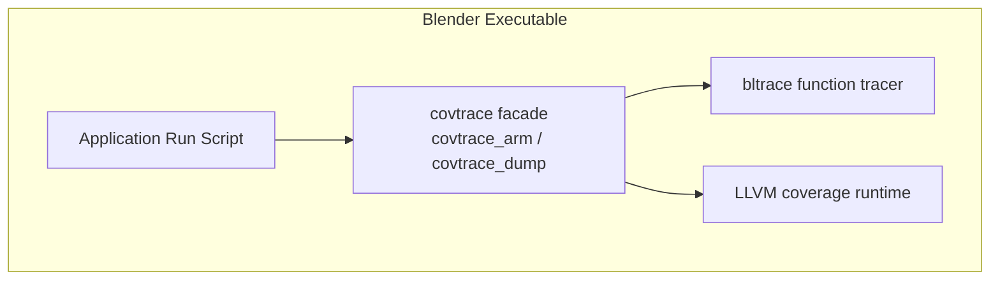
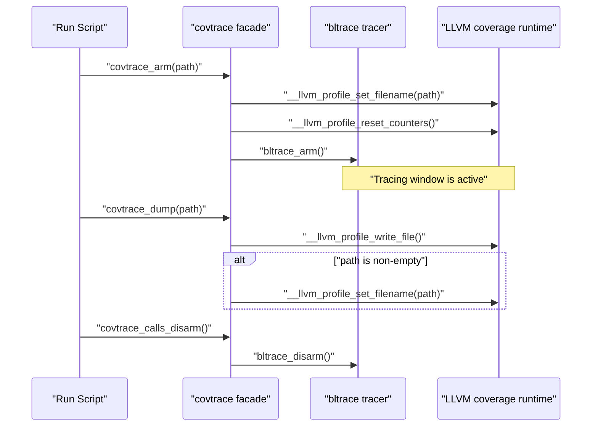
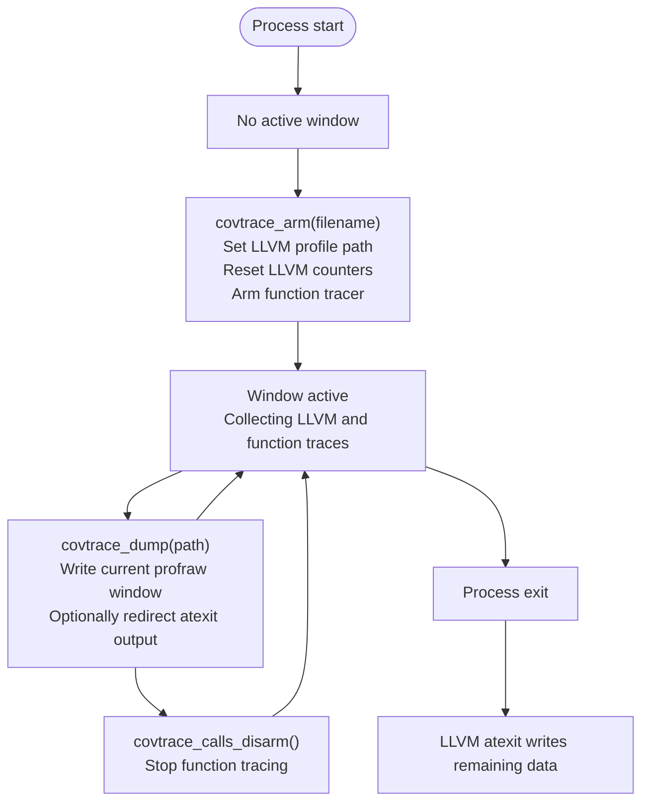
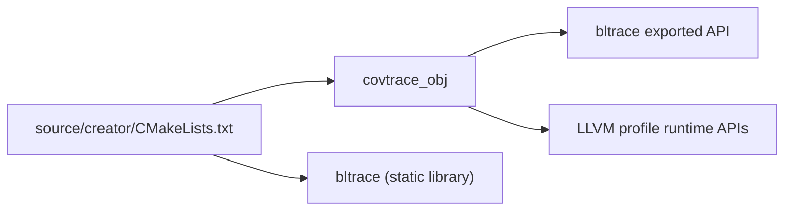
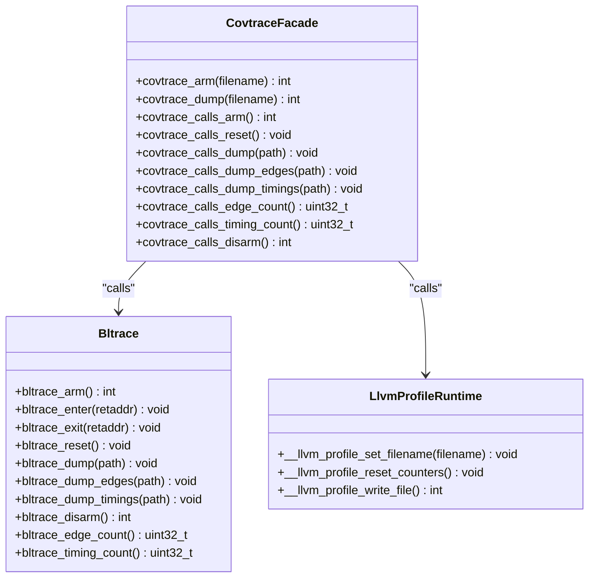

# Coverage Control (covtrace)

<cite>
**Referenced Files in This Document**   
- [covtrace_hook.c](file://covtrace/covtrace_hook.c)
- [covtrace/CMakeLists.txt](file://covtrace/CMakeLists.txt)
- [bltrace_hook.c](file://bltrace/bltrace_hook.c)
- [bltrace/CMakeLists.txt](file://bltrace/CMakeLists.txt)
- [CMakeLists.txt](file://source/creator/CMakeLists.txt)
</cite>

## Table of Contents
1. [Introduction](#introduction)
2. [Project Structure](#project-structure)
3. [Core Components](#core-components)
4. [Architecture Overview](#architecture-overview)
5. [Detailed Component Analysis](#detailed-component-analysis)
6. [Dependency Analysis](#dependency-analysis)
7. [Performance Considerations](#performance-considerations)
8. [Troubleshooting Guide](#troubleshooting-guide)
9. [Conclusion](#conclusion)

## Introduction
The coverage control layer, implemented as `covtrace`, is a public facade that coordinates two complementary tracing mechanisms:

- **Function-level tracing via bltrace**: Captures call-site and edge information using MSVC `/Gh` entry hooks or Clang `-finstrument-functions`. It records which functions are entered, caller-callee edges, and per-function timing data.
- **LLVM line-and-branch coverage runtime**: Uses LLVM’s profile instrumentation to collect execution counts for instrumented source lines and branches within bounded time windows.

`covtrace` exposes a small set of exported functions intended to be called from the application’s run script through dynamic loading. Its responsibilities are:

- Starting and stopping coverage collection windows.
- Configuring where LLVM writes its `profraw` output.
- Writing an explicit window file before process exit so the atexit handler does not overwrite it.
- Forwarding function-tracing operations to `bltrace`.

This document explains how those pieces fit together, how the window lifecycle works, and when to prefer function tracing versus LLVM coverage.

## Project Structure
The repository contains two related but separate components:

| Area | Purpose | Key Files |
|---|---|---|
| `covtrace/` | Public facade for coverage window control and LLVM profile configuration | `covtrace_hook.c`, `covtrace/CMakeLists.txt` |
| `bltrace/` | Low-level function tracing, edge tracking, and timing collection | `bltrace_hook.c`, `bltrace/CMakeLists.txt`, plus platform-specific shim/assembly |
| `source/creator/` | Links both tracing objects into the Blender executable | `CMakeLists.txt` |

**Diagram sources**
- [covtrace_hook.c:1-85](file://covtrace/covtrace_hook.c#L1-L85)
- [bltrace_hook.c:1-376](file://bltrace/bltrace_hook.c#L1-L376)
- [CMakeLists.txt:2117-2122](file://source/creator/CMakeLists.txt#L2117-L2122)

**Section sources**
- [covtrace_hook.c:1-85](file://covtrace/covtrace_hook.c#L1-L85)
- [bltrace_hook.c:1-376](file://bltrace/bltrace_hook.c#L1-L376)
- [CMakeLists.txt:2117-2122](file://source/creator/CMakeLists.txt#L2117-L2122)

## Core Components
### covtrace Facade
The facade is implemented in a single translation unit. It exports two main window-control functions and forwards all function-tracing operations to `bltrace`.

| Exported Function | Responsibility |
|---|---|
| `covtrace_arm(filename)` | Sets the LLVM profile output path and resets LLVM counters. Also arms function tracing by calling `bltrace_arm()`. |
| `covtrace_dump(filename)` | Writes the current LLVM coverage window to the configured `profraw` file, then optionally redirects future atexit output to another path. Returns the LLVM write status. |
| `covtrace_calls_*` | Thin wrappers around `bltrace_*` for function-call tracing, edge dumping, timing dumping, and disarm. |

Important behavior:

- `covtrace_arm` configures the filename used by `__llvm_profile_set_filename` and resets LLVM counters with `__llvm_profile_reset_counters`.
- `covtrace_dump` calls `__llvm_profile_write_file` first, then sets a new filename only if one is provided. This ensures the current window is written before any later atexit-based write.
- The `covtrace_calls_*` exports exist because the top-level link may drop `bltrace.lib` export symbols; the object containing these wrappers remains linked directly.

**Section sources**
- [covtrace_hook.c:1-85](file://covtrace/covtrace_hook.c#L1-L85)
- [covtrace/CMakeLists.txt:1-14](file://covtrace/CMakeLists.txt#L1-L14)

### bltrace Function Tracer
`bltrace` implements low-level function tracing and timing. It uses:

- A hash table of fixed size to record observed function return addresses.
- A second hash table for caller-callee edge records.
- Thread-local storage holding a call stack frame list.
- Query Performance Counter data to compute inclusive and self timing per function.
- Atomic counters for total call count, edge count, and timing slot occupancy.

Its exported API includes:

| Function | Meaning |
|---|---|
| `bltrace_arm()` | Allocates tables and TLS state once, initializes performance counters, and marks tracing armed. |
| `bltrace_enter(retaddr)` | Called on function entry to record function identity, edge, and push timing state. |
| `bltrace_exit(retaddr)` | Called on function exit to update timing and pop the stack frame. |
| `bltrace_reset()` | Clears function slots, edge slots, timing slots, and counters. |
| `bltrace_dump(path)` | Serializes function call records. |
| `bltrace_dump_edges(path)` | Serializes caller-callee edge records. |
| `bltrace_dump_timings(path)` | Serializes per-function timing records with header metadata. |
| `bltrace_disarm()` | Disables further tracing. |
| `bltrace_edge_count()` / `bltrace_timing_count()` | Report sizes useful for consumers. |

**Section sources**
- [bltrace_hook.c:1-376](file://bltrace/bltrace_hook.c#L1-L376)

## Architecture Overview
The system separates concerns between high-level window control and low-level tracing:

**Diagram sources**
- [covtrace_hook.c:30-85](file://covtrace/covtrace_hook.c#L30-L85)
- [bltrace_hook.c:119-200](file://bltrace/bltrace_hook.c#L119-L200)

At build time, the facade object is compiled without instrumentation so it does not pollute coverage data or add itself to the traced call graph. The Blender executable links both the static `bltrace` library and the `covtrace_obj` object so the run script can resolve the exported control functions.

**Section sources**
- [covtrace/CMakeLists.txt:1-14](file://covtrace/CMakeLists.txt#L1-L14)
- [CMakeLists.txt:2117-2122](file://source/creator/CMakeLists.txt#L2117-L2122)

## Detailed Component Analysis

### Profile Window Lifecycle
The window model divides program execution into discrete coverage collection periods. Each period starts with `covtrace_arm` and ends with either `covtrace_dump` or process termination.

Key points:

- `covtrace_arm` prepares both LLVM and `bltrace` for a new window.
- `covtrace_dump` writes the current LLVM profile data immediately, preventing the default atexit writer from overwriting it. If a filename is supplied, it also reconfigures the next atexit destination.
- `covtrace_calls_disarm` stops function-level tracing independently of LLVM coverage.
- Multiple dumps are supported within one arm/disarm cycle, allowing several bounded profiling sessions.

**Diagram sources**
- [covtrace_hook.c:30-85](file://covtrace/covtrace_hook.c#L30-L85)
- [bltrace_hook.c:119-200](file://bltrace/bltrace_hook.c#L119-L200)

**Section sources**
- [covtrace_hook.c:30-85](file://covtrace/covtrace_hook.c#L30-L85)

### LLVM Coverage Runtime Integration
The LLVM integration is intentionally minimal:

- `__llvm_profile_set_filename` selects the output file for profile-instruction data.
- `__llvm_profile_reset_counters` clears accumulated counts so each window starts fresh.
- `__llvm_profile_write_file` serializes the current coverage buffer to disk.

The facade does not parse or interpret `profraw`; it delegates serialization entirely to LLVM. Consumers should use LLVM’s normal profile-processing toolchain to convert the generated files into human-readable reports.

Configuration rules:

- Always call `covtrace_arm` with the desired initial `profraw` path before starting a window.
- Call `covtrace_dump` after collecting data for a window.
- Supply a new filename to `covtrace_dump` only when you want subsequent atexit writes to go elsewhere.
- Do not expect `covtrace_dump` to merge multiple windows automatically; each call writes the current LLVM buffer.

**Section sources**
- [covtrace_hook.c:1-85](file://covtrace/covtrace_hook.c#L1-L85)

### Function-Level Tracing and Timing
`bltrace` provides a different kind of coverage than LLVM’s line-and-branch instrumentation:

| Aspect | LLVM Coverage | bltrace Function Tracing |
|---|---|---|
| Granularity | Source lines and branches | Functions and caller-callee edges |
| Instrumentation | Compiler-generated coverage callbacks | Entry/exit hooks (`/Gh` or `-finstrument-functions`) |
| Output | `profraw` files consumed by LLVM tools | Binary records for functions, edges, and timings |
| Primary Use | Line and branch coverage analysis | Call-graph reconstruction, hot-path identification, timing breakdowns |
| Overhead Model | Coverage callback overhead proportional to instrumented code | Hook overhead proportional to function entries/exits |

The timing subsystem stores per-function:

- Invocation count.
- Self time.
- Inclusive time including children.

Timing records are written with a header containing magic, version, frequency, record size, and record count.

**Section sources**
- [bltrace_hook.c:1-376](file://bltrace/bltrace_hook.c#L1-L376)

### Usage Patterns

#### Controlling Coverage Data Collection
A typical sequence is:

1. Call `covtrace_arm(initial_profraw_path)` to prepare LLVM coverage and function tracing.
2. Execute the workload whose coverage is being collected.
3. Call `covtrace_dump(next_profraw_path)` to flush the current window.
4. Repeat steps 2–3 for additional windows if needed.
5. Call `covtrace_calls_disarm()` when function tracing is no longer required.

#### Configuring Output Paths
- Use `covtrace_arm` to set the initial LLVM profile filename.
- Use `covtrace_dump` with a non-empty filename to redirect future atexit output.
- Use `covtrace_calls_dump_edges` and `covtrace_calls_dump_timings` to write `bltrace`-specific binary outputs.
- Use `covtrace_calls_dump` to write raw function call records from `bltrace`.

#### Coordinating with the Underlying Tracing System
- The run script loads the exported `covtrace_*` functions dynamically.
- `covtrace_calls_*` functions expose `bltrace` capabilities even when the static `bltrace` library exports are dropped by the final link.
- Both systems should be armed together when comprehensive coverage is required: LLVM for line/branch coverage and `bltrace` for call graphs and timing.

**Section sources**
- [covtrace_hook.c:1-85](file://covtrace/covtrace_hook.c#L1-L85)
- [bltrace_hook.c:201-376](file://bltrace/bltrace_hook.c#L201-L376)

## Dependency Analysis
The dependency relationships are straightforward and layered:

- `source/creator/CMakeLists.txt` links `bltrace` statically and embeds `covtrace_obj` directly into the executable.
- `covtrace_hook.c` depends on LLVM’s profile C API and on `bltrace`’s exported functions.
- `covtrace/CMakeLists.txt` compiles the facade with instrumentation disabled so it does not affect coverage metrics.
- `bltrace/CMakeLists.txt` builds `bltrace` as a static library and disables instrumentation and coverage mapping where appropriate.

**Diagram sources**
- [covtrace_hook.c:1-85](file://covtrace/covtrace_hook.c#L1-L85)
- [bltrace_hook.c:1-376](file://bltrace/bltrace_hook.c#L1-L376)
- [CMakeLists.txt:2117-2122](file://source/creator/CMakeLists.txt#L2117-L2122)

**Section sources**
- [CMakeLists.txt:2117-2122](file://source/creator/CMakeLists.txt#L2117-L2122)
- [covtrace/CMakeLists.txt:1-14](file://covtrace/CMakeLists.txt#L1-L14)
- [bltrace/CMakeLists.txt:1-49](file://bltrace/CMakeLists.txt#L1-L49)

## Performance Considerations
- **Avoid instrumenting the facade**: `covtrace_hook.c` is compiled with `-fno-profile-instr-generate`, `-fno-coverage-mapping`, and Clang function instrumentation disabled. This prevents reset operations from re-polluting counters and avoids adding the facade to traced call graphs.
- **Use bounded windows**: Because LLVM coverage accumulates until written, repeatedly calling `covtrace_dump` prevents unbounded growth of the in-memory coverage buffer.
- **Prefer targeted workflows**: Function tracing has overhead proportional to function calls, while LLVM coverage has overhead proportional to instrumented statements and branches. Choose the mechanism based on whether call-graph/timing data or line/branch coverage is more important.
- **Be careful with timing data**: Timing records depend on Query Performance Counter frequency and thread-local stack state. They are most useful for relative hotspot analysis rather than absolute wall-clock timing across processes.

[No sources needed since this section provides general guidance]

## Troubleshooting Guide

| Symptom | Likely Cause | Recommended Action |
|---|---|---|
| No LLVM `profraw` file appears | `covtrace_arm` was never called, or the filename path is invalid. | Ensure `covtrace_arm` is called before the workload and passes a writable path. |
| Existing `profraw` file is overwritten at exit | `covtrace_dump` did not set a new filename, so the default atexit writer still targets the original path. | Pass a new filename to `covtrace_dump` after writing the window. |
| LLVM coverage data appears incomplete | The process exited before the LLVM atexit writer flushed data, or multiple windows were expected to merge automatically. | Call `covtrace_dump` explicitly after each window. |
| Function tracing does not record calls | `bltrace` was not armed, or the hook path is not active. | Confirm `covtrace_arm` is called and that the underlying tracing mechanism is enabled during the relevant build. |
| Function trace data is missing or empty | `bltrace_dump` was not called, or the dump path is invalid. | Call `covtrace_calls_dump` with a valid path. |
| Edge or timing data is missing | `bltrace_dump_edges` or `bltrace_dump_timings` was not invoked. | Call the corresponding `covtrace_calls_dump_*` function. |
| Coverage metrics include the facade itself | The facade was accidentally compiled with instrumentation enabled. | Verify that the facade object is built with coverage and function instrumentation disabled. |

**Section sources**
- [covtrace_hook.c:1-85](file://covtrace/covtrace_hook.c#L1-L85)
- [covtrace/CMakeLists.txt:1-14](file://covtrace/CMakeLists.txt#L1-L14)
- [bltrace_hook.c:201-376](file://bltrace/bltrace_hook.c#L201-L376)

## Conclusion
The `covtrace` coverage control layer is a focused public API that coordinates two complementary tracing backends:

- `bltrace` provides function-level and caller-callee edge tracing with timing information.
- LLVM’s coverage runtime provides line and branch coverage through profile instrumentation.

Its design emphasizes bounded profiling windows, clear separation between window control and tracing implementation, and minimal coupling with the underlying systems. For best results, use LLVM coverage when line and branch coverage are required, and use `bltrace` when call graphs, edges, or per-function timing are more valuable. The facade makes both available under a consistent interface controlled from the application’s run script.

[No sources needed since this section summarizes without analyzing specific files]