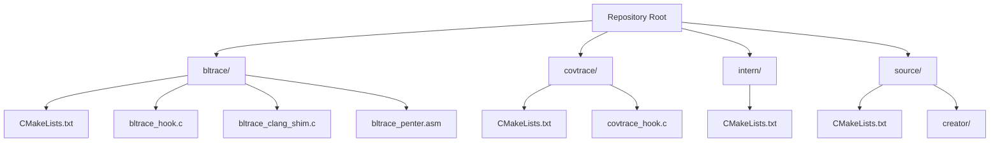
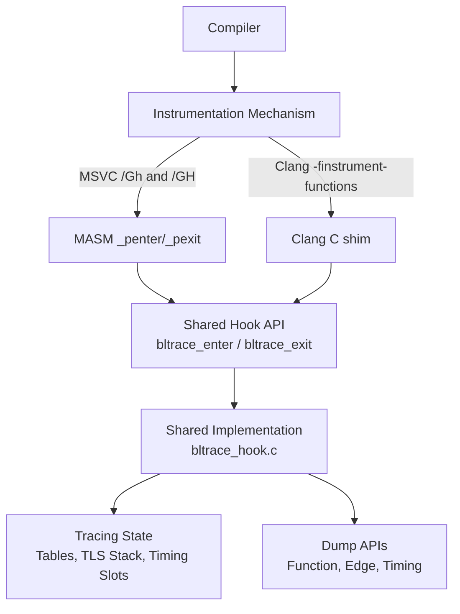
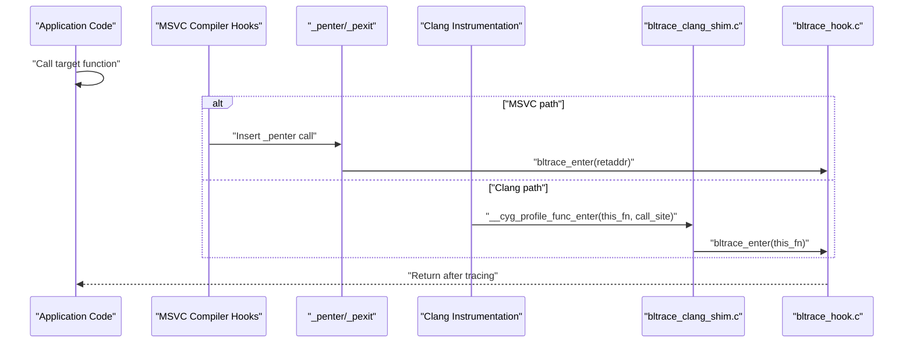
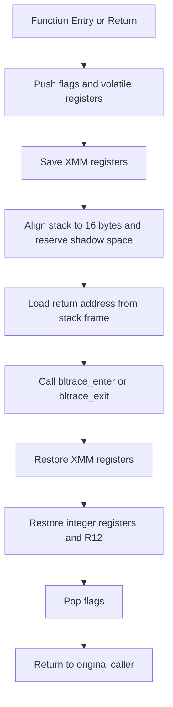
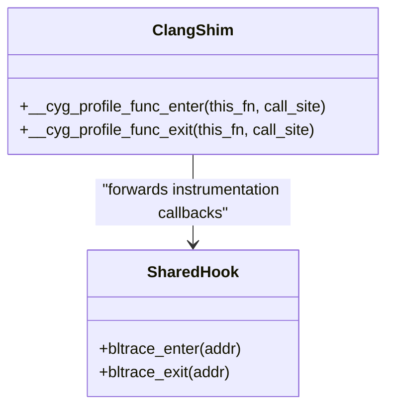
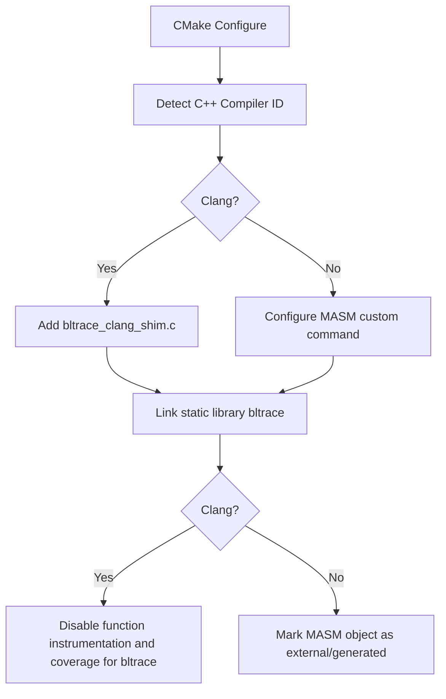
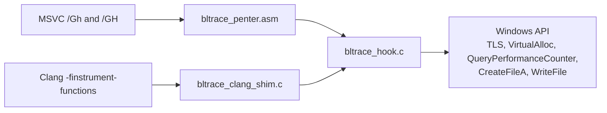

# Toolchain Abstraction Layer

<cite>
**Referenced Files in This Document**   
- [CMakeLists.txt](file://CMakeLists.txt)
- [bltrace/CMakeLists.txt](file://bltrace/CMakeLists.txt)
- [bltrace/bltrace_hook.c](file://bltrace/bltrace_hook.c)
- [bltrace/bltrace_clang_shim.c](file://bltrace/bltrace_clang_shim.c)
- [bltrace/bltrace_penter.asm](file://bltrace/bltrace_penter.asm)
</cite>

## Table of Contents
1. [Introduction](#introduction)
2. [Project Structure](#project-structure)
3. [Core Components](#core-components)
4. [Architecture Overview](#architecture-overview)
5. [Detailed Component Analysis](#detailed-component-analysis)
6. [Dependency Analysis](#dependency-analysis)
7. [Performance Considerations](#performance-considerations)
8. [Troubleshooting Guide](#troubleshooting-guide)
9. [Conclusion](#conclusion)

## Introduction
This document explains the toolchain abstraction layer that bridges two instrumentation approaches used by the project:

- **MSVC path**: Uses MSVC’s `/Gh` and `/GH` compiler hooks to inject `_penter` and `_pexit` calls around every function entry and return. MASM-generated assembly stubs preserve registers, align the stack, and invoke shared C hook code.
- **Clang path**: Uses Clang’s `-finstrument-functions` to call `__cyg_profile_func_enter` and `__cyg_profile_func_exit`. A small C shim forwards these into the same shared hook implementation.

Both paths converge on `bltrace_hook.c`, which implements the actual tracing state, TLS-based call stack tracking, edge recording, timing collection, and binary dump routines. The build system selects the appropriate toolchain-specific files through conditional logic in `bltrace/CMakeLists.txt`.

## Project Structure
The relevant source tree for this abstraction layer is:

**Diagram sources**
- [bltrace/CMakeLists.txt:1-49](file://bltrace/CMakeLists.txt#L1-L49)
- [bltrace/bltrace_hook.c:1-200](file://bltrace/bltrace_hook.c#L1-L200)
- [bltrace/bltrace_clang_shim.c:1-27](file://bltrace/bltrace_clang_shim.c#L1-L27)
- [bltrace/bltrace_penter.asm:1-108](file://bltrace/bltrace_penter.asm#L1-L108)

**Section sources**
- [bltrace/CMakeLists.txt:1-49](file://bltrace/CMakeLists.txt#L1-L49)

## Core Components
The abstraction layer has three primary responsibilities:

| Component | Responsibility | Toolchain Relevance |
|---|---|---|
| `bltrace_hook.c` | Shared tracing implementation: armed/disarmed state, hash-slot tables, per-thread call stack, timing records, counters, and dump functions. | Used by both MSVC and Clang paths. |
| `bltrace_penter.asm` | MASM entry/exit stubs exposing `_penter` and `_pexit`; preserves all volatile registers, XMM registers, flags, and stack alignment before calling into C. | MSVC-only. |
| `bltrace_clang_shim.c` | Thin C shim mapping Clang’s instrumented-function callbacks to the shared `bltrace_enter`/`bltrace_exit` API. | Clang-only. |
| `bltrace/CMakeLists.txt` | Selects either the MASM object or the Clang shim at configure/build time and configures compilation options. | Both paths. |

Key shared behaviors implemented in the hook:

- Global armed flag controls whether tracing is active.
- Module base address is captured so relative virtual addresses can be computed from return addresses.
- Function-entry RVAs are stored in a fixed-size hash table with atomic insertion.
- Caller-to-callee edges are recorded as combined 64-bit values.
- Per-thread stack frames track timing data including inclusive and self times.
- Counters track total entries, exit-counted edges, and timing slots.
- Dump APIs serialize tables and timing records to binary files.

**Section sources**
- [bltrace/bltrace_hook.c:1-200](file://bltrace/bltrace_hook.c#L1-L200)
- [bltrace/bltrace_hook.c:201-376](file://bltrace/bltrace_hook.c#L201-L376)

## Architecture Overview
The dual-path design isolates toolchain-specific details behind a stable C interface.

**Diagram sources**
- [bltrace/CMakeLists.txt:5-49](file://bltrace/CMakeLists.txt#L5-L49)
- [bltrace/bltrace_penter.asm:1-108](file://bltrace/bltrace_penter.asm#L1-L108)
- [bltrace/bltrace_clang_shim.c:1-27](file://bltrace/bltrace_clang_shim.c#L1-L27)
- [bltrace/bltrace_hook.c:1-376](file://bltrace/bltrace_hook.c#L1-L376)

### Entry Flow Comparison

**Diagram sources**
- [bltrace/bltrace_penter.asm:1-108](file://bltrace/bltrace_penter.asm#L1-L108)
- [bltrace/bltrace_clang_shim.c:1-27](file://bltrace/bltrace_clang_shim.c#L1-L27)
- [bltrace/bltrace_hook.c:1-200](file://bltrace/bltrace_hook.c#L1-L200)

## Detailed Component Analysis

### Shared Hook Implementation: `bltrace_hook.c`
This file is the common backend for both toolchains. It exposes several exported functions:

| Exported Symbol | Purpose |
|---|---|
| `bltrace_arm` | Allocates global buffers, initializes QPC frequency, allocates TLS index, and arms tracing. |
| `bltrace_disarm` | Disables tracing while preserving internal counters. |
| `bltrace_count` | Returns the number of unique function entries recorded. |
| `bltrace_edge_count` | Returns the number of recorded caller-to-callee edges. |
| `bltrace_reset` | Clears all tables, timing records, and thread-local stack state. |
| `bltrace_dump` | Serializes function-entry table to a binary file. |
| `bltrace_dump_edges` | Serializes edge table to a binary file. |
| `bltrace_timing_count` | Returns the number of timing slots populated. |
| `bltrace_dump_timings` | Writes timing header followed by timing records. |

Data structures include:

- Thread-local frame structure holding RVA, start timestamp, and accumulated child time.
- Thread-local stack array with bounded capacity; overflow resets the counter.
- Fixed-size hash-slot arrays for function entries and edges.
- Timing slot array storing per-RVA counts and inclusive/self timings.

Complexity characteristics:

- Hash-table lookup and insertion use open addressing with linear probing and atomic compare-and-swap operations.
- Worst-case slot search is proportional to the table size, but typical behavior depends on load factor and hash distribution.
- TLS state allocation occurs lazily when tracing becomes active.
- Timing updates use atomic increments and additions.

Error handling considerations:

- Early returns occur when tracing is disarmed, module base is uninitialized, or TLS state is unavailable.
- File dumps check for invalid handles and write only non-zero entries.
- Timing calculations guard against underflow using comparisons before subtraction.

**Section sources**
- [bltrace/bltrace_hook.c:1-200](file://bltrace/bltrace_hook.c#L1-L200)
- [bltrace/bltrace_hook.c:201-376](file://bltrace/bltrace_hook.c#L201-L376)

### MSVC Assembly Hook: `bltrace_penter.asm`
The MASM stubs implement `_penter` and `_pexit`, which MSVC inserts automatically when `/Gh` and `/GH` are enabled.

Key behaviors:

- Pushes and restores flags, integer registers, and XMM registers.
- Saves and restores R12 as a callee-saved register used internally.
- Adjusts the stack pointer to maintain 16-byte alignment before calling into C.
- Reserves shadow space for the C function call.
- Loads the return address from the stack frame and passes it as the first argument to `bltrace_enter` or `bltrace_exit`.
- Restores all saved state before returning to the caller.

This design ensures that traced functions observe normal calling conventions and that the injected hooks do not corrupt execution state.

**Diagram sources**
- [bltrace/bltrace_penter.asm:1-108](file://bltrace/bltrace_penter.asm#L1-L108)

**Section sources**
- [bltrace/bltrace_penter.asm:1-108](file://bltrace/bltrace_penter.asm#L1-L108)

### Clang Shim: `bltrace_clang_shim.c`
The Clang shim translates compiler-generated instrumentation callbacks into the shared hook API:

- `__cyg_profile_func_enter` receives the function entry address and forwards it to `bltrace_enter`.
- `__cyg_profile_func_exit` pops the TLS stack through `bltrace_exit`, maintaining matching semantics between entry and exit events.
- Both shim functions are marked noinline to prevent the compiler from optimizing away the instrumentation boundary.
- The translation unit is compiled without further function instrumentation to avoid recursion.

This approach lets Clang reuse the same tracing backend as MSVC without requiring a separate MASM pipeline.

**Diagram sources**
- [bltrace/bltrace_clang_shim.c:1-27](file://bltrace/bltrace_clang_shim.c#L1-L27)
- [bltrace/bltrace_hook.c:1-200](file://bltrace/bltrace_hook.c#L1-L200)

**Section sources**
- [bltrace/bltrace_clang_shim.c:1-27](file://bltrace/bltrace_clang_shim.c#L1-L27)

### Build System Selection: `bltrace/CMakeLists.txt`
The build configuration uses the detected C++ compiler identity to choose the appropriate toolchain path:

| Condition | Behavior |
|---|---|
| Clang detected | Adds `bltrace_clang_shim.c` and does not assemble MASM. |
| Non-Clang (typically MSVC) | Defines MASM input/output paths, invokes the MASM assembler via `add_custom_command`, and adds the generated object file. |
| Clang path | Applies `/clang:-fno-instrument-functions` and related options to avoid recursive instrumentation and unnecessary coverage data. |
| Non-Clang path | Marks the generated MASM object as external and generated. |

The top-level `CMakeLists.txt` also enforces minimum compiler versions:

- GCC requires version 11.0.0 or newer.
- Clang requires version 8.0 or newer.
- MSVC requires version 1928 or newer, corresponding to Visual Studio 2019 16.9.16 or newer.

**Diagram sources**
- [bltrace/CMakeLists.txt:1-49](file://bltrace/CMakeLists.txt#L1-L49)
- [CMakeLists.txt:78-125](file://CMakeLists.txt#L78-L125)

**Section sources**
- [bltrace/CMakeLists.txt:1-49](file://bltrace/CMakeLists.txt#L1-L49)
- [CMakeLists.txt:78-125](file://CMakeLists.txt#L78-L125)

## Dependency Analysis
The toolchain abstraction layer has clear boundaries:

Coupling observations:

- `bltrace_hook.c` is independent of the instrumentation mechanism; it only requires the exported entry/exit API.
- `bltrace_penter.asm` depends on the C ABI for passing the return address in `rcx` and on the presence of `bltrace_enter` and `bltrace_exit`.
- `bltrace_clang_shim.c` depends on Clang generating the standard Cygwin-style instrumentation symbols.
- The CMake layer couples toolchain selection to compiler identity rather than feature detection, so compiler capabilities must be enforced externally.

Potential risks:

- If Clang is invoked without `-finstrument-functions`, the shim will never be called.
- If MSVC is built without `/Gh` and `/GH`, the MASM objects will still link but tracing will not activate.
- Changes to calling conventions, stack layout, or register usage require synchronized updates across both assembly and C implementations.

**Diagram sources**
- [bltrace/bltrace_penter.asm:1-108](file://bltrace/bltrace_penter.asm#L1-L108)
- [bltrace/bltrace_clang_shim.c:1-27](file://bltrace/bltrace_clang_shim.c#L1-L27)
- [bltrace/bltrace_hook.c:1-376](file://bltrace/bltrace_hook.c#L1-L376)

**Section sources**
- [bltrace/CMakeLists.txt:1-49](file://bltrace/CMakeLists.txt#L1-L49)
- [bltrace/bltrace_hook.c:1-376](file://bltrace/bltrace_hook.c#L1-L376)

## Performance Considerations
- Tracing is gated by an armed flag, allowing zero-cost bypass when disabled.
- Hash-slot tables avoid dynamic allocation during hot paths; they rely on preallocated memory and atomic insertion.
- Per-thread state is allocated lazily and stored in thread-local storage.
- Timing collection uses high-resolution performance counters and accumulates inclusive and self time.
- The Clang path explicitly disables function instrumentation and coverage generation for the bltrace library to avoid overhead and recursion.
- MASM stubs minimize work by only saving/restoring necessary registers and aligning the stack once per hook.

[No sources needed since this section provides general guidance]

## Troubleshooting Guide

### MSVC-Specific Issues
- **No tracing output**: Verify that the build enables `/Gh` and `/GH` for the target modules. Without these switches, `_penter` and `_pexit` are not inserted.
- **Missing `_penter` symbol**: Ensure the MASM object is generated and linked. The CMake custom command compiles `bltrace_penter.asm` into an object file and adds it to the library.
- **Crash inside hooks**: Check that the executable was built with a compatible MSVC version. The top-level configuration enforces a minimum MSVC version.
- **Incorrect return address**: Confirm that the runtime module base calculation matches the loaded module. The hook computes RVAs relative to the base address returned by the module handle query.
- **Stack corruption**: Avoid modifying global or thread-local state inside traced functions before `bltrace_arm` is called, because early hook invocations may encounter uninitialized state.

**Section sources**
- [bltrace/CMakeLists.txt:10-38](file://bltrace/CMakeLists.txt#L10-L38)
- [CMakeLists.txt:108-125](file://CMakeLists.txt#L108-L125)
- [bltrace/bltrace_penter.asm:1-108](file://bltrace/bltrace_penter.asm#L1-L108)
- [bltrace/bltrace_hook.c:1-200](file://bltrace/bltrace_hook.c#L1-L200)

### Clang-Specific Issues
- **Hooks not invoked**: Ensure Clang is configured with `-finstrument-functions`. The shim forwards `__cyg_profile_func_enter` and `__cyg_profile_func_exit` into the shared hook.
- **Recursive instrumentation**: The bltrace library is compiled with function instrumentation disabled. If custom build rules override these options, recursion or unexpected coverage data may appear.
- **Coverage noise**: When code coverage is enabled globally, the bltrace library explicitly avoids profile instrumentation and coverage mapping.
- **Incompatible Clang version**: The top-level configuration requires Clang 8.0 or newer. Older versions may lack required features or behave differently with instrumentation.

**Section sources**
- [bltrace/CMakeLists.txt:5-16](file://bltrace/CMakeLists.txt#L5-L16)
- [bltrace/CMakeLists.txt:27-37](file://bltrace/CMakeLists.txt#L27-L37)
- [bltrace/bltrace_clang_shim.c:1-27](file://bltrace/bltrace_clang_shim.c#L1-L27)
- [CMakeLists.txt:96-107](file://CMakeLists.txt#L96-L107)

### Shared Hook Issues
- **Zero counts after arm**: Confirm that `bltrace_arm` succeeded and that traced functions are actually executed.
- **Timing count remains zero**: Timing data requires timing slots to be allocated and populated; verify that `bltrace_dump_timings` is called after tracing.
- **Duplicate or missing entries**: The hook uses hash-slot tables with collision resolution. Extremely high contention or unusual call patterns may affect distribution, though the algorithm falls back to linear probing.
- **Thread-local state problems**: The hook allocates TLS state lazily. If tracing starts before TLS initialization completes, early entries may be ignored.

**Section sources**
- [bltrace/bltrace_hook.c:1-200](file://bltrace/bltrace_hook.c#L1-L200)
- [bltrace/bltrace_hook.c:201-376](file://bltrace/bltrace_hook.c#L201-L376)

## Conclusion
The toolchain abstraction layer cleanly separates compiler-specific instrumentation from shared tracing logic. MSVC relies on MASM-generated entry/exit stubs triggered by compiler hooks, while Clang uses a C shim bridging compiler-generated instrumentation callbacks. Both paths share `bltrace_hook.c`, which manages tracing state, call-stack timing, edge recording, and binary output. The CMake configuration centralizes toolchain selection and applies appropriate compile-time safeguards. Maintaining compatibility across compiler versions requires honoring the minimum version checks and keeping the assembly stubs aligned with the platform’s calling convention.

[No sources needed since this section summarizes without analyzing specific files]