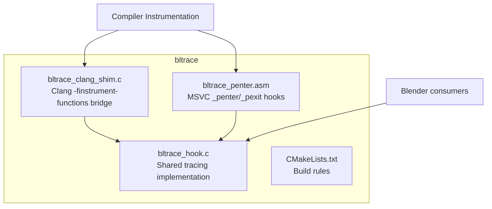
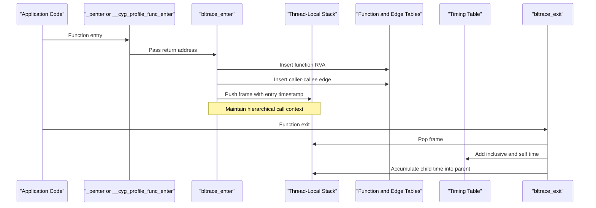
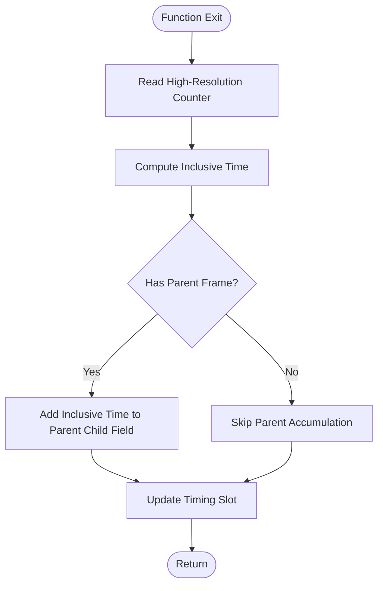
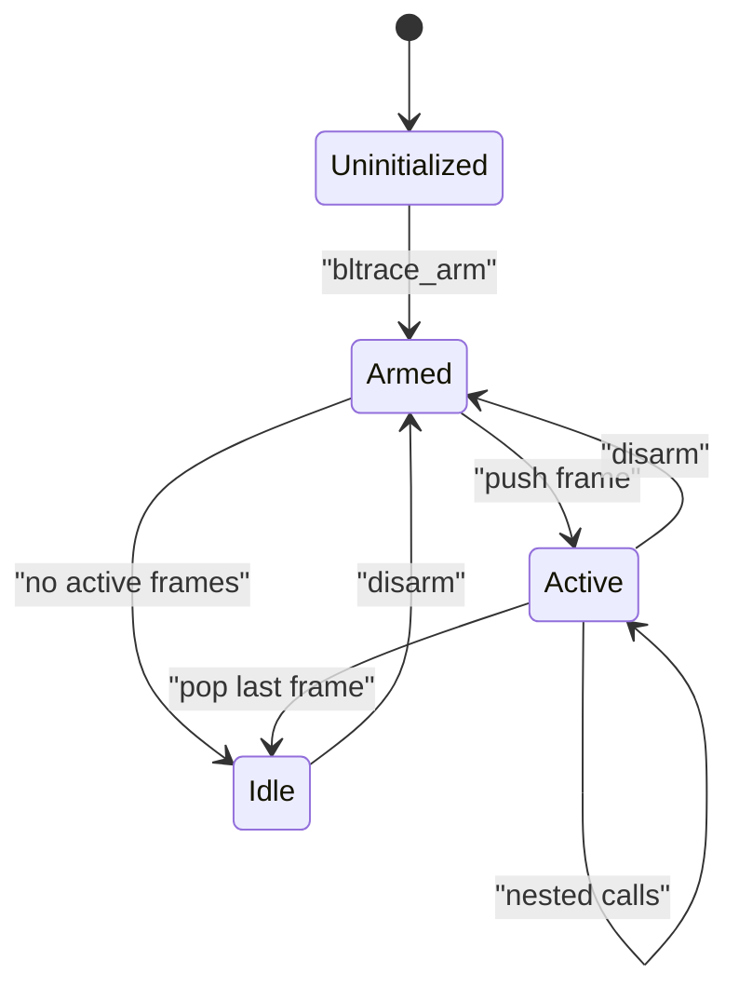
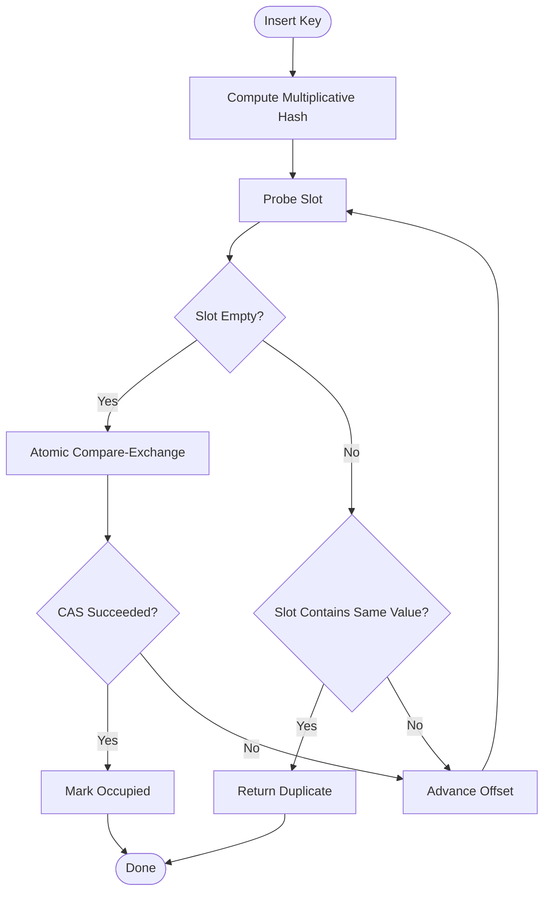
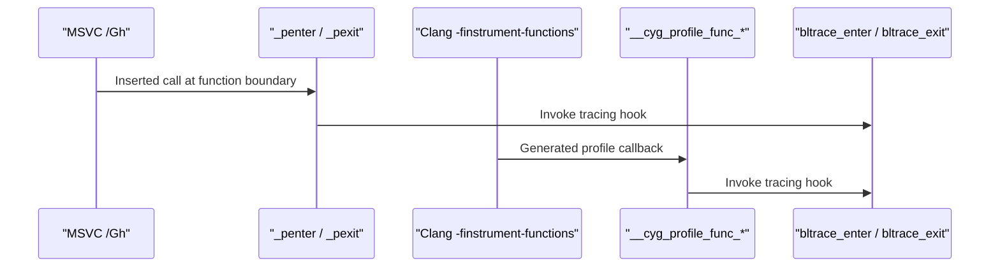
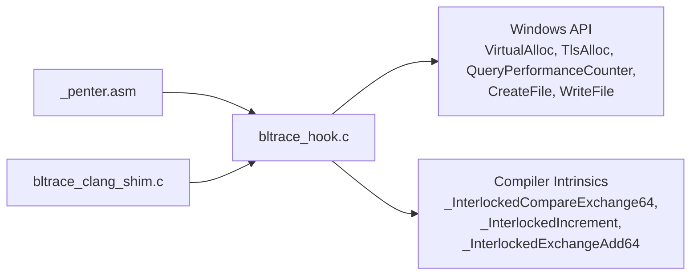

# Tracing Engine (bltrace)

<cite>
**Referenced Files in This Document**   
- [bltrace_hook.c](file://bltrace/bltrace_hook.c)
- [bltrace_clang_shim.c](file://bltrace/bltrace_clang_shim.c)
- [bltrace_penter.asm](file://bltrace/bltrace_penter.asm)
- [CMakeLists.txt](file://bltrace/CMakeLists.txt)
</cite>

## Table of Contents
1. [Introduction](#introduction)
2. [Project Structure](#project-structure)
3. [Core Components](#core-components)
4. [Architecture Overview](#architecture-overview)
5. [Detailed Component Analysis](#detailed-component-analysis)
6. [Dependency Analysis](#dependency-analysis)
7. [Performance Considerations](#performance-considerations)
8. [Troubleshooting Guide](#troubleshooting-guide)
9. [Conclusion](#conclusion)

## Introduction
The bltrace tracing engine is a low-overhead, Windows-targeted function call tracer for Blender’s build pipeline. It records:

- Which functions are executed.
- Caller-to-callee edges.
- Per-function inclusive and self timing measured with high-resolution performance counters.
- A hierarchical thread-local call stack so that child execution time can be subtracted from parent frames.

It supports two instrumentation entry points:

- MSVC `/Gh` / `/GH` hooks through an assembled `_penter` / `_pexit`.
- Clang `-finstrument-functions` through C shim entry points.

At runtime, bltrace uses fixed-size open-addressing hash tables to store unique function relative virtual addresses and caller-callee edges, while maintaining per-thread call stacks in thread-local storage. The design minimizes locking by using atomic operations and simple state flags.

## Project Structure
The bltrace module is a static library built by the top-level CMake configuration. Its source layout separates platform-specific hook assembly, shared tracing logic, and a compiler-specific shim.

**Diagram sources**
- [CMakeLists.txt:1-49](file://bltrace/CMakeLists.txt#L1-L49)
- [bltrace_clang_shim.c:1-27](file://bltrace/bltrace_clang_shim.c#L1-L27)
- [bltrace_penter.asm:1-108](file://bltrace/bltrace_penter.asm#L1-L108)
- [bltrace_hook.c:1-60](file://bltrace/bltrace_hook.c#L1-L60)

**Section sources**
- [CMakeLists.txt:1-49](file://bltrace/CMakeLists.txt#L1-L49)

## Core Components
The core runtime lives in `bltrace_hook.c`. It exposes several exported symbols used by the rest of Blender:

| Exported symbol | Responsibility |
|---|---|
| `bltrace_arm` | Initializes global state, allocates slot tables, caches QPC frequency, allocates TLS index, and enables tracing. |
| `bltrace_disarm` | Disables tracing atomically. |
| `bltrace_enter` | Records function entry, edge information, and pushes a new frame onto the thread-local stack. |
| `bltrace_exit` | Pops the top frame, measures inclusive/self time, updates timing slots, and accumulates child time into the parent frame. |
| `bltrace_reset` | Clears all slot tables and counters; resets TLS frame depth. |
| `bltrace_dump` | Writes function table entries as raw 64-bit values. |
| `bltrace_dump_edges` | Writes caller-callee edge entries as raw 64-bit values. |
| `bltrace_dump_timings` | Writes timing header plus per-function timing records. |
| `bltrace_count` | Returns number of unique functions recorded. |
| `bltrace_edge_count` | Returns number of unique caller-callee edges recorded. |
| `bltrace_timing_count` | Returns number of timing slots occupied. |

Key data structures include:

| Structure | Purpose |
|---|---|
| `TlsFrame` | Stores one call frame: function RVA, entry timestamp, and accumulated child time. |
| `TlsStack` | Fixed-depth array of `TlsFrame` plus current depth. |
| `TimingSlot` | Open-addressing hash bucket storing key, call count, self time, and inclusive time. |
| `TimingRecord` | Serializable form written to disk during timing dump. |
| `TimingHeader` | File header containing magic value, version, QPC frequency, record size, and record count. |

Global runtime state includes:

| Global | Meaning |
|---|---|
| `g_armed` | Tracing enabled flag. |
| `g_base` | Module base address used to compute RVAs. |
| `g_slots` | Function table storing unique function keys. |
| `g_eslots` | Edge table storing unique caller-callee edges. |
| `g_tslots` | Timing table storing per-function timing statistics. |
| `g_qpc_freq` | High-resolution counter frequency. |
| `g_tls` | Thread-local storage index. |

**Section sources**
- [bltrace_hook.c:1-60](file://bltrace/bltrace_hook.c#L1-L60)
- [bltrace_hook.c:61-120](file://bltrace/bltrace_hook.c#L61-L120)
- [bltrace_hook.c:121-200](file://bltrace/bltrace_hook.c#L121-L200)

## Architecture Overview
The tracing engine has three main layers:

1. **Instrumentation layer**: Inserts calls into every function body. On MSVC it uses `/Gh`/`/GH` and the MASM `_penter`/`_pexit` wrappers. On Clang it uses `-finstrument-functions` shims.
2. **Runtime layer**: `bltrace_enter` and `bltrace_exit` perform all tracing work. They update function tables, edge tables, timing tables, and thread-local call stacks.
3. **Dump layer**: Serializers write flat binary files for post-processing.

**Diagram sources**
- [bltrace_penter.asm:1-108](file://bltrace/bltrace_penter.asm#L1-L108)
- [bltrace_clang_shim.c:1-27](file://bltrace/bltrace_clang_shim.c#L1-L27)
- [bltrace_hook.c:121-200](file://bltrace/bltrace_hook.c#L121-L200)
- [bltrace_hook.c:201-280](file://bltrace/bltrace_hook.c#L201-L280)

## Detailed Component Analysis

### Function Call Graph Recording System

#### Caller-Callee Edge Tracking
On each function entry, bltrace computes a caller RVA from the current TLS stack frame and combines it with the callee RVA into a single 64-bit edge value. It then attempts to insert this edge into the edge slot table.

- Caller identification comes from the most recent frame on the thread-local stack.
- If no TLS stack exists or the stack is empty, the caller is treated as zero, which avoids recording spurious edges.
- The edge is only inserted if it is nonzero.
- Successful insertion increments the global edge counter.

This approach captures directed call relationships without requiring a full graph at runtime. Edges are later serialized as `(caller_rva << 32) | callee_rva`.

#### Function Table Recording
Each unique function RVA plus one is stored in the function table. Adding one avoids treating a zero-valued key as an empty slot because the open-addressing algorithm uses zero to indicate an unoccupied bucket.

- The key is computed as `rva + 1`.
- RVAs are derived from the return address minus the module base.
- Duplicate insertions do not increment the function counter again.

#### Data Structures for RVAs and Edges
Both the function table and edge table use the same fixed-size open-addressing hash table:

- Size: `SLOT_COUNT`, currently `0x200000`.
- Mask: `SLOT_MASK`, enabling modulo hashing via bitwise AND.
- Hash: Multiplicative hash using the constant `0x9E3779B1u`.
- Collision resolution: Linear probing across the table.
- Atomic insertion: `_InterlockedCompareExchange64` checks whether the slot is empty or already contains the same value.

This design avoids locks and provides O(1)-expected insertion under normal conditions.

**Section sources**
- [bltrace_hook.c:121-200](file://bltrace/bltrace_hook.c#L121-L200)
- [bltrace_hook.c:61-100](file://bltrace/bltrace_hook.c#L61-L100)

### Per-Function Timing Measurement Using High-Resolution Performance Counters

#### Timer Source
Timing uses Windows Query Performance Counter:

- Frequency is cached once during `bltrace_arm`.
- Entry timestamps are captured when pushing a frame.
- Exit timestamps are captured when popping a frame.

#### Inclusive and Self Time
Inclusive time is the total time spent inside the function, including all descendants. Self time is the time spent in the function itself, excluding children.

The calculation proceeds as follows:

1. Compute inclusive time as `now - t0`.
2. Subtract accumulated child time from the top frame to obtain self time.
3. Clamp both values to zero if the subtraction would underflow.
4. Update the timing slot for `frame.rva + 1`.
5. Add inclusive time to the parent frame’s child accumulator.

**Diagram sources**
- [bltrace_hook.c:201-280](file://bltrace/bltrace_hook.c#L201-L280)

#### Timing Slot Table
The timing table is separate from the function and edge tables:

- Size: `TIME_SLOT_COUNT`, currently `0x80000`.
- Key: `rva + 1`.
- Fields: call count, self time, inclusive time.
- Lookup uses the same multiplicative hash and linear probing pattern.
- Empty-slot insertion is also atomic.

Timing records are serialized with a header containing:

- Magic value `BTIM`.
- Version.
- QPC frequency.
- Record size.
- Number of occupied timing slots.

**Section sources**
- [bltrace_hook.c:201-280](file://bltrace/bltrace_hook.c#L201-L280)
- [bltrace_hook.c:281-376](file://bltrace/bltrace_hook.c#L281-L376)

### Thread-Local Call Stack Management

#### TLS Allocation Strategy
Thread-local state is lazily allocated:

- `tls_state` checks the TLS index.
- If no state exists, it allocates a `TlsStack` via `VirtualAlloc`.
- It stores the pointer in TLS and returns it.
- If TLS allocation fails, tracing continues but does not maintain call hierarchy.

#### Call Stack Layout
Each `TlsStack` holds:

- A signed depth counter.
- A fixed-size array of `TlsFrame`.
- Current capacity `STACK_CAP`, currently `0x2000`.

On entry:

- The top frame’s RVA becomes the caller.
- A new frame is pushed with the current RVA, entry timestamp, and zero child time.
- If the stack is full, depth is reset to zero to avoid overflow.

On exit:

- The top frame is popped.
- Inclusive and self time are computed.
- Child time is added to the parent frame if one exists.

**Diagram sources**
- [bltrace_hook.c:121-200](file://bltrace/bltrace_hook.c#L121-L200)
- [bltrace_hook.c:201-280](file://bltrace/bltrace_hook.c#L201-L280)

**Section sources**
- [bltrace_hook.c:121-200](file://bltrace/bltrace_hook.c#L121-L200)
- [bltrace_hook.c:201-280](file://bltrace/bltrace_hook.c#L201-L280)

### Slot Table Architecture and Collision Resolution

#### Shared Hashing Pattern
All three major tables—function table, edge table, and timing table—use the same hashing strategy:

- Hash input: key value.
- Multiplier: `0x9E3779B1u`.
- Index computation: `(hash + offset) & mask`.
- Collision resolution: linear probing.
- Capacity: power-of-two sizes with corresponding masks.

#### Atomic Insertion
For function and edge tables, the `claim` helper performs:

1. Probe each slot until capacity is exhausted.
2. Compare-exchange zero with the target value.
3. Return success if the slot was empty.
4. Return duplicate if the slot already contains the same value.
5. Continue probing on collision.

For timing slots, `timing_slot` similarly:

1. Searches for an existing key.
2. Allocates an empty slot atomically if needed.
3. Increments the occupied timing slot counter exactly once.

**Diagram sources**
- [bltrace_hook.c:61-100](file://bltrace/bltrace_hook.c#L61-L100)
- [bltrace_hook.c:101-120](file://bltrace/bltrace_hook.c#L101-L120)

**Section sources**
- [bltrace_hook.c:61-120](file://bltrace/bltrace_hook.c#L61-L120)

### Instrumentation Entry Points

#### MSVC Path
On MSVC builds, the assembler file defines `_penter` and `_pexit`:

- Saves volatile registers and floating-point state.
- Maintains 16-byte stack alignment.
- Reads the return address from the stack.
- Calls `bltrace_enter` or `bltrace_exit`.
- Restores state and returns.

This path is selected when the compiler is not Clang.

#### Clang Path
On Clang builds, `-finstrument-functions` generates calls to `__cyg_profile_func_enter` and `__cyg_profile_func_exit`. The shim forwards these to `bltrace_enter` and `bltrace_exit`. The shim is compiled with instrumentation disabled to prevent recursive instrumentation.

**Diagram sources**
- [bltrace_penter.asm:1-108](file://bltrace/bltrace_penter.asm#L1-L108)
- [bltrace_clang_shim.c:1-27](file://bltrace/bltrace_clang_shim.c#L1-L27)
- [CMakeLists.txt:1-49](file://bltrace/CMakeLists.txt#L1-L49)

**Section sources**
- [bltrace_penter.asm:1-108](file://bltrace/bltrace_penter.asm#L1-L108)
- [bltrace_clang_shim.c:1-27](file://bltrace/bltrace_clang_shim.c#L1-L27)
- [CMakeLists.txt:1-49](file://bltrace/CMakeLists.txt#L1-L49)

## Dependency Analysis

**Diagram sources**
- [bltrace_penter.asm:1-108](file://bltrace/bltrace_penter.asm#L1-L108)
- [bltrace_clang_shim.c:1-27](file://bltrace/bltrace_clang_shim.c#L1-L27)
- [bltrace_hook.c:1-60](file://bltrace/bltrace_hook.c#L1-L60)
- [bltrace_hook.c:121-200](file://bltrace/bltrace_hook.c#L121-L200)
- [bltrace_hook.c:201-280](file://bltrace/bltrace_hook.c#L201-L280)
- [bltrace_hook.c:281-376](file://bltrace/bltrace_hook.c#L281-L376)

**Section sources**
- [bltrace_hook.c:1-60](file://bltrace/bltrace_hook.c#L1-L60)
- [bltrace_hook.c:121-200](file://bltrace/bltrace_hook.c#L121-L200)
- [bltrace_hook.c:201-280](file://bltrace/bltrace_hook.c#L201-L280)
- [bltrace_hook.c:281-376](file://bltrace/bltrace_hook.c#L281-L376)

## Performance Considerations

### Lock-Free Design Patterns
- Global armed state is controlled by an atomic exchange rather than a mutex.
- Function and edge table insertion uses compare-and-swap instead of locks.
- Timing slot allocation uses atomic compare-and-swap to avoid races between threads claiming the same empty slot.
- Timing accumulation uses atomic increment and atomic add.

These choices minimize contention and keep hot paths suitable for frequent instrumentation.

### Memory Allocation Strategies
- Slot tables are preallocated with `VirtualAlloc` during arm initialization.
- TLS frame storage is allocated lazily per thread.
- No dynamic resizing occurs during tracing, avoiding allocation overhead in hot paths.
- Reset clears tables with bulk memory operations and resets counters.

### Overhead Trade-Offs
- Every function entry records timing, updates TLS, and probes hash tables.
- Every function exit pops TLS, measures timing, and updates timing slots.
- Edge recording adds extra hashing and atomic insertion work.
- The function table stores unique RVAs; the edge table stores unique caller-callee pairs.
- The timing table maintains statistical aggregates rather than per-call samples.

Granularity options and their trade-offs:

| Aspect | Higher Granularity | Lower Granularity |
|---|---|---|
| Coverage | More precise call graphs and timing | Coarser call graphs and timing |
| Runtime cost | More hash probes, atomic operations, TLS updates | Fewer hash probes and atomic operations |
| Memory pressure | Larger filled tables and more edges | Smaller filled tables |
| Post-processing detail | Richer analysis possible | Less detailed analysis |

### Timing Precision
- High-resolution counters provide fine-grained timing.
- Inclusive/self time division depends on correct push/pop pairing.
- Underflow protection ensures negative time differences are clamped to zero.

### Serialization Cost
- Dump functions iterate over entire slot tables.
- Only nonzero entries are written.
- Timing dumps write a header plus one record per occupied timing slot.
- Dump operations should be performed outside hot execution paths.

[No sources needed since this section provides general guidance]

## Troubleshooting Guide

### Tracing Appears Disabled
Check the following:

- Ensure `bltrace_arm` has been called before instrumented code runs.
- Verify `g_armed` is set to one.
- Confirm `g_base` is initialized from the module handle.
- Check that TLS allocation succeeded if TLS-dependent behavior is expected.

**Section sources**
- [bltrace_hook.c:121-200](file://bltrace/bltrace_hook.c#L121-L200)

### No Functions Recorded
Likely causes:

- Tracing is disarmed.
- The return address equals the module base, producing a zero RVA.
- The function table slot cannot claim the key due to table exhaustion.
- The wrong instrumentation path is linked.

**Section sources**
- [bltrace_hook.c:121-200](file://bltrace/bltrace_hook.c#L121-L200)
- [CMakeLists.txt:1-49](file://bltrace/CMakeLists.txt#L1-L49)

### Missing Caller-Callee Edges
Likely causes:

- TLS stack was unavailable or empty at entry.
- Caller RVA is zero.
- Edge table is full.
- Edge value is zero and therefore skipped.

**Section sources**
- [bltrace_hook.c:121-200](file://bltrace/bltrace_hook.c#L121-L200)

### Incorrect Timing Values
Likely causes:

- Nested exits do not match entries.
- TLS state was lost or corrupted.
- QPC frequency is zero because `QueryPerformanceFrequency` failed.
- Parent frame was absent when accumulating child time.

**Section sources**
- [bltrace_hook.c:201-280](file://bltrace/bltrace_hook.c#L201-L280)

### Dump Files Are Empty
Likely causes:

- Slot tables were never allocated.
- File creation failed.
- All slots remain zero.
- Dump functions are called before `bltrace_arm`.

**Section sources**
- [bltrace_hook.c:281-376](file://bltrace/bltrace_hook.c#L281-L376)

### Clang Builds Do Not Trace
Likely causes:

- The Clang shim is not compiled.
- `-finstrument-functions` is not enabled.
- The shim inadvertently instruments itself.
- The build selected the MSVC MASM path instead of the Clang path.

**Section sources**
- [bltrace_clang_shim.c:1-27](file://bltrace/bltrace_clang_shim.c#L1-L27)
- [CMakeLists.txt:1-49](file://bltrace/CMakeLists.txt#L1-L49)

## Conclusion
The bltrace tracing engine implements a compact, Windows-oriented function call profiler. Its architecture separates instrumentation entry points from shared runtime logic, uses fixed-size open-addressing hash tables for concurrency-safe table access, and maintains a thread-local hierarchical call stack to compute inclusive and self timing. The lock-free patterns reduce contention, while preallocated tables and lazy TLS allocation limit runtime allocation overhead.

For production profiling, consumers should balance tracing granularity against runtime cost. Recording all edges and per-function timing provides rich analysis capability but increases per-call overhead. Disabling edges or limiting sampling reduces cost at the expense of graph completeness. The provided dump interfaces allow consumers to collect results efficiently after tracing concludes.

[No sources needed since this section summarizes without analyzing specific files]