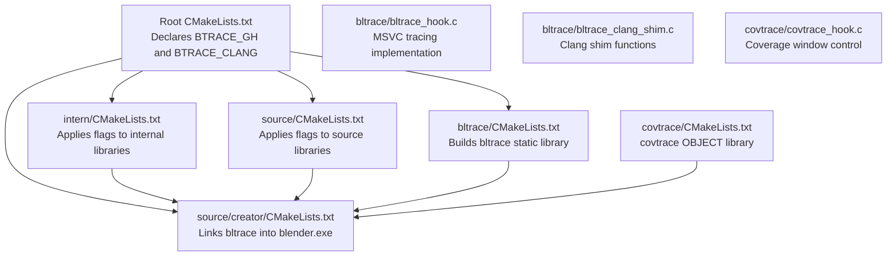
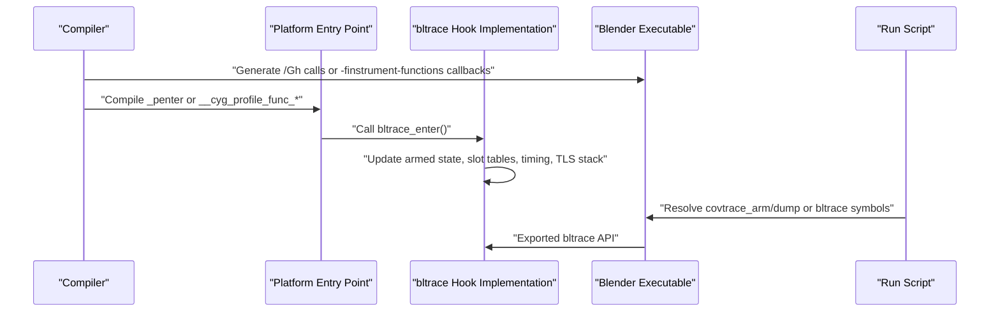
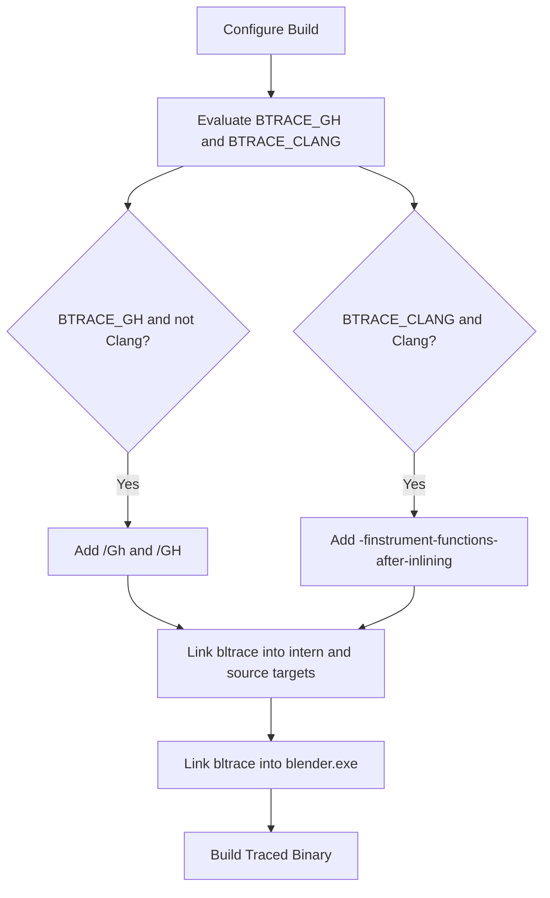
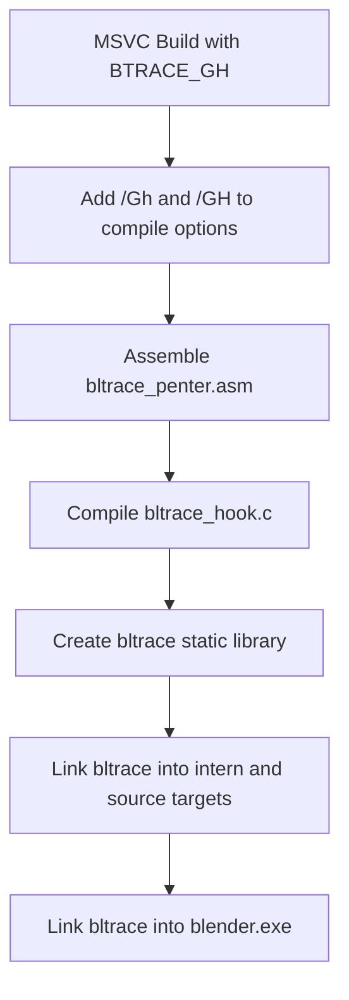
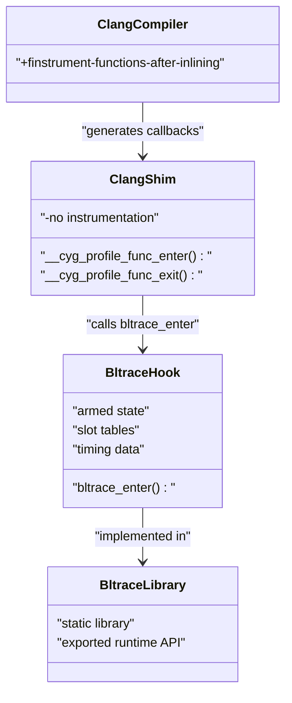
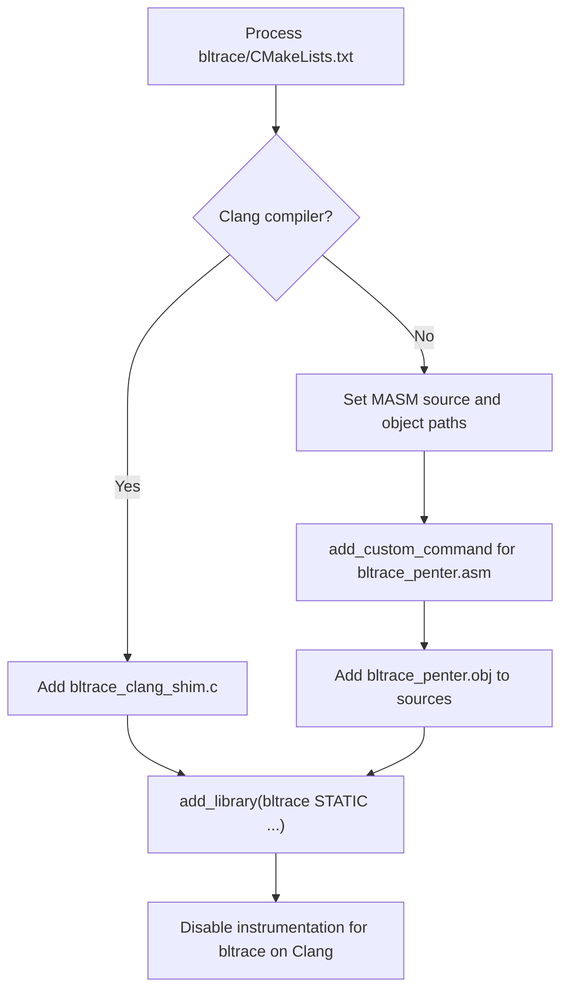
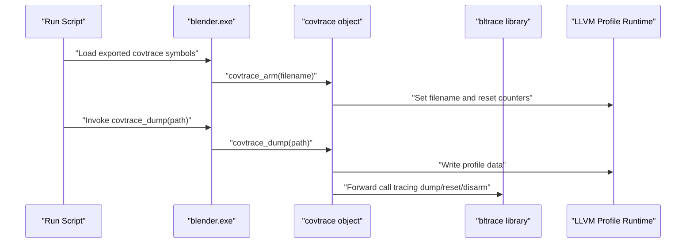
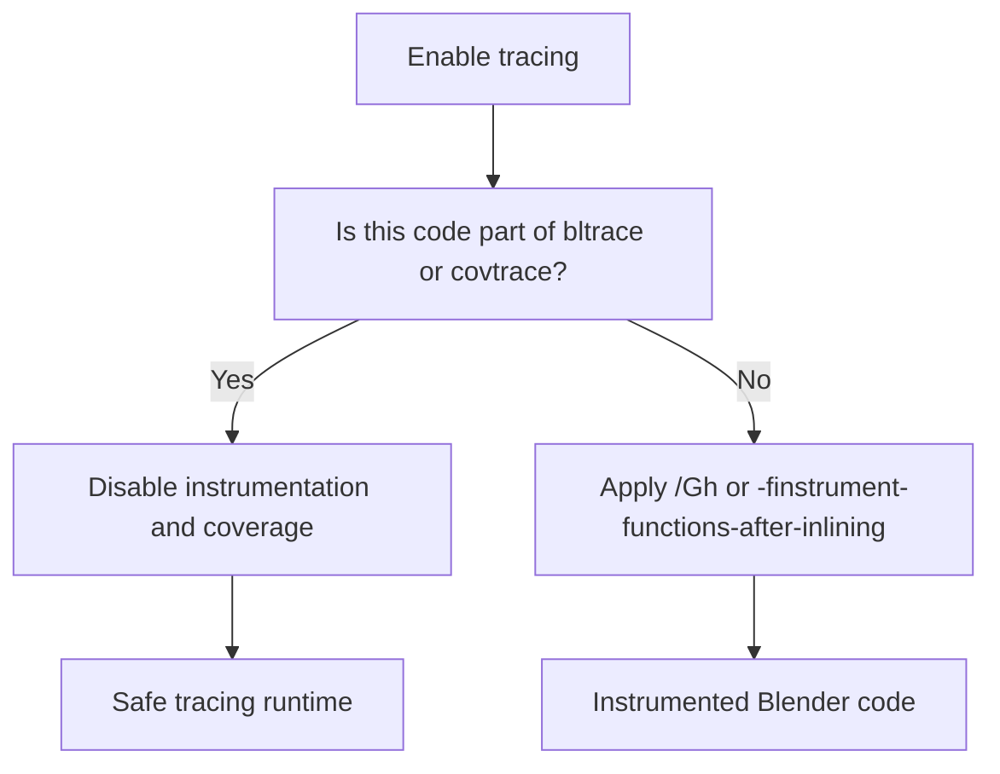
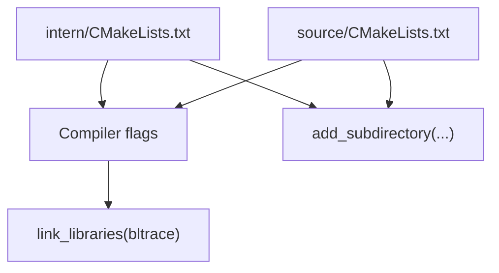
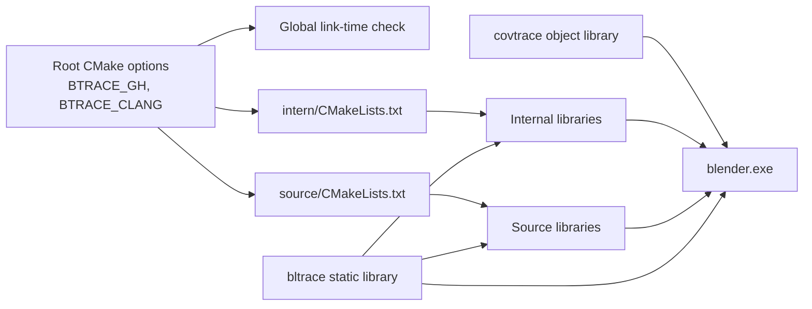

# Build System Integration

<cite>
**Referenced Files in This Document**   
- [CMakeLists.txt](file://CMakeLists.txt)
- [bltrace/CMakeLists.txt](file://bltrace/CMakeLists.txt)
- [bltrace/bltrace_hook.c](file://bltrace/bltrace_hook.c)
- [bltrace/bltrace_clang_shim.c](file://bltrace/bltrace_clang_shim.c)
- [covtrace/CMakeLists.txt](file://covtrace/CMakeLists.txt)
- [covtrace/covtrace_hook.c](file://covtrace/covtrace_hook.c)
- [intern/CMakeLists.txt](file://intern/CMakeLists.txt)
- [source/CMakeLists.txt](file://source/CMakeLists.txt)
- [source/creator/CMakeLists.txt](file://source/creator/CMakeLists.txt)
</cite>

## Table of Contents
1. [Introduction](#introduction)
2. [Project Structure](#project-structure)
3. [Core Components](#core-components)
4. [Architecture Overview](#architecture-overview)
5. [Detailed Component Analysis](#detailed-component-analysis)
6. [Dependency Analysis](#dependency-analysis)
7. [Performance Considerations](#performance-considerations)
8. [Troubleshooting Guide](#troubleshooting-guide)
9. [Conclusion](#conclusion)
10. [Appendices](#appendices)

## Introduction
This document explains how Blender’s CMake build system integrates runtime function tracing through the `bltrace` static library. It covers:

- Where the tracing options are declared and how they propagate through the CMake hierarchy.
- The conditional compilation paths for MSVC (`BTRACE_GH`) and Clang (`BTRACE_CLANG`).
- How the `bltrace` library is assembled differently on MSVC (with MASM assembly) versus Clang (with a C shim).
- Why the traced implementation itself is excluded from instrumentation to avoid recursive hooks and coverage pollution.
- How internal libraries, source modules, and the final Blender executable receive consistent target-specific setup.
- Troubleshooting guidance and examples for extending the integration to new targets.

## Project Structure
The relevant parts of the repository are organized into feature directories rather than layers:

- Root `CMakeLists.txt`: Declares user-facing trace options and applies them during global link setup.
- `bltrace/`: Implements the tracing runtime and its platform-specific entry points.
- `covtrace/`: Provides a thin object layer that forwards to both LLVM profile data and `bltrace`.
- `intern/` and `source/`: Apply tracing flags to large groups of components and finally to the Blender executable.

**Diagram sources**
- [CMakeLists.txt:208-209](file://CMakeLists.txt#L208-L209)
- [CMakeLists.txt:2697-2700](file://CMakeLists.txt#L2697-L2700)
- [intern/CMakeLists.txt:5-15](file://intern/CMakeLists.txt#L5-L15)
- [source/CMakeLists.txt:5-15](file://source/CMakeLists.txt#L5-L15)
- [source/creator/CMakeLists.txt:2115-2123](file://source/creator/CMakeLists.txt#L2115-L2123)
- [bltrace/CMakeLists.txt:1-49](file://bltrace/CMakeLists.txt#L1-L49)
- [covtrace/CMakeLists.txt:1-14](file://covtrace/CMakeLists.txt#L1-L14)

**Section sources**
- [CMakeLists.txt:208-209](file://CMakeLists.txt#L208-L209)
- [CMakeLists.txt:2697-2700](file://CMakeLists.txt#L2697-L2700)
- [bltrace/CMakeLists.txt:1-49](file://bltrace/CMakeLists.txt#L1-L49)
- [intern/CMakeLists.txt:1-20](file://intern/CMakeLists.txt#L1-L20)
- [source/CMakeLists.txt:1-15](file://source/CMakeLists.txt#L1-L15)
- [source/creator/CMakeLists.txt:2115-2123](file://source/creator/CMakeLists.txt#L2115-L2123)

## Core Components
The tracing integration consists of four interacting pieces:

| Component | Role | Platform behavior |
|---|---|---|
| Root CMake options | Declare `BTRACE_GH` and `BTRACE_CLANG` and apply them globally at link time. | Option scope affects all targets linked after propagation. |
| `bltrace` static library | Contains tracing state, hash tables, timing buffers, and exported runtime helpers. | MSVC uses `bltrace_hook.c` plus an assembled `bltrace_penter.asm`; Clang adds `bltrace_clang_shim.c`. |
| `covtrace` object library | Exposes wrapper symbols used by the runtime script and links against LLVM profile data. | Always built as an object library; never compiled with coverage or instrumentation. |
| Target propagation | Internal libraries, source libraries, and the Blender executable inherit tracing flags. | `intern/` and `source/` add compiler flags and link `bltrace`; `creator/` links it into the executable. |

**Section sources**
- [CMakeLists.txt:208-209](file://CMakeLists.txt#L208-L209)
- [CMakeLists.txt:2697-2700](file://CMakeLists.txt#L2697-L2700)
- [bltrace/CMakeLists.txt:1-49](file://bltrace/CMakeLists.txt#L1-L49)
- [covtrace/CMakeLists.txt:1-14](file://covtrace/CMakeLists.txt#L1-L14)

## Architecture Overview
The tracing architecture separates three concerns:

1. **Compiler-level hook generation**: MSVC injects call sites via `/Gh`, while Clang generates callbacks through `-finstrument-functions-after-inlining`.
2. **Runtime tracing implementation**: Shared C code maintains armed state, module base, slot tables, timing records, and TLS-based call stacks.
3. **Platform entry points**: A MASM `_penter` function on MSVC and C shim functions on Clang bridge compiler-generated hooks to `bltrace_enter`.

**Diagram sources**
- [CMakeLists.txt:208-209](file://CMakeLists.txt#L208-L209)
- [CMakeLists.txt:2697-2700](file://CMakeLists.txt#L2697-L2700)
- [bltrace/CMakeLists.txt:1-49](file://bltrace/CMakeLists.txt#L1-L49)
- [bltrace/bltrace_hook.c:1-200](file://bltrace/bltrace_hook.c#L1-L200)
- [bltrace/bltrace_clang_shim.c:1-27](file://bltrace/bltrace_clang_shim.c#L1-L27)
- [covtrace/covtrace_hook.c:1-85](file://covtrace/covtrace_hook.c#L1-L85)

## Detailed Component Analysis

### Tracing Options Propagation
The root configuration defines two options:

- `BTRACE_GH`: Enables MSVC function-entry tracing using `/Gh` and `/GH`.
- `BTRACE_CLANG`: Enables Clang callback instrumentation using `-finstrument-functions-after-inlining`.

These options are checked twice in the root CMake file: once for internal linkage setup and again for the final executable link step. The checks also guard against unsupported compiler combinations, such as applying MSVC-only flags when the compiler is Clang.

Propagation path:

1. Root CMake declares the options.
2. `intern/CMakeLists.txt` adds `/Gh /GH` or Clang instrumentation flags to every internal target.
3. `source/CMakeLists.txt` applies the same flags to source targets.
4. `source/creator/CMakeLists.txt` links `bltrace` directly into the Blender executable when either tracing mode is active.

**Diagram sources**
- [CMakeLists.txt:208-209](file://CMakeLists.txt#L208-L209)
- [CMakeLists.txt:2697-2700](file://CMakeLists.txt#L2697-L2700)
- [intern/CMakeLists.txt:5-15](file://intern/CMakeLists.txt#L5-L15)
- [source/CMakeLists.txt:5-15](file://source/CMakeLists.txt#L5-L15)
- [source/creator/CMakeLists.txt:2115-2123](file://source/creator/CMakeLists.txt#L2115-L2123)

**Section sources**
- [CMakeLists.txt:208-209](file://CMakeLists.txt#L208-L209)
- [CMakeLists.txt:2697-2700](file://CMakeLists.txt#L2697-L2700)
- [intern/CMakeLists.txt:5-15](file://intern/CMakeLists.txt#L5-L15)
- [source/CMakeLists.txt:5-15](file://source/CMakeLists.txt#L5-L15)
- [source/creator/CMakeLists.txt:2115-2123](file://source/creator/CMakeLists.txt#L2115-L2123)

### MSVC Tracing Path: BTRACE_GH
When `BTRACE_GH` is enabled and the compiler is not Clang:

- Every target under `intern/` and `source/` receives `/Gh` and `/GH`.
- These flags make MSVC insert calls to `_penter` at function entry points.
- `bltrace_penter.asm` is assembled separately because it does not need C/C++ preprocessor definitions.
- `bltrace_hook.c` implements the tracing runtime, including exported helpers such as `bltrace_arm`, `bltrace_disarm`, and `bltrace_enter`.

The MASM object is marked as external and generated so CMake treats it correctly during dependency tracking and linking.

**Diagram sources**
- [CMakeLists.txt:208](file://CMakeLists.txt#L208)
- [CMakeLists.txt:2697-2699](file://CMakeLists.txt#L2697-L2699)
- [intern/CMakeLists.txt:5-9](file://intern/CMakeLists.txt#L5-L9)
- [source/CMakeLists.txt:5-9](file://source/CMakeLists.txt#L5-L9)
- [bltrace/CMakeLists.txt:7-35](file://bltrace/CMakeLists.txt#L7-L35)
- [bltrace/CMakeLists.txt:37-49](file://bltrace/CMakeLists.txt#L37-L49)

**Section sources**
- [CMakeLists.txt:208](file://CMakeLists.txt#L208)
- [CMakeLists.txt:2697-2699](file://CMakeLists.txt#L2697-L2699)
- [intern/CMakeLists.txt:5-9](file://intern/CMakeLists.txt#L5-L9)
- [source/CMakeLists.txt:5-9](file://source/CMakeLists.txt#L5-L9)
- [bltrace/CMakeLists.txt:7-35](file://bltrace/CMakeLists.txt#L7-L35)
- [bltrace/CMakeLists.txt:37-49](file://bltrace/CMakeLists.txt#L37-L49)
- [bltrace/bltrace_hook.c:1-200](file://bltrace/bltrace_hook.c#L1-L200)

### Clang Tracing Path: BTRACE_CLANG
When `BTRACE_CLANG` is enabled and the compiler is Clang:

- Targets receive `/clang:-finstrument-functions-after-inlining`.
- Instead of MASM, `bltrace_clang_shim.c` provides `__cyg_profile_func_enter` and `__cyg_profile_func_exit`.
- The shim forwards these callbacks to the shared `bltrace_enter` implementation.
- The shim translation unit is explicitly excluded from instrumentation and line coverage.

Using the post-inlining callback avoids instrumenting too early in the pipeline and aligns the behavior more closely with MSVC’s function-entry semantics.

**Diagram sources**
- [CMakeLists.txt:209](file://CMakeLists.txt#L209)
- [CMakeLists.txt:2700-2700](file://CMakeLists.txt#L2700-L2700)
- [intern/CMakeLists.txt:11-15](file://intern/CMakeLists.txt#L11-L15)
- [source/CMakeLists.txt:11-15](file://source/CMakeLists.txt#L11-L15)
- [bltrace/CMakeLists.txt:3-6](file://bltrace/CMakeLists.txt#L3-L6)
- [bltrace/CMakeLists.txt:39-49](file://bltrace/CMakeLists.txt#L39-L49)
- [bltrace/bltrace_clang_shim.c:1-27](file://bltrace/bltrace_clang_shim.c#L1-L27)
- [bltrace/bltrace_hook.c:1-200](file://bltrace/bltrace_hook.c#L1-L200)

**Section sources**
- [CMakeLists.txt:209](file://CMakeLists.txt#L209)
- [CMakeLists.txt:2700-2700](file://CMakeLists.txt#L2700-L2700)
- [intern/CMakeLists.txt:11-15](file://intern/CMakeLists.txt#L11-L15)
- [source/CMakeLists.txt:11-15](file://source/CMakeLists.txt#L11-L15)
- [bltrace/CMakeLists.txt:3-6](file://bltrace/CMakeLists.txt#L3-L6)
- [bltrace/CMakeLists.txt:39-49](file://bltrace/CMakeLists.txt#L39-L49)
- [bltrace/bltrace_clang_shim.c:1-27](file://bltrace/bltrace_clang_shim.c#L1-L27)

### bltrace Static Library Construction
The `bltrace` library adapts its source list based on the compiler:

- Default source: `bltrace_hook.c`.
- Clang addition: `bltrace_clang_shim.c`.
- Non-Clang addition: a custom command that invokes `CMAKE_ASM_MASM_COMPILER` to assemble `bltrace_penter.asm`.
- The MASM output is marked `EXTERNAL_OBJECT` and `GENERATED`.
- On Clang, the library disables instrumentation and coverage mapping for itself.

**Diagram sources**
- [bltrace/CMakeLists.txt:3-6](file://bltrace/CMakeLists.txt#L3-L6)
- [bltrace/CMakeLists.txt:7-35](file://bltrace/CMakeLists.txt#L7-L35)
- [bltrace/CMakeLists.txt:37-49](file://bltrace/CMakeLists.txt#L37-L49)

**Section sources**
- [bltrace/CMakeLists.txt:1-49](file://bltrace/CMakeLists.txt#L1-L49)

### Coverage Window Control with covtrace
The `covtrace` component is separate from the regular tracing flags:

- It is built as an OBJECT library from `covtrace_hook.c`.
- It exports wrapper functions that call both `bltrace` and LLVM profile APIs.
- Its compile options disable profile instrumentation, coverage mapping, and function instrumentation so resetting counters does not pollute coverage data.
- The Blender executable links `$<TARGET_OBJECTS:covtrace_obj>` when `WITH_COMPILER_CODE_COVERAGE` is enabled.

**Diagram sources**
- [covtrace/CMakeLists.txt:1-14](file://covtrace/CMakeLists.txt#L1-L14)
- [covtrace/covtrace_hook.c:1-85](file://covtrace/covtrace_hook.c#L1-L85)
- [source/creator/CMakeLists.txt:2115-2123](file://source/creator/CMakeLists.txt#L2115-L2123)

**Section sources**
- [covtrace/CMakeLists.txt:1-14](file://covtrace/CMakeLists.txt#L1-L14)
- [covtrace/covtrace_hook.c:1-85](file://covtrace/covtrace_hook.c#L1-L85)
- [source/creator/CMakeLists.txt:2115-2123](file://source/creator/CMakeLists.txt#L2115-L2123)

### Exclusion of Instrumented Code from Self-Instrumentation
Recursive hooking and coverage pollution are prevented at multiple levels:

| Location | Mechanism | Reason |
|---|---|---|
| `bltrace` on Clang | `target_compile_options` disables `-finstrument-functions` and `-finstrument-functions-after-inlining`. | Prevents the tracing implementation from calling itself recursively. |
| `bltrace` on Clang with coverage | Disables `-fprofile-instr-generate` and `-fno-coverage-mapping`. | Prevents coverage counters from being polluted by traced code. |
| `covtrace` object | Same exclusion flags applied unconditionally. | Resetting counters must not create new coverage entries. |
| MSVC path | `/Gh` is applied to application code, while `bltrace_penter.asm` and `bltrace_hook.c` are part of the static library and do not re-enter the traced surface. | Keeps hook logic outside the instrumented call graph. |

**Diagram sources**
- [bltrace/CMakeLists.txt:39-49](file://bltrace/CMakeLists.txt#L39-L49)
- [covtrace/CMakeLists.txt:6-14](file://covtrace/CMakeLists.txt#L6-L14)

**Section sources**
- [bltrace/CMakeLists.txt:39-49](file://bltrace/CMakeLists.txt#L39-L49)
- [covtrace/CMakeLists.txt:6-14](file://covtrace/CMakeLists.txt#L6-L14)

### Target-Specific Setup in intern and source
Both `intern/CMakeLists.txt` and `source/CMakeLists.txt` mirror the same conditional logic:

- If `BTRACE_GH` is enabled and the compiler is not Clang, add `/Gh` and `/GH` and link `bltrace`.
- If `BTRACE_CLANG` is enabled and the compiler is Clang, add `/clang:-finstrument-functions-after-inlining` and link `bltrace`.

This ensures consistency across all internal libraries and source modules without duplicating per-target logic.

**Diagram sources**
- [intern/CMakeLists.txt:5-15](file://intern/CMakeLists.txt#L5-L15)
- [source/CMakeLists.txt:5-15](file://source/CMakeLists.txt#L5-L15)

**Section sources**
- [intern/CMakeLists.txt:1-20](file://intern/CMakeLists.txt#L1-L20)
- [source/CMakeLists.txt:1-20](file://source/CMakeLists.txt#L1-L20)

## Dependency Analysis
The build dependencies form a layered structure where options flow downward and linking flows upward:

**Diagram sources**
- [CMakeLists.txt:208-209](file://CMakeLists.txt#L208-L209)
- [CMakeLists.txt:2697-2700](file://CMakeLists.txt#L2697-L2700)
- [intern/CMakeLists.txt:5-15](file://intern/CMakeLists.txt#L5-L15)
- [source/CMakeLists.txt:5-15](file://source/CMakeLists.txt#L5-L15)
- [bltrace/CMakeLists.txt:1-49](file://bltrace/CMakeLists.txt#L1-L49)
- [covtrace/CMakeLists.txt:1-14](file://covtrace/CMakeLists.txt#L1-L14)
- [source/creator/CMakeLists.txt:2115-2123](file://source/creator/CMakeLists.txt#L2115-L2123)

**Section sources**
- [CMakeLists.txt:208-209](file://CMakeLists.txt#L208-L209)
- [CMakeLists.txt:2697-2700](file://CMakeLists.txt#L2697-L2700)
- [bltrace/CMakeLists.txt:1-49](file://bltrace/CMakeLists.txt#L1-L49)
- [covtrace/CMakeLists.txt:1-14](file://covtrace/CMakeLists.txt#L1-L14)
- [intern/CMakeLists.txt:5-15](file://intern/CMakeLists.txt#L5-L15)
- [source/CMakeLists.txt:5-15](file://source/CMakeLists.txt#L5-L15)
- [source/creator/CMakeLists.txt:2115-2123](file://source/creator/CMakeLists.txt#L2115-L2123)

## Performance Considerations
- Function-entry tracing increases call overhead because every instrumented function now performs additional work in the tracing runtime.
- MSVC’s `/Gh` inserts calls at function entry, which can affect binary size and execution speed.
- Clang’s `-finstrument-functions-after-inlining` instruments after optimization passes, reducing some noise but still adding runtime cost.
- The `bltrace` implementation uses lock-free atomic operations and hash-slot tables to minimize contention, but high-frequency tracing may still impact performance.
- Coverage instrumentation should be disabled for traced code to prevent counter pollution and misleading profiling results.

[No sources needed since this section provides general guidance]

## Troubleshooting Guide

### Symbol Export Problems
**Symptoms:**
- Missing `bltrace_arm`, `bltrace_reset`, `bltrace_dump`, or related symbols at runtime.
- The run script cannot resolve tracing helper functions.

**Likely causes:**
- `bltrace` was not linked into the final executable.
- The symbol export path differs between MSVC and Clang builds.
- The `covtrace` wrapper is not included when coverage features are expected.

**Checks:**
- Confirm `BTRACE_GH` or `BTRACE_CLANG` is set according to the active compiler.
- Verify that `bltrace` is linked through `intern/`, `source/`, and `source/creator/CMakeLists.txt`.
- For coverage-related scripts, ensure `WITH_COMPILER_CODE_COVERAGE` includes the `covtrace` object library.

**Relevant files:**
- [CMakeLists.txt:208-209](file://CMakeLists.txt#L208-L209)
- [CMakeLists.txt:2697-2700](file://CMakeLists.txt#L2697-L2700)
- [source/creator/CMakeLists.txt:2115-2123](file://source/creator/CMakeLists.txt#L2115-L2123)
- [covtrace/covtrace_hook.c:1-85](file://covtrace/covtrace_hook.c#L1-L85)

### Linker Errors with MASM Objects
**Symptoms:**
- MASM assembler failures.
- Missing or incorrectly treated `.obj` artifacts from `bltrace_penter.asm`.
- CMake warnings about external or generated objects.

**Likely causes:**
- `CMAKE_ASM_MASM_COMPILER` is unavailable or misconfigured.
- The custom command did not produce the expected object path.
- The object properties were not marked as external and generated.

**Checks:**
- Ensure the non-Clang branch in `bltrace/CMakeLists.txt` runs and emits `bltrace_penter.obj`.
- Confirm the object is added to `BLTRACE_SOURCES`.
- Confirm `EXTERNAL_OBJECT TRUE` and `GENERATED TRUE` are set.

**Relevant files:**
- [bltrace/CMakeLists.txt:7-35](file://bltrace/CMakeLists.txt#L7-L35)
- [bltrace/CMakeLists.txt:37-49](file://bltrace/CMakeLists.txt#L37-L49)

### Compiler Version Compatibility
**Symptoms:**
- Configuration fails due to unsupported GCC, Clang, or MSVC versions.
- Unexpected tracing behavior when mixing compilers.

**Likely causes:**
- Using an older compiler than the minimum supported version.
- Applying MSVC-only flags to a Clang build.
- Enabling `BTRACE_CLANG` with a non-Clang compiler.

**Checks:**
- Review the root compiler version validation logic.
- Verify the conditional branches use `CMAKE_CXX_COMPILER_ID MATCHES "Clang"` consistently.
- Use `BTRACE_GH` only with MSVC and `BTRACE_CLANG` only with Clang.

**Relevant files:**
- [CMakeLists.txt:208-209](file://CMakeLists.txt#L208-L209)
- [CMakeLists.txt:2697-2700](file://CMakeLists.txt#L2697-L2700)
- [intern/CMakeLists.txt:5-15](file://intern/CMakeLists.txt#L5-L15)
- [source/CMakeLists.txt:5-15](file://source/CMakeLists.txt#L5-L15)

### Recursive Hooking or Coverage Pollution
**Symptoms:**
- Infinite recursion during tracing initialization.
- Coverage data contains entries from tracing code.
- Counter resets appear to lose previously collected data.

**Likely causes:**
- Instrumentation was not disabled for `bltrace` or `covtrace`.
- Both tracing and coverage instrumentation were enabled together incorrectly.

**Checks:**
- Confirm Clang builds disable `-finstrument-functions*` for `bltrace`.
- Confirm `covtrace` disables profile instrumentation and coverage mapping.
- Avoid enabling tracing for the tracing implementation itself.

**Relevant files:**
- [bltrace/CMakeLists.txt:39-49](file://bltrace/CMakeLists.txt#L39-L49)
- [covtrace/CMakeLists.txt:6-14](file://covtrace/CMakeLists.txt#L6-L14)

**Section sources**
- [CMakeLists.txt:208-209](file://CMakeLists.txt#L208-L209)
- [CMakeLists.txt:2697-2700](file://CMakeLists.txt#L2697-L2700)
- [bltrace/CMakeLists.txt:7-49](file://bltrace/CMakeLists.txt#L7-L49)
- [covtrace/CMakeLists.txt:6-14](file://covtrace/CMakeLists.txt#L6-L14)
- [source/creator/CMakeLists.txt:2115-2123](file://source/creator/CMakeLists.txt#L2115-L2123)
- [covtrace/covtrace_hook.c:1-85](file://covtrace/covtrace_hook.c#L1-L85)

## Conclusion
Blender’s tracing integration is a carefully layered CMake design. The root options define the intended tracing mode, `intern/` and `source/` propagate compiler flags consistently, and `source/creator/CMakeLists.txt` links the tracing runtime into the final executable. The `bltrace` library adapts to the compiler: MSVC uses MASM assembly and `/Gh`, while Clang uses a C shim and `-finstrument-functions-after-inlining`. Both paths exclude the tracing implementation from instrumentation to prevent recursive hooks and coverage pollution. When extending the integration, copy the existing conditional pattern, link `bltrace` consistently, and keep instrumentation disabled for tracing code itself.

[No sources needed since this section summarizes without analyzing specific files]

## Appendices

### Extending the Integration to New Targets
To add tracing support to a new target:

1. Place the target under `intern/` or `source/` so it inherits the existing flag propagation.
2. If the target is built outside those trees, replicate the conditional block:
   - Add `/Gh /GH` when `BTRACE_GH` is enabled and the compiler is not Clang.
   - Add `/clang:-finstrument-functions-after-inlining` when `BTRACE_CLANG` is enabled and the compiler is Clang.
   - Link `bltrace` under the same condition.
3. If the target participates in coverage workflows, consider adding the `covtrace` object library and disabling instrumentation for any self-tracing code.
4. Test with both MSVC and Clang configurations if applicable.

**Section sources**
- [intern/CMakeLists.txt:5-15](file://intern/CMakeLists.txt#L5-L15)
- [source/CMakeLists.txt:5-15](file://source/CMakeLists.txt#L5-L15)
- [source/creator/CMakeLists.txt:2115-2123](file://source/creator/CMakeLists.txt#L2115-L2123)
- [covtrace/CMakeLists.txt:1-14](file://covtrace/CMakeLists.txt#L1-L14)