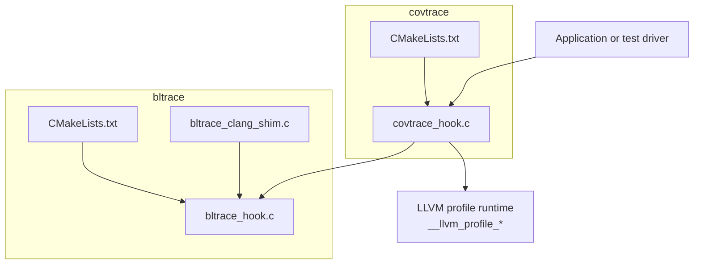
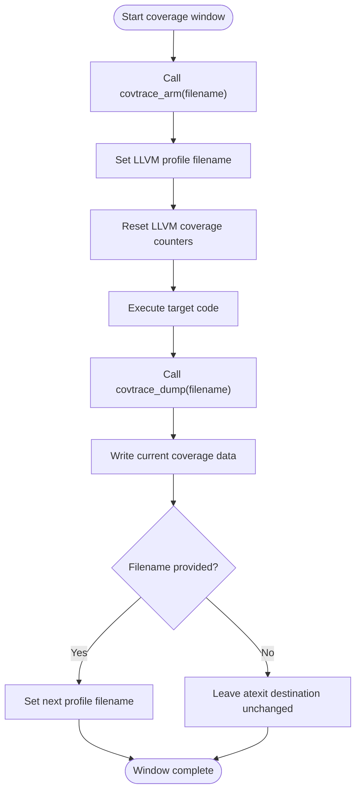
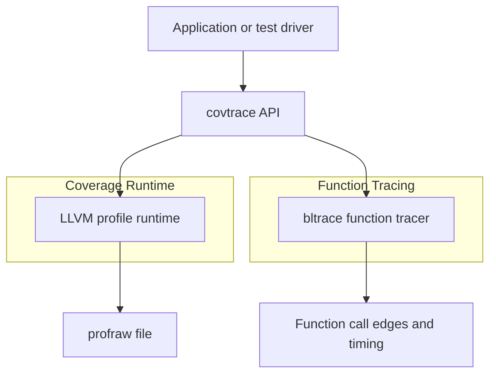
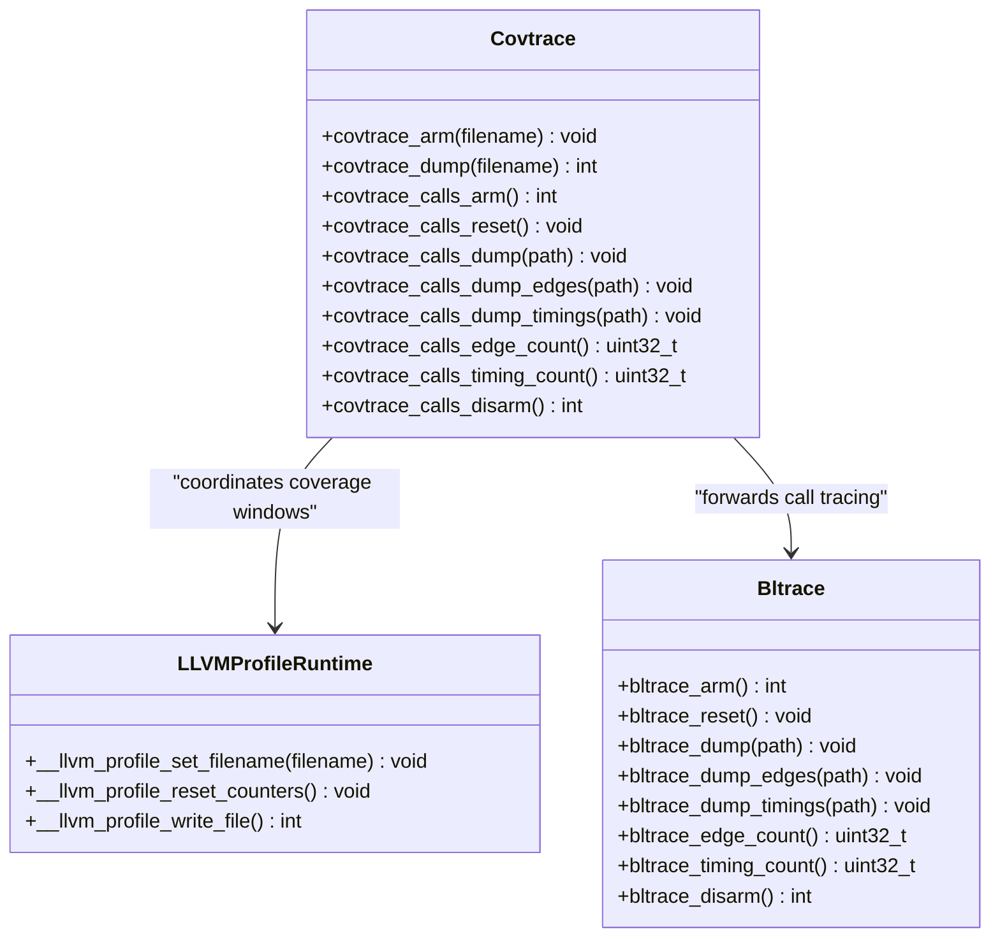
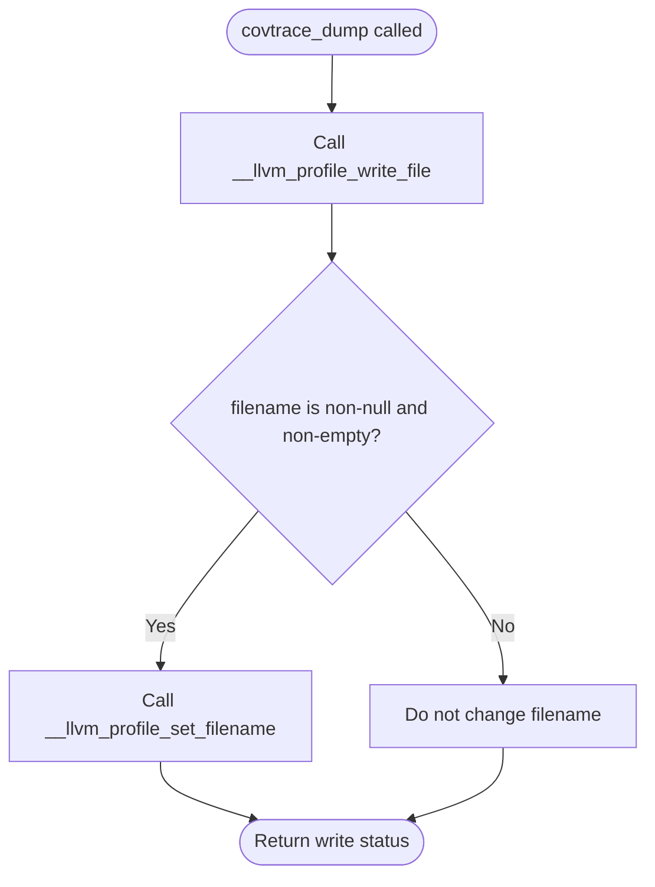
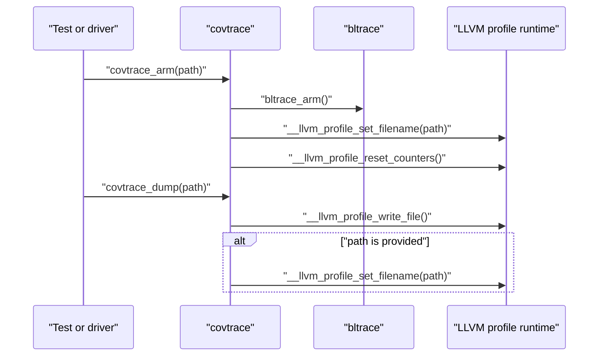
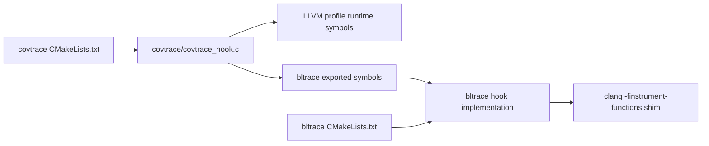

# Coverage Control (covtrace)

<cite>
**Referenced Files in This Document**
- [covtrace_hook.c](file://covtrace/covtrace_hook.c)
- [CMakeLists.txt](file://covtrace/CMakeLists.txt)
- [bltrace_hook.c](file://bltrace/bltrace_hook.c)
- [bltrace_clang_shim.c](file://bltrace/bltrace_clang_shim.c)
- [CMakeLists.txt](file://bltrace/CMakeLists.txt)
</cite>

## Table of Contents
1. [Introduction](#introduction)
2. [Project Structure](#project-structure)
3. [Core Components](#core-components)
4. [Architecture Overview](#architecture-overview)
5. [Detailed Component Analysis](#detailed-component-analysis)
6. [Dependency Analysis](#dependency-analysis)
7. [Performance Considerations](#performance-considerations)
8. [Troubleshooting Guide](#troubleshooting-guide)
9. [Conclusion](#conclusion)
10. [Appendices](#appendices)

## Introduction
This document explains the covtrace coverage window control system. It is a small public API facade that coordinates two measurement systems:

- LLVM’s instrumentation-based coverage runtime, configured through `-fprofile-instr-generate` and producing profraw data.
- bltrace, which records function entry/exit call edges and timing information on Windows.

covtrace does not implement coverage collection itself. Instead, it orchestrates the LLVM coverage runtime by setting filenames, resetting counters, writing the current window, and redirecting future output. It also forwards selected calls to bltrace so that function tracing and coverage can be coordinated from one place.

The central idea is a **coverage window**: a bounded period during which coverage is collected into a specific file. A window starts with `covtrace_arm`, ends with `covtrace_dump`, and prevents later exit-time writes from overwriting the captured window data.

## Project Structure
The relevant implementation lives under `covtrace/`. Its single source file exports the public API and delegates to both the LLVM profile runtime and bltrace. The CMake configuration builds covtrace as an object library and explicitly disables coverage instrumentation for covtrace itself, so its own function calls do not pollute the counters being measured.

**Diagram sources**
- [covtrace_hook.c:1-85](file://covtrace/covtrace_hook.c#L1-L85)
- [CMakeLists.txt](file://covtrace/CMakeLists.txt#L1-L14)
- [bltrace_hook.c:1-200](file://bltrace/bltrace_hook.c#L1-L200)
- [bltrace_clang_shim.c:1-27](file://bltrace/bltrace_clang_shim.c#L1-L27)
- [CMakeLists.txt](file://bltrace/CMakeLists.txt#L1-L49)

**Section sources**
- [covtrace_hook.c:1-85](file://covtrace/covtrace_hook.c#L1-L85)
- [CMakeLists.txt](file://covtrace/CMakeLists.txt#L1-L14)
- [bltrace_hook.c:1-200](file://bltrace/bltrace_hook.c#L1-L200)
- [bltrace_clang_shim.c:1-27](file://bltrace/bltrace_clang_shim.c#L1-L27)
- [CMakeLists.txt](file://bltrace/CMakeLists.txt#L1-L49)

## Core Components
covtrace exposes three main coverage-window functions:

| Function | Purpose | Parameters | Return value |
|---|---|---|---|
| `covtrace_arm` | Starts a new coverage window. Sets the next profile filename and resets LLVM counters. | `filename`: destination path for the next coverage window. May be null or empty. | No return value. |
| `covtrace_dump` | Writes the current coverage window and redirects future atexit writes away from the same file. | `filename`: optional path for the written window. If non-empty, future writes are redirected there. | Integer status from the underlying LLVM write operation. |
| `covtrace_disarm` | Not exported by covtrace itself. Available through the bltrace bridge for function-tracing state. | None. | Previous armed state of the function tracer. |

covtrace also provides a set of call-tracing wrappers prefixed with `covtrace_calls_` that forward to bltrace. These are useful when tests want to arm, reset, dump edges/timings, query counts, and disarm function tracing alongside coverage windows.

### How the Window Pattern Works
A typical window follows this sequence:

1. Call `covtrace_arm(path)` before starting the workload.
2. Run the code whose coverage you want to capture.
3. Call `covtrace_dump(path)` after the workload finishes.
4. Optionally repeat the pattern for additional windows.

The important guarantee is that `covtrace_dump` first flushes the current coverage data and then changes the destination so the process-wide atexit handler cannot overwrite the already-written file.

**Diagram sources**
- [covtrace_hook.c:60-85](file://covtrace/covtrace_hook.c#L60-L85)

**Section sources**
- [covtrace_hook.c:1-85](file://covtrace/covtrace_hook.c#L1-L85)

## Architecture Overview
covtrace sits between application/test code and two lower-level systems.

- On top, applications call covtrace’s exported functions.
- In the middle, covtrace translates those calls into LLVM profile runtime operations and bltrace operations.
- At the bottom, LLVM collects instrumentation coverage and produces profraw files; bltrace records function entry/exit edges and timing.

**Diagram sources**
- [covtrace_hook.c:1-85](file://covtrace/covtrace_hook.c#L1-L85)
- [bltrace_hook.c:1-200](file://bltrace/bltrace_hook.c#L1-L200)

## Detailed Component Analysis

### covtrace Hook Implementation
The file `covtrace/covtrace_hook.c` is the core implementation. It declares extern references to three LLVM profile runtime symbols and reuses bltrace’s exported symbols directly.

Key responsibilities:

- Expose `covtrace_arm`, `covtrace_dump`, and call-tracing helpers.
- Forward most call-tracing operations to bltrace.
- Manage the LLVM coverage window lifecycle.
- Prevent the default atexit writer from overwriting captured coverage data.

#### Public API Surface

| Symbol | Exported? | Description |
|---|---:|---|
| `covtrace_calls_arm` | Yes | Arms bltrace call tracing and returns success. |
| `covtrace_calls_reset` | Yes | Resets bltrace counters. |
| `covtrace_calls_dump` | Yes | Dumps bltrace call data. |
| `covtrace_calls_dump_edges` | Yes | Dumps call-edge data. |
| `covtrace_calls_dump_timings` | Yes | Dumps timing data. |
| `covtrace_calls_edge_count` | Yes | Returns the number of recorded edges. |
| `covtrace_calls_timing_count` | Yes | Returns the number of timing records. |
| `covtrace_calls_disarm` | Yes | Disarms bltrace call tracing. |
| `covtrace_arm` | Yes | Starts a coverage window. |
| `covtrace_dump` | Yes | Flushes and redirects coverage output. |

#### Class-like View of Responsibilities
Although the implementation is procedural rather than class-based, it is helpful to view covtrace as a coordinator with two subsystems:

**Diagram sources**
- [covtrace_hook.c:1-85](file://covtrace/covtrace_hook.c#L1-L85)

#### Window Management Logic
The window management logic is concentrated in `covtrace_dump`. Its behavior is intentionally defensive:

1. Write the current LLVM coverage data.
2. If a filename is supplied, update the next profile filename.
3. Return the write result.

This design avoids the common problem where a process exits and the LLVM runtime writes again to the same filename, destroying the previously captured window.

**Diagram sources**
- [covtrace_hook.c:72-85](file://covtrace/covtrace_hook.c#L72-L85)

**Section sources**
- [covtrace_hook.c:1-85](file://covtrace/covtrace_hook.c#L1-L85)

### Integration with LLVM Coverage Runtime
covtrace relies on three externally provided LLVM profile runtime functions:

| Function | Role |
|---|---|
| `__llvm_profile_set_filename` | Configures the destination path for the next coverage output. |
| `__llvm_profile_reset_counters` | Clears accumulated coverage counters, starting a fresh window. |
| `__llvm_profile_write_file` | Flushes the current coverage data and returns a status code. |

These symbols are expected to be linked in because the application or target code is compiled with `-fprofile-instr-generate`. That compiler flag instruments the program and arranges for the LLVM runtime to collect branch and function coverage into profraw format.

Important points:

- The LLVM runtime normally writes coverage data at process exit unless told otherwise.
- covtrace uses `__llvm_profile_set_filename` to choose where each window’s data goes.
- covtrace uses `__llvm_profile_reset_counters` to begin a clean window.
- covtrace uses `__llvm_profile_write_file` to explicitly capture data before the process exits.

#### Typical Usage Pattern for LLVM Coverage
A testing workflow might look like this:

1. Compile the workload with `-fprofile-instr-generate`.
2. Before the workload, call `covtrace_arm("coverage_window_1.profraw")`.
3. Execute the test case or feature under analysis.
4. After the workload, call `covtrace_dump("coverage_window_1.profraw")`.
5. Repeat for additional test cases or phases if needed.
6. Do not rely on the default exit-time write for the same filename, because `covtrace_dump` has already redirected future output.

**Section sources**
- [covtrace_hook.c:1-18](file://covtrace/covtrace_hook.c#L1-L18)
- [covtrace_hook.c:60-85](file://covtrace/covtrace_hook.c#L60-L85)

### Relationship with bltrace Function Tracing
covtrace also acts as a thin wrapper around bltrace. This is useful because coverage and function tracing answer different questions:

- Coverage answers “which instrumented branches and functions were executed?”
- Function tracing answers “which functions were entered, how often, and with what call relationships and timing?”

The covtrace layer forwards several bltrace operations:

- Arming and disarming function tracing.
- Resetting trace state.
- Dumping edges and timings.
- Querying edge and timing record counts.

The bltrace side records call edges and timing data using platform-specific mechanisms. On Clang builds, it uses `-finstrument-functions` entry points. On MSVC-style builds, it uses injected function-entry hooks.

**Diagram sources**
- [covtrace_hook.c:20-85](file://covtrace/covtrace_hook.c#L20-L85)
- [bltrace_hook.c:1-200](file://bltrace/bltrace_hook.c#L1-L200)

**Section sources**
- [covtrace_hook.c:20-58](file://covtrace/covtrace_hook.c#L20-L58)
- [bltrace_hook.c:1-200](file://bltrace/bltrace_hook.c#L1-L200)
- [bltrace_clang_shim.c:1-27](file://bltrace/bltrace_clang_shim.c#L1-L27)

## Dependency Analysis
covtrace has low internal complexity but meaningful external dependencies.

- **External LLVM symbols:** covtrace declares but does not define `__llvm_profile_set_filename`, `__llvm_profile_reset_counters`, and `__llvm_profile_write_file`. The consumer must link against a build that includes the LLVM coverage runtime, typically via `-fprofile-instr-generate`.
- **Internal bltrace dependency:** covtrace links directly against bltrace’s exported symbols instead of depending on a separate bltrace import library. This is necessary because the blender linker drops some `/EXPORT` directives from bltrace.lib.
- **Self-instrumentation avoidance:** covtrace is built with coverage and function instrumentation disabled. This prevents covtrace’s own calls from being counted or polluting the coverage data it is trying to measure.

**Diagram sources**
- [covtrace_hook.c:1-85](file://covtrace/covtrace_hook.c#L1-L85)
- [CMakeLists.txt](file://covtrace/CMakeLists.txt#L1-L14)
- [bltrace_hook.c:1-200](file://bltrace/bltrace_hook.c#L1-L200)
- [bltrace_clang_shim.c:1-27](file://bltrace/bltrace_clang_shim.c#L1-L27)
- [CMakeLists.txt](file://bltrace/CMakeLists.txt#L1-L49)

### Coupling and Cohesion
- **Cohesion:** covtrace has a clear single purpose: coordinate coverage windows and expose a unified interface to both LLVM coverage and bltrace.
- **Coupling:** covtrace is tightly coupled to the names and contracts of the LLVM profile runtime symbols and bltrace’s exported API. However, it isolates those details behind a small, stable surface.
- **Circular dependencies:** There is no circular dependency in covtrace. It depends outward on LLVM and bltrace, but neither depends back on covtrace.

**Section sources**
- [covtrace_hook.c:1-85](file://covtrace/covtrace_hook.c#L1-L85)
- [CMakeLists.txt](file://covtrace/CMakeLists.txt#L1-L14)
- [CMakeLists.txt](file://bltrace/CMakeLists.txt#L1-L49)

## Performance Considerations
covtrace is designed to add minimal overhead while enabling comprehensive measurements.

- **Explicit window writes:** Using `covtrace_dump` avoids repeated or unexpected writes caused by process-exit handlers. This gives deterministic control over when coverage data is flushed.
- **Counter resets:** Calling `covtrace_arm` resets LLVM counters, ensuring each window represents only the intended workload segment.
- **Disabled self-instrumentation:** covtrace is compiled without coverage mapping and without function instrumentation. This prevents covtrace’s own helper functions from being recorded in coverage or call traces.
- **Bltrace buffers:** bltrace uses fixed-size slot tables and TLS-backed stacks. The covtrace layer does not allocate per-call trace storage, keeping per-function overhead low.

Recommended practices:

- Avoid calling `covtrace_arm` excessively inside tight loops. Each call resets coverage counters.
- Use one window per logical test phase or scenario.
- Keep the filename argument consistent within a test run to make profiling results easier to identify.
- Combine coverage windows with function tracing when diagnosing performance problems, but understand that they produce different outputs and should be interpreted separately.

[No sources needed since this section provides general guidance]

## Troubleshooting Guide

### Coverage File Is Empty or Missing
Possible causes:

- The workload was not compiled with `-fprofile-instr-generate`.
- `covtrace_arm` was never called before the workload.
- `covtrace_dump` was never called, and the process exited before the default coverage writer ran.
- The filename passed to `covtrace_dump` is null or empty, so no explicit write occurs.

Checklist:

1. Confirm the target binary is linked with LLVM coverage instrumentation enabled.
2. Verify `covtrace_arm` is called before the code under test.
3. Verify `covtrace_dump` is called after the code under test.
4. Ensure the filename argument is a valid path string.

**Section sources**
- [covtrace_hook.c:1-18](file://covtrace/covtrace_hook.c#L1-L18)
- [covtrace_hook.c:60-85](file://covtrace/covtrace_hook.c#L60-L85)

### Existing Coverage File Was Overwritten
Likely cause:

- Multiple windows used the same filename without proper redirection.
- The process exited after a window and the LLVM runtime wrote again to the same location.

Resolution:

- Use a unique filename per window.
- Always call `covtrace_dump` with the desired filename so it can redirect future writes.
- Avoid relying on the default exit-time writer when you need precise window boundaries.

**Section sources**
- [covtrace_hook.c:72-85](file://covtrace/covtrace_hook.c#L72-L85)

### Coverage Data Contains covtrace or Helper Functions
Likely cause:

- covtrace or related helper code was instrumented.

Resolution:

- Ensure covtrace is built with coverage and function instrumentation disabled.
- For Clang, confirm that `-fno-profile-instr-generate`, `-fno-coverage-mapping`, and `-fno-instrument-functions*` options apply to covtrace.

**Section sources**
- [CMakeLists.txt](file://covtrace/CMakeLists.txt#L1-L14)

### Function Tracing Does Not Record Calls
Likely causes:

- bltrace was not armed.
- The wrong tracing function was used for the platform.
- The build did not include the correct bltrace entry points.

Resolution:

- Call the appropriate bltrace arming function through the covtrace call-tracing wrappers.
- On Clang builds, verify that `-finstrument-functions` is enabled for the traced code.
- On MSVC-style builds, verify that the injected function-entry mechanism is available.

**Section sources**
- [bltrace_hook.c:1-200](file://bltrace/bltrace_hook.c#L1-L200)
- [bltrace_clang_shim.c:1-27](file://bltrace/bltrace_clang_shim.c#L1-L27)
- [CMakeLists.txt](file://bltrace/CMakeLists.txt#L1-L49)

## Conclusion
covtrace is a focused coordination layer. It does not reimplement coverage collection; it manages the lifetime of coverage windows around LLVM’s instrumentation runtime and provides a convenient bridge to bltrace for function tracing.

Its main value is predictable window control:

- Start a window with `covtrace_arm`.
- Capture and isolate the window with `covtrace_dump`.
- Prevent accidental overwrites by redirecting future coverage output.

When combined with function tracing, covtrace helps teams obtain both coverage metrics and detailed call-path information, making it suitable for performance-sensitive workflows such as Blender’s Windows tooling and testing pipelines.

[No sources needed since this section summarizes without analyzing specific files]

## Appendices

### API Reference Summary

#### Coverage Window Functions

| Function | Signature | Behavior |
|---|---|---|
| `covtrace_arm` | `void covtrace_arm(const char *filename)` | Sets the next LLVM profile filename and resets coverage counters. |
| `covtrace_dump` | `int covtrace_dump(const char *filename)` | Writes the current coverage file and optionally redirects future output. |

#### Call-Tracing Wrapper Functions

| Function | Signature | Behavior |
|---|---|---|
| `covtrace_calls_arm` | `int covtrace_calls_arm(void)` | Arms bltrace call tracing. Returns success. |
| `covtrace_calls_reset` | `void covtrace_calls_reset(void)` | Resets bltrace call-trace state. |
| `covtrace_calls_dump` | `void covtrace_calls_dump(const char *path)` | Dumps bltrace call data. |
| `covtrace_calls_dump_edges` | `void covtrace_calls_dump_edges(const char *path)` | Dumps call-edge data. |
| `covtrace_calls_dump_timings` | `void covtrace_calls_dump_timings(const char *path)` | Dumps timing data. |
| `covtrace_calls_edge_count` | `uint32_t covtrace_calls_edge_count(void)` | Returns the number of recorded call edges. |
| `covtrace_calls_timing_count` | `uint32_t covtrace_calls_timing_count(void)` | Returns the number of timing records. |
| `covtrace_calls_disarm` | `int covtrace_calls_disarm(void)` | Disarms bltrace call tracing and returns previous armed state. |

**Section sources**
- [covtrace_hook.c:20-58](file://covtrace/covtrace_hook.c#L20-L58)
- [covtrace_hook.c:60-85](file://covtrace/covtrace_hook.c#L60-L85)

### Typical Testing Workflow Examples

#### Example 1: Single Coverage Window
1. Compile the target with `-fprofile-instr-generate`.
2. Call `covtrace_arm("test_coverage.profraw")`.
3. Run the test function.
4. Call `covtrace_dump("test_coverage.profraw")`.
5. Process the resulting profraw file with the normal LLVM profiling tools.

#### Example 2: Multiple Windows
1. Call `covtrace_arm("window_a.profraw")`.
2. Run workload A.
3. Call `covtrace_dump("window_a.profraw")`.
4. Call `covtrace_arm("window_b.profraw")`.
5. Run workload B.
6. Call `covtrace_dump("window_b.profraw")`.

#### Example 3: Combined Coverage and Function Tracing
1. Arm coverage with `covtrace_arm`.
2. Arm function tracing through the covtrace call-tracing wrappers.
3. Execute the workload.
4. Dump function edges and timings through the covtrace call-tracing wrappers.
5. Dump coverage through `covtrace_dump`.
6. Disarm function tracing when finished.

[No sources needed since this section provides general usage examples]