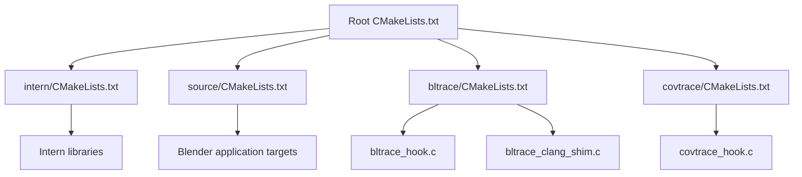
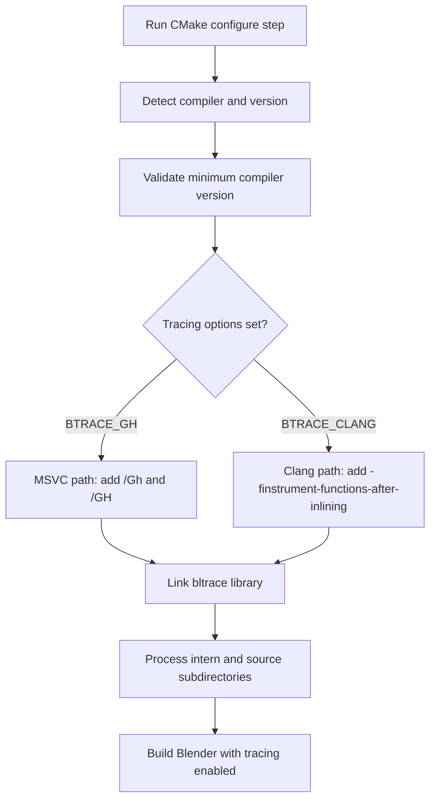
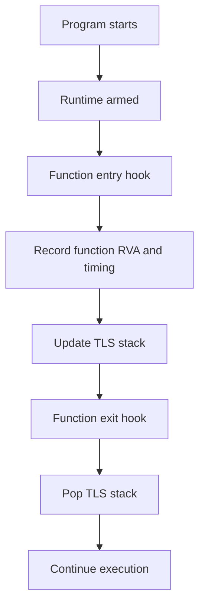
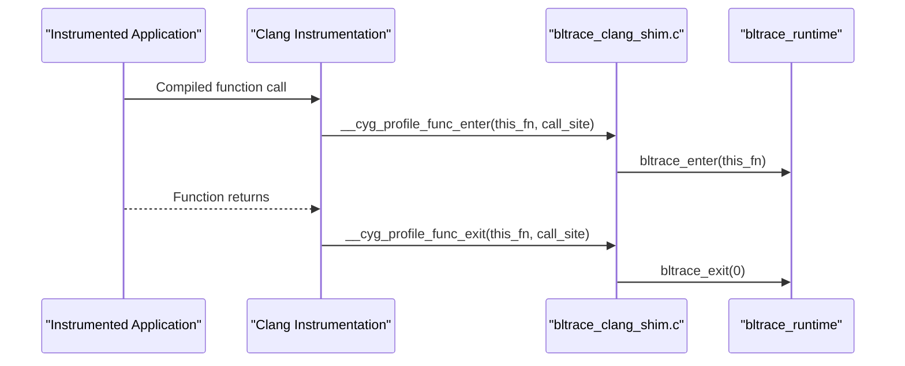

# Getting Started

<cite>
**Referenced Files in This Document**
- [CMakeLists.txt](file://CMakeLists.txt)
- [bltrace/CMakeLists.txt](file://bltrace/CMakeLists.txt)
- [intern/CMakeLists.txt](file://intern/CMakeLists.txt)
- [source/CMakeLists.txt](file://source/CMakeLists.txt)
- [covtrace/CMakeLists.txt](file://covtrace/CMakeLists.txt)
- [bltrace/bltrace_hook.c](file://bltrace/bltrace_hook.c)
- [bltrace/bltrace_clang_shim.c](file://bltrace/bltrace_clang_shim.c)
- [covtrace/covtrace_hook.c](file://covtrace/covtrace_hook.c)
</cite>

## Table of Contents
1. [Introduction](#introduction)
2. [Project Structure](#project-structure)
3. [Prerequisites](#prerequisites)
4. [Build Configuration Flow](#build-configuration-flow)
5. [Enabling Tracing](#enabling-tracing)
6. [Basic Usage Examples](#basic-usage-examples)
7. [How the Trace Data Is Produced](#how-the-trace-data-is-produced)
8. [Troubleshooting Guide](#troubleshooting-guide)
9. [Performance and Coverage Notes](#performance-and-coverage-notes)
10. [Conclusion](#conclusion)

## Introduction
This document explains how to prepare, build, and run a traced Blender build using the repository’s instrumentation extensions. It focuses on Windows builds, supported compilers, out-of-source CMake configuration, and the two tracing entry points:

- `BTRACE_GH`: MSVC function-entry tracing using `/Gh` and `/GH`.
- `BTRACE_CLANG`: Clang function-instrumentation tracing using `-finstrument-functions-after-inlining`.

The extension provides:

- A static tracing library that records function calls, edges, timing, and optional coverage window control.
- CMake integration that adds tracing flags only when the selected option is enabled for the detected compiler.
- Shims that adapt different compiler tracing mechanisms to a common runtime API.

## Project Structure
At a high level, the instrumentation lives under `bltrace`, with supporting coverage control under `covtrace`. The top-level and subdirectory CMake files connect these libraries into the broader Blender build.



**Diagram sources**
- [CMakeLists.txt:1-200](file://CMakeLists.txt#L1-L200)
- [intern/CMakeLists.txt:1-89](file://intern/CMakeLists.txt#L1-L89)
- [source/CMakeLists.txt:1-29](file://source/CMakeLists.txt#L1-L29)
- [bltrace/CMakeLists.txt:1-49](file://bltrace/CMakeLists.txt#L1-L49)
- [covtrace/CMakeLists.txt:1-14](file://covtrace/CMakeLists.txt#L1-L14)

**Section sources**
- [CMakeLists.txt:1-200](file://CMakeLists.txt#L1-L200)
- [bltrace/CMakeLists.txt:1-49](file://bltrace/CMakeLists.txt#L1-L49)
- [intern/CMakeLists.txt:1-89](file://intern/CMakeLists.txt#L1-L89)
- [source/CMakeLists.txt:1-29](file://source/CMakeLists.txt#L1-L29)
- [covtrace/CMakeLists.txt:1-14](file://covtrace/CMakeLists.txt#L1-L14)

## Prerequisites
Before configuring or building, satisfy these requirements:

| Requirement | Details |
|---|---|
| Operating system | Windows is required for the primary tracing path because the implementation uses MSVC-specific hooks and MASM assembly. |
| Compiler | Use one of the following: |
| MSVC | Version 2019 or newer. The minimum corresponds to internal version `1928`. |
| Clang | Version 8 or newer. |
| Build location | Out-of-source CMake build directory is mandatory. In-source generation is explicitly rejected by the root CMake configuration. |
| CMake | The project requires at least CMake 3.10. |

The root CMake configuration enforces the out-of-source requirement and prints instructions if you try to generate inside the source tree. It also validates GCC, Clang, and MSVC versions early in the configuration process.

**Section sources**
- [CMakeLists.txt:1-40](file://CMakeLists.txt#L1-L40)
- [CMakeLists.txt:120-180](file://CMakeLists.txt#L120-L180)

## Build Configuration Flow
The tracing options are evaluated as part of normal CMake processing. They do not require a separate build system; they integrate into Blender’s existing CMake flow.



**Diagram sources**
- [CMakeLists.txt:120-180](file://CMakeLists.txt#L120-L180)
- [intern/CMakeLists.txt:1-20](file://intern/CMakeLists.txt#L1-L20)
- [source/CMakeLists.txt:1-15](file://source/CMakeLists.txt#L1-L15)

Key behavior:

- The root CMake file sets policies, loads macros, defines the project, and checks compiler support before adding subdirectories.
- `intern/CMakeLists.txt` and `source/CMakeLists.txt` both check the same tracing options and apply compiler-specific flags.
- If `BTRACE_GH` is set but the compiler is Clang, the MSVC-only path is skipped.
- If `BTRACE_CLANG` is set but the compiler is not Clang, the Clang-only path is skipped.
- Both paths link the `bltrace` static library so the runtime tracing functions are available.

**Section sources**
- [CMakeLists.txt:120-180](file://CMakeLists.txt#L120-L180)
- [intern/CMakeLists.txt:1-20](file://intern/CMakeLists.txt#L1-L20)
- [source/CMakeLists.txt:1-15](file://source/CMakeLists.txt#L1-L15)

## Enabling Tracing
Choose the option based on your compiler.

### When to use `BTRACE_GH`
Use `BTRACE_GH` when building with MSVC. It enables:

- Function-entry tracing through MSVC’s `/Gh` and `/GH` options.
- Linking against the `bltrace` static library.
- A MASM-generated entry hook compiled only for non-Clang builds.

Do not enable this option with Clang. The MSVC compiler flags are ignored unless the compiler matches MSVC.

### When to use `BTRACE_CLANG`
Use `BTRACE_CLANG` when building with Clang. It enables:

- Function-instrumentation tracing through `-finstrument-functions-after-inlining`.
- Linking against the `bltrace` static library.
- A Clang shim that forwards instrumented function entry and exit callbacks to the shared tracing runtime.

Do not enable this option with MSVC. The Clang-specific flag is guarded by a Clang compiler detection check.

### Recommended selection rule
- MSVC → `BTRACE_GH=ON`
- Clang → `BTRACE_CLANG=ON`

You should generally enable only one tracing mode at a time because they target different compiler toolchains.

**Section sources**
- [intern/CMakeLists.txt:1-20](file://intern/CMakeLists.txt#L1-L20)
- [source/CMakeLists.txt:1-15](file://source/CMakeLists.txt#L1-L15)
- [bltrace/CMakeLists.txt:1-49](file://bltrace/CMakeLists.txt#L1-L49)

## Basic Usage Examples
The following examples show how to configure and build a traced Blender installation. Replace placeholders such as `<install-path>` and `<build-directory>` with your actual paths.

### Example 1: MSVC traced build
```text
cmake -S . -B <build-directory> ^
    -DCMAKE_BUILD_TYPE=Release ^
    -DCMAKE_INSTALL_PREFIX=<install-path> ^
    -DBTRACE_GH=ON
cmake --build <build-directory> --config Release
```

What happens:

1. CMake detects MSVC.
2. The root configuration validates that the MSVC version meets the minimum requirement.
3. `intern/CMakeLists.txt` and `source/CMakeLists.txt` add `/Gh` and `/GH`.
4. The `bltrace` static library is linked into relevant targets.
5. The build produces binaries with function-entry tracing enabled.

### Example 2: Clang traced build
```text
cmake -S . -B <build-directory> ^
    -DCMAKE_BUILD_TYPE=Release ^
    -DCMAKE_INSTALL_PREFIX=<install-path> ^
    -DBTRACE_CLANG=ON
cmake --build <build-directory> --config Release
```

What happens:

1. CMake detects Clang.
2. The root configuration validates that the Clang version meets the minimum requirement.
3. `intern/CMakeLists.txt` and `source/CMakeLists.txt` add `-finstrument-functions-after-inlining`.
4. The `bltrace` static library is linked into relevant targets.
5. The Clang shim translates instrumented function callbacks into the shared tracing runtime.

### Example 3: Generate trace data
After running the built Blender binary, the tracing runtime collects call entries, return edges, timing information, and optionally coverage-window output. The runtime exposes functions for controlling tracing state, including:

- Arm and disarm tracing.
- Reset counters.
- Dump call traces, edge traces, and timing data.
- Control coverage profiling output through `covtrace_arm` and `covtrace_dump`.

These functions are implemented in the tracing and coverage hook modules and are exposed for runtime use by higher-level scripts or wrappers.

**Section sources**
- [bltrace/bltrace_hook.c:1-120](file://bltrace/bltrace_hook.c#L1-L120)
- [covtrace/covtrace_hook.c:1-85](file://covtrace/covtrace_hook.c#L1-L85)

## How the Trace Data Is Produced
The tracing implementation adapts to the compiler while keeping a common runtime interface.

### MSVC path with `BTRACE_GH`
- The MSVC compiler injects entry hooks through `/Gh` and `/GH`.
- For non-Clang builds, the `bltrace` CMake file assembles `bltrace_penter.asm` and links the resulting object into the `bltrace` static library.
- The runtime maintains per-function tables, edge tables, thread-local stacks, and timing slots.
- Call entries and timing data are recorded without instrumenting the tracing code itself.



**Diagram sources**
- [bltrace/bltrace_hook.c:1-120](file://bltrace/bltrace_hook.c#L1-L120)
- [bltrace/CMakeLists.txt:10-49](file://bltrace/CMakeLists.txt#L10-L49)

### Clang path with `BTRACE_CLANG`
- Clang generates instrumentation callbacks around functions.
- The Clang shim implements `__cyg_profile_func_enter` and `__cyg_profile_func_exit`.
- These callbacks forward to the shared tracing runtime used by the MSVC path.
- The shim is compiled with instrumentation disabled so it does not recurse into itself.



**Diagram sources**
- [bltrace/bltrace_clang_shim.c:1-27](file://bltrace/bltrace_clang_shim.c#L1-L27)
- [bltrace/CMakeLists.txt:1-49](file://bltrace/CMakeLists.txt#L1-L49)

### Coverage window control
The `covtrace` module bridges the tracing runtime with LLVM coverage profiling. It can:

- Point coverage output to a specific file.
- Reset coverage counters.
- Write the current coverage window.
- Redirect subsequent coverage output after dumping the window.

This layer reuses the tracing runtime’s arm, reset, dump, and disarm functions.

**Section sources**
- [covtrace/covtrace_hook.c:1-85](file://covtrace/covtrace_hook.c#L1-L85)
- [covtrace/CMakeLists.txt:1-14](file://covtrace/CMakeLists.txt#L1-L14)

## Troubleshooting Guide

### Problem: CMake refuses an in-source build
**Symptoms:** CMake fails immediately during generation with an error about generating inside the source directory.

**Cause:** The root CMake configuration explicitly prevents in-source builds because cached files can corrupt the source tree.

**Resolution:**
1. Remove any `CMakeCache.txt` and `CMakeFiles` directories from the source tree.
2. Create a separate build directory outside the source tree.
3. Run CMake from that build directory, pointing at the source directory.

**Section sources**
- [CMakeLists.txt:1-40](file://CMakeLists.txt#L1-L40)

### Problem: Unsupported compiler version
**Symptoms:** CMake fails early with a message about unsupported GCC, Clang, or MSVC versions.

**Cause:** The root configuration checks compiler versions before proceeding.

**Resolution:**
- For MSVC, use version 2019 or newer.
- For Clang, use version 8 or newer.
- For GCC, use version 11 or newer.

**Section sources**
- [CMakeLists.txt:120-180](file://CMakeLists.txt#L120-L180)

### Problem: Tracing flags have no effect
**Symptoms:** You enable `BTRACE_GH` or `BTRACE_CLANG`, but the build does not appear to include tracing.

**Likely causes:**
- You enabled `BTRACE_GH` with Clang.
- You enabled `BTRACE_CLANG` with MSVC.
- The wrong CMake cache was reused.

**Resolution:**
- Use `BTRACE_GH=ON` with MSVC.
- Use `BTRACE_CLANG=ON` with Clang.
- Delete the build directory and regenerate CMake to avoid stale cache values.

**Section sources**
- [intern/CMakeLists.txt:1-20](file://intern/CMakeLists.txt#L1-L20)
- [source/CMakeLists.txt:1-15](file://source/CMakeLists.txt#L1-L15)

### Problem: Clang tracing crashes or loops
**Symptoms:** A Clang build appears to hang, crash, or repeatedly invoke tracing callbacks.

**Cause:** The Clang shim must not be instrumented itself. The implementation disables function instrumentation and coverage mapping for the shim translation unit.

**Resolution:**
- Ensure you are using the provided `bltrace_clang_shim.c` instead of modifying it in a way that removes its instrumentation-disabled behavior.
- Confirm that `BTRACE_CLANG=ON` is used with Clang, not MSVC.

**Section sources**
- [bltrace/bltrace_clang_shim.c:1-27](file://bltrace/bltrace_clang_shim.c#L1-L27)
- [bltrace/CMakeLists.txt:15-49](file://bltrace/CMakeLists.txt#L15-L49)

## Performance and Coverage Notes
- Tracing adds overhead because every function entry and exit is recorded.
- The MSVC implementation uses hash tables and thread-local storage to reduce contention.
- The Clang shim forwards to the same runtime so call/return semantics stay consistent across compilers.
- The tracing library is deliberately excluded from instrumentation to avoid recursion and self-pollution.
- Coverage window control separates tracing data from coverage profile output, allowing controlled dumps without overwriting active profiling state.

**Section sources**
- [bltrace/bltrace_hook.c:1-120](file://bltrace/bltrace_hook.c#L1-L120)
- [bltrace/bltrace_clang_shim.c:1-27](file://bltrace/bltrace_clang_shim.c#L1-L27)
- [covtrace/covtrace_hook.c:1-85](file://covtrace/covtrace_hook.c#L1-L85)

## Conclusion
To get started with a traced Blender build:

1. Install a supported compiler: MSVC 2019+ or Clang 8+.
2. Prepare an out-of-source CMake build directory.
3. Choose the correct tracing option:
   - `BTRACE_GH=ON` for MSVC.
   - `BTRACE_CLANG=ON` for Clang.
4. Configure and build Blender normally.
5. Run the resulting binary to collect trace data.
6. Use the tracing runtime functions to arm, disarm, reset, and dump traces or coverage windows as needed.

The CMake integration keeps tracing opt-in and compiler-aware, while the shared runtime ensures consistent tracing behavior across MSVC and Clang.