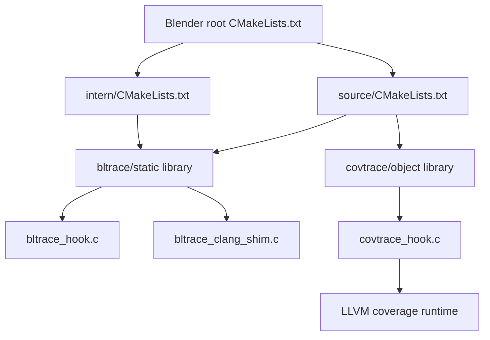
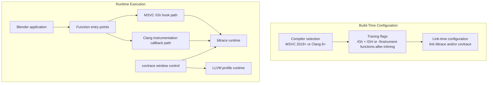
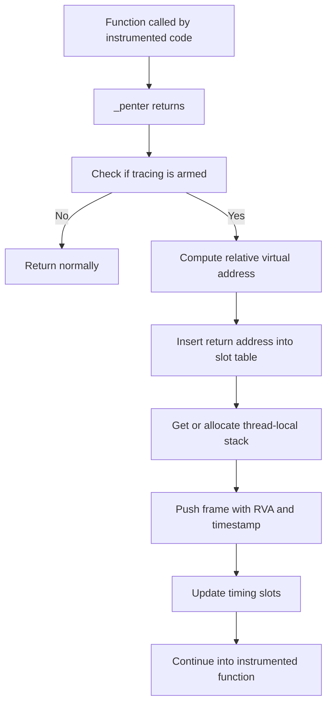
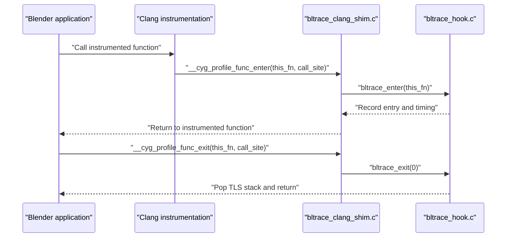
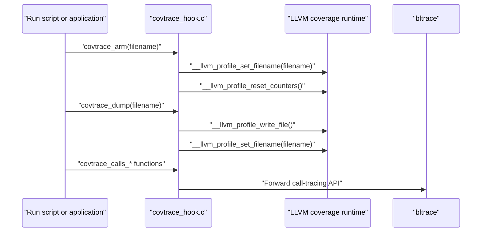
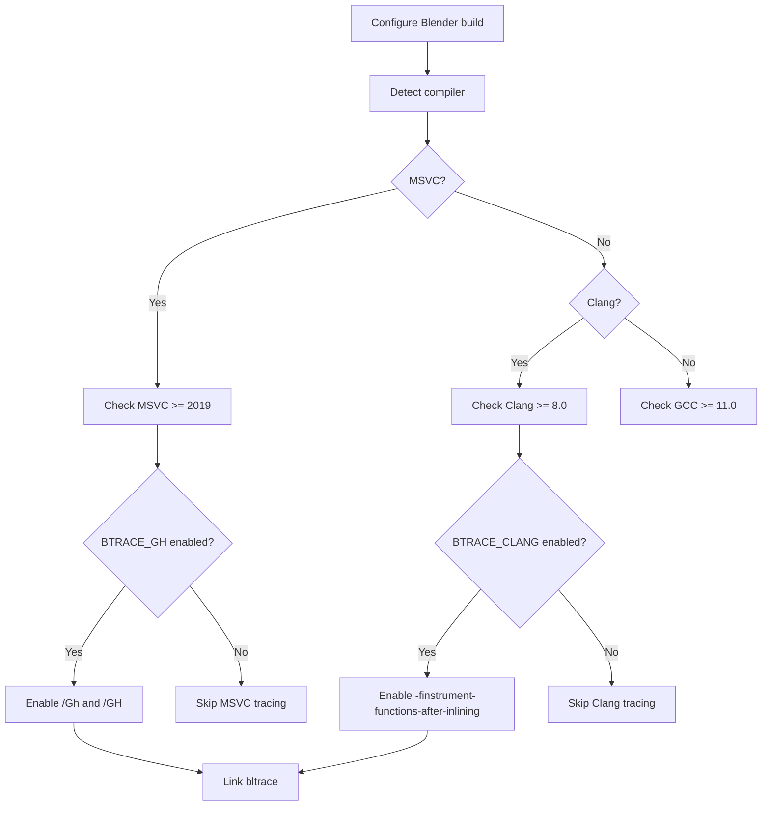
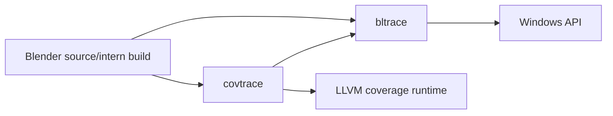

# Project Overview

<cite>
**Referenced Files in This Document**   
- [CMakeLists.txt](file://CMakeLists.txt)
- [bltrace/CMakeLists.txt](file://bltrace/CMakeLists.txt)
- [covtrace/CMakeLists.txt](file://covtrace/CMakeLists.txt)
- [intern/CMakeLists.txt](file://intern/CMakeLists.txt)
- [source/CMakeLists.txt](file://source/CMakeLists.txt)
- [bltrace/bltrace_hook.c](file://bltrace/bltrace_hook.c)
- [bltrace/bltrace_clang_shim.c](file://bltrace/bltrace_clang_shim.c)
- [covtrace/covtrace_hook.c](file://covtrace/covtrace_hook.c)
</cite>

## Table of Contents
1. [Introduction](#introduction)
2. [Project Structure](#project-structure)
3. [Core Components](#core-components)
4. [Architecture Overview](#architecture-overview)
5. [Detailed Component Analysis](#detailed-component-analysis)
6. [Dependency Analysis](#dependency-analysis)
7. [Performance Considerations](#performance-considerations)
8. [Troubleshooting Guide](#troubleshooting-guide)
9. [Conclusion](#conclusion)

## Introduction
This project is a specialized instrumentation extension for Blender’s CMake-based build system. It adds two complementary capabilities:

- Function call tracing and timing through the `bltrace` library.
- Coverage-window control and runtime coverage data handling through the `covtrace` library.

The extension supports Windows builds using MSVC 2019+ and Clang 8+. On MSVC, it integrates with the `/Gh` / `/GH` compiler hooks so that function entry points can be intercepted without source-level instrumentation. On Clang, it integrates with `-finstrument-functions`, allowing the same tracing logic to run when the code is compiled with LLVM function instrumentation. The `covtrace` layer sits on top of this by managing the LLVM coverage runtime, letting developers open and close coverage windows during a Blender session rather than relying only on process-wide output.

Developers use this toolchain when profiling Blender’s startup, editor initialization, rendering pipelines, or any hot path where understanding exact call sequences, per-function timing, and coverage boundaries is important. Because the hooking logic is designed to be low overhead, it can remain available in builds intended for repeated analysis without completely changing the application’s normal execution model.

## Project Structure
The repository contains two small libraries under `bltrace/` and `covtrace/`, plus CMake integration points inside Blender’s main build tree.

**Diagram sources**
- [CMakeLists.txt:1-200](file://CMakeLists.txt#L1-L200)
- [source/CMakeLists.txt:1-29](file://source/CMakeLists.txt#L1-L29)
- [intern/CMakeLists.txt:1-89](file://intern/CMakeLists.txt#L1-L89)
- [bltrace/CMakeLists.txt:1-49](file://bltrace/CMakeLists.txt#L1-L49)
- [covtrace/CMakeLists.txt:1-14](file://covtrace/CMakeLists.txt#L1-L14)

The key organization principles are:

- `bltrace/` implements the actual tracing infrastructure and exposes an exportable API.
- `covtrace/` does not reimplement tracing; it controls coverage output and forwards calls to `bltrace`.
- Blender’s `source/CMakeLists.txt` and `intern/CMakeLists.txt` conditionally enable MSVC `/Gh` hooks or Clang `-finstrument-functions-after-inlining` and link the appropriate libraries.
- The root `CMakeLists.txt` establishes minimum supported compilers: GCC 11+, Clang 8+, and MSVC 2019 (version 1928 or later).

**Section sources**
- [CMakeLists.txt:100-170](file://CMakeLists.txt#L100-L170)
- [bltrace/CMakeLists.txt:1-49](file://bltrace/CMakeLists.txt#L1-L49)
- [covtrace/CMakeLists.txt:1-14](file://covtrace/CMakeLists.txt#L1-L14)
- [intern/CMakeLists.txt:1-20](file://intern/CMakeLists.txt#L1-L20)
- [source/CMakeLists.txt:1-20](file://source/CMakeLists.txt#L1-L20)

## Core Components

### bltrace: Function Call Tracing Library
`bltrace` is a static Windows library that records function call graphs and timing data at runtime. Its responsibilities include:

- Maintaining global state such as module base address, slot tables, timing slots, performance counter frequency, and thread-local stack state.
- Recording function entries and exits through either MSVC `/Gh` hooks or Clang-generated instrumentation callbacks.
- Providing exported functions for enabling, disabling, resetting, dumping call edges, dumping timing data, and querying counts.

The implementation uses:

- Fixed-size hash-slot tables for storing unique function return-value addresses and timing keys.
- A bounded thread-local stack to track active call depth and compute self versus inclusive time.
- High-resolution timing via Windows Query Performance Counter.
- Atomic operations for safe concurrent updates from multiple threads.

It exports symbols such as `bltrace_arm`, `bltrace_disarm`, `bltrace_reset`, `bltrace_dump`, `bltrace_dump_edges`, `bltrace_dump_timings`, `bltrace_edge_count`, and `bltrace_timing_count`.

### covtrace: Coverage Window Control Layer
`covtrace` is implemented as an object library around `covtrace_hook.c`. It does not implement tracing itself. Instead, it:

- Calls into the LLVM coverage runtime functions exposed by `-fprofile-instr-generate`.
- Exposes window-control APIs such as `covtrace_arm`, `covtrace_dump`, and related call-tracing helpers.
- Delegates call-tracing operations to `bltrace` through direct linkage.

Its compile options explicitly disable coverage mapping and function instrumentation for its own translation unit so that the coverage controller cannot pollute its own counters or become part of the traced call graph.

**Section sources**
- [bltrace/bltrace_hook.c:1-200](file://bltrace/bltrace_hook.c#L1-L200)
- [covtrace/covtrace_hook.c:1-85](file://covtrace/covtrace_hook.c#L1-L85)

## Architecture Overview
At build time, Blender chooses between two tracing backends depending on the compiler and selected flags. At runtime, the active backend writes trace data, while `covtrace` manages when coverage data is written out.

**Diagram sources**
- [CMakeLists.txt:100-170](file://CMakeLists.txt#L100-L170)
- [source/CMakeLists.txt:1-20](file://source/CMakeLists.txt#L1-L20)
- [intern/CMakeLists.txt:1-20](file://intern/CMakeLists.txt#L1-L20)
- [bltrace/bltrace_hook.c:1-200](file://bltrace/bltrace_hook.c#L1-L200)
- [bltrace/bltrace_clang_shim.c:1-27](file://bltrace/bltrace_clang_shim.c#L1-L27)
- [covtrace/covtrace_hook.c:1-85](file://covtrace/covtrace_hook.c#L1-L85)

The architecture has two clear layers:

1. **Instrumentation layer**: Captures function entry and exit events.
2. **Coverage/window-control layer**: Manages LLVM coverage output files and coordinates with the tracing layer.

## Detailed Component Analysis

### MSVC Hook Path
When building with MSVC and the `BTRACE_GH` option is enabled, Blender enables `/Gh` and `/GH`. This tells the MSVC compiler to generate calls to `_penter` at function entry points. `bltrace` supplies the implementation used by those hooks.

Key behaviors:

- The hook computes a relative virtual address from the return address returned by the MSVC entry hook.
- It inserts that address into a fixed-size hash table of function slots.
- It pushes a frame onto a thread-local stack on entry and pops it on exit.
- It records timing information including elapsed time, self time, and inclusive time.
- It provides exported dump functions for call edges and timing data.

**Diagram sources**
- [bltrace/bltrace_hook.c:1-200](file://bltrace/bltrace_hook.c#L1-L200)

**Section sources**
- [source/CMakeLists.txt:1-12](file://source/CMakeLists.txt#L1-L12)
- [intern/CMakeLists.txt:1-12](file://intern/CMakeLists.txt#L1-L12)
- [bltrace/bltrace_hook.c:1-200](file://bltrace/bltrace_hook.c#L1-L200)

### Clang Instrumentation Path
When building with Clang and the `BTRACE_CLANG` option is enabled, Blender adds `/clang:-finstrument-functions-after-inlining` and links `bltrace`. Clang generates calls to `__cyg_profile_func_enter` and `__cyg_profile_func_exit`. `bltrace_clang_shim.c` maps those callbacks into the shared `bltrace_enter` and `bltrace_exit` implementations.

Important design points:

- The shim translates the Clang-provided function pointer into the address expected by `bltrace_hook.c`.
- The shim is compiled with `-fno-instrument-functions` and `-fno-instrument-functions-after-inlining` so it cannot be recursively instrumented.
- Exit semantics keep the TLS stack consistent with the MSVC path, preserving call/return edge behavior.

**Diagram sources**
- [bltrace/bltrace_clang_shim.c:1-27](file://bltrace/bltrace_clang_shim.c#L1-L27)
- [bltrace/bltrace_hook.c:1-200](file://bltrace/bltrace_hook.c#L1-L200)

**Section sources**
- [source/CMakeLists.txt:13-20](file://source/CMakeLists.txt#L13-L20)
- [bltrace/CMakeLists.txt:3-28](file://bltrace/CMakeLists.txt#L3-L28)
- [bltrace/bltrace_clang_shim.c:1-27](file://bltrace/bltrace_clang_shim.c#L1-L27)

### Coverage Window Control Flow
`covtrace` exposes runtime APIs that the Blender run script or application code can call to manage coverage output. When `covtrace_arm` is called, it sets the LLVM profile filename and resets counters. When `covtrace_dump` is called, it writes the current coverage window and optionally redirects future coverage output to another file.

**Diagram sources**
- [covtrace/covtrace_hook.c:1-85](file://covtrace/covtrace_hook.c#L1-L85)

**Section sources**
- [covtrace/CMakeLists.txt:1-14](file://covtrace/CMakeLists.txt#L1-L14)
- [covtrace/covtrace_hook.c:1-85](file://covtrace/covtrace_hook.c#L1-L85)

### Build System Integration
The root Blender build enforces minimum compiler versions and then configures tracing based on compiler identity and CMake options.

- MSVC 2019 or newer is required because the build checks `MSVC_VERSION` against version 1928.
- Clang 8.0 or newer is required for both C and C++ compilers.
- GCC 11.0 or newer is required when using GNU GCC.
- Under `intern/CMakeLists.txt` and `source/CMakeLists.txt`, `BTRACE_GH` enables MSVC hooks and links `bltrace`.
- Under the same files, `BTRACE_CLANG` enables Clang function instrumentation after inlining and links `bltrace`.

**Diagram sources**
- [CMakeLists.txt:100-170](file://CMakeLists.txt#L100-L170)
- [source/CMakeLists.txt:1-20](file://source/CMakeLists.txt#L1-L20)
- [intern/CMakeLists.txt:1-20](file://intern/CMakeLists.txt#L1-L20)

**Section sources**
- [CMakeLists.txt:100-170](file://CMakeLists.txt#L100-L170)
- [source/CMakeLists.txt:1-20](file://source/CMakeLists.txt#L1-L20)
- [intern/CMakeLists.txt:1-20](file://intern/CMakeLists.txt#L1-L20)

## Dependency Analysis
The dependency relationships are intentionally shallow:

- `bltrace` depends only on Windows APIs and intrinsic functions.
- `covtrace` depends on the LLVM coverage runtime and the `bltrace` API.
- Blender’s `source` and `intern` build trees conditionally depend on `bltrace` when tracing is enabled.
- There is no circular dependency between tracing and coverage: coverage wraps tracing, not the other way around.

**Diagram sources**
- [source/CMakeLists.txt:1-20](file://source/CMakeLists.txt#L1-L20)
- [intern/CMakeLists.txt:1-20](file://intern/CMakeLists.txt#L1-L20)
- [covtrace/covtrace_hook.c:1-85](file://covtrace/covtrace_hook.c#L1-L85)

**Section sources**
- [source/CMakeLists.txt:1-20](file://source/CMakeLists.txt#L1-L20)
- [intern/CMakeLists.txt:1-20](file://intern/CMakeLists.txt#L1-L20)
- [covtrace/covtrace_hook.c:1-85](file://covtrace/covtrace_hook.c#L1-L85)

## Performance Considerations
The extension is designed for relatively low overhead, but instrumentation still changes execution characteristics:

- Slot insertion uses atomic compare-and-exchange operations and linear probing, which avoids locks but can contend under high concurrency.
- Timing uses high-resolution counters and thread-local state allocation, adding small per-call overhead.
- Coverage reset and write operations may flush I/O and alter process behavior, so they should be invoked deliberately rather than on every frame.
- Both `bltrace` and `covtrace` are compiled with options that prevent their own instrumentation from being counted, reducing feedback loops and noise.

Recommended practices:

- Enable tracing only for the subsystems or sessions being analyzed.
- Use `covtrace_arm` and `covtrace_dump` to limit coverage collection to meaningful windows.
- Avoid treating traced builds as production builds.
- Prefer targeted runs over continuous full-application tracing unless necessary.

[No sources needed since this section provides general guidance]

## Troubleshooting Guide

### Tracing Does Not Appear
Possible causes:

- Tracing was not enabled in the CMake configuration.
- The wrong compiler path was selected.
- The application did not call the coverage or tracing enable functions before the code paths of interest executed.

Checks:

- Verify whether `BTRACE_GH` or `BTRACE_CLANG` is set according to the chosen compiler.
- Confirm that `/Gh` and `/GH` are present for MSVC builds.
- Confirm that `-finstrument-functions-after-inlining` is present for Clang builds.
- Confirm that `bltrace` is linked into the final binary.

**Section sources**
- [source/CMakeLists.txt:1-20](file://source/CMakeLists.txt#L1-L20)
- [intern/CMakeLists.txt:1-20](file://intern/CMakeLists.txt#L1-L20)
- [bltrace/CMakeLists.txt:1-49](file://bltrace/CMakeLists.txt#L1-L49)

### Coverage Data Is Missing or Empty
Possible causes:

- The LLVM profile filename was not set before collecting data.
- Counters were reset after useful data was collected.
- The coverage window was never dumped before process exit.
- The coverage output was redirected to `NUL` or overwritten by a later dump.

Checks:

- Ensure `covtrace_arm` is called with a valid filename before tracing begins.
- Ensure `covtrace_dump` is called when the desired coverage window ends.
- Inspect the filenames passed to the LLVM coverage runtime functions.

**Section sources**
- [covtrace/covtrace_hook.c:1-85](file://covtrace/covtrace_hook.c#L1-L85)

### Clang Build Instruments Too Much Code
Possible causes:

- The tracing shim itself is being instrumented.
- Coverage mapping is interfering with trace data.

Checks:

- Confirm the Clang shim is compiled with `-fno-instrument-functions` and `-fno-instrument-functions-after-inlining`.
- Confirm that coverage generation is disabled for the tracing libraries when not needed.

**Section sources**
- [bltrace/CMakeLists.txt:28-49](file://bltrace/CMakeLists.txt#L28-L49)
- [covtrace/CMakeLists.txt:6-14](file://covtrace/CMakeLists.txt#L6-L14)

## Conclusion
The Blender Build Instrumentation Extension provides a focused, Windows-targeted solution for analyzing Blender’s runtime behavior. `bltrace` captures function call and timing information through MSVC `/Gh` hooks or Clang `-finstrument-functions`, while `covtrace` manages LLVM coverage output and exposes a windowed control interface. Together, they let developers inspect call graphs, measure timing, and collect coverage data without replacing Blender’s entire build pipeline.

For typical workflows:

- Use MSVC `/Gh` tracing when working with Visual Studio builds.
- Use Clang instrumentation when building with Clang and LLVM coverage tools.
- Wrap interesting execution phases with `covtrace_arm` and `covtrace_dump` to produce focused coverage windows.
- Treat traced builds as developer-only artifacts and avoid shipping them as production binaries.

[No sources needed since this section summarizes without analyzing specific files]