# Data Structures and Algorithms

<cite>
**Referenced Files in This Document**
- [bltrace_hook.c](file://bltrace/bltrace_hook.c)
- [bltrace_clang_shim.c](file://bltrace/bltrace_clang_shim.c)
- [bltrace_penter.asm](file://bltrace/bltrace_penter.asm)
- [CMakeLists.txt](file://bltrace/CMakeLists.txt)
</cite>

## Table of Contents
1. [Introduction](#introduction)
2. [Project Structure](#project-structure)
3. [Core Components](#core-components)
4. [Architecture Overview](#architecture-overview)
5. [Detailed Component Analysis](#detailed-component-analysis)
6. [Dependency Analysis](#dependency-analysis)
7. [Performance Considerations](#performance-considerations)
8. [Troubleshooting Guide](#troubleshooting-guide)
9. [Conclusion](#conclusion)

## Introduction
This document explains the data structures and algorithms behind bltrace’s trace collection system. It focuses on:

- Per-call-frame information stored in `TlsFrame`.
- Thread-local call stack management through `TlsStack`.
- Timing measurements stored in `TimingSlot`.
- Hash-based slot tables with linear probing and atomic operations for thread safety.
- The caller-callee edge table algorithm.
- Memory allocation strategy for static, fixed-capacity tables.
- Serialization formats for function tables, edge tables, and timing output files.
- Mathematical analysis of hash distribution, collision handling performance, and memory usage patterns.
- Concrete examples of layouts, allocation scenarios, and trade-offs between table size, collision rate, and memory consumption.

The implementation is a low-overhead Windows tracing layer that can be used with MSVC `/Gh`/`/GH` entry hooks or Clang `-finstrument-functions`.

**Section sources**
- [bltrace_hook.c:1-40](file://bltrace/bltrace_hook.c#L1-L40)
- [bltrace_clang_shim.c:1-27](file://bltrace/bltrace_clang_shim.c#L1-L27)
- [bltrace_penter.asm:1-108](file://bltrace/bltrace_penter.asm#L1-L108)

## Project Structure
Bltrace is implemented as a small C library with optional assembly entry hooks.

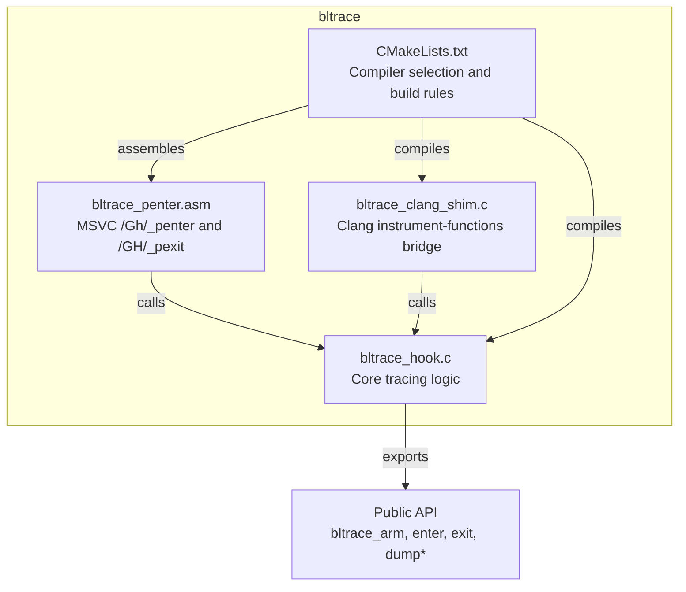

**Diagram sources**
- [bltrace_hook.c:1-40](file://bltrace/bltrace_hook.c#L1-L40)
- [bltrace_clang_shim.c:1-27](file://bltrace/bltrace_clang_shim.c#L1-L27)
- [bltrace_penter.asm:1-108](file://bltrace/bltrace_penter.asm#L1-L108)
- [CMakeLists.txt:1-49](file://bltrace/CMakeLists.txt#L1-L49)

**Section sources**
- [CMakeLists.txt:1-49](file://bltrace/CMakeLists.txt#L1-L49)

## Core Components
The core data structures live in the tracing implementation:

| Structure | Purpose | Key Fields | Notes |
|---|---|---|---|
| `TlsFrame` | Information for one active call frame | `rva`, `t0`, `child` | Stored on each thread’s local call stack. `rva` identifies the function entry. `t0` is the entry timestamp. `child` accumulates time spent by direct children. |
| `TlsStack` | Thread-local call stack | `count`, `stack[STACK_CAP]` | Fixed-size ring-like buffer capped at `STACK_CAP`; overflow resets to protect memory. |
| `TimingSlot` | Timing bucket for a single function key | `key`, `count`, `self`, `inclusive` | `key = rva + 1`; zero means empty. Atomic updates are used during tracing. |
| `TimingRecord` | Serialized timing row | `key`, `count`, `self`, `inclusive` | Written to disk; no longer atomic. |
| `TimingHeader` | Timing file header | `magic`, `version`, `freq`, `record_size`, `count` | Describes magic value, version, query performance counter frequency, record size, and number of records. |

Global state includes:

- `g_base`: module base address used to convert return addresses into relative virtual addresses (`rva`).
- `g_slots`: flat array of 64-bit values storing occupied function keys.
- `g_eslots`: flat array of 64-bit values storing caller-callee edges.
- `g_tslots`: array of `TimingSlot` entries.
- `g_qpc_freq`: query performance counter frequency.
- `g_tls`: TLS index for per-thread `TlsStack`.

**Section sources**
- [bltrace_hook.c:21-80](file://bltrace/bltrace_hook.c#L21-L80)
- [bltrace_hook.c:81-160](file://bltrace/bltrace_hook.c#L81-L160)

## Architecture Overview
The tracing pipeline has three major paths:

1. **Function entry path**: computes `rva`, records an edge if possible, inserts the function key into the slot table, and pushes a frame onto the thread-local stack.
2. **Function exit path**: pops the top frame, computes inclusive and self time, updates timing buckets, and propagates child time to the parent frame.
3. **Serialization path**: writes function tables, edge tables, and timing records to disk.

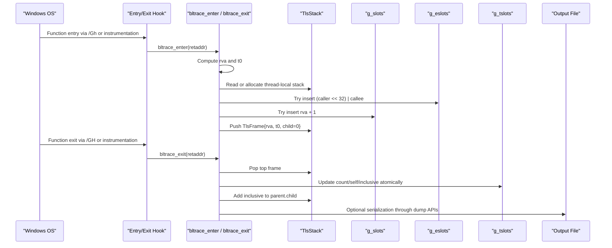

**Diagram sources**
- [bltrace_penter.asm:1-108](file://bltrace/bltrace_penter.asm#L1-L108)
- [bltrace_clang_shim.c:1-27](file://bltrace/bltrace_clang_shim.c#L1-L27)
- [bltrace_hook.c:161-376](file://bltrace/bltrace_hook.c#L161-L376)

**Section sources**
- [bltrace_penter.asm:1-108](file://bltrace/bltrace_penter.asm#L1-L108)
- [bltrace_clang_shim.c:1-27](file://bltrace/bltrace_clang_shim.c#L1-L27)
- [bltrace_hook.c:161-376](file://bltrace/bltrace_hook.c#L161-L376)

## Detailed Component Analysis

### TlsFrame: Per-Call-Frame Information
`TlsFrame` represents one active function invocation on a thread’s call stack.

- `rva`: Relative virtual address identifying the function entry point. It is derived from the caller’s return address minus the module base.
- `t0`: Entry timestamp obtained from `QueryPerformanceCounter`.
- `child`: Accumulated time spent by direct child frames.

When a new call enters, the code reads the previous top frame’s `rva` as the caller, then pushes a new frame with `child` initialized to zero. When exiting, the popped frame’s `inclusive` time is added to its parent’s `child`, which allows parent frames to accumulate total child time without needing recursive traversal.

Complexity:
- Push: O(1).
- Pop: O(1).
- Child accumulation: O(1) per call.

Memory:
- Each frame is a small struct containing three 64-bit fields.
- The stack capacity is bounded by `STACK_CAP`.

Overflow behavior:
- If `state->count >= STACK_CAP`, the stack is reset to `count = 0`. This prevents unbounded growth but may lose early-stack context under deep recursion.

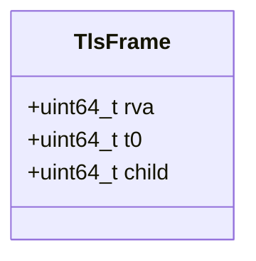

**Diagram sources**
- [bltrace_hook.c:21-40](file://bltrace/bltrace_hook.c#L21-L40)

**Section sources**
- [bltrace_hook.c:21-40](file://bltrace/bltrace_hook.c#L21-L40)
- [bltrace_hook.c:201-240](file://bltrace/bltrace_hook.c#L201-L240)
- [bltrace_hook.c:241-300](file://bltrace/bltrace_hook.c#L241-L300)

### TlsStack: Thread-Local Call Stack Management
`TlsStack` manages the per-thread call stack:

- `count`: Current number of frames.
- `stack[STACK_CAP]`: Fixed-size array of `TlsFrame`.

Thread-local storage is lazily allocated:

- On first access, `tls_state()` tries to read the TLS value.
- If absent, it allocates a `TlsStack` using `VirtualAlloc`.
- The allocation is associated with the current process TLS index.

Key design points:

- Fixed capacity avoids dynamic reallocation during hot tracing paths.
- Overflow protection resets the stack rather than growing indefinitely.
- Resetting clears only the logical length; existing frames remain until overwritten.

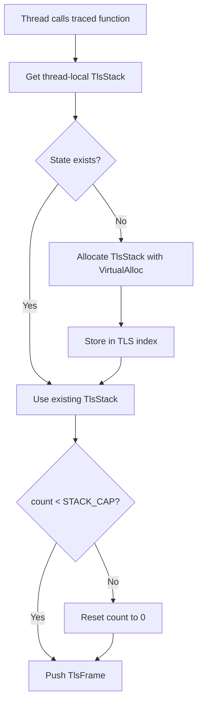

**Diagram sources**
- [bltrace_hook.c:121-160](file://bltrace/bltrace_hook.c#L121-L160)
- [bltrace_hook.c:201-240](file://bltrace/bltrace_hook.c#L201-L240)

**Section sources**
- [bltrace_hook.c:121-160](file://bltrace/bltrace_hook.c#L121-L160)
- [bltrace_hook.c:201-240](file://bltrace/bltrace_hook.c#L201-L240)

### TimingSlot: Timing Measurement Storage
`TimingSlot` stores aggregated timing data for a function identified by `key = rva + 1`.

Fields:

- `key`: Unique function identifier; zero means the slot is empty.
- `count`: Number of times the function was timed.
- `self`: Total time attributed to the function itself, excluding child time.
- `inclusive`: Total time attributed to the function including all descendants.

Update semantics:

- On function exit, the code computes `inclusive` as elapsed time since entry.
- `self` is computed as `inclusive - child`, ensuring self time excludes direct child duration.
- All updates to `count`, `self`, and `inclusive` use atomic operations.

Collision resolution:

- Linear probing over `TIME_SLOT_COUNT`.
- A newly found empty slot is claimed atomically using `_InterlockedCompareExchange64`.
- `g_tcount` tracks the number of occupied slots.

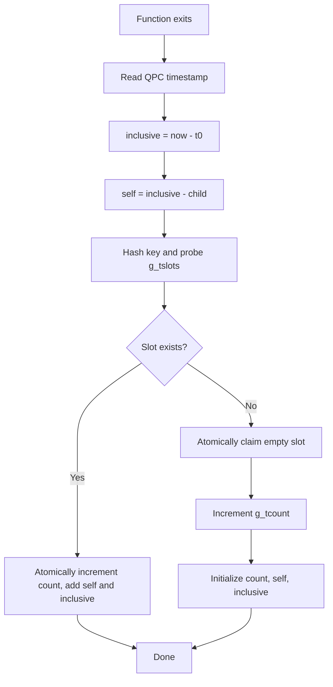

**Diagram sources**
- [bltrace_hook.c:91-120](file://bltrace/bltrace_hook.c#L91-L120)
- [bltrace_hook.c:241-300](file://bltrace/bltrace_hook.c#L241-L300)

**Section sources**
- [bltrace_hook.c:91-120](file://bltrace/bltrace_hook.c#L91-L120)
- [bltrace_hook.c:241-300](file://bltrace/bltrace_hook.c#L241-L300)

### Slot Table Algorithm: Hash-Based Collision Resolution with Atomic Operations
Both the function table and the edge table share the same basic design:

- Fixed-size arrays of 64-bit values.
- `SLOT_COUNT = 0x200000`, so the mask is `SLOT_COUNT - 1`.
- Hash function: `hash = (uint32_t)value * 0x9E3779B1u`.
- Probing: `(hash + offset) & SLOT_MASK` for successive offsets.
- Insertion uses `_InterlockedCompareExchange64` to atomically claim empty slots.
- Duplicate keys are detected by comparing the existing value with the inserted value.

Important characteristics:

- The function table stores `rva + 1`, so `rva == 0` is skipped before insertion.
- The edge table stores combined caller-callee pairs as `(caller << 32) | callee_rva`.
- `claim()` returns success only when a slot is newly claimed; duplicates and full-table failures do not increment counters.

Mathematical analysis:

- Hash space: 32 bits due to casting to `uint32_t`.
- Load factor for function and edge tables: approximately `occupied_keys / SLOT_COUNT`.
- Expected probes under uniform hashing with linear probing are roughly proportional to `1 / (1 - load_factor)` for successful searches and grow sharply near full capacity.
- Because `value` is hashed to 32 bits, the effective collision probability depends on how many distinct keys map to the same 32-bit hash.

Trade-offs:

- Larger tables reduce collisions but increase memory usage.
- Small tables save memory but increase probe chains and contention.
- Fixed capacity avoids runtime resizing but requires choosing `SLOT_COUNT` based on expected key cardinality.

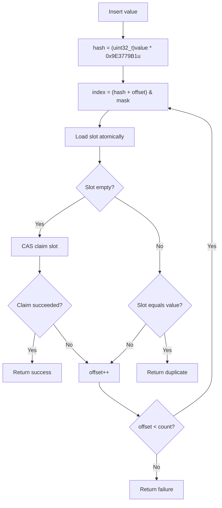

**Diagram sources**
- [bltrace_hook.c:81-120](file://bltrace/bltrace_hook.c#L81-L120)

**Section sources**
- [bltrace_hook.c:81-120](file://bltrace/bltrace_hook.c#L81-L120)

### Edge Table Algorithm: Recording Caller-Callee Relationships
Edge recording happens during function entry:

1. If a parent frame exists, read its `rva` as `caller`.
2. Form the edge as `(caller << 32) | callee_rva`.
3. Insert the edge into `g_eslots` using `claim`.
4. On success, increment the global edge counter.

Constraints:

- An edge is only recorded when both caller and callee are non-zero.
- The callee part uses only the lower 32 bits of `rva`.
- The caller part uses the full 64-bit `rva`, so caller identity is preserved even though the edge value is packed into a 64-bit word.

Implications:

- Multiple callers mapping to the same lower 32-bit callee can still be distinguished by the upper caller field.
- Collisions in the edge table are handled by the same linear-probing hash mechanism.

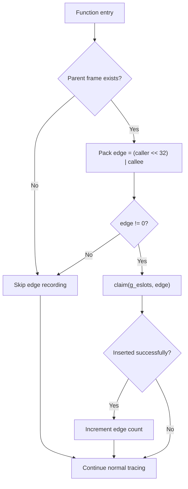

**Diagram sources**
- [bltrace_hook.c:201-220](file://bltrace/bltrace_hook.c#L201-L220)

**Section sources**
- [bltrace_hook.c:201-220](file://bltrace/bltrace_hook.c#L201-L220)

### Memory Allocation Strategy
Bltrace uses static-sized buffers allocated once during initialization:

- `g_slots`: `SLOT_COUNT` elements of `uint64_t`.
- `g_eslots`: `SLOT_COUNT` elements of `uint64_t`.
- `g_tslots`: `TIME_SLOT_COUNT` elements of `TimingSlot`.
- Per-thread `TlsStack`: allocated lazily on first use.

Initialization flow:

- `bltrace_arm()` initializes module base, allocates tables, queries performance counter frequency, and allocates the TLS index.
- Tables are not resized after allocation; growth is achieved by collecting more unique keys until the fixed capacity is reached.
- `bltrace_reset()` zeroes all tables and resets counters and TLS stack length.

Allocation details:

- `VirtualAlloc` reserves and commits memory pages.
- `bltrace_reset()` uses bulk zeroing for speed.
- No `malloc`/`realloc` is used for hot-path tables, reducing fragmentation and lock overhead.

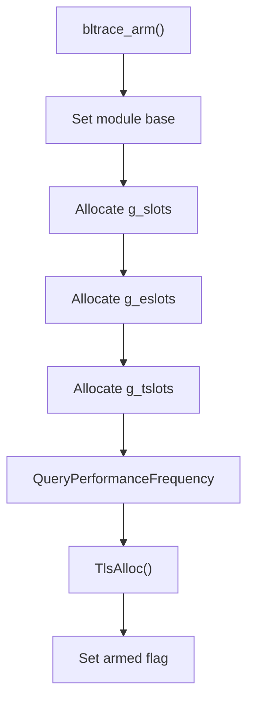

**Diagram sources**
- [bltrace_hook.c:121-160](file://bltrace/bltrace_hook.c#L121-L160)

**Section sources**
- [bltrace_hook.c:121-160](file://bltrace/bltrace_hook.c#L121-L160)
- [bltrace_hook.c:301-376](file://bltrace/bltrace_hook.c#L301-L376)

### Serialization Format for Output Files
Bltrace provides three serialization functions:

#### Function Table File
- Written by `bltrace_dump`.
- Iterates `g_slots` in order.
- Writes only non-zero 64-bit values.
- Each value is `rva + 1`.

#### Edge Table File
- Written by `bltrace_dump_edges`.
- Iterates `g_eslots` in order.
- Writes only non-zero 64-bit values.
- Each value is `(caller_rva << 32) | callee_rva`.

#### Timing File
- Written by `bltrace_dump_timings`.
- Header structure:
  - `magic`: constant identifying the format.
  - `version`: format version.
  - `freq`: QPC frequency.
  - `record_size`: serialized record size.
  - `count`: number of timing records.
- Records:
  - One `TimingRecord` per occupied timing slot.
  - Contains `key`, `count`, `self`, `inclusive`.

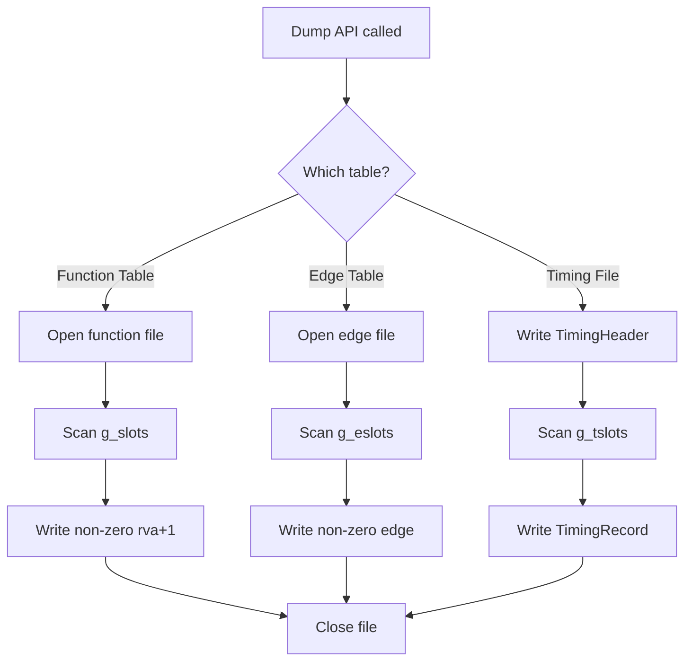

**Diagram sources**
- [bltrace_hook.c:301-376](file://bltrace/bltrace_hook.c#L301-L376)

**Section sources**
- [bltrace_hook.c:301-376](file://bltrace/bltrace_hook.c#L301-L376)

### Integration Points: MSVC and Clang Tracing
Two integration paths feed the same C-level entry and exit handlers:

- **MSVC `/Gh`/`/GH`**: MASM assembly `_penter` and `_pexit` preserve registers and stack alignment, extract the caller return address, and call `bltrace_enter` and `bltrace_exit`.
- **Clang `-finstrument-functions`**: The shim converts compiler-generated `__cyg_profile_func_enter` and `__cyg_profile_func_exit` into calls to `bltrace_enter` and `bltrace_exit`.

The Clang shim deliberately disables further instrumentation to avoid recursion.

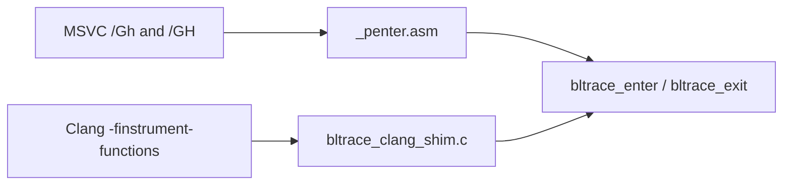

**Diagram sources**
- [bltrace_penter.asm:1-108](file://bltrace/bltrace_penter.asm#L1-L108)
- [bltrace_clang_shim.c:1-27](file://bltrace/bltrace_clang_shim.c#L1-L27)

**Section sources**
- [bltrace_penter.asm:1-108](file://bltrace/bltrace_penter.asm#L1-L108)
- [bltrace_clang_shim.c:1-27](file://bltrace/bltrace_clang_shim.c#L1-L27)
- [CMakeLists.txt:1-49](file://bltrace/CMakeLists.txt#L1-L49)

## Dependency Analysis
The tracing components form a layered dependency graph:

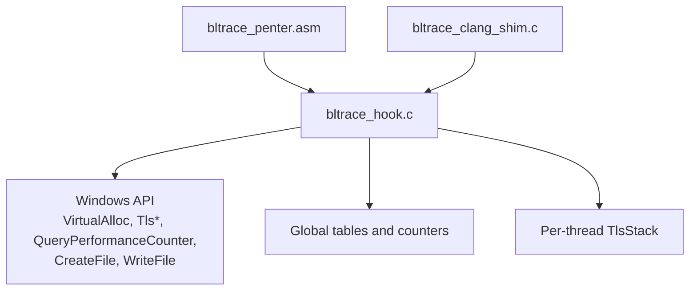

Coupling:

- Assembly and Clang shim are thin adapters around the C API.
- The C layer depends heavily on Windows API for memory, threading, timing, and file I/O.
- Global state is shared across threads, requiring atomic operations for concurrent access.

Potential circular dependencies:

- None within the analyzed source files.
- External coupling is limited to Windows APIs.

External dependencies:

- Windows kernel and user-mode services for TLS, memory allocation, performance counters, and file I/O.
- Compiler toolchain: MSVC assembler or Clang instrumentation.

**Section sources**
- [bltrace_hook.c:1-40](file://bltrace/bltrace_hook.c#L1-L40)
- [bltrace_clang_shim.c:1-27](file://bltrace/bltrace_clang_shim.c#L1-L27)
- [bltrace_penter.asm:1-108](file://bltrace/bltrace_penter.asm#L1-L108)

## Performance Considerations

### Hash Distribution and Collision Handling
- The hash function multiplies the input by a constant and truncates to 32 bits.
- With linear probing, average probe length increases as load factor approaches one.
- For function and edge tables, the effective load factor is `occupied_entries / SLOT_COUNT`.
- Timing slots have a separate table with `TIME_SLOT_COUNT` and track occupancy through `g_tcount`.

Expected behavior:

- At low load factors, most inserts succeed within one or two probes.
- Near capacity, probe chains become long, increasing latency and atomic contention.
- Duplicate keys are fast: they are detected without allocating a new slot.

Optimization opportunities:

- Choose `SLOT_COUNT` and `TIME_SLOT_COUNT` based on expected unique function keys and edges.
- Monitor collision rates by comparing unique counts with table sizes.
- Avoid excessive table sharing if workload grows beyond current capacity.

### Atomic Contention
- Hot-path inserts and timing updates use atomic compare-and-exchange and atomic arithmetic.
- High concurrency can cause CAS retries and cache-line bouncing.
- Reducing contention can be achieved by lowering collision rates through larger tables or better hash distribution.

### Memory Usage Patterns
- Function table memory: `SLOT_COUNT × sizeof(uint64_t)`.
- Edge table memory: `SLOT_COUNT × sizeof(uint64_t)`.
- Timing table memory: `TIME_SLOT_COUNT × sizeof(TimingSlot)`.
- Per-thread stack memory: `sizeof(TlsStack)`, allocated lazily.

Example layout for typical constants:

- Function table: `0x200000 × 8 bytes ≈ 16 MiB`.
- Edge table: `0x200000 × 8 bytes ≈ 16 MiB`.
- Timing table: `0x80000 × sizeof(TimingSlot)`, where each record contains four 64-bit fields plus padding considerations depending on compiler alignment.

Trade-offs:

- Larger tables improve collision behavior and reduce atomic retries but consume more resident memory.
- Smaller tables save memory but increase collision-related CPU work.
- Fixed allocation avoids runtime reallocation cost but cannot adapt to unexpected growth.

### Timing Precision
- Timestamps come from `QueryPerformanceCounter`.
- Frequency is captured once and written into the timing file header.
- Self time is computed by subtracting accumulated child time, avoiding double-counting descendant work.

**Section sources**
- [bltrace_hook.c:81-120](file://bltrace/bltrace_hook.c#L81-L120)
- [bltrace_hook.c:241-300](file://bltrace/bltrace_hook.c#L241-L300)
- [bltrace_hook.c:301-376](file://bltrace/bltrace_hook.c#L301-L376)

## Troubleshooting Guide

### Tracing Does Not Start
Possible causes:

- `bltrace_arm()` has not been called.
- Module base is not set.
- TLS index allocation failed.
- The hook is not enabled.

Checks:

- Confirm `bltrace_arm()` runs before instrumentation begins.
- Verify that `g_armed` becomes non-zero.
- Ensure the selected compiler path is built correctly.

**Section sources**
- [bltrace_hook.c:121-160](file://bltrace/bltrace_hook.c#L121-L160)

### Missing Function Keys or Edges
Possible causes:

- `rva == 0` is filtered out.
- Caller is zero, so edge recording is skipped.
- Table is full; new keys are rejected.
- Collision resolution did not find an empty slot.

Checks:

- Inspect whether unique keys exceed `SLOT_COUNT`.
- Compare `bltrace_count()` and `bltrace_edge_count()` with expected cardinality.
- Review serialized function and edge files for sparse regions.

**Section sources**
- [bltrace_hook.c:201-220](file://bltrace/bltrace_hook.c#L201-L220)
- [bltrace_hook.c:81-120](file://bltrace/bltrace_hook.c#L81-L120)

### Incorrect Timing Values
Possible causes:

- QPC frequency is unavailable or zero.
- Exit occurs without a matching entry.
- Deep recursion exceeded `STACK_CAP`, causing stack reset.
- Child time propagation missed because parent frame was lost.

Checks:

- Validate `g_qpc_freq` after `bltrace_arm()`.
- Ensure every entry has a corresponding exit.
- Monitor maximum call depth against `STACK_CAP`.
- Compare `inclusive` and `self` sums with expected profile shapes.

**Section sources**
- [bltrace_hook.c:241-300](file://bltrace/bltrace_hook.c#L241-L300)
- [bltrace_hook.c:121-160](file://bltrace/bltrace_hook.c#L121-L160)

### Serialization Produces Empty or Partial Files
Possible causes:

- Table pointer is null.
- File creation failed.
- Only non-zero entries are written.
- Timing table has no occupied slots.

Checks:

- Call reset and collect fresh traces before dumping.
- Verify file handle validity.
- Use `bltrace_timing_count()` to confirm timing records exist.

**Section sources**
- [bltrace_hook.c:301-376](file://bltrace/bltrace_hook.c#L301-L376)

## Conclusion
Bltrace implements a compact, low-overhead tracing layer with:

- Simple per-frame metadata in `TlsFrame`.
- Bounded thread-local stacks in `TlsStack`.
- Atomic timing aggregation in `TimingSlot`.
- Fixed-size hash tables with linear probing for function keys and caller-callee edges.
- Straightforward serialization for function tables, edge tables, and timing records.

The main design trade-off is memory versus collision behavior. Choosing appropriate table sizes, monitoring unique key counts, and understanding the atomic update model are essential for predictable performance. The dual integration path supports both MSVC and Clang workflows while sharing the same core tracing logic.