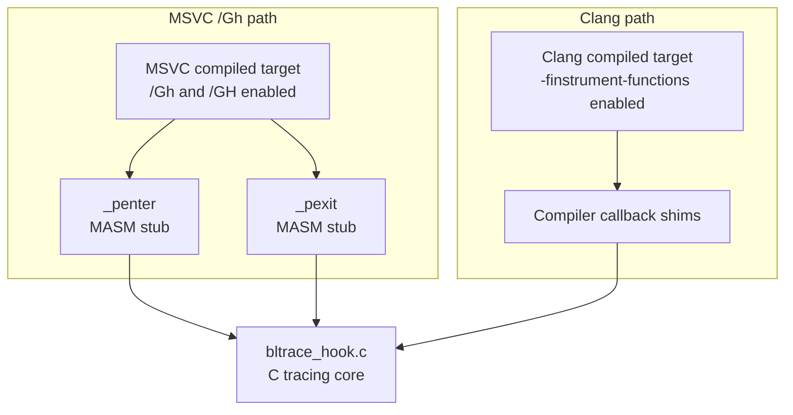
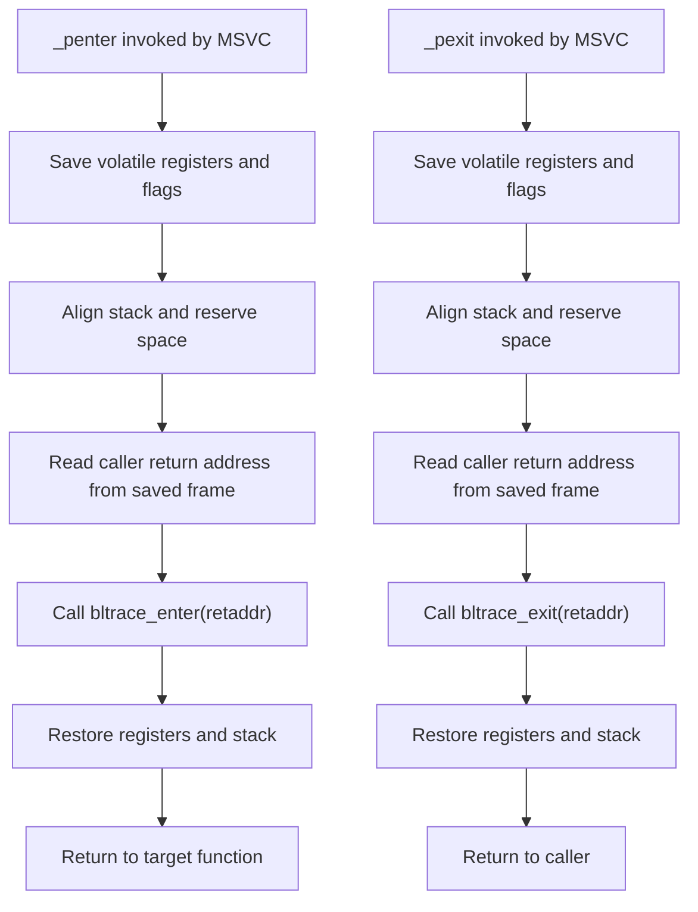
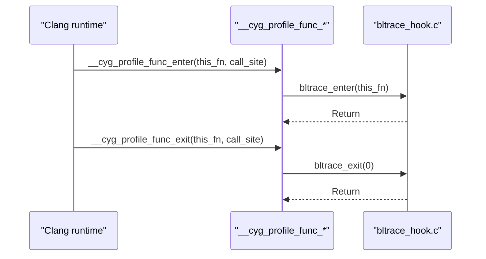
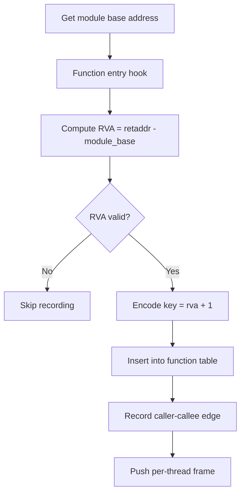
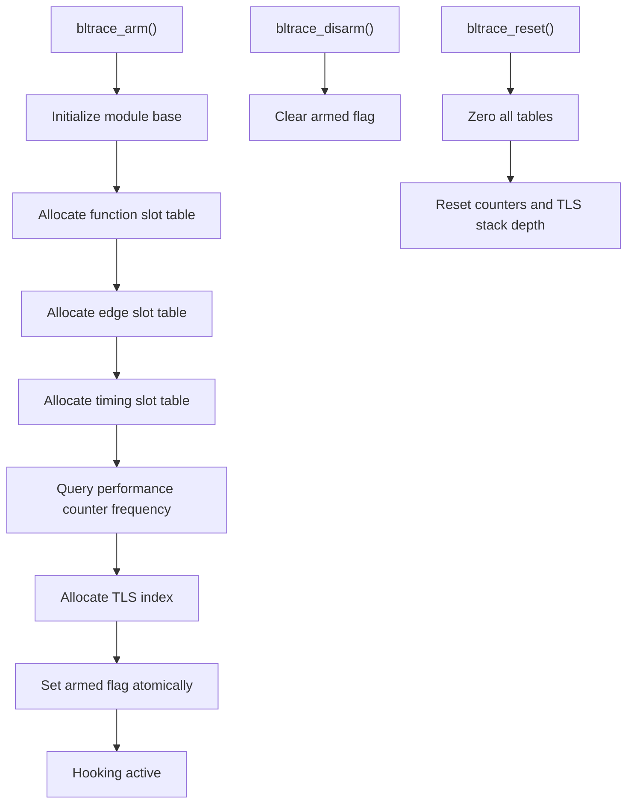
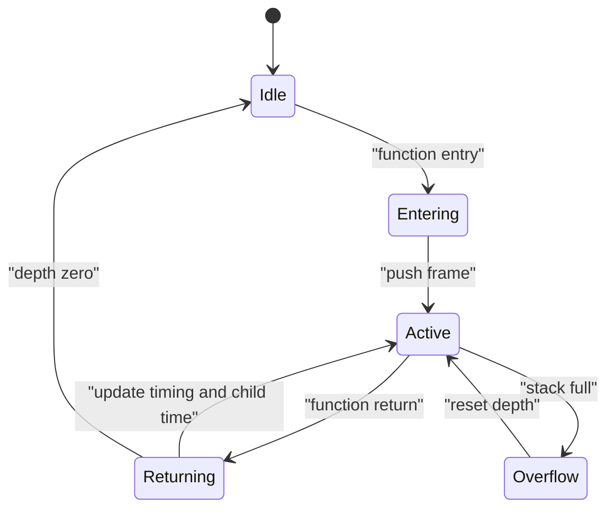
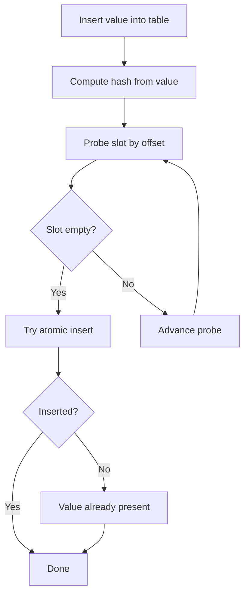
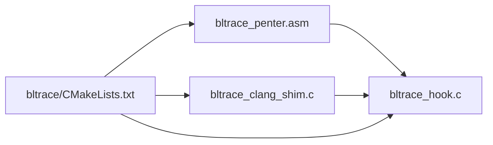

# Function Hooking Mechanisms

<cite>
**Referenced Files in This Document**
- [bltrace_penter.asm](file://bltrace/bltrace_penter.asm)
- [bltrace_hook.c](file://bltrace/bltrace_hook.c)
- [bltrace_clang_shim.c](file://bltrace/bltrace_clang_shim.c)
- [CMakeLists.txt](file://bltrace/CMakeLists.txt)
</cite>

## Table of Contents
1. [Introduction](#introduction)
2. [Project Structure](#project-structure)
3. [Core Components](#core-components)
4. [Architecture Overview](#architecture-overview)
5. [Detailed Component Analysis](#detailed-component-analysis)
6. [Dependency Analysis](#dependency-analysis)
7. [Performance Considerations](#performance-considerations)
8. [Troubleshooting Guide](#troubleshooting-guide)
9. [Conclusion](#conclusion)

## Introduction
This document explains the function hooking mechanisms used by bltrace on Windows. It covers two complementary instrumentation paths:

- MSVC `/Gh` and `/GH`: MASM-generated `_penter` and `_pexit` stubs call into C entry points that compute a Relative Virtual Address (RVA), maintain per-thread call stacks, record function calls and return edges, and collect timing statistics.
- Clang `-finstrument-functions`: A small shim redirects compiler-inserted `__cyg_profile_func_enter` and `__cyg_profile_func_exit` into the same C tracing logic so that both compilers produce compatible trace data.

The system avoids symbol resolution at runtime by identifying functions through RVAs derived from the module base address. It is designed to be lock-free during hot-path execution, uses thread-local storage for per-call state, and provides atomic tables for concurrent recording.

## Project Structure
The bltrace component is a static library that adapts its build and entry points depending on the compiler:

| File | Responsibility |
| --- | --- |
| [bltrace_penter.asm](file://bltrace/bltrace_penter.asm) | MASM assembly implementing `_penter` and `_pexit` for MSVC `/Gh` and `/GH`. |
| [bltrace_hook.c](file://bltrace/bltrace_hook.c) | Core C implementation: initialization, RVA computation, call stack management, edge recording, timing, dumping, and synchronization primitives. |
| [bltrace_clang_shim.c](file://bltrace/bltrace_clang_shim.c) | Compiler shim mapping Clang instrumentation callbacks to the shared C hooks. |
| [CMakeLists.txt](file://bltrace/CMakeLists.txt) | Build configuration selecting MASM or Clang shim sources and applying appropriate compile options. |



**Diagram sources**
- [bltrace_penter.asm:1-108](file://bltrace/bltrace_penter.asm#L1-L108)
- [bltrace_clang_shim.c:1-27](file://bltrace/bltrace_clang_shim.c#L1-L27)
- [bltrace_hook.c:1-200](file://bltrace/bltrace_hook.c#L1-L200)
- [CMakeLists.txt:1-49](file://bltrace/CMakeLists.txt#L1-L49)

**Section sources**
- [bltrace_penter.asm:1-108](file://bltrace/bltrace_penter.asm#L1-L108)
- [bltrace_hook.c:1-200](file://bltrace/bltrace_hook.c#L1-L200)
- [bltrace_clang_shim.c:1-27](file://bltrace/bltrace_clang_shim.c#L1-L27)
- [CMakeLists.txt:1-49](file://bltrace/CMakeLists.txt#L1-L49)

## Core Components
- **MASM entry/exit stubs**: Preserve all volatile registers, align the stack, extract the caller’s return address, and invoke the C hooks.
- **C tracing core**: Computes RVAs, records unique function IDs and call edges, maintains a per-thread call stack, accumulates inclusive/self timing, and exports dump/reset/query APIs.
- **Clang shim**: Converts compiler-provided function addresses into the same format expected by the MSVC hook path.
- **Build configuration**: Adds the MASM object when not using Clang, adds the Clang shim otherwise, and disables recursive instrumentation in the hook translation unit.

Key responsibilities and design decisions:
- Function identification uses an RVA plus one encoding, which avoids zero-valued keys and matches the dump format described in the file header comment.
- Call tracking uses a fixed-size open-addressing hash table with atomic insertion and a caller/callee edge table.
- Per-thread call state is allocated lazily via TLS and virtual memory, with overflow protection.
- Timing uses Query Performance Counter values and stores per-function self/inclusive time without locking during hot paths.

**Section sources**
- [bltrace_penter.asm:1-108](file://bltrace/bltrace_penter.asm#L1-L108)
- [bltrace_hook.c:1-376](file://bltrace/bltrace_hook.c#L1-L376)
- [bltrace_clang_shim.c:1-27](file://bltrace/bltrace_clang_shim.c#L1-L27)
- [CMakeLists.txt:1-49](file://bltrace/CMakeLists.txt#L1-L49)

## Architecture Overview
The hooking architecture separates platform-specific instrumentation from portable tracing logic:

```mermaid
sequenceDiagram
    participant Target as "Target function"
    participant MSVC as "MSVC runtime"
    participant MASM as "_penter / _pexit"
    participant Shim as "Clang shim"
    participant Core as "bltrace_hook.c"
    participant TLS as "Per-thread state"
    participant Tables as "Atomic tables"

    Note over Target,MSVC: MSVC builds use /Gh and /GH; Clang builds use -finstrument-functions.

    Target->>MSVC: Function call
    MSVC->>MASM: Call _penter
    MASM->>Core: bltrace_enter(return_address)
    Core->>Core: Compute RVA from return address
    Core->>Tables: Record function ID and edge atomically
    Core->>TLS: Push frame with start time and parent info
    Core-->>MASM: Return
    MASM-->>Target: Return to target

    Target-->>MSVC: Function return
    MSVC->>MASM: Call _pexit
    MASM->>Core: bltrace_exit(retaddr)
    Core->>TLS: Pop frame
    Core->>Core: Compute inclusive/self timing
    Core->>Tables: Update timing slots if enabled
    Core-->>MASM: Return
    MASM-->>Target: Restore state and return
```

**Diagram sources**
- [bltrace_penter.asm:1-108](file://bltrace/bltrace_penter.asm#L1-L108)
- [bltrace_hook.c:1-376](file://bltrace/bltrace_hook.c#L1-L376)
- [bltrace_clang_shim.c:1-27](file://bltrace/bltrace_clang_shim.c#L1-L27)

## Detailed Component Analysis

### MSVC /Gh and /GH Entry Points
The MASM stubs are generated to match the ABI requirements of MSVC’s `/Gh` and `/GH` hooks:

- `_penter` is called at function entry with no arguments and no shadow space reserved by the compiler.
- `_pexit` is called before each function return.
- Both stubs must preserve every volatile register and flags, keep the stack 16-byte aligned, and pass the caller’s return address directly above the hook call site.

Implementation highlights:
- The stub saves integer and XMM registers, adjusts the stack to satisfy alignment, reads the return address from the saved stack frame, and invokes `bltrace_enter` or `bltrace_exit`.
- After the C call returns, it restores registers and stack state before returning to the original caller.



**Diagram sources**
- [bltrace_penter.asm:1-108](file://bltrace/bltrace_penter.asm#L1-L108)

**Section sources**
- [bltrace_penter.asm:1-108](file://bltrace/bltrace_penter.asm#L1-L108)

### Clang Instrumentation Shim
When built with Clang, bltrace does not use MASM. Instead, Clang inserts calls to `__cyg_profile_func_enter` and `__cyg_profile_func_exit`, and the shim forwards them to the shared C code:

- `__cyg_profile_func_enter` receives `this_fn`, the address of the instrumented function, and forwards it to `bltrace_enter`.
- `__cyg_profile_func_exit` pops the TLS stack through `bltrace_exit(0)` because the exit semantics only need the per-thread state, not the return address.
- The shim translation unit is compiled with `-fno-instrument-functions*` options to avoid recursive instrumentation of the hook itself.



**Diagram sources**
- [bltrace_clang_shim.c:1-27](file://bltrace/bltrace_clang_shim.c#L1-L27)
- [bltrace_hook.c:1-200](file://bltrace/bltrace_hook.c#L1-L200)

**Section sources**
- [bltrace_clang_shim.c:1-27](file://bltrace/bltrace_clang_shim.c#L1-L27)
- [CMakeLists.txt:1-49](file://bltrace/CMakeLists.txt#L1-L49)

### RVA System and Function Identification
bltrace identifies functions without relying on debug symbols or dynamic symbol lookup:

- At initialization, the module base address is obtained.
- On entry, the return address passed by the compiler or MASM stub is converted to an RVA by subtracting the module base.
- The recorded key is `rva + 1`, which ensures that valid keys are nonzero and can be stored efficiently in fixed-size tables.
- Dump files write flat sequences of little-endian 64-bit values:
  - Function table entries: `rva + 1`.
  - Edge table entries: `(caller_rva << 32) | callee_rva`.



**Diagram sources**
- [bltrace_hook.c:1-200](file://bltrace/bltrace_hook.c#L1-L200)

**Section sources**
- [bltrace_hook.c:1-200](file://bltrace/bltrace_hook.c#L1-L200)

### Initialization and Hook Activation
The initialization path prepares memory, timing frequency, TLS, and activation state:

- `bltrace_arm` allocates function slot tables, edge slot tables, and timing slot buffers.
- It queries the performance counter frequency once and stores it for later timing output.
- It allocates a TLS index and sets an armed flag atomically.
- `bltrace_disarm` clears the armed flag.
- `bltrace_reset` zeroes all tables, resets counters, and clears per-thread stack depth.



**Diagram sources**
- [bltrace_hook.c:1-200](file://bltrace/bltrace_hook.c#L1-L200)

**Section sources**
- [bltrace_hook.c:1-200](file://bltrace/bltrace_hook.c#L1-L200)

### Call Stack Management and Nested Calls
Each thread has a TLS-backed stack frame array:

- Each frame stores the function RVA, the entry timestamp, and accumulated child time.
- On entry, the current top-of-stack RVA becomes the caller for edge recording.
- On exit, the top frame is popped, inclusive time is computed from the start timestamp, and self time is computed by subtracting accumulated child time.
- If there is a parent frame, its child accumulator is increased by the current function’s inclusive time.
- The stack depth is bounded; overflow resets depth to zero rather than corrupting state.



**Diagram sources**
- [bltrace_hook.c:201-376](file://bltrace/bltrace_hook.c#L201-L376)

**Section sources**
- [bltrace_hook.c:201-376](file://bltrace/bltrace_hook.c#L201-L376)

### Atomic Recording and Hash Tables
bltrace uses fixed-size arrays with open addressing:

- Function IDs are hashed with a multiplicative constant and inserted using compare-and-exchange.
- Duplicate IDs are ignored, but the total count is incremented.
- Edge entries store combined caller and callee RVAs and are similarly deduplicated.
- Timing slots use the same hashing strategy and support atomic increments and additions.

Complexity characteristics:
- Average insertion is O(1).
- Worst-case probing is bounded by the table size.
- Memory usage is deterministic because the slot counts are constants.



**Diagram sources**
- [bltrace_hook.c:1-200](file://bltrace/bltrace_hook.c#L1-L200)

**Section sources**
- [bltrace_hook.c:1-200](file://bltrace/bltrace_hook.c#L1-L200)

### Dumping and Output Formats
The public API exposes several dump routines:

- `bltrace_dump` writes function IDs to a file.
- `bltrace_dump_edges` writes caller-callee edges to a file.
- `bltrace_dump_timings` writes a binary header followed by timing records.
- `bltrace_timing_count` reports how many timing slots have been populated.
- `bltrace_edge_count` reports how many unique edges were recorded.

Timing record fields include the encoded key, invocation count, self time, and inclusive time. The header includes magic, version, performance counter frequency, record size, and count.

**Section sources**
- [bltrace_hook.c:201-376](file://bltrace/bltrace_hook.c#L201-L376)

## Dependency Analysis
The dependency relationships between components are intentionally layered:



- The MASM stub depends only on exported C entry points.
- The Clang shim depends only on the same C entry points.
- The build script selects which sources participate based on the compiler.
- The C core depends on Windows APIs, intrinsic atomic operations, and performance counter APIs.

**Diagram sources**
- [bltrace_penter.asm:1-108](file://bltrace/bltrace_penter.asm#L1-L108)
- [bltrace_clang_shim.c:1-27](file://bltrace/bltrace_clang_shim.c#L1-L27)
- [bltrace_hook.c:1-376](file://bltrace/bltrace_hook.c#L1-L376)
- [CMakeLists.txt:1-49](file://bltrace/CMakeLists.txt#L1-L49)

**Section sources**
- [CMakeLists.txt:1-49](file://bltrace/CMakeLists.txt#L1-L49)

## Performance Considerations
Hot-path overhead comes from several sources:

- Register and XMM save/restore in MASM stubs.
- Stack alignment adjustments.
- Calling into C code.
- Computing QPC timestamps.
- Hash probing and atomic updates.
- Per-thread TLS access and lazy allocation.
- Edge recording and timing accumulation.

Recommended measurement approach:
- Enable hooks with `bltrace_arm`.
- Run a controlled benchmark section.
- Read `bltrace_count` and `bltrace_edge_count` to measure total function invocations and unique edges.
- Dump timings with `bltrace_dump_timings` and decode self versus inclusive times.
- Compare results across different hook strategies:
  - MSVC `/Gh`/`/GH` incurs explicit entry/exit overhead at every call and return.
  - Clang `-finstrument-functions` incurs compiler-inserted callbacks, but shares the same C core.
  - Disabling edge recording reduces table pressure and may lower contention.
  - Disabling timing collection avoids QPC calls and timing slot updates.

Thread safety considerations:
- Global tables use atomic compare-and-exchange and atomic increments/adds.
- Per-thread state is isolated via TLS.
- Initialization should happen before enabling hooks in other threads.
- `bltrace_reset` clears mutable state and should not be called while hooks are active concurrently unless the consumer protocol guarantees exclusive access.

[No sources needed since this section provides general guidance]

## Troubleshooting Guide
Common issues and diagnostics:

- **Hooks appear inactive**: Verify that `bltrace_arm` was called and that `g_armed` is set. Also verify that the module base is initialized.
- **Missing functions in dumps**: Functions whose return address cannot be mapped to the current module base will be skipped. Ensure the traced code belongs to the expected module.
- **Incorrect timing values**: Confirm that the performance counter frequency is available and that timing slots are allocated. Use `bltrace_timing_count` to confirm timing data presence.
- **High overhead**: Consider disabling edge recording or timing collection, reducing the number of traced functions, or comparing MSVC and Clang paths.
- **Corrupted call stacks**: Check for unbalanced calls where `_pexit` is not invoked for every `_penter`, or for recursion that bypasses normal control flow. The stack cap prevents overflow but resets depth, which may affect accuracy.
- **Dump files are empty**: Confirm that hooks were armed during the workload and that dump routines are called after the workload completes.

**Section sources**
- [bltrace_hook.c:1-376](file://bltrace/bltrace_hook.c#L1-L376)

## Conclusion
bltrace implements a compact, cross-compiler function hooking system:

- MSVC `/Gh` and `/GH` rely on MASM-generated `_penter` and `_pexit` stubs that safely bridge into C.
- Clang instrumentation is supported through a small shim that reuses the same C logic.
- Function identity is based on RVAs, avoiding symbol resolution and keeping the runtime lightweight.
- Thread-local call stacks track nested calls, while atomic tables record function IDs and edges.
- Timing data captures self and inclusive durations for profiling.

For best results, initialize hooks early, measure overhead with controlled benchmarks, choose the minimal recording features required, and handle reset/dump operations outside the hot path.

[No sources needed since this section summarizes without analyzing specific files]