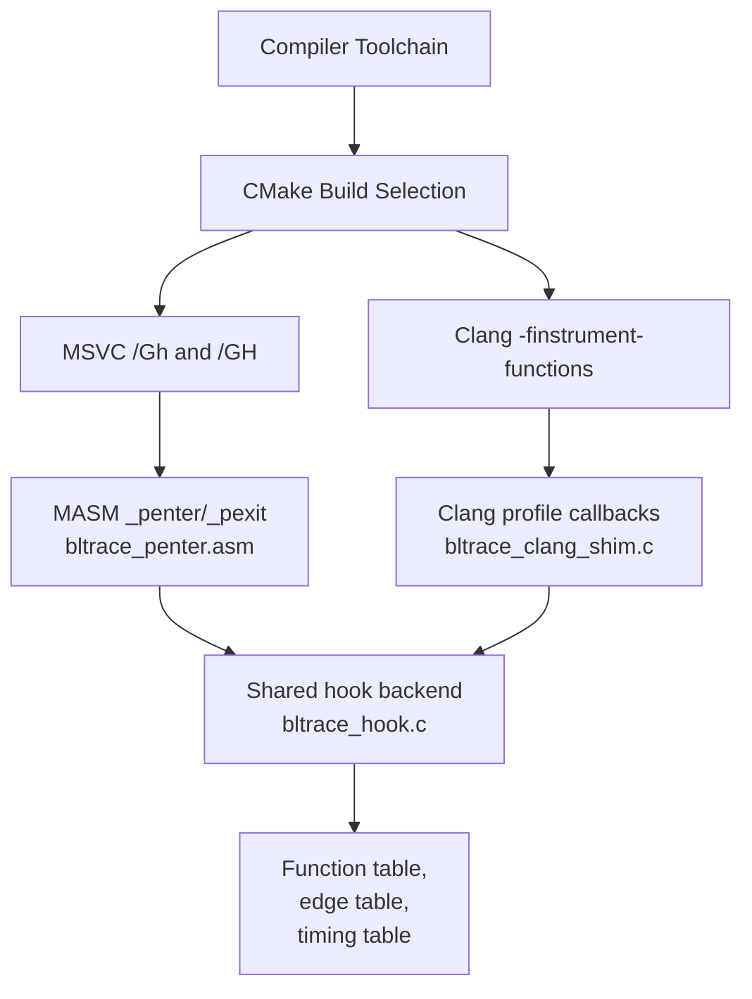
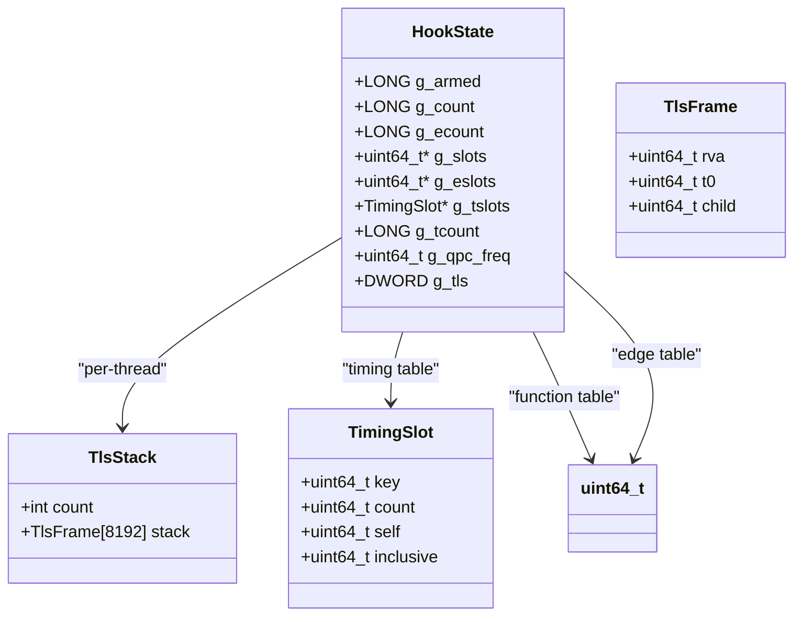
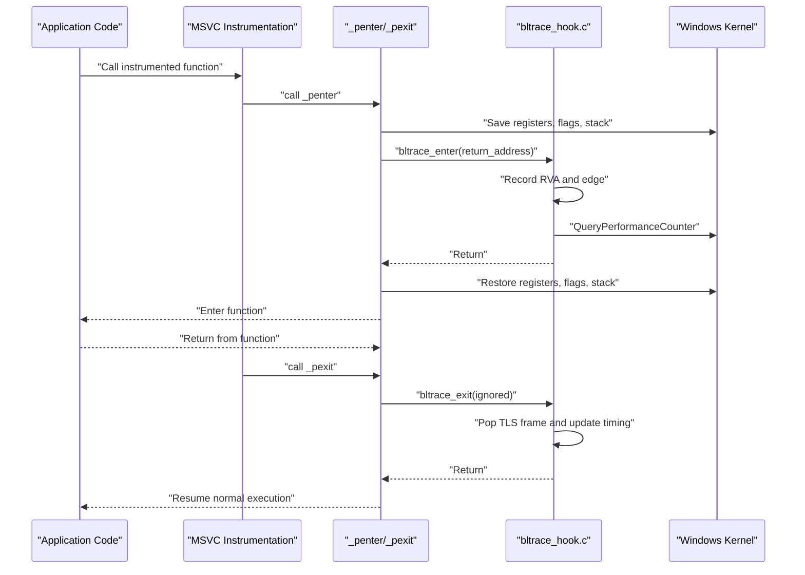
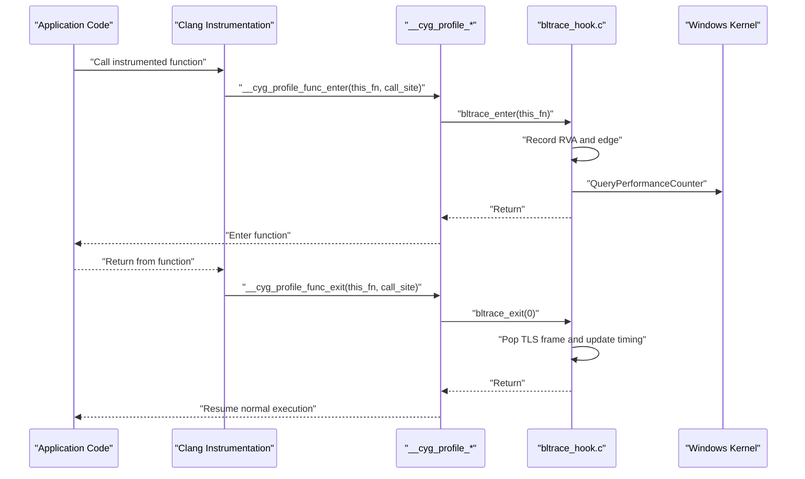
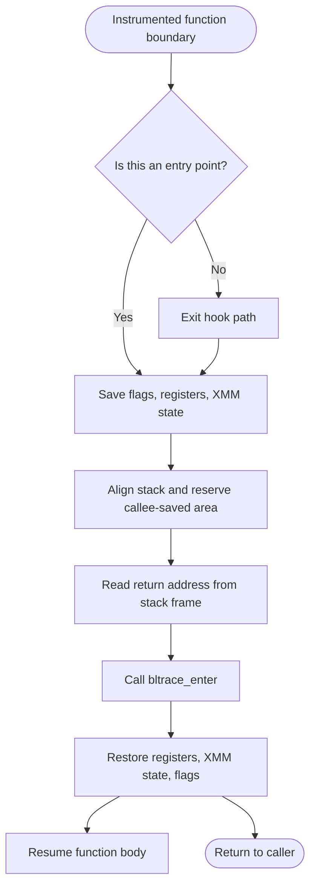
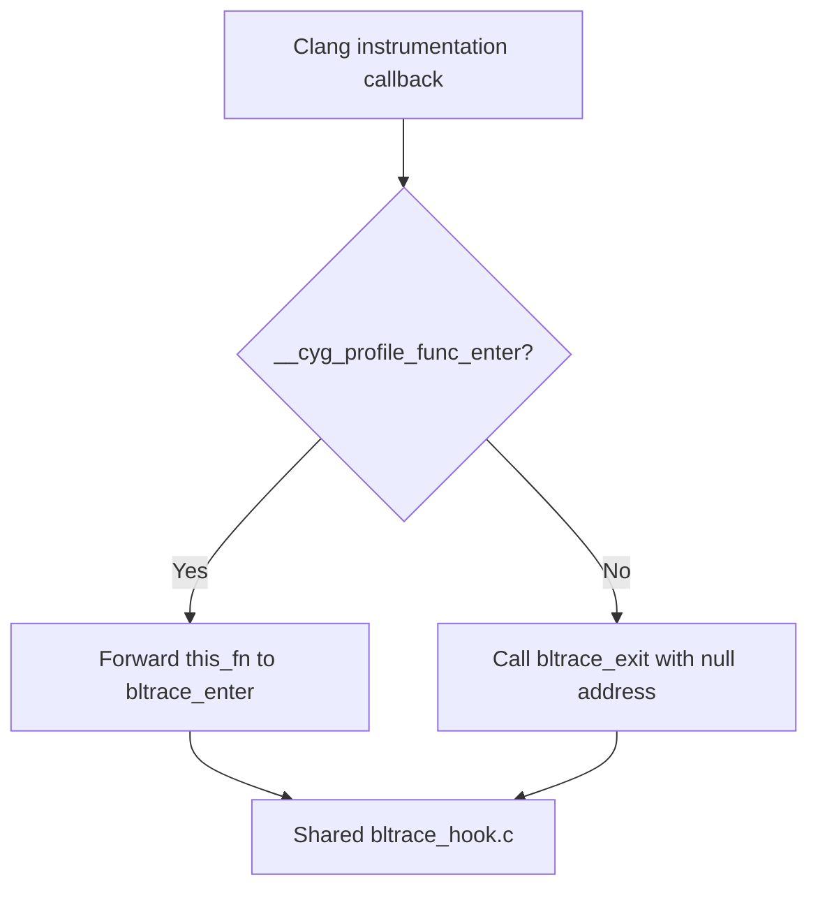
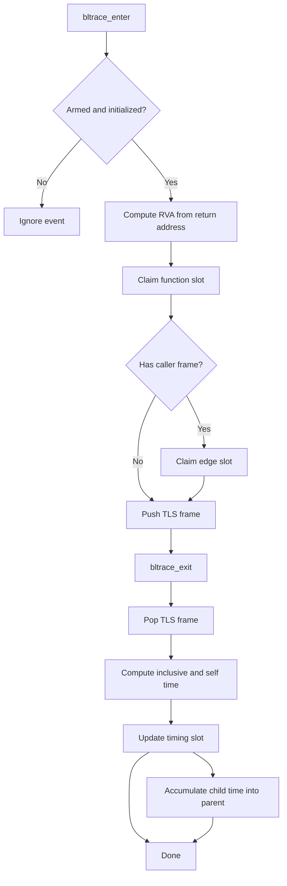
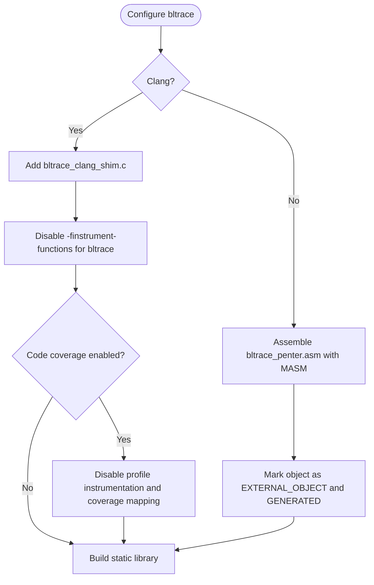
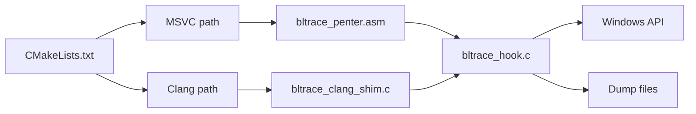

# MSVC vs Clang Implementations

<cite>
**Referenced Files in This Document**
- [bltrace/CMakeLists.txt](file://bltrace/CMakeLists.txt)
- [bltrace/bltrace_hook.c](file://bltrace/bltrace_hook.c)
- [bltrace/bltrace_clang_shim.c](file://bltrace/bltrace_clang_shim.c)
- [bltrace/bltrace_penter.asm](file://bltrace/bltrace_penter.asm)
</cite>

## Table of Contents
1. [Introduction](#introduction)
2. [Project Structure](#project-structure)
3. [Core Components](#core-components)
4. [Architecture Overview](#architecture-overview)
5. [Detailed Component Analysis](#detailed-component-analysis)
6. [Dependency Analysis](#dependency-analysis)
7. [Performance Considerations](#performance-considerations)
8. [Platform-Specific Limitations](#platform-specific-limitations)
9. [Debugging Capabilities](#debugging-capabilities)
10. [Migration Guide](#migration-guide)
11. [Troubleshooting Guide](#troubleshooting-guide)
12. [Conclusion](#conclusion)

## Introduction
This document compares two compiler-driven tracing approaches used by the bltrace library:

- **MSVC path**: Uses the `/Gh` and `/GH` compiler options so the compiler inserts calls to `_penter` at function entry and `_pexit` before function return. A MASM assembly stub preserves registers and stack state, then forwards control to shared C logic that records function entries, call/return edges, and per-function timing.
- **Clang path**: Uses `-finstrument-functions`, which asks Clang to generate calls to `__cyg_profile_func_enter` and `__cyg_profile_func_exit`. A small C shim translates those callbacks into the same shared C API used by the MSVC path.

Both paths converge on a common implementation in `bltrace_hook.c`, which manages Windows Thread Local Storage, hash tables for recorded functions and edges, performance counter–based timing, and file-based dump routines.

## Project Structure
The bltrace module is organized around one shared tracing backend and two platform-specific entry points:

| File | Responsibility |
|---|---|
| `bltrace/CMakeLists.txt` | Selects MSVC or Clang build artifacts and configures compiler flags. |
| `bltrace/bltrace_hook.c` | Shared C implementation of hook state, hash tables, TLS, timing, and dump APIs. |
| `bltrace/bltrace_penter.asm` | MSVC-only MASM stubs implementing `_penter` and `_pexit`. |
| `bltrace/bltrace_clang_shim.c` | Clang-only shim translating instrumentation callbacks into the shared API. |

**Diagram sources**
- [bltrace/CMakeLists.txt:1-49](file://bltrace/CMakeLists.txt#L1-L49)
- [bltrace/bltrace_penter.asm:1-108](file://bltrace/bltrace_penter.asm#L1-L108)
- [bltrace/bltrace_clang_shim.c:1-27](file://bltrace/bltrace_clang_shim.c#L1-L27)
- [bltrace/bltrace_hook.c:1-376](file://bltrace/bltrace_hook.c#L1-L376)

**Section sources**
- [bltrace/CMakeLists.txt:1-49](file://bltrace/CMakeLists.txt#L1-L49)

## Core Components
The bltrace library exposes a small public surface through exported C functions while keeping its internal tracing state private:

| Exported Function | Purpose |
|---|---|
| `bltrace_arm` | Allocates global buffers, initializes the performance counter frequency, allocates TLS storage, and arms tracing. |
| `bltrace_disarm` | Disables tracing by clearing the armed flag. |
| `bltrace_count` | Returns the number of unique function slots filled. |
| `bltrace_edge_count` | Returns the number of unique call/return edge slots filled. |
| `bltrace_timing_count` | Returns the number of timing records collected. |
| `bltrace_reset` | Clears all tables, counters, and TLS frame state. |
| `bltrace_dump` | Writes the function slot table to a binary file. |
| `bltrace_dump_edges` | Writes the edge slot table to a binary file. |
| `bltrace_dump_timings` | Writes a header plus timing records to a binary file. |

Internally, the shared implementation uses:

- A 0x200000-slot hash table for function RVAs.
- A second 0x200000-slot hash table for caller/callee edges encoded as `(caller_rva << 32) | callee_rva`.
- A 0x80000-slot timing table keyed by RVA with count, self time, and inclusive time.
- Per-thread TLS storing an array of up to 0x2000 frames tracking the current call depth, function RVA, entry timestamp, and accumulated child time.
- Lock-free atomic operations for concurrent updates to counters and slots.
- Query Performance Counter for high-resolution timing.

**Diagram sources**
- [bltrace/bltrace_hook.c:1-190](file://bltrace/bltrace_hook.c#L1-L190)

**Section sources**
- [bltrace/bltrace_hook.c:1-376](file://bltrace/bltrace_hook.c#L1-L376)

## Architecture Overview
The two toolchains produce different runtime call chains but share the same data collection and output behavior.

### MSVC Path
MSVC’s `/Gh` option inserts a call to `_penter` at every function entry, and `/GH` inserts a call to `_pexit` before each return. The MASM stubs save volatile registers, XMM registers, flags, and stack alignment, then pass the address above the inserted call—effectively the caller’s return address—to `bltrace_enter` or `bltrace_exit`.

**Diagram sources**
- [bltrace/bltrace_penter.asm:1-108](file://bltrace/bltrace_penter.asm#L1-L108)
- [bltrace/bltrace_hook.c:150-376](file://bltrace/bltrace_hook.c#L150-L376)

### Clang Path
Clang’s `-finstrument-functions` generates calls to `__cyg_profile_func_enter(this_fn, call_site)` and `__cyg_profile_func_exit(this_fn, call_site)`. The shim forwards these to the same shared API. The MSVC-style semantics are preserved because the shared exit routine pops the TLS frame; the Clang path treats the exit callback as matching the corresponding enter event rather than recording a separate return edge.

**Diagram sources**
- [bltrace/bltrace_clang_shim.c:1-27](file://bltrace/bltrace_clang_shim.c#L1-L27)
- [bltrace/bltrace_hook.c:150-376](file://bltrace/bltrace_hook.c#L150-L376)

## Detailed Component Analysis

### MSVC Assembly Stub: `bltrace_penter.asm`
The MASM file defines two public symbols:

- `_penter`: Called at function entry.
- `_pexit`: Called before function return.

Key implementation characteristics:

- Saves the full processor state: flags, general-purpose registers `rax` through `r12`, and XMM registers `xmm0` through `xmm5`.
- Temporarily adjusts the stack pointer to satisfy x64 calling conventions and preserve 16-byte alignment.
- Reads the caller’s return address from the stack frame offset used by the MSVC-generated hook call site.
- Calls `bltrace_enter` or `bltrace_exit` and restores all saved state before returning.
- Declares both functions as `PROC`/`ENDP` and exports them as public symbols.

This design matches the comment in the source: MSVC’s `/Gh` emits `call _penter` without arguments and without reserved shadow space, so the stub must be careful about register and stack preservation.

**Diagram sources**
- [bltrace/bltrace_penter.asm:1-108](file://bltrace/bltrace_penter.asm#L1-L108)

**Section sources**
- [bltrace/bltrace_penter.asm:1-108](file://bltrace/bltrace_penter.asm#L1-L108)

### Clang Shim: `bltrace_clang_shim.c`
The Clang shim is intentionally minimal:

- Declares `__cyg_profile_func_enter` and `__cyg_profile_func_exit` as `__declspec(noinline)`.
- Forwards `this_fn` directly to `bltrace_enter`, reusing the same RVA subtraction logic already present in the shared backend.
- Ignores `call_site` because the shared code does not require it.
- Calls `bltrace_exit` with a null argument during exit, relying on the shared implementation’s TLS frame handling rather than trying to reconstruct a return address.

This allows the Clang path to reuse all allocation, hashing, timing, and dump logic without duplicating it.

**Diagram sources**
- [bltrace/bltrace_clang_shim.c:1-27](file://bltrace/bltrace_clang_shim.c#L1-L27)
- [bltrace/bltrace_hook.c:150-376](file://bltrace/bltrace_hook.c#L150-L376)

**Section sources**
- [bltrace/bltrace_clang_shim.c:1-27](file://bltrace/bltrace_clang_shim.c#L1-L27)

### Shared Backend: `bltrace_hook.c`
The shared backend implements the actual tracing work. Its main responsibilities are:

#### Initialization and State Management
- Computes the module base using `GetModuleHandleA(NULL)`.
- Allocates three large buffers: function table, edge table, and timing table.
- Initializes the high-resolution timer frequency via `QueryPerformanceFrequency`.
- Allocates a TLS index and lazily allocates per-thread TLS state.

#### Hash Tables
- Uses a simple linear-probing hash table with a fixed mask (`SLOT_COUNT - 1` or `TIME_SLOT_MASK`).
- Hashes keys using multiplication by `0x9E3779B1`, a well-known constant for spreading integer keys.
- Uses `_InterlockedCompareExchange64` for lock-free insertion when the slot is empty.
- Returns whether a new slot was successfully claimed, allowing counters to track distinct entries.

#### Entry Handling
- Rejects events if tracing is disarmed or uninitialized.
- Converts the received return address into an RVA relative to the module base.
- Records the function RVA as `rva + 1` in the function table.
- Optionally records a caller/callee edge if a previous frame exists in TLS.
- Pushes the current frame onto the per-thread TLS stack.

#### Exit Handling
- Pops the top TLS frame.
- Computes inclusive and self timing using QPC timestamps and accumulated child time.
- Updates timing slots atomically.
- Adds inclusive time to the parent frame’s child accumulator.

#### Dumping and Resetting
- Writes non-zero function slots to a file.
- Writes non-zero edge slots to a file.
- Writes timing records preceded by a structured header containing magic, version, frequency, record size, and count.
- Resets all buffers and counters to zero.

**Diagram sources**
- [bltrace/bltrace_hook.c:150-376](file://bltrace/bltrace_hook.c#L150-L376)

**Section sources**
- [bltrace/bltrace_hook.c:1-376](file://bltrace/bltrace_hook.c#L1-L376)

### Build Configuration: `bltrace/CMakeLists.txt`
The CMake script selects the implementation based on the C++ compiler identifier:

| Condition | Behavior |
|---|---|
| `CMAKE_CXX_COMPILER_ID MATCHES "Clang"` | Adds `bltrace_clang_shim.c` to the static library and disables function instrumentation inside the bltrace translation unit. |
| Non-Clang compiler | Invokes the MASM assembler through `add_custom_command` to assemble `bltrace_penter.asm` into `bltrace_penter.obj`, marks it as external/generated, and links it into the static library. |

Important configuration details:

- Clang builds explicitly disable `-finstrument-functions` and `-finstrument-functions-after-inlining` for the bltrace target so the shim itself is not recursively instrumented.
- When code coverage is enabled, Clang also disables profile instrumentation and coverage mapping for bltrace.
- The MASM object is marked `EXTERNAL_OBJECT TRUE` and `GENERATED TRUE` so CMake knows it is produced outside the normal C/C++ compilation pipeline.
- The comment explains that MASM cannot safely consume globally added Windows definitions with quoted values, so the MASM path avoids those definitions entirely.

**Diagram sources**
- [bltrace/CMakeLists.txt:1-49](file://bltrace/CMakeLists.txt#L1-L49)

**Section sources**
- [bltrace/CMakeLists.txt:1-49](file://bltrace/CMakeLists.txt#L1-L49)

## Dependency Analysis
The dependency graph shows how toolchain choice determines which entry points feed the shared backend.

**Diagram sources**
- [bltrace/CMakeLists.txt:1-49](file://bltrace/CMakeLists.txt#L1-L49)
- [bltrace/bltrace_penter.asm:1-108](file://bltrace/bltrace_penter.asm#L1-L108)
- [bltrace/bltrace_clang_shim.c:1-27](file://bltrace/bltrace_clang_shim.c#L1-L27)
- [bltrace/bltrace_hook.c:1-376](file://bltrace/bltrace_hook.c#L1-L376)

**Section sources**
- [bltrace/CMakeLists.txt:1-49](file://bltrace/CMakeLists.txt#L1-L49)

## Performance Considerations
The two implementations differ primarily in where the instrumentation cost originates:

| Aspect | MSVC `/Gh`/`/GH` | Clang `-finstrument-functions` |
|---|---|---|
| Instrumentation origin | Compiler-generated `_penter`/`_pexit` calls. | Compiler-generated `__cyg_profile_func_enter`/`__cyg_profile_func_exit` calls. |
| Register/stack overhead | Explicitly handled by hand-written MASM; saves flags, GPRs, XMMs, and aligns the stack. | Handled by Clang’s instrumentation machinery; the shim is declared `noinline` to avoid recursion. |
| Edge recording | Both paths can record caller/callee edges through the shared TLS stack. | Same shared logic applies once the shim forwards the call. |
| Recursion prevention | MASM calls directly into the shared C API; the rest of the program controls whether hooks are active. | Clang is told to skip instrumentation for the bltrace target, preventing infinite recursion. |
| Debugging integration | Uses MSVC ABI conventions and Windows TLS/QPC. | Uses Clang profiling callbacks but shares the same Windows-facing backend. |

Practical implications:

- Every instrumented function pays a call overhead plus the cost of hash-table lookups, atomic updates, and possibly QPC calls.
- The function table and edge table use fixed-size open-addressing hash tables; collisions increase lookup cost. With 0x200000 slots, contention grows as more unique functions or edges are observed.
- Timing adds per-entry and per-exit QPC reads and atomic updates to the timing table.
- TLS allocation is lazy: per-thread state is allocated only when needed.
- Dumping writes non-zero entries sequentially, avoiding unnecessary I/O for empty slots.

[No sources needed since this section provides general guidance derived from the analyzed components]

## Platform-Specific Limitations
### MSVC Limitations
- Requires a working MASM toolchain because `bltrace_penter.asm` is assembled separately.
- Depends on MSVC ABI assumptions: the generated `_penter`/`_pexit` call sites, register layout, and stack frame offsets used to read the return address.
- The comment indicates that MASM cannot accept globally added Windows definitions containing quoted values with dots, so the MASM object is kept independent of global C/C++ definitions.
- Uses Windows-only APIs such as `VirtualAlloc`, `TlsAlloc`, `TlsGetValue`, `CreateFileA`, and `QueryPerformanceCounter`.

### Clang Limitations
- Relies on Clang’s `-finstrument-functions` support and the resulting `__cyg_profile_func_*` symbols.
- The shim assumes that `this_fn` has the same meaning as the MSVC return address passed to `bltrace_enter`; this works because both ultimately represent the function entry point within the module.
- Still targets Windows through the shared backend, so it inherits the Windows API dependencies.
- If the build enables code coverage, additional Clang instrumentation may conflict with profiling unless explicitly disabled for the bltrace target.

**Section sources**
- [bltrace/CMakeLists.txt:1-49](file://bltrace/CMakeLists.txt#L1-L49)
- [bltrace/bltrace_penter.asm:1-108](file://bltrace/bltrace_penter.asm#L1-L108)
- [bltrace/bltrace_clang_shim.c:1-27](file://bltrace/bltrace_clang_shim.c#L1-L27)
- [bltrace/bltrace_hook.c:1-376](file://bltrace/bltrace_hook.c#L1-L376)

## Debugging Capabilities
The shared backend supports several debugging-oriented outputs:

| Capability | Description |
|---|---|
| Function sampling | `bltrace_dump` writes a flat sequence of little-endian 64-bit values representing sampled function RVAs. |
| Edge sampling | `bltrace_dump_edges` writes caller/callee pairs packed as `(caller_rva << 32) | callee_rva`. |
| Timing sampling | `bltrace_dump_timings` writes a header followed by records containing key, count, self time, and inclusive time. |
| Counters | `bltrace_count`, `bltrace_edge_count`, and `bltrace_timing_count` expose approximate cardinality metrics. |
| Reset | `bltrace_reset` clears all buffers and counters, useful between test runs or profiling sessions. |

Because both paths write the same formats, consumers of bltrace output do not need to distinguish whether the data came from MSVC or Clang.

**Section sources**
- [bltrace/bltrace_hook.c:1-376](file://bltrace/bltrace_hook.c#L1-L376)

## Migration Guide
When switching between MSVC and Clang, consider the following steps:

### From MSVC to Clang
1. Ensure the build system selects Clang as the compiler so the Clang branch in `bltrace/CMakeLists.txt` activates.
2. Verify that `-finstrument-functions` is enabled for the application targets that should be traced.
3. Confirm that the bltrace target is compiled with instrumentation disabled for itself to avoid recursion.
4. Validate that dump files still contain the expected function table, edge table, and timing format.
5. Check that code coverage settings do not unintentionally instrument bltrace again.

### From Clang to MSVC
1. Ensure MASM is available and callable through `CMAKE_ASM_MASM_COMPILER`.
2. Confirm that `bltrace_penter.asm` is assembled into `bltrace_penter.obj` during the build.
3. Enable MSVC’s `/Gh` and `/GH` options in the project’s compiler settings so `_penter` and `_pexit` are injected.
4. Rebuild and verify that dump files remain compatible.
5. If global C/C++ definitions interfere with MASM, keep the MASM object isolated as the build script already attempts to do.

### Behavioral Notes
- Both paths record function RVAs relative to the module base, so downstream tools should expect RVA-based keys rather than absolute addresses.
- The edge table encodes caller and callee RVAs together; callers must unpack the high and low 32 bits correctly.
- Timing records include a magic value, version, frequency, and record size, enabling readers to validate format compatibility.

**Section sources**
- [bltrace/CMakeLists.txt:1-49](file://bltrace/CMakeLists.txt#L1-L49)
- [bltrace/bltrace_clang_shim.c:1-27](file://bltrace/bltrace_clang_shim.c#L1-L27)
- [bltrace/bltrace_penter.asm:1-108](file://bltrace/bltrace_penter.asm#L1-L108)
- [bltrace/bltrace_hook.c:1-376](file://bltrace/bltrace_hook.c#L1-L376)

## Troubleshooting Guide
| Symptom | Likely Cause | Recommended Action |
|---|---|---|
| No tracing data appears | Tracing is disarmed or initialization failed. | Call `bltrace_arm` before instrumented code executes; check that the module base and buffers were allocated. |
| Build fails on MSVC with MASM errors | MASM cannot parse global definitions or toolchain path is missing. | Verify `CMAKE_ASM_MASM_COMPILER` is configured; rely on the existing isolation of the MASM object from global C/C++ definitions. |
| Build fails on Clang with recursion or unexpected profiling | The bltrace translation unit is being instrumented. | Confirm the target compile options disable `-finstrument-functions` and related coverage options. |
| Very slow performance under load | Hash table contention or excessive edge/timing recording. | Reduce workload size, inspect `bltrace_count` and `bltrace_edge_count`, and consider whether full edge and timing recording is necessary. |
| Dump files are empty | Tables were never populated or reset before dumping. | Ensure tracing is armed and run enough instrumented code before calling dump functions. |
| Timing counts are zero | Timing table was not allocated or timing data was cleared. | Check `bltrace_timing_count` and confirm `bltrace_dump_timings` is called after meaningful execution. |
| Edge table seems incomplete | Caller information was unavailable or collision limited insertion. | Inspect TLS stack behavior and remember that edge recording depends on having a previous frame. |

**Section sources**
- [bltrace/CMakeLists.txt:1-49](file://bltrace/CMakeLists.txt#L1-L49)
- [bltrace/bltrace_hook.c:1-376](file://bltrace/bltrace_hook.c#L1-L376)

## Conclusion
The bltrace library cleanly separates platform-specific instrumentation from shared tracing logic. MSVC’s approach relies on explicit `_penter`/`_pexit` stubs written in MASM, while Clang’s approach adapts generic profiling callbacks through a small shim. Both converge on the same shared backend, producing compatible output formats and exposing the same debugging interface.

The most important architectural distinction is where the compiler hook infrastructure lives:

- MSVC requires MASM and Windows ABI assumptions embedded in `bltrace_penter.asm`.
- Clang requires `-finstrument-functions` support and relies on the shim to translate callbacks into the shared API.
- CMake decides between the two based on the detected compiler, adding either the Clang shim or the assembled MASM object and applying appropriate compiler flags.

For teams maintaining both toolchains, the shared backend ensures consistent semantics, while migration primarily involves build configuration, compiler options, and verification that dump outputs remain compatible.