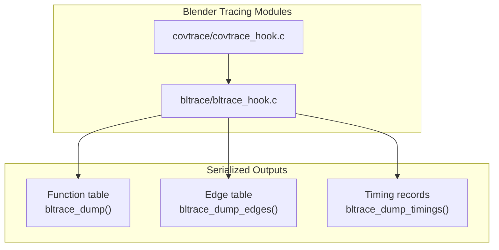
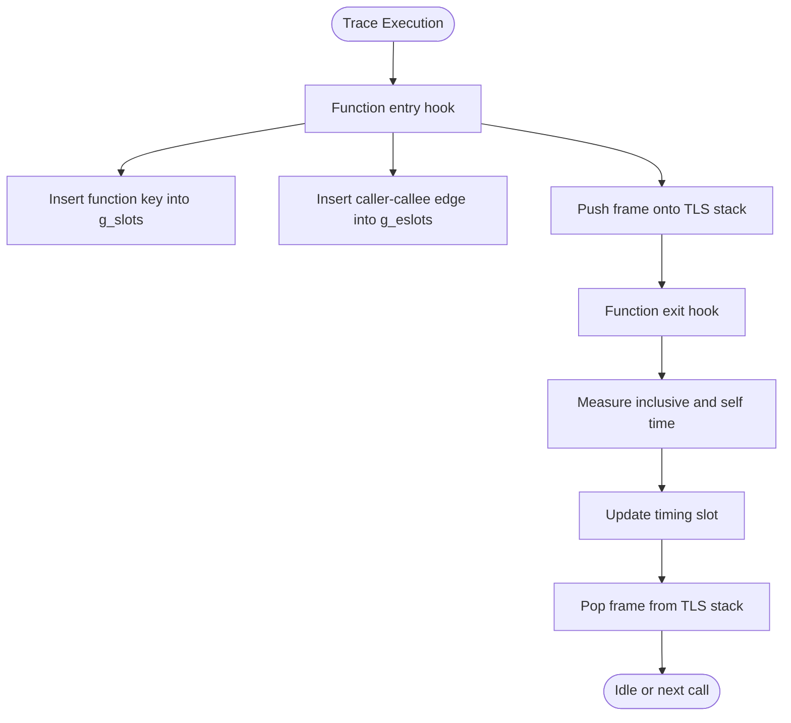
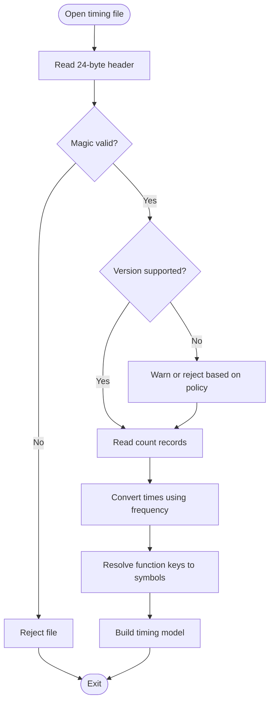
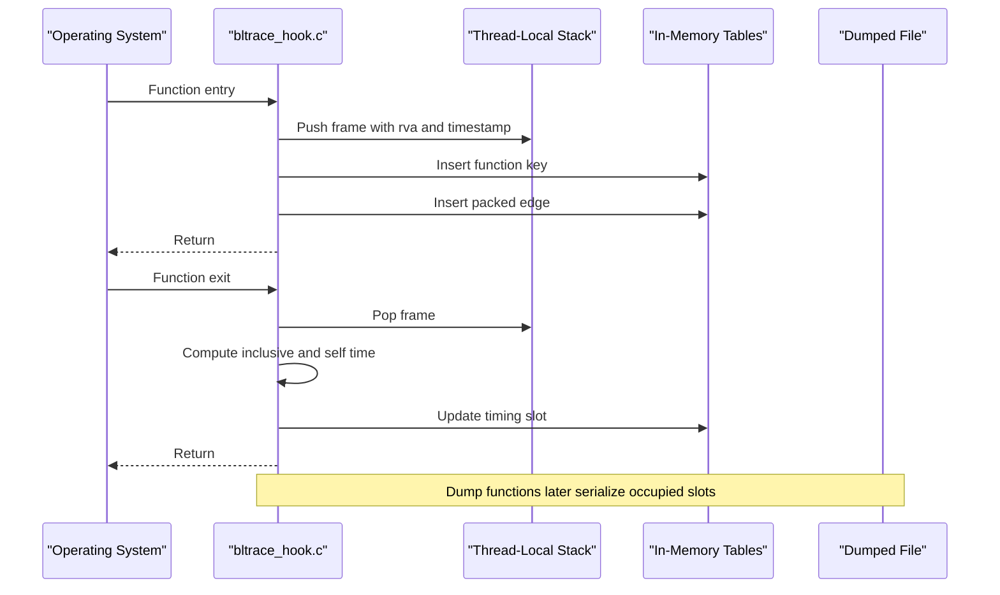
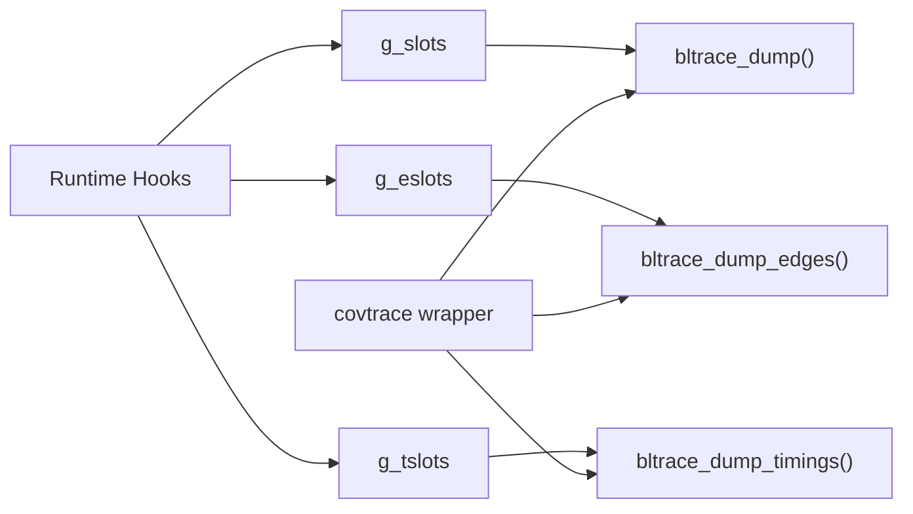

# Output Formats and Serialization

<cite>
**Referenced Files in This Document**
- [bltrace_hook.c](file://bltrace/bltrace_hook.c)
- [covtrace_hook.c](file://covtrace/covtrace_hook.c)
</cite>

## Table of Contents
1. [Introduction](#introduction)
2. [Project Structure](#project-structure)
3. [Core Components](#core-components)
4. [Architecture Overview](#architecture-overview)
5. [Detailed Component Analysis](#detailed-component-analysis)
6. [Dependency Analysis](#dependency-analysis)
7. [Performance Considerations](#performance-considerations)
8. [Troubleshooting Guide](#troubleshooting-guide)
9. [Conclusion](#conclusion)

## Introduction
This document describes the serialized output formats produced by bltrace’s dump functions: `bltrace_dump()`, `bltrace_dump_edges()`, and `bltrace_dump_timings()`. It explains how in-memory tracing data is translated into binary files, including record layouts, byte ordering, versioning, file layout rules, and parsing requirements for downstream tools. The goal is to enable reliable parsers that can reconstruct function call graphs, edge frequencies, and timing measurements from the generated trace files.

## Project Structure
The relevant implementation lives in two C source files:
- `bltrace/bltrace_hook.c` implements the runtime hooks, in-memory tables, and all three dump functions.
- `covtrace/covtrace_hook.c` re-exports selected bltrace symbols through a thin compatibility layer and also manages LLVM coverage output; it does not define the serialization format itself.

**Diagram sources**
- [bltrace_hook.c:1-376](file://bltrace/bltrace_hook.c#L1-L376)
- [covtrace_hook.c:1-85](file://covtrace/covtrace_hook.c#L1-L85)

**Section sources**
- [bltrace_hook.c:1-376](file://bltrace/bltrace_hook.c#L1-L376)
- [covtrace_hook.c:1-85](file://covtrace/covtrace_hook.c#L1-L85)

## Core Components
The serialization logic centers on three exported dump functions and supporting structures:

| Component | Responsibility | Serialized File |
|---|---|---|
| `bltrace_dump()` | Writes the function table containing unique visited function keys | Function table file |
| `bltrace_dump_edges()` | Writes the edge table containing caller-callee pairs | Edge table file |
| `bltrace_dump_timings()` | Writes timing metadata header followed by per-function timing records | Timing file |

Key design properties:
- All integer fields are written as little-endian values.
- Function identifiers are represented as 64-bit keys derived from module-relative addresses plus one.
- Edges are packed into 64-bit values with caller and callee halves.
- Timing output includes an explicit header describing magic, version, frequency, record size, and count.

**Section sources**
- [bltrace_hook.c:1-60](file://bltrace/bltrace_hook.c#L1-L60)
- [bltrace_hook.c:201-376](file://bltrace/bltrace_hook.c#L201-L376)

## Architecture Overview
The runtime maintains three hash-table-like arrays and writes only occupied entries when dumping:

- `g_slots`: stores function keys.
- `g_eslots`: stores packed caller-callee edges.
- `g_tslots`: stores timing slots keyed by function key.

**Diagram sources**
- [bltrace_hook.c:120-200](file://bltrace/bltrace_hook.c#L120-L200)
- [bltrace_hook.c:201-260](file://bltrace/bltrace_hook.c#L201-L260)
- [bltrace_hook.c:261-310](file://bltrace/bltrace_hook.c#L261-L310)

## Detailed Component Analysis

### Function Table Format Produced by `bltrace_dump()`

#### In-Memory Representation
- The function table is a fixed-size array of 64-bit values.
- Each entry stores either zero (empty) or a function key.
- A function key is computed as the return address offset from the module base plus one.

#### Serialized File Layout
- The file is a contiguous sequence of 64-bit little-endian integers.
- Only non-zero entries are written.
- There is no header, no file-level count, and no padding between records.
- The parser must therefore treat the entire file as a variable-length list of function keys.

#### Record Definition
| Field | Size | Byte Order | Meaning |
|---|---:|---:|---|
| Key | 8 bytes | Little-endian | Module-relative address of the function plus one |

#### Parsing Rules
1. Read 8-byte values until end of file.
2. Treat each value as a function key.
3. Convert back to a module-relative address by subtracting one.
4. Resolve the address to a symbol using the original binary or symbol database.

#### Practical Example
A minimal file could contain three function keys:
- Hex: `01 00 00 00 00 00 00 00 05 00 00 00 00 00 00 00 0a 00 00 00 00 00 00 00`
- Interpreted keys: `1`, `5`, `10`
- Corresponding module-relative addresses: `0`, `4`, `9`

Note: Address zero is intentionally excluded because keys are stored as address plus one.

#### Relationship Between In-Memory Data and Output
- The in-memory array may have many empty slots due to hashing.
- Dump skips empty slots, so the output contains only reachable function keys.
- Duplicate keys are prevented by the insertion routine, so the output has one entry per distinct function.

**Section sources**
- [bltrace_hook.c:1-40](file://bltrace/bltrace_hook.c#L1-L40)
- [bltrace_hook.c:120-180](file://bltrace/bltrace_hook.c#L120-L180)
- [bltrace_hook.c:310-340](file://bltrace/bltrace_hook.c#L310-L340)

### Edge Table Format Produced by `bltrace_dump_edges()`

#### In-Memory Representation
- The edge table is a fixed-size array of 64-bit values.
- Each edge packs a caller and callee:
  - Lower 32 bits: callee RVA
  - Upper 32 bits: caller RVA
- An edge is inserted only when both caller and callee information are available.

#### Serialized File Layout
- The file is a contiguous sequence of 64-bit little-endian integers.
- Only non-zero packed edges are written.
- Like the function table, there is no header and no file-level count.

#### Record Definition
| Field | Size | Byte Order | Meaning |
|---|---:|---:|---|
| Packed Edge | 8 bytes | Little-endian | Caller in upper 32 bits, callee in lower 32 bits |

#### Parsing Rules
1. Read 8-byte values until end of file.
2. For each value:
   - Extract callee as the lower 32 bits.
   - Extract caller as the upper 32 bits.
3. Convert caller and callee RVAs to symbols.
4. Build a directed graph where each pair represents a call relationship.
5. If edge counts are required, parse the whole file and count duplicate packed edges.

#### Practical Example
A single packed edge with caller RVA `0x1000` and callee RVA `0x2000` is:
- Hex: `00 20 00 00 00 10 00 00`
- Upper half: `0x00001000`
- Lower half: `0x00002000`

#### Relationship Between In-Memory Data and Output
- The insertion routine prevents duplicate edges from being stored.
- Therefore, the edge file normally contains one packed edge per unique caller-callee pair.
- To obtain call counts, use the timing data or instrument additional counters outside this format.

**Section sources**
- [bltrace_hook.c:1-40](file://bltrace/bltrace_hook.c#L1-L40)
- [bltrace_hook.c:201-240](file://bltrace/bltrace_hook.c#L201-L240)
- [bltrace_hook.c:340-360](file://bltrace/bltrace_hook.c#L340-L360)

### Timing Format Produced by `bltrace_dump_timings()`

#### In-Memory Representation
Each timing slot stores:
- Key: function key used as the index identity.
- Count: number of times the function was entered.
- Self: accumulated self time across calls.
- Inclusive: accumulated inclusive time across calls.

Timing updates occur during function exit:
- Inclusive time is the elapsed time since entering the function.
- Self time is inclusive time minus child time.
- Child time is accumulated from nested calls.

#### Serialized Header
The timing file begins with a header structure:

| Field | Size | Byte Order | Meaning |
|---|---:|---:|---|
| Magic | 4 bytes | Little-endian | Identifier identifying the timing format |
| Version | 4 bytes | Little-endian | Format version |
| Frequency | 8 bytes | Little-endian | Performance counter frequency |
| Record Size | 4 bytes | Little-endian | Size of each timing record |
| Count | 4 bytes | Little-endian | Number of timing records |

#### Serialized Record
After the header, the file contains one timing record per active timing slot:

| Field | Size | Byte Order | Meaning |
|---|---:|---:|---|
| Key | 8 bytes | Little-endian | Function key |
| Count | 8 bytes | Little-endian | Call count |
| Self | 8 bytes | Little-endian | Accumulated self time in performance counter units |
| Inclusive | 8 bytes | Little-endian | Accumulated inclusive time in performance counter units |

#### Parsing Rules
1. Read exactly 24 bytes for the header.
2. Validate magic and version before interpreting further data.
3. Use `record_size` to validate or extend future parsing.
4. Use `count` to determine how many records follow.
5. Read `count` records of `record_size` bytes each.
6. Convert timing values to seconds by dividing by `frequency`.
7. Map function keys back to symbols by resolving address minus one.

#### Version Compatibility
- Current magic identifies the timing format.
- Current version is `1`.
- Downstream parsers should reject unknown magic values.
- Parsers should ignore or warn on unknown higher versions unless they understand them.
- Because `record_size` is included, future extensions can add trailing fields while keeping backward compatibility if older parsers stop reading after the expected size.

#### Practical Example
Assume:
- Magic: `BTIM`
- Version: `1`
- Frequency: `10,000,000`
- Record size: `32`
- One record with key `5`, count `2`, self `1,000,000`, inclusive `2,000,000`

Header hex (little-endian):
- Magic: `42 54 49 4D`
- Version: `01 00 00 00`
- Frequency: `40 42 9F 00 00 00 00 00`
- Record size: `20 00 00 00`
- Count: `01 00 00 00`

Record hex:
- Key: `05 00 00 00 00 00 00 00`
- Count: `02 00 00 00 00 00 00 00`
- Self: `00 F6 FF 00 00 00 00 00`
- Inclusive: `00 E8 D0 1E 00 00 00 00`

Time conversion example:
- Self seconds: `1,000,000 / 10,000,000 = 0.1`
- Inclusive seconds: `2,000,000 / 10,000,000 = 0.2`

#### Relationship Between In-Memory Data and Output
- The in-memory timing slot array may contain empty slots.
- The dump writes only slots whose key is nonzero.
- The header `count` field reflects the number of active timing slots rather than the raw array length.
- Timing values are cumulative counters updated at function exits.

**Diagram sources**
- [bltrace_hook.c:30-60](file://bltrace/bltrace_hook.c#L30-L60)
- [bltrace_hook.c:260-310](file://bltrace/bltrace_hook.c#L260-L310)
- [bltrace_hook.c:360-376](file://bltrace/bltrace_hook.c#L360-L376)

**Section sources**
- [bltrace_hook.c:30-60](file://bltrace/bltrace_hook.c#L30-L60)
- [bltrace_hook.c:201-310](file://bltrace/bltrace_hook.c#L201-L310)
- [bltrace_hook.c:360-376](file://bltrace/bltrace_hook.c#L360-L376)

### Function Entry and Exit Semantics Relevant to Serialization

#### Function Keys
- A function key is `module_relative_address + 1`.
- This avoids storing zero as a meaningful address representation.
- Both function and timing tables use the same key convention.

#### Edge Construction
- On function entry, the current top-of-stack caller RVA is combined with the callee RVA.
- The resulting 64-bit packed edge is inserted into the edge table.
- If TLS state is unavailable or incomplete, the edge may be omitted.

#### Timing Calculation
- Inclusive time measures total time spent in the function, including children.
- Self time measures time spent in the function body excluding children.
- Child accumulation happens by adding the child’s inclusive time to its parent’s child accumulator.

**Diagram sources**
- [bltrace_hook.c:120-200](file://bltrace/bltrace_hook.c#L120-L200)
- [bltrace_hook.c:201-310](file://bltrace/bltrace_hook.c#L201-L310)

**Section sources**
- [bltrace_hook.c:120-310](file://bltrace/bltrace_hook.c#L120-L310)

## Dependency Analysis
The serialization layer depends on earlier runtime instrumentation:

- Function and edge insertion uses lock-free hash probing with atomic operations.
- Timing updates use atomic increments and exchanges.
- Dump functions iterate fixed-size arrays and write only populated entries.
- The covtrace wrapper exposes bltrace dump functions through compatible names.

**Diagram sources**
- [bltrace_hook.c:60-120](file://bltrace/bltrace_hook.c#L60-L120)
- [bltrace_hook.c:310-376](file://bltrace/bltrace_hook.c#L310-L376)
- [covtrace_hook.c:1-85](file://covtrace/covtrace_hook.c#L1-L85)

**Section sources**
- [bltrace_hook.c:60-120](file://bltrace/bltrace_hook.c#L60-L120)
- [bltrace_hook.c:310-376](file://bltrace/bltrace_hook.c#L310-L376)
- [covtrace_hook.c:1-85](file://covtrace/covtrace_hook.c#L1-L85)

## Performance Considerations

### Large Trace Datasets
- Function and edge tables are fixed-size arrays sized for a large number of entries.
- Empty slots are skipped during dump, reducing output size but requiring full scans.
- Timing output scales with the number of active timing slots rather than array capacity.

### Compression
- The dump functions do not apply compression.
- Recommended strategy: compress the final output files externally.
- Function and edge files are highly repetitive and often compress well with dictionary-based algorithms.
- Timing files benefit less from compression because they already aggregate repeated calls.

### I/O Optimization
- The current implementation writes each record individually.
- For very large traces, consider buffering records in memory before writing.
- Batched writes reduce system call overhead.
- Preallocate buffers proportional to estimated counts when possible.

### Memory and Collision Behavior
- Hash probing is linear and bounded by table size.
- Collisions are resolved by probing forward.
- If tables fill up, new keys may fail to insert; parsers should expect potentially incomplete coverage under extreme load.
- Timing slot lookup follows the same probing pattern.

### Parser Optimization
- For function and edge files, streaming parsing avoids loading the entire file into memory.
- For edge files, maintain a hash map of packed edges if counting duplicates is needed.
- For timing files, use the header `count` field to preallocate result arrays.
- Resolve symbols lazily to avoid unnecessary symbol lookups.

[No sources needed since this section provides general guidance]

## Troubleshooting Guide

### Common Parsing Failures
| Symptom | Likely Cause | Resolution |
|---|---|---|
| Unknown magic value in timing file | Wrong file type or corrupted header | Verify the file is a timing file produced by `bltrace_dump_timings()` |
| Version unsupported | Future format version | Reject or log warning depending on compatibility policy |
| Unexpected file size | Missing header or truncated file | Validate header first and compare expected record count |
| No function keys found | Empty trace or wrong file | Confirm tracing was armed and dumped before process exit |
| Zero caller or callee in edges | Incomplete TLS state or invalid return address | Skip malformed edges and log diagnostics |
| Timing values are zero | Timing table not allocated or disabled | Ensure timing collection was enabled and `g_tslots` exists |

### Validation Checklist
1. Check file existence and readable size.
2. For timing files, read and validate the header before reading records.
3. Validate magic and decide whether to accept or reject the version.
4. Verify `record_size` matches expected timing record size.
5. Confirm `count` matches remaining file content.
6. Validate function keys by converting back to addresses and checking for negative results.
7. Validate edge halves fit within 32 bits.
8. Check that timing values are nonnegative and reasonable relative to frequency.

### Debugging Tips
- Compare function keys with known symbols from the target binary.
- Re-run with a small workload to produce predictable outputs.
- Inspect timing frequency to confirm realistic CPU performance counter rates.
- Use hex viewers to verify little-endian layout.
- If edge counts appear missing, remember the current edge format stores unique pairs; use timing counts or external instrumentation for frequencies.

**Section sources**
- [bltrace_hook.c:30-60](file://bltrace/bltrace_hook.c#L30-L60)
- [bltrace_hook.c:310-376](file://bltrace/bltrace_hook.c#L310-L376)

## Conclusion
bltrace’s serialized output consists of three complementary formats:
- Function table files enumerate unique visited functions as little-endian 64-bit keys.
- Edge table files enumerate unique caller-callee relationships as packed little-endian 64-bit values.
- Timing files begin with a structured header and then emit per-function timing records with explicit versioning and frequency information.

Downstream parsers should:
- Treat function and edge files as unheadered sequences of records.
- Parse timing files strictly according to their header.
- Convert keys to symbols using the original binary and module base.
- Handle versioning conservatively and reject unknown magic values.
- Apply external compression and buffering strategies for large datasets.

These constraints ensure that downstream tools can reliably reconstruct call graphs, identify hot paths, and analyze execution timing from bltrace output.