# Tracing Library (bltrace)

<cite>
**Referenced Files in This Document**
- [bltrace_hook.c](file://bltrace/bltrace_hook.c)
- [bltrace_clang_shim.c](file://bltrace/bltrace_clang_shim.c)
- [bltrace_penter.asm](file://bltrace/bltrace_penter.asm)
- [CMakeLists.txt](file://bltrace/CMakeLists.txt)
</cite>

## Table of Contents
1. [Introduction](#introduction)
2. [Project Structure](#project-structure)
3. [Core Components](#core-components)
4. [Architecture Overview](#architecture-overview)
5. [Detailed Component Analysis](#detailed-component-analysis)
6. [Dependency Analysis](#dependency-analysis)
7. [Performance Considerations](#performance-considerations)
8. [Troubleshooting Guide](#troubleshooting-guide)
9. [Conclusion](#conclusion)

## Introduction
bltrace is a Windows tracing library that records function call graphs and timing statistics for an instrumented process. It supports two hooking mechanisms:

- MSVC `/Gh` and `/GH`: MASM-generated `_penter` and `_pexit` stubs call into the C runtime at every function entry and return.
- Clang `-finstrument-functions`: A thin shim translates compiler-inserted `__cyg_profile_func_enter`/`__cyg_profile_func_exit` callbacks into bltrace’s internal hooks.

At each function entry, bltrace records the function’s relative virtual address, maintains a thread-local hierarchical call stack, and records caller-to-callee edges. At function exit, it measures elapsed time using `QueryPerformanceCounter`, updates per-function timing aggregates, and propagates inclusive timing to the parent frame.

The library exposes exported functions for enabling/disabling instrumentation, resetting state, and dumping serialized traces, edge tables, and timing data.

## Project Structure
The bltrace build consists of three primary files:

| File | Role |
|---|---|
| `bltrace_hook.c` | Core tracing implementation: slot tables, TLS stack, timing, export API, and serialization. |
| `bltrace_penter.asm` | MSVC-specific assembly stubs injecting `_penter` and `_pexit`. |
| `bltrace_clang_shim.c` | Clang shim mapping compiler instrumentation callbacks to bltrace. |
| `CMakeLists.txt` | Build configuration selecting MASM or Clang shim sources. |

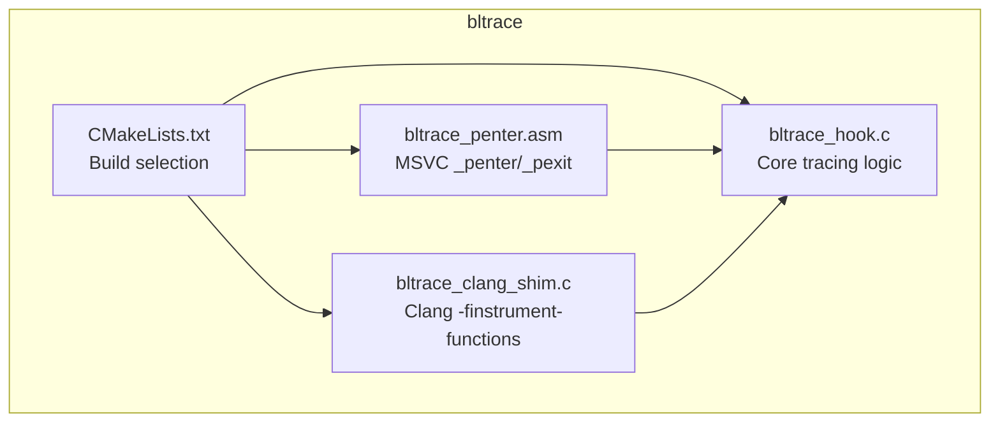

**Diagram sources**
- [CMakeLists.txt:1-49](file://bltrace/CMakeLists.txt#L1-L49)
- [bltrace_penter.asm:1-108](file://bltrace/bltrace_penter.asm#L1-L108)
- [bltrace_clang_shim.c:1-27](file://bltrace/bltrace_clang_shim.c#L1-L27)
- [bltrace_hook.c:1-376](file://bltrace/bltrace_hook.c#L1-L376)

**Section sources**
- [CMakeLists.txt:1-49](file://bltrace/CMakeLists.txt#L1-L49)

## Core Components
bltrace organizes its state around several key structures and buffers:

| Component | Purpose |
|---|---|
| `TlsFrame` | Represents one level on the thread-local call stack, storing the recorded function RVA, entry timestamp, and accumulated child timing. |
| `TlsStack` | Holds the current thread’s call depth and fixed-size array of `TlsFrame`. |
| `TimingSlot` | Per-function timing bucket keyed by function RVA plus one. Stores call count, self time, and inclusive time. |
| `TimingHeader` | Serialized header for timing dumps, including magic number, version, performance counter frequency, record size, and record count. |
| Slot table | Hash table of `uint64_t` entries used for function call counting via linear probing. |
| Edge slot table | Same layout as the slot table but stores packed caller/callee edges. |
| Timing slot table | Hash table of `TimingSlot` entries for timing aggregation. |

Important constants:

| Constant | Meaning |
|---|---|
| `SLOT_COUNT` | Size of the call-count and edge slot tables; must be a power of two. |
| `STACK_CAP` | Maximum tracked call depth per thread. |
| `TIME_SLOT_COUNT` | Number of timing buckets. |
| `TIME_MAGIC` | Magic identifier for timing dump files. |
| `TIME_VERSION` | Version of the timing dump format. |

**Section sources**
- [bltrace_hook.c:18-52](file://bltrace/bltrace_hook.c#L18-L52)
- [bltrace_hook.c:54-120](file://bltrace/bltrace_hook.c#L54-L120)

## Architecture Overview
bltrace has two entry paths depending on the compiler toolchain.

### MSVC path with `/Gh`
The MSVC build uses generated assembly stubs. Each function prologue can emit a call to `_penter`, and each return can emit a call to `_pexit`. The stubs preserve all volatile registers and flags, align the stack, and pass the return address above the hook call to the C-side hooks.

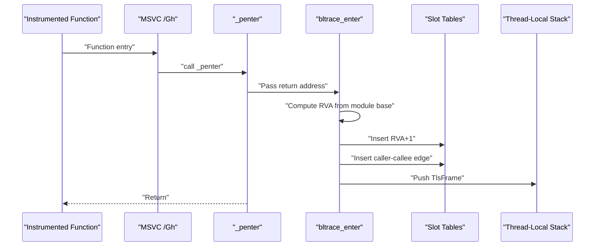

**Diagram sources**
- [bltrace_penter.asm:1-108](file://bltrace/bltrace_penter.asm#L1-L108)
- [bltrace_hook.c:121-240](file://bltrace/bltrace_hook.c#L121-L240)

### Clang path with `-finstrument-functions`
The Clang build compiles a small shim that forwards compiler-provided callback arguments to bltrace. The shim itself is compiled without instrumentation to avoid recursive instrumentation.

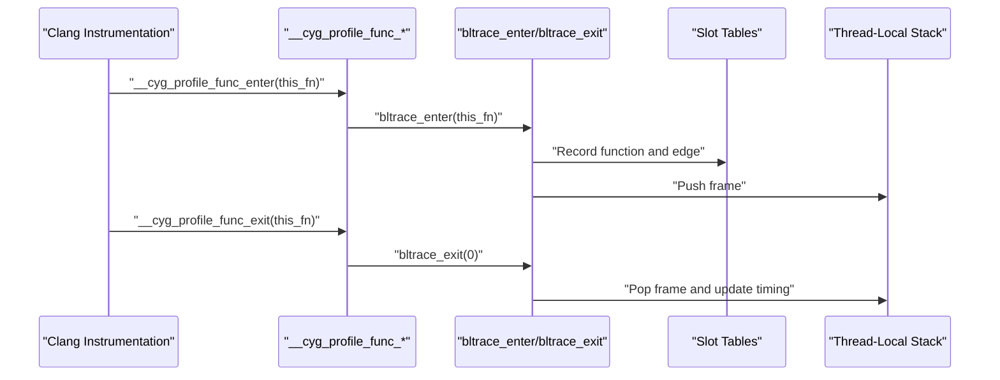

**Diagram sources**
- [bltrace_clang_shim.c:1-27](file://bltrace/bltrace_clang_shim.c#L1-L27)
- [bltrace_hook.c:121-240](file://bltrace/bltrace_hook.c#L121-L240)

### High-Level Data Flow
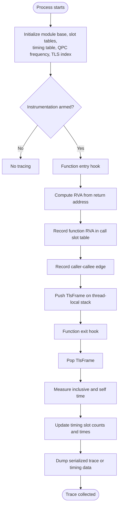

[No sources needed since this diagram shows conceptual workflow, not actual code structure]

## Detailed Component Analysis

### Function Hooking Mechanisms

#### MSVC `/Gh` and `/GH` Assembly Stubs
The MASM file defines `_penter` and `_pexit`. Both stubs:

1. Save flags and all relevant integer and XMM registers.
2. Adjust the stack to satisfy ABI alignment requirements.
3. Load the caller’s return address from the expected stack offset.
4. Call `bltrace_enter` or `bltrace_exit`.
5. Restore registers, stack pointer, and flags.
6. Return to the caller.

This design ensures that instrumentation does not corrupt calling conventions or register state.

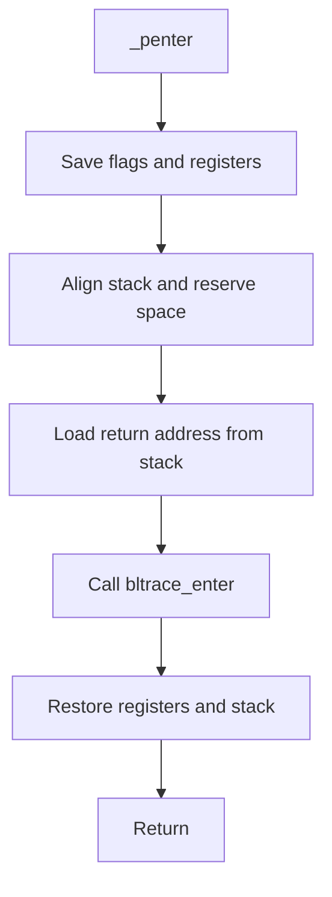

**Diagram sources**
- [bltrace_penter.asm:1-108](file://bltrace/bltrace_penter.asm#L1-L108)

**Section sources**
- [bltrace_penter.asm:1-108](file://bltrace/bltrace_penter.asm#L1-L108)

#### Clang `-finstrument-functions` Shim
The Clang shim provides:

- `__cyg_profile_func_enter(this_fn, call_site)` → calls `bltrace_enter(this_fn)`.
- `__cyg_profile_func_exit(this_fn, call_site)` → calls `bltrace_exit(0)`.

The shim ignores the extra `call_site` argument because bltrace only needs the function entry address. The translation unit is compiled with `-fno-instrument-functions` so the shim itself is not recursively traced.

**Section sources**
- [bltrace_clang_shim.c:1-27](file://bltrace/bltrace_clang_shim.c#L1-L27)
- [CMakeLists.txt:5-18](file://bltrace/CMakeLists.txt#L5-L18)
- [CMakeLists.txt:33-49](file://bltrace/CMakeLists.txt#L33-L49)

### Call Graph Recording Using RVAs and Edge Tables

#### Relative Virtual Address Calculation
At function entry, bltrace computes the RVA by subtracting the module base from the return address passed by the hook. The stored value is `rva + 1`, which avoids zero while preserving the original RVA for reconstruction.

For edges, bltrace packs the caller and callee into one 64-bit value:

- Upper 32 bits: caller RVA.
- Lower 32 bits: callee RVA.

This compact representation allows both call and edge tables to use the same linear-probing hash table algorithm.

#### Slot Table Allocation Algorithm
Both the call slot table and edge slot table are arrays of `uint64_t`. The allocation and lookup algorithm:

1. Compute a hash by multiplying the key by a constant.
2. Mask the hash with `SLOT_COUNT - 1`.
3. Probe linearly through the table.
4. Use atomic compare-and-exchange to insert a value atomically.
5. If the existing value equals the requested key, treat it as already present.
6. If no empty slot is found, report failure.

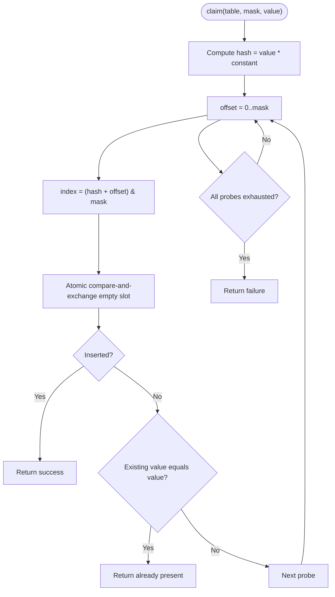

**Diagram sources**
- [bltrace_hook.c:74-96](file://bltrace/bltrace_hook.c#L74-L96)

**Section sources**
- [bltrace_hook.c:18-52](file://bltrace/bltrace_hook.c#L18-L52)
- [bltrace_hook.c:74-96](file://bltrace/bltrace_hook.c#L74-L96)
- [bltrace_hook.c:121-240](file://bltrace/bltrace_hook.c#L121-L240)

### Timing Measurement Implementation

#### QueryPerformanceCounter Integration
Timing measurement uses `QueryPerformanceCounter` and stores the query frequency in a global variable after initialization. On entry, the hook captures `t0`. On exit, it computes:

- Inclusive time: difference between exit tick and entry tick.
- Self time: inclusive time minus accumulated child time.

These values are added atomically to the corresponding timing slot.

#### Hierarchical Child Timing
When exiting a frame, if there is a parent frame, the child’s inclusive time is added to the parent’s `child` field. This allows inclusive timing to propagate up the call tree during subsequent exits.

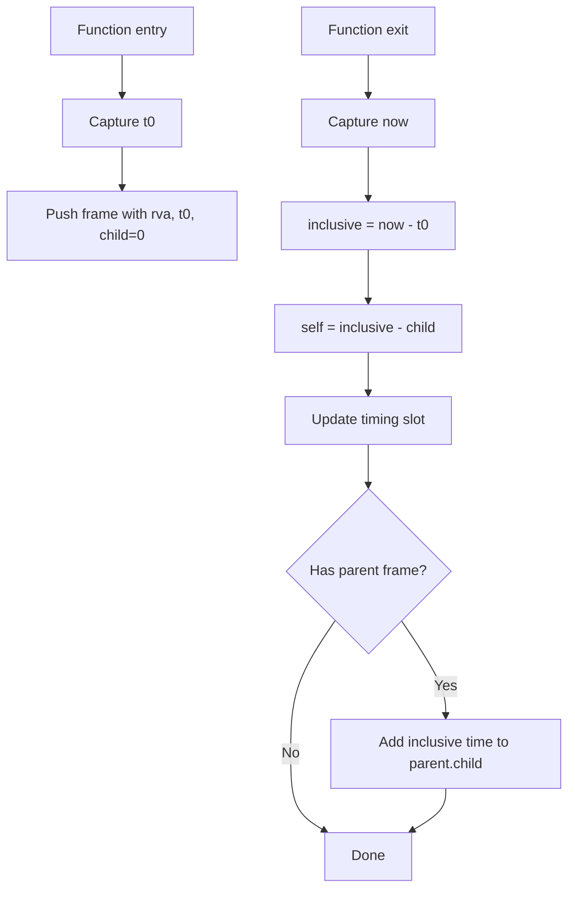

**Diagram sources**
- [bltrace_hook.c:121-240](file://bltrace/bltrace_hook.c#L121-L240)

**Section sources**
- [bltrace_hook.c:54-72](file://bltrace/bltrace_hook.c#L54-L72)
- [bltrace_hook.c:241-300](file://bltrace/bltrace_hook.c#L241-L300)

### Thread-Local Stack Management

#### TlsStack and TlsFrame
Each thread can have a lazily allocated `TlsStack`. The first access checks whether the TLS index is valid and allocates memory via `VirtualAlloc` when necessary. The stack stores frames up to `STACK_CAP`; if the stack overflows, it resets the depth to prevent unbounded growth.

Each frame contains:

- `rva`: recorded function RVA.
- `t0`: entry timestamp.
- `child`: accumulated child timing used to compute self time.

#### TLS State Lifecycle
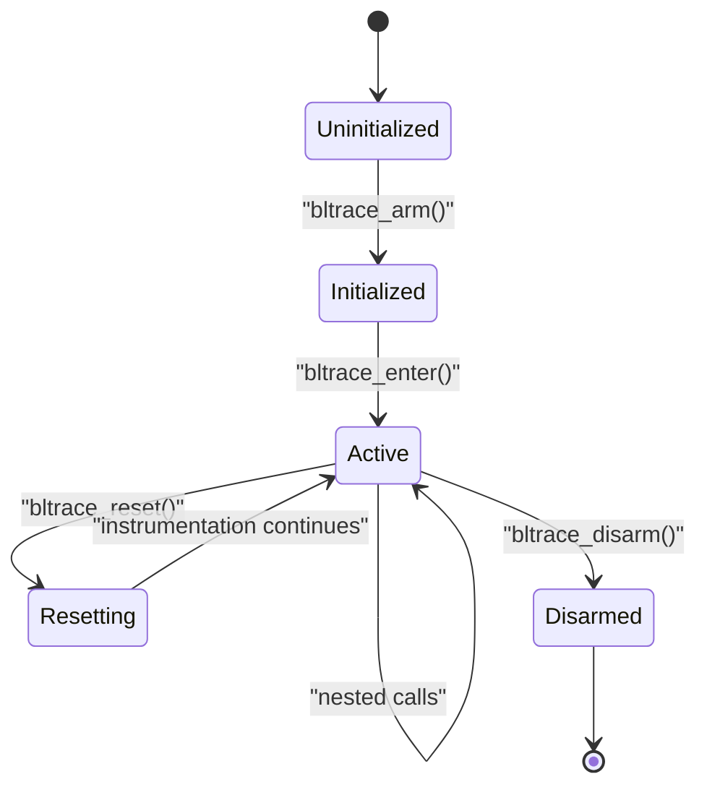

**Diagram sources**
- [bltrace_hook.c:100-119](file://bltrace/bltrace_hook.c#L100-L119)
- [bltrace_hook.c:121-240](file://bltrace/bltrace_hook.c#L121-L240)
- [bltrace_hook.c:300-376](file://bltrace/bltrace_hook.c#L300-L376)

**Section sources**
- [bltrace_hook.c:54-72](file://bltrace/bltrace_hook.c#L54-L72)
- [bltrace_hook.c:100-119](file://bltrace/bltrace_hook.c#L100-L119)
- [bltrace_hook.c:121-240](file://bltrace/bltrace_hook.c#L121-L240)

### Timing Slot Table

#### TimingSlot Structure
Timing data is stored in a separate hash table of `TimingSlot` entries. Each slot holds:

- `key`: function RVA plus one.
- `count`: number of completed function executions.
- `self`: accumulated self time.
- `inclusive`: accumulated inclusive time.

The lookup function scans linearly up to `TIME_SLOT_COUNT`, handles collisions, and uses atomic operations to claim newly discovered slots.

#### Timing Slot Lookup Flow
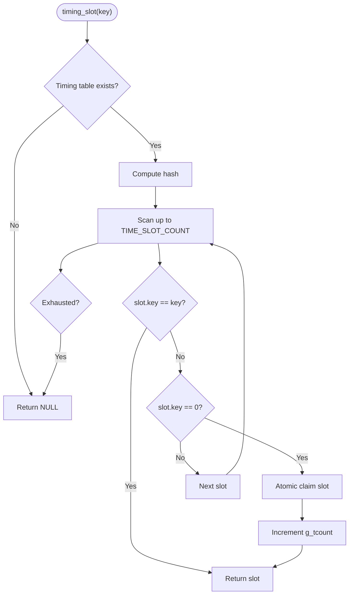

**Diagram sources**
- [bltrace_hook.c:98-119](file://bltrace/bltrace_hook.c#L98-L119)

**Section sources**
- [bltrace_hook.c:54-72](file://bltrace/bltrace_hook.c#L54-L72)
- [bltrace_hook.c:98-119](file://bltrace/bltrace_hook.c#L98-L119)

### Exported API and Serialization

#### Public Interface
The library exports the following main routines:

| Function | Description |
|---|---|
| `bltrace_arm` | Initializes module base, slot tables, timing table, QPC frequency, and TLS index; enables instrumentation. |
| `bltrace_disarm` | Disables instrumentation. |
| `bltrace_count` | Returns total unique function entries recorded. |
| `bltrace_edge_count` | Returns total unique edges recorded. |
| `bltrace_timing_count` | Returns number of active timing slots. |
| `bltrace_enter` | Called from `_penter` or Clang shim on function entry. |
| `bltrace_exit` | Called from `_pexit` or Clang shim on function exit. |
| `bltrace_reset` | Clears slot tables, timing data, TLS stack, and counters. |
| `bltrace_dump` | Serializes function call RVAs to a binary file. |
| `bltrace_dump_edges` | Serializes caller-callee edge RVAs to a binary file. |
| `bltrace_dump_timings` | Serializes timing headers and records to a binary file. |

#### Serialized Output Formats

##### Call Table
A flat sequence of little-endian 64-bit values. Each non-zero value is a function key equal to `rva + 1`.

##### Edge Table
A flat sequence of little-endian 64-bit values. Each value packs:

- Upper 32 bits: caller RVA.
- Lower 32 bits: callee RVA.

##### Timing Table
Starts with a `TimingHeader`, followed by one `TimingRecord` per active timing slot.

| Field | Type | Meaning |
|---|---|---|
| `magic` | 32-bit | Identifies the timing format. |
| `version` | 32-bit | Format version. |
| `freq` | 64-bit | `QueryPerformanceCounter` frequency. |
| `record_size` | 32-bit | Size of `TimingRecord`. |
| `count` | 32-bit | Number of timing records. |
| `key` | 64-bit | Function RVA plus one. |
| `count` | 64-bit | Number of calls. |
| `self` | 64-bit | Accumulated self time in QPC ticks. |
| `inclusive` | 64-bit | Accumulated inclusive time in QPC ticks. |

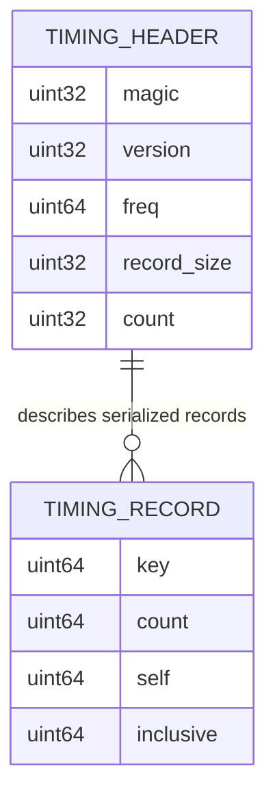

**Diagram sources**
- [bltrace_hook.c:54-72](file://bltrace/bltrace_hook.c#L54-L72)
- [bltrace_hook.c:300-376](file://bltrace/bltrace_hook.c#L300-L376)

**Section sources**
- [bltrace_hook.c:100-119](file://bltrace/bltrace_hook.c#L100-L119)
- [bltrace_hook.c:300-376](file://bltrace/bltrace_hook.c#L300-L376)

### Practical Usage Examples

#### Collecting Traces
A typical usage pattern is:

1. Call `bltrace_arm` before starting the workload.
2. Run instrumented code.
3. Optionally inspect `bltrace_count` and `bltrace_edge_count`.
4. Call `bltrace_dump` and `bltrace_dump_edges` to write serialized call and edge tables.
5. Call `bltrace_disarm` when finished.

#### Managing and Resetting State
Use `bltrace_reset` to clear all collected data without reallocating buffers. This is useful when capturing multiple runs in one process.

#### Dumping Timing Data
After instrumentation, call `bltrace_dump_timings` to produce a timing file. Consumers should read the header to obtain the QPC frequency and record size, then iterate over records.

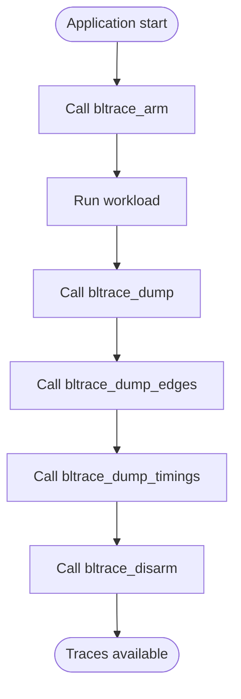

[No sources needed since this diagram shows conceptual workflow, not actual code structure]

## Dependency Analysis
The bltrace library has clear separation between platform-specific hooking code and shared tracing logic.

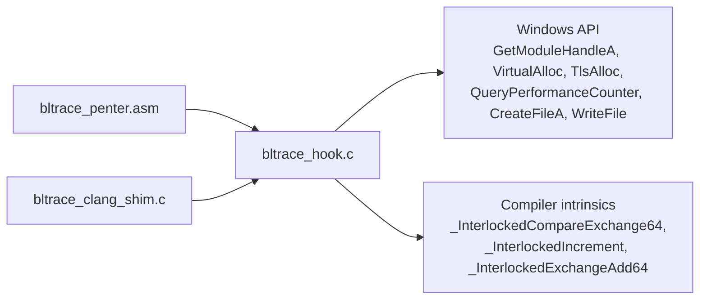

**Diagram sources**
- [bltrace_penter.asm:1-108](file://bltrace/bltrace_penter.asm#L1-L108)
- [bltrace_clang_shim.c:1-27](file://bltrace/bltrace_clang_shim.c#L1-L27)
- [bltrace_hook.c:1-376](file://bltrace/bltrace_hook.c#L1-L376)

**Section sources**
- [CMakeLists.txt:1-49](file://bltrace/CMakeLists.txt#L1-L49)
- [bltrace_hook.c:1-376](file://bltrace/bltrace_hook.c#L1-L376)

## Performance Considerations

### Hooking Overhead
- **MSVC `_penter`/`_pexit`**: Every function entry and return incurs register saving, stack adjustment, and a C function call. This adds measurable overhead proportional to the number of functions executed.
- **Clang shim**: Similar overhead occurs through compiler-inserted callbacks, but the shim itself is lightweight and excluded from instrumentation.

### Memory Allocation Strategy
- Slot tables and timing tables are allocated once during `bltrace_arm` using `VirtualAlloc`.
- Thread-local stacks are allocated lazily on first access.
- Repeated allocation is avoided by reusing globals across runs.

### Slot Table Size Trade-offs
- Larger `SLOT_COUNT` reduces hash collisions and improves insertion probability, but increases memory usage.
- The current default is large enough for many workloads, but applications with very high function diversity may experience more collisions.
- Edge tracking doubles the slot table pressure because each edge also uses the same hashing strategy.

### Timing Cost
- Timing measurements use `QueryPerformanceCounter`, which is efficient but still adds overhead on every entry and exit.
- Timing slot updates use atomic operations, which can become a bottleneck under extreme contention.
- Applications requiring extremely low overhead may disable timing collection or reduce sampling.

### Mitigation Strategies
- Enable instrumentation only for relevant phases.
- Use `bltrace_reset` between runs instead of recreating buffers.
- Avoid tracing extremely hot, tiny functions unless necessary.
- Tune slot table sizes based on observed collision rates and memory budgets.

[No sources needed since this section provides general guidance]

## Troubleshooting Guide

### Instrumentation Not Activated
Symptoms:

- No function entries recorded.
- `bltrace_count` remains zero.

Checks:

- Ensure `bltrace_arm` was called.
- Verify the process is built with `/Gh`/`/GH` for MSVC or `-finstrument-functions` for Clang.
- Confirm the module base and slot tables were initialized.

**Section sources**
- [bltrace_hook.c:100-119](file://bltrace/bltrace_hook.c#L100-L119)
- [bltrace_hook.c:121-170](file://bltrace/bltrace_hook.c#L121-L170)

### Missing Edges
Symptoms:

- Call table contains functions but edge table is sparse.

Possible causes:

- Top-level functions have no recorded caller.
- The edge table is full or heavily colliding.
- The process exited before enough edges were captured.

**Section sources**
- [bltrace_hook.c:170-210](file://bltrace/bltrace_hook.c#L170-L210)

### Incorrect Timing Values
Symptoms:

- Self time exceeds inclusive time.
- Timing totals appear inconsistent.

Possible causes:

- QPC frequency is unavailable or zero.
- Nested timing propagation is affected by stack overflow reset.
- Timing table is full.

**Section sources**
- [bltrace_hook.c:100-119](file://bltrace/bltrace_hook.c#L100-L119)
- [bltrace_hook.c:241-300](file://bltrace/bltrace_hook.c#L241-L300)

### Trace Files Are Empty
Symptoms:

- `bltrace_dump`, `bltrace_dump_edges`, or `bltrace_dump_timings` produces no output.

Checks:

- Ensure the corresponding table was allocated.
- Verify that data was collected before dumping.
- Check file creation permissions.

**Section sources**
- [bltrace_hook.c:300-376](file://bltrace/bltrace_hook.c#L300-L376)

## Conclusion
bltrace provides a compact, portable tracing solution for Windows processes. Its design separates platform-specific hooking from shared tracing logic, supports both MSVC and Clang workflows, and records call graphs using RVAs with atomic hash-based slot tables. Timing is measured with high-resolution counters and propagated hierarchically through a thread-local stack. The serialized output formats are simple and deterministic, making them suitable for offline analysis. Careful tuning of slot table sizes, hook activation scope, and timing collection helps balance accuracy and performance.