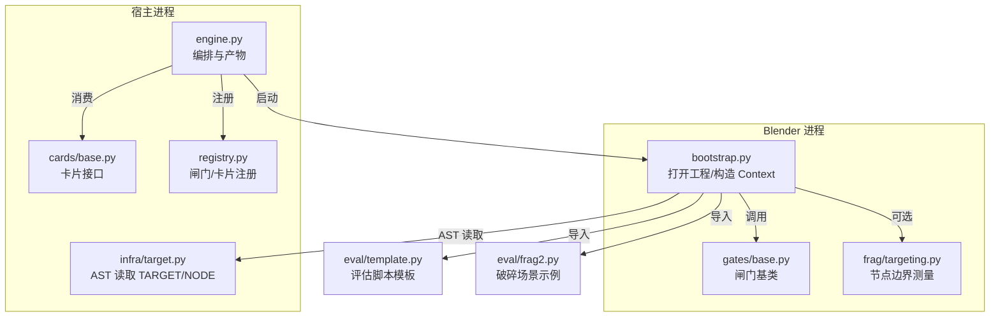
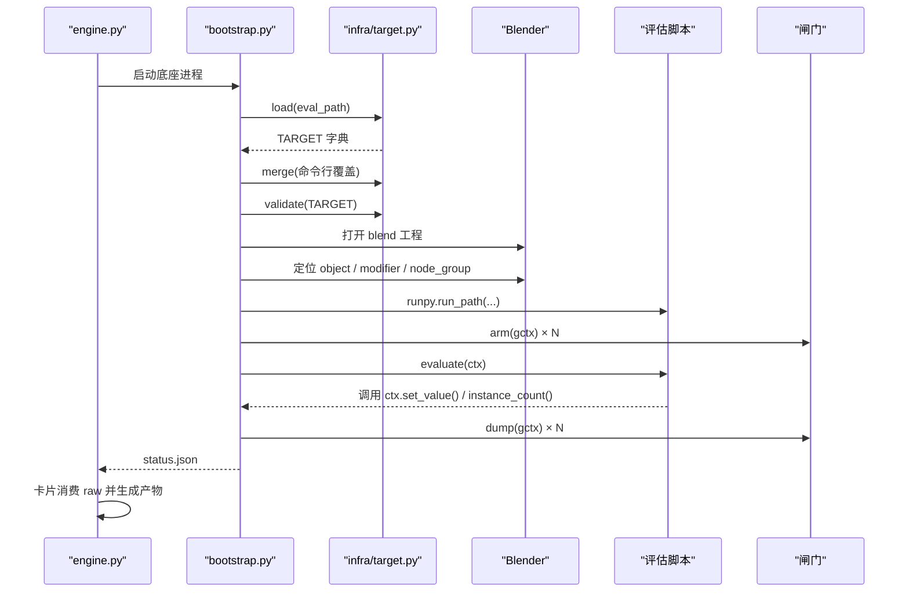
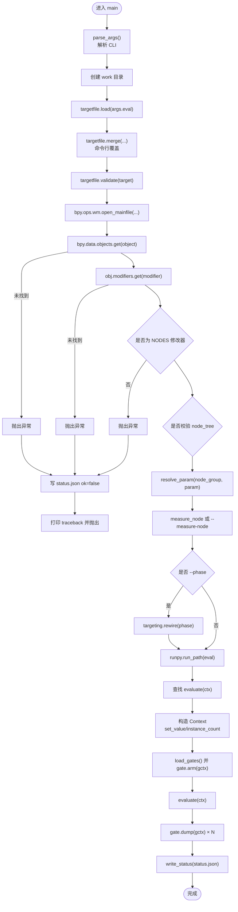
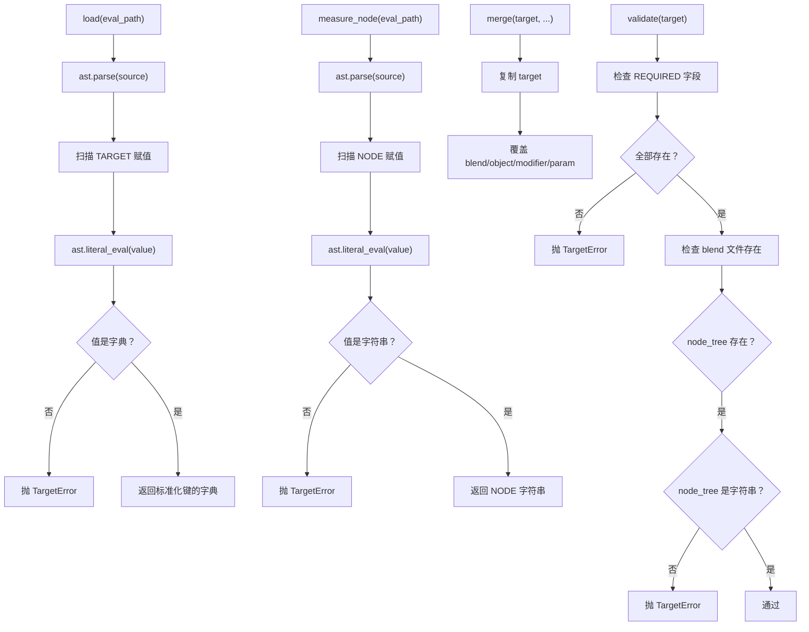
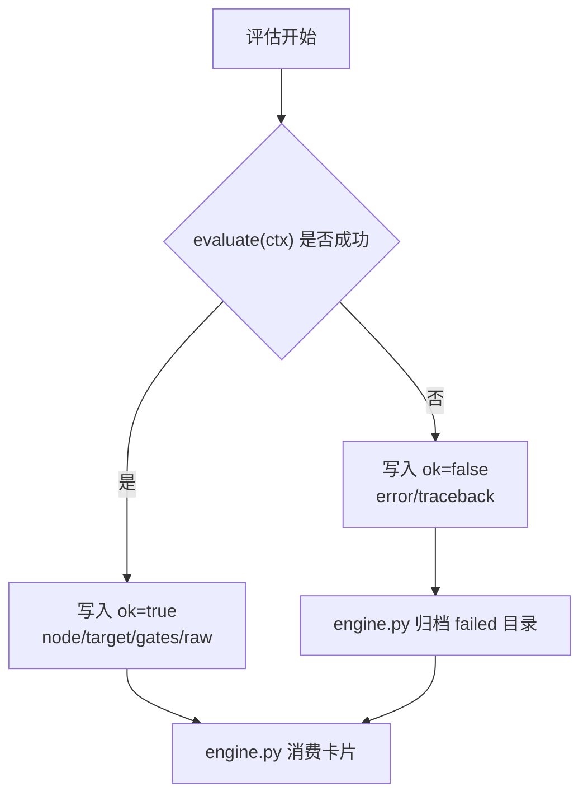
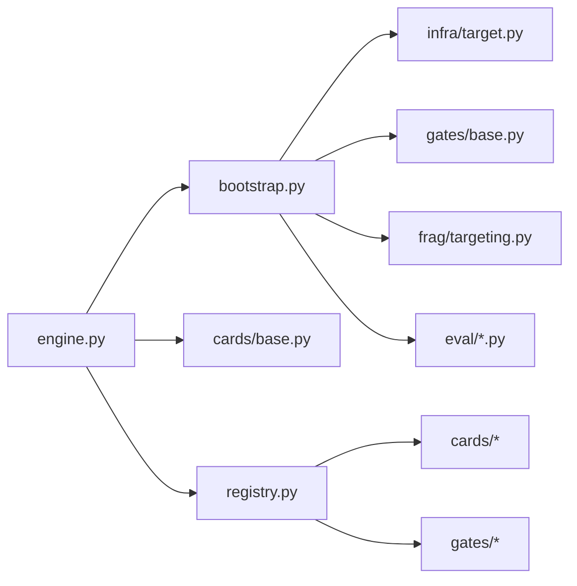
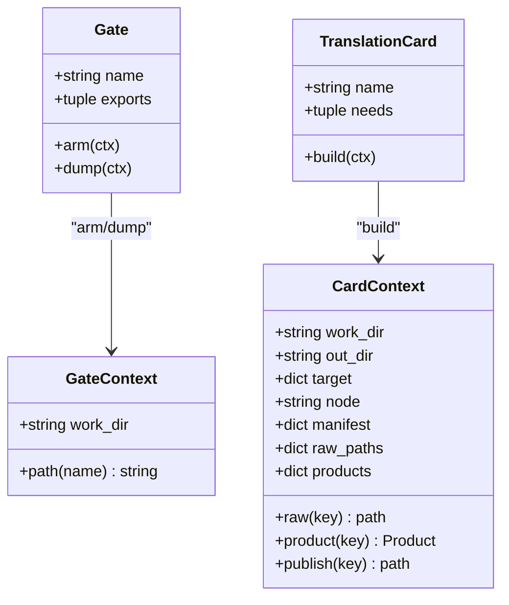

# Blender 底座与评估脚本接口

<cite>
**本文引用的文件**   
- [bootstrap.py](file://bootstrap.py)
- [infra/target.py](file://infra/target.py)
- [eval/template.py](file://eval/template.py)
- [eval/frag2.py](file://eval/frag2.py)
- [gates/base.py](file://gates/base.py)
- [frag/targeting.py](file://frag/targeting.py)
- [engine.py](file://engine.py)
- [directories.py](file://directories.py)
- [cards/base.py](file://cards/base.py)
- [registry.py](file://registry.py)
</cite>

## 目录
1. [引言](#引言)
2. [项目结构](#项目结构)
3. [核心组件](#核心组件)
4. [架构总览](#架构总览)
5. [详细组件分析](#详细组件分析)
6. [依赖关系分析](#依赖关系分析)
7. [性能与稳定性考虑](#性能与稳定性考虑)
8. [故障排查指南](#故障排查指南)
9. [结论](#结论)

## 引言
本文面向两类读者：一是需要编写评估脚本的 Blender 用户，二是需要理解采集流程的引擎维护者。文档聚焦以下目标：

- 解释底座 `bootstrap.py` 如何解析命令行参数、安全加载 `TARGET` 与 `NODE`、打开 Blender 工程、定位对象和几何节点修改器、构造评估上下文，并在“闸门 arm → evaluate(ctx) → dump”的生命周期中调度数据采集。
- 说明 `infra/target.py` 如何通过 AST 读取 `TARGET` 与 `NODE`，合并命令行覆盖参数，并校验必需字段。
- 定义评估脚本接口契约：`TARGET` 字段规范、`NODE` 边界约定、`ctx.set_value` 与 `instance_count` 用法，以及 `evaluate(ctx)` 的最佳实践。
- 给出基于 `eval/template.py` 风格的示例说明，并解释 `status.json` 的结构与错误传播方式。

## 项目结构
本仓库采用“底座 + 基础设施 + 闸门 + 卡片 + 评估脚本”的分层组织：

- 底座：`bootstrap.py`，在 Blender 内部运行，负责打开工程、定位数据、执行评估脚本、写入结果。
- 基础设施：`infra/target.py` 等，提供安全的 `TARGET`/`NODE` 解析与路径、工作区管理。
- 闸门：`gates/base.py` 及具体闸门（如调用统计、覆盖率），在 Blender 侧进行埋点与导出。
- 卡片：`cards/base.py` 及各类卡片（边缘、反汇编、覆盖率、耗时、过滤、差异等），在宿主引擎侧消费底座产出的原始数据。
- 评估脚本：`eval/template.py`、`eval/frag2.py`，由用户或业务团队编写，定义被测场景。
- 引擎：`engine.py` 负责编排多次运行、缓存、失败归档与产物整理；`directories.py` 集中工程路径。

**图示来源**
- [engine.py:1-200](file://engine.py#L1-L200)
- [bootstrap.py:1-192](file://bootstrap.py#L1-L192)
- [infra/target.py:1-81](file://infra/target.py#L1-L81)
- [gates/base.py:1-38](file://gates/base.py#L1-L38)
- [frag/targeting.py:1-136](file://frag/targeting.py#L1-L136)
- [cards/base.py:1-63](file://cards/base.py#L1-L63)
- [registry.py:1-49](file://registry.py#L1-L49)

**章节来源**
- [directories.py:1-25](file://directories.py#L1-L25)
- [registry.py:1-49](file://registry.py#L1-L49)

## 核心组件
本节从“入口 → 配置 → 执行 → 产出”的角度，概述关键角色及其职责。

- 底座 `bootstrap.py`
  - 解析 CLI：`--eval`、`--work`、`--node`、`--gates`、`--blend`、`--obj`、`--mod`、`--param`、`--phase`、`--measure-node`。
  - 通过 `infra/target.py` 安全加载 `TARGET` 与 `NODE`，合并命令行覆盖，校验必需字段。
  - 打开 blend 工程，定位 `object` → `modifier` → `node_group`，并解析 socket 标识符。
  - 根据 `--measure-node` 或 `NODE` 计算测量边界，支持 before/after 重连。
  - 动态导入评估脚本，注入 `bpy`、`time`，构造 `Context`，调用 `evaluate(ctx)`。
  - 闸门生命周期：先 `arm(gctx)`，再执行 `evaluate`，最后按逆序 `dump(gctx)`。
  - 将闸门汇总的 `raw` 与元信息写入 `status.json`。

- 基础设施 `infra/target.py`
  - `load(eval_path)`：用 `ast.parse` 与 `ast.literal_eval` 读取 `TARGET`，要求是字面量字典。
  - `measure_node(eval_path)`：读取可选 `NODE = "..."` 字符串字面量。
  - `merge(target, ...)`：允许命令行覆盖 `blend/object/modifier/param`。
  - `validate(target)`：检查必需字段与 `node_tree` 类型。

- 评估脚本接口
  - 必须定义 `TARGET` 字典，推荐定义 `NODE`。
  - 必须导出可调用函数 `evaluate(ctx)`。
  - `ctx.set_value(value)`：设置参数、触发求值并返回耗时毫秒数。
  - `ctx.instance_count()`：获取当前实例数量。
  - 可直接使用 `ctx.bpy`、`ctx.mod`、`ctx.node_tree`、`ctx.param_id` 等上下文属性。

- 闸门与卡片
  - 闸门在 Blender 内运行，导出符号并在 `arm/dump` 生命周期中收集原始数据。
  - 卡片在宿主引擎侧消费原始数据，生成边缘、覆盖率、耗时等产物。

**章节来源**
- [bootstrap.py:1-192](file://bootstrap.py#L1-L192)
- [infra/target.py:1-81](file://infra/target.py#L1-L81)
- [eval/template.py:1-25](file://eval/template.py#L1-L25)
- [gates/base.py:1-38](file://gates/base.py#L1-L38)
- [cards/base.py:1-63](file://cards/base.py#L1-L63)

## 架构总览
下图展示一次典型评估的生命周期：引擎启动底座 → 底座加载配置 → 打开工程 → 构建上下文 → 闸门 arm → 评估脚本 → 闸门 dump → 写出 `status.json` → 引擎消费卡片。

**图示来源**
- [engine.py:1-200](file://engine.py#L1-L200)
- [bootstrap.py:1-192](file://bootstrap.py#L1-L192)
- [infra/target.py:1-81](file://infra/target.py#L1-L81)

## 详细组件分析

### bootstrap.py：底座生命周期
`bootstrap.py` 是整个采集流程的核心协调者。其控制流如下：

**图示来源**
- [bootstrap.py:1-192](file://bootstrap.py#L1-L192)

关键点：

- 命令行参数
  - `--eval`：评估脚本路径。
  - `--work`：工作目录，用于存放 `status.json` 与闸门原始数据。
  - `--node`：传递给上层引擎使用的节点标签。
  - `--gates`：逗号分隔的“模块名:类名”，用于动态加载闸门。
  - `--blend/--obj/--mod/--param`：运行时覆盖 `TARGET` 中的对应字段。
  - `--phase`：仅在配合 `--measure-node` 或 `NODE` 时使用，值为 `before` 或 `after`。
  - `--measure-node`：覆盖 `NODE`，指定要测量的节点。

- 安全加载配置
  - 不直接执行评估脚本，而是用 AST 提取 `TARGET` 与 `NODE`。
  - 仅接受字面量字典与字符串，避免任意代码执行风险。

- 工程与修改器定位
  - 打开 blend 后，依次查找 `object`、`modifier`，并要求为 `NODES` 类型且存在 `node_group`。
  - 如果 `TARGET` 指定了 `node_tree`，则与修改器的 `node_group.name` 做一致性校验。

- 参数 Socket 解析
  - 通过 `resolve_param` 遍历 `node_group.interface.items_tree`，匹配显示名称到真实 socket identifier。
  - 找不到时抛出明确错误，列出可用输入名称。

- 测量边界与重连
  - 若提供 `--measure-node` 或 `NODE`，则调用 `frag/targeting.py` 的 `validate_zones` 与 `resolve`。
  - `validate_zones` 拒绝包含 Repeat/Foreach/Simulation 区域的节点树。
  - `resolve` 要求节点有恰好一个几何输出，最多一个几何输入；同时要求节点树只有一个 Group Output 且只有一个几何输出。
  - `rewire` 在 before/after 阶段断开并重新连接 Group Output 的几何输出，以捕获边界前后数据。

- 评估脚本加载与上下文
  - 使用 `runpy.run_path` 加载脚本，命名空间名为 `__covtrace_eval__`。
  - 强制要求脚本导出 `evaluate` 且为可调用对象。
  - 向 `evaluate` 的全局暴露 `bpy` 与 `time`。
  - 构造 `Context`，注入：
    - `bpy`、`target`、`obj`、`mod`、`node_tree`、`param`、`param_id`。
    - `set_value(value)`：赋值、标记更新、触发 `view_layer.update()` 并返回耗时毫秒。
    - `instance_count()`：通过 `evaluated_depsgraph_get().object_instances` 计数。

- 闸门生命周期
  - 解析 `--gates`，动态导入模块并实例化闸门。
  - 校验闸门导出的符号是否存在。
  - 对每个闸门调用 `arm(gctx)`，随后执行 `evaluate(ctx)`，最后在 finally 中按逆序调用 `dump(gctx)`。
  - 将所有闸门的 `raw` 合并，并写入 `status.json`。

- 错误处理与状态输出
  - 所有异常被捕获后写入 `status.json`：`ok=False`、`error`、`traceback`。
  - 正常流程写入 `ok=True`、`node`、`target`、`gates`、`raw`。

**章节来源**
- [bootstrap.py:1-192](file://bootstrap.py#L1-L192)
- [frag/targeting.py:1-136](file://frag/targeting.py#L1-L136)

### infra/target.py：TARGET 与 NODE 的安全加载
`infra/target.py` 的职责是“只读、安全、严格”。

- `load(eval_path)`
  - 以 UTF-8-SIG 编码读取评估脚本源码。
  - 使用 `ast.parse` 解析语法树。
  - 扫描顶层赋值语句，寻找 `TARGET` 变量。
  - 使用 `ast.literal_eval` 将值解析为 Python 字面量字典。
  - 将键统一转为字符串。
  - 如果找不到 `TARGET`，抛出 `TargetError`。

- `measure_node(eval_path)`
  - 同样用 AST 读取 `NODE`。
  - 要求 `NODE` 是字符串字面量。
  - 不存在时返回空字符串，表示不测量。

- `merge(target, blend="", obj="", mod="", param="")`
  - 复制原 `target`。
  - 如果命令行传入非空值，则覆盖对应字段。
  - 覆盖顺序：`blend`、`object`、`modifier`、`param`。

- `validate(target)`
  - 必需字段：`blend`、`object`、`modifier`、`param`。
  - 检查 `blend` 指向的文件是否存在。
  - 可选字段 `node_tree` 必须是字符串。

**图示来源**
- [infra/target.py:1-81](file://infra/target.py#L1-L81)

**章节来源**
- [infra/target.py:1-81](file://infra/target.py#L1-L81)

### 评估脚本接口：TARGET、NODE、ctx 与最佳实践

#### TARGET 字段规范
| 字段 | 是否必需 | 类型 | 含义 | 校验行为 |
|---|---:|---|---|---|
| `blend` | 是 | 字符串 | Blender 工程路径 | 必须存在 |
| `object` | 是 | 字符串 | 场景中对象名称 | 打开工程后查找 |
| `modifier` | 是 | 字符串 | 几何节点修改器名称 | 必须在对象上存在且类型为 `NODES` |
| `param` | 是 | 字符串 | 修改器节点组接口的输入显示名称 | 必须存在于 `node_group.interface` 的输入 Socket |
| `node_tree` | 否 | 字符串 | 期望的节点树名称 | 留空表示不校验；非空时必须与修改器 `node_group.name` 一致 |

注意：

- `TARGET` 必须是字面量字典，不能是表达式或变量引用。
- `TARGET["param"]` 使用显示名，底座会将其映射为 socket identifier。
- 可通过命令行参数 `--blend/--obj/--mod/--param` 覆盖 `TARGET`。

#### NODE 边界约定
`NODE` 用于指定要测量边界的节点，支持节点名、label 或 `bl_idname`。当启用 `--phase before` 或 `--phase after` 时，底座会重写节点组的几何输出连线，以便捕获该节点前后的几何数据。

约束包括：

- 节点树不得包含 Repeat/Foreach/Simulation 区域。
- 被测节点必须有恰好一个几何输出。
- 被测节点最多只能有一个几何输入。
- 节点树必须只有一个 `Group Output`，且该输出只有一个几何输出。

#### ctx 对象与常用方法
| 成员 | 类型 | 用途 |
|---|---|---|
| `ctx.bpy` | Blender API | 直接访问 Blender 数据 |
| `ctx.target` | 字典 | 最终生效的 `TARGET` |
| `ctx.obj` | 对象 | 场景中被测对象 |
| `ctx.mod` | 修改器 | 几何节点修改器 |
| `ctx.node_tree` | 节点组 | 修改器对应的节点树 |
| `ctx.param` | 字符串 | `TARGET["param"]` 显示名 |
| `ctx.param_id` | 字符串 | 解析后的 socket identifier |
| `ctx.set_value(value)` | 函数 | 设置参数、触发求值、返回耗时毫秒 |
| `ctx.instance_count()` | 函数 | 返回当前实例数量 |

#### evaluate(ctx) 最佳实践
- 始终通过 `ctx.set_value` 设置参数，而不是直接修改 `ctx.mod[ctx.param_id]`，因为底座会在其中封装 `update_tag` 与 `view_layer.update()`，并记录耗时。
- 如果需要批量测试多组参数，可在 `evaluate` 中循环调用 `ctx.set_value`。
- 使用 `ctx.instance_count()` 观察几何实例变化，有助于验证不同参数下的几何规模。
- 如需更精细的控制，可使用 `ctx.bpy`、`ctx.mod`、`ctx.node_tree`、`ctx.param_id`，但应避免绕过底座的求值包装。
- 如果使用 `NODE` 或 `--measure-node`，请确保满足边界约束；否则会在底座或 `frag/targeting.py` 中抛出明确的 `TargetError`。

**章节来源**
- [eval/template.py:1-25](file://eval/template.py#L1-L25)
- [eval/frag2.py:1-37](file://eval/frag2.py#L1-L37)
- [bootstrap.py:1-192](file://bootstrap.py#L1-L192)
- [frag/targeting.py:1-136](file://frag/targeting.py#L1-L136)

### eval/template.py 风格示例说明
`eval/template.py` 是一个标准模板，适合大多数单参数几何节点修改器评估场景。它展示了：

- 使用 `TARGET` 声明工程、对象、修改器、参数与可选节点树。
- 可选地声明 `NODE` 以启用边界测量。
- 在 `evaluate(ctx)` 中循环多个参数值，调用 `ctx.set_value` 并打印实例数与耗时。

与之对比，`eval/frag2.py` 展示了更复杂的场景：同时修改两个输入参数，手动调用 `update_tag` 与 `view_layer.update()`，并打印实例数与耗时。这说明：

- 简单场景优先使用 `ctx.set_value`。
- 复杂场景可以使用 `ctx.bpy`、`ctx.mod`、`ctx.param_id` 自行构造更新逻辑，但需自行保证求值触发。

**章节来源**
- [eval/template.py:1-25](file://eval/template.py#L1-L25)
- [eval/frag2.py:1-37](file://eval/frag2.py#L1-L37)

### status.json 结构与错误传播
底座在两种主要路径下写入 `status.json`：

- 成功路径
  - `ok`：`True`。
  - `node`：来自 `--node`。
  - `target`：最终生效的 `TARGET`。
  - `gates`：各闸门 `dump` 返回的摘要列表。
  - `raw`：合并所有闸门的 `raw` 字典。

- 异常路径
  - `ok`：`False`。
  - `error`：异常类型名与消息。
  - `traceback`：完整回溯。

引擎侧还会根据 `status.json` 判断是否失败，并在必要时将失败的工作目录归档到 `cache/<node>/<hash8>.failed-时间戳` 路径，同时尝试重定原始路径。

**图示来源**
- [bootstrap.py:1-192](file://bootstrap.py#L1-L192)
- [engine.py:1-200](file://engine.py#L1-L200)

**章节来源**
- [bootstrap.py:1-192](file://bootstrap.py#L1-L192)
- [engine.py:1-200](file://engine.py#L1-L200)

## 依赖关系分析

### 组件耦合图

**图示来源**
- [bootstrap.py:1-192](file://bootstrap.py#L1-L192)
- [engine.py:1-200](file://engine.py#L1-L200)
- [registry.py:1-49](file://registry.py#L1-L49)

### 闸门与卡片关系
- 闸门在 Blender 内运行，负责埋点与导出原始数据。
- 卡片在宿主引擎侧运行，依赖闸门产出的 `raw` 数据生成最终产物。
- `registry.py` 注册闸门与卡片，使引擎知道需要哪些产物。

**图示来源**
- [gates/base.py:1-38](file://gates/base.py#L1-L38)
- [cards/base.py:1-63](file://cards/base.py#L1-L63)

**章节来源**
- [registry.py:1-49](file://registry.py#L1-L49)
- [gates/base.py:1-38](file://gates/base.py#L1-L38)
- [cards/base.py:1-63](file://cards/base.py#L1-L63)

## 性能与稳定性考虑
- 避免在 `evaluate` 中进行大量重复的 Blender 操作。优先使用 `ctx.set_value`，因为它已封装求值与计时。
- 如果需要使用 `--phase before/after`，请确认节点树满足边界约束，否则会因拓扑校验失败而快速报错。
- 闸门导出符号缺失会导致底座直接抛出异常，应在开发阶段尽早发现。
- 频繁 `view_layer.update()` 可能昂贵，应合理分组参数组合，避免无意义的重复求值。
- 引擎侧会对失败运行进行归档并保留最近若干缓存目录，便于回归分析。

## 故障排查指南

### 常见错误与定位
| 现象 | 可能原因 | 排查建议 |
|---|---|---|
| 找不到对象 | `TARGET["object"]` 与实际对象名不一致 | 检查 `TARGET["object"]`，或通过 `--obj` 覆盖 |
| 找不到修改器 | `TARGET["modifier"]` 错误或对象上没有该修改器 | 检查 `TARGET["modifier"]`，或使用 `--mod` 覆盖 |
| 修改器不是几何节点修改器 | 修改器类型不是 `NODES` | 改用几何节点修改器，或在 `TARGET` 中指向正确修改器 |
| 节点树名称不匹配 | `TARGET["node_tree"]` 与修改器实际节点组名不同 | 删除 `node_tree` 或修正为目标名称 |
| 参数不在 Socket 列表中 | `TARGET["param"]` 显示名不正确 | 检查节点组接口输入名称，或使用 `--param` 覆盖 |
| 不支持 Repeat/Foreach/Simulation 区域 | 节点树包含受限区域 | 重构节点树，避免这些区域 |
| 节点不唯一或找不到 | `NODE` 或 `--measure-node` 匹配到多个节点 | 使用更精确的名称、label 或 `bl_idname` |
| 节点没有几何输出或几何输入过多 | 不符合测量边界约束 | 调整被测节点，使其符合“一个几何输出、最多一个几何输入” |
| 评估脚本没有 `evaluate` | 脚本未导出 `evaluate` | 确保脚本顶部定义 `def evaluate(ctx):` |
| `status.json` 中 `ok=false` | 评估过程中抛出异常 | 查看 `error` 与 `traceback`，定位具体步骤 |

**章节来源**
- [bootstrap.py:1-192](file://bootstrap.py#L1-L192)
- [infra/target.py:1-81](file://infra/target.py#L1-L81)
- [frag/targeting.py:1-136](file://frag/targeting.py#L1-L136)

## 结论
`bootstrap.py` 与 `infra/target.py` 共同构成了 Blender 底座与评估脚本之间的稳定契约：前者负责在 Blender 进程中安全地打开工程、定位数据、构造上下文并调度闸门与评估脚本；后者负责在不执行脚本的前提下安全解析 `TARGET` 与 `NODE`，并通过命令行覆盖机制提供灵活性。

对于评估脚本作者而言，最重要的约定是：

- 使用字面量 `TARGET`，并确保 `blend/object/modifier/param` 准确。
- 如需边界测量，使用 `NODE` 并遵守几何输入输出约束。
- 在 `evaluate(ctx)` 中优先使用 `ctx.set_value` 与 `ctx.instance_count`。
- 遇到错误时，首先检查 `status.json` 的 `ok`、`error` 与 `traceback`。

对于引擎维护者而言，闸门与卡片提供了可扩展的数据采集与产物生成能力，底座的生命周期设计保证了评估过程的可观测性与可恢复性。