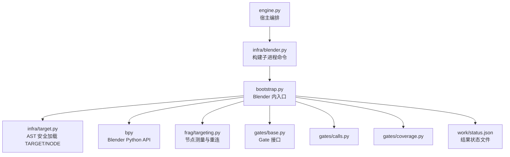
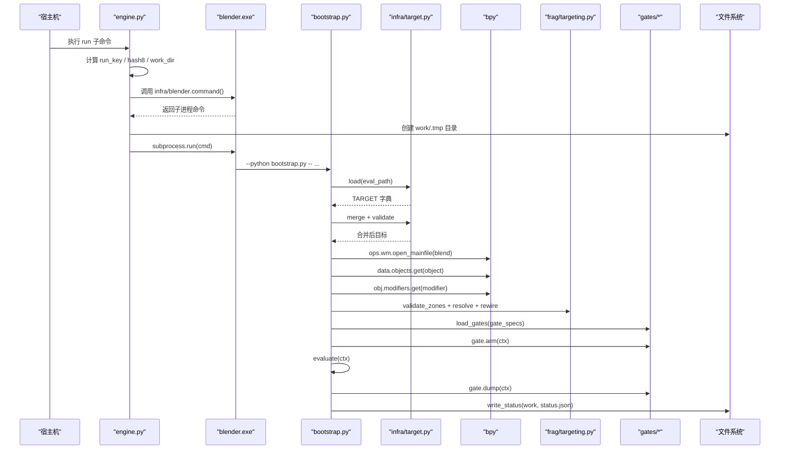
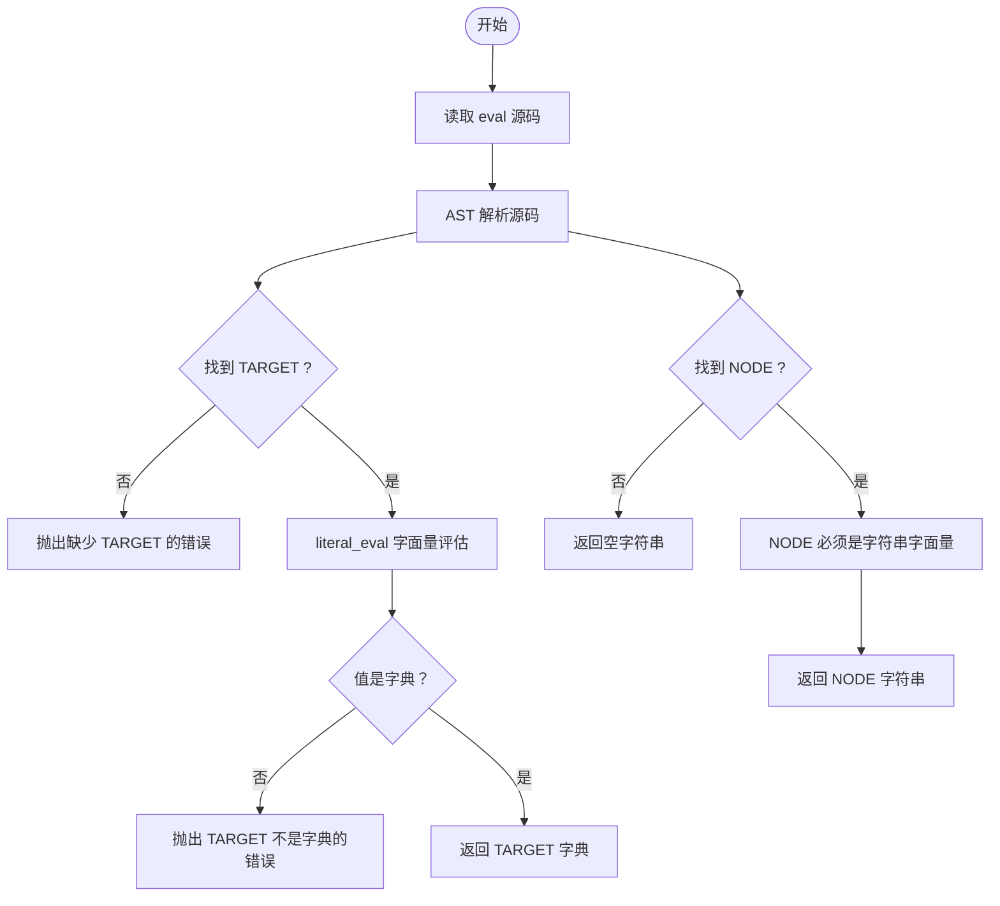
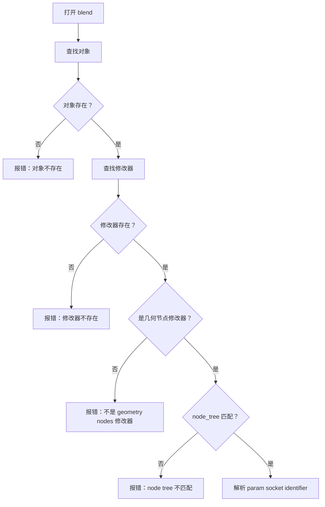
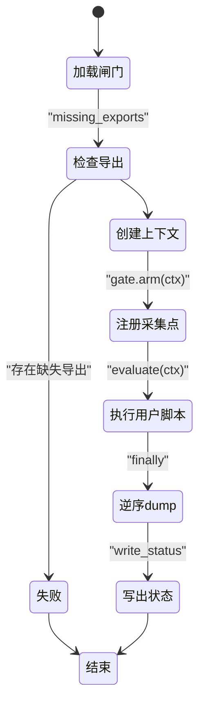
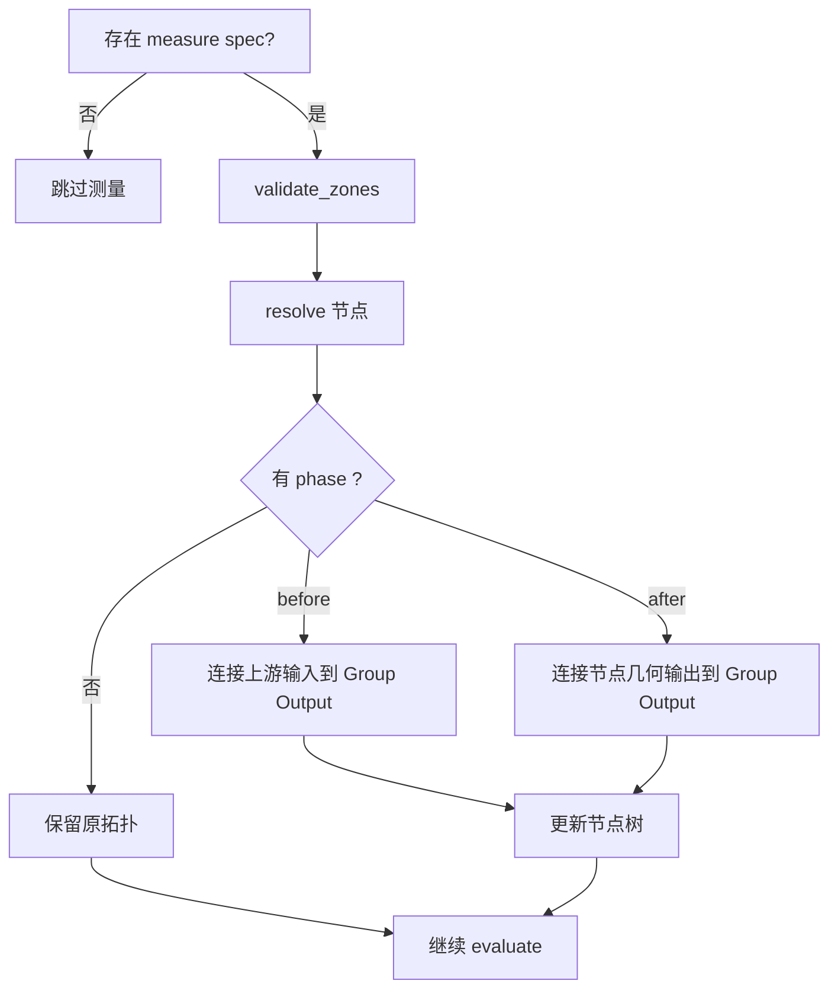
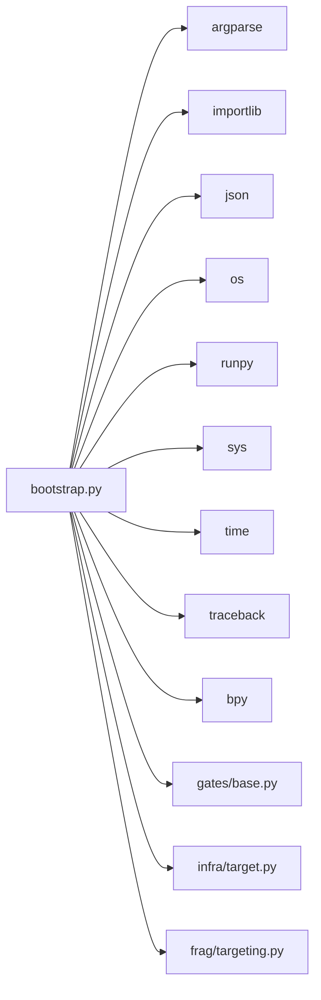

# Bootstrap 执行流程

<cite>
**本文引用的文件**   
- [bootstrap.py](file://bootstrap.py)
- [engine.py](file://engine.py)
- [gates/base.py](file://gates/base.py)
- [gates/calls.py](file://gates/calls.py)
- [gates/coverage.py](file://gates/coverage.py)
- [infra/blender.py](file://infra/blender.py)
- [infra/target.py](file://infra/target.py)
- [frag/targeting.py](file://frag/targeting.py)
- [directories.py](file://directories.py)
</cite>

## 目录
1. [引言](#引言)
2. [项目结构定位](#项目结构定位)
3. [核心组件](#核心组件)
4. [架构总览](#架构总览)
5. [详细组件分析](#详细组件分析)
6. [依赖关系分析](#依赖关系分析)
7. [性能与行为特征](#性能与行为特征)
8. [故障排查指南](#故障排查指南)
9. [结论](#结论)

## 引言
本文聚焦 `bootstrap.py` 作为 Blender 侧实际执行入口的职责，说明它如何解析命令行参数、通过 AST 安全读取 TARGET/NODE、打开 Blender 工程、定位对象与几何节点修改器、构造供用户脚本使用的 Context，并管理闸门（Gate）生命周期。文档还覆盖 missing exports 检测、错误堆栈传播、以及 `engine.py` 启动到 `status.json` 落盘的完整时序。

## 项目结构定位
从仓库顶层看，Bootstrap 处于“宿主引擎”和“Blender 进程内部”之间的边界：

- `engine.py`：宿主侧编排器，负责计算运行键、创建 work/cache/out 目录、调用 Blender 子进程。
- `infra/blender.py`：封装 Blender 子进程命令。
- `bootstrap.py`：Blender 进程内入口，负责加载 TARGET、打开 blend、装配 Context、执行业务 evaluate、管理 Gate。
- `gates/base.py`：Gate 抽象接口、共享导出检查。
- `gates/calls.py`、`gates/coverage.py`：具体闸门实现。
- `infra/target.py`：AST 安全加载 TARGET/NODE。
- `frag/targeting.py`：几何节点测量点校验与重连逻辑。
- `directories.py`：路径常量，如 `BOOTSTRAP_SCRIPT`。

**图示来源**
- [engine.py:201-562](file://engine.py#L201-L562)
- [infra/blender.py:1-39](file://infra/blender.py#L1-L39)
- [bootstrap.py:1-192](file://bootstrap.py#L1-L192)
- [infra/target.py:1-81](file://infra/target.py#L1-L81)
- [frag/targeting.py:1-136](file://frag/targeting.py#L1-L136)
- [gates/base.py:1-38](file://gates/base.py#L1-L38)
- [gates/calls.py:1-63](file://gates/calls.py#L1-L63)
- [gates/coverage.py:1-39](file://gates/coverage.py#L1-L39)

**章节来源**
- [directories.py:1-25](file://directories.py#L1-L25)

## 核心组件
Bootstrap 的核心职责可以拆成六个阶段：

1. **初始化环境**：将自身所在目录加入 `sys.path`，设置 stdout/stderr 编码为 UTF-8。
2. **解析 CLI 参数**：通过 `argparse` 解析 `--eval`、`--work`、`--node`、`--blend`、`--obj`、`--mod`、`--param`、`--phase`、`--measure-node`、`--gates`。
3. **安全加载目标**：调用 `infra.target.load` 用 AST 读取 TARGET；调用 `merge` 合并命令行覆盖值；调用 `validate` 校验必填字段与 blend 路径。
4. **定位 Blender 资源**：打开 blend，查找对象、几何节点修改器、验证 node_group 名称，解析 param 对应的 socket identifier。
5. **构造 Context**：暴露 `bpy`、`target`、`obj`、`mod`、`node_tree`、`param`、`set_value`、`instance_count`。
6. **闸门生命周期**：加载 Gate 类、检查导出符号、注册采集点、执行用户 `evaluate(ctx)`、逆序 dump 汇总 raw 数据、写出 `status.json`。

**章节来源**
- [bootstrap.py:1-192](file://bootstrap.py#L1-L192)
- [infra/target.py:1-81](file://infra/target.py#L1-L81)

## 架构总览
下面给出从 `engine.py` 启动到 `status.json` 落盘的关键时序。

**图示来源**
- [engine.py:201-562](file://engine.py#L201-L562)
- [infra/blender.py:1-39](file://infra/blender.py#L1-L39)
- [bootstrap.py:1-192](file://bootstrap.py#L1-L192)
- [infra/target.py:1-81](file://infra/target.py#L1-L81)
- [frag/targeting.py:1-136](file://frag/targeting.py#L1-L136)
- [gates/base.py:1-38](file://gates/base.py#L1-L38)
- [gates/calls.py:1-63](file://gates/calls.py#L1-L63)
- [gates/coverage.py:1-39](file://gates/coverage.py#L1-L39)

## 详细组件分析

### 命令行参数解析
`bootstrap.py` 使用 `argparse` 定义以下关键参数：

| 参数 | 是否必需 | 默认值 | 用途 |
|---|---:|---|---|
| `--eval` | 是 | 无 | 求值脚本路径，包含 TARGET 和可选 NODE |
| `--work` | 是 | 无 | Blender 侧工作目录，用于写入 raw 与 status.json |
| `--node` | 是 | 无 | 输出产物所属节点名 |
| `--gates` | 否 | 空字符串 | 逗号分隔的模块与类名，例如 `module:Class` |
| `--blend` | 否 | 空字符串 | 覆盖 TARGET.blend |
| `--obj` | 否 | 空字符串 | 覆盖 TARGET.object |
| `--mod` | 否 | 空字符串 | 覆盖 TARGET.modifier |
| `--param` | 否 | 空字符串 | 覆盖 TARGET.param |
| `--phase` | 否 | 空字符串 | before/after，配合 --measure-node 重连几何节点 |
| `--measure-node` | 否 | 空字符串 | 指定要测量的几何节点 |

参数解析会跳过 Blender 自身传给 `--python` 的参数，只处理 `--` 之后的内容。

**章节来源**
- [bootstrap.py:20-45](file://bootstrap.py#L20-L45)

### 安全加载 TARGET 与 NODE
`infra/target.py` 不直接执行求值脚本，而是：

1. 以 UTF-8-SIG 解码源码。
2. 使用 AST 解析源码。
3. 查找顶层赋值语句中名为 `TARGET` 的目标。
4. 使用 `ast.literal_eval` 仅接受字面量字典。
5. 对 `NODE` 做类似但更宽松的检查，允许字符串字面量。

这避免了在宿主或 Bootstrap 阶段执行任意用户代码的风险。

**图示来源**
- [infra/target.py:1-81](file://infra/target.py#L1-L81)

**章节来源**
- [infra/target.py:1-81](file://infra/target.py#L1-L81)

### 打开 Blend 与定位对象、修改器、参数
Bootstrap 在成功加载 TARGET 后：

1. 合并命令行覆盖项：`blend`、`object`、`modifier`、`param`。
2. 校验必填字段与 blend 文件是否存在。
3. 调用 `bpy.ops.wm.open_mainfile` 打开工程。
4. 按 `target.object` 查对象；不存在则报错，附带可用对象名列表。
5. 按 `target.modifier` 查修改器；不存在则报错，附带对象上所有修改器。
6. 要求修改器类型为 `NODES` 且存在 `node_group`。
7. 若 TARGET 指定了 `node_tree`，必须与修改器的 `node_group.name` 一致。
8. 解析 `param`：遍历 node group 的 interface，只接受 `SOCKET` 类型且方向为 `INPUT` 的项，找到 display name 对应的 identifier。

**图示来源**
- [bootstrap.py:63-120](file://bootstrap.py#L63-L120)

**章节来源**
- [bootstrap.py:63-120](file://bootstrap.py#L63-L120)

### Context 数据结构
Bootstrap 定义一个轻量级 `Context` 对象，并向用户 `evaluate(ctx)` 暴露以下属性与方法：

| 属性/方法 | 类型 | 含义 |
|---|---|---|
| `bpy` | bpy 模块 | Blender Python API |
| `target` | dict | 合并后的 TARGET |
| `obj` | bpy 对象 | 目标对象 |
| `mod` | bpy 修改器 | 几何节点修改器 |
| `node_tree` | bpy 节点树 | `mod.node_group` |
| `param` | str | 用户可见的 param 显示名 |
| `param_id` | str | 底层 socket identifier |
| `set_value(value)` | callable | 设置参数、标记更新、触发 view_layer 更新并返回耗时毫秒 |
| `instance_count()` | callable | 从 evaluated_depsgraph 统计 object_instances 数量 |

`set_value` 的实现会依次执行：写参、`obj.update_tag()`、`bpy.context.view_layer.update()`，并用 `time.perf_counter` 计时。这是理解为什么频繁调用可能较慢的关键。

**章节来源**
- [bootstrap.py:48-62](file://bootstrap.py#L48-L62)
- [bootstrap.py:121-192](file://bootstrap.py#L121-L192)

### 闸门生命周期与 missing exports 检测
Bootstrap 通过 `load_gates(spec)` 解析 `--gates`：

1. 按逗号拆分。
2. 每项形如 `module:class`。
3. 使用 `importlib.import_module` 导入模块。
4. 使用 `getattr` 获取类实例。

随后对每个 Gate 调用 `missing_exports(gate)`，该函数基于 `gates.base.missing_exports`，使用 Windows Kernel32 的 `GetModuleHandleA` 与 `GetProcAddress` 检查 Gate 声明的导出符号是否在 Blender 进程中可用。

闸门生命周期如下：

**图示来源**
- [bootstrap.py:46-62](file://bootstrap.py#L46-L62)
- [bootstrap.py:141-192](file://bootstrap.py#L141-L192)
- [gates/base.py:1-38](file://gates/base.py#L1-L38)
- [gates/calls.py:1-63](file://gates/calls.py#L1-L63)
- [gates/coverage.py:1-39](file://gates/coverage.py#L1-L39)

**章节来源**
- [bootstrap.py:46-62](file://bootstrap.py#L46-L62)
- [bootstrap.py:141-192](file://bootstrap.py#L141-L192)
- [gates/base.py:1-38](file://gates/base.py#L1-L38)

### 几何节点测量与 phase 重连
当存在 `--measure-node` 或 eval 中存在 `NODE` 时，Bootstrap 会：

1. 调用 `frag/targeting.validate_zones` 禁止 Repeat/Foreach/Simulation 区域。
2. 调用 `frag/targeting.resolve` 根据 spec 匹配节点，要求几何输入最多一个、几何输出恰好一个。
3. 如果设置了 `--phase`，调用 `rewire` 把 Group Output 的几何输出重连到指定节点的输入或输出。
4. 打印 boundary 信息，包含 phase 与 measure 描述。

**图示来源**
- [bootstrap.py:121-140](file://bootstrap.py#L121-L140)
- [frag/targeting.py:1-136](file://frag/targeting.py#L1-L136)

**章节来源**
- [bootstrap.py:121-140](file://bootstrap.py#L121-L140)
- [frag/targeting.py:1-136](file://frag/targeting.py#L1-L136)

### 用户 evaluate 执行
Bootstrap 使用 `runpy.run_path` 加载 eval 脚本，并强制命名空间名为 `__covtrace_eval__`。它会：

1. 检查 `evaluate` 是否存在且可调用。
2. 向 evaluate 的全局命名空间注入 `bpy` 和 `time`。
3. 构造 `ctx`。
4. 先 arm 所有闸门，再 try/finally 包裹 `evaluate(ctx)`。
5. 无论正常还是异常，都逆序调用各闸门的 `dump`。

这意味着闸门可以在 `arm` 中安装采样钩子，在 `dump` 中释放钩子并写出二进制文件。

**章节来源**
- [bootstrap.py:141-192](file://bootstrap.py#L141-L192)

### status.json 结构与原子写入
Bootstrap 使用 `write_status(work_dir, data)` 写出 `status.json`：

- 先写 `.tmp` 文件。
- 成功后用 `os.replace` 原子替换为目标文件名。
- JSON 使用 UTF-8、缩进 1、末尾换行。

成功时包含：

| 字段 | 含义 |
|---|---|
| `ok` | true |
| `node` | 传入的 `--node` |
| `target` | 合并后的 TARGET |
| `gates` | 各闸门 dump 摘要列表 |
| `raw` | 各闸门 raw 字典的合并结果 |

失败时包含：

| 字段 | 含义 |
|---|---|
| `ok` | false |
| `error` | 异常类型名加消息 |
| `traceback` | `traceback.format_exc()` |

**章节来源**
- [bootstrap.py:46-62](file://bootstrap.py#L46-L62)
- [bootstrap.py:170-192](file://bootstrap.py#L170-L192)

## 依赖关系分析
Bootstrap 的直接依赖如下：

**图示来源**
- [bootstrap.py:1-20](file://bootstrap.py#L1-L20)

Bootstrap 与 gates/base.py 的协作契约：

- Gate 子类必须实现 `arm(ctx)` 与 `dump(ctx)`。
- Gate 可声明 `exports` 元组，表示需要从 Blender 进程导出函数。
- `GateContext` 提供 `work_dir` 与 `path(name)`。
- `missing_exports(gate)` 负责检查导出符号。

**章节来源**
- [bootstrap.py:1-20](file://bootstrap.py#L1-L20)
- [bootstrap.py:46-62](file://bootstrap.py#L46-L62)
- [gates/base.py:1-38](file://gates/base.py#L1-L38)

## 性能与行为特征
- `set_value` 每次调用都会触发 `view_layer.update()`，因此不适合在高频循环中反复设置参数。
- `instance_count` 需要访问 `evaluated_depsgraph_get()` 并遍历对象实例，属于相对昂贵的操作。
- 闸门通过 ctypes 调用 C/C++ 导出函数，适合采集调用边、时间等低开销数据。
- `status.json` 使用临时文件加 `os.replace`，降低崩溃时留下损坏 JSON 的概率。

**章节来源**
- [bootstrap.py:121-169](file://bootstrap.py#L121-L169)

## 故障排查指南

### 常见错误分类与诊断

| 现象 | 可能原因 | 诊断方法 |
|---|---|---|
| 找不到求值脚本 | `--eval` 路径错误或未拷贝 | 确认 `engine.py` 已规范化路径并存在文件 |
| TARGET 语法错误 | eval 文件不是合法 Python | 查看 `infra/target.py` 抛出的 `TargetError` |
| TARGET 不是字面量字典 | 使用了变量或复杂表达式 | 改为 `TARGET = {"blend": "...", ...}` |
| 缺少 TARGET | eval 没有定义 `TARGET` | 检查 eval 顶层赋值 |
| 缺少 NODE | 自动 diff 模式需要 NODE | 添加 `NODE = "..."` 或使用 `--measure-node` |
| blend 文件不存在 | TARGET.blend 或覆盖值路径错误 | 检查绝对路径与平台大小写 |
| 对象不存在 | `object` 名称错误或 blend 未正确打开 | 查看报错中的可用对象列表 |
| 修改器不存在 | `modifier` 名称错误或对象上没有该修改器 | 查看报错中的修改器列表 |
| 不是几何节点修改器 | 修改器类型不是 `NODES` | 确认修改器类型 |
| node tree 不匹配 | TARGET 指定了 `node_tree` 但与修改器不一致 | 移除或修正 `node_tree` |
| param 不在 sockets | param 显示名无效或不是几何输入 | 检查节点组接口中的 INPUT SOCKET |
| missing exports | Blender 进程缺少 Gate 需要的导出符号 | 检查 Gate.exports 与插桩版 blender |
| 采集失败 | Bootstrap 捕获异常并写出 `ok: false` | 查看 `status.json` 中的 error 与 traceback |
| 采集结果异常 | calls 或 coverage raw 为空 | 查看 `_capture_problem` 的诊断信息 |

### 从 engine.py 到 status.json 的定位建议
1. 先看 `engine.py` 控制台输出中的 run key、hash8、work_dir、cache_dir。
2. 进入对应 cache 目录，查找 `status.json`。
3. 若 `ok` 为 false，优先阅读 `error` 与 `traceback`。
4. 若 `ok` 为 true 但后续步骤失败，检查 gates 的 raw 文件是否存在，以及卡片是否报告 missing inputs。
5. 对于 auto-diff 场景，分别检查 before 与 after 的 status.json。

**章节来源**
- [engine.py:201-562](file://engine.py#L201-L562)
- [bootstrap.py:141-192](file://bootstrap.py#L141-L192)
- [infra/target.py:1-81](file://infra/target.py#L1-L81)

## 结论
`bootstrap.py` 是 Blender 内真正的执行入口：它负责把外部可控的配置安全地转化为 Blender 内的运行时上下文，并在受控的生命周期中调度闸门与用户 evaluate。它的核心价值在于：

- 用 AST 安全读取 TARGET/NODE，避免执行任意代码。
- 明确约束 blend、对象、几何节点修改器与 param 的存在性与一致性。
- 提供稳定的 `Context` 接口，屏蔽 bpy 细节。
- 通过 Gate 抽象分离采集逻辑，并通过 missing exports 保证 C/C++ 导出可用。
- 使用原子写入与统一异常捕获，让 `status.json` 成为宿主侧判断成功、失败与调试问题的权威来源。

理解这个流程后，排查问题应优先定位：TARGET/NODE 是否正确、blend 能否打开、对象与修改器是否能定位、Gate 导出是否齐全，最后再看 `status.json` 中的 error、traceback 与各闸门 raw 数据。