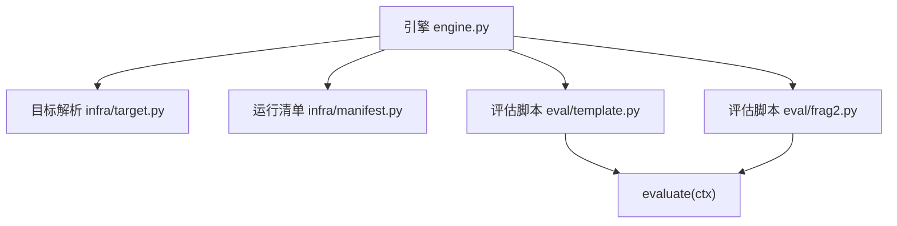
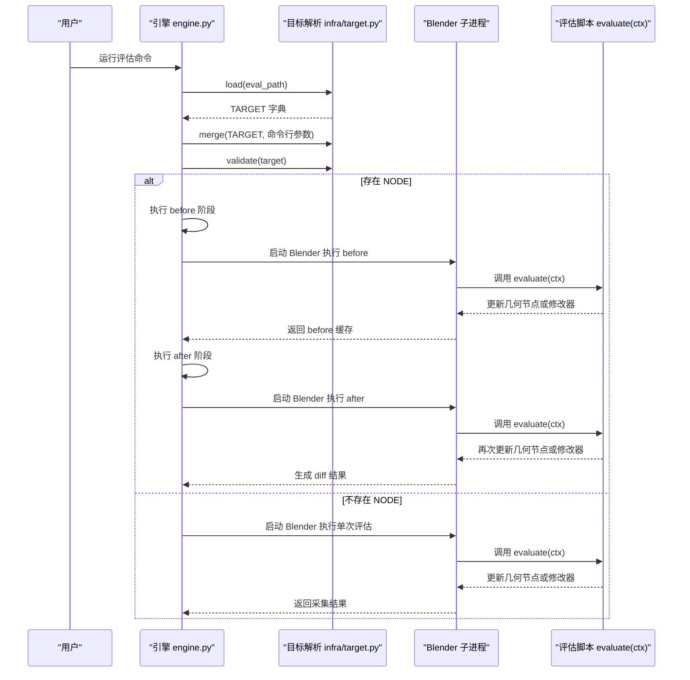
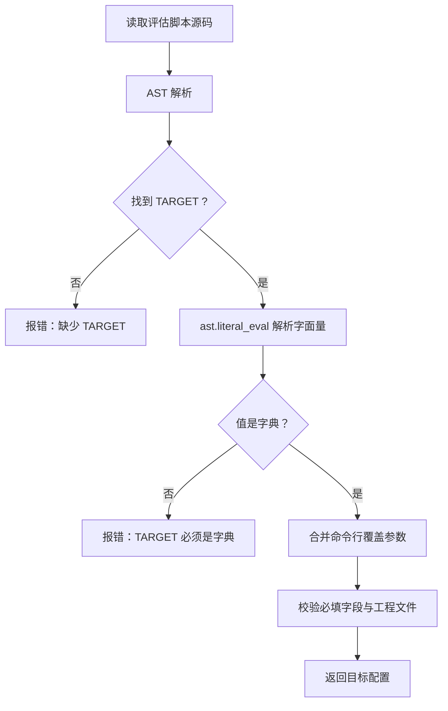
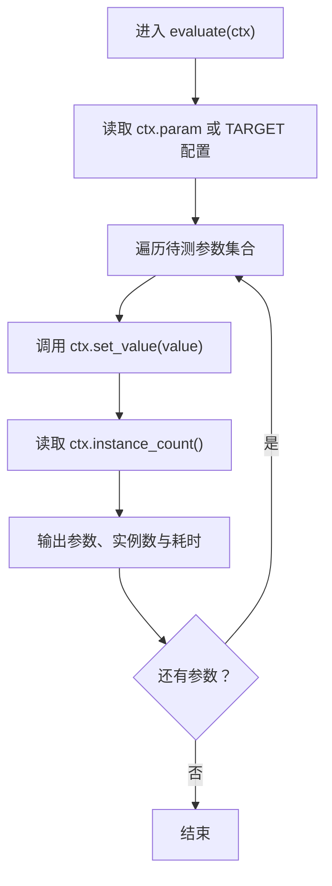
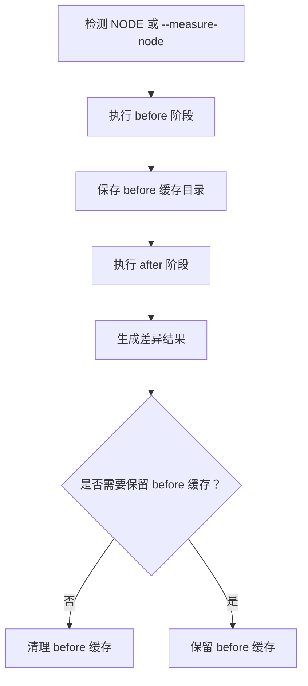
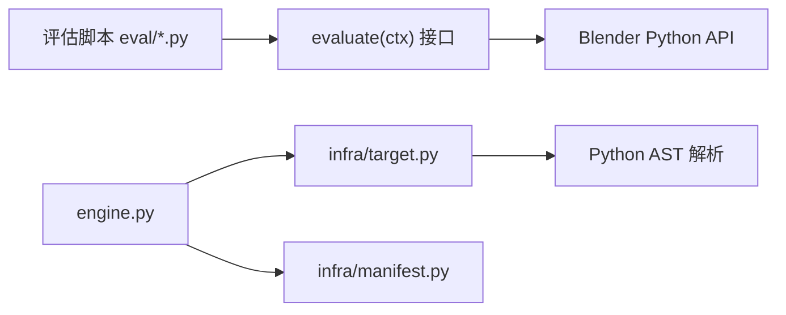

# 评估脚本接口

<cite>
**本文引用的文件**
- [engine.py](file://engine.py)
- [infra/target.py](file://infra/target.py)
- [infra/manifest.py](file://infra/manifest.py)
- [eval/template.py](file://eval/template.py)
- [eval/frag2.py](file://eval/frag2.py)
</cite>

## 目录
1. [引言](#引言)
2. [项目结构](#项目结构)
3. [核心组件](#核心组件)
4. [架构总览](#架构总览)
5. [详细组件分析](#详细组件分析)
6. [依赖关系分析](#依赖关系分析)
7. [性能与稳定性考虑](#性能与稳定性考虑)
8. [故障排查指南](#故障排查指南)
9. [结论](#结论)
10. [附录：TARGET 字段规范与最佳实践](#附录target-字段规范与最佳实践)

## 引言
本文件面向编写 `eval/*.py` 的开发者与 AI，说明评估脚本的输入契约、执行边界以及安全约束。重点包括：

- `TARGET` 字段规范：`blend`、`object`、`modifier`、`param`、可选 `node_tree`。
- 可选 `NODE` 字段：用于 before/after 节点对比边界。
- `infra/target.py` 如何安全读取配置、合并命令行覆盖参数并校验必需字段。
- `evaluate(ctx)` 接口中 `ctx.bpy`、`ctx.target`、`ctx.obj`、`ctx.mod`、`ctx.node_tree`、`ctx.param`、`ctx.set_value`、`ctx.instance_count` 的含义与用法。
- 为什么不要在 `evaluate` 中直接执行高风险操作，以及如何保持评估幂等、避免写入外部状态。

## 项目结构
评估相关代码主要分布在以下位置：

| 路径 | 职责 |
|---|---|
| `infra/target.py` | 从评估脚本 AST 安全读取 `TARGET` 和 `NODE`，合并命令行覆盖参数，校验必需字段。 |
| `engine.py` | 编排运行流程；当存在 `NODE` 时自动执行 before/after 并生成差异结果。 |
| `infra/manifest.py` | 维护每次运行的 manifest 元数据，用于区分重复、冲突与不完整的运行目录。 |
| `eval/template.py` | 模板式评估脚本，展示 TARGET/NODE 声明与 `evaluate(ctx)` 标准写法。 |
| `eval/frag2.py` | 示例脚本，演示手动遍历 node tree interface、设置修改器输入并触发求值。 |

**图表来源**
- [engine.py:200-350](file://engine.py#L200-L350)
- [infra/target.py:1-81](file://infra/target.py#L1-L81)
- [infra/manifest.py:1-58](file://infra/manifest.py#L1-L58)
- [eval/template.py:1-25](file://eval/template.py#L1-L25)
- [eval/frag2.py:1-37](file://eval/frag2.py#L1-L37)

**章节来源**
- [engine.py:200-350](file://engine.py#L200-L350)
- [infra/target.py:1-81](file://infra/target.py#L1-L81)
- [infra/manifest.py:1-58](file://infra/manifest.py#L1-L58)
- [eval/template.py:1-25](file://eval/template.py#L1-L25)
- [eval/frag2.py:1-37](file://eval/frag2.py#L1-L37)

## 核心组件
本节聚焦两个层面：

1. **目标解析层**：负责从评估脚本中提取并校验 `TARGET` 与 `NODE`。
2. **评估执行层**：负责在 Blender 进程中调用 `evaluate(ctx)`，并提供上下文对象。

### 目标解析层
`infra/target.py` 提供三个关键能力：

| 函数 | 作用 | 安全特性 |
|---|---|---|
| `load(eval_path)` | 读取 `TARGET = {...}` 字面量字典。 | 使用 `ast.parse` + `ast.literal_eval`，拒绝任意 Python 表达式。 |
| `measure_node(eval_path)` | 读取可选 `NODE = "..."` 字符串字面量。 | 同样仅接受字符串字面量，不会执行脚本逻辑。 |
| `merge(target, blend, obj, mod, param)` | 用命令行参数覆盖 `TARGET` 中的对应键。 | 仅对非空命令行值进行覆盖。 |
| `validate(target)` | 校验 `blend/object/modifier/param` 必填，并检查工程文件是否存在。 | 额外允许可选 `node_tree` 字符串。 |

**章节来源**
- [infra/target.py:1-81](file://infra/target.py#L1-L81)

### 评估执行层
`engine.py` 在启动 Blender 前完成以下工作：

1. 定位评估脚本路径。
2. 通过 `targetfile.load` 读取 `TARGET`。
3. 通过 `targetfile.merge` 合并命令行参数。
4. 规范化 `blend` 路径并调用 `targetfile.validate`。
5. 根据是否包含 `NODE`，决定是否进入自动 diff 流程。
6. 将 `blender` 可执行路径、评估脚本路径、工作目录、节点名、目标信息与闸门列表传给 Blender 子进程。

**章节来源**
- [engine.py:200-350](file://engine.py#L200-L350)

## 架构总览
下图描述一次典型评估的运行流程：

**图表来源**
- [engine.py:200-350](file://engine.py#L200-L350)
- [infra/target.py:1-81](file://infra/target.py#L1-L81)

## 详细组件分析

### TARGET 字段规范
`TARGET` 必须是 Python 字面量字典，不能是表达式或变量引用。引擎在宿主侧使用 AST 解析，因此即使评估脚本被恶意篡改，也不会执行其中的任意代码。

| 字段 | 类型 | 是否必填 | 含义与用法 |
|---|---|---:|---|
| `blend` | 字符串 | 是 | Blender 工程文件路径；`validate` 会检查该文件是否存在。 |
| `object` | 字符串 | 是 | 需要访问的对象名称。 |
| `modifier` | 字符串 | 是 | 需要访问的修改器名称。 |
| `param` | 字符串 | 是 | 修改器的显示参数名；底座负责将其解析为真正的 socket identifier。 |
| `node_tree` | 字符串 | 否 | 几何节点树名；留空时表示使用修改器的 `node_group`。若提供，则必须是字符串。 |

此外，`infra/target.py` 还定义了一个可选 `NODE` 字段：

| 字段 | 类型 | 是否必填 | 含义与用法 |
|---|---|---:|---|
| `NODE` | 字符串 | 否 | 指定要测量边界的节点名、label 或 `bl_idname`。引擎检测到 `NODE` 后，会自动执行 before/after 两阶段，并生成差异结果。 |

**章节来源**
- [infra/target.py:1-81](file://infra/target.py#L1-L81)
- [eval/template.py:1-25](file://eval/template.py#L1-L25)

### 安全读取与命令行覆盖
`infra/target.py` 的安全机制如下：

1. 打开评估脚本源文件。
2. 使用 `ast.parse` 解析语法树。
3. 遍历顶层赋值语句，查找名为 `TARGET` 或 `NODE` 的变量。
4. 使用 `ast.literal_eval` 解析其值。
5. 校验类型：`TARGET` 必须是字典，`NODE` 必须是字符串。
6. 如果语法错误或值类型不符合要求，抛出 `TargetError`。

命令行覆盖由 `engine.py` 调用 `targetfile.merge` 实现：只有传入的 `blend`、`object`、`modifier`、`param` 非空时才会覆盖 `TARGET` 中的对应键。

**图表来源**
- [infra/target.py:1-81](file://infra/target.py#L1-L81)
- [engine.py:200-350](file://engine.py#L200-L350)

**章节来源**
- [infra/target.py:1-81](file://infra/target.py#L1-L81)
- [engine.py:200-350](file://engine.py#L200-L350)

### evaluate(ctx) 接口语义
`evaluate(ctx)` 是评估脚本必须实现的函数。`ctx` 是一个上下文对象，常见属性与行为如下：

| 属性或方法 | 类型 | 含义与用法 |
|---|---|---|
| `ctx.bpy` | Blender Python API 根对象 | 用于访问 Blender 全局 API。 |
| `ctx.target` | 字典 | 原始 `TARGET` 配置。 |
| `ctx.obj` | Blender 对象 | 由 `object` 字段指定的对象。 |
| `ctx.mod` | Blender 修改器 | 由 `modifier` 字段指定的修改器。 |
| `ctx.node_tree` | Blender 节点树或组 | 由 `node_tree` 字段指定的节点树；为空时使用修改器的 `node_group`。 |
| `ctx.param` | 字符串 | 当前使用的参数显示名，通常来自 `TARGET["param"]`。 |
| `ctx.set_value(value)` | 方法 | 将 `value` 设置到修改器对应 socket，并返回耗时（毫秒）。这是设置几何节点输入参数的推荐方式。 |
| `ctx.instance_count()` | 方法 | 返回当前实例化采样次数，常用于统计渲染或几何求值规模。 |

#### 推荐模式
- 使用 `ctx.set_value` 设置修改器参数或几何节点输入参数。
- 使用 `ctx.instance_count()` 输出实例数量，便于横向比较不同参数下的几何规模。
- 不要直接在 `evaluate` 中执行高风险操作，例如删除文件、修改系统状态、发起网络请求、执行任意表达式等。

#### 模板风格示例
参考 `eval/template.py` 的标准写法：

- 声明 `TARGET`，包含 `blend`、`object`、`modifier`、`param`、可选 `node_tree`。
- 可选声明 `NODE`，用于自动 before/after 对比。
- 实现 `evaluate(ctx)`，遍历待测参数，调用 `ctx.set_value`，打印 `ctx.instance_count()` 与耗时。

**图表来源**
- [eval/template.py:1-25](file://eval/template.py#L1-L25)

**章节来源**
- [eval/template.py:1-25](file://eval/template.py#L1-L25)

### 手动遍历节点输入的示例
`eval/frag2.py` 展示了另一种写法：

- 不依赖 `ctx.set_value`，而是直接遍历 `ctx.node_tree.interface.items_tree`。
- 查找类型为 `SOCKET`、方向为 `INPUT`、名称匹配的项。
- 通过 `identifier` 设置修改器或节点输入。
- 手动触发 `update_tag()` 与视图层更新，并统计时间。

这种写法适合需要精细控制多个 socket 的场景，但要注意：

- 名称匹配失败时应明确报错。
- 不应假设 display name 与 identifier 一一对应。
- 仍应避免在评估脚本中写入外部文件或持久状态。

**章节来源**
- [eval/frag2.py:1-37](file://eval/frag2.py#L1-L37)

### 自动节点边界对比
当评估脚本定义了 `NODE`，或者命令行提供了 `--measure-node`，引擎会进入自动对比流程：

1. 先执行 `before` 阶段，记录基础缓存。
2. 再执行 `after` 阶段，基于 `before` 的缓存目录计算差异。
3. 如果没有必要保留 raw 数据，可清理 before 阶段的缓存。

**图表来源**
- [engine.py:200-350](file://engine.py#L200-L350)

**章节来源**
- [engine.py:200-350](file://engine.py#L200-L350)

## 依赖关系分析
评估脚本对外部系统的依赖如下：

- `eval/*.py` 只暴露 `TARGET`、可选 `NODE` 与 `evaluate(ctx)`。
- `engine.py` 负责生命周期管理、路径校验、Blender 子进程调度。
- `infra/target.py` 负责安全解析与校验。
- `infra/manifest.py` 负责运行元数据与重复/冲突分类。

**图表来源**
- [engine.py:200-350](file://engine.py#L200-L350)
- [infra/target.py:1-81](file://infra/target.py#L1-L81)
- [infra/manifest.py:1-58](file://infra/manifest.py#L1-L58)
- [eval/template.py:1-25](file://eval/template.py#L1-L25)
- [eval/frag2.py:1-37](file://eval/frag2.py#L1-L37)

**章节来源**
- [engine.py:200-350](file://engine.py#L200-L350)
- [infra/target.py:1-81](file://infra/target.py#L1-L81)
- [infra/manifest.py:1-58](file://infra/manifest.py#L1-L58)

## 性能与稳定性考虑
- `ctx.set_value` 是推荐的参数设置入口，通常会在内部完成 socket 解析与必要的更新步骤，减少评估脚本中的样板逻辑。
- `ctx.instance_count()` 能反映实例化规模，适合与耗时一起输出，用于比较不同参数或不同种子下的几何复杂度。
- 使用 `NODE` 进行 before/after 对比时，注意几何节点工程应避免复杂的 Repeat/Foreach/Simulation 区域，否则边界对比可能不稳定。
- 评估脚本应保持幂等：同一组输入应当产生相同的几何结果与实例数量，这样 run key、diff 与产物缓存才可靠。

[本节为通用指导，不直接分析具体文件]

## 故障排查指南
常见错误与处理建议：

| 现象 | 可能原因 | 处理建议 |
|---|---|---|
| 报错“求值脚本缺少 TARGET” | 未定义 `TARGET`，或不是顶层赋值。 | 在评估脚本顶部添加 `TARGET = {...}`。 |
| 报错“TARGET 必须是字面量字典” | `TARGET` 的值不是字典，或使用了表达式而非字面量。 | 改为字面量字典，不要写变量或函数调用。 |
| 报错“TARGET 缺少字段” | 缺少 `blend`、`object`、`modifier`、`param` 之一。 | 补全必填字段。 |
| 报错“找不到工程” | `blend` 路径不存在。 | 检查绝对路径或相对路径是否正确。 |
| 报错“NODE 必须是字符串” | `NODE` 不是字符串字面量。 | 改为 `NODE = "节点名"`。 |
| 自动 diff 没有触发 | 未定义 `NODE`，也未提供 `--measure-node`。 | 添加 `NODE` 或使用命令行选项。 |
| 评估结果不稳定 | 评估脚本非幂等，或几何节点包含随机性且未固定种子。 | 固定随机种子，确保相同输入得到相同输出。 |
| 运行时找不到 Blender | `--blender` 或未配置的 Blender 可执行文件缺失。 | 确认 Blender 安装路径与调试符号路径。 |

**章节来源**
- [infra/target.py:1-81](file://infra/target.py#L1-L81)
- [engine.py:200-350](file://engine.py#L200-L350)

## 结论
评估脚本的核心契约很清晰：

- 用 `TARGET` 声明 Blender 工程、对象、修改器和参数。
- 用可选 `NODE` 声明节点边界以启用自动对比。
- 在 `evaluate(ctx)` 中读取参数、设置几何节点输入、触发求值，并输出实例数量与耗时。
- 依赖 `infra/target.py` 的 AST 安全解析，避免任意代码执行风险。
- 保持评估幂等，不写入外部状态，使引擎能够可靠地缓存、去重与对比结果。

[本节为总结性内容，不直接分析具体文件]

## 附录：TARGET 字段规范与最佳实践

### TARGET 字段速查表
| 字段 | 必填 | 类型 | 说明 |
|---|---:|---|---|
| `blend` | 是 | 字符串 | Blender 工程路径，必须存在。 |
| `object` | 是 | 字符串 | 目标对象名。 |
| `modifier` | 是 | 字符串 | 目标修改器名。 |
| `param` | 是 | 字符串 | 修改器显示参数名，底座负责解析为 socket identifier。 |
| `node_tree` | 否 | 字符串 | 几何节点树名；留空表示使用修改器的 `node_group`。 |

### 最佳实践
1. **TARGET 保持幂等**：同一份 `TARGET` 与 `param` 应始终指向同一工程、对象与修改器。
2. **NODE 仅用于边界对比**：只在需要 before/after 差异时使用 `NODE`；普通单点评估可不填。
3. **优先使用 `ctx.set_value`**：它封装了 socket 解析与参数设置，减少手写错误。
4. **使用 `ctx.instance_count()` 辅助诊断**：结合耗时与实例数判断求值是否真正触发。
5. **不要在 `evaluate` 中执行高风险操作**：避免文件删除、系统调用、网络请求、动态表达式执行等。
6. **避免在评估脚本中写入外部状态**：所有临时结果应交给引擎的工作目录与缓存机制。
7. **合理拆分评估用例**：一个 `eval/*.py` 聚焦一个修改器或一组相关参数，便于独立运行与对比。

[本节为通用指导，不直接分析具体文件]