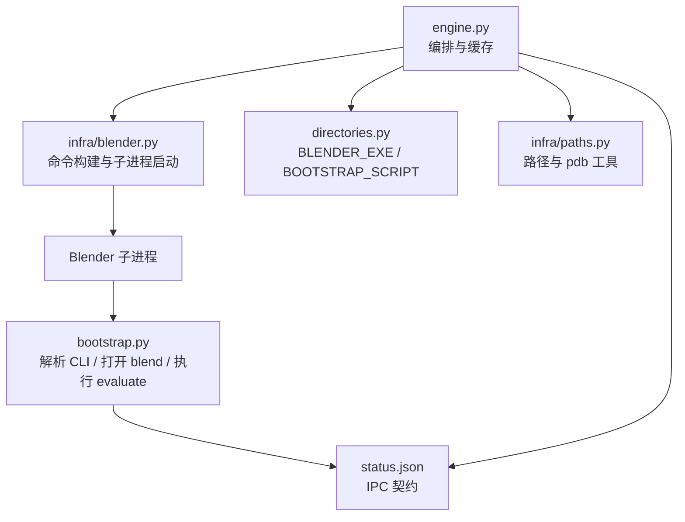
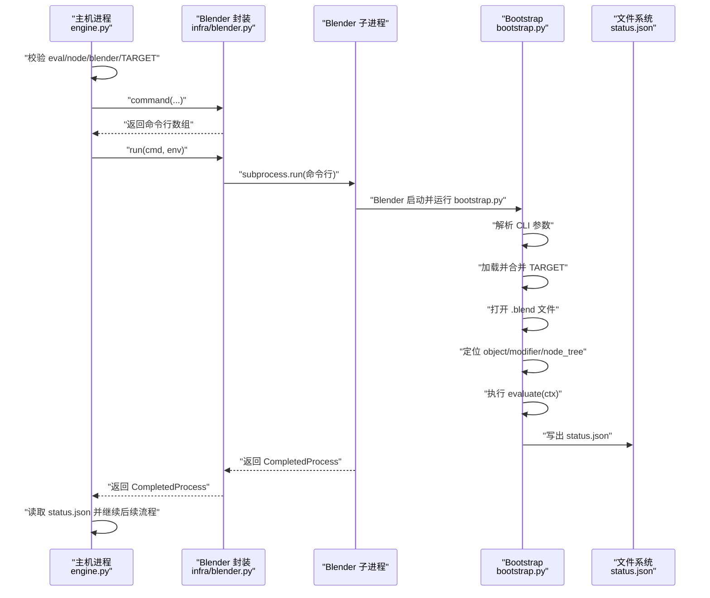
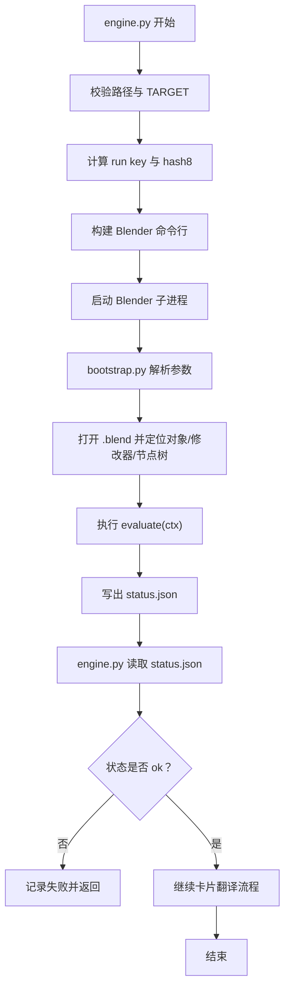
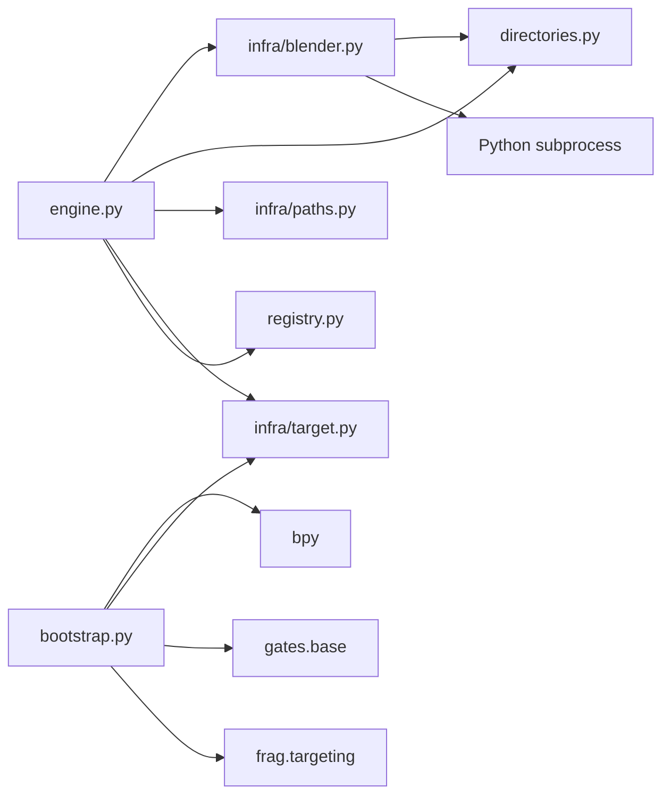

# Blender 子进程封装

<cite>
**本文引用的文件**   
- [infra/blender.py](file://infra/blender.py)
- [bootstrap.py](file://bootstrap.py)
- [engine.py](file://engine.py)
- [directories.py](file://directories.py)
- [infra/paths.py](file://infra/paths.py)
</cite>

## 目录
1. [引言](#引言)
2. [项目结构](#项目结构)
3. [核心组件](#核心组件)
4. [架构总览](#架构总览)
5. [详细组件分析](#详细组件分析)
6. [依赖关系分析](#依赖关系分析)
7. [性能与行为特征](#性能与行为特征)
8. [故障排查指南](#故障排查指南)
9. [扩展命令行参数指南](#扩展命令行参数指南)
10. [结论](#结论)

## 引言
本文围绕引擎侧对 Blender 的封装展开，说明：
- `infra/blender.py` 如何组装 Blender 命令行、启动子进程并打印命令；
- `engine.py` 如何决定何时启动子进程、如何处理工作目录与结果；
- `bootstrap.py` 如何在 Blender 内部解析参数、加载目标、打开 `.blend`、定位对象/修改器/节点树、执行评估脚本，并写出 `status.json`；
- 为什么必须通过独立子进程调用 Blender，而不能直接 `import bpy`；
- 引擎侧与 bootstrap 之间的 IPC 契约；
- 典型调用链和常见故障的诊断方法；
- 如何安全增加新的命令行参数并保持向后兼容。

## 项目结构
本项目中与 Blender 子进程相关的关键文件如下：

| 文件 | 职责 |
|---|---|
| `infra/blender.py` | 主机侧封装：构造 Blender 命令行、统一启动子进程 |
| `bootstrap.py` | Blender 子进程入口：解析参数、打开工程、执行评估、写状态 |
| `engine.py` | 编排层：路径校验、缓存键、启动子进程、读取状态、驱动卡片 |
| `directories.py` | 固定路径常量：Blender 可执行文件、bootstrap 脚本等 |
| `infra/paths.py` | 路径规范化、pdb 路径推导、文件名安全化 |

**图表来源**
- [engine.py:201-562](file://engine.py#L201-L562)
- [infra/blender.py:1-39](file://infra/blender.py#L1-L39)
- [bootstrap.py:1-192](file://bootstrap.py#L1-L192)
- [directories.py:1-25](file://directories.py#L1-L25)
- [infra/paths.py:1-32](file://infra/paths.py#L1-L32)

**章节来源**
- [engine.py:201-562](file://engine.py#L201-L562)
- [infra/blender.py:1-39](file://infra/blender.py#L1-L39)
- [bootstrap.py:1-192](file://bootstrap.py#L1-L192)
- [directories.py:1-25](file://directories.py#L1-L25)
- [infra/paths.py:1-32](file://infra/paths.py#L1-L32)

## 核心组件
本节聚焦三个模块的职责边界：

### `infra/blender.py`：命令构建与子进程启动
- `command(blender, eval_path, work_dir, node, ...)`：
  - 始终传入 `--background --python <BOOTSTRAP_SCRIPT>`；
  - 使用 `--` 分隔 Python 脚本参数与 Bootstrap 自身参数；
  - 必填参数：`--eval`、`--work`、`--node`；
  - 可选参数包括 `--gates`、`--blend`、`--obj`、`--mod`、`--param`、`--phase`、`--measure-node`；
  - 只有当值非空时才追加对应参数，从而天然支持默认值和可选覆盖；
- `run(cmd, env=None)`：
  - 先打印完整命令；
  - 使用 `subprocess.run` 启动进程，以文本模式运行，错误字符替换为占位符；
  - 返回 `subprocess.CompletedProcess`，包含返回码、标准输出与标准错误。

该模块不直接处理业务逻辑，只负责“把高层意图转成 Blender 命令行并启动”。

**章节来源**
- [infra/blender.py:1-39](file://infra/blender.py#L1-L39)

### `bootstrap.py`：Blender 子进程主流程
- 将自身所在目录加入 `sys.path`，然后导入 `bpy`；
- 使用 `argparse` 解析 `--` 之后的参数；
- 创建 `work_dir`；
- 加载并合并 TARGET：
  - `target = targetfile.load(eval)`；
  - `target = targetfile.merge(target, blend, obj, mod, param)`；
  - `targetfile.validate(target)`；
- 打开 Blender 主文件并定位资源：
  - `bpy.ops.wm.open_mainfile(filepath=target["blend"])`；
  - 从 `bpy.data.objects` 获取对象；
  - 从对象的 modifiers 获取修改器；
  - 验证是几何节点修改器且 `node_group` 存在；
  - 如果指定了 `node_tree`，则校验名称一致；
  - 解析节点组接口中的输入 socket 名称到标识符；
- 可选测量区域：
  - 根据 `--measure-node` 或 eval 中的 NODE 解析测量区域；
  - 若提供 `--phase`，会重写测量边界；
- 动态加载评估脚本：
  - 使用 `runpy.run_path` 运行 `args.eval`；
  - 要求脚本导出 `evaluate(ctx)`；
  - 向评估脚本全局注入 `bpy` 和 `time`；
- 构造上下文对象 `ctx`：
  - 暴露 `bpy`、`target`、`obj`、`mod`、`node_tree`、`param`、`param_id`；
  - 提供 `set_value(value)` 设置参数并触发求值；
  - 提供 `instance_count()` 查询实例数量；
- 闸门机制：
  - 解析 `--gates` 中的 `module:class` 列表；
  - 检查缺失导出；
  - 依次执行 `arm` → `evaluate` → `dump`；
- 写出 `status.json`：
  - 成功时写入 `ok=True`、`node`、`target`、`gates`、`raw`；
  - 失败时写入 `ok=False`、`error`、`traceback`；
  - 使用临时文件加原子替换，避免部分写入。

**章节来源**
- [bootstrap.py:1-192](file://bootstrap.py#L1-L192)

### `engine.py`：引擎编排
- 校验 eval 路径、node、blender 可执行文件；
- 合并 TARGET 并标准化路径；
- 计算 run key、hash8、输出目录、缓存目录与工作目录；
- 写入 manifest；
- 构造 gates 规格字符串并调用 `blender_lib.command`；
- 设置环境变量（例如关闭 LLVM profile 输出）；
- 调用 `blender_lib.run`；
- 读取 `status.json`：
  - 不存在或非成功时视为采集失败；
  - 检查 raw 数据是否有效；
- 将 gate 摘要与 raw 写回 manifest，并进入卡片翻译阶段；
- 支持 `run`、`translate`、`validate` 三种命令；
- `validate` 会直接调用 `frag/validate.py` 进行轻量校验。

**章节来源**
- [engine.py:201-562](file://engine.py#L201-L562)

## 架构总览
下图展示一次典型执行的端到端流程：

**图表来源**
- [engine.py:201-562](file://engine.py#L201-L562)
- [infra/blender.py:1-39](file://infra/blender.py#L1-L39)
- [bootstrap.py:1-192](file://bootstrap.py#L1-L192)

## 详细组件分析

### 为什么 Blender 必须作为独立子进程运行
当前代码中，`bootstrap.py` 在启动时直接 `import bpy`。Blender 提供的 Python API 通常绑定到 Blender 内部运行时环境，包括场景图、视图层、依赖图等。若在宿主 Python 进程中直接 `import bpy`，可能遇到以下问题：
- Blender 未以正确方式初始化 CPython 嵌入环境；
- `bpy` 的符号由 Blender 二进制动态导出，宿主进程没有这些符号；
- 进程间内存、线程模型、C-API 初始化顺序不同；
- 测试与评估脚本可能被重复导入或共享状态，造成难以复现的错误；
- 崩溃隔离：Blender 内部错误或崩溃不应直接杀死引擎主进程。

因此，架构选择让 `engine.py` 作为稳定编排进程，`bootstrap.py` 作为 Blender 子进程的入口，二者通过文件系统上的 `status.json` 通信。

**章节来源**
- [bootstrap.py:1-20](file://bootstrap.py#L1-L20)
- [engine.py:201-562](file://engine.py#L201-L562)

### 引擎侧与 Bootstrap 的 IPC 契约
IPC 不是通过网络或管道协议，而是基于工作目录中的 `status.json`。

#### 成功状态
| 字段 | 含义 |
|---|---|
| `ok` | 布尔值，表示评估是否成功 |
| `node` | 本次运行的节点名 |
| `target` | 最终合并后的 TARGET 信息 |
| `gates` | 各闸门的摘要列表 |
| `raw` | 闸门产出的原始数据映射 |

#### 失败状态
| 字段 | 含义 |
|---|---|
| `ok` | 布尔值，表示失败 |
| `error` | 异常类型与消息 |
| `traceback` | 完整回溯文本 |

`write_status` 的实现方式是先写 `.tmp` 文件，再原子替换为目标文件名，确保 `status.json` 要么完整、要么不存在，避免半写状态被引擎读取。

**章节来源**
- [bootstrap.py:35-48](file://bootstrap.py#L35-L48)
- [bootstrap.py:149-192](file://bootstrap.py#L149-L192)
- [engine.py:201-330](file://engine.py#L201-L330)

### 典型调用链
1. `engine.py` 解析命令行参数；
2. 校验 eval、node、blender 可执行文件；
3. 加载并合并 TARGET；
4. 计算缓存键与工作目录；
5. 调用 `infra/blender.py.command` 生成 Blender 命令行；
6. 调用 `infra/blender.py.run` 启动子进程；
7. `bootstrap.py` 解析 CLI；
8. `bootstrap.py` 加载 TARGET、打开 `.blend`；
9. `bootstrap.py` 定位 `object` → `modifier` → `node_tree`；
10. `bootstrap.py` 动态加载评估脚本并执行 `evaluate(ctx)`；
11. `bootstrap.py` 写出 `status.json`；
12. `engine.py` 读取 `status.json`，判断成功与否，并继续卡片翻译流程。

**图表来源**
- [engine.py:201-562](file://engine.py#L201-L562)
- [bootstrap.py:1-192](file://bootstrap.py#L1-L192)

### 资源定位与上下文传递
Bootstrap 中的 `Context` 是一个简单容器，向评估脚本暴露以下关键能力：

| 上下文成员 | 用途 |
|---|---|
| `ctx.bpy` | 直接访问 Blender Python API |
| `ctx.target` | 合并后的 TARGET |
| `ctx.obj` | Blender 中的对象 |
| `ctx.mod` | 几何节点修改器 |
| `ctx.node_tree` | 节点组 |
| `ctx.param` | 用户可见的参数显示名 |
| `ctx.param_id` | 节点接口 socket 的实际标识符 |
| `ctx.set_value(value)` | 设置参数、更新标签、触发求值并计时 |
| `ctx.instance_count()` | 获取求值后的对象实例数 |

这个设计使评估脚本可以专注于“如何改变参数、如何触发求值、如何收集指标”，而不必关心 Blender 子进程启动细节。

**章节来源**
- [bootstrap.py:70-148](file://bootstrap.py#L70-L148)

## 依赖关系分析

**图表来源**
- [engine.py:1-562](file://engine.py#L1-L562)
- [infra/blender.py:1-39](file://infra/blender.py#L1-L39)
- [bootstrap.py:1-192](file://bootstrap.py#L1-L192)
- [directories.py:1-25](file://directories.py#L1-L25)
- [infra/paths.py:1-32](file://infra/paths.py#L1-L32)

### 耦合与内聚
- `infra/blender.py` 低耦合：只依赖 `subprocess` 和 `directories`；
- `engine.py` 高内聚地组织路径、缓存、gate、card 流程；
- `bootstrap.py` 集中处理 Blender 内部依赖；
- 引擎与 Bootstrap 的唯一强契约是 `status.json`，降低进程间耦合。

### 潜在循环依赖
当前结构中没有明显循环导入：引擎不反向依赖 bootstrap，bootstrap 也不依赖 engine。

**章节来源**
- [engine.py:1-562](file://engine.py#L1-L562)
- [infra/blender.py:1-39](file://infra/blender.py#L1-L39)
- [bootstrap.py:1-192](file://bootstrap.py#L1-L192)

## 性能与行为特征
- Blender 子进程启动成本较高，因此引擎通过 `runkey`、`hash8`、`cache_dir` 避免重复执行；
- 工作目录使用 `<cache>/<node>/<hash8>.tmp`，成功后原子替换为 `<cache>/<node>/<hash8>`；
- `no_raw` 模式下可删除原始数据以减少磁盘占用；
- `keep_cache` 控制每个节点保留多少个历史 cache；
- `--dry-run` 允许在不启动 Blender 的情况下检查路径、TARGET 和重复状态；
- `status.json` 使用 UTF-8 编码，并保留缩进换行，便于人类阅读与调试；
- 标准输出/错误流在 `bootstrap.py` 中尝试重新配置为 UTF-8，但不会阻止异常传播。

**章节来源**
- [engine.py:201-562](file://engine.py#L201-L562)
- [bootstrap.py:35-48](file://bootstrap.py#L35-L48)
- [bootstrap.py:10-20](file://bootstrap.py#L10-L20)

## 故障排查指南

### Blender 崩溃
**现象**
- 子进程退出码非零；
- `status.json` 缺失或非成功；
- 控制台输出中可能出现 Blender 崩溃信息。

**诊断步骤**
1. 查看引擎打印的完整命令行；
2. 确认 `directories.BLENDER_EXE` 指向的是插桩版 Blender；
3. 检查 `status.json` 是否存在以及 `ok` 是否为真；
4. 若存在失败状态，查看 `error` 和 `traceback`；
5. 若崩溃发生在 Blender 内部，`traceback` 可能不完整，应优先检查 `.blend`、对象名、修改器名、节点树名是否正确。

**相关实现位置**
- [engine.py:260-330](file://engine.py#L260-L330)
- [bootstrap.py:149-192](file://bootstrap.py#L149-L192)

**章节来源**
- [engine.py:260-330](file://engine.py#L260-L330)
- [bootstrap.py:149-192](file://bootstrap.py#L149-L192)

### 导出符号缺失
**现象**
- 报错中包含 “missing exports”；
- 某个闸门类缺少期望的方法或属性。

**原因**
- `load_gates` 解析 `--gates` 中的 `module:class`；
- `missing_exports(gate)` 检查闸门导出的必需接口；
- 若缺失，Bootstrap 抛出运行时错误并写失败状态。

**修复建议**
- 检查闸门类的模块路径是否与注册一致；
- 确保闸门类实现了所有必需导出；
- 检查 `engine.py` 中 gates 规格字符串的拼接是否正确。

**章节来源**
- [bootstrap.py:50-68](file://bootstrap.py#L50-L68)
- [bootstrap.py:129-148](file://bootstrap.py#L129-L148)

### PYTHONPATH 不正确
**现象**
- `importlib.import_module` 找不到闸门模块；
- 自定义模块无法在 Blender 子进程中导入；
- `runpy.run_path(args.eval)` 找不到评估脚本依赖。

**原因**
- `bootstrap.py` 仅将自身所在目录加入 `sys.path`；
- 如果闸门或评估脚本依赖其他包，需要保证它们在 Blender 可识别的模块搜索路径中。

**修复建议**
- 将闸门模块放在 `bootstrap.py` 所在目录或其子模块结构中；
- 或在外部环境中配置 Blender 可发现的 Python 路径；
- 对于复杂项目，考虑将必要模块打包到 Blender 可加载的位置。

**章节来源**
- [bootstrap.py:10-18](file://bootstrap.py#L10-L18)
- [bootstrap.py:50-68](file://bootstrap.py#L50-L68)

### 自定义 Blender 构建不可用
**现象**
- 引擎提示找不到插桩 Blender；
- 自定义构建路径配置错误；
- PDB 文件缺失导致调试信息不可用。

**诊断步骤**
1. 检查 `directories.BLENDER_BIN_DIR` 和 `BLENDER_EXE`；
2. 使用 `--blender` 显式指定自定义 Blender 路径；
3. 检查 `infra/paths.pdb_for(blender)` 推导出的 `.pdb` 是否存在；
4. 确认自定义构建版本与项目预期兼容；
5. 若仍失败，先用 `engine validate` 快速检查工程结构。

**相关实现位置**
- [directories.py:1-25](file://directories.py#L1-L25)
- [infra/paths.py:18-32](file://infra/paths.py#L18-L32)
- [engine.py:240-260](file://engine.py#L240-L260)

**章节来源**
- [directories.py:1-25](file://directories.py#L1-L25)
- [infra/paths.py:18-32](file://infra/paths.py#L18-L32)
- [engine.py:240-260](file://engine.py#L240-L260)

### 评估脚本未定义 `evaluate(ctx)`
**现象**
- Bootstrap 抛出运行时错误，提示评估脚本必须定义 `evaluate(ctx)`。

**原因**
- `runpy.run_path` 加载脚本后检查命名空间中的 `evaluate`；
- 若不是可调用的函数，Bootstrap 拒绝执行。

**修复建议**
- 确保评估脚本顶层定义 `evaluate(ctx)`；
- 不要覆盖 `__main__` 逻辑替代 `evaluate`；
- 如需初始化逻辑，可在 `evaluate` 内部执行。

**章节来源**
- [bootstrap.py:116-128](file://bootstrap.py#L116-L128)

### 对象、修改器或节点树定位失败
**现象**
- 报错包含 “object not found”、“modifier not found”、“node tree mismatch” 等。

**原因**
- `target["object"]`、`target["modifier"]`、`target["node_tree"]` 与实际 `.blend` 不一致；
- 修改器不是几何节点修改器；
- 节点组名称与 TARGET 指定不一致。

**修复建议**
- 使用 `engine validate` 快速验证工程；
- 检查 eval 中的 TARGET 声明；
- 使用 `--obj`、`--mod`、`--blend`、`--param` 覆盖参数进行最小化复现。

**章节来源**
- [bootstrap.py:80-115](file://bootstrap.py#L80-L115)

## 扩展命令行参数指南

### 新增参数的推荐步骤
假设要新增一个名为 `--feature-x` 的参数：

1. **在 `infra/blender.py.command` 中添加参数**
   - 在函数签名中增加形参；
   - 将其加入可选参数列表；
   - 保持“值为空时不追加”的行为，以维持向后兼容。

2. **在 `bootstrap.py.parse_args` 中添加解析项**
   - 添加同名 argparse 参数；
   - 设置合理默认值；
   - 如有枚举值，使用 `choices` 限制合法输入。

3. **在 `bootstrap.main` 中使用新参数**
   - 将参数用于 TARGET 合并、资源定位、测量区域或评估逻辑；
   - 如果需要影响输出，写入 `status.json` 的 `target`、`gates` 或 `raw`。

4. **在 `engine.py` 中透传参数**
   - 如果是 CLI 级参数，先在 `engine.py` 的 `argparse` 中定义；
   - 传给 `blender_lib.command`；
   - 如果参与 run key，考虑加入 `options` 或 runkey 输入，以保证缓存一致性。

5. **保持向后兼容**
   - 旧参数为空时应等价于未传参；
   - 已有行为不得因新增参数而改变；
   - 若参数语义变化，应引入新版本字段或迁移策略。

### 向后兼容要点
- `infra/blender.py` 中已有多个可选参数均以相同方式处理：只在值非空时追加；
- `bootstrap.py` 中多数参数有默认空值；
- `engine.py` 在合并 TARGET 时也允许空值覆盖；
- 新增参数应避免强制要求，除非该功能完全替代旧行为。

**章节来源**
- [infra/blender.py:10-39](file://infra/blender.py#L10-L39)
- [bootstrap.py:24-48](file://bootstrap.py#L24-L48)
- [engine.py:220-330](file://engine.py#L220-L330)

## 结论
该封装采用清晰的三层结构：
- `engine.py` 负责稳定编排、缓存、产物生成；
- `infra/blender.py` 负责把高层意图转换为 Blender 命令行并启动子进程；
- `bootstrap.py` 负责 Blender 内部资源加载、评估执行和状态输出。

这种设计将 Blender 的脆弱性和复杂性隔离在子进程中，同时通过 `status.json` 建立简单可靠的进程间契约。新增参数时，应遵循“引擎侧定义 → 封装层透传 → Bootstrap 解析 → 状态输出”的路径，并保持空值兼容，以确保现有调用不受影响。