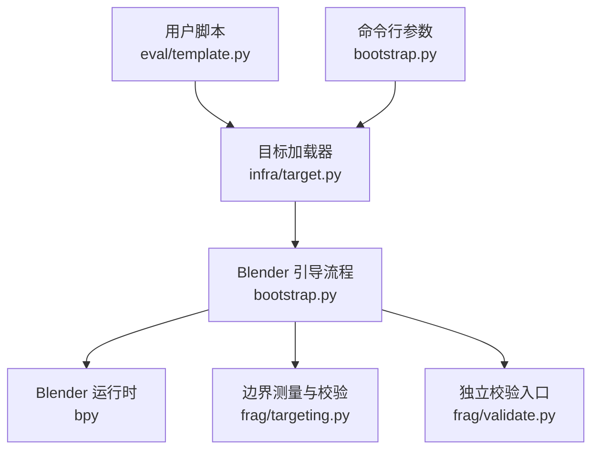
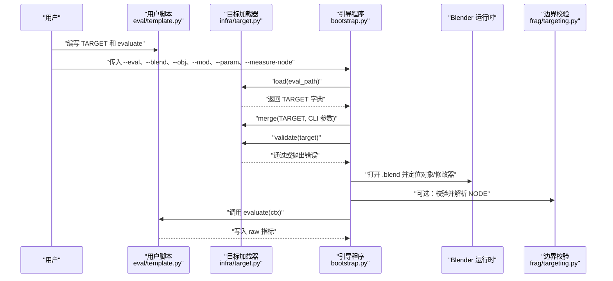
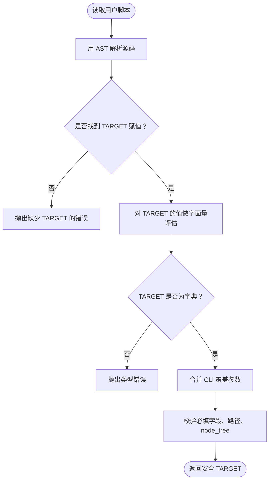
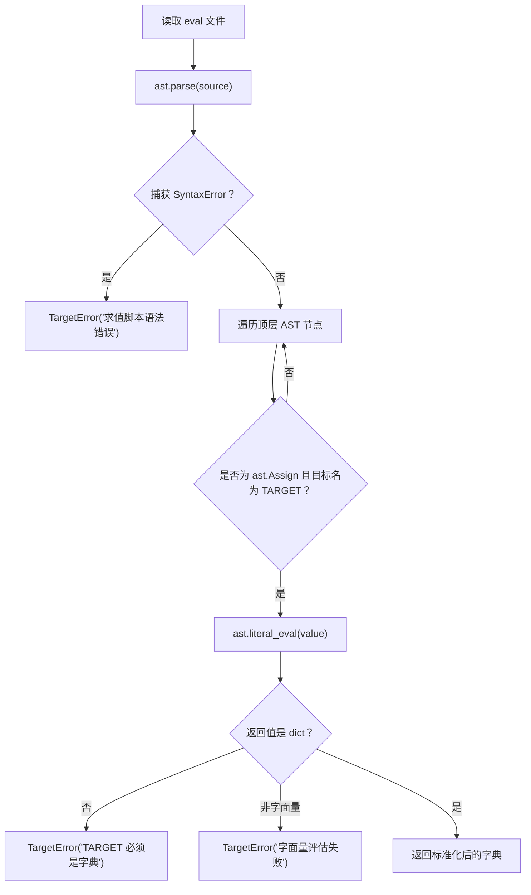
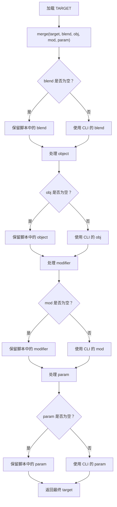
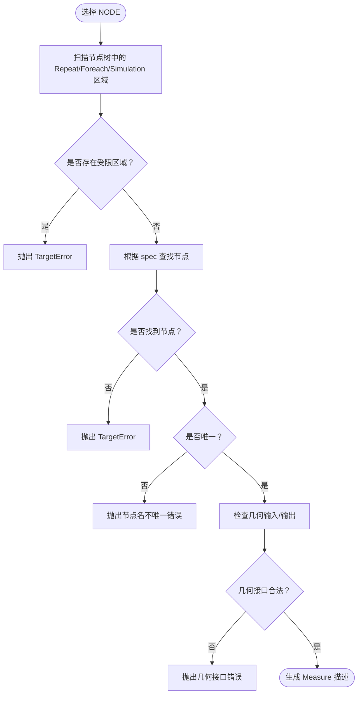
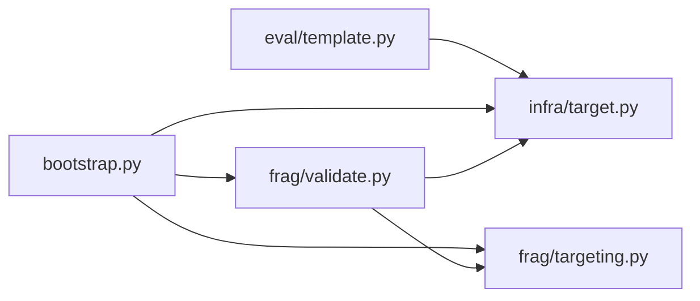

# TARGET 安全解析与校验

<cite>
**本文引用的文件**   
- [infra/target.py](file://infra/target.py)
- [bootstrap.py](file://bootstrap.py)
- [eval/template.py](file://eval/template.py)
- [frag/targeting.py](file://frag/targeting.py)
- [frag/validate.py](file://frag/validate.py)
</cite>

## 目录
1. [引言](#引言)
2. [项目结构](#项目结构)
3. [核心组件](#核心组件)
4. [架构总览](#架构总览)
5. [详细组件分析](#详细组件分析)
6. [依赖关系分析](#依赖关系分析)
7. [性能考虑](#性能考虑)
8. [故障排查指南](#故障排查指南)
9. [结论](#结论)
10. [附录：TARGET 字段规范](#附录target-字段规范)

## 引言
本模块负责“安全地读取用户编写的求值脚本中的目标配置”，而不是在宿主侧直接执行这些脚本。其核心目标是：

- 从 `eval/template.py` 这类用户脚本中，通过抽象语法树（AST）提取 `TARGET` 和可选的 `NODE` 字面量。
- 在宿主机上对 `TARGET` 做基础类型、路径和 Blender 对象/修改器层面的校验。
- 将命令行参数作为覆盖层合并到 `TARGET`，再交给后续 Blender 端逻辑使用。
- 在测量边界场景下，进一步限制节点树的区域类型、几何输入输出数量等约束。

## 项目结构
与安全解析 `TARGET` 相关的代码分布在以下文件中：

| 文件 | 职责 |
| --- | --- |
| `infra/target.py` | AST 加载 `TARGET` / `NODE`；合并 CLI 覆盖参数；校验必需字段、工程路径和 `node_tree` 类型。 |
| `bootstrap.py` | Blender 启动入口：解析 CLI、加载并合并 `TARGET`、打开 `.blend`、定位对象与修改器、运行用户 `evaluate`。 |
| `eval/template.py` | 用户脚本模板：定义 `TARGET`、可选 `NODE` 以及 `evaluate(ctx)`。 |
| `frag/targeting.py` | Blender 端边界测量相关校验：禁止特定区域、查找目标节点、检查几何接口、改写连线。 |
| `frag/validate.py` | 独立验证入口：在不完整运行引擎的情况下，校验 NODE 边界是否能正确解析。 |



**图表来源**
- [infra/target.py:1-81](file://infra/target.py#L1-L81)
- [bootstrap.py:1-192](file://bootstrap.py#L1-L192)
- [eval/template.py:1-25](file://eval/template.py#L1-L25)
- [frag/targeting.py:1-136](file://frag/targeting.py#L1-L136)
- [frag/validate.py:1-66](file://frag/validate.py#L1-L66)

**章节来源**
- [infra/target.py:1-81](file://infra/target.py#L1-L81)
- [bootstrap.py:1-192](file://bootstrap.py#L1-L192)
- [eval/template.py:1-25](file://eval/template.py#L1-L25)
- [frag/targeting.py:1-136](file://frag/targeting.py#L1-L136)
- [frag/validate.py:1-66](file://frag/validate.py#L1-L66)

## 核心组件
`infra/target.py` 是 TARGET 安全解析的核心，提供四个关键能力：

1. **安全加载 `TARGET`**：只解析语法树并做字面量评估，不执行任意 Python 代码。
2. **安全加载 `NODE`**：读取可选的节点边界描述字符串。
3. **合并覆盖参数**：允许 CLI 的 `--blend`、`--obj`、`--mod`、`--param` 覆盖脚本中的值。
4. **基础校验**：检查必填字段、`.blend` 路径是否存在、`node_tree` 是否为字符串。

**章节来源**
- [infra/target.py:1-81](file://infra/target.py#L1-L81)

## 架构总览
下图展示从用户脚本到 Blender 运行时的整体数据流：



**图表来源**
- [bootstrap.py:60-192](file://bootstrap.py#L60-L192)
- [infra/target.py:1-81](file://infra/target.py#L1-L81)
- [eval/template.py:1-25](file://eval/template.py#L1-L25)
- [frag/targeting.py:1-136](file://frag/targeting.py#L1-L136)

**章节来源**
- [bootstrap.py:60-192](file://bootstrap.py#L60-L192)
- [infra/target.py:1-81](file://infra/target.py#L1-L81)

## 详细组件分析

### 为什么不能直接执行用户 eval 脚本
用户脚本可能包含任意 Python 表达式。如果宿主侧直接执行，就等同于把整个系统权限交给脚本作者，可能出现：

- 读写或删除本地文件。
- 访问网络资源。
- 修改环境变量、进程状态或系统配置。
- 消耗大量 CPU/内存。
- 注入恶意逻辑，影响后续测试、对比或发布产物。

因此，`infra/target.py` 采用两层防护：

1. **先解析为 AST**：只关心语法结构，不执行语句体。
2. **只对 `TARGET` 和 `NODE` 做 `ast.literal_eval`**：仅允许 Python 字面量（如字符串、数字、列表、字典），不允许函数调用、属性访问、导入、控制流等。



**图表来源**
- [infra/target.py:14-49](file://infra/target.py#L14-L49)

**章节来源**
- [infra/target.py:14-49](file://infra/target.py#L14-L49)

### TARGET 安全加载流程
`load(eval_path)` 的行为如下：

| 步骤 | 行为 | 失败时 |
| --- | --- | --- |
| 打开文件 | 以 UTF-8-SIG 编码读取脚本内容 | 文件系统异常会向上抛出。 |
| 解析 AST | 捕获语法错误 | 抛出 `TargetError("求值脚本语法错误: ...")`。 |
| 扫描顶层赋值 | 只处理 `ast.Assign`，且目标变量名为 `TARGET`。 | 找不到时抛出 `TargetError("求值脚本缺少 TARGET = {...}")`。 |
| 字面量评估 | 使用 `ast.literal_eval` 评估 `TARGET` 的值。 | 非字面量时抛出 `TargetError("TARGET 必须是字面量字典（字符串值）")`。 |
| 类型检查 | 要求值是 `dict`。 | 不是字典时抛出 `TargetError("TARGET 必须是字典")`。 |
| 键名标准化 | 所有键转为字符串。 | 无额外错误。 |



**图表来源**
- [infra/target.py:14-49](file://infra/target.py#L14-L49)

**章节来源**
- [infra/target.py:14-49](file://infra/target.py#L14-L49)

### NODE 安全加载
`measure_node(eval_path)` 只读取可选的 `NODE = "..."` 字面量：

| 条件 | 结果 |
| --- | --- |
| 没有 `NODE` | 返回空字符串。 |
| `NODE` 不是字符串字面量 | 抛出 `TargetError("NODE 必须是字符串字面量")`。 |
| `NODE` 不是字符串类型 | 抛出 `TargetError("NODE 必须是字符串")`。 |
| 成功解析 | 返回该字符串。 |

当 `NODE` 为空时，`bootstrap.py` 仍可通过 `--measure-node` 指定要测量的节点。

**章节来源**
- [infra/target.py:51-70](file://infra/target.py#L51-L70)
- [bootstrap.py:114-131](file://bootstrap.py#L114-L131)

### CLI 参数合并规则
`bootstrap.py` 会按以下顺序处理 `TARGET`：

1. 从 `eval/template.py` 加载 `TARGET`。
2. 使用 `targetfile.merge` 合并 CLI 参数：
   - `--blend`
   - `--obj`
   - `--mod`
   - `--param`
3. 调用 `targetfile.validate(target)` 进行校验。

合并规则要点：

| 场景 | 行为 |
| --- | --- |
| CLI 参数为空字符串 | 不覆盖 `TARGET` 中的对应字段。 |
| CLI 参数为非空字符串 | 覆盖 `TARGET` 中的 `blend`、`object`、`modifier`、`param`。 |
| 脚本中有 `node_tree` | 保留；CLI 不会覆盖它。 |



**图表来源**
- [infra/target.py:72-81](file://infra/target.py#L72-L81)
- [bootstrap.py:93-100](file://bootstrap.py#L93-L100)

**章节来源**
- [bootstrap.py:93-100](file://bootstrap.py#L93-L100)
- [infra/target.py:72-81](file://infra/target.py#L72-L81)

### 校验失败时的错误信息格式
校验分为两类：

#### 1. 宿主侧校验：`infra/target.py` 的 `validate`
| 错误原因 | 抛出异常类型 | 典型消息 |
| --- | --- | --- |
| 缺少必填字段 | `TargetError` | `TARGET 缺少字段: blend, object, modifier, param` |
| `.blend` 文件不存在 | `TargetError` | `找不到工程: <路径>` |
| `node_tree` 存在但不是字符串 | `TargetError` | `TARGET['node_tree'] 必须是字符串` |

#### 2. Blender 运行时校验：`bootstrap.py`
| 错误原因 | 抛出异常类型 | 典型消息 |
| --- | --- | --- |
| 找不到对象 | `RuntimeError` | `object not found: <对象名>; available: [...]` |
| 找不到修改器 | `RuntimeError` | `modifier not found: <修改器名> on <对象名>; available: [...]` |
| 修改器不是几何节点修改器 | `RuntimeError` | `modifier <name> is not a geometry nodes modifier` |
| `node_tree` 与修改器实际节点组不一致 | `RuntimeError` | `node tree mismatch: modifier has <实际>, TARGET says <期望>` |
| 未定义 `evaluate` 函数 | `RuntimeError` | `eval script must define evaluate(ctx)` |
| 需要 phase 但未提供 NODE | `RuntimeError` | `--phase 需要 eval 里的 NODE 或 --measure-node` |

全局异常处理会把错误写回 `status.json`，格式为：

```json
{
  "ok": false,
  "error": "异常类型: 异常消息",
  "traceback": "完整堆栈"
}
```

**章节来源**
- [infra/target.py:72-81](file://infra/target.py#L72-L81)
- [bootstrap.py:101-192](file://bootstrap.py#L101-L192)

### 典型 eval/template.py 写法与 TARGET 结构
用户脚本应遵循模板约定：

| 元素 | 说明 |
| --- | --- |
| `TARGET` | 必须是一个字面量字典，不能是动态表达式。 |
| `TARGET["blend"]` | Blender 工程路径。 |
| `TARGET["object"]` | 场景中对象的名称。 |
| `TARGET["modifier"]` | 对象上的几何节点修改器名称。 |
| `TARGET["param"]` | 几何节点组接口的显示名称，不是 socket identifier。 |
| `TARGET["node_tree"]` | 可选；用于校验修改器使用的节点组名称是否与预期一致。留空表示接受修改器的默认节点组。 |
| `NODE` | 可选；用于指定要测量边界的节点。可以是节点名、label 或 `bl_idname`。 |
| `evaluate(ctx)` | 业务函数；接收上下文对象，通过 `ctx.set_value`、`ctx.instance_count` 等操作 Blender。 |

模板示例对应的 TARGET 结构可理解为：

| 字段 | 必需性 | 类型 | 默认行为 |
| --- | --- | --- | --- |
| `blend` | 必需 | 字符串 | 必须指向存在的 `.blend` 文件。 |
| `object` | 必需 | 字符串 | 打开工程后必须在 `bpy.data.objects` 中找到。 |
| `modifier` | 必需 | 字符串 | 必须在对象修改器列表中，且类型为 `NODES`。 |
| `param` | 必需 | 字符串 | 必须是几何节点组接口的显示名称。 |
| `node_tree` | 可选 | 字符串或空字符串 | 若填写，则修改器的 `node_group.name` 必须与之匹配。 |
| `NODE` | 可选 | 字符串 | 若不填，需通过 `--measure-node` 指定；否则边界测量不会自动执行。 |

**章节来源**
- [eval/template.py:1-25](file://eval/template.py#L1-L25)
- [infra/target.py:1-81](file://infra/target.py#L1-L81)
- [bootstrap.py:101-146](file://bootstrap.py#L101-L146)

### NODE 边界与 Repeat/Foreach/Simulation 的限制
当启用 NODE 边界测量时，`frag/targeting.py` 会施加更严格的限制：

| 限制 | 含义 | 失败时行为 |
| --- | --- | --- |
| 禁止 `Repeat` / `Foreach` / `Simulation` 区域 | 当前实现不支持在这些区域中插入测量边界。 | 抛出 `TargetError`，列出找到的区域节点。 |
| 只能有一个 `NodeGroupOutput` | 确保测量目标明确。 | 抛出 `TargetError`，报告当前数量。 |
| Group Output 只能有一个几何输出 | 避免歧义。 | 抛出 `TargetError`，报告当前数量。 |
| 目标节点最多一个几何输入 | v1 版本只支持单几何输入。 | 抛出 `TargetError`，报告几何输入数量。 |
| 目标节点必须有且只有一个几何输出 | 才能把输出连回 Group Output。 | 抛出 `TargetError`，报告几何输出数量。 |
| 节点匹配必须唯一 | 防止多个同名、同 label 或同 `bl_idname` 的节点被误选。 | 抛出 `TargetError`，列出冲突节点。 |



**图表来源**
- [frag/targeting.py:1-136](file://frag/targeting.py#L1-L136)

**章节来源**
- [frag/targeting.py:1-136](file://frag/targeting.py#L1-L136)

## 依赖关系分析



**图表来源**
- [eval/template.py:1-25](file://eval/template.py#L1-L25)
- [infra/target.py:1-81](file://infra/target.py#L1-L81)
- [bootstrap.py:1-192](file://bootstrap.py#L1-L192)
- [frag/targeting.py:1-136](file://frag/targeting.py#L1-L136)
- [frag/validate.py:1-66](file://frag/validate.py#L1-L66)

**章节来源**
- [infra/target.py:1-81](file://infra/target.py#L1-L81)
- [bootstrap.py:1-192](file://bootstrap.py#L1-L192)
- [frag/targeting.py:1-136](file://frag/targeting.py#L1-L136)
- [frag/validate.py:1-66](file://frag/validate.py#L1-L66)

## 性能考虑
- `ast.parse` 和 `ast.literal_eval` 只在宿主侧对脚本文本做一次轻量解析，不涉及 Blender 渲染或几何计算。
- 真正的 Blender 打开、对象查找、修改器查找、视图层更新发生在 `bootstrap.py` 中，属于运行时成本。
- `instance_count()` 会触发 depsgraph 实例枚举，频繁调用可能有性能开销，适合仅在关键测量点使用。
- 推荐做法是把耗时较大的数值放在 `ctx.set_value` 调用的参数中，而不是在 `evaluate` 中反复构造复杂数据结构。

[本节为通用指导，不直接分析具体代码行]

## 故障排查指南

### 常见陷阱一：blend 路径不存在
**现象**  
`validate` 阶段报错，提示找不到工程。

**可能原因**
- 路径拼写错误。
- 相对路径在当前工作目录下不存在。
- Windows 路径中的反斜杠未正确处理。
- 工程文件被移动或删除。

**处理方式**
- 优先使用绝对路径。
- 在 Windows 上使用原始字符串或双反斜杠。
- 确认 `TARGET["blend"]` 与 `--blend` 覆盖值一致。

**章节来源**
- [infra/target.py:72-81](file://infra/target.py#L72-L81)

### 常见陷阱二：对象或修改器名称不匹配
**现象**  
Blender 打开工程后报 `object not found` 或 `modifier not found`。

**可能原因**
- 对象名、修改器名与 Blender 场景不一致。
- 中文名称大小写或空格差异。
- CLI 覆盖了错误的 `--obj` 或 `--mod`。

**处理方式**
- 在 Blender 中确认对象名和修改器名。
- 检查 `available` 列表，核对实际名称。
- 如果只想覆盖 `param`，不要传空的 `--obj` 或 `--mod`，因为空字符串不会覆盖，但非空字符串会覆盖。

**章节来源**
- [bootstrap.py:101-120](file://bootstrap.py#L101-L120)

### 常见陷阱三：修改器不是几何节点修改器
**现象**  
报错提示修改器不是 geometry nodes 修改器。

**可能原因**
- 修改器类型不是 `NODES`。
- 修改器存在但没有关联节点组。

**处理方式**
- 在 Blender 中将修改器改为“几何节点”类型。
- 确认修改器已分配节点组。

**章节来源**
- [bootstrap.py:116-120](file://bootstrap.py#L116-L120)

### 常见陷阱四：node_tree 与实际节点组不一致
**现象**  
报错提示 `node tree mismatch`。

**可能原因**
- `TARGET["node_tree"]` 与修改器实际 `node_group.name` 不同。
- 复制了节点组导致名称变化。

**处理方式**
- 修正 `TARGET["node_tree"]`。
- 如果不需要强校验，将其设为空字符串。

**章节来源**
- [bootstrap.py:120-124](file://bootstrap.py#L120-L124)

### 常见陷阱五：param 不是有效接口
**现象**  
解析 param 时报错，提示找不到 socket identifier。

**可能原因**
- `TARGET["param"]` 使用了错误的字段名，而非几何节点组的显示名称。
- 几何节点组接口已被改名或删除。

**处理方式**
- 在几何节点编辑器中确认接口的 Display Name。
- 使用模板中的约定：`param` 是显示名，不是底层 identifier。

**章节来源**
- [bootstrap.py:84-91](file://bootstrap.py#L84-L91)

### 常见陷阱六：NODE 边界与 Repeat/Foreach/Simulation 冲突
**现象**  
启用 NODE 测量时报 `暂不支持包含 Repeat/Foreach/Simulation 区域`。

**可能原因**
- 节点组中包含 Repeat Region、Foreach Geometry Element Region 或 Simulation Region。
- 嵌套 Group 中也包含受限区域。

**处理方式**
- 移除或重构受限区域。
- 将待测量节点移到不含受限区域的普通节点组中。
- 临时关闭 NODE 边界测量，改用其他调试方式。

**章节来源**
- [frag/targeting.py:1-37](file://frag/targeting.py#L1-L37)

### 常见陷阱七：NODE 节点不唯一
**现象**  
报错提示节点名不唯一。

**可能原因**
- 多个节点具有相同 name、label 或 `bl_idname`。
- `spec` 过于宽泛，例如只写了一个短词。

**处理方式**
- 给目标节点设置唯一的 name 或 label。
- 使用更具体的 `spec`，或直接使用精确的 bl_idname。

**章节来源**
- [frag/targeting.py:39-60](file://frag/targeting.py#L39-L60)

### 常见陷阱八：GROUP OUTPUT 几何接口数量不正确
**现象**  
报错提示 Group Output 数量或几何输出数量不符合要求。

**可能原因**
- 节点组中有多个 Group Output。
- Group Output 有多个几何输出端口。
- 目标节点的几何输入超过一个。

**处理方式**
- 保证节点组只有一个 Group Output。
- 保证 Group Output 只有一个几何输入端口。
- 保证目标节点最多一个几何输入、恰好一个几何输出。

**章节来源**
- [frag/targeting.py:62-114](file://frag/targeting.py#L62-L114)

### 错误输出位置
无论哪一步失败，`bootstrap.py` 都会尝试把错误写入 `work_dir/status.json`：

```json
{
  "ok": false,
  "error": "异常类型: 异常消息",
  "traceback": "完整堆栈"
}
```

建议优先查看该文件，再结合控制台日志定位问题。

**章节来源**
- [bootstrap.py:52-59](file://bootstrap.py#L52-L59)
- [bootstrap.py:170-192](file://bootstrap.py#L170-L192)

## 结论
`infra/target.py` 通过 AST 解析和字面量评估，把“读取用户脚本中的目标配置”和“执行用户脚本”完全分离。这既保留了用户自定义 `TARGET` 和 `evaluate` 的灵活性，又避免了在宿主侧执行任意代码的风险。配合 `bootstrap.py` 的 CLI 覆盖机制和 Blender 端 `frag/targeting.py` 的边界约束，系统可以在较安全的范围内完成几何节点参数的自动化测量与对比。

使用建议：

- 始终让 `TARGET` 保持为字面量字典。
- 使用 `eval/template.py` 作为模板，保持一致的字段命名。
- 仅在确实需要时使用 `NODE` 或 `--measure-node`。
- 遇到路径、对象、修改器或节点组不一致时，优先检查 Blender 中的实际名称。
- 启用 NODE 边界测量前，确保节点组不包含 Repeat/Foreach/Simulation 区域。

[本节为总结性内容，不直接分析具体代码行]

## 附录：TARGET 字段规范

| 字段 | 必需性 | 类型 | 默认行为 | 校验规则 |
| --- | --- | --- | --- | --- |
| `blend` | 必需 | 字符串 | 无 | 必须指向存在的 `.blend` 文件。 |
| `object` | 必需 | 字符串 | 无 | 打开工程后必须在 `bpy.data.objects` 中找到。 |
| `modifier` | 必需 | 字符串 | 无 | 必须在对象修改器列表中，且类型为 `NODES`，并有关联节点组。 |
| `param` | 必需 | 字符串 | 无 | 必须是几何节点组接口的显示名称，并能解析为 socket identifier。 |
| `node_tree` | 可选 | 字符串或空字符串 | 空字符串 | 若填写，必须是字符串；且修改器的 `node_group.name` 必须与之匹配。 |
| `NODE` | 可选 | 字符串 | 空字符串 | 若启用，需满足边界测量约束；可通过 `--measure-node` 替代。 |

**章节来源**
- [infra/target.py:1-81](file://infra/target.py#L1-L81)
- [bootstrap.py:101-146](file://bootstrap.py#L101-L146)
- [frag/targeting.py:1-136](file://frag/targeting.py#L1-L136)
- [eval/template.py:1-25](file://eval/template.py#L1-L25)