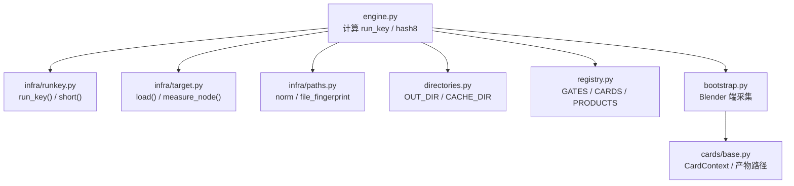
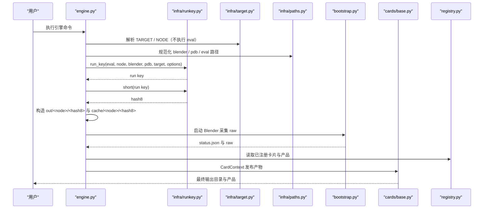
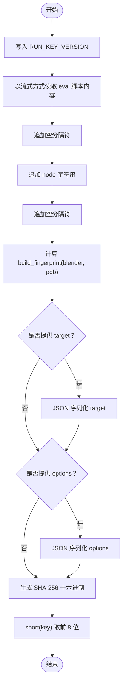
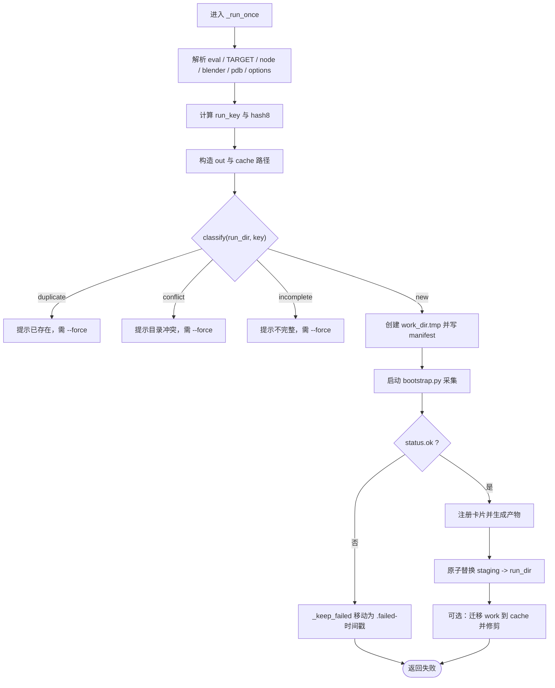
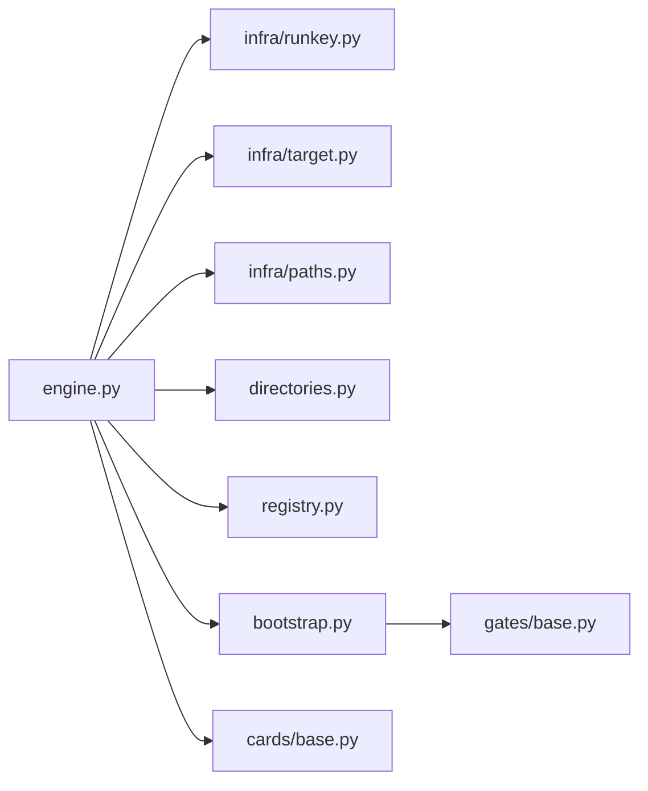
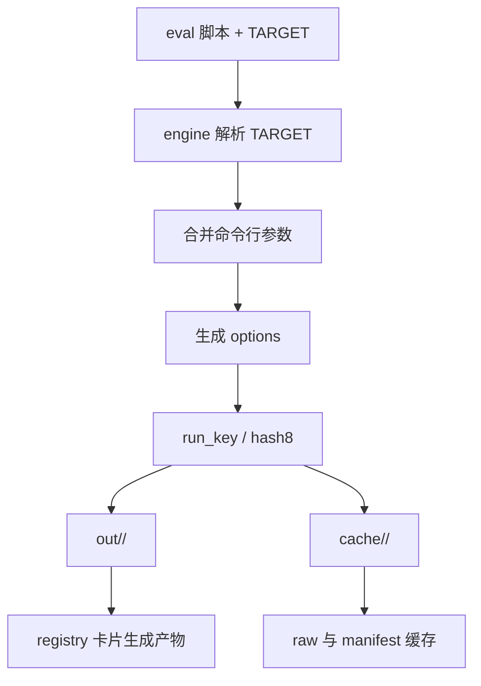

# run key 与 hash8 计算

<cite>
**本文引用的文件**   
- [infra/runkey.py](file://infra/runkey.py)
- [engine.py](file://engine.py)
- [registry.py](file://registry.py)
- [infra/target.py](file://infra/target.py)
- [infra/paths.py](file://infra/paths.py)
- [bootstrap.py](file://bootstrap.py)
- [directories.py](file://directories.py)
- [cards/base.py](file://cards/base.py)
</cite>

## 目录
1. [引言](#引言)
2. [项目结构中的相关位置](#项目结构中的相关位置)
3. [核心概念：run key 与 hash8](#核心概念run-key-与-hash8)
4. [架构总览](#架构总览)
5. [详细组件分析](#详细组件分析)
6. [依赖关系分析](#依赖关系分析)
7. [性能考虑](#性能考虑)
8. [故障排查与策略](#故障排查与策略)
9. [结论](#结论)

## 引言
本文件围绕 `infra/runkey.py` 中的 run key 与 hash8 计算逻辑展开，说明系统如何根据 eval 脚本内容、TARGET、构建指纹等输入生成稳定的运行标识，并解释 hash8 如何作为 `out/<node>/<hash8>/` 与 `cache/<node>/<hash8>.failed-*` 的路由键。同时结合 `engine.py` 的缓存命中逻辑与 `registry.py` 对产物粒度的约定，给出从 eval + TARGET 到最终输出目录的完整示例，并讨论哈希稳定性、碰撞、缓存失效以及评估脚本重构后的处理策略。

## 项目结构中的相关位置
与 run key、hash8 和缓存路由直接相关的代码分布如下：
- `infra/runkey.py`：定义 `RUN_KEY_VERSION`、`run_key`、`short` 及构建指纹辅助函数。
- `engine.py`：调用 `run_key` 计算 key/hash8，决定 `out` 与 `cache` 路径，管理失败保留、增量复用与翻译阶段。
- `infra/target.py`：在不执行 eval 脚本的前提下解析 `TARGET` 与可选 `NODE`。
- `infra/paths.py`：提供规范化路径、安全文件名与轻量级“构建指纹”。
- `bootstrap.py`：Blender 侧入口，负责加载 TARGET、执行 evaluate、写入 `status.json` 与 raw 数据。
- `registry.py`：声明闸门、卡片与产品名，用于翻译阶段产物粒度。
- `directories.py`：定义 `OUT_DIR`、`CACHE_DIR` 等根目录常量。
- `cards/base.py`：定义 `CardContext`，统一产品发布路径规则。

**图表来源**
- [engine.py:200-450](file://engine.py#L200-L450)
- [infra/runkey.py:1-44](file://infra/runkey.py#L1-L44)
- [infra/target.py:1-81](file://infra/target.py#L1-L81)
- [infra/paths.py:1-32](file://infra/paths.py#L1-L32)
- [directories.py:1-25](file://directories.py#L1-L25)
- [registry.py:1-49](file://registry.py#L1-L49)
- [bootstrap.py:1-192](file://bootstrap.py#L1-L192)
- [cards/base.py:1-63](file://cards/base.py#L1-L63)

**章节来源**
- [infra/runkey.py:1-44](file://infra/runkey.py#L1-L44)
- [engine.py:200-450](file://engine.py#L200-L450)
- [infra/target.py:1-81](file://infra/target.py#L1-L81)
- [infra/paths.py:1-32](file://infra/paths.py#L1-L32)
- [directories.py:1-25](file://directories.py#L1-L25)
- [registry.py:1-49](file://registry.py#L1-L49)
- [bootstrap.py:1-192](file://bootstrap.py#L1-L192)
- [cards/base.py:1-63](file://cards/base.py#L1-L63)

## 核心概念：run key 与 hash8
- **run key**：基于 SHA-256 的稳定字符串，用于唯一标识一次“求值配置 + 构建环境”的组合。它由版本头、eval 脚本内容、node 名称、构建指纹、可选 target 与 options 共同组成。
- **hash8**：run key 的前 8 个十六进制字符，用作文件系统路由键，出现在 `out/<node>/<hash8>/` 与 `cache/<node>/<hash8>` 或 `.failed-*` 后缀中。
- **目的**：让同一组求值脚本和目标在相同构建环境下可复现；当任何影响计算的输入发生变化时，hash8 变化，从而触发重新采集或增量重建。

关键实现要点如下：
- `RUN_KEY_VERSION` 是固定字节串，便于未来升级哈希算法或字段顺序。
- `run_key` 按固定顺序拼接：版本 → eval 内容 → null 分隔符 → node → null → 构建指纹 → 可选 target（JSON 序列化）→ 可选 options（JSON 序列化）。
- `short` 取前 8 位 hex，作为用户可见且稳定短键。
- 构建指纹由 `blender` 与对应 `.pdb` 的“规范化路径 + 文件大小 + mtime”构成，不扫描二进制内容，只读元数据。

**章节来源**
- [infra/runkey.py:1-44](file://infra/runkey.py#L1-L44)
- [infra/paths.py:1-32](file://infra/paths.py#L1-L32)

## 架构总览
下图展示从命令行参数到最终产物的主要流程，重点标注 run key 与 hash8 的作用点。

**图表来源**
- [engine.py:200-450](file://engine.py#L200-L450)
- [infra/runkey.py:1-44](file://infra/runkey.py#L1-L44)
- [infra/target.py:1-81](file://infra/target.py#L1-L81)
- [infra/paths.py:1-32](file://infra/paths.py#L1-L32)
- [bootstrap.py:1-192](file://bootstrap.py#L1-L192)
- [cards/base.py:1-63](file://cards/base.py#L1-L63)
- [registry.py:1-49](file://registry.py#L1-L49)

## 详细组件分析

### infra/runkey.py：run key 与 hash8 的计算
该模块是哈希稳定性的核心。其职责包括：
- 定义固定版本头 `RUN_KEY_VERSION`，防止历史缓存被错误复用。
- 提供 `sha256_file`，但当前 `run_key` 并未直接使用该函数读取 eval 内容以外的文件。
- 提供 `build_fingerprint(blender, pdb)`，组合 blender 与 pdb 的轻量指纹。
- 提供 `run_key(...)` 主计算函数。
- 提供 `short(key)` 提取 hash8。

重要设计约束：
- eval 内容通过逐块读取（约 1MB 块）参与哈希，避免一次性加载大脚本导致内存峰值过高。
- 字段之间使用 null 字节分隔，避免不同字段拼接后产生歧义。
- target 与 options 使用 `json.dumps(sort_keys=True, ensure_ascii=False)`，保证字典键顺序稳定、编码一致。
- 构建指纹不使用二进制内容哈希，而是路径 + 大小 + mtime，显著降低每次运行的 I/O 开销。

**图表来源**
- [infra/runkey.py:1-44](file://infra/runkey.py#L1-L44)
- [infra/paths.py:1-32](file://infra/paths.py#L1-L32)

**章节来源**
- [infra/runkey.py:1-44](file://infra/runkey.py#L1-L44)
- [infra/paths.py:1-32](file://infra/paths.py#L1-L32)

### engine.py：缓存命中、失败保留与输出路由
`engine.py` 将 run key 与 hash8 应用到实际工作流：
- 先解析 eval、TARGET、node、blender、pdb 与 options。
- 调用 `runkey.run_key` 得到 run key，再 `runkey.short` 得到 hash8。
- 构造：
  - `out_root/node_dir/hash8`：最终用户输出目录。
  - `cache_dir = cache/node_dir/hash8`：原始 raw 与 manifest 缓存。
  - `work_dir = cache_dir.tmp`：原子写入临时工作目录。
- 通过 `manifest.classify(run_dir, key)` 判断重复、冲突或不完整状态，决定是否报错或允许覆盖。
- 如果采集成功，会将 work 数据重定向到 cache 或清理 work，并删除旧缓存目录进行修剪。
- 如果失败，使用 `_keep_failed(work_dir, hash8, keep)` 将 `cache/<node>/<hash8>.failed-时间戳[序号]` 保留，便于诊断。

**图表来源**
- [engine.py:200-450](file://engine.py#L200-L450)
- [directories.py:1-25](file://directories.py#L1-L25)

**章节来源**
- [engine.py:200-450](file://engine.py#L200-L450)
- [directories.py:1-25](file://directories.py#L1-L25)

### infra/target.py：TARGET 与 NODE 的静态解析
为避免在主机上执行任意 eval 脚本，`target.load` 与 `measure_node` 使用 AST 静态解析：
- `load(eval_path)` 寻找顶层赋值语句 `TARGET = {...}`，要求其为字面量字典，并返回标准化键值。
- `measure_node(eval_path)` 可选读取 `NODE = "..."` 字符串，用于自动 diff 模式下的测量区域选择。
- `merge(target, blend, obj, mod, param)` 把命令行传入的参数合并进 TARGET。
- `validate(target)` 检查必填字段 `blend/object/modifier/param`，并校验工程文件是否存在、`node_tree` 类型是否正确。

这意味着：**TARGET 中的路径与字段直接影响 run key**，因为它们会作为 JSON 序列化的一部分进入哈希。

**章节来源**
- [infra/target.py:1-81](file://infra/target.py#L1-L81)

### bootstrap.py：Blender 端采集与 status.json
`bootstrap.py` 负责在 Blender 环境中：
- 解析 `--eval`、`--work`、`--node`、gates、TARGET 参数。
- 加载并验证 TARGET，打开 Blender 工程，定位对象与修改器。
- 可选地根据 `NODE` 或 `--measure-node` 进行区域划分与 rewire。
- 执行 eval 脚本中的 `evaluate(ctx)`，并收集 gates 的 raw 数据。
- 写入 `status.json`，包含 `ok`、`node`、`target`、`gates`、`raw` 等信息。

`engine.py` 后续依据 `status.ok` 判断是否继续翻译阶段，否则将 work 目录保留为 `.failed-*`。

**章节来源**
- [bootstrap.py:1-192](file://bootstrap.py#L1-L192)
- [engine.py:200-450](file://engine.py#L200-L450)

### registry.py 与 cards/base.py：产物粒度与发布路径
- `registry.py` 声明 `PRODUCTS`、`GATES`、`CARDS`，每个卡片注册一个或多个产品键，如 `edge`、`coverage`、`metrics` 等。
- `cards/base.py` 的 `CardContext` 根据产品键与 `internal` 标志确定最终路径：非内部产物放在 `out/<node>/<hash8>/...`，内部产物默认放在 `_internal/...`，测试模式下可能暴露。
- 因此，hash8 不仅控制 raw 与 manifest 的缓存位置，也间接控制所有卡片的最终输出路径。

**章节来源**
- [registry.py:1-49](file://registry.py#L1-L49)
- [cards/base.py:1-63](file://cards/base.py#L1-L63)

## 依赖关系分析
以下图展示与 run key/hash8 直接相关的模块依赖：

**图表来源**
- [engine.py:200-450](file://engine.py#L200-L450)
- [infra/runkey.py:1-44](file://infra/runkey.py#L1-L44)
- [infra/target.py:1-81](file://infra/target.py#L1-L81)
- [infra/paths.py:1-32](file://infra/paths.py#L1-L32)
- [directories.py:1-25](file://directories.py#L1-L25)
- [registry.py:1-49](file://registry.py#L1-L49)
- [bootstrap.py:1-192](file://bootstrap.py#L1-L192)
- [cards/base.py:1-63](file://cards/base.py#L1-L63)

**章节来源**
- [engine.py:200-450](file://engine.py#L200-L450)
- [infra/runkey.py:1-44](file://infra/runkey.py#L1-L44)
- [infra/target.py:1-81](file://infra/target.py#L1-L81)
- [infra/paths.py:1-32](file://infra/paths.py#L1-L32)
- [directories.py:1-25](file://directories.py#L1-L25)
- [registry.py:1-49](file://registry.py#L1-L49)
- [bootstrap.py:1-192](file://bootstrap.py#L1-L192)
- [cards/base.py:1-63](file://cards/base.py#L1-L63)

## 性能考虑
- **哈希计算应轻量**：`run_key` 对 eval 脚本采用分块读取，避免一次性加载大文件；构建指纹仅读取路径、大小与 mtime，不扫描二进制内容。
- **避免大型二进制文件哈希**：不应将 Blender 二进制、profraw、large coverage 产物等纳入 run key，否则每次运行都会产生大量 I/O，显著拖慢调度与缓存判断。
- **避免随机性与时间戳**：hash8 必须稳定，因此不能把随机数、当前时间、临时进程 ID、机器无关路径差异等引入 run key。
- **选项与目标序列化要稳定**：target 与 options 使用排序键的 JSON 序列化，确保字典顺序不影响哈希结果。
- **缓存修剪策略**：engine 会按最近修改时间裁剪 `cache/<node>/` 下多余的 hash8 目录，避免无限增长。

[本节为通用性能建议，不直接分析具体代码片段]

## 故障排查与策略

### 哪些输入会影响哈希稳定性
影响 run key 与 hash8 的因素包括：
- eval 脚本内容。
- node 名称。
- blender 路径、大小与 mtime。
- pdb 路径、大小与 mtime。
- TARGET 字典内容。
- options 字典内容。

不应纳入的因素包括：
- 临时路径与工作目录本身。
- 随机时间戳、随机 ID。
- 大型二进制文件内容。
- 与求值语义无关的系统状态。

**章节来源**
- [infra/runkey.py:1-44](file://infra/runkey.py#L1-L44)
- [infra/paths.py:1-32](file://infra/paths.py#L1-L32)
- [engine.py:200-450](file://engine.py#L200-L450)

### 哈希碰撞处理
- hash8 只有 8 位十六进制，碰撞概率虽低，但并非零。若发生碰撞，可能出现两个不同 run key 映射到相同 hash8，从而共享 `out/<node>/<hash8>` 或 `cache/<node>/<hash8>`。
- 当前实现以 hash8 作为目录路由键；更严格的做法是在 manifest 中保留完整 run key，并在读取缓存时校验完整 key。
- 短期缓解：
  - 增加 hash8 长度，例如改为 16 位。
  - 在 manifest 中强制校验完整 run key。
  - 对已有冲突目录使用 `--force` 覆盖，但需谨慎，因为可能污染其他用户或并行任务的结果。

**章节来源**
- [infra/runkey.py:1-44](file://infra/runkey.py#L1-L44)
- [engine.py:200-450](file://engine.py#L200-L450)

### 缓存失效策略
触发重新采集的典型情况：
- eval 脚本内容改变。
- TARGET 内容改变。
- blender 或 pdb 的文件大小或 mtime 改变。
- options 内容改变。
- node 名称改变。

行为说明：
- 如果 `manifest.classify` 返回 duplicate，engine 会拒绝覆盖，除非使用 `--force`。
- 如果返回 conflict 或 incomplete，同样需要 `--force`。
- 如果采集失败，engine 会将 work 目录移动到 `cache/<node>/<hash8>.failed-时间戳[序号]`，并打印失败 raw 的位置。

**章节来源**
- [engine.py:200-450](file://engine.py#L200-L450)

### eval 重构后重新采集的处理策略
当 eval 脚本重构但仍保持语义不变时：
- 如果重构改变了 eval 文本，run key 会变化，hash8 也会变化，从而自然触发重新采集。
- 如果重构只是内部实现变化，而 TARGET、options、blender、pdb 不变，则 hash8 不变，系统会复用原有缓存。
- 如果需要强制忽略缓存，可使用 `--force`，但应确认新实现确实兼容现有产物格式。
- 建议在重构时优先保持 TARGET 与 options 语义稳定；若确需破坏兼容性，应显式调整 TARGET 或 options，使 hash8 变化具有可解释性。

**章节来源**
- [infra/runkey.py:1-44](file://infra/runkey.py#L1-L44)
- [engine.py:200-450](file://engine.py#L200-L450)
- [infra/target.py:1-81](file://infra/target.py#L1-L81)

### 从 eval + TARGET 到最终输出目录的完整示例
假设有一个 eval 脚本定义了 `TARGET = {"blend": "...", "object": "...", "modifier": "...", "param": "..."}`，并选择某个 node 名称。

步骤如下：
1. `engine.py` 调用 `targetfile.load(eval_path)` 解析 TARGET。
2. 合并命令行传入的 blend、obj、mod、param，形成最终 target。
3. 规范化 blender 与 pdb 路径，并根据 phase、measure_node、diff_against 等生成 options。
4. 调用 `runkey.run_key(eval_path, node, blender, pdb, target, options)` 得到稳定 run key。
5. 调用 `runkey.short(key)` 得到 hash8。
6. 构造：
   - 输出目录：`out/<safe_name(node)>/<hash8>`。
   - 缓存目录：`cache/<safe_name(node)>/<hash8>`。
   - 失败目录：`cache/<safe_name(node)>/<hash8>.failed-时间戳[序号]`。
7. 启动 `bootstrap.py` 采集 raw 并写入 `status.json`。
8. 如果成功，按 `registry.CARDS` 与 `registry.PRODUCTS` 生成产物，并发布到 `out/<node>/<hash8>` 或 `_internal`。
9. 如果失败，保留 `.failed-*` 以便诊断。

**图表来源**
- [engine.py:200-450](file://engine.py#L200-L450)
- [infra/target.py:1-81](file://infra/target.py#L1-L81)
- [infra/runkey.py:1-44](file://infra/runkey.py#L1-L44)
- [registry.py:1-49](file://registry.py#L1-L49)
- [directories.py:1-25](file://directories.py#L1-L25)

**章节来源**
- [engine.py:200-450](file://engine.py#L200-L450)
- [infra/target.py:1-81](file://infra/target.py#L1-L81)
- [infra/runkey.py:1-44](file://infra/runkey.py#L1-L44)
- [registry.py:1-49](file://registry.py#L1-L49)
- [directories.py:1-25](file://directories.py#L1-L25)

## 结论
`infra/runkey.py` 通过固定版本头、eval 内容、node、构建指纹与可选 target/options 的有序拼接，提供了稳定且可扩展的 run key；`engine.py` 将其压缩为 hash8，作为 `out` 与 `cache` 的核心路由键。这种设计使得同一组求值脚本与目标在相同构建环境下可复现，并支持增量复用与失败保留。

为保证长期稳定性，应遵循以下原则：
- 只将与求值语义与构建环境相关的内容纳入哈希。
- 避免引入临时路径、随机数、时间戳与大二进制文件内容。
- 保持 target 与 options 的序列化稳定。
- 谨慎处理 hash8 碰撞风险，必要时增强 manifest 校验或扩展 hash8 长度。
- 在 eval 重构时优先保持语义稳定；如需破坏兼容性，应显式改变 target 或 options，使缓存失效具有可解释性。

[本节为总结性内容，不直接分析具体代码片段]