# run manifest 与 run.json

<cite>
**本文引用的文件**   
- [infra/manifest.py](file://infra/manifest.py)
- [engine.py](file://engine.py)
- [infra/runkey.py](file://infra/runkey.py)
- [infra/paths.py](file://infra/paths.py)
</cite>

## 目录
1. [引言](#引言)
2. [项目结构定位](#项目结构定位)
3. [核心概念：run_key、hash8 与产物目录](#核心概念run_keyhash8-与产物目录)
4. [Manifest 数据结构](#manifest-数据结构)
5. [Manifest 读写接口与生命周期](#manifest-读写接口与生命周期)
6. [运行状态分类：new、duplicate、conflict、incomplete](#运行状态分类newduplicatetimeoutconflictincomplete)
7. [run.json 在 engine.py 中的使用](#runjson-在-enginepy-中的使用)
8. [缓存命中、冲突检测与失败现场分析流程](#缓存命中冲突检测与失败现场分析流程)
9. [run.json 字段定义与示例](#runjson-字段定义与示例)
10. [manifest 与 out\<node\>\<hash8\>/ 的关系](#manifest-与-outnodehash8--的关系)
11. [未来扩展新字段的兼容建议](#未来扩展新字段的兼容建议)
12. [调试技巧](#调试技巧)
13. [结论](#结论)

## 引言
本文聚焦于 CovTrace 的 **run manifest** 机制及其持久化载体 `run.json`。它负责描述一次 Blender 求值采集和后续卡片翻译的运行元数据，并作为引擎判断“是否可复用已有结果”的核心依据。本文说明：

- `infra/manifest.py` 中 Manifest 的数据结构与读写接口；
- `classify` 如何判定 `new`、`duplicate`、`conflict`、`incomplete`；
- `engine.py` 如何利用 `run.json` 进行缓存命中、冲突检测和失败现场分析；
- `run.json` 的字段含义、示例及扩展策略；
- 如何手动检查 `cache/_internal/run.json` 等缓存相关位置；
- 如何通过 manifest 判断某次运行是否可复用。

## 项目结构定位
本次文档涉及的关键代码位于以下模块：

| 模块 | 职责 |
|---|---|
| `infra/manifest.py` | 读取、写入 `run.json`，生成基础 manifest，对已存在目录做运行状态分类 |
| `engine.py` | 编排运行流程：计算 `run_key`、判断缓存状态、执行 Blender、写 manifest、处理失败现场、重放 translate |
| `infra/runkey.py` | 根据求值脚本、节点、Blender、PDB、target、options 计算稳定的 `run_key` 和短哈希 `hash8` |
| `infra/paths.py` | 路径规范化、安全文件名、文件指纹，用于保证 `run_key` 和 manifest 路径稳定 |

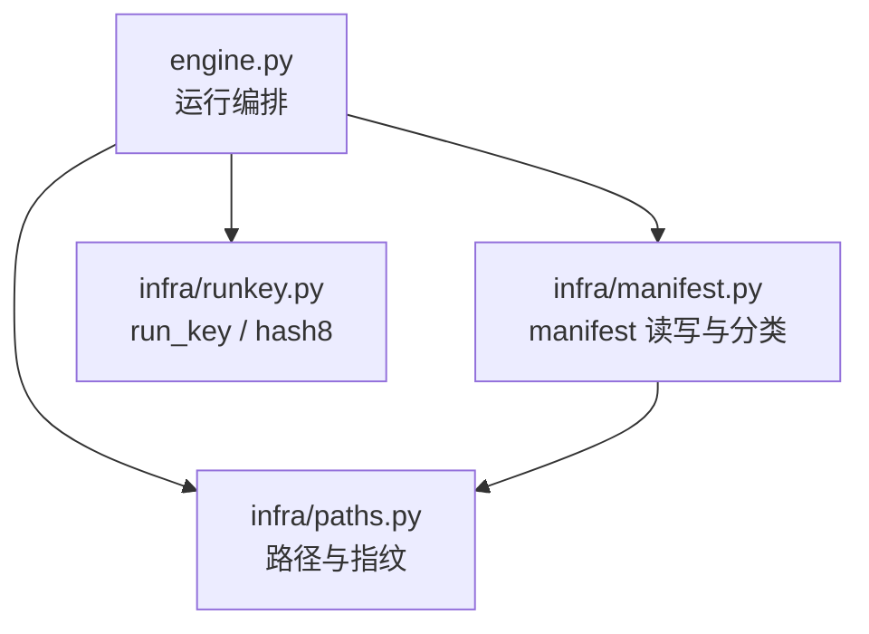

**图表来源**
- [engine.py:200-562](file://engine.py#L200-L562)
- [infra/manifest.py:1-58](file://infra/manifest.py#L1-L58)
- [infra/runkey.py:1-44](file://infra/runkey.py#L1-L44)
- [infra/paths.py:1-32](file://infra/paths.py#L1-L32)

**章节来源**
- [infra/manifest.py:1-58](file://infra/manifest.py#L1-L58)
- [engine.py:1-562](file://engine.py#L1-L562)
- [infra/runkey.py:1-44](file://infra/runkey.py#L1-L44)
- [infra/paths.py:1-32](file://infra/paths.py#L1-L32)

## 核心概念：run_key、hash8 与产物目录
`run_key` 是这次运行的完整身份标识，由以下要素共同决定：

| 输入项 | 作用 |
|---|---|
| `RUN_KEY_VERSION` | 版本前缀，避免历史 `run_key` 直接复用 |
| `eval_path` | 求值脚本内容，保证脚本变化会改变 `run_key` |
| `node` | 目标节点名称 |
| `blender` 与 `pdb` | 通过 `paths.file_fingerprint` 比较路径、大小与修改时间 |
| `target` | 可选的目标配置，按排序 JSON 序列化参与哈希 |
| `options` | 可选运行选项，例如 `phase`、`measure_node`、`diff_against`、`coverage_keep_all` |

`hash8` 是 `run_key` 的前 8 个十六进制字符，用作输出目录名，使人类可读的日志更简短。

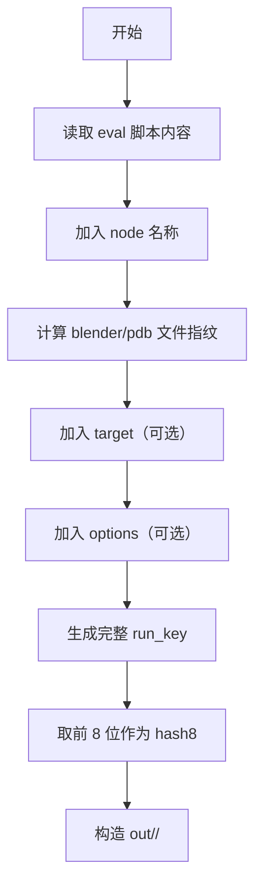

**图表来源**
- [infra/runkey.py:1-44](file://infra/runkey.py#L1-L44)
- [infra/paths.py:1-32](file://infra/paths.py#L1-L32)
- [engine.py:260-330](file://engine.py#L260-L330)

**章节来源**
- [infra/runkey.py:1-44](file://infra/runkey.py#L1-L44)
- [infra/paths.py:1-32](file://infra/paths.py#L1-L32)
- [engine.py:260-330](file://engine.py#L260-L330)

## Manifest 数据结构
`infra/manifest.py` 中的 Manifest 是一个普通 Python 字典，对应磁盘上的 `run.json`。其基础结构由 `base()` 生成，包含以下字段：

| 字段 | 类型 | 含义 |
|---|---|---|
| `schema` | 整数 | manifest 结构版本号，当前为 `1` |
| `run_key` | 字符串 | 完整运行身份，用于精确匹配 |
| `hash8` | 字符串 | `run_key` 的前 8 位，用于目录名 |
| `node` | 字符串 | 输出节点名 |
| `eval` | 字符串 | 求值脚本绝对路径 |
| `blend` | 字符串 | Blend 文件绝对路径 |
| `blender` | 字符串 | Blender 可执行文件绝对路径 |
| `pdb` | 字符串 | PDB 符号文件路径 |
| `options` | 对象 | 运行时选项，如 `phase`、`measure_node`、`diff_against`、`coverage_keep_all` |
| `created` | 字符串 | 创建时间，格式为 `YYYY-MM-DD HH:MM:SS` |
| `gates` | 对象 | 闸门采集摘要，初始为空对象 |
| `cards` | 对象 | 卡片运行摘要，初始为空对象 |
| `counts` | 对象 | 各闸门的计数摘要，初始为空对象 |

注意：`eval`、`blend`、`blender`、`pdb` 会通过 `paths.norm` 转换为绝对路径，以保证 manifest 中的路径稳定且可重建。

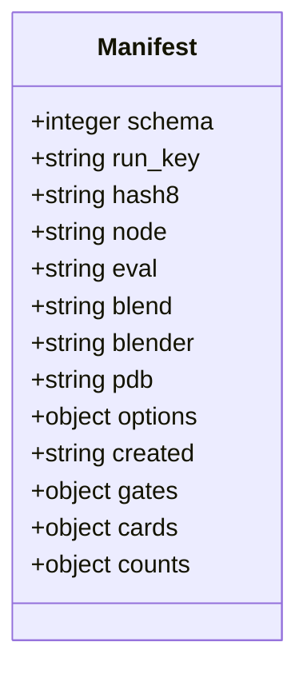

**图表来源**
- [infra/manifest.py:37-58](file://infra/manifest.py#L37-L58)

**章节来源**
- [infra/manifest.py:37-58](file://infra/manifest.py#L37-L58)

## Manifest 读写接口与生命周期
`infra/manifest.py` 暴露四个主要函数：

| 函数 | 输入 | 输出/行为 |
|---|---|---|
| `manifest_path(run_dir)` | 运行目录 | 返回 `<run_dir>/run.json` |
| `load(run_dir)` | 运行目录 | 若不存在则返回 `None`，否则加载 UTF-8 JSON |
| `write(run_dir, data)` | 运行目录、字典 | 原子写入：先写 `.tmp`，再 `os.replace`，末尾追加换行 |
| `classify(run_dir, key)` | 运行目录、`run_key` | 返回四类状态之一 |
| `base(...)` | 运行参数 | 生成基础 manifest 字典 |

### 写入安全性
`write()` 不直接覆盖目标文件，而是：

1. 确保 `run_dir` 存在；
2. 写入 `<run_dir>/run.json.tmp`；
3. 调用 `os.replace(tmp, path)` 完成原子替换；
4. 写入一个换行符，便于人类编辑器查看。

这降低了并发或中断导致 `run.json` 损坏的风险。

### 生命周期阶段
结合 `engine.py`，Manifest 的生命周期大致如下：

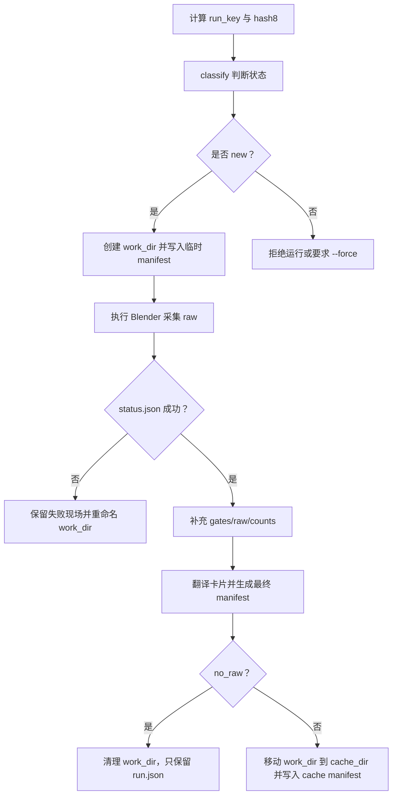

**图表来源**
- [infra/manifest.py:11-58](file://infra/manifest.py#L11-L58)
- [engine.py:260-562](file://engine.py#L260-L562)

**章节来源**
- [infra/manifest.py:11-58](file://infra/manifest.py#L11-L58)
- [engine.py:260-562](file://engine.py#L260-L562)

## 运行状态分类：new、duplicate、conflict、incomplete
`classify(run_dir, key)` 的判断逻辑如下：

| 条件 | 返回状态 | 含义 |
|---|---|---|
| `run_dir` 不是目录 | `new` | 尚未产出该 hash 的运行结果 |
| `run_dir` 是目录但 `run.json` 不存在 | `incomplete` | 目录存在但 manifest 不完整 |
| `run.json` 存在且 `run_key` 相等 | `duplicate` | 已有相同运行的结果，可直接复用 |
| `run.json` 存在但 `run_key` 不同 | `conflict` | 同名目录属于另一次运行，存在冲突 |

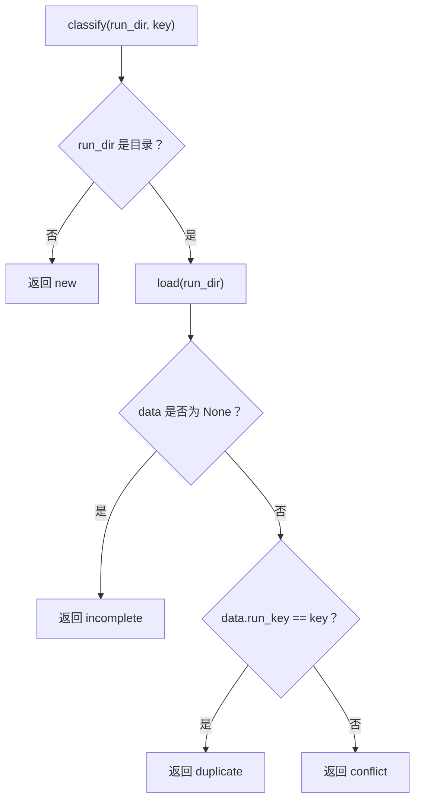

**图表来源**
- [infra/manifest.py:29-35](file://infra/manifest.py#L29-L35)

**章节来源**
- [infra/manifest.py:29-35](file://infra/manifest.py#L29-L35)

## run.json 在 engine.py 中的使用
`engine.py` 在多个关键位置依赖 `run.json`：

1. **缓存命中与冲突检测**：通过 `manifest.classify(run_dir, key)` 判断是否跳过、拒绝或需要 `--force`。
2. **工作目录初始化**：在 `work_dir` 中写入临时 manifest，记录 `run_key`、`hash8`、`node`、`eval`、`blend`、`blender`、`pdb`、`options`。
3. **失败现场分析**：如果 `status.json` 不存在或非成功状态，则把 `work_dir` 重命名为 `hash8.failed-时间戳`，同时修正其中 `run.json` 和 `status.json` 的路径。
4. **raw 数据合并**：成功后从 `work_dir/status.json` 读取 `gates`、`raw`、`counts`，回填到 manifest。
5. **translate 模式**：从 `cache/<node>/<hash8>/run.json` 读取 manifest，并验证 `status.json` 成功且有 `raw` 数据。

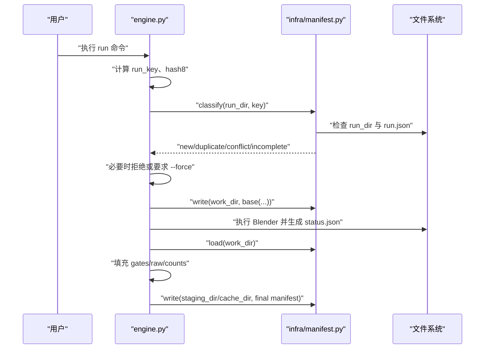

**图表来源**
- [engine.py:260-562](file://engine.py#L260-L562)
- [infra/manifest.py:11-58](file://infra/manifest.py#L11-L58)

**章节来源**
- [engine.py:200-562](file://engine.py#L200-L562)
- [infra/manifest.py:11-58](file://infra/manifest.py#L11-L58)

## 缓存命中、冲突检测与失败现场分析流程

### 正常运行流程
当 `engine.py` 的 `run()` 进入 `_run_once()` 时：

1. 解析 target、blender、pdb；
2. 构造 `options`，包含 `phase`、`measure_node`、`diff_against`、`coverage_keep_all`；
3. 计算 `key = runkey.run_key(...)` 与 `hash8 = runkey.short(key)`；
4. 构造 `run_dir = out/<safe_name(node)>/<hash8>`；
5. 调用 `manifest.classify(run_dir, key)`；
6. 如果是 `duplicate`，直接报错提示可用 `--force` 覆盖；
7. 如果是 `conflict`，也报错提示目录存在但属于其他运行；
8. 如果是 `incomplete`，报错提示 manifest 不完整；
9. 如果是 `new`，继续创建 `work_dir` 并写入临时 manifest。

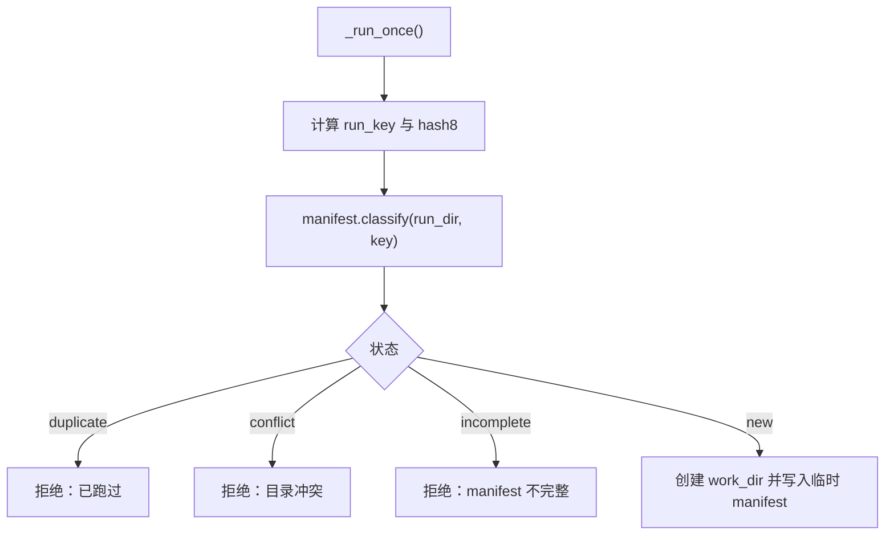

**图表来源**
- [engine.py:260-330](file://engine.py#L260-L330)
- [infra/manifest.py:29-35](file://infra/manifest.py#L29-L35)

### 失败现场保留流程
当采集失败或采集结果异常时，`_keep_failed()` 会：

1. 构造失败目录名：`<node_dir>/<hash8>.failed-时间戳`；
2. 如果存在 `run.json`，将其路径从 `work_dir` 反基线到失败目录；
3. 如果存在 `status.json`，同样反基线路径；
4. 用 `os.replace(work_dir, dest)` 将工作目录移动到失败目录；
5. 调用 `_prune_cache()` 清理超出保留数量的旧缓存。

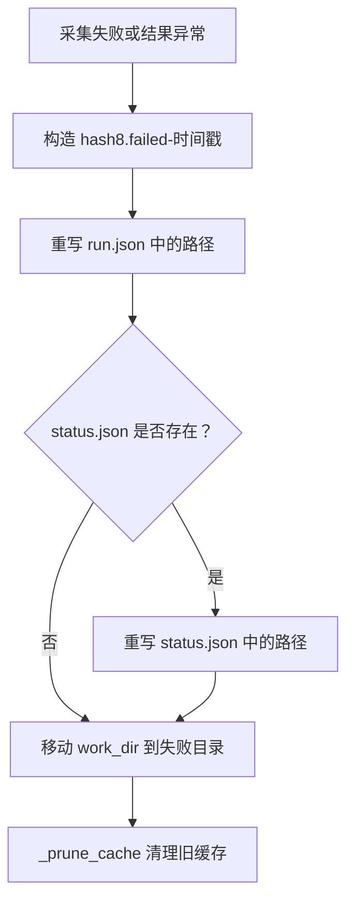

**图表来源**
- [engine.py:60-110](file://engine.py#L60-L110)
- [engine.py:360-420](file://engine.py#L360-L420)

**章节来源**
- [engine.py:60-110](file://engine.py#L60-L110)
- [engine.py:260-420](file://engine.py#L260-L420)

## run.json 字段定义与示例

### 字段定义表

| 字段 | 类型 | 必填 | 默认值 | 说明 |
|---|---|---:|---|---|
| `schema` | 整数 | 是 | `1` | manifest 结构版本 |
| `run_key` | 字符串 | 是 | 无 | 完整运行身份，来自 `runkey.run_key()` |
| `hash8` | 字符串 | 是 | 无 | `run_key[:8]` |
| `node` | 字符串 | 是 | 无 | 输出节点名 |
| `eval` | 字符串 | 是 | 无 | 求值脚本绝对路径 |
| `blend` | 字符串 | 是 | 无 | Blend 文件绝对路径 |
| `blender` | 字符串 | 是 | 无 | Blender 可执行文件绝对路径 |
| `pdb` | 字符串 | 是 | 无 | PDB 符号文件路径 |
| `options` | 对象 | 是 | `{}` | 运行选项 |
| `created` | 字符串 | 是 | 无 | 创建时间 |
| `gates` | 对象 | 是 | `{}` | 闸门摘要 |
| `cards` | 对象 | 是 | `{}` | 卡片摘要 |
| `counts` | 对象 | 是 | `{}` | 计数摘要 |
| `raw` | 对象 | 否 | 无 | raw 数据映射，仅存在于工作目录或缓存目录 |
| `raw_removed` | 布尔值 | 否 | 无 | 表示原始 raw 已被移除 |

### 示例 JSON
以下为一次成功运行后，`out/<node>/<hash8>/run.json` 的典型结构示例：

```json
{
  "schema": 1,
  "run_key": "完整 sha256 字符串",
  "hash8": "abcdefgh",
  "node": "MyNode",
  "eval": "/absolute/path/to/eval.py",
  "blend": "/absolute/path/to/scene.blend",
  "blender": "/absolute/path/to/blender.exe",
  "pdb": "/absolute/path/to/blender.pdb",
  "options": {
    "coverage_keep_all": true
  },
  "created": "2026-11-07 12:34:56",
  "gates": {},
  "cards": [],
  "counts": {}
}
```

实际文件中可能还包含：

- `raw`：raw 产物映射；
- `gates`：闸门采集结果；
- `cards`：卡片运行摘要；
- `counts`：各闸门计数；
- `raw_removed`：当启用 `--no-raw` 时为 `true`。

注意：上述 JSON 是结构化示例，并非仓库源码内容。

**章节来源**
- [infra/manifest.py:37-58](file://infra/manifest.py#L37-L58)
- [engine.py:330-520](file://engine.py#L330-L520)

## manifest 与 out\<node\>\<hash8\>/ 的关系
CovTrace 的输出目录约定如下：

| 目录 | 含义 |
|---|---|
| `out/<safe_name(node)>/<hash8>/` | 用户可见的 **运行输出**，即 run manifest 所在目录 |
| `cache/<safe_name(node)>/<hash8>/` | 内部 **缓存**，包含 raw、status.json、以及可重放翻译的 manifest |
| `cache/_internal/` | 内部临时或辅助目录，具体用途取决于卡片实现 |
| `out/<safe_name(node)>/.<hash8>.translate.tmp` | translate 阶段的暂存目录 |
| `out/<safe_name(node)>/.<hash8>.tmp` | finalize 阶段的暂存目录 |

`manifest.base()` 本身不关心 `out` 或 `cache`，它只生成 manifest 数据。真正决定 manifest 落盘位置的是 `engine.py`：

- 工作目录：`cache/<node>/<hash8>.tmp`；
- 最终运行目录：`out/<node>/<hash8>`；
- 最终缓存目录：`cache/<node>/<hash8>`。

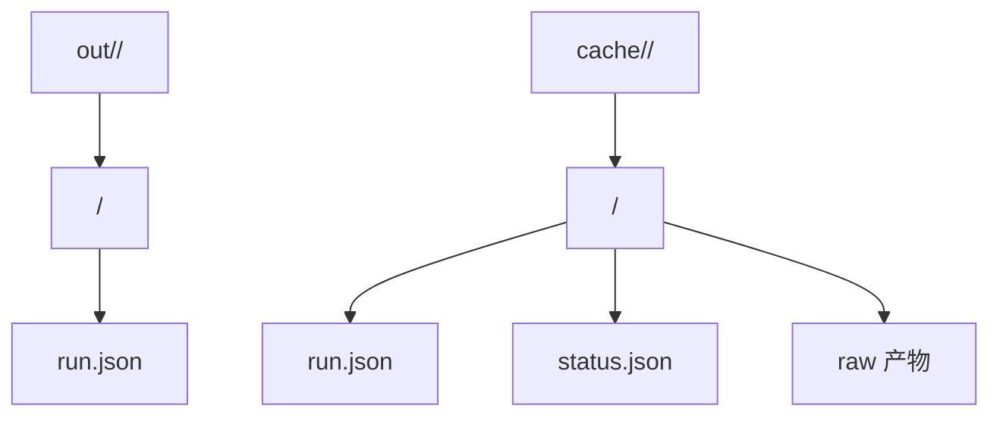

**图表来源**
- [engine.py:260-520](file://engine.py#L260-L520)
- [infra/manifest.py:11-58](file://infra/manifest.py#L11-L58)

**章节来源**
- [engine.py:260-520](file://engine.py#L260-L520)
- [infra/manifest.py:11-58](file://infra/manifest.py#L11-L58)

## 未来扩展新字段的兼容建议
当前 `schema` 固定为 `1`，而新增字段大多具有默认值或可选语义。建议遵循以下规则：

1. **向后兼容优先**：新字段应允许旧 manifest 缺失该字段。
2. **使用默认值**：`base()` 中为新字段提供合理默认值，避免旧工具无法解析。
3. **谨慎升级 schema**：只有破坏性变更才应增加 `schema` 版本。
4. **区分运行期字段与产物字段**：
   - `run_key`、`hash8`、`node`、`eval`、`blend`、`blender`、`pdb`、`options`、`created` 属于运行元数据；
   - `gates`、`cards`、`counts`、`raw` 属于采集与翻译产物；
   - `raw_removed` 表示 raw 清理状态。
5. **避免隐式依赖路径语义**：新增路径字段应沿用 `paths.norm()`，避免相对路径导致缓存不可重用。
6. **保持 `run_key` 稳定范围**：如果新字段影响缓存复用，应纳入 `runkey.run_key()`；如果只是展示字段，不应改变 `run_key`。
7. **在 engine.py 中显式迁移旧 manifest**：如果字段需要从旧位置迁移到新位置，应在加载后补齐，而不是直接丢弃。

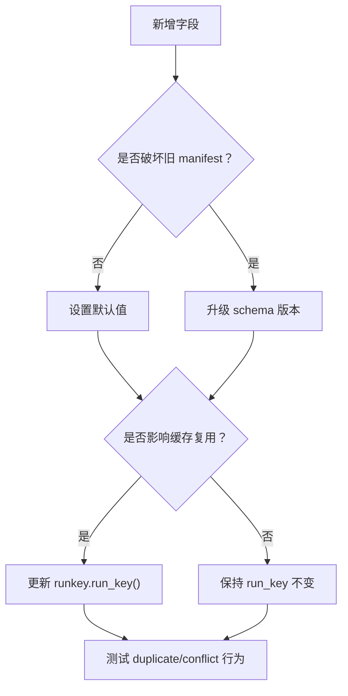

**图表来源**
- [infra/manifest.py:37-58](file://infra/manifest.py#L37-L58)
- [infra/runkey.py:1-44](file://infra/runkey.py#L1-L44)

**章节来源**
- [infra/manifest.py:37-58](file://infra/manifest.py#L37-L58)
- [infra/runkey.py:1-44](file://infra/runkey.py#L1-L44)

## 调试技巧

### 如何手动检查 `cache/_internal/run.json`
仓库中 `directories.INTERNAL_DIR` 表示内部目录，而 `cache/_internal/` 通常用于卡片或中间态数据。要手动检查：

1. 找到目标节点的缓存根目录：`cache/<safe_name(node)>/`；
2. 进入 `_internal` 子目录；
3. 查找 `run.json`；
4. 使用 JSON 编辑器或命令行工具确认其结构；
5. 注意：如果 `_internal/run.json` 存在但不是引擎主流程写入的 manifest，它可能只是某个卡片的局部状态，不能直接替代 `out/<node>/<hash8>/run.json`。

此外，引擎的 `translate` 模式会从 `cache/<node>/<hash8>/run.json` 加载 manifest，因此更常见的手动检查目标是：

- `cache/<node>/<hash8>/run.json`；
- `cache/<node>/<hash8>/status.json`；
- `out/<node>/<hash8>/run.json`。

### 如何通过 manifest 判断某次运行是否可复用
判断步骤如下：

1. 确定目标 `node` 与 `hash8`；
2. 打开 `out/<node>/<hash8>/run.json`；
3. 比较 `run_key` 是否与当前运行一致；
4. 如果一致，且 `status.json` 存在且成功，则可直接复用；
5. 如果 `run_key` 不一致，说明是不同运行，应视为冲突；
6. 如果目录存在但没有 `run.json`，说明是不完整运行；
7. 如果目录不存在，则是新的运行。

可复用的必要条件：

| 条件 | 必须满足 |
|---|---|
| `run_dir` 存在 | 是 |
| `run.json` 存在 | 是 |
| `run_key` 匹配 | 是 |
| `status.json` 成功 | 推荐校验，尤其 translate 模式 |
| `raw` 存在 | translate 模式必须存在 |

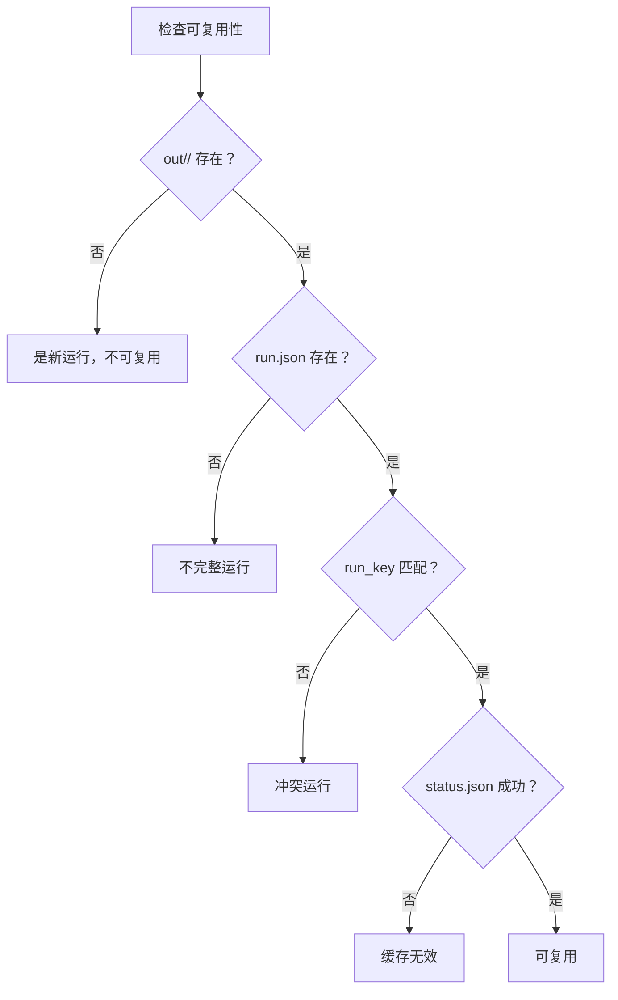

**图表来源**
- [infra/manifest.py:29-35](file://infra/manifest.py#L29-L35)
- [engine.py:420-520](file://engine.py#L420-L520)

**章节来源**
- [engine.py:420-520](file://engine.py#L420-L520)
- [infra/manifest.py:29-35](file://infra/manifest.py#L29-L35)

### 常见问题排查清单

| 现象 | 可能原因 | 处理方法 |
|---|---|---|
| 报 “你要的东西已经跑过了” | `run_key` 完全匹配 | 如需重新运行，加 `--force` |
| 报 “目录已存在但是另一次运行” | 同名目录存在但 `run_key` 不同 | 确认是否误用 hash8，或加 `--force` |
| 报 “目录存在但没有完整 manifest” | 目录存在但缺少 `run.json` | 删除不完整目录或加 `--force` |
| translate 报 “cache 里没有 run.json” | 指定缓存目录没有 manifest | 检查路径是否正确 |
| translate 报 “cache 的 status.json 不是成功状态” | 原始采集失败或未完成 | 重新运行采集 |
| translate 报 “cache raw 文件缺失” | raw 被清理或路径失效 | 检查 `raw_removed` 或重新运行 |

**章节来源**
- [engine.py:260-562](file://engine.py#L260-L562)

## 结论
`infra/manifest.py` 提供的 Manifest 数据结构是 CovTrace 运行元数据的核心抽象。它通过 `run_key` 建立稳定运行身份，通过 `hash8` 建立人类可读的目录名，并通过 `run.json` 持久化每次运行的上下文。`engine.py` 在此基础上实现了缓存命中、冲突检测、失败现场保留和 translate 重放能力。

对于使用者而言，判断一次运行是否可复用的关键是：

- `out/<node>/<hash8>/run.json` 是否存在；
- `run_key` 是否与当前运行一致；
- `status.json` 是否成功；
- translate 模式下 `raw` 是否完整。

对于维护者而言，扩展 manifest 时应优先保持向后兼容，仅在破坏性变更时升级 `schema`，并在影响缓存语义时同步更新 `runkey.run_key()`。