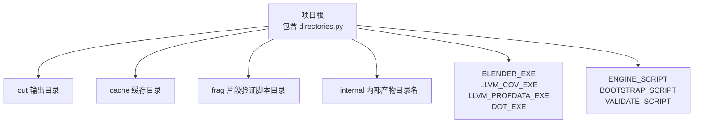
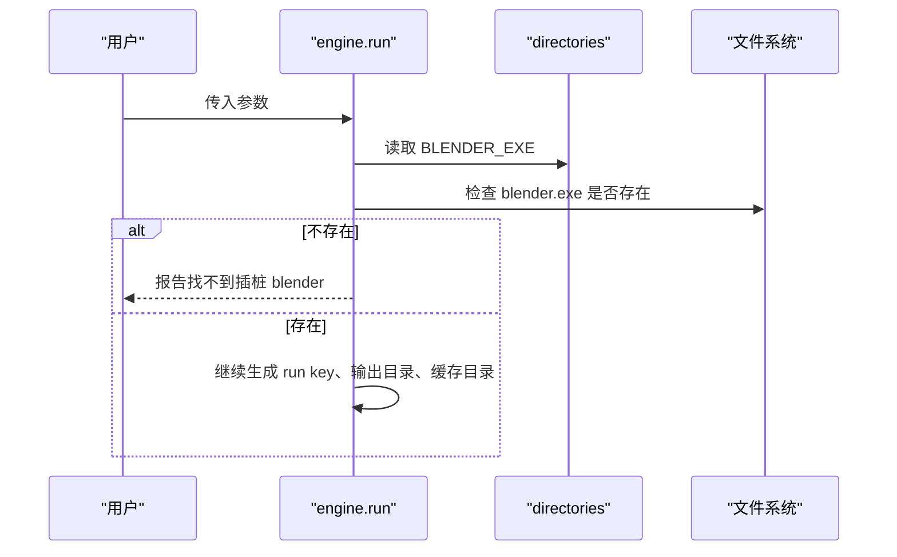
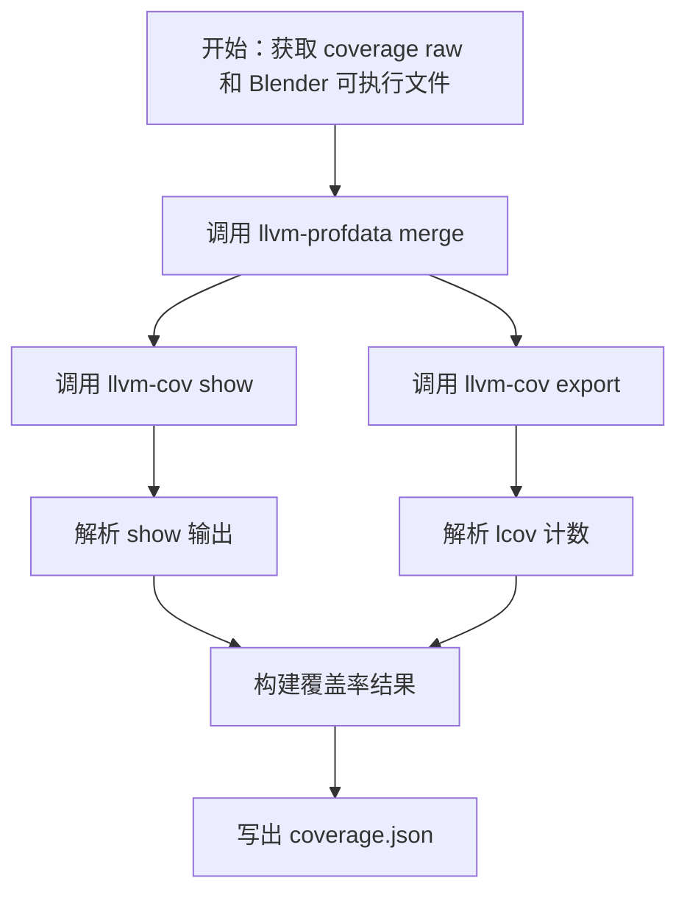
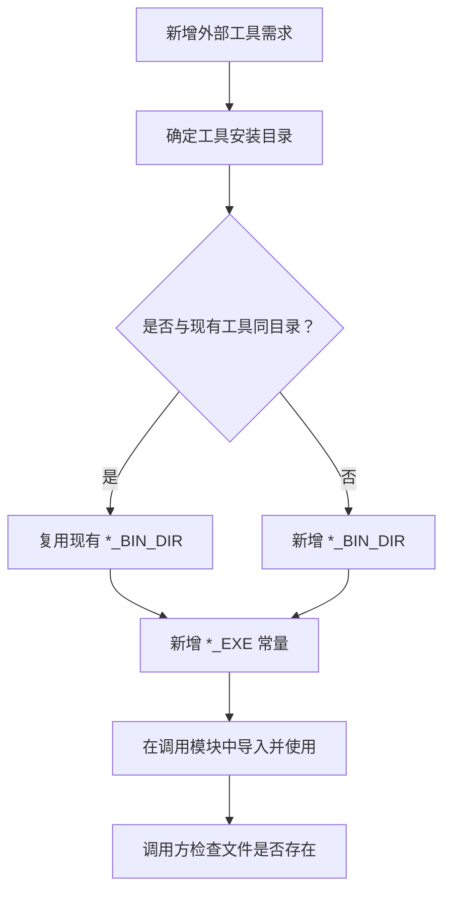
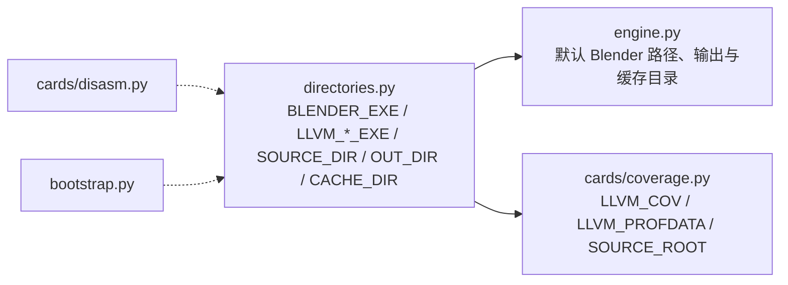

# 全局路径与工具配置

<cite>
**本文引用的文件**   
- [directories.py](file://directories.py)
- [engine.py](file://engine.py)
- [bootstrap.py](file://bootstrap.py)
- [cards/coverage.py](file://cards/coverage.py)
- [cards/disasm.py](file://cards/disasm.py)
</cite>

## 目录
1. [引言](#引言)
2. [项目结构与定位](#项目结构与定位)
3. [常量总览与含义](#常量总览与含义)
4. [默认值、查找策略与平台差异](#默认值查找策略与平台差异)
5. [为什么需要集中管理外部依赖路径](#为什么需要集中管理外部依赖路径)
6. [运行阶段中的读取方式](#运行阶段中的读取方式)
7. [新增工具扩展指南](#新增工具扩展指南)
8. [依赖关系图](#依赖关系图)
9. [常见问题诊断](#常见问题诊断)
10. [性能与稳定性建议](#性能与稳定性建议)
11. [结论](#结论)

## 引言
CovTrace 是一个围绕 Blender 插桩、LLVM 覆盖率数据与反汇编分析构建的工具链。其核心思想是：引擎负责编排流程，Blender 侧 bootstrap 负责采集 raw 数据，cards 层负责把 raw 转换为结构化产物。`directories.py` 是整个链路中“路径与工具可执行文件”的唯一事实来源，它对外暴露稳定的路径常量，而不是让各模块各自拼接或猜测工具位置。

本文件重点说明 `directories.py` 的设计目标、常量语义、默认值、平台差异，并结合 `engine.py`、`bootstrap.py`、`cards/coverage.py`、`cards/disasm.py` 的使用方式，解释不同运行阶段如何读取工具路径，同时给出新增工具和故障排查的指导。

## 项目结构与定位
`directories.py` 位于仓库根目录，不依赖任何运行时 GUI 环境，也不依赖 Blender、LLVM 或 Graphviz 的实际进程；它只做两件事：
- 计算项目内部目录。
- 组合外部工具的绝对路径常量。



**图表来源**
- [directories.py:1-25](file://directories.py#L1-L25)

该模块没有类、没有函数，也没有动态加载逻辑；所有对外接口都是顶层常量。这种设计降低了耦合度，也便于测试和静态分析。

**章节来源**
- [directories.py:1-25](file://directories.py#L1-L25)

## 常量总览与含义
以下常量按用途分组，不再直接粘贴代码内容，而是说明其职责和组合方式。

| 常量 | 含义 | 默认值或来源 | 是否随平台变化 |
|---|---|---|---|
| `ROOT` | `directories.py` 所在目录的绝对路径 | 由 Python 标准库根据当前文件路径计算 | 否 |
| `SOURCE_DIR` | Blender 源码根目录 | 项目根向上取一级后拼接 `blender-4.5.0` | 否（但路径本身受部署结构影响） |
| `OUT_DIR` | 工程输出目录 | `ROOT/out` | 否 |
| `CACHE_DIR` | 工程缓存目录 | `ROOT/cache` | 否 |
| `FRAG_DIR` | 片段验证脚本目录 | `ROOT/frag` | 否 |
| `INTERNAL_DIR` | 内部产物子目录名称 | `_internal` | 否 |
| `BLENDER_BIN_DIR` | Blender 构建产物 bin 目录 | Windows 硬编码路径 | 是（Windows 示例） |
| `LLVM_BIN_DIR` | LLVM 工具 bin 目录 | Windows 硬编码路径 | 是（Windows 示例） |
| `GRAPHVIZ_BIN_DIR` | Graphviz dot.exe 所在目录 | Windows 硬编码路径 | 是（Windows 示例） |
| `BLENDER_EXE` | 完整 Blender 可执行文件路径 | `BLENDER_BIN_DIR/blender.exe` | 是（Windows 示例） |
| `LLVM_COV_EXE` | llvm-cov 可执行文件路径 | `LLVM_BIN_DIR/llvm-cov.exe` | 是（Linux/macOS 应改为对应二进制名） |
| `LLVM_PROFDATA_EXE` | llvm-profdata 可执行文件路径 | `LLVM_BIN_DIR/llvm-profdata.exe` | 是（Linux/macOS 应改为对应二进制名） |
| `DOT_EXE` | Graphviz dot.exe 路径 | `GRAPHVIZ_BIN_DIR/dot.exe` | 是（Linux/macOS 通常应为 `dot`） |
| `ENGINE_SCRIPT` | CovTrace 引擎脚本路径 | `ROOT/engine.py` | 否 |
| `BOOTSTRAP_SCRIPT` | Bootstrap 脚本路径 | `ROOT/bootstrap.py` | 否 |
| `VALIDATE_SCRIPT` | 片段验证脚本路径 | `FRAG_DIR/validate.py` | 否 |

其中，`INTERNAL_DIR` 不是绝对路径，而是一个目录名字符串。它被 `engine.py` 用于从最终输出中移除内部产物。

**章节来源**
- [directories.py:1-25](file://directories.py#L1-L25)
- [engine.py:139-146](file://engine.py#L139-L146)

## 默认值、查找策略与平台差异
### 1. 项目内部路径
`ROOT`、`OUT_DIR`、`CACHE_DIR`、`FRAG_DIR`、`ENGINE_SCRIPT`、`BOOTSTRAP_SCRIPT`、`VALIDATE_SCRIPT` 都基于 Python 标准库路径操作计算，因此可以在任意工作目录下正确解析。它们反映的是 CovTrace 自身的项目布局，不应被理解为外部工具的固定安装位置。

### 2. 源码根 `SOURCE_DIR`
`SOURCE_DIR` 通过 `os.path.normpath(os.path.join(ROOT, os.pardir, "blender-4.5.0"))` 构造。也就是说，它假设项目根的上层存在名为 `blender-4.5.0` 的目录。若实际源码目录不同，例如为 `blender-release` 或其他版本目录，则需要修改该常量或引入配置机制。

这个常量目前主要用于覆盖率卡片中的相对路径归一化和过滤逻辑，而不是用来启动 Blender。

### 3. 外部工具路径
当前实现采用“硬编码绝对路径 + exe 后缀”的方式：
- `BLENDER_BIN_DIR` 指向一个 Windows 下的 Blender 构建输出。
- `LLVM_BIN_DIR` 指向一个 Windows 下的 LLVM 工具目录。
- `GRAPHVIZ_BIN_DIR` 指向一个 Windows 下的 Graphviz 目录。
- `DOT_EXE` 使用 `dot.exe`。
- `LLVM_COV_EXE`、`LLVM_PROFDATA_EXE` 使用 `.exe` 后缀。

这意味着：
- 在 Linux 上，`dot.exe`、`llvm-cov.exe`、`llvm-profdata.exe` 大概率不存在。
- 在 macOS 上，情况类似。
- 即使在同一台 Windows 机器上，如果安装路径改变，也需要更新这些常量。

### 4. 当前查找策略总结
| 类型 | 策略 | 是否检查文件存在 | 失败表现 |
|---|---|---:|---|
| 项目内部路径 | 基于 `ROOT` 计算 | 否 | 后续读写时才会报错 |
| `SOURCE_DIR` | 基于父目录 + 固定源码目录名 | 否 | 覆盖率路径比较可能异常 |
| `BLENDER_EXE` | 硬编码绝对路径 | 否 | `engine.py` 在使用前检查 |
| `LLVM_*_EXE` | 硬编码绝对路径 | 否 | 调用 subprocess 时报找不到命令 |
| `DOT_EXE` | 硬编码绝对路径 | 否 | 调用 dot 时报找不到命令 |

**章节来源**
- [directories.py:1-25](file://directories.py#L1-L25)
- [cards/coverage.py:1-25](file://cards/coverage.py#L1-L25)

## 为什么需要集中管理外部依赖路径
将 Blender、LLVM、Graphviz 等外部依赖路径集中在 `directories.py` 中有以下好处：

1. **单一事实来源**  
   所有模块只依赖稳定常量，而不是各自写死路径。修改安装位置时只需改一处。

2. **避免隐式依赖 PATH**  
   当前实现不使用 `subprocess` 搜索 PATH 来定位工具，而是显式拼接绝对路径。这使行为更可预测，但也要求路径准确。

3. **降低对内部版本的耦合**  
   该模块只声明“某个外部工具在某个绝对路径”，并不读取 LLVM 的版本号、Blender 的内部 ABI、Python 解释器版本或操作系统细节。版本号相关逻辑应放在更高层或配置文件中。

4. **便于测试替换**  
   测试可以直接 patch `directories.LLVM_COV_EXE` 等常量，而不必改动每个 card 的实现。

5. **明确边界**  
   `directories.py` 不关心工具是否可用，只负责“如果工具在这里，它的完整路径是什么”。可用性检查应由调用方处理。

**章节来源**
- [directories.py:1-25](file://directories.py#L1-L25)

## 运行阶段中的读取方式
CovTrace 的运行可分为三个阶段：引擎编排阶段、Blender 采集阶段、卡片翻译阶段。各阶段对工具路径的读取方式不同。

### 阶段一：引擎编排阶段
`engine.py` 在用户发起一次运行前，会读取 `directories.BLENDER_EXE` 作为默认 Blender 路径。如果命令行未指定 `--blend`，则回退到该常量。随后它会检查文件是否存在，不存在则返回错误。



**图表来源**
- [engine.py:200-320](file://engine.py#L200-L320)
- [directories.py:1-25](file://directories.py#L1-L25)

关键点：
- `engine.py` 直接使用 `directories.BLENDER_EXE` 作为默认值。
- `engine.py` 还使用 `directories.OUT_DIR` 和 `directories.CACHE_DIR` 决定最终输出和缓存位置。
- `engine.py` 使用 `directories.INTERNAL_DIR` 清理内部产物。

**章节来源**
- [engine.py:200-320](file://engine.py#L200-L320)
- [engine.py:139-146](file://engine.py#L139-L146)
- [directories.py:1-25](file://directories.py#L1-L25)

### 阶段二：Blender 采集阶段
`bootstrap.py` 运行在 Blender 内部，主要负责打开 Blender 工程、挂载闸门、执行求值脚本并写入 status 和 raw 数据。它不直接读取 `directories.py` 中的外部工具路径，因为此时它不需要启动 LLVM 或 Graphviz。

它关注的是：
- 解析 `--eval`、`--work`、`--node`、`--gates` 等参数。
- 打开 Blender 对象、修改器和节点树。
- 执行评估脚本。
- 收集 gate 摘要和 raw 数据。

因此，`bootstrap.py` 与 `directories.py` 的耦合很弱，主要耦合点在于工作目录和产物结构，而不是外部工具路径。

**章节来源**
- [bootstrap.py:1-192](file://bootstrap.py#L1-L192)

### 阶段三：卡片翻译阶段
卡片阶段会真正调用外部工具：

#### 覆盖率卡片
`cards/coverage.py` 导入 `directories`，并将以下常量设为模块级别名：
- `LLVM_COV_EXE` → `LLVM_COV`
- `LLVM_PROFDATA_EXE` → `LLVM_PROFDATA`
- `SOURCE_DIR` → `SOURCE_ROOT`

然后在 `CoverageCard.build` 中：
1. 使用 `LLVM_PROFDATA` 合并 profraw。
2. 使用 `LLVM_COV show` 生成行覆盖信息。
3. 使用 `LLVM_COV export` 生成 lcov。
4. 使用 `SOURCE_ROOT` 进行路径归一化、过滤和元数据输出。



**图表来源**
- [cards/coverage.py:1-25](file://cards/coverage.py#L1-L25)
- [cards/coverage.py:180-233](file://cards/coverage.py#L180-L233)

#### 反汇编卡片
`cards/disasm.py` 不直接读取 `directories.py`，但它依赖：
- Capstone 进行指令解码。
- `cards/symbols` 解析符号表。
- 直接从上下文提供的 `ctx.blender` 读取 PE 二进制。

这说明：反汇编阶段依赖的是“已经确定的 Blender 可执行文件和 PDB”，而不是 `directories.py` 中的路径常量。路径选择发生在 `engine.py` 中。

**章节来源**
- [cards/coverage.py:1-25](file://cards/coverage.py#L1-L25)
- [cards/coverage.py:180-233](file://cards/coverage.py#L180-L233)
- [cards/disasm.py:1-60](file://cards/disasm.py#L1-L60)

## 新增工具扩展指南
如果要新增一个外部工具，例如 `MY_TOOL`，推荐步骤如下：

1. **在 `directories.py` 中添加路径常量**  
   - 如果新工具与现有工具同属一个目录，复用已有 `*_BIN_DIR`。
   - 如果新工具在不同目录，新增一个 `*_BIN_DIR`。
   - 新增完整可执行文件常量，例如 `MY_TOOL_EXE`。

2. **保持命名一致**  
   遵循现有风格：
   - 目录常量以 `_BIN_DIR` 结尾。
   - 可执行文件常量以 `_EXE` 结尾。
   - 通用路径常量使用大写英文单词。

3. **不要在本模块中判断工具是否存在**  
   让调用方负责校验。这样 `directories.py` 可以保持纯常量特性。

4. **如果需要跨平台区分**  
   可在 `directories.py` 中使用 `sys.platform` 或 `os.name` 选择默认值，但不要在此处启动工具或探测版本。

5. **在需要的模块中导入并使用**  
   例如覆盖率卡片会做模块级别名：
   ```python
   import directories
   LLVM_COV = directories.LLVM_COV_EXE
   ```
   其他模块也可直接使用 `directories.LLVM_COV_EXE`。

6. **为默认值提供清晰注释**  
   特别是当默认值是 Windows 专用路径时，应在注释中说明其他平台的预期行为。



**图表来源**
- [directories.py:1-25](file://directories.py#L1-L25)
- [cards/coverage.py:1-25](file://cards/coverage.py#L1-L25)

**章节来源**
- [directories.py:1-25](file://directories.py#L1-L25)
- [cards/coverage.py:1-25](file://cards/coverage.py#L1-L25)

## 依赖关系图
下图展示 `directories.py` 与关键模块之间的静态依赖关系：



- `engine.py` 直接依赖 `directories`。
- `cards/coverage.py` 直接依赖 `directories`。
- `cards/disasm.py` 不直接依赖 `directories`，但间接依赖引擎选定的 Blender 可执行文件。
- `bootstrap.py` 不直接依赖 `directories`，因为它运行在 Blender 内，不负责外部工具路径。

**图表来源**
- [directories.py:1-25](file://directories.py#L1-L25)
- [engine.py:200-320](file://engine.py#L200-L320)
- [cards/coverage.py:1-25](file://cards/coverage.py#L1-L25)
- [cards/disasm.py:1-60](file://cards/disasm.py#L1-L60)
- [bootstrap.py:1-40](file://bootstrap.py#L1-L40)

## 常见问题诊断

### 问题一：Blender 可执行文件未找到
**现象**  
运行引擎时报错找不到插桩 Blender。

**原因**  
- `directories.BLENDER_BIN_DIR` 指向的路径不存在。
- `blender.exe` 文件名或大小写不正确。
- 使用了错误的 Blender 构建版本。
- 环境变量或工作目录导致 `__file__` 解析异常。

**诊断方法**  
1. 确认 `directories.py` 中 `BLENDER_BIN_DIR` 指向的目录确实存在。
2. 确认该目录下存在 `blender.exe`。
3. 检查 `engine.py` 中读取默认值的逻辑：如果未传 `--blend`，会使用 `directories.BLENDER_EXE`。
4. 如果使用自定义 Blender，请确保通过参数传入有效路径。

**解决思路**  
- 修正 `BLENDER_BIN_DIR`。
- 重新编译 Blender 并将构建产物放到期望路径。
- 或者通过命令行参数覆盖默认值。

**章节来源**
- [directories.py:1-25](file://directories.py#L1-L25)
- [engine.py:200-320](file://engine.py#L200-L320)

### 问题二：LLVM bin 不在 PATH
**现象**  
覆盖率卡片在执行 `llvm-cov` 或 `llvm-profdata` 时报命令不存在。

**原因**  
- `directories.LLVM_BIN_DIR` 指向的目录不存在。
- 当前系统 PATH 中没有 LLVM 工具。
- 当前实现不会自动搜索 PATH，而是直接调用绝对路径。

**诊断方法**  
1. 检查 `LLVM_BIN_DIR` 是否存在。
2. 检查 `LLVM_BIN_DIR` 下是否有 `llvm-cov.exe` 和 `llvm-profdata.exe`。
3. 查看 `cards/coverage.py` 中调用的 `LLVM_COV` 和 `LLVM_PROFDATA` 是否来自 `directories`。
4. 如果希望支持 PATH，应在 `directories.py` 中增加查找逻辑，而不是在各 card 中重复实现。

**解决思路**  
- 修正 `LLVM_BIN_DIR`。
- 将 LLVM 安装到预期路径。
- 如需增强查找能力，可扩展 `directories.py`，但仍应避免直接探测 LLVM 内部版本。

**章节来源**
- [directories.py:1-25](file://directories.py#L1-L25)
- [cards/coverage.py:1-25](file://cards/coverage.py#L1-L25)
- [cards/coverage.py:180-233](file://cards/coverage.py#L180-L233)

### 问题三：Graphviz dot.exe 缺失
**现象**  
任何调用 `DOT_EXE` 的地方报找不到 `dot.exe`。

**原因**  
- `GRAPHVIZ_BIN_DIR` 指向的目录不存在。
- 目录中存在的是 `dot` 而非 `dot.exe`。
- Graphviz 安装在非预期位置。

**诊断方法**  
1. 检查 `GRAPHVIZ_BIN_DIR`。
2. 确认该目录下存在 `dot.exe`。
3. 如果在 Linux/macOS 上使用，注意当前默认值是 Windows 风格路径和可执行文件后缀。

**解决思路**  
- 修正 `GRAPHVIZ_BIN_DIR`。
- 安装 Graphviz 到期望位置。
- 如要支持多平台，可增加平台分支，将 `DOT_EXE` 改为 `dot`。

**章节来源**
- [directories.py:1-25](file://directories.py#L1-L25)

### 问题四：源码根路径不一致导致覆盖率路径异常
**现象**  
覆盖率输出中源文件路径无法与源码树匹配。

**原因**  
- `SOURCE_DIR` 指向的目录与实际源码目录不一致。
- 源码目录名不是 `blender-4.5.0`。
- 覆盖率卡片依赖 `SOURCE_ROOT` 做路径归一化。

**诊断方法**  
1. 检查项目根上层是否存在 `blender-4.5.0`。
2. 检查 `cards/coverage.py` 中 `SOURCE_ROOT` 的来源。
3. 检查覆盖率结果中的 `source_root` 字段是否与预期一致。

**解决思路**  
- 调整源码目录名或 `SOURCE_DIR`。
- 或者将源码根路径放入配置文件，由 `directories.py` 读取。

**章节来源**
- [directories.py:1-25](file://directories.py#L1-L25)
- [cards/coverage.py:1-25](file://cards/coverage.py#L1-L25)
- [cards/coverage.py:180-233](file://cards/coverage.py#L180-L233)

## 性能与稳定性建议
1. **避免在 `directories.py` 中执行昂贵操作**  
   该模块会被多个模块导入，不应包含网络请求、重型文件扫描或外部进程调用。

2. **不要在此模块中探测工具版本**  
   版本探测应放在初始化阶段或配置层，避免每次导入都触发子进程。

3. **优先使用绝对路径常量**  
   当前实现已做到这一点，有助于减少 PATH 不确定性带来的偶发失败。

4. **保留向后兼容的默认值**  
   如果未来引入配置系统，应保持 `directories.py` 中的常量仍可被直接读取，避免破坏旧用法。

5. **谨慎修改 `SOURCE_DIR`**  
   它会影响覆盖率卡片的相对路径处理和过滤逻辑，改动前应同步检查 `cards/coverage.py`。

[本节为通用指导，不直接分析具体代码文件]

## 结论
`directories.py` 是 CovTrace 工具链的“路径锚点”。它不负责启动 Blender、LLVM 或 Graphviz，也不负责检测它们的版本；它只回答“如果工具安装在这个位置，那么完整路径是什么”。`engine.py` 用 `BLENDER_EXE` 作为默认 Blender 路径并检查存在性；`cards/coverage.py` 用 `LLVM_COV_EXE`、`LLVM_PROFDATA_EXE` 和 `SOURCE_DIR` 完成覆盖率数据处理；`cards/disasm.py` 则依赖引擎阶段确定的 Blender 可执行文件。

新增外部工具时，应继续在 `directories.py` 中集中声明路径常量，并在调用方检查可用性。对于多平台支持，可在该模块中加入平台分支，但应避免把平台探测、版本探测或工具执行逻辑混入该模块。这样既能保证配置简单直观，又能维持模块间的低耦合。