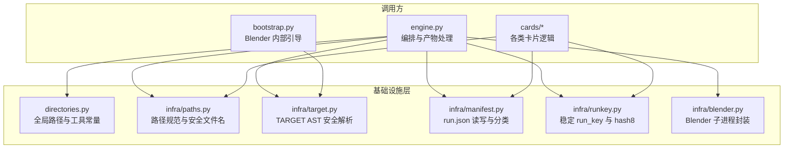
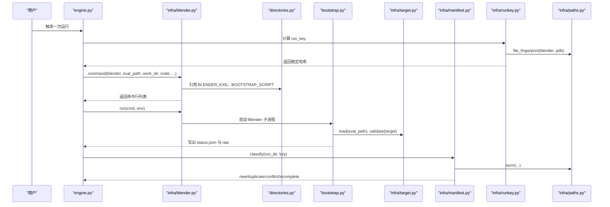
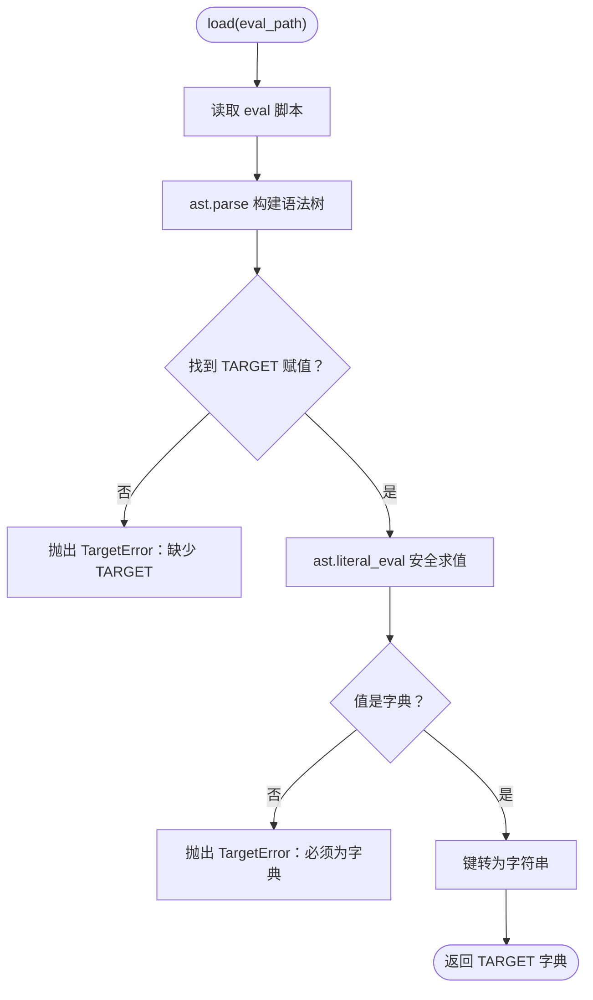
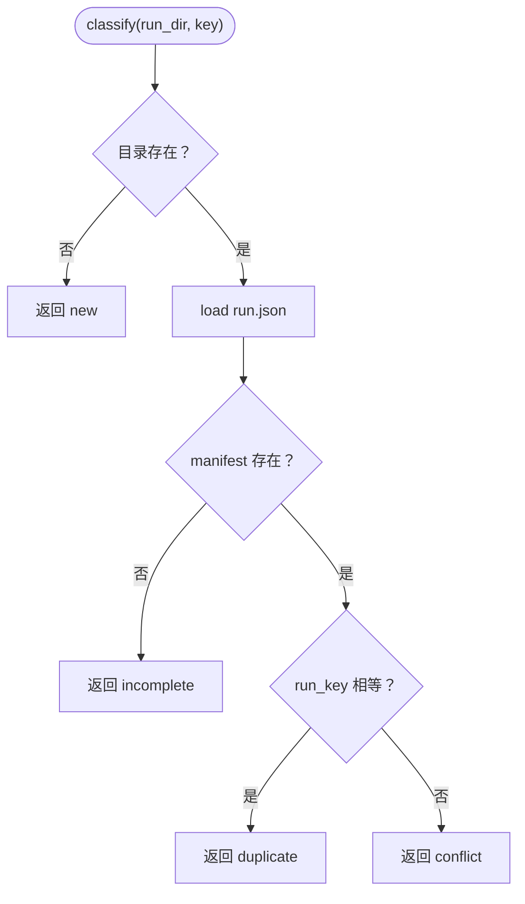
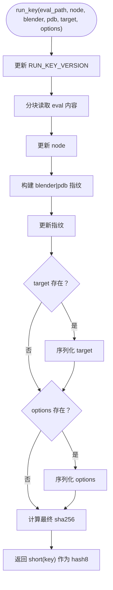
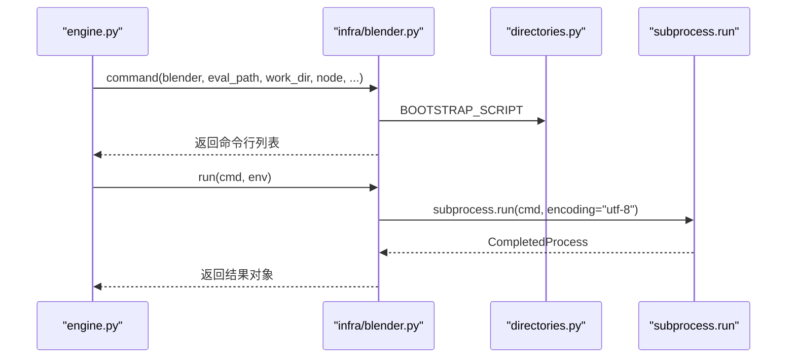
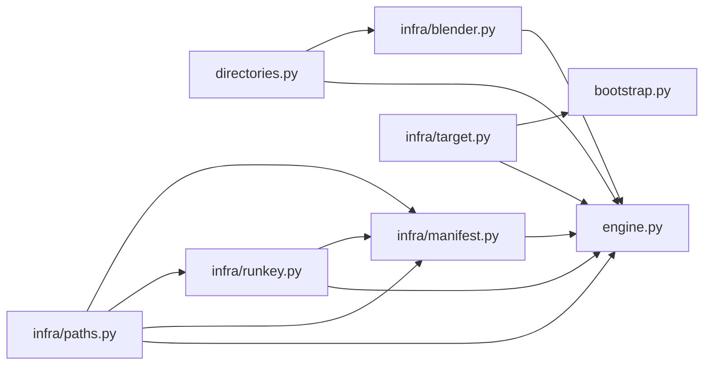

# 基础设施层

<cite>
**本文引用的文件**   
- [directories.py](file://directories.py)
- [infra/target.py](file://infra/target.py)
- [infra/manifest.py](file://infra/manifest.py)
- [infra/runkey.py](file://infra/runkey.py)
- [infra/blender.py](file://infra/blender.py)
- [infra/paths.py](file://infra/paths.py)
- [engine.py](file://engine.py)
- [bootstrap.py](file://bootstrap.py)
</cite>

## 目录
1. [引言](#引言)
2. [项目结构](#项目结构)
3. [核心组件](#核心组件)
4. [架构总览](#架构总览)
5. [详细组件分析](#详细组件分析)
6. [依赖关系分析](#依赖关系分析)
7. [性能与稳定性考虑](#性能与稳定性考虑)
8. [故障排查指南](#故障排查指南)
9. [结论](#结论)

## 引言
CovTrace 的基础设施层负责为上层引擎、启动引导和卡片逻辑提供稳定的公共能力。它统一处理外部工具路径、TARGET 安全解析、run manifest 管理、运行身份哈希计算、Blender 子进程封装以及路径规范化。这些模块被 engine、bootstrap、cards 共同复用，目标是让业务逻辑避免直接耦合外部工具版本、平台路径差异和文件系统细节。

## 项目结构
基础设施层由六个职责清晰的模块组成：

**图示来源**
- [directories.py:1-25](file://directories.py#L1-L25)
- [infra/paths.py:1-32](file://infra/paths.py#L1-L32)
- [infra/target.py:1-81](file://infra/target.py#L1-L81)
- [infra/manifest.py:1-58](file://infra/manifest.py#L1-L58)
- [infra/runkey.py:1-44](file://infra/runkey.py#L1-L44)
- [infra/blender.py:1-39](file://infra/blender.py#L1-L39)
- [engine.py:1-40](file://engine.py#L1-L40)
- [bootstrap.py:1-40](file://bootstrap.py#L1-L40)

**章节来源**
- [directories.py:1-25](file://directories.py#L1-L25)
- [engine.py:1-40](file://engine.py#L1-L40)
- [bootstrap.py:1-40](file://bootstrap.py#L1-L40)

## 核心组件
- `directories.py`：集中声明 Blender、LLVM、Graphviz 等外部工具路径，源码根目录，out/cache/_internal 等输出位置，以及 engine、bootstrap、validate 脚本入口。
- `infra/target.py`：在不执行求值脚本的前提下，通过 AST 读取并校验 TARGET 与 NODE。
- `infra/manifest.py`：读写 run.json，生成基础 manifest，并根据 run_key 判断 new/duplicate/conflict/incomplete。
- `infra/runkey.py`：基于 eval 内容、node、blender 与 pdb 构建稳定 run_key，并提供短 hash8。
- `infra/blender.py`：组装 blender 命令行并启动子进程。
- `infra/paths.py`：提供路径规范化、安全文件名、轻量构建指纹与 pdb 路径推导。

**章节来源**
- [directories.py:1-25](file://directories.py#L1-L25)
- [infra/target.py:1-81](file://infra/target.py#L1-L81)
- [infra/manifest.py:1-58](file://infra/manifest.py#L1-L58)
- [infra/runkey.py:1-44](file://infra/runkey.py#L1-L44)
- [infra/blender.py:1-39](file://infra/blender.py#L1-L39)
- [infra/paths.py:1-32](file://infra/paths.py#L1-L32)

## 架构总览
基础设施层处于调用方与外部工具之间：engine 负责整体编排，bootstrap 在 Blender 进程中加载 gates 与 eval，cards 消费 raw 数据并产出产物。所有模块对外暴露的是稳定的接口，而不是直接拼接平台相关命令或硬编码路径。

**图示来源**
- [engine.py:1-40](file://engine.py#L1-L40)
- [infra/blender.py:1-39](file://infra/blender.py#L1-L39)
- [directories.py:1-25](file://directories.py#L1-L25)
- [bootstrap.py:40-120](file://bootstrap.py#L40-L120)
- [infra/target.py:1-81](file://infra/target.py#L1-L81)
- [infra/manifest.py:1-58](file://infra/manifest.py#L1-L58)
- [infra/runkey.py:1-44](file://infra/runkey.py#L1-L44)
- [infra/paths.py:1-32](file://infra/paths.py#L1-L32)

## 详细组件分析

### directories.py：全局路径与工具配置
该模块承担“外部工具与固定目录”的单一事实来源。关键常量包括：
- `BLENDER_BIN_DIR`、`BLENDER_EXE`：Blender 可执行目录与完整路径。
- `LLVM_BIN_DIR`、`LLVM_COV_EXE`、`LLVM_PROFDATA_EXE`：LLVM 工具链目录与 llvm-cov、llvm-profdata 路径。
- `GRAPHVIZ_BIN_DIR`、`DOT_EXE`：Graphviz dot 工具路径。
- `SOURCE_DIR`：指向外部 Blender 源码根目录，用于定位被测源码。
- `OUT_DIR`、`CACHE_DIR`、`FRAG_DIR`、`INTERNAL_DIR="_internal"`：工程输出、缓存、frag 工具与内部产物目录。
- `ENGINE_SCRIPT`、`BOOTSTRAP_SCRIPT`、`VALIDATE_SCRIPT`：各 Python 脚本入口。

设计要点：
- 外部工具路径集中在一个模块，便于后续迁移到配置文件或环境变量。
- `_internal` 作为内部产物标记，engine 中会将其从公开输出中剥离。
- 当前示例使用 Windows 风格绝对路径；若跨平台运行，应改为可配置路径，避免直接耦合本机磁盘布局。

**章节来源**
- [directories.py:1-25](file://directories.py#L1-L25)
- [engine.py:120-160](file://engine.py#L120-L160)

### infra/target.py：TARGET 安全解析
该模块在不执行求值脚本的情况下，通过 AST 解析 eval 脚本中的 `TARGET` 和可选 `NODE`，并进行严格校验。

核心流程：
1. 以 UTF-8-SIG 编码读取 eval 脚本。
2. 使用 `ast.parse` 构建语法树。
3. 遍历顶层赋值语句，寻找名为 `TARGET` 的变量。
4. 使用 `ast.literal_eval` 安全求值，确保只接受字面量字典。
5. 将键统一转为字符串，返回目标字典。
6. `measure_node` 类似地读取可选 `NODE` 字面量。
7. `merge` 将命令行传入的 blend、object、modifier、param 合并进 TARGET。
8. `validate` 检查必填字段、blend 文件存在性、node_tree 类型等。

错误处理：
- 语法错误抛出 `TargetError`。
- 非字面量或非字典抛出 `TargetError`。
- 缺少 TARGET 或必填字段抛出 `TargetError`。
- 找不到 blend 文件或 node_tree 类型不合法抛出 `TargetError`。

这种 AST 方式避免了直接执行 eval 脚本带来的任意代码执行风险，同时仍允许用户在 TARGET 中使用简单字面量。

**图示来源**
- [infra/target.py:1-81](file://infra/target.py#L1-L81)

**章节来源**
- [infra/target.py:1-81](file://infra/target.py#L1-L81)
- [bootstrap.py:60-120](file://bootstrap.py#L60-L120)

### infra/manifest.py：run.json 管理
该模块管理每个 run 目录下的 `run.json`，负责写入、加载、分类与基础结构构造。

主要能力：
- `manifest_path`：返回 `run_dir/run.json`。
- `load`：如果文件不存在则返回 None。
- `write`：先写 `.tmp`，再用原子替换，写入时保留缩进并追加换行。
- `classify`：根据目录是否存在、是否包含有效 manifest、run_key 是否匹配，返回 `new`、`incomplete`、`duplicate`、`conflict`。
- `base`：构造 schema=1 的基础 manifest，记录 run_key、hash8、node、eval、blend、blender、pdb、options、created、gates、cards、counts。

分类语义：
- 目录不存在 → `new`。
- 目录存在但无 manifest → `incomplete`。
- manifest 存在且 run_key 相同 → `duplicate`。
- manifest 存在但 run_key 不同 → `conflict`。

**图示来源**
- [infra/manifest.py:1-58](file://infra/manifest.py#L1-L58)

**章节来源**
- [infra/manifest.py:1-58](file://infra/manifest.py#L1-L58)

### infra/runkey.py：稳定哈希与 hash8
该模块定义 CovTrace 的运行身份：同一个 eval、node、blender 和 pdb，即使在不同机器或不同时间运行，也应得到相同 run_key。

关键点：
- `RUN_KEY_VERSION` 作为版本号前缀，便于未来升级后产生新空间。
- `sha256_file` 分块读取大文件，避免一次性加载。
- `build_fingerprint` 使用 `paths.file_fingerprint` 组合 blender 与 pdb 标识。
- `run_key` 依次拼接版本、eval 文件内容、node、blender/pdb 指纹，以及可选 target 与 options。
- `short` 取前 8 位十六进制作为 hash8。

复杂度：
- 时间复杂度与 eval、blender、pdb 文件大小线性相关。
- 空间复杂度较低，因为按块读取。

**图示来源**
- [infra/runkey.py:1-44](file://infra/runkey.py#L1-L44)
- [infra/paths.py:1-32](file://infra/paths.py#L1-L32)

**章节来源**
- [infra/runkey.py:1-44](file://infra/runkey.py#L1-L44)
- [infra/paths.py:1-32](file://infra/paths.py#L1-L32)

### infra/blender.py：Blender 子进程封装
该模块负责把高层参数转化为 Blender 命令行，并启动子进程。

行为说明：
- `command` 构造以 `--background` 运行的 Blender 命令，并通过 `--python` 调用 `directories.BOOTSTRAP_SCRIPT`。
- 必传参数包括 eval、work、node。
- gates、blend、obj、mod、param、phase、measure-node 等可选参数只在非空时追加。
- `run` 打印命令并以 UTF-8 解码输出，遇到无法解码字符时使用 replace。

注意：
- 该模块不直接解析退出码；调用方（engine）需要结合 subprocess 返回值与 bootstrap 输出的 status.json 判断成功与否。
- Blender 路径来自 `directories.BLENDER_EXE`，应避免在业务逻辑中硬编码。

**图示来源**
- [infra/blender.py:1-39](file://infra/blender.py#L1-L39)
- [directories.py:1-25](file://directories.py#L1-L25)

**章节来源**
- [infra/blender.py:1-39](file://infra/blender.py#L1-L39)
- [engine.py:1-L40](file://engine.py#L1-L40)

### infra/paths.py：路径规范化与安全文件名
该模块提供文件系统层面的通用工具：

- `norm(path)`：对空路径返回空字符串；否则规范化并转为绝对路径。
- `safe_name(name)`：将节点名转换为安全的目录名，去除非法字符，并清理首尾点号。
- `file_fingerprint(path)`：用“规范化路径+文件大小+mtime_ns”构成轻量构建指纹，用于区分不同编译产物。
- `pdb_for(blender)`：根据 Blender 可执行路径推导对应 `.pdb` 符号文件路径。

重要性：
- `file_fingerprint` 直接影响 run_key 稳定性；若路径大小写、反斜杠或时间戳变化导致指纹不稳定，会造成重复或冲突。
- `safe_name` 保证 node 名称能安全写入文件系统，避免非法字符破坏目录结构。

**章节来源**
- [infra/paths.py:1-32](file://infra/paths.py#L1-L32)
- [infra/runkey.py:1-44](file://infra/runkey.py#L1-L44)

## 依赖关系分析
基础设施层内部依赖清晰，且被上层模块复用：

**图示来源**
- [directories.py:1-25](file://directories.py#L1-L25)
- [infra/paths.py:1-32](file://infra/paths.py#L1-L32)
- [infra/target.py:1-81](file://infra/target.py#L1-L81)
- [infra/manifest.py:1-58](file://infra/manifest.py#L1-L58)
- [infra/runkey.py:1-44](file://infra/runkey.py#L1-L44)
- [infra/blender.py:1-39](file://infra/blender.py#L1-L39)
- [engine.py:1-L40](file://engine.py#L1-L40)
- [bootstrap.py:1-L40](file://bootstrap.py#L1-L40)

**章节来源**
- [engine.py:1-L40](file://engine.py#L1-L40)
- [bootstrap.py:1-L40](file://bootstrap.py#L1-L40)

## 性能与稳定性考虑
- 大文件哈希：`runkey.sha256_file` 与 `runkey.run_key` 分块读取，避免内存峰值过高。
- 原子写入：`manifest.write` 使用临时文件加 `os.replace`，减少部分写入导致的损坏。
- 路径一致性：`paths.norm` 统一绝对路径，降低跨平台路径差异引发的缓存不一致。
- 构建指纹：`paths.file_fingerprint` 同时考虑路径、大小与修改时间，比仅比较路径更稳健。
- 外部工具解耦：路径集中在 `directories.py`，方便后续迁移至配置或环境变量，避免引擎逻辑与本机路径耦合。

建议：
- 将 `BLENDER_BIN_DIR`、`LLVM_BIN_DIR`、`GRAPHVIZ_BIN_DIR` 与脚本路径迁移到可配置项，默认值放在 `directories.py`。
- 对 Blender、LLVM、Graphviz 增加最小版本检查，失败时给出明确提示。
- 在 CI 环境中显式设置工具路径，避免依赖开发者本地环境。

[本节为通用指导，不直接分析具体代码行]

## 故障排查指南
常见错误及定位方式：

- TARGET 解析失败
  - 现象：`TargetError`，提示语法错误或 TARGET 不是字面量字典。
  - 原因：eval 脚本语法错误，或 TARGET 使用了函数调用、变量引用等非字面量。
  - 处理：确保 TARGET 是纯字面量字典；如需动态值，改用 bootstrap 参数合并。

- 求值脚本缺少 TARGET
  - 现象：`TargetError` 提示缺少 TARGET。
  - 处理：在 eval 脚本顶部添加 `TARGET = {...}`。

- blend 文件不存在
  - 现象：`TargetError` 提示找不到工程。
  - 处理：检查 TARGET.blend 是否为真实存在的绝对或相对路径。

- run manifest 冲突
  - 现象：`classify` 返回 `conflict`。
  - 原因：同一目录已有不同 run_key 的 manifest，可能是重建了不同版本或修改了 eval、blender、pdb。
  - 处理：确认是否需要清理旧目录或重新命名工作目录。

- Blender 子进程异常
  - 现象：engine 侧看到子进程非零退出，或 bootstrap 写出 `ok=false`。
  - 处理：查看 `status.json` 中的 error 与 traceback，确认 eval、gates、TARGET 与 Blender 版本匹配。

- 路径或符号文件问题
  - 现象：hash 不稳定、pdb 未找到。
  - 处理：检查 `paths.pdb_for` 生成的 pdb 路径是否与 Blender 可执行路径一致；确认编译器生成了对应 pdb。

**章节来源**
- [infra/target.py:1-81](file://infra/target.py#L1-L81)
- [infra/manifest.py:1-58](file://infra/manifest.py#L1-L58)
- [infra/blender.py:1-39](file://infra/blender.py#L1-L39)
- [bootstrap.py:1-L192](file://bootstrap.py#L1-L192)
- [engine.py:1-L200](file://engine.py#L1-L200)

## 结论
CovTrace 基础设施层通过 `directories.py`、`infra/target.py`、`infra/manifest.py`、`infra/runkey.py`、`infra/blender.py` 与 `infra/paths.py` 形成稳定抽象。它们分别解决外部工具路径、TARGET 安全解析、run manifest 分类、运行身份哈希、Blender 子进程与路径规范化问题。engine、bootstrap 与 cards 在此基础上协作，避免直接耦合 Blender、LLVM、Graphviz 的具体路径与版本。未来改进方向应是将这些常量与路径进一步配置化，并增加工具版本校验，使系统在多环境与持续集成中更加可靠。