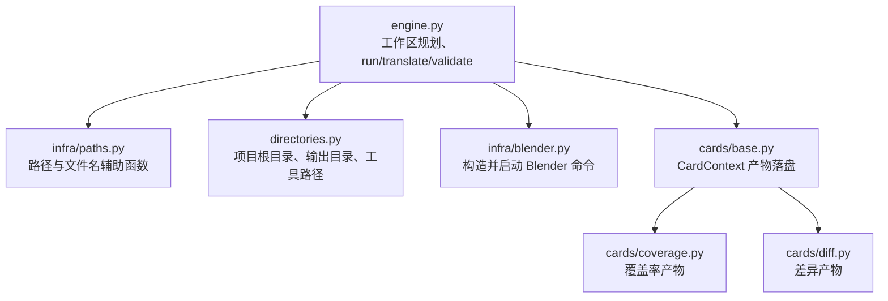
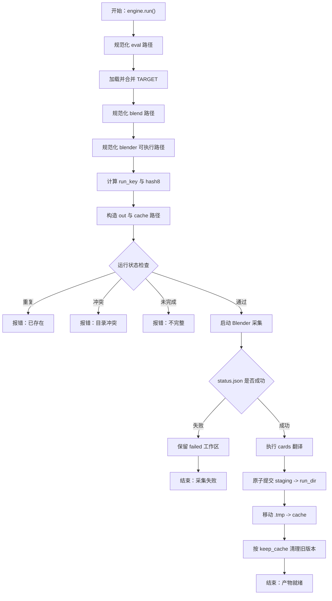
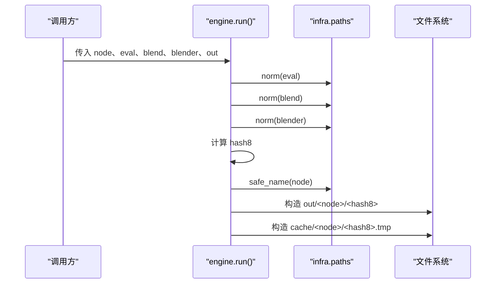
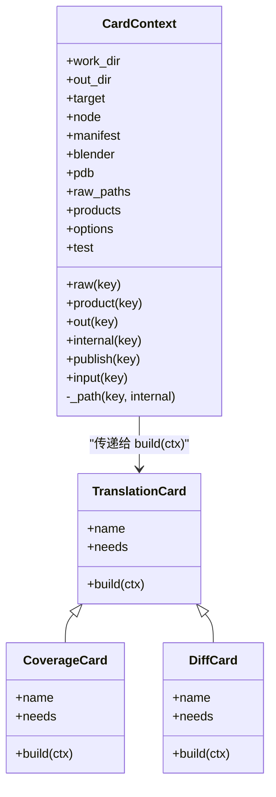
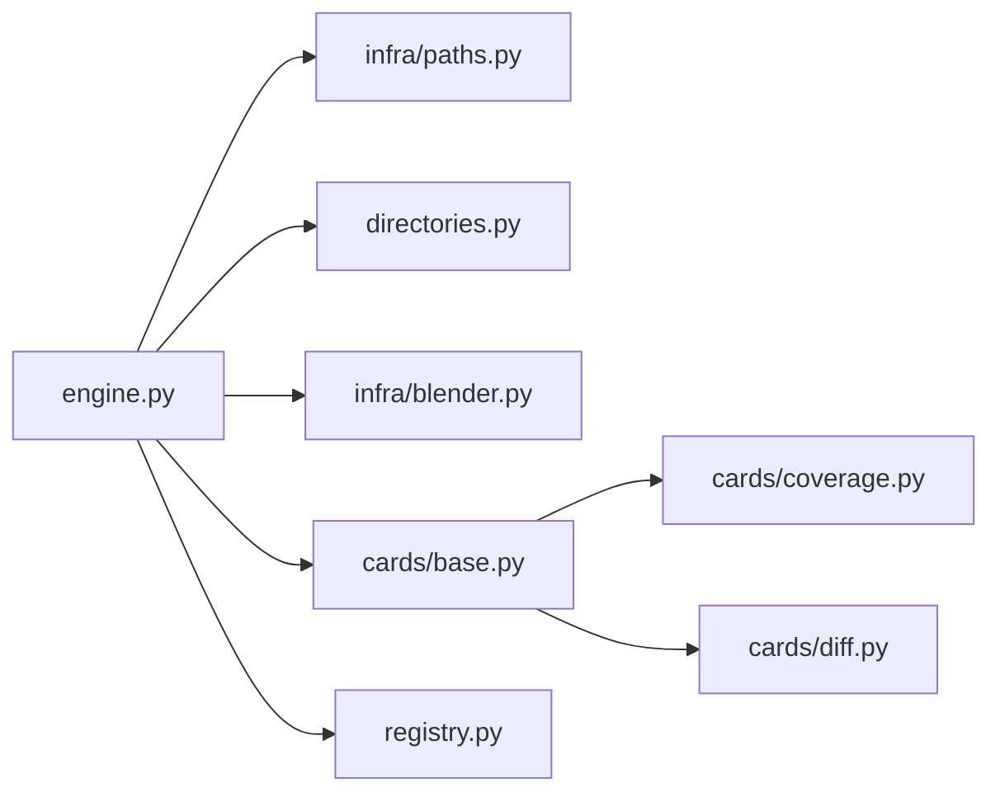

# 路径规范化与安全文件名工具

<cite>
**本文引用的文件**   
- [infra/paths.py](file://infra/paths.py)
- [engine.py](file://engine.py)
- [directories.py](file://directories.py)
- [cards/base.py](file://cards/base.py)
- [cards/coverage.py](file://cards/coverage.py)
- [cards/diff.py](file://cards/diff.py)
- [infra/blender.py](file://infra/blender.py)
</cite>

## 目录

1. [引言](#引言)
2. [项目结构](#项目结构)
3. [核心组件：路径与文件名辅助函数](#核心组件路径与文件名辅助函数)
4. [架构总览：从 node 名到产物落盘](#架构总览从-node-名到产物落盘)
5. [详细组件分析](#详细组件分析)
6. [依赖关系分析](#依赖关系分析)
7. [性能与幂等性考虑](#性能与幂等性考虑)
8. [平台差异注意事项](#平台差异注意事项)
9. [故障排查指南](#故障排查指南)
10. [结论](#结论)

## 引言

本仓库是一个面向 Blender 工程、以覆盖率与差异分析为核心的工具链。其关键目标是：根据一个“求值脚本”和“节点名”，在 `out/<node>/<hash8>/` 下生成稳定、可重复、可比较的产物；同时把原始采集数据缓存到 `cache/<node>/<hash8>/`，以便后续重新运行翻译卡片。

在这个流程中，多个输入都会进入文件系统：

- **node 名**：用户指定的逻辑标识，可能包含空格、中文、特殊符号或看起来像路径的内容。
- **hash8**：由运行键生成的短哈希，用于区分同一 node 的不同构建配置。
- **blend 路径**：Blender 工程路径，可能来自 TARGET、命令行覆盖或自动测量结果。
- **blender 可执行文件路径**：插桩后的 Blender 程序。
- **产物路径**：由 cards 注册的产品名决定，例如 coverage、diff、edge 等。

如果这些路径没有经过统一处理，就可能发生以下问题：

| 风险 | 典型表现 | 需要统一处理的原因 |
|---|---|---|
| Windows 非法字符 | node 名含 `<>:"/\|?*` 导致无法创建目录 | 必须转换为安全文件名 |
| 路径穿越 | node 名为 `../data` 或 `C:\Windows\...` | 不应让业务层直接拼接不可信目录名 |
| 相对路径歧义 | blend 路径未绝对化 | 不同工作目录下行为不一致 |
| 重复后缀 | 多次运行后出现 `.failed-时间戳-序号` 等残留 | 清理与去重策略需明确 |
| 大小写混淆 | Windows 上 `source/` 与 `Source/` 被视为相同路径 | 哈希与比较应基于规范化结果 |
| 分隔符混用 | JSON 中混有 `\` 和 `/` | 下游解析、diff、可视化工具可能出错 |

`infra/paths.py` 的职责就是收敛这些通用规则，避免每个业务模块各自实现一套路径处理逻辑。

**章节来源**
- [engine.py:237-275](file://engine.py#L237-L275)
- [engine.py:407-445](file://engine.py#L407-L445)
- [directories.py:1-25](file://directories.py#L1-L25)

## 项目结构

本次文档关注的路径相关代码主要分布在以下位置：

**图表来源**
- [engine.py:1-25](file://engine.py#L1-L25)
- [infra/paths.py:1-32](file://infra/paths.py#L1-L32)
- [directories.py:1-25](file://directories.py#L1-L25)
- [infra/blender.py:1-39](file://infra/blender.py#L1-L39)
- [cards/base.py:1-63](file://cards/base.py#L1-L63)
- [cards/coverage.py:1-30](file://cards/coverage.py#L1-L30)
- [cards/diff.py:1-20](file://cards/diff.py#L1-L20)

**章节来源**
- [engine.py:1-25](file://engine.py#L1-L25)
- [directories.py:1-25](file://directories.py#L1-L25)

## 核心组件：路径与文件名辅助函数

`infra/paths.py` 提供了四个公共能力：

| 函数 | 输入 | 输出 | 职责 |
|---|---|---|---|
| `norm(path)` | 任意路径字符串 | 规范化后的绝对路径字符串 | 空输入返回空串；否则先绝对化再标准化路径分隔符和冗余点段 |
| `safe_name(name)` | 任意名称字符串 | 适合用作目录名的安全字符串 | 替换非法字符为下划线，去掉首尾点与下划线，空结果退化为 `node` |
| `file_fingerprint(path)` | 文件路径 | 指纹字符串或空串 | 基于规范化路径、文件大小、纳秒级修改时间计算轻量身份标识 |
| `pdb_for(blender)` | Blender 可执行路径 | 对应 `.pdb` 调试符号路径 | 去掉扩展名后追加 `.pdb` |

### `norm`：路径绝对化与标准化

`norm` 是 engine 中最常用的入口。它保证：

1. 空路径不崩溃，直接返回空字符串。
2. 相对路径被转换为当前进程工作目录下的绝对路径。
3. `..`、`.`、多余分隔符等被操作系统标准库统一。

在 engine 中，`norm` 被用于：

- 求值脚本路径 `a.eval`
- blend 工程路径 `target["blend"]`
- blender 可执行路径 `a.blender`
- 输出根目录 `a.out`
- translate 子命令的 `cache_dir`

这意味着上层传入的相对路径不会直接拼接到 `out/` 下，而是先变成绝对路径，从而降低“在不同工作目录运行产生不同结果”的风险。

### `safe_name`：node 名转安全文件名

`safe_name` 不是简单地把所有非字母数字字符替换成下划线。它还做了两件事：

1. 使用正则表达式将连续的非安全字符序列替换为单个下划线。
2. 去掉结果开头和结尾的点与下划线。
3. 如果处理后为空，则返回固定名称 `node`。

这能解决三类问题：

| 输入示例 | 问题 | `safe_name` 的作用 |
|---|---|---|
| `My Node` | 空格不能做目录名 | 转为带下划线的安全名 |
| `C:\Windows\System32` | 可能被误认为路径或造成危险写入 | 全部非安全字符被替换 |
| `.` 或 `..` | 会被系统解释为当前目录或父目录 | 去掉首尾点后变为 `node` |
| `__test__` | 前后下划线可能干扰排序或隐藏语义 | 被清理 |
| `A-B.C/D` | 斜杠在 Windows 上是非法字符 | 被替换为下划线 |

注意：`safe_name` 只负责“名字本身安全”，并不阻止用户传入类似 `../../etc` 的内容。真正防止路径穿越的关键是：**永远不要把 untrusted name 直接当作目录根来拼接**，而应把它作为 `out/` 下的子目录名，并由更高层保证拼接顺序。

### `file_fingerprint`：轻量文件身份

该函数返回形如“规范化路径:大小:修改时间”的字符串。它的用途是快速判断某个输入文件是否发生变化，而不必重新解析完整内容。复杂度如下：

| 操作 | 时间复杂度 | 空间复杂度 |
|---|---|---|
| 路径检查 | O(1) | O(1) |
| `os.stat` | 取决于操作系统，通常接近 O(1) | O(1) |
| 格式化字符串 | 与路径长度线性相关 | O(n) |

由于它依赖 `mtime_ns`，不同平台精度可能不同，因此它适合“同一次构建会话内”的快速变化检测，不适合跨机器长期稳定性校验。

### `pdb_for`：Blender 调试符号路径

该函数基于 Blender 可执行文件路径推导 PDB 文件路径。例如，若 blender 路径为 `D:\tools\blender.exe`，则对应 PDB 路径为 `D:\tools\blender.pdb`。它假设 PDB 与可执行文件同名、仅扩展名不同。

**章节来源**
- [infra/paths.py:1-32](file://infra/paths.py#L1-L32)

## 架构总览：从 node 名到产物落盘

engine 的工作区规划可以概括为三层：

1. **输出目录 `out/<node>/<hash8>/`**：最终用户可见的产物。
2. **缓存目录 `cache/<node>/<hash8>/`**：保存 raw 数据、manifest、status 等中间状态。
3. **临时工作目录 `<cache_dir>.tmp` 或 `<hash8>.tmp`**：原子写入 staging 后再替换目标目录。

**图表来源**
- [engine.py:200-360](file://engine.py#L200-L360)
- [engine.py:360-445](file://engine.py#L360-L445)
- [engine.py:445-562](file://engine.py#L445-L562)

**章节来源**
- [engine.py:200-360](file://engine.py#L200-L360)
- [engine.py:360-445](file://engine.py#L360-L445)

## 详细组件分析

### 工作区路径构造

engine 的核心路径构造发生在 `run` 和 `translate` 两个主流程中。

#### `run` 流程中的路径

1. 规范化 `eval`、`blend`、`blender`、`out`。
2. 根据 `runkey.run_key(...)` 得到完整运行键，再用 `runkey.short(key)` 取 `hash8`。
3. 构造：
   - `run_dir = out_root / safe_name(node) / hash8`
   - `cache_dir = CACHE_DIR / safe_name(node) / hash8`
   - `work_dir = cache_dir + ".tmp"`

这里有两个关键设计：

- node 名通过 `safe_name` 转换，避免 Windows 非法字符。
- `hash8` 来自运行键，确保同一 node 的不同参数、不同 blender、不同 target 会落到不同目录。

**图表来源**
- [engine.py:237-275](file://engine.py#L237-L275)
- [engine.py:300-360](file://engine.py#L300-L360)
- [infra/paths.py:1-32](file://infra/paths.py#L1-L32)

#### `translate` 流程中的路径

`translate` 不再启动 Blender，而是读取已有 cache 并重新运行 cards。它同样使用：

- `out_root = paths.norm(a.out or directories.OUT_DIR)`
- `run_dir = os.path.join(out_root, paths.safe_name(node), hash8)`

这说明无论是一次采集还是离线翻译，产物路径都遵循统一规则。

**章节来源**
- [engine.py:237-275](file://engine.py#L237-L275)
- [engine.py:407-445](file://engine.py#L407-L445)

### 目录结构与常量

`directories.py` 集中管理项目根目录、工具路径和输出目录：

| 常量 | 含义 | 备注 |
|---|---|---|
| `ROOT` | 本模块所在目录的绝对路径 | 作为其他路径的基础 |
| `OUT_DIR` | `out` 目录 | 默认产物根 |
| `CACHE_DIR` | `cache` 目录 | 原始采集数据根 |
| `FRAG_DIR` | `frag` 目录 | 片段验证脚本所在 |
| `INTERNAL_DIR` | `_internal` | 内部中间产物目录 |
| `BLENDER_EXE` | Blender 可执行路径 | 硬编码为 Windows 路径 |
| `LLVM_COV_EXE`、`LLVM_PROFDATA_EXE` | LLVM 工具路径 | 覆盖率处理依赖 |
| `ENGINE_SCRIPT`、`BOOTSTRAP_SCRIPT` | 引擎脚本路径 | 供外部启动器使用 |

当前实现已经明显偏向 Windows：

- `BLENDER_BIN_DIR`、`LLVM_BIN_DIR`、`GRAPHVIZ_BIN_DIR` 都是 Windows 风格的硬编码路径。
- `BLENDER_EXE` 直接指向 `blender.exe`。
- `VALIDATE_SCRIPT`、`ENGINE_SCRIPT`、`BOOTSTRAP_SCRIPT` 也使用 Windows 路径风格。

如果需要支持 Linux/macOS 上的 Blender，不应在 `engine.py` 或 cards 里逐个判断平台，而应在 `directories.py` 或新的平台适配层中提供统一的工具路径抽象。

**章节来源**
- [directories.py:1-25](file://directories.py#L1-L25)

### Cards 产物落盘逻辑

`cards/base.py` 中的 `CardContext` 是 cards 访问产物的唯一入口。它维护：

- `work_dir`：当前卡片工作目录。
- `out_dir`：最终输出根。
- `products`：产品注册表。
- `raw_paths`：raw 数据路径映射。
- `options`：包括 `coverage_keep_all`、`phase`、`measure_node`、`diff_against` 等。

`_path` 方法负责实际落盘：

1. 从产品注册表中取出相对路径。
2. 如果是内部产品且不在测试模式，则前缀加上 `_internal`。
3. 与 `out_dir` 拼接。
4. 规范化路径。
5. 创建父目录。

**图表来源**
- [cards/base.py:1-63](file://cards/base.py#L1-L63)
- [cards/coverage.py:1-30](file://cards/coverage.py#L1-L30)
- [cards/diff.py:1-20](file://cards/diff.py#L1-L20)

**章节来源**
- [cards/base.py:1-63](file://cards/base.py#L1-L63)

### 覆盖率卡片中的路径处理

`cards/coverage.py` 负责把 Blender 产生的覆盖率原始数据转换成结构化报告。它涉及多处路径处理：

- 从 `ctx.raw("coverage")` 读取原始覆盖率数据。
- 调用外部 `llvm-profdata merge` 生成 `.profdata`。
- 调用 `llvm-cov export` 导出 lcov。
- 对源路径进行相对化、分隔符统一、大小写归一。
- 根据 `SOURCE_DIR` 过滤 `source/` 与 `intern/` 路径。

其中 `to_rel`、`keep_file`、`norm_lcov_path` 都显式处理了反斜杠：

- 把 `\` 替换为 `/`。
- 忽略大小写匹配 `SOURCE_DIR`。
- 把路径转为小写用于 lcov 匹配。

这类处理属于“文件内容路径”的规范化，而不是“目录名”的安全化。它和 `infra/paths.py` 的职责互补：

| 层次 | 规范化目标 | 典型函数 |
|---|---|---|
| 文件名安全 | 防止 Windows 非法字符、路径穿越、重复后缀 | `safe_name` |
| 工作区路径 | 绝对化、标准化、幂等定位 | `norm` |
| 内容路径 | 相对化、分隔符统一、大小写一致 | `to_rel`、`norm_lcov_path` |
| 工具路径 | 平台相关工具查找 | `directories.*_EXE` |

**章节来源**
- [cards/coverage.py:1-200](file://cards/coverage.py#L1-L200)

### 差异卡片中的路径处理

`cards/diff.py` 对比当前运行与上一次运行的函数与边差异。它会：

1. 从 `ctx.options.get("diff_against")` 获取对比目标。
2. 优先加载已有的 edge 产物。
3. 如果没有 edge 产物，则从 functions.bin 和 edges.bin 符号化。
4. 将 before/after 路径规范化为绝对路径，并把反斜杠替换为正斜杠。
5. 根据 manifest 中的 `hash8` 推断 after 目录。

这里的重点是：**diff 输出的 meta 字段中，before 和 after 路径要统一格式**，避免 JSON 消费者因分隔符大小写或绝对/相对差异而无法正确显示。

**章节来源**
- [cards/diff.py:1-141](file://cards/diff.py#L1-L141)

### Blender 命令构造

`infra/blender.py` 的 `command` 函数负责把 Python 侧的参数组装成 Blender 命令行。它接收：

- blender 可执行路径
- eval 路径
- work_dir
- node
- blend、obj、mod、param
- gates、phase、measure_node

这个模块本身不做路径规范化，但它在 engine 中被调用时，传入的 `work_dir`、`node`、`blend`、`blender` 都已经过 engine 层的规范化处理。因此，Blender 子进程收到的通常是干净、绝对化的路径。

**章节来源**
- [infra/blender.py:1-39](file://infra/blender.py#L1-L39)

## 依赖关系分析

**图表来源**
- [engine.py:1-25](file://engine.py#L1-L25)
- [infra/paths.py:1-32](file://infra/paths.py#L1-L32)
- [directories.py:1-25](file://directories.py#L1-L25)
- [infra/blender.py:1-39](file://infra/blender.py#L1-L39)
- [cards/base.py:1-15](file://cards/base.py#L1-L15)
- [cards/coverage.py:1-20](file://cards/coverage.py#L1-L20)
- [cards/diff.py:1-15](file://cards/diff.py#L1-L15)

依赖特点：

- `engine.py` 是协调者，负责参数校验、路径构造、状态检查、Blender 启动、cards 调度。
- `infra/paths.py` 是纯工具模块，无副作用。
- `directories.py` 是配置中心，暴露路径常量。
- `cards/base.py` 定义卡片接口和产物落盘逻辑。
- `cards/coverage.py` 和 `cards/diff.py` 是具体业务卡片。
- `infra/blender.py` 封装子进程启动。

潜在耦合点：

- `engine.py` 直接依赖 `directories.OUT_DIR`、`directories.CACHE_DIR`、`directories.BLENDER_EXE`。
- `cards/coverage.py` 依赖 `directories.LLVM_COV_EXE`、`directories.LLVM_PROFDATA_EXE`、`directories.SOURCE_DIR`。
- 如果未来增加更多平台工具，建议把这些依赖继续集中在 `directories.py`，而不是散落进 engine 或 cards。

**章节来源**
- [engine.py:1-25](file://engine.py#L1-L25)
- [cards/coverage.py:1-20](file://cards/coverage.py#L1-L20)

## 性能与幂等性考虑

### 幂等性

engine 通过 `runkey.run_key` 和 `hash8` 实现幂等定位。相同输入会产生相同 `hash8`，从而复用已有目录或拒绝覆盖。配合 `--force`，用户可以显式选择覆盖。

此外：

- `run_dir` 和 `cache_dir` 使用相同 node+hash8 结构。
- 失败时会把 work_dir 移动到 `<hash8>.failed-时间戳[-序号]`。
- `_prune_cache` 按修改时间排序，只保留最近 N 个目录。

### 去重

`safe_name` 会把连续非法字符替换为单个下划线，减少类似 `A--B` 与 `A_B` 这类语义等价但字符串不同的情况。不过真正的去重和唯一性主要由 `hash8` 承担。

### 文件指纹

`file_fingerprint` 使用 `st_size` 和 `st_mtime_ns` 做轻量变更检测。优点是快；缺点是：

- 修改时间可能受文件系统、备份工具、虚拟机时间同步影响。
- 不同平台纳秒精度不同。
- 不适合作为分布式一致性哈希。

因此它更适合本地构建场景，而不是跨机器共享缓存的唯一依据。

**章节来源**
- [engine.py:120-170](file://engine.py#L120-L170)
- [engine.py:300-360](file://engine.py#L300-L360)
- [infra/paths.py:1-32](file://infra/paths.py#L1-L32)

## 平台差异注意事项

### Windows 与 POSIX 路径分隔符

当前仓库大量使用反斜杠：

- `directories.py` 中的工具路径是 Windows 风格。
- `cards/coverage.py` 中多处显式把 `\` 替换为 `/`。
- `cards/diff.py` 中也把绝对路径的反斜杠替换为正斜杠。
- `engine.py` 的 `_rebase_path` 使用 `os.sep` 拼接路径，但比较时使用 `os.path.normcase`。

建议规则：

1. **目录名和业务路径拼接**：始终使用 `os.path.join`，不要手动拼接 `\` 或 `/`。
2. **JSON 中的路径展示**：统一使用 `/`，避免消费者因分隔符差异误判。
3. **文件系统路径比较**：使用 `os.path.normpath` + `os.path.normcase`，不要直接字符串相等。
4. **正则匹配路径**：优先使用 `[\\/]` 或 `os.path.sep`，避免遗漏某一平台。

### 大小写敏感性

- Windows 文件系统通常不区分大小写。
- macOS 默认文件系统也可能不区分大小写。
- Linux 文件系统通常区分大小写。

因此，`cards/coverage.py` 中对 `SOURCE_DIR` 和 lcov 路径使用大小写不敏感比较，有助于缓解 Windows/macOS 上 `source/` 与 `Source/` 的差异。但如果将来需要在 Linux 上严格匹配源码路径，应新增选项而非默认改变行为。

### 长路径限制

Windows 传统 API 有 MAX_PATH 限制（通常为 260 字符）。虽然现代 Windows 支持长路径，但仍依赖应用程序声明支持。Python 的 `os.path` 行为可能随平台和 Python 版本变化。

对于长路径风险：

- 避免生成过深的 `out/<node>/<hash8>/...` 树。
- 避免过长的 node 名或 product 路径。
- 在 CI 或批量运行环境中，优先使用较短的工作根目录。
- 如果未来需要支持超长路径，应在 `directories.py` 或 platform 适配层集中处理。

### 支持 Linux/macOS 上 Blender 的建议

当前 `directories.py` 是平台适配的最佳位置，因为：

- 它集中定义了所有工具路径。
- 上层只消费常量，不关心具体平台。
- 新增 Linux/macOS 路径不会影响现有 Windows 逻辑。

建议做法：

1. 新增平台探测逻辑，例如根据 `sys.platform` 选择工具目录。
2. 为 Linux/macOS 提供 `BLENDER_BIN_DIR`、`LLVM_BIN_DIR`、`GRAPHVIZ_BIN_DIR` 的默认值或环境变量覆盖方式。
3. 不要把 `blender`、`llvm-cov`、`dot` 的可执行名硬编码在 engine 或 cards 中。
4. 如果 Linux/macOS 上工具扩展名不是 `.exe`，应由 `directories.py` 处理，而不是在调用处加条件分支。
5. 如果 Linux/macOS 的 Blender 产物路径规则不同，应在 `directories.py` 或新的 platform module 中暴露统一接口，而不是分散到 engine 和 cards。

**章节来源**
- [directories.py:1-25](file://directories.py#L1-L25)
- [cards/coverage.py:60-120](file://cards/coverage.py#L60-L120)
- [cards/diff.py:90-141](file://cards/diff.py#L90-L141)

## 故障排查指南

### 问题：node 名包含非法字符导致目录创建失败

**现象**：当 node 名包含空格、中文、尖括号、引号、反斜杠等字符时，engine 可能在尝试创建 `out/<node>/<hash8>` 时报错。

**原因**：Windows 不允许某些字符出现在文件名或目录名中。

**处理位置**：`infra/paths.safe_name`。

**排查建议**：

- 检查传入 engine 的 `--node` 参数。
- 确认没有故意传入 `..`、`C:\`、`/etc/passwd` 等类路径值。
- 如果业务需要保留原始 node 名，应保存在 manifest 或 metadata 中，而不是直接作为目录名。

**章节来源**
- [infra/paths.py:12-20](file://infra/paths.py#L12-L20)
- [engine.py:237-275](file://engine.py#L237-L275)

### 问题：blend 路径在不同工作目录下不一致

**现象**：同一个 blend 工程，从不同目录运行 engine，生成路径不同。

**原因**：相对路径没有被统一绝对化。

**处理位置**：engine 中对 `target["blend"]` 调用 `paths.norm`。

**排查建议**：

- 检查 TARGET 文件中 blend 路径是否为相对路径。
- 确认 engine 确实进入了 `run` 或 `validate` 流程。
- 如果自定义 TARGET 逻辑绕过 engine，请自行调用 `paths.norm`。

**章节来源**
- [engine.py:247-260](file://engine.py#L247-L260)
- [infra/paths.py:10-15](file://infra/paths.py#L10-L15)

### 问题：cache 中 raw 文件缺失

**现象**：`translate` 报 “cache raw 文件缺失”。

**原因**：raw 路径引用的是之前的 work_dir 或 cache_dir，但这些目录被删除或迁移。

**处理位置**：engine 的 `translate` 和 `_rebase_path`。

**排查建议**：

- 不要手动删除 `cache/<node>/<hash8>`。
- 如果需要迁移 cache，应使用 engine 提供的 rebase 逻辑，而不是直接复制目录。
- 检查 `data["raw_removed"]` 是否表示 raw 已被清理。

**章节来源**
- [engine.py:360-445](file://engine.py#L360-L445)
- [engine.py:445-562](file://engine.py#L445-L562)

### 问题：覆盖率路径大小写不一致

**现象**：Linux 上覆盖率报告无法匹配源码路径，或 diff 报告中路径大小写混乱。

**原因**：不同平台路径大小写规则不同，且原始路径可能混用 `\` 和 `/`。

**处理位置**：`cards/coverage.py` 中的 `to_rel`、`keep_file`、`norm_lcov_path`。

**排查建议**：

- 确认 `SOURCE_DIR` 与实际源码目录一致。
- 检查覆盖率工具输出的路径分隔符。
- 如果需要在 Linux 上严格匹配路径，应新增选项控制大小写行为，而不是默认关闭大小写敏感。

**章节来源**
- [cards/coverage.py:60-120](file://cards/coverage.py#L60-L120)

### 问题：Blender 找不到或 PDB 缺失

**现象**：engine 报找不到插桩 Blender，或 PDB 不存在。

**处理位置**：engine 的 `run`、`validate` 以及 `infra/paths.pdb_for`。

**排查建议**：

- 检查 `--blender` 参数或 `directories.BLENDER_EXE`。
- 确认 PDB 与 Blender 可执行文件在同一目录且同名。
- 如果 PDB 可选，可在上层逻辑中忽略缺失警告，但不要跳过必要验证。

**章节来源**
- [engine.py:256-275](file://engine.py#L256-L275)
- [engine.py:460-505](file://engine.py#L460-L505)
- [infra/paths.py:26-32](file://infra/paths.py#L26-L32)

## 结论

`infra/paths.py` 虽然只有四个函数，但它承担了 CovTrace 路径基础设施的关键职责：

- `norm` 保证路径绝对化和标准化，避免相对路径带来的不确定性。
- `safe_name` 把 node 名转化为安全的目录名，避免 Windows 非法字符和路径穿越。
- `file_fingerprint` 提供轻量文件身份，便于快速变更检测。
- `pdb_for` 统一推导调试符号路径。

真正安全的路径处理不是单一函数的事，而是一个分层体系：

1. **输入层**：engine 负责校验 node、eval、blend、blender、out。
2. **命名层**：`safe_name` 保证目录名安全。
3. **定位层**：`norm` 保证路径绝对化、标准化。
4. **内容层**：cards 内部对 JSON 中的源码路径做相对化、分隔符统一、大小写归一。
5. **平台层**：`directories.py` 集中管理工具路径，避免业务逻辑感知 Windows 或 POSIX 细节。

如果未来要支持 Linux/macOS 上的 Blender，应优先扩展 `directories.py` 的平台适配能力，而不是在 engine 或 cards 中添加零散的条件分支。这样既能保持当前 Windows 行为不变，又能让新平台获得一致的抽象接口。