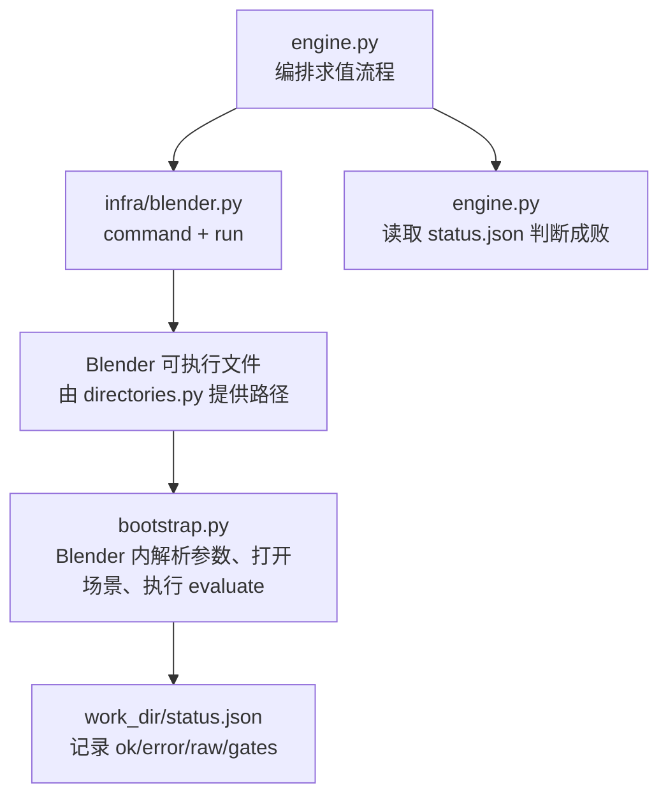
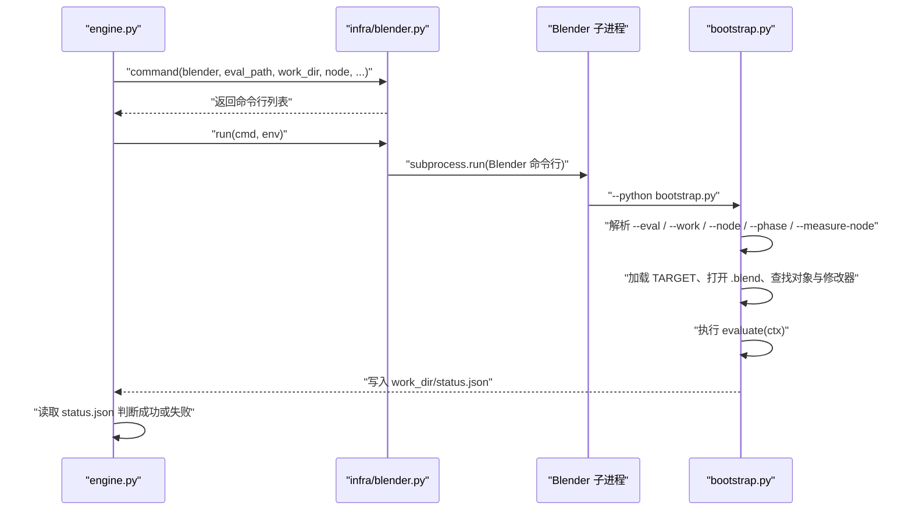
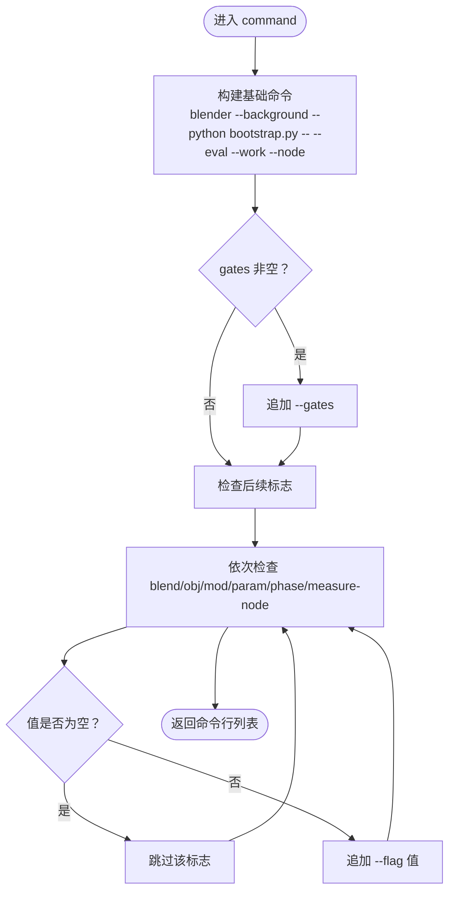
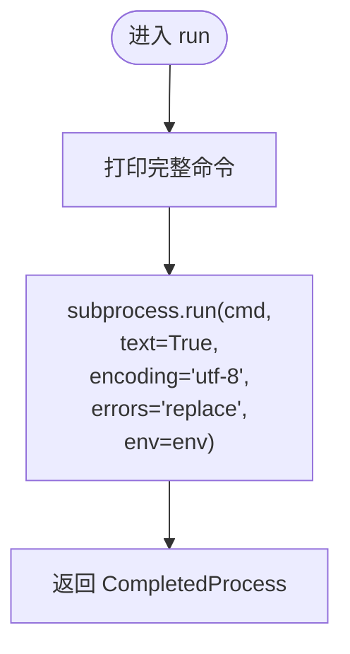
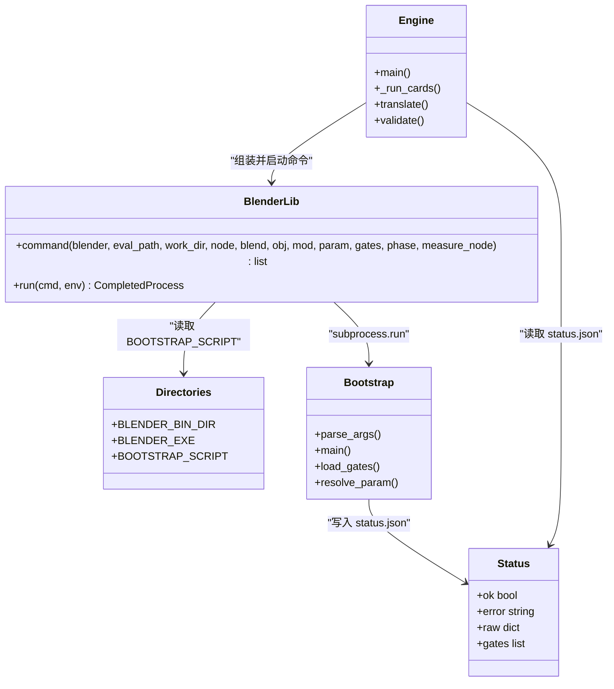
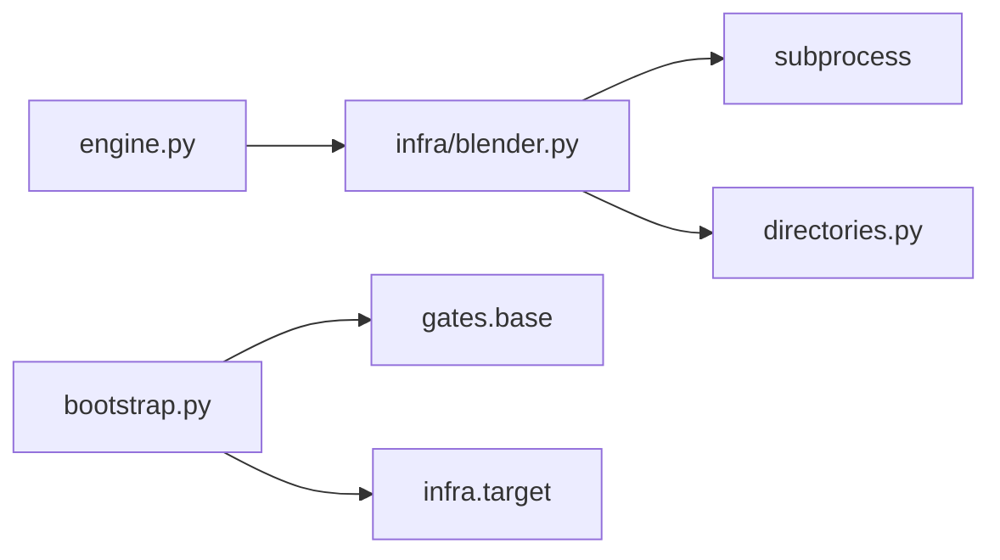

# Blender 子进程启动器

<cite>
**本文引用的文件**   
- [infra/blender.py](file://infra/blender.py)
- [engine.py](file://engine.py)
- [bootstrap.py](file://bootstrap.py)
- [directories.py](file://directories.py)
</cite>

## 目录
1. [引言](#引言)
2. [项目结构定位](#项目结构定位)
3. [核心组件](#核心组件)
4. [架构总览](#架构总览)
5. [详细组件分析](#详细组件分析)
6. [依赖关系分析](#依赖关系分析)
7. [性能与健壮性考虑](#性能与健壮性考虑)
8. [故障排查指南](#故障排查指南)
9. [结论](#结论)

## 引言
本文件说明 `infra/blender.py` 中两个关键函数如何把 Python 调用转换为 Blender 子进程命令行，并解释它与引擎层 `engine.py`、Blender 侧引导脚本 `bootstrap.py` 以及路径配置 `directories.py` 的关系。重点包括：

- `command(blender, eval_path, work_dir, node, blend, obj, mod, param, gates, phase, measure_node)` 的命令行组装规则；
- `run(cmd, env=None)` 如何通过 `subprocess.run` 启动子进程，并以文本模式、UTF-8 编码和 `errors="replace"` 处理输出；
- 该模块是纯编排层，不解析 Blender 内部状态，实际解析由 `bootstrap.py` 完成；
- `engine.py` 中典型调用方式，特别是 `--phase` 与 `--measure-node` 的选择逻辑；
- 常见问题排查方法，包括命令打印、Blender 可执行路径确认、Windows PATH 与引号问题，以及如何区分“Blender 启动失败”和“求值失败”。

## 项目结构定位
`infra/blender.py` 是一个轻量级“主机侧 Blender 子进程启动器”，只负责：

1. 根据参数构造 Blender 命令行；
2. 使用 `subprocess.run` 启动 Blender；
3. 打印完整命令以便调试。

它不读取 Blender 运行结果中的业务字段（如闸门数据、覆盖率统计等），这些由 `bootstrap.py` 在 Blender 进程中写入 `work_dir/status.json`，再由 `engine.py` 读取。



**图表来源**
- [engine.py:322-340](file://engine.py#L322-L340)
- [infra/blender.py:1-39](file://infra/blender.py#L1-L39)
- [bootstrap.py:1-192](file://bootstrap.py#L1-L192)
- [directories.py:1-25](file://directories.py#L1-L25)

**章节来源**
- [infra/blender.py:1-39](file://infra/blender.py#L1-L39)
- [directories.py:1-25](file://directories.py#L1-L25)

## 核心组件
`infra/blender.py` 暴露两个函数：

| 函数 | 职责 | 输入 | 输出 |
|---|---|---|---|
| `command(...)` | 组装 Blender 命令行列表 | Blender 路径、评估脚本路径、工作目录、节点名、可选参数 | 字符串列表形式的命令行 |
| `run(cmd, env=None)` | 启动子进程并返回 `subprocess.CompletedProcess` | 已组装的命令、可选环境变量 | `subprocess.run` 的结果对象 |

`command` 的行为要点：

- 固定前缀：`[blender, --background, --python, directories.BOOTSTRAP_SCRIPT, --]`；
- 必选参数：`--eval`、`--work`、`--node`；
- 可选参数：`--gates`、`--blend`、`--obj`、`--mod`、`--param`、`--phase`、`--measure-node`；
- 只有非空字符串才会被加入命令行。

`run` 的行为要点：

- 先打印完整命令；
- 调用 `subprocess.run(cmd, text=True, encoding="utf-8", errors="replace", env=env)`；
- 不捕获标准输出或标准错误，因此子进程会直接输出到父进程控制台；
- 返回完整的 `CompletedProcess`，包含 `returncode`、`stdout`、`stderr` 等。

**章节来源**
- [infra/blender.py:9-39](file://infra/blender.py#L9-L39)
- [directories.py:15-25](file://directories.py#L15-L25)

## 架构总览
从调用方到 Blender 进程的完整链路如下：



**图表来源**
- [engine.py:322-340](file://engine.py#L322-L340)
- [infra/blender.py:9-39](file://infra/blender.py#L9-L39)
- [bootstrap.py:17-192](file://bootstrap.py#L17-L192)

## 详细组件分析

### `command` 的参数传递规则

`command` 接受的参数顺序为：

| 位置 | 参数名 | 是否必填 | 对应命令行标志 | 含义 |
|---|---|---:|---|---|
| 1 | `blender` | 是 | 第 0 个元素 | Blender 可执行文件路径 |
| 2 | `eval_path` | 是 | `--eval` | Blender 侧要执行的评估脚本路径 |
| 3 | `work_dir` | 是 | `--work` | Blender 侧的工作目录，用于写入 `status.json` 和闸门产物 |
| 4 | `node` | 是 | `--node` | 当前被测节点名称 |
| 5 | `blend` | 否 | `--blend` | 目标 `.blend` 文件路径 |
| 6 | `obj` | 否 | `--obj` | 目标对象名称 |
| 7 | `mod` | 否 | `--mod` | 几何节点修改器名称 |
| 8 | `param` | 否 | `--param` | 待测接口参数显示名 |
| 9 | `gates` | 否 | `--gates` | 闸门规格，逗号分隔的 `模块名:类名` |
| 10 | `phase` | 否 | `--phase` | 边界阶段，取值可为空、`before`、`after` |
| 11 | `measure_node` | 否 | `--measure-node` | 测量节点区域规格 |

组装规则如下：

1. 初始命令列表固定包含：
   - `blender`；
   - `--background`；
   - `--python`；
   - `directories.BOOTSTRAP_SCRIPT`；
   - `--`；
   - `--eval eval_path`；
   - `--work work_dir`；
   - `--node node`。
2. 如果 `gates` 非空，追加 `--gates gates`。
3. 对以下参数逐个检查是否为非空字符串：`blend`、`obj`、`mod`、`param`、`phase`、`measure_node`；若非空，则追加对应的标志和值。
4. 返回最终命令行列表。

这意味着：

- 空字符串不会出现在最终命令中；
- 只要传入了 `--phase` 或 `--measure-node`，即使值为空字符串也不会出现；
- 真正决定是否传入这些标志的是调用方传入的 Python 参数是否为空字符串。



**图表来源**
- [infra/blender.py:11-33](file://infra/blender.py#L11-L33)

**章节来源**
- [infra/blender.py:11-33](file://infra/blender.py#L11-L33)
- [directories.py:23-25](file://directories.py#L23-L25)

### `run` 的子进程启动行为

`run` 的核心行为可以概括为：

1. 将命令行列表用空格拼接后，以 `">> "` 开头打印到标准输出；
2. 调用 `subprocess.run`；
3. 设置 `text=True`，使 `stdout` 和 `stderr` 为字符串而非字节；
4. 设置 `encoding="utf-8"`，指定解码编码；
5. 设置 `errors="replace"`，当遇到无法用 UTF-8 解码的字节时替换为 Unicode 替换字符，而不是抛出异常；
6. 透传 `env`，若不传则为 `None`，表示使用操作系统默认环境。

需要注意：

- `run` 没有显式设置 `capture_output=True`，也没有设置 `stdin`、`stdout`、`stderr`，因此 Blender 的标准输出和标准错误会直接流向父进程；
- 返回值是 `subprocess.run` 的 `CompletedProcess`，调用方应通过 `result.returncode` 判断成功与否；
- 因为 `errors="replace"`，Blender 输出的乱码可能变成替换字符，但不会导致 Python 启动过程崩溃。



**图表来源**
- [infra/blender.py:35-39](file://infra/blender.py#L35-L39)

**章节来源**
- [infra/blender.py:35-39](file://infra/blender.py#L35-L39)

### `engine.py` 的典型调用方式

在 `engine.py` 的主流程中，Blender 子进程启动大致发生在以下位置：

1. 计算 `hash8`、`run_dir`、`cache_dir`；
2. 创建工作目录 `work_dir`；
3. 写出 `manifest`；
4. 构造闸门规格 `gate_specs`；
5. 调用 `blender_lib.command`；
6. 设置 `LLVM_PROFILE_FILE`；
7. 调用 `blender_lib.run`；
8. 读取 `work_dir/status.json` 判断采集是否成功。

典型调用片段语义为：

```python
cmd = blender_lib.command(
    blender,
    eval_path,
    work_dir,
    a.node,
    blend=a.blend,
    obj=a.obj,
    mod=a.mod,
    param=a.param,
    gates=gate_specs,
    phase=phase,
    measure_node=measure_spec,
)
```

其中：

- `blender` 通常来自命令行参数或默认路径；
- `eval_path` 是评估脚本路径；
- `work_dir` 是当前求值的工作目录；
- `a.node` 是当前被测节点；
- `a.blend`、`a.obj`、`a.mod`、`a.param` 来自上层参数；
- `gate_specs` 是注册的所有闸门类名的逗号拼接；
- `phase` 和 `measure_spec` 由上层逻辑决定。

#### `--phase` 与 `--measure-node` 的选择

`--phase` 与 `--measure-node` 不是 `command` 自行决定的，而是由 `engine.py` 上层逻辑计算后传入：

- `--measure-node`：如果没有从 `eval` 脚本的 TARGET 中找到 NODE，且用户也没有通过命令行传入 `--measure-node`，`engine.py` 会报错；找到时，会将规格传给 `measure_spec`，再传给 `command`。
- `--phase`：只有在需要执行边界重连阶段时才传入。`bootstrap.py` 中要求：如果传入 `--phase`，则必须存在 `NODE` 或 `--measure-node`，否则会抛错。

因此，常见调用形态是：

| 场景 | `--phase` | `--measure-node` |
|---|---:|---:|
| 正常求值，不需要边界重连 | 空字符串，不传入 | 由 TARGET 决定或为空 |
| 需要测量特定节点区域 | 空字符串，不传入 | 由 TARGET 或命令行传入 |
| 需要在求值前后注入边界 | `before` 或 `after` | 必须有 NODE 或 `--measure-node` |
| 校验阶段 | 通常不传入 | 校验命令单独构造，不一定走 `command` |

**章节来源**
- [engine.py:322-340](file://engine.py#L322-L340)
- [engine.py:479-482](file://engine.py#L479-L482)
- [bootstrap.py:17-40](file://bootstrap.py#L17-L40)
- [bootstrap.py:100-135](file://bootstrap.py#L100-L135)

### `bootstrap.py` 的实际解析职责

`bootstrap.py` 是 Blender 内运行的脚本，负责：

1. 解析 `sys.argv` 中 `--` 之后的参数；
2. 支持 `--eval`、`--work`、`--node`、`--gates`、`--blend`、`--obj`、`--mod`、`--param`、`--phase`、`--measure-node`；
3. 加载 TARGET，合并 `blend`、`obj`、`mod`、`param`；
4. 打开 `.blend`；
5. 查找对象和几何节点修改器；
6. 解析节点树和参数；
7. 根据 `--measure-node` 解析测量区域；
8. 如果传入 `--phase`，则对测量区域进行重连；
9. 执行 `evaluate(ctx)`；
10. 收集闸门数据，写入 `status.json`；
11. 发生异常时，写入 `ok=False` 的错误信息。

这说明：

- `infra/blender.py` 只负责“把参数传给 Blender”；
- `bootstrap.py` 才负责“解释这些参数并在 Blender 场景中执行”；
- `engine.py` 只负责“根据 `status.json` 判断成败并继续翻译流程”。



**图表来源**
- [engine.py:322-340](file://engine.py#L322-L340)
- [infra/blender.py:9-39](file://infra/blender.py#L9-L39)
- [bootstrap.py:17-192](file://bootstrap.py#L17-L192)
- [directories.py:15-25](file://directories.py#L15-L25)

**章节来源**
- [bootstrap.py:17-192](file://bootstrap.py#L17-L192)

## 依赖关系分析

`infra/blender.py` 的直接依赖较少：

- `subprocess`：Python 标准库，用于启动子进程；
- `directories`：项目内模块，提供 `BOOTSTRAP_SCRIPT` 等固定路径。



**图表来源**
- [infra/blender.py:1-8](file://infra/blender.py#L1-L8)
- [engine.py:21](file://engine.py#L21)
- [bootstrap.py:17-28](file://bootstrap.py#L17-L28)

**章节来源**
- [infra/blender.py:1-8](file://infra/blender.py#L1-L8)
- [engine.py:21](file://engine.py#L21)
- [bootstrap.py:17-28](file://bootstrap.py#L17-L28)

## 性能与健壮性考虑

### 性能
- `command` 只是构建一个字符串列表，时间复杂度近似 O(n)，n 为传入参数个数；
- `run` 启动一次 Blender 子进程，这是整个流程中最重的操作；
- 由于 `run` 不捕获输出，避免在 Python 层额外复制大量日志；
- 如果需要多次执行，建议复用 `command` 的调用方式，而不是每次重新构造复杂逻辑。

### 健壮性
- `errors="replace"` 能避免因 Blender 输出非 UTF-8 字符导致 Python 崩溃；
- `bootstrap.py` 在异常分支会写入 `status.json`，便于上层判断失败原因；
- `engine.py` 会根据 `status.json` 中的 `ok` 字段判断采集是否成功，并保留失败工作目录；
- Windows 下建议使用绝对路径，减少 PATH 搜索歧义。

[本节为通用指导，不直接分析具体代码行]

## 故障排查指南

### 1. 如何打印完整命令
`infra/blender.py` 的 `run` 会在启动前打印完整命令：

```text
>> blender.exe --background --python bootstrap.py -- --eval ...
```

因此，首先查看控制台输出中的 `>> ` 行。如果看不到，检查：

- 是否直接调用了 `subprocess.run` 而没有经过 `blender_lib.run`；
- 是否被其他日志工具吞掉；
- 是否在 Windows 终端中因编码问题导致乱码。

**章节来源**
- [infra/blender.py:35-39](file://infra/blender.py#L35-L39)

### 2. 如何确认 Blender 可执行路径
Blender 路径由调用方传入，而默认路径定义在 `directories.py`：

- `BLENDER_BIN_DIR` 是 Blender 构建产物目录；
- `BLENDER_EXE` 是 `BLENDER_BIN_DIR` 下的 `blender.exe`；
- `BOOTSTRAP_SCRIPT` 是 `bootstrap.py` 的路径。

排查步骤：

1. 确认 `directories.BLENDER_BIN_DIR` 是否存在；
2. 确认 `directories.BLENDER_EXE` 是否存在；
3. 如果通过命令行传入 `--blender`，优先使用该路径；
4. 如果 Blender 需要依赖 DLL，确保其所在目录在系统 PATH 中，或在同一目录下。

**章节来源**
- [directories.py:7-25](file://directories.py#L7-L25)
- [engine.py:450-460](file://engine.py#L450-L460)

### 3. Windows 下 PATH 与引号问题
- `command` 返回的是命令行列表，不是空格拼接后的字符串；
- `subprocess.run` 接收列表时，Windows 会自动处理引号和转义，一般不需要手动加引号；
- 如果路径包含空格，推荐始终使用绝对路径；
- 如果 Blender 需要加载外部 DLL，请确保 DLL 路径在系统 PATH 中，或者放在 Blender 可执行文件同级目录；
- 如果使用相对路径，注意 Python 启动时的当前工作目录可能与预期不同。

**章节来源**
- [infra/blender.py:35-39](file://infra/blender.py#L35-L39)
- [directories.py:7-25](file://directories.py#L7-L25)

### 4. 如何区分 Blender 启动失败与求值失败

| 现象 | 可能原因 | 排查方向 |
|---|---|---|
| `subprocess.run` 返回非零退出码，但没有 `status.json` | Blender 可执行文件不存在、权限不足、缺少依赖、命令行格式错误 | 检查 `blender` 路径、PATH、命令行打印 |
| 有 `status.json` 且 `ok=false` | Blender 启动了，但 `bootstrap.py` 内部出错 | 查看 `status.json` 中的 `error` 和 `traceback` |
| `status.json` 存在且 `ok=true`，但工程逻辑认为失败 | 求值成功，但产出数据不完整 | 查看 `engine.py` 的 `_capture_problem` 逻辑 |
| 控制台输出乱码 | Blender 输出编码不是 UTF-8 | 接受 `errors="replace"` 的影响，检查 `bootstrap.py` 的编码设置 |

关键判断点：

1. 如果 `subprocess.run` 本身抛出异常，通常是底层系统调用失败；
2. 如果返回了 `CompletedProcess`，应检查 `returncode`；
3. 如果 `returncode==0`，仍要看 `work_dir/status.json`，因为 Blender 可能以 0 退出但内部失败；
4. 如果 `status.json` 不存在，大概率是 Blender 根本没成功执行到 `bootstrap.py` 的写入逻辑；
5. 如果 `status.json` 存在但 `ok=false`，说明 Blender 启动了，但 `bootstrap.py` 捕获到异常。

**章节来源**
- [bootstrap.py:136-192](file://bootstrap.py#L136-L192)
- [engine.py:322-340](file://engine.py#L322-L340)

### 5. 常见参数错误对照

| 错误描述 | 可能原因 | 修复建议 |
|---|---|---|
| `object not found` | `--obj` 指定的对象名不在 `.blend` 中 | 检查 `--blend` 和 `--obj` |
| `modifier not found` | `--mod` 指定的修改器不存在 | 检查 `--blend`、`--obj`、`--mod` |
| `modifier is not a geometry nodes modifier` | 修改器类型不是几何节点 | 检查 TARGET 或修改器配置 |
| `--phase 需要 eval 里的 NODE 或 --measure-node` | 传了 `--phase` 但没有测量节点 | 补充 `--measure-node` 或在 TARGET 中配置 NODE |
| `eval 里没有 NODE，且没有 --measure-node` | `engine.py` 找不到测量目标 | 添加 `--measure-node` 或修正 TARGET |
| `eval script must define evaluate(ctx)` | 评估脚本没有正确导出 `evaluate` | 检查评估脚本结构 |

**章节来源**
- [bootstrap.py:100-135](file://bootstrap.py#L100-L135)
- [engine.py:479-482](file://engine.py#L479-L482)

## 结论
`infra/blender.py` 的职责非常明确：它是 Python 层与 Blender 子进程之间的薄封装。`command` 负责按规则拼装命令行，`run` 负责启动子进程并以文本 UTF-8 模式处理输出。真正的 Blender 场景解析、TARGET 合并、对象与修改器查找、测量节点解析、边界重连、`evaluate` 执行以及结果写入，全部由 `bootstrap.py` 完成。`engine.py` 作为编排层，根据阶段选择是否传入 `--phase` 或 `--measure-node`，并最终依据 `status.json` 判断采集是否成功。

在实际使用中，优先关注三点：

1. Blender 可执行文件和 `bootstrap.py` 路径是否正确；
2. 命令行中是否传入了预期的 `--phase` 和 `--measure-node`；
3. 通过 `>> ` 打印的命令和 `work_dir/status.json` 区分“启动失败”和“求值失败”。