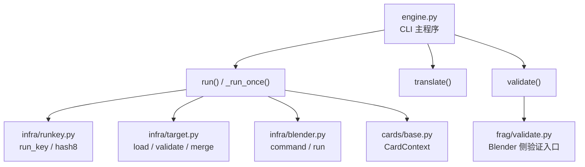
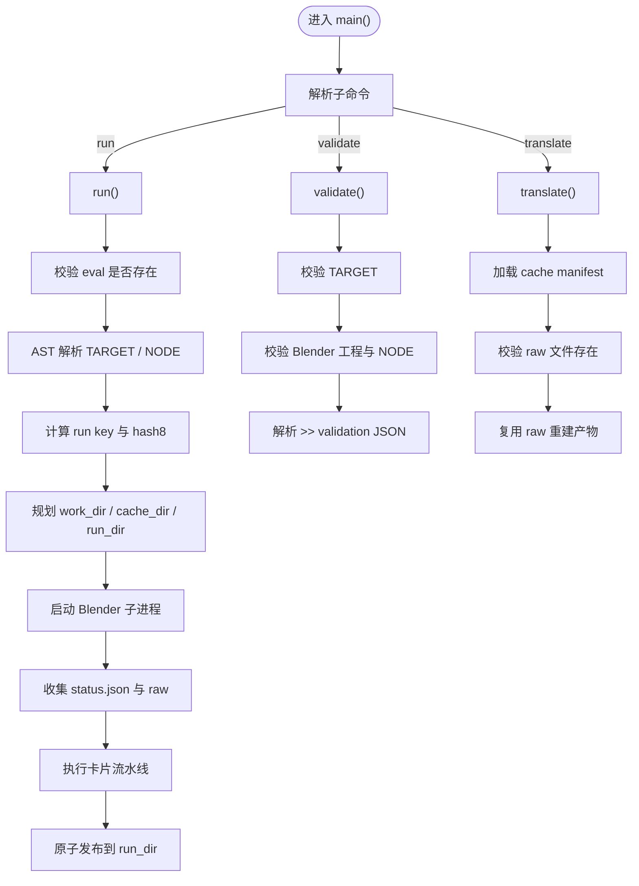
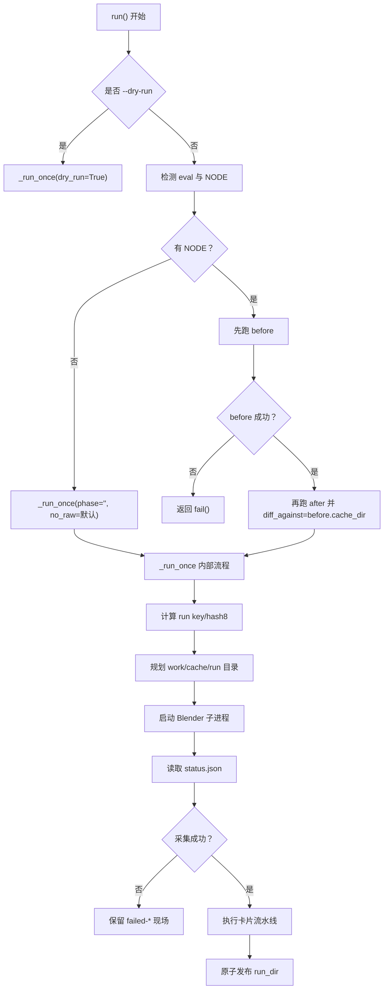
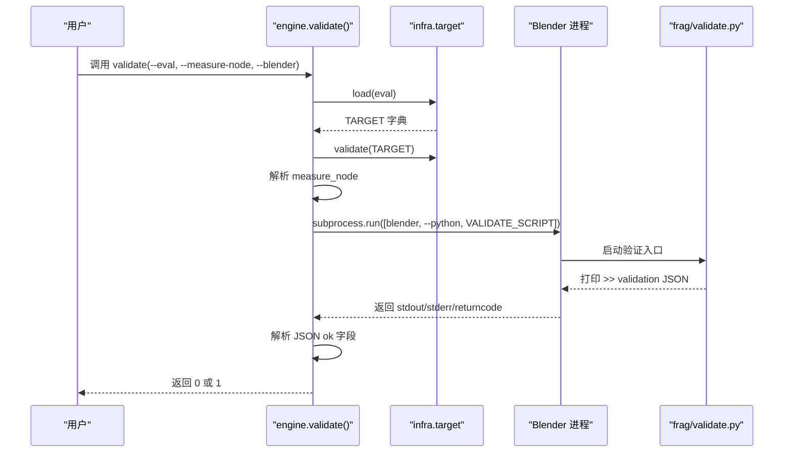
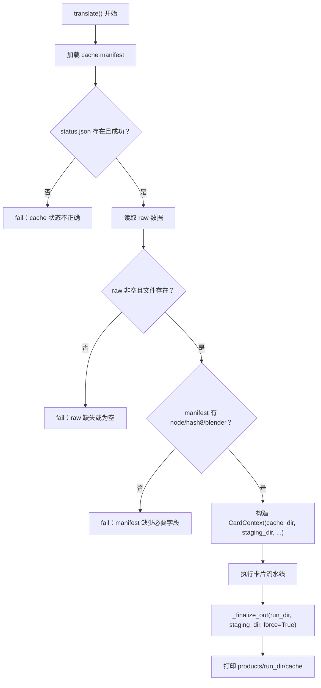
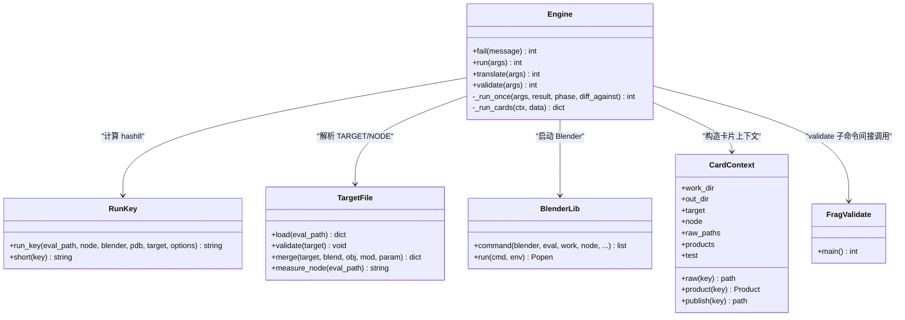

# CLI 子命令：run、validate、translate

<cite>
**本文引用的文件**   
- [engine.py](file://engine.py)
- [infra/runkey.py](file://infra/runkey.py)
- [infra/blender.py](file://infra/blender.py)
- [infra/target.py](file://infra/target.py)
- [cards/base.py](file://cards/base.py)
- [frag/validate.py](file://frag/validate.py)
</cite>

## 目录
1. [引言](#引言)
2. [项目结构](#项目结构)
3. [核心组件](#核心组件)
4. [架构总览](#架构总览)
5. [详细子命令分析](#详细子命令分析)
6. [依赖关系分析](#依赖关系分析)
7. [性能与缓存特性](#性能与缓存特性)
8. [故障排查指南](#故障排查指南)
9. [结论](#结论)

## 引言
engine.py 是 CovTrace 的编排入口，提供三个 CLI 子命令：

- `run`：解析求值脚本、校验 TARGET、计算 run key/hash8、规划工作区、启动 Blender 子进程采集 raw、执行卡片流水线，并原子发布到输出目录。
- `validate`：仅解析 eval 中的 TARGET 和 NODE，调用 Blender 侧的验证脚本检查工程、对象、几何节点修改器与区域，不触发任何闸门求值。
- `translate`：从已有 `cache/<node>/<hash8>/` 中读取 manifest 与 raw，复用已采集数据重新执行卡片流水线，不再启动 Blender。

这三个命令共享参数解析、TARGET 解析、路径重定位、失败现场保留与卡片上下文等基础设施，但职责边界清晰：`run` 负责完整采集与发布；`validate` 只做轻量验证；`translate` 只做离线翻译。

## 项目结构
与本说明直接相关的代码分布在以下位置：



**图表来源**
- [engine.py:201-562](file://engine.py#L201-L562)
- [infra/runkey.py:1-44](file://infra/runkey.py#L1-L44)
- [infra/blender.py:1-39](file://infra/blender.py#L1-L39)
- [infra/target.py:1-81](file://infra/target.py#L1-L81)
- [cards/base.py:1-63](file://cards/base.py#L1-L63)
- [frag/validate.py:1-66](file://frag/validate.py#L1-L66)

**章节来源**
- [engine.py:1-200](file://engine.py#L1-L200)
- [engine.py:201-562](file://engine.py#L201-L562)

## 核心组件
- `fail(message)`：向标准错误输出写入以 `!! ` 开头的错误消息，返回整数 `1`。这是 CLI 层统一的错误返回值约定。
- `_run_once(a, ...)`：`run` 的核心实现，负责解析 eval、TARGET、Blender、计算 key/hash8、创建工作区、启动 Blender、收集 status/raw、执行卡片流水线并发布。
- `translate(a)`：从 cache 目录加载 manifest 与 status/raw，构造 CardContext，跳过 Blender，直接运行卡片流水线。
- `validate(a)`：解析 TARGET 与 NODE，构造外部验证命令，通过 subprocess 启动 Blender 侧验证脚本，解析 JSON 结果。
- `CardContext`：为卡片提供 work_dir、out_dir、target、raw_paths、products、options、test 等运行时视图。
- `runkey.run_key()`：基于 eval 内容、node、blender、pdb、target、options 生成 SHA-256 run key；`short()` 取前 8 位作为 hash8。
- `infra.target`：安全地 AST 解析 eval 中的 TARGET 与 NODE，合并命令行覆盖项，并校验必填字段。
- `infra.blender.command()`：组装 Blender 子进程命令行，把 gates、blend、obj、mod、param、phase、measure-node 等参数传递下去。

**章节来源**
- [engine.py:18-19](file://engine.py#L18-L19)
- [engine.py:201-562](file://engine.py#L201-L562)
- [cards/base.py:1-63](file://cards/base.py#L1-L63)
- [infra/runkey.py:1-44](file://infra/runkey.py#L1-L44)
- [infra/target.py:1-81](file://infra/target.py#L1-L81)
- [infra/blender.py:1-39](file://infra/blender.py#L1-L39)

## 架构总览
engine.py 的三个子命令在控制流上呈分层结构：



**图表来源**
- [engine.py:201-562](file://engine.py#L201-L562)
- [infra/target.py:1-81](file://infra/target.py#L1-L81)
- [infra/blender.py:1-39](file://infra/blender.py#L1-L39)
- [frag/validate.py:1-66](file://frag/validate.py#L1-L66)

## 详细子命令分析

### run：完整采集、卡片流水线与原子发布

#### 职责差异
`run` 是唯一会真正“跑一次求值”的子命令。它可能执行两次 `_run_once`：当检测到自动 diff 场景时，先以 `before` phase 采集基准，再以 `after` phase 对比；否则只执行一次。

典型流程：
1. 解析 `--eval`、`--node`、`--blender` 等参数。
2. 如果未设置 `--dry-run`，且 eval 中有可测量的 NODE，则尝试自动 diff。
3. `_run_once` 内解析 TARGET，合并命令行覆盖项，校验 Blender 路径。
4. 计算 run key 与 hash8，确定 `run_dir`、`cache_dir`、`work_dir`。
5. 检查重复、冲突或不完整状态。
6. 创建临时工作区并写入 manifest base。
7. 通过 `infra.blender.command()` 启动 Blender，传入 gates、phase、measure-node 等。
8. 读取 `status.json`，捕获采集异常或 raw 缺失问题。
9. 执行卡片流水线 `_run_cards`，产出公开产品。
10. 将 raw 重定位到 cache，最后原子替换 `run_dir`。

#### 关键处理逻辑
- **run key/hash8**：由 `runkey.run_key(eval_path, node, blender, pdb, target, options)` 生成，再取前 8 位。不同 eval、node、blender/pdb、target 或 options 会得到不同 hash8。
- **工作区规划**：
  - `run_dir = out/<safe_name(node)>/<hash8>`：最终发布目录。
  - `cache_dir = CACHE_DIR/<safe_name(node)>/<hash8>`：raw 缓存目录。
  - `work_dir = cache_dir.tmp`：Blender 写入的临时工作区。
- **原子发布**：先将产物写到 `run_dir/.<hash8>.tmp`，成功后用 `os.replace` 替换目标目录，避免部分发布。
- **raw 清理**：若使用 `--no-raw`，会在发布前清空 data.raw 与 gate.raw，并在成功后删除 `work_dir`；否则将 work_dir 提升为 cache_dir。
- **失败现场**：采集失败、raw 异常或卡片异常时，调用 `_keep_failed` 把 work_dir 移动到 `<hash8>.failed-时间戳`，并可选保留最近 N 个 failed 目录。

#### 主要参数、默认值与规则
| 参数 | 默认值 | 含义与规则 | 典型用法 |
|---|---:|---|---|
| `--eval` | 无 | 必需。包含 TARGET 与可选 NODE 的 Python 求值脚本。必须存在。 | `--eval examples/diff.py` |
| `--node` | 无 | 必需。输出目录名，用于区分不同运行。不能为空字符串。 | `--node my_node` |
| `--blend` | `""` | 覆盖 TARGET['blend']。最终需指向存在的 Blender 工程。 | `--blend scene.blend` |
| `--obj` | `""` | 覆盖 TARGET['object']。 | `--obj Cube` |
| `--mod` | `""` | 覆盖 TARGET['modifier']。 | `--mod ModNode` |
| `--param` | `""` | 覆盖 TARGET['param']。 | `--param "{'size': 2}"` |
| `--blender` | `""` | 覆盖插桩 Blender 路径；为空时使用内置默认值。必须存在。 | `--blender C:\tools\blender.exe` |
| `--out` | `""` | 输出根目录；为空时使用默认 OUT_DIR。 | `--out results` |
| `--force` | `False` | 覆盖重复、冲突或不完整的 run_dir。 | `--force` |
| `--dry-run` | `False` | 只检查路径与重复状态，不启动 Blender。 | `--dry-run` |
| `--keep-cache` | `5` | 每个节点目录最多保留最近 N 个 cache 子目录。`0` 表示不清理。 | `--keep-cache 3` |
| `--no-raw` | `False` | 所有卡片成功后删除 raw 缓存。 | `--no-raw` |
| `--keep-all` | `False` | 让 coverage 不过滤路径，保留更多覆盖率信息。 | `--keep-all` |
| `--test` | `False` | 保留 disasm、timing 等内部中间产物。 | `--test` |
| `--measure-node` | `""` | 覆盖 eval 中定义的 NODE，用于自动 diff 或测量。 | `--measure-node MyNode` |

#### run 的控制流程图


**图表来源**
- [engine.py:201-562](file://engine.py#L201-L562)
- [infra/runkey.py:1-44](file://infra/runkey.py#L1-L44)
- [infra/blender.py:1-39](file://infra/blender.py#L1-L39)

**章节来源**
- [engine.py:201-562](file://engine.py#L201-L562)
- [infra/runkey.py:1-44](file://infra/runkey.py#L1-L44)

### validate：仅校验 eval 与 TARGET，不启动求值

#### 职责差异
`validate` 不调用 `_run_once`，也不构建 gates 或执行卡片流水线。它的目标是确认：
- eval 语法正确。
- eval 中存在合法的 TARGET 字面量字典。
- TARGET 包含 blend/object/modifier/param 等必填字段。
- Blender 工程文件存在。
- Blender 中能打开工程、找到对象、找到几何节点修改器。
- 节点区域校验通过，并能根据 NODE 或 `--measure-node` 解析测量目标。

因此，`validate` 是一个轻量级“前置检查”，适合在 CI 或用户输入阶段快速反馈错误。

#### 执行流程
1. 解析 `--eval`、`--measure-node`、`--blender`。
2. 通过 `infra.target.load()` 解析 TARGET，再通过 `validate(target)` 校验必填字段与工程文件。
3. 获取 measure_spec：优先使用 `--measure-node`，否则从 eval 中读取可选 NODE。
4. 如果两者都没有，返回失败。
5. 构造外部命令：`blender --background --python <VALIDATE_SCRIPT> -- --eval <eval> --measure-node <spec>`。
6. 使用 `subprocess.run` 启动 Blender 侧 `frag/validate.py`。
7. 解析 stdout 中以 `>> validation:` 开头的 JSON 行。
8. 如果未解析出结果，返回错误；如果 `ok == false`，返回失败；否则返回子进程返回码。

#### 主要参数、默认值与规则
| 参数 | 默认值 | 含义与规则 | 典型用法 |
|---|---:|---|---|
| `--eval` | 无 | 必需。待校验的求值脚本。 | `--eval test_eval.py` |
| `--measure-node` | `""` | 指定要测量的节点名称。 | `--measure-node TargetNode` |
| `--blender` | `""` | 指定 Blender 路径。 | `--blender blender.exe` |

#### validate 的序列图


**图表来源**
- [engine.py:497-533](file://engine.py#L497-L533)
- [infra/target.py:1-81](file://infra/target.py#L1-L81)
- [frag/validate.py:1-66](file://frag/validate.py#L1-L66)

**章节来源**
- [engine.py:497-533](file://engine.py#L497-L533)
- [frag/validate.py:1-66](file://frag/validate.py#L1-L66)

### translate：复用已有 raw 重新执行卡片流水线

#### 职责差异
`translate` 不会解析新的 eval，也不会启动 Blender。它假设 `cache/<node>/<hash8>/` 已经由某次成功的 `run` 生成，包含：
- manifest（run.json）
- status.json
- raw 数据文件

其目标是：
- 校验 manifest 与 status 状态。
- 校验 raw 文件仍存在于磁盘。
- 构造 CardContext。
- 重新执行卡片流水线，产出最终产品。
- 原子发布到 `out/<node>/<hash8>`。

#### 关键行为
- 如果 cache 中没有 manifest，返回失败。
- 如果 status.json 不存在或不是成功状态，返回失败。
- 如果 raw 数据为空，返回失败。
- 如果 raw 中记录的文件路径不存在，列出缺失路径并返回失败。
- 如果 manifest 缺少 node、hash8 或 blender，返回失败。
- 支持通过 `--keep-all` 覆盖 cache 中的 `coverage_keep_all` 选项。
- 支持通过 `--test` 暴露内部中间产物。
- 始终使用 `force=True` 完成 `_finalize_out`，因为 translate 通常用于离线重建。

#### 主要参数、默认值与规则
| 参数 | 默认值 | 含义与规则 | 典型用法 |
|---|---:|---|---|
| `cache_dir` | 无 | 必需。`cache/<node>/<hash8>` 的实际路径。 | `cache/my_node/abc12345` |
| `--out` | `""` | 输出根目录。 | `--out rebuild_out` |
| `--keep-all` | `None` | 覆盖 cache 中的 coverage_keep_all。 | `--keep-all` |
| `--test` | `False` | 保留内部中间产物。 | `--test` |

#### translate 的执行流程图


**图表来源**
- [engine.py:354-496](file://engine.py#L354-L496)
- [cards/base.py:1-63](file://cards/base.py#L1-L63)

**章节来源**
- [engine.py:354-496](file://engine.py#L354-L496)

## 依赖关系分析



**图表来源**
- [engine.py:201-562](file://engine.py#L201-L562)
- [infra/runkey.py:1-44](file://infra/runkey.py#L1-L44)
- [infra/target.py:1-81](file://infra/target.py#L1-L81)
- [infra/blender.py:1-39](file://infra/blender.py#L1-L39)
- [cards/base.py:1-63](file://cards/base.py#L1-L63)
- [frag/validate.py:1-66](file://frag/validate.py#L1-L66)

**章节来源**
- [engine.py:201-562](file://engine.py#L201-L562)
- [infra/runkey.py:1-44](file://infra/runkey.py#L1-L44)
- [infra/target.py:1-81](file://infra/target.py#L1-L81)
- [infra/blender.py:1-39](file://infra/blender.py#L1-L39)
- [cards/base.py:1-63](file://cards/base.py#L1-L63)
- [frag/validate.py:1-66](file://frag/validate.py#L1-L66)

## 性能与缓存特性
- **hash8 复用**：相同 eval、node、blender/pdb、TARGET 与 options 会命中同一 hash8，避免重复计算。
- **自动 diff**：当 eval 中包含 NODE 时，`run` 先跑 before，再跑 after 并 diff against before 的 cache。这有助于比较优化前后差异。
- **raw 缓存**：默认情况下，work_dir 会被提升为 cache_dir，后续可用 `translate` 直接重建产物。
- **缓存清理**：每个节点目录下按修改时间排序，最多保留 `--keep-cache` 个最新目录；失败目录也受该策略影响。
- **`--no-raw`**：适用于只需最终产物、不需要保留原始采集数据的场景。
- **`--keep-all`**：保留更完整的覆盖率信息，适合调试，但会增加缓存体积。

[本节为通用指导，不直接分析具体代码行]

## 故障排查指南

### 错误输出格式
- 引擎层错误统一通过 `fail(message)` 输出，格式为：
  ```
  !! 错误消息
  ```
- 错误返回值约定：
  - `fail(...)` 返回 `1`。
  - `main()` 在未识别子命令时返回 `2`。
  - `validate()` 在无法解析 validation JSON 或结果为失败时返回 `1`。
  - 正常成功返回 `0`。

### 常见问题与诊断步骤

| 现象 | 可能原因 | 诊断建议 |
|---|---|---|
| `找不到求值脚本` | `--eval` 路径错误或不存在 | 检查绝对/相对路径；先用 `--dry-run` 确认。 |
| `--node 不能为空` | 忘记传 `--node` 或传入空字符串 | 传入有意义的节点名。 |
| `TARGET 缺少字段` | eval 中 TARGET 不完整 | 检查 blend/object/modifier/param。 |
| `找不到插桩 blender` | `--blender` 为空或路径无效 | 指定有效 Blender 路径。 |
| `你要的东西已经跑过了` | run_dir 已存在且重复 | 使用 `--force` 覆盖，或更换 node/hash8。 |
| `采集失败` | Blender 子进程未生成成功 status.json | 查看 stderr；检查 gates、NODE、工程文件。 |
| `采集结果异常` | functions.bin 为空、edge_count 为 0 或覆盖率文件缺失 | 检查求值是否触发目标函数；必要时加 `--keep-all`。 |
| `翻译失败` | 卡片流水线抛出异常 | 使用 `--test` 暴露中间产物；检查 raw 是否完整。 |
| `cache 里没有 run.json` | translate 指向了错误目录 | 确认 cache_dir 是 `cache/<node>/<hash8>`。 |
| `cache raw 文件缺失` | 原始 raw 被移动或删除 | 重新运行 `run`，不要提前清理 cache。 |

### 如何通过 `--test` 暴露内部产物
- `--test` 会让 `CardContext.publish()` 对内部产品也暴露到公共输出目录。
- 对于 `run`，内部中间产物如 disasm、timing 等 JSON 不会被 `_drop_internal` 删除。
- 对于 `translate`，同样保留这些中间产物，便于离线复查。

### 如何查看 `status.json` 与 `failed-*` 现场
- 成功采集后，`status.json` 位于 work_dir；发布成功后，work_dir 可能被提升到 cache_dir，或被删除（取决于 `--no-raw`）。
- 失败时，`_keep_failed` 会把 work_dir 移动到 `<hash8>.failed-时间戳[-序号]`，并打印 `>> failed raw: <dest>`。
- 失败现场包含：
  - 原 manifest 数据（路径会被重定位到 failed 目录）。
  - status.json（同样重定位并重写）。
  - 原始 raw 文件。
- 可通过 `--keep-cache` 控制保留数量；设为 `0` 可关闭自动清理，方便长期保留现场。

### 调试建议
1. 先用 `--dry-run` 检查路径、TARGET 与重复状态。
2. 使用 `--test` 保留中间产物。
3. 使用 `--keep-all` 保留更完整的覆盖率数据。
4. 如果自动 diff 不稳定，先用固定 `--measure-node` 复现。
5. 失败时优先查看 `failed-*` 目录中的 status.json 与 raw。
6. 用 `translate` 针对同一个 cache_dir 多次重建，排除 Blender 侧噪声。

**章节来源**
- [engine.py:18-19](file://engine.py#L18-L19)
- [engine.py:201-562](file://engine.py#L201-L562)
- [cards/base.py:1-63](file://cards/base.py#L1-L63)

## 结论
engine.py 的 CLI 设计把“采集”“验证”“离线重建”三种职责拆分为三个子命令：

- `run` 是主流程，负责解析、校验、计算 hash8、启动 Blender、采集 raw、执行卡片流水线并原子发布。
- `validate` 只做轻量验证，确保 TARGET、Blender 工程与 NODE 合法，不触发闸门求值。
- `translate` 完全依赖已有 cache，不重启 Blender，只重新执行卡片流水线。

三者共享相同的参数族与错误模型，并通过 `--test`、`--keep-all`、`--no-raw`、`--keep-cache` 等选项覆盖行为。实际排错时，应优先观察 `!!` 错误输出、status.json 与 `failed-*` 现场，并结合 `--dry-run` 与 `translate` 缩小问题范围。