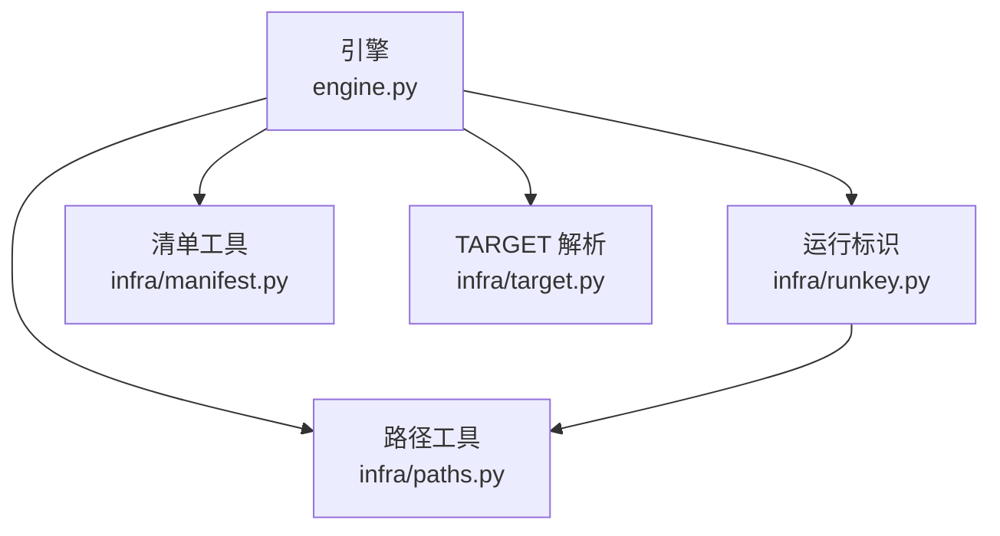
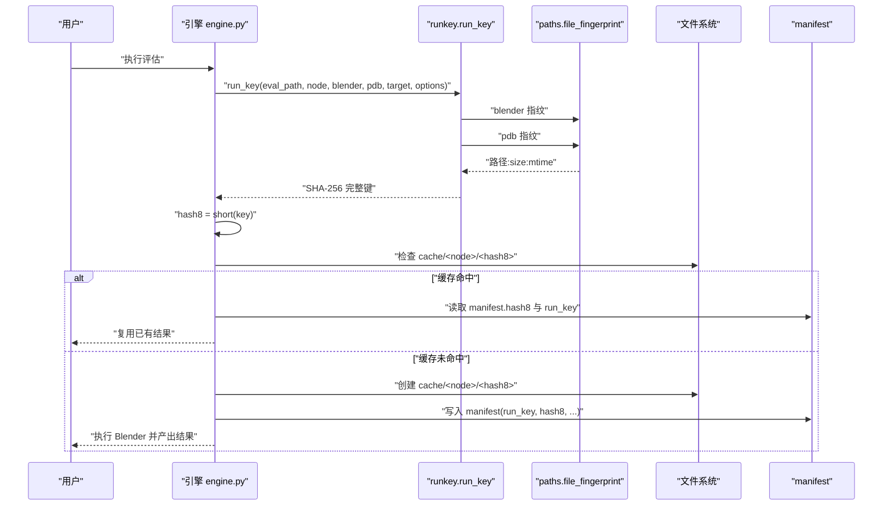
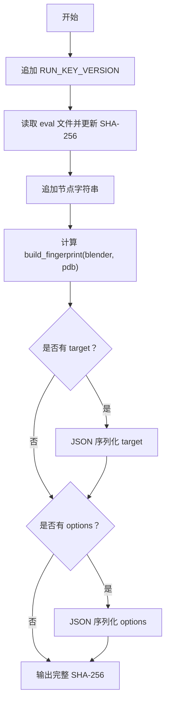
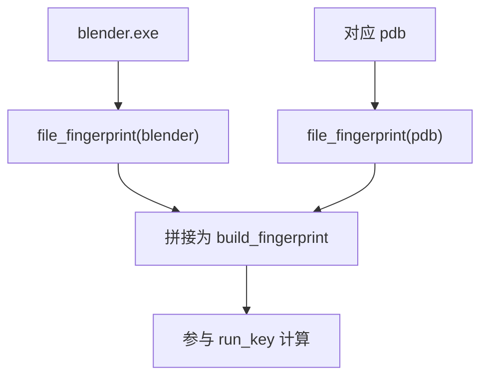
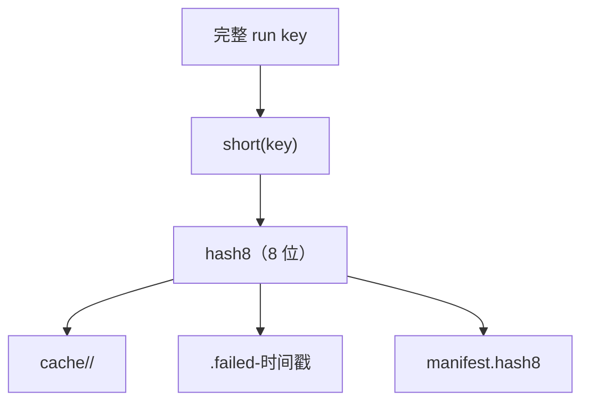
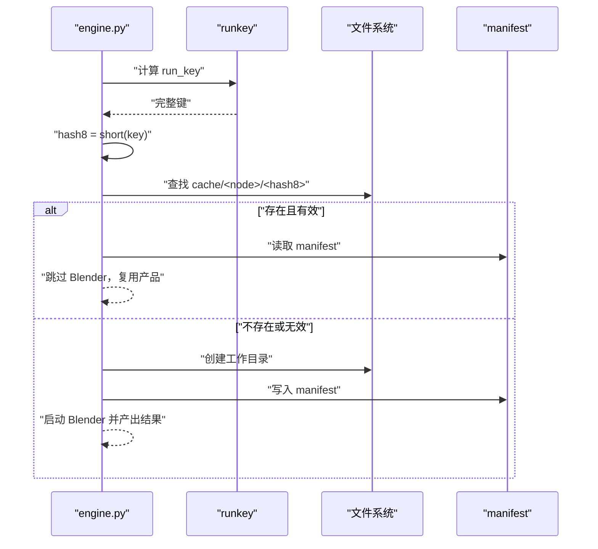
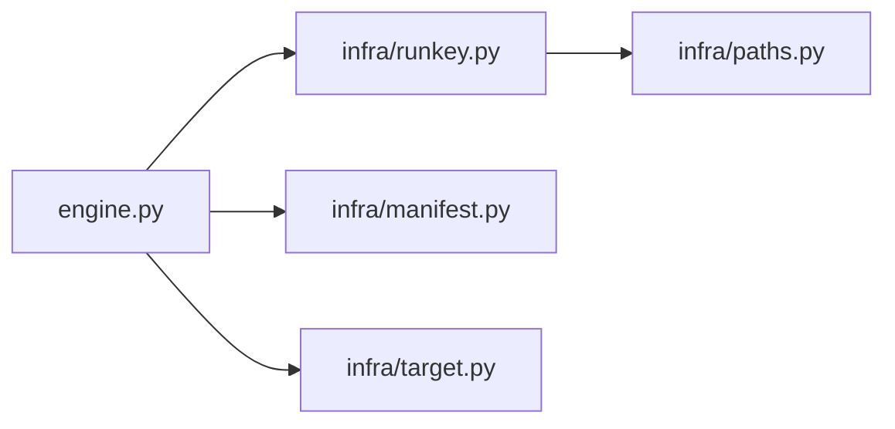

# run key 与 hash8 标识体系

<cite>
**本文引用的文件**   
- [engine.py](file://engine.py)
- [infra/runkey.py](file://infra/runkey.py)
- [infra/paths.py](file://infra/paths.py)
- [infra/target.py](file://infra/target.py)
- [infra/manifest.py](file://infra/manifest.py)
</cite>

## 目录
1. [引言](#引言)
2. [项目结构](#项目结构)
3. [核心组件](#核心组件)
4. [架构总览](#架构总览)
5. [详细组件分析](#详细组件分析)
6. [依赖关系分析](#依赖关系分析)
7. [性能与缓存特性](#性能与缓存特性)
8. [故障诊断指南](#故障诊断指南)
9. [结论](#结论)

## 引言
本说明聚焦于 CovTrace 的缓存标识体系：run key 与 hash8。它们的目标是保证“同一组评估脚本、节点、Blender 构建产物、PDB、可选 TARGET 与 options”能够复现地命中缓存，从而避免重复执行 Blender。

- run key 是一个完整的 SHA-256 字符串，用于判断一次运行是否语义等价。
- hash8 是 run key 的前 8 个十六进制字符，用作磁盘上的短标识符，并写入 manifest 中，便于人类定位具体某次运行。

## 项目结构
与 run key 和 hash8 直接相关的代码分布在以下模块：

**图表来源**
- [engine.py:270-320](file://engine.py#L270-L320)
- [infra/runkey.py:1-44](file://infra/runkey.py#L1-L44)
- [infra/paths.py:1-32](file://infra/paths.py#L1-L32)
- [infra/manifest.py:1-58](file://infra/manifest.py#L1-L58)
- [infra/target.py:1-81](file://infra/target.py#L1-L81)

**章节来源**
- [engine.py:1-120](file://engine.py#L1-L120)
- [infra/runkey.py:1-44](file://infra/runkey.py#L1-L44)
- [infra/paths.py:1-32](file://infra/paths.py#L1-L32)
- [infra/manifest.py:1-58](file://infra/manifest.py#L1-L58)
- [infra/target.py:1-81](file://infra/target.py#L1-L81)

## 核心组件
- `run_key`：计算一次运行的完整标识。它把版本标记、eval 内容、node、blender/pdb 指纹、target 与 options 统一编码进一个 SHA-256。
- `build_fingerprint`：将 blender.exe 与 pdb 的二进制信息拼接为 build fingerprint。
- `paths.file_fingerprint`：对单个二进制文件生成轻量指纹，包含规范化路径、文件大小与修改时间。
- `short`：取 run key 前 8 位作为 hash8。
- `engine.py`：调用 run_key，决定走缓存还是新建运行，并把 hash8 写入工作目录名、失败备份名以及 manifest。

**章节来源**
- [infra/runkey.py:1-44](file://infra/runkey.py#L1-L44)
- [infra/paths.py:1-32](file://infra/paths.py#L1-L32)
- [engine.py:270-340](file://engine.py#L270-L340)

## 架构总览
下图展示 engine 在一次运行中如何使用 run key 与 hash8 完成缓存判定与目录组织。

**图表来源**
- [engine.py:275-320](file://engine.py#L275-L320)
- [infra/runkey.py:17-44](file://infra/runkey.py#L17-L44)
- [infra/paths.py:19-28](file://infra/paths.py#L19-L28)
- [infra/manifest.py:43-58](file://infra/manifest.py#L43-L58)

## 详细组件分析

### run_key 的设计目标与拼接规则
`run_key` 的设计目标是让“语义相同的一次评估”产生相同的哈希值。它依次拼接以下部分：

| 输入 | 作用 | 变化影响 |
|---|---|---|
| `RUN_KEY_VERSION` | 固定版本头，防止未来格式变更误命中旧缓存 | 升级标识格式后应重新构建缓存 |
| eval 文件内容 | 使用 SHA-256 流式读取整个 eval 脚本 | eval 任何字节变化都会改变 run key |
| node | 当前节点名称 | 不同节点不会互相复用 |
| build fingerprint | 由 blender 与 pdb 共同构成 | Blender 或 PDB 变更会失效 |
| target | 可选，按 JSON 序列化 | TARGET 字段变化会影响缓存 |
| options | 可选，按 JSON 序列化 | options 变化会影响缓存 |

其中，target 与 options 仅在传入非空值时才会加入哈希；二者均通过 JSON 序列化并以固定排序方式编码，避免字典顺序差异导致哈希不一致。

**图表来源**
- [infra/runkey.py:17-44](file://infra/runkey.py#L17-L44)

**章节来源**
- [infra/runkey.py:1-44](file://infra/runkey.py#L1-L44)

### build_fingerprint 与二进制变更感知
`build_fingerprint` 返回的是 blender 与 pdb 两个文件的指纹拼接结果。每个文件的指纹由 `paths.file_fingerprint` 生成，其组成包括：

- 规范化后的绝对路径
- 文件大小
- 以纳秒为单位的修改时间

这意味着只要 Blender 可执行文件或对应 PDB 的文件内容、路径、大小或 mtime 发生变化，build fingerprint 就会变化，进而使 run key 失效，强制重建缓存。

**图表来源**
- [infra/runkey.py:21-23](file://infra/runkey.py#L21-L23)
- [infra/paths.py:19-28](file://infra/paths.py#L19-L28)

**章节来源**
- [infra/runkey.py:21-23](file://infra/runkey.py#L21-L23)
- [infra/paths.py:19-28](file://infra/paths.py#L19-L28)

### hash8 的作用与目录命名
`hash8` 是 `short(key)` 的结果，即完整 run key 的前 8 个十六进制字符。它在系统中承担三个关键角色：

1. **缓存目录短名**：engine 将运行产物放入 `cache/<node>/<hash8>`。
2. **失败目录后缀**：当运行失败时，工作目录会被重命名为 `<hash8>.failed-时间戳`，便于保留原始数据。
3. **manifest 字段**：每次成功创建的运行会在 `run.json` 中记录 `hash8`，方便后续识别某次具体运行。

**图表来源**
- [infra/runkey.py:42-44](file://infra/runkey.py#L42-L44)
- [engine.py:275-320](file://engine.py#L275-L320)
- [engine.py:74-108](file://engine.py#L74-L108)
- [infra/manifest.py:43-58](file://infra/manifest.py#L43-L58)

**章节来源**
- [infra/runkey.py:42-44](file://infra/runkey.py#L42-L44)
- [engine.py:74-108](file://engine.py#L74-L108)
- [engine.py:275-320](file://engine.py#L275-L320)
- [infra/manifest.py:43-58](file://infra/manifest.py#L43-L58)

### engine.py 中的使用位置与行为
engine 在调度阶段执行以下流程：

1. 根据当前参数调用 `runkey.run_key`。
2. 用 `runkey.short` 生成 hash8。
3. 构造 `out_root` 下的工作目录 `cache/<node>/<hash8>`，并检查是否存在已完成的缓存。
4. 若命中缓存，则直接复用；若未命中，则创建新运行、写入 manifest，并在失败时保留带 hash8 的失败目录。

**图表来源**
- [engine.py:275-320](file://engine.py#L275-L320)
- [infra/manifest.py:27-41](file://infra/manifest.py#L27-L41)

**章节来源**
- [engine.py:270-340](file://engine.py#L270-L340)

### 当 run key 相同但节点或评估脚本变化时会发生什么
从实现角度看，这种情况不应出现：

- `run_key` 已经显式包含 eval 文件内容与 node。因此，如果 eval 内容或 node 发生变化，run key 必然变化，hash8 也会变化。
- hash8 用于目录命名，所以新的运行会进入新的 `cache/<node>/<hash8>`，不会覆盖旧结果。
- manifest 同时记录 `run_key` 与 `hash8`。即使未来有人手工复制目录，系统也可以通过 manifest 中的 run_key 区分新旧语义。

因此，更准确的理解是：**run key 相同意味着 eval、node、blender、pdb、target 与 options 均未变化；hash8 则是该语义等价类的短标识**。

**章节来源**
- [infra/runkey.py:17-44](file://infra/runkey.py#L17-L44)
- [engine.py:275-320](file://engine.py#L275-L320)
- [infra/manifest.py:43-58](file://infra/manifest.py#L43-L58)

### 如何通过 hash8 定位具体一次运行
在实际使用中，可以按以下方式定位：

1. 查看 `cache/<node>/<hash8>/run.json`。
2. 读取其中的 `hash8` 与 `run_key`。
3. 确认 `eval`、`blend`、`blender`、`pdb`、`options` 是否与预期一致。
4. 若需要比较两次运行，优先比较 `run_key`；若只关心磁盘位置，则使用 `hash8`。

这尤其适合在 CI 日志或调试输出中看到某个 hash8 后，快速跳转到对应缓存目录。

**章节来源**
- [infra/manifest.py:43-58](file://infra/manifest.py#L43-L58)
- [engine.py:300-320](file://engine.py#L300-L320)

## 依赖关系分析
run key 体系的依赖链如下：

- `engine.py` 负责编排：计算 run key、选择缓存目录、读写 manifest。
- `infra/runkey.py` 负责标识：组合 eval、node、build fingerprint、target、options。
- `infra/paths.py` 提供文件指纹与路径安全化。
- `infra/manifest.py` 提供 run.json 的读写与分类。
- `infra/target.py` 负责解析 eval 中的 TARGET，但不直接参与 run key 的哈希计算——只有当 target 被传入 `run_key` 时才影响缓存。

**图表来源**
- [engine.py:270-320](file://engine.py#L270-L320)
- [infra/runkey.py:1-44](file://infra/runkey.py#L1-L44)
- [infra/paths.py:1-32](file://infra/paths.py#L1-L32)
- [infra/manifest.py:1-58](file://infra/manifest.py#L1-L58)
- [infra/target.py:1-81](file://infra/target.py#L1-L81)

**章节来源**
- [engine.py:270-320](file://engine.py#L270-L320)
- [infra/runkey.py:1-44](file://infra/runkey.py#L1-L44)
- [infra/paths.py:1-32](file://infra/paths.py#L1-L32)
- [infra/manifest.py:1-58](file://infra/manifest.py#L1-L58)
- [infra/target.py:1-81](file://infra/target.py#L1-L81)

## 性能与缓存特性
- 缓存粒度是 `cache/<node>/<hash8>`。同一 node 下不同 hash8 表示不同运行实例。
- 失败运行不会被删除，而是以 `<hash8>.failed-时间戳` 形式保留，并可受清理策略限制。
- hash8 足够短，便于日志显示与目录遍历；完整 run key 用于精确语义比较。
- file_fingerprint 使用路径、大小与 mtime，属于轻量级二进制指纹，成本很低，但能捕获大多数 Blender/PDB 替换场景。

**章节来源**
- [engine.py:74-108](file://engine.py#L74-L108)
- [engine.py:275-320](file://engine.py#L275-L320)
- [infra/paths.py:19-28](file://infra/paths.py#L19-L28)

## 故障诊断指南
当期望复用缓存却未命中时，应按以下顺序排查：

1. **检查 eval 内容**  
   eval 文件任意字节变化都会改变 run key。确认评估脚本是否被编辑、格式化或换行风格变化。

2. **检查 TARGET**  
   如果本次运行传入了 target，则 TARGET 字段的任何变化都会影响缓存。确保 blend、object、modifier、param 等字段与上次一致。

3. **检查 blender.exe**  
   Blender 可执行文件路径、大小或 mtime 变化会导致 build fingerprint 变化。更换 Blender 安装路径或重新编译后会失效。

4. **检查 PDB**  
   对应 pdb 的变化同样会破坏缓存。确认 PDB 与 blender.exe 匹配。

5. **检查 options**  
   如果调用了带有 options 的接口，options 的 JSON 序列化内容也会影响缓存。

6. **对照 manifest**  
   打开 `cache/<node>/<hash8>/run.json`，对比 `run_key`、`hash8`、`eval`、`blend`、`blender`、`pdb`、`options`。若这些字段与预期不一致，就能解释为什么没有命中。

7. **检查失败目录**  
   若运行失败，engine 会把工作目录重命名为 `<hash8>.failed-时间戳`。此时应检查该目录下是否保留了原始状态与日志。

**章节来源**
- [infra/runkey.py:17-44](file://infra/runkey.py#L17-L44)
- [infra/manifest.py:27-58](file://infra/manifest.py#L27-L58)
- [engine.py:74-108](file://engine.py#L74-L108)
- [engine.py:275-320](file://engine.py#L275-L320)

## 结论
run key 与 hash8 共同构成了 CovTrace 的缓存身份层：

- run key 保证语义等价性：eval 内容、node、Blender、PDB、target 与 options 全部一致时才会复用缓存。
- build fingerprint 把 Blender 与 PDB 的二进制变更纳入考虑，避免混用不同构建产物。
- hash8 是 run key 的短标识，用于目录命名、失败备份与 manifest 字段，帮助人类快速定位某次具体运行。
- engine.py 是唯一对外编排点：它计算 run key、选择缓存目录、写入 manifest，并在失败时保留可诊断的运行痕迹。

理解这套机制后，遇到缓存未命中时，应优先对比 eval、TARGET、blender.exe 与 pdb 是否发生变化，而不是盲目删除整个缓存目录。