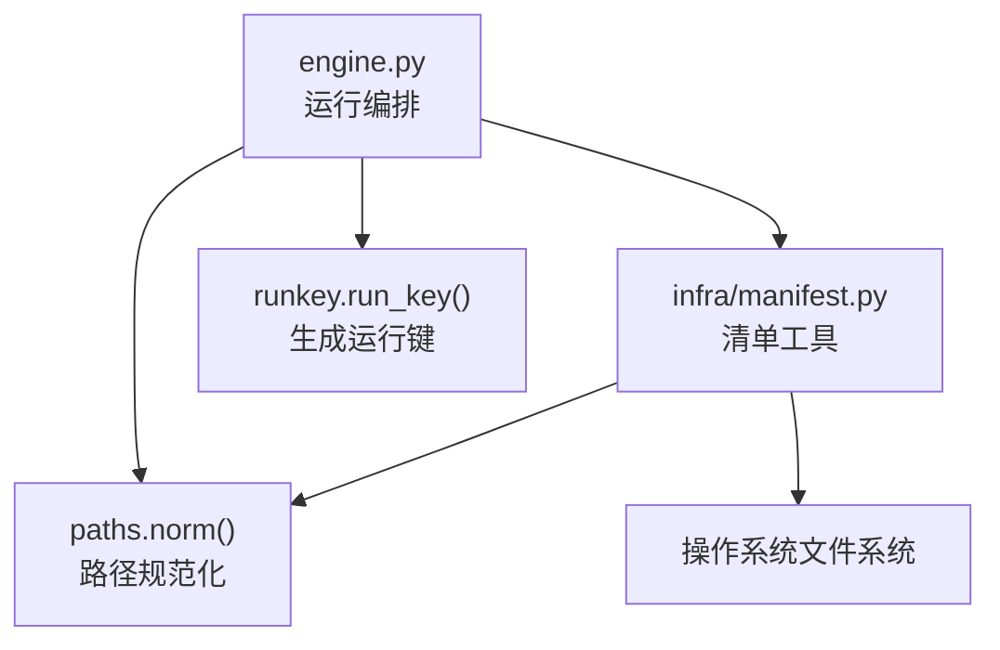
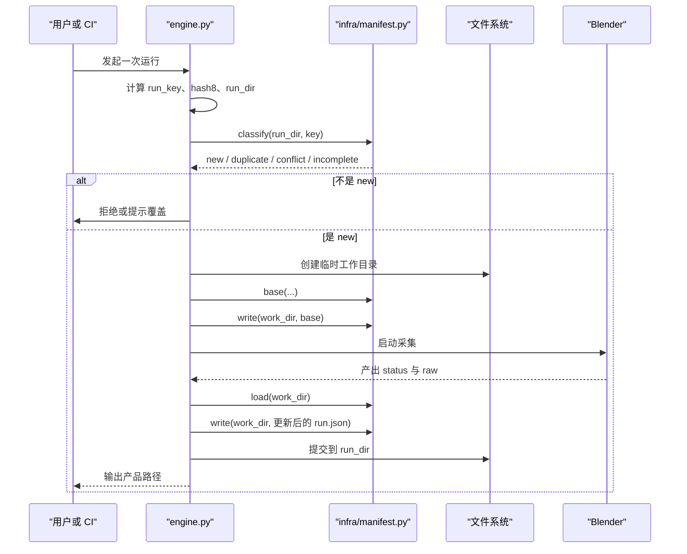
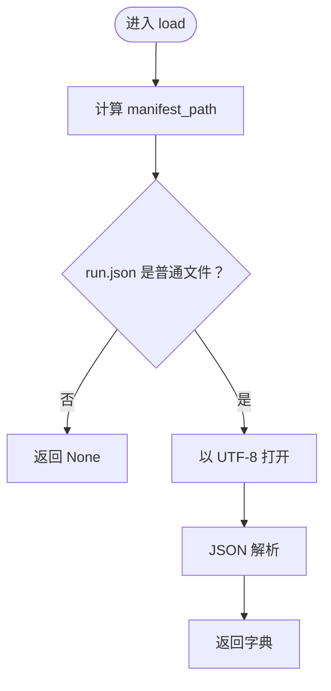
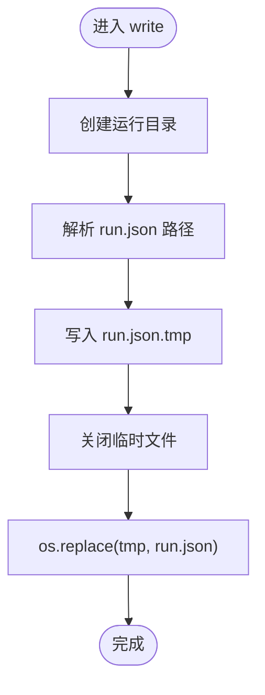
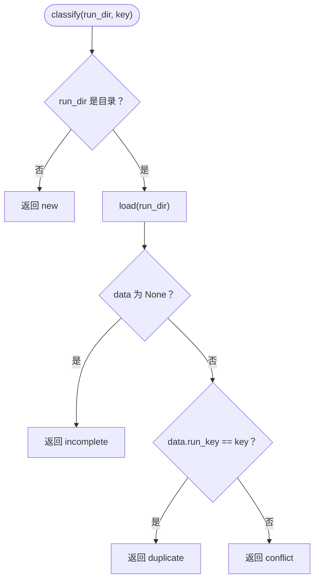
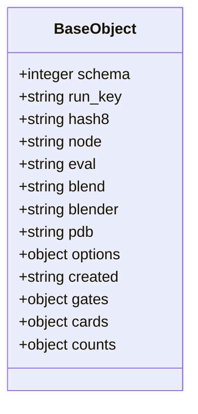
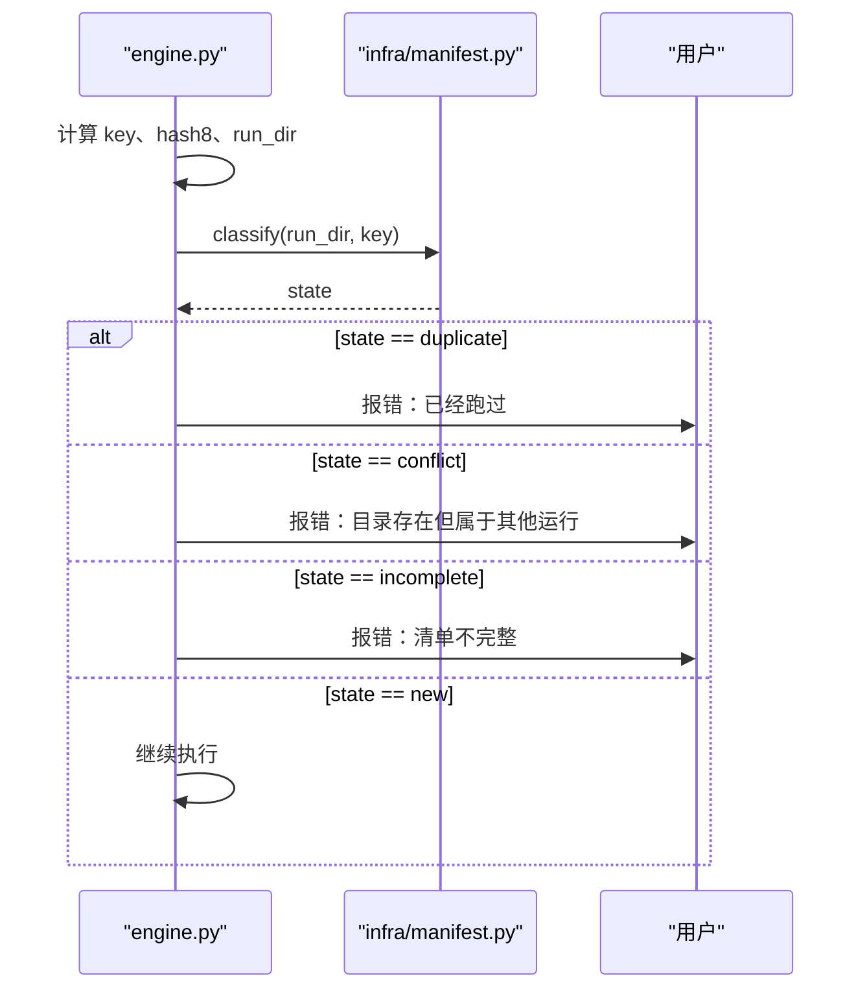
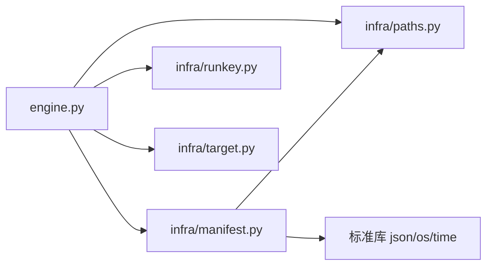

# run manifest 分类 new/duplicate/conflict/incomplete

<cite>
**本文引用的文件**   
- [infra/manifest.py](file://infra/manifest.py)
- [engine.py](file://engine.py)
</cite>

## 目录
1. [引言](#引言)
2. [项目结构与角色划分](#项目结构与角色划分)
3. [核心组件与职责](#核心组件与职责)
4. [架构总览](#架构总览)
5. [详细组件分析](#详细组件分析)
6. [依赖关系分析](#依赖关系分析)
7. [性能与可靠性考虑](#性能与可靠性考虑)
8. [故障排查指南](#故障排查指南)
9. [结论](#结论)

## 引言
本文件聚焦于 `infra/manifest.py` 中用于管理单次运行元数据（`run.json`）的核心函数，以及 `engine.py` 如何利用该元数据进行“重复运行判断”。目标包括：

- 解释 `manifest_path`、`load`、`write`、`classify`、`base` 的职责。
- 明确 `classify(run_dir, key)` 返回 `new`、`duplicate`、`conflict`、`incomplete` 的判断规则。
- 说明 `base()` 构造的结构化基线对象及其字段用途。
- 强调 `write()` 使用 `.tmp` + `os.replace` 的原子写入模式。
- 给出 CI 场景中跳过重复运行、报告冲突、扩展新元数据字段并保持向后兼容的实践建议。

## 项目结构与角色划分
仓库中与本次主题直接相关的代码分布在两个位置：

| 文件 | 角色 | 主要职责 |
|---|---|---|
| `infra/manifest.py` | 运行清单工具层 | 提供 `run.json` 的路径、读取、写入、分类和基线构造能力。 |
| `engine.py` | 引擎编排层 | 计算运行键、调用 `manifest.classify` 做重复性决策，并在不同阶段读写 `run.json`。 |

**图表来源**
- [engine.py:201-450](file://engine.py#L201-L450)
- [infra/manifest.py:1-58](file://infra/manifest.py#L1-L58)

**章节来源**
- [infra/manifest.py:1-58](file://infra/manifest.py#L1-L58)
- [engine.py:201-450](file://engine.py#L201-L450)

## 核心组件与职责
`infra/manifest.py` 暴露五个关键符号：

| 符号 | 输入 | 输出或副作用 | 用途 |
|---|---|---|---|
| `manifest_path(run_dir)` | 运行目录 | 字符串 | 计算 `run.json` 的绝对路径。 |
| `load(run_dir)` | 运行目录 | `None` 或 JSON 字典 | 安全读取 `run.json`；不存在时返回 `None`。 |
| `write(run_dir, data)` | 运行目录、字典 | 无返回值 | 原子写入 `run.json`。 |
| `classify(run_dir, key)` | 运行目录、运行键 | 字符串 | 判断是否为新运行、已完成、冲突或缺失清单。 |
| `base(...)` | 运行时参数 | 结构化字典 | 构造一个最小可用且可扩展的 `run.json` 基线对象。 |

**章节来源**
- [infra/manifest.py:1-58](file://infra/manifest.py#L1-L58)

## 架构总览
`engine.py` 在一次执行中大致经历以下阶段：

1. 解析命令行与目标配置。
2. 计算 `run_key` 和 `hash8`。
3. 确定 `run_dir`。
4. 调用 `manifest.classify(run_dir, key)` 决定行为。
5. 若允许继续，则在临时工作目录中写入初始 `run.json`。
6. 启动 Blender 采集原始数据。
7. 将闸门结果、计数等合并回 `run.json`。
8. 通过卡片流程生成产品。
9. 最终将产物落盘到 `run_dir`，并可能写入缓存目录。

**图表来源**
- [engine.py:201-450](file://engine.py#L201-L450)
- [infra/manifest.py:1-58](file://infra/manifest.py#L1-L58)

## 详细组件分析

### `manifest_path(run_dir)`
- 作用：在传入的运行目录下拼接 `run.json`。
- 设计意义：把清单文件名集中定义，避免散落各处硬编码。
- 风险点：如果 `run_dir` 为空或非目录语义值，外层应保证合法性后再调用。

**章节来源**
- [infra/manifest.py:9-12](file://infra/manifest.py#L9-L12)

### `load(run_dir)`
- 行为：
  - 先计算 `manifest_path(run_dir)`。
  - 若 `run.json` 不是普通文件，返回 `None`。
  - 否则以 UTF-8 打开并解析 JSON。
- 返回值约定：
  - `None`：表示清单缺失或无法作为普通文件打开。
  - 字典：已解析的 `run.json` 内容。
- 对上层的影响：`classify` 利用 `None` 表达“目录存在但清单不完整”的情况。

**图表来源**
- [infra/manifest.py:14-21](file://infra/manifest.py#L14-L21)

**章节来源**
- [infra/manifest.py:14-21](file://infra/manifest.py#L14-L21)

### `write(run_dir, data)`
- 行为：
  - 确保 `run_dir` 存在。
  - 计算 `run.json` 路径。
  - 先写入 `<run_dir>/run.json.tmp`。
  - 使用 `json.dump` 并以非 ASCII 转义、缩进为 1 的方式序列化。
  - 追加换行符。
  - 用 `os.replace(tmp, path)` 替换目标文件。
- 原子性保障：
  - 如果写入中途崩溃，只会留下 `.tmp` 文件，不会损坏现有 `run.json`。
  - `os.replace` 在大多数系统上是原子替换操作，避免半写状态被外部读到。
- 可观察性：
  - 人类可读的 JSON 格式便于调试。
  - 末尾换行符合常见文本文件约定。

**图表来源**
- [infra/manifest.py:23-31](file://infra/manifest.py#L23-L31)

**章节来源**
- [infra/manifest.py:23-31](file://infra/manifest.py#L23-L31)

### `classify(run_dir, key)`
这是重复性判断的核心逻辑。其规则如下：

| 条件 | 返回 | 含义 |
|---|---|---|
| `run_dir` 不存在 | `new` | 从未运行过，可以新建。 |
| `run_dir` 存在但 `load` 返回 `None` | `incomplete` | 目录存在但缺少有效的 `run.json`。 |
| `run.json` 中的 `run_key` 等于当前 `key` | `duplicate` | 当前运行已经存在，可直接复用。 |
| `run.json` 中的 `run_key` 不等于当前 `key` | `conflict` | 目录中存在其他运行的清单，发生键冲突。 |

**图表来源**
- [infra/manifest.py:33-41](file://infra/manifest.py#L33-L41)

**章节来源**
- [infra/manifest.py:33-41](file://infra/manifest.py#L33-L41)

### `base(run_key, hash8, node, eval_path, blend, blender, pdb, options=None)`
`base()` 构造一个最小可用的 `run.json` 基线对象，字段如下：

| 字段 | 类型 | 用途 | 兼容性说明 |
|---|---|---|---|
| `schema` | 整数 | 清单版本标识，当前为 `1`。 | 新增不兼容结构时应升级版本号。 |
| `run_key` | 字符串 | 唯一标识一次运行输入组合。 | 上游通过比较该字段区分 `duplicate` 与 `conflict`。 |
| `hash8` | 字符串 | 运行键的短哈希，常用于目录名。 | 方便人类识别与快速定位。 |
| `node` | 字符串 | 被测节点名称。 | 用于输出目录组织与日志显示。 |
| `eval` | 字符串 | 求值脚本路径，经 `paths.norm` 规范化。 | 后续可被重定向或相对化。 |
| `blend` | 字符串 | Blender 场景文件路径，经 `paths.norm` 规范化。 | 与 `blender`、`pdb` 一起描述执行环境。 |
| `blender` | 字符串 | Blender 可执行文件路径，经 `paths.norm` 规范化。 | 用于判断环境一致性。 |
| `pdb` | 字符串 | PDB 调试符号路径，经 `paths.norm` 规范化。 | 某些分析需要符号信息。 |
| `options` | 字典 | 运行选项，默认空字典。 | 新增可选开关时可加入此处。 |
| `created` | 字符串 | 创建时间，格式为 `YYYY-MM-DD HH:MM:SS`。 | 只读时间戳，便于排序和审计。 |
| `gates` | 字典 | 闸门相关数据，初始为空。 | 采集完成后填充实际闸门结果。 |
| `cards` | 字典 | 卡片相关数据，初始为空。 | 第二阶段卡片处理后可扩展。 |
| `counts` | 字典 | 各闸门计数汇总，初始为空。 | 由引擎从闸门统计字段聚合而来。 |

**图表来源**
- [infra/manifest.py:43-58](file://infra/manifest.py#L43-L58)

**章节来源**
- [infra/manifest.py:43-58](file://infra/manifest.py#L43-L58)

### `engine.py` 如何使用 `classify`
`engine.py` 的计算与判断流程如下：

1. 根据求值脚本、节点、Blender、PDB、目标配置和选项计算 `key`。
2. 取 `hash8 = runkey.short(key)`。
3. 构造 `run_dir = out_root / safe_name(node) / hash8`。
4. 调用 `state = manifest.classify(run_dir, key)`。
5. 分支处理：
   - `duplicate`：未启用 `--force` 时报错并退出，提示“已经跑过，用 `--force` 覆盖”。
   - `conflict`：未启用 `--force` 时报错并退出，提示“目录存在但是另一次运行”。
   - `incomplete`：未启用 `--force` 时报错并退出，提示“目录存在但没有完整 manifest”。
   - `new`：继续执行。

**图表来源**
- [engine.py:201-450](file://engine.py#L201-L450)

**章节来源**
- [engine.py:201-450](file://engine.py#L201-L450)

## 依赖关系分析
- `engine.py` 依赖：
  - `infra.manifest`：读取、写入、分类 `run.json`。
  - `infra.paths`：路径规范化。
  - `infra.runkey`：生成运行键和短哈希。
  - `infra.target`：加载和验证目标配置。
- `infra.manifest.py` 依赖：
  - `infra.paths`：用于 `base()` 中对路径字段做规范化。
  - 标准库：`json`、`os`、`time`。

**图表来源**
- [engine.py:1-30](file://engine.py#L1-L30)
- [infra/manifest.py:1-10](file://infra/manifest.py#L1-L10)

**章节来源**
- [engine.py:1-30](file://engine.py#L1-L30)
- [infra/manifest.py:1-10](file://infra/manifest.py#L1-L10)

## 性能与可靠性考虑
- `load()` 仅在文件存在时打开，缺失时直接返回 `None`，避免异常开销。
- `write()` 采用 `.tmp` + `os.replace`，降低并发或中断时的数据损坏风险。
- `base()` 预先初始化 `gates`、`cards`、`counts` 为空字典，使下游模块无需反复检查字段是否存在。
- `classify()` 只做轻量文件系统检查和字典键访问，适合在 CI 高频路径中使用。
- `engine.py` 在失败路径中会保留 `.failed-*` 目录，有助于离线诊断。

[本节为通用指导，不直接分析具体代码行]

## 故障排查指南
常见问题与对应表现：

| 现象 | 可能原因 | 处理建议 |
|---|---|---|
| 提示“已经跑过” | `classify` 返回 `duplicate`，且未加 `--force`。 | 确认是否真的需要重新运行；必要时加 `--force`。 |
| 提示“目录已存在但是另一次运行” | `classify` 返回 `conflict`，`run_key` 不一致。 | 检查是否误用了旧目录、Blender 版本或目标配置变化。 |
| 提示“目录存在但没有完整 manifest” | `classify` 返回 `incomplete`，`load` 返回 `None`。 | 删除残留目录或加 `--force` 重建。 |
| `run.json` 损坏 | 写入过程被中断，`.tmp` 残留。 | 检查 `.tmp` 文件，清理后重试。 |
| 新字段丢失 | 旧版 `run.json` 没有新字段。 | 在读取侧提供默认值；写入侧使用 `base()` 再增量更新。 |

**章节来源**
- [engine.py:201-450](file://engine.py#L201-L450)
- [infra/manifest.py:14-41](file://infra/manifest.py#L14-L41)

## 结论
`infra/manifest.py` 以极简接口封装了 `run.json` 的生命周期管理：路径、读取、原子写入、分类和基线构造。`engine.py` 则基于 `classify(run_dir, key)` 的四种结果，实现 CI 友好的重复运行策略：

- `new`：首次运行，继续执行。
- `duplicate`：已存在相同运行键，跳过。
- `conflict`：目录存在但键不同，视为冲突并拒绝。
- `incomplete`：目录存在但清单缺失，视为损坏或中断。

在实际工程中，推荐：

1. **CI 跳过重复运行**：当 `classify` 返回 `duplicate` 且不需要强制重建时，直接复用已有产物。
2. **CI 报告冲突**：当返回 `conflict` 时记录运行键差异，例如对比 `run_key`、`blender`、`node`、`options`，帮助定位环境漂移。
3. **扩展新元数据字段**：优先放入 `options` 或新的顶层字段，同时保持 `schema` 稳定或按版本演进；读取侧始终提供默认值，确保旧 `run.json` 仍可被消费。
4. **保持向后兼容**：不要假设 `gates`、`cards`、`counts`、`raw`、`options` 一定存在；通过 `dict.get` 或默认值防御式读取。

**章节来源**
- [infra/manifest.py:1-58](file://infra/manifest.py#L1-L58)
- [engine.py:201-450](file://engine.py#L201-L450)