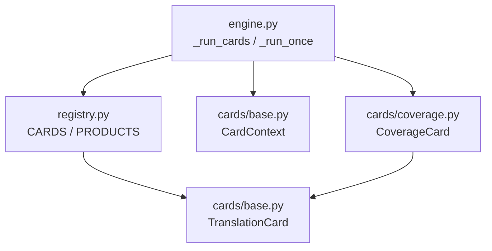
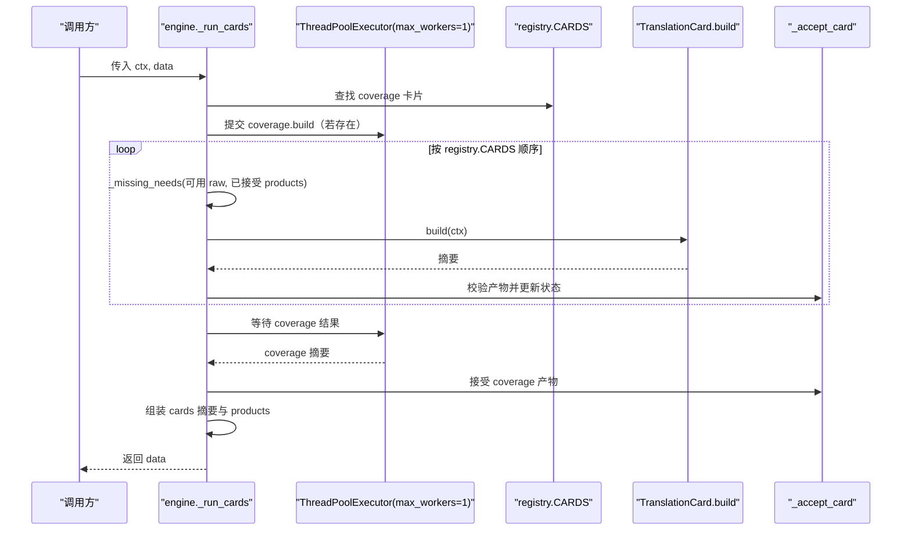
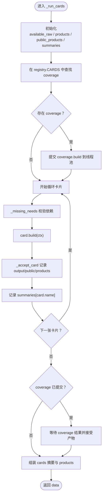
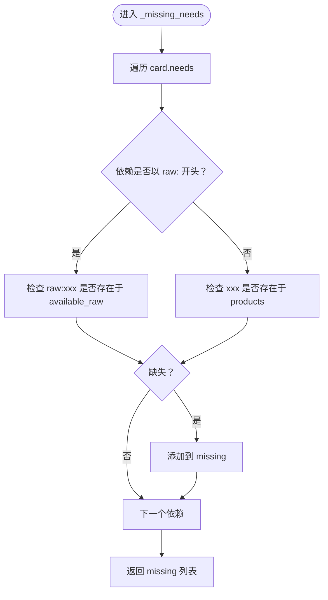
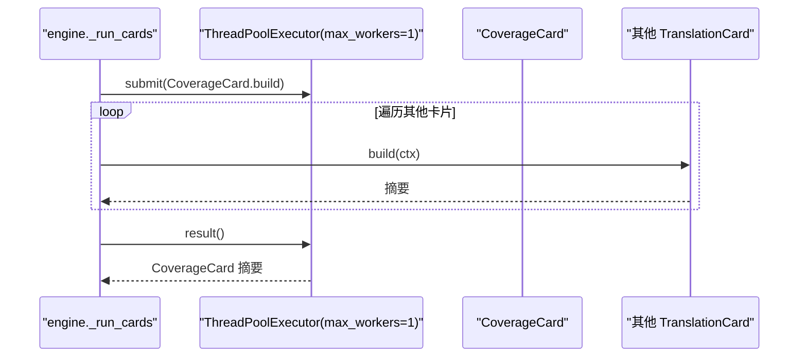
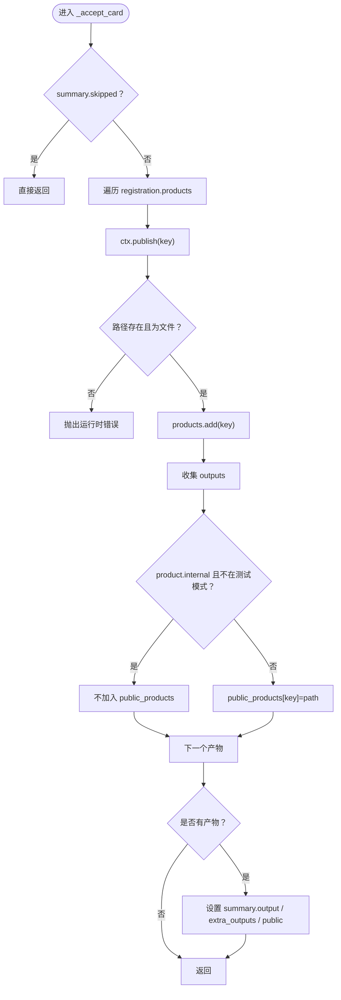
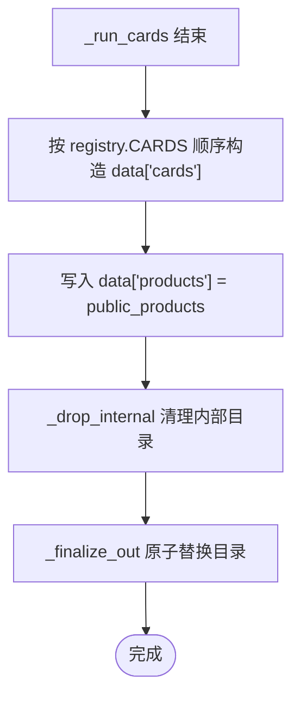
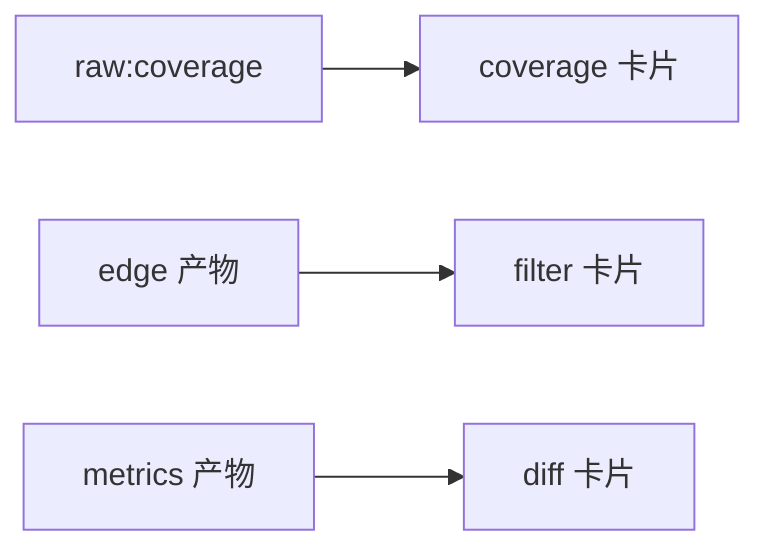

# 卡片流水线与线程池执行

<cite>
**本文引用的文件**
- [engine.py](file://engine.py)
- [registry.py](file://registry.py)
- [cards/base.py](file://cards/base.py)
- [cards/coverage.py](file://cards/coverage.py)
</cite>

## 目录
1. [引言](#引言)
2. [项目结构](#项目结构)
3. [核心组件](#核心组件)
4. [架构总览](#架构总览)
5. [详细组件分析](#详细组件分析)
6. [依赖关系分析](#依赖关系分析)
7. [性能考虑](#性能考虑)
8. [故障排查指南](#故障排查指南)
9. [结论](#结论)

## 引言
本文聚焦引擎中 `_run_cards(ctx, data)` 的执行流程，解释它如何消费 `registry.CARDS`、按注册顺序调度 `TranslationCard`，以及四个关键状态变量 `available_raw`、`products`、`public_products`、`summaries` 的作用。同时说明依赖校验逻辑 `_missing_needs`、覆盖率卡片的特殊线程池处理、产物接受逻辑 `_accept_card`，以及最终摘要和公开产物如何写回 `data`。最后补充性能与正确性建议，帮助新增卡片时避免阻塞或产物不可见。

## 项目结构
当前代码库采用“引擎 + 注册表 + 卡片 + 闸门”的分层组织：

- 引擎负责生命周期、原始数据加载、卡片调度、结果落盘。
- 注册表集中声明所有卡片及其产物键。
- 卡片定义每个翻译任务的输入依赖、构建行为和输出路径。
- 闸门由外部采集阶段产生 raw 数据，供卡片消费。

**图示来源**
- [engine.py:1-100](file://engine.py#L1-L100)
- [registry.py:1-49](file://registry.py#L1-L49)
- [cards/base.py:1-63](file://cards/base.py#L1-L63)
- [cards/coverage.py:1-40](file://cards/coverage.py#L1-L40)

**章节来源**
- [engine.py:1-100](file://engine.py#L1-L100)
- [registry.py:1-49](file://registry.py#L1-L49)

## 核心组件
本节围绕 `_run_cards` 及其辅助函数展开，说明数据流与控制流。

- `_run_cards(ctx, data)`：从 `registry.CARDS` 获取全部卡片，初始化状态，串行遍历卡片，但将覆盖率卡片单独提交到单工作线程池中执行，其余卡片在主线程构建后立刻接受产物并记录摘要。
- `_missing_needs(card, available_raw, products)`：校验卡片依赖是否满足；`raw:xxx` 对应 `ctx.raw_paths`，其他键对应已接受的 `products`。
- `_accept_card(registration, summary, ctx, products, public_products)`：检查卡片是否跳过、验证产物是否存在、写入 `output`/`extra_outputs`/`public`，并把非内部产物加入公开集合。
- `_finalize_out(run_dir, staging_dir, data, force=False)`：在 `_run_cards` 返回后完成暂存目录替换、清理内部目录、最终写出。

**章节来源**
- [engine.py:80-140](file://engine.py#L80-L140)
- [engine.py:141-200](file://engine.py#L141-L200)

## 架构总览
下图展示一次完整运行中，从原始数据到卡片产物的主要调用链。

**图示来源**
- [engine.py:100-170](file://engine.py#L100-L170)
- [registry.py:20-49](file://registry.py#L20-L49)

## 详细组件分析

### `_run_cards` 与四个状态变量
`_run_cards` 是卡片流水线的核心入口。其关键职责包括：

- 初始化 `available_raw = set(ctx.raw_paths)`，作为所有卡片可消费的原始输入集合。
- 初始化 `products = set()`，记录已通过 `_accept_card` 的产物键。
- 初始化 `public_products = {}`，记录对外公开的产物键到路径映射。
- 初始化 `summaries = {}`，记录每张卡片执行后的摘要。
- 从 `registry.CARDS` 中定位 `coverage` 卡片，并将其构建任务提交到 `ThreadPoolExecutor(max_workers=1)`，随后继续串行处理其他卡片，最后再等待 `coverage` 的结果。

**图示来源**
- [engine.py:100-170](file://engine.py#L100-L170)

#### 四个状态变量的作用
- `available_raw`：保存所有可用的原始输入键，如 `coverage`、`functions` 等。用于依赖校验中匹配以 `raw:` 前缀开头的依赖。
- `products`：保存已通过产物校验的产物键集合。用于判断普通依赖是否已就绪。
- `public_products`：保存对外公开的产物键到路径映射。只有非内部产物或在测试模式下才会被加入。
- `summaries`：保存每张卡片执行后的摘要字典，最终会按注册顺序生成 `data["cards"]`。

**章节来源**
- [engine.py:100-170](file://engine.py#L100-L170)

### 依赖校验 `_missing_needs`
依赖校验逻辑如下：

- 遍历卡片声明的 `needs`。
- 如果依赖以 `raw:` 开头，则去掉前缀后检查是否在 `available_raw` 中。
- 否则，直接检查该依赖键是否在 `products` 中。
- 若任一依赖缺失，收集到 `missing` 列表并在调用处抛出错误。

这意味着：
- `raw:coverage` 表示该卡片需要上游闸门提供的原始覆盖率数据。
- 其他键如 `edge`、`filter` 等表示这些是其他卡片已经成功产出并接受的产物键。

**图示来源**
- [engine.py:80-100](file://engine.py#L80-L100)

**章节来源**
- [engine.py:80-100](file://engine.py#L80-L100)

### 覆盖率卡片特殊处理
覆盖率卡片 `CoverageCard` 被特殊对待：

- 在执行主循环前，引擎先在 `ThreadPoolExecutor(max_workers=1)` 中提交 `coverage.build`。
- 主循环仍按 `registry.CARDS` 的顺序处理其他卡片。
- 主循环结束后，才调用 `coverage_future.result()` 等待覆盖率结果。
- 这样设计允许其他卡片与覆盖率卡片“看似并行”，但由于线程池大小为 1，实际仍是串行执行；真正并行的是覆盖率卡片内部的两个子任务（例如生成覆盖率显示与导出 LCOV）。

**图示来源**
- [engine.py:120-170](file://engine.py#L120-L170)
- [cards/coverage.py:200-233](file://cards/coverage.py#L200-L233)

#### 覆盖率卡片内部并行
覆盖率卡片自身使用 `ThreadPoolExecutor(max_workers=2)` 并行执行 `run_show` 与 `export_lcov`，因此即使外层引擎只分配一个工作线程，覆盖率卡片内部仍可并发执行两个 I/O 或计算密集任务。

**章节来源**
- [engine.py:120-170](file://engine.py#L120-L170)
- [cards/coverage.py:200-233](file://cards/coverage.py#L200-L233)

### 产物接受 `_accept_card`
`_accept_card` 负责把卡片构建结果转化为稳定状态：

- 如果摘要标记为跳过，则直接返回，不修改任何状态。
- 对注册表中声明的每个产物键：
  - 通过 `ctx.product(key)` 获取产物元信息。
  - 通过 `ctx.publish(key)` 得到最终路径。
  - 检查该路径是否为文件；不是则抛出运行时错误。
  - 将产物键加入 `products`。
  - 收集产物路径到 `outputs`。
  - 如果产物不是内部产物，或者当前处于测试模式，则将键与路径加入 `public_products`。
- 如果有产物：
  - 第一个产物路径写入摘要的 `output`。
  - 多余产物路径写入 `extra_outputs`。
  - 只要至少有一个产物被公开，就设置 `public=True`。

**图示来源**
- [engine.py:100-140](file://engine.py#L100-L140)

**章节来源**
- [engine.py:100-140](file://engine.py#L100-L140)

### 最终数据写入
`_run_cards` 返回前会做两件事：

- 按 `registry.CARDS` 的注册顺序，筛选出已在 `summaries` 中的卡片摘要，构造 `data["cards"]`。
- 将 `public_products` 写入 `data["products"]`。

之后，调用方会继续执行 `_drop_internal` 清理内部目录，并调用 `_finalize_out` 将暂存目录原子替换为最终运行目录。

**图示来源**
- [engine.py:160-200](file://engine.py#L160-L200)
- [engine.py:201-215](file://engine.py#L201-L215)

**章节来源**
- [engine.py:160-200](file://engine.py#L160-L200)
- [engine.py:201-215](file://engine.py#L201-L215)

## 依赖关系分析

### 卡片注册与产物声明
`registry.py` 定义了：

- `PRODUCTS`：产物键到 `Product(path, internal)` 的映射。
- `GATES`：闸门列表。
- `CARDS`：卡片注册列表，包含卡片实例与其产物键元组。

例如：

| 产物键 | 默认文件名 | 是否内部 |
|---|---|---|
| edge | edge.json | 否 |
| disasm | disasm.json | 是 |
| coverage | coverage.json | 否 |
| timing | timing.json | 是 |
| metrics | functions.jsonl | 否 |
| filter | filter.json | 否 |
| diff | diff.json | 否 |

**章节来源**
- [registry.py:12-49](file://registry.py#L12-L49)

### 卡片上下文与路径规则
`CardContext` 提供以下能力：

- `raw(key)`：读取原始输入路径，不存在时报错。
- `product(key)`：查询注册产物，未注册时报错。
- `out(key)`：输出到公开目录。
- `internal(key)`：输出到内部目录。
- `publish(key)`：根据产物是否内部以及是否测试模式决定最终路径。

**图示来源**
- [cards/base.py:1-63](file://cards/base.py#L1-L63)

**章节来源**
- [cards/base.py:1-63](file://cards/base.py#L1-L63)

### 依赖图
下面用概念方式表达常见卡片之间的依赖关系。注意具体依赖应以各卡片 `needs` 为准。

[此图为概念依赖示意，不对应单一源码文件，故不附图示来源]

## 性能考虑

### 为什么外层使用 `max_workers=1`
外层线程池使用 `max_workers=1`，意味着所有卡片仍然按顺序执行。这样做的好处是：

- 简化资源竞争：卡片可能写入同一输出根目录或使用共享工具链。
- 保证确定性：产物顺序和日志顺序更容易复现。
- 避免并发覆盖风险：多个卡片同时写入相同命名空间可能造成竞态。

但代价是覆盖率卡片无法与其他卡片真正并行。

**章节来源**
- [engine.py:120-170](file://engine.py#L120-L170)

### 为什么覆盖率卡片要独立提交
覆盖率卡片被单独提交到线程池，并在主循环结束后等待结果。这带来以下效果：

- 主循环可以立即开始构建其他卡片。
- 覆盖率卡片虽在同一单工作线程池中排队，但其内部仍可使用 `ThreadPoolExecutor(max_workers=2)` 并行执行两个子任务。
- 最终引擎仍确保覆盖率卡片结果被接受，不会丢失产物。

这种设计适合覆盖率卡片较重、但其他卡片相对轻量且可提前启动的场景。

**章节来源**
- [engine.py:120-170](file://engine.py#L120-L170)
- [cards/coverage.py:200-233](file://cards/coverage.py#L200-L233)

### 新增卡片时的最佳实践
新增卡片时应注意：

1. **声明正确的 `needs`**：
   - 如果依赖上游闸门原始数据，使用 `raw:xxx`。
   - 如果依赖其他卡片产物，使用产物键名，例如 `edge`、`metrics`。
   - 不要遗漏依赖，否则会在 `_missing_needs` 中触发运行时错误。

2. **正确设置 `internal`**：
   - 中间产物、调试产物应设为内部，避免污染最终公开产物。
   - 用户关心的结果产物应设为非内部，才能进入 `public_products`。
   - 测试模式下内部产物也会被公开，便于调试。

3. **避免不必要的并行化**：
   - 如果新卡片较重，优先考虑其内部并行，而不是扩大外层线程池。
   - 如果必须与其他卡片并行，应先评估产物写入冲突和依赖顺序。

4. **保证产物路径存在**：
   - 卡片构建完成后必须在 `ctx.out(key)` 或 `ctx.publish(key)` 对应位置写出文件。
   - 否则 `_accept_card` 会抛出运行时错误。

## 故障排查指南

### 常见错误一：缺少输入依赖
当卡片声明了 `needs`，但 `available_raw` 或 `products` 中没有对应键时，会抛出类似“卡片缺少输入”的错误。

排查步骤：

- 检查卡片 `needs` 是否与实际输入匹配。
- 如果是原始输入，确认上游闸门是否生成了对应 raw 键。
- 如果是其他卡片产物，确认上游卡片是否成功执行并被接受。

**章节来源**
- [engine.py:80-100](file://engine.py#L80-L100)
- [engine.py:110-130](file://engine.py#L110-L130)

### 常见错误二：产物文件缺失
如果卡片没有在预期路径生成产物，`_accept_card` 会抛出“卡片未产出指定产物”的错误。

排查步骤：

- 确认卡片是否正确调用 `ctx.out(key)` 或 `ctx.publish(key)`。
- 确认产物文件确实存在且非空。
- 如果是内部产物，检查是否因非测试模式被放入内部目录。

**章节来源**
- [engine.py:100-140](file://engine.py#L100-L140)
- [cards/base.py:20-63](file://cards/base.py#L20-L63)

### 常见错误三：公开产物不可见
如果某个产物没有出现在 `data["products"]` 中，可能是：

- 产物被标记为内部。
- 当前不是测试模式。
- 卡片声明了产物键，但没有被 `_accept_card` 接受。

排查步骤：

- 检查 `registry.PRODUCTS` 中该产物的 `internal` 属性。
- 如果使用测试模式，内部产物会被公开。
- 检查卡片是否成功构建并写入产物。

**章节来源**
- [engine.py:100-140](file://engine.py#L100-L140)
- [registry.py:12-49](file://registry.py#L12-L49)

## 结论
`_run_cards` 是卡片流水线的核心控制器：它以注册顺序消费 `registry.CARDS`，通过 `available_raw`、`products`、`public_products`、`summaries` 管理依赖与产物状态，并通过 `_missing_needs` 和 `_accept_card` 保证输入完备性和输出一致性。覆盖率卡片因其重量级特性被单独提交到单工作线程池中执行，从而让其他卡片尽早启动，但最终仍等待其结果。

在实际使用中，新增卡片应严格声明 `needs`，合理设置 `internal`，确保产物路径存在，并优先在卡片内部实现并行，以避免破坏外层执行的确定性与稳定性。