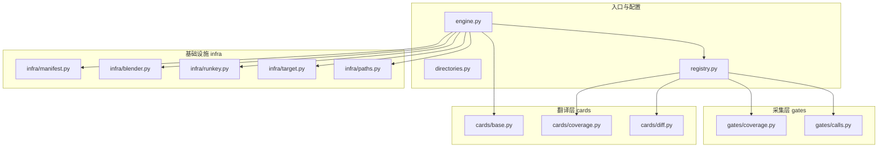
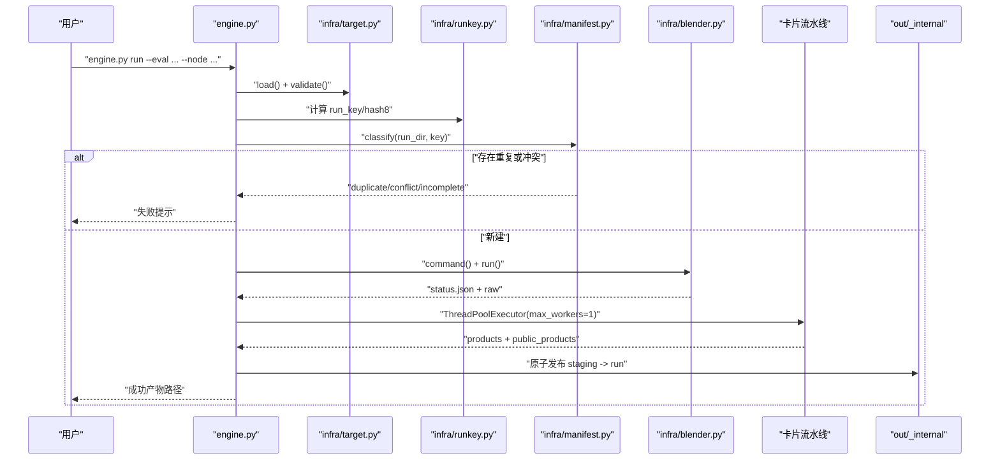
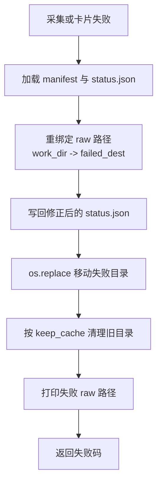
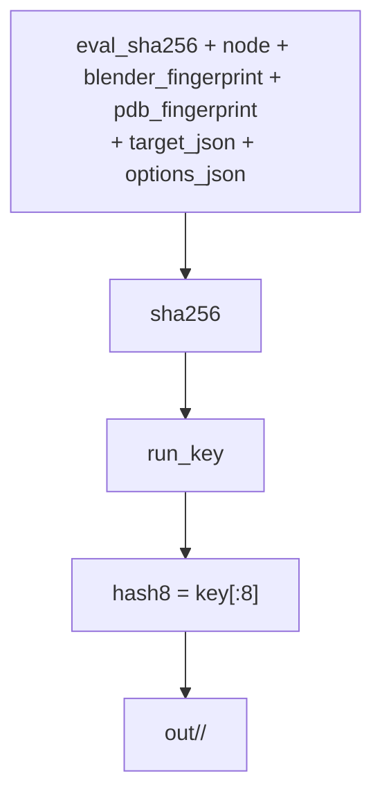
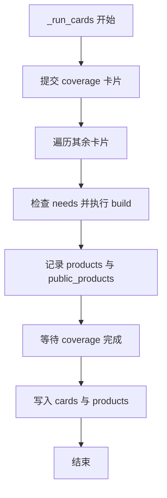
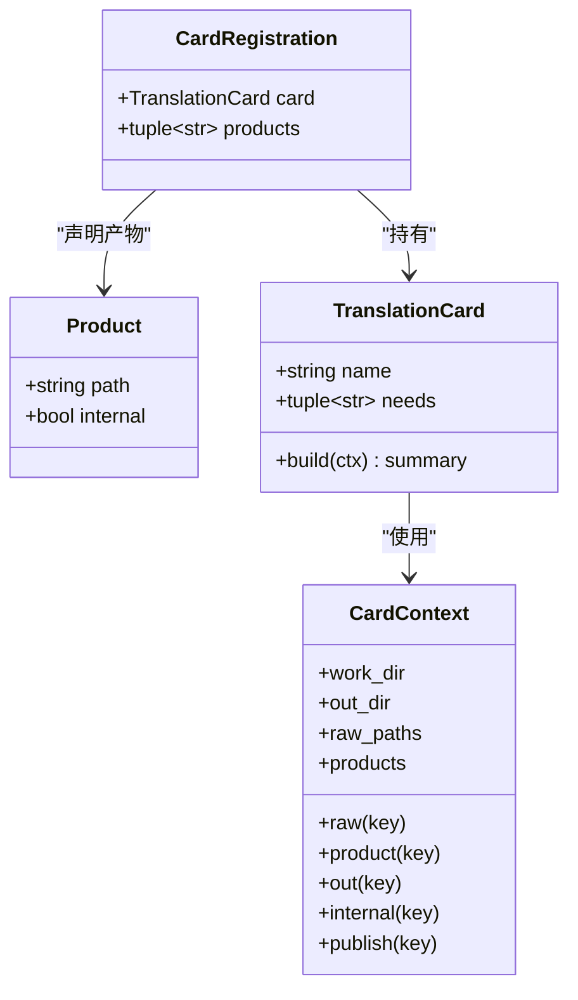
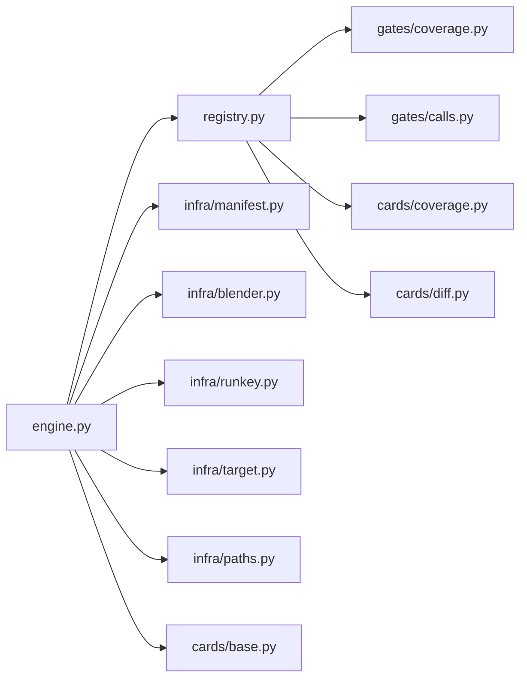

# 宿主引擎

<cite>
**本文引用的文件**   
- [engine.py](file://engine.py)
- [directories.py](file://directories.py)
- [registry.py](file://registry.py)
- [infra/manifest.py](file://infra/manifest.py)
- [infra/blender.py](file://infra/blender.py)
- [infra/runkey.py](file://infra/runkey.py)
- [infra/target.py](file://infra/target.py)
- [infra/paths.py](file://infra/paths.py)
- [cards/base.py](file://cards/base.py)
- [cards/diff.py](file://cards/diff.py)
- [cards/coverage.py](file://cards/coverage.py)
- [gates/calls.py](file://gates/calls.py)
- [gates/coverage.py](file://gates/coverage.py)
</cite>

## 目录
1. [引言](#引言)
2. [项目结构](#项目结构)
3. [核心组件](#核心组件)
4. [架构总览](#架构总览)
5. [详细组件分析](#详细组件分析)
6. [依赖关系分析](#依赖关系分析)
7. [性能与缓存特性](#性能与缓存特性)
8. [故障排查指南](#故障排查指南)
9. [结论](#结论)

## 引言
宿主引擎 `engine.py` 是 CovTrace 的编排入口，负责解析命令行、校验求值脚本与 Blender 环境、启动 Blender 子进程采集原始数据、执行卡片流水线，并把最终产物原子发布到工作区。它同时支持三种模式：

| 子命令 | 主要职责 | 是否启动 Blender | 典型用途 |
|---|---|---:|---|
| `run` | 采集 raw、执行卡片、原子发布 run 与 cache | 是 | 完整运行一次求值并产出公开产物 |
| `validate` | 仅校验 TARGET 与 NODE，不跑闸门 | 否（只验证） | 快速检查工程路径、对象、修改器、参数与节点树 |
| `translate` | 复用已有 cache 里的 raw 重新跑卡片 | 否 | 重建产物或调整卡片选项而不重复采集 |

此外，当检测到 eval 脚本中定义了 `NODE` 时，`run` 会自动进行“前后对比”：先以 `phase=before` 运行一次，再以 `phase=after` 运行一次，并通过 diff 卡片生成差异报告。

## 项目结构
本仓库按功能分层组织：

**图表来源**
- [engine.py:1-30](file://engine.py#L1-L30)
- [registry.py:1-49](file://registry.py#L1-L49)
- [infra/manifest.py:1-58](file://infra/manifest.py#L1-L58)
- [infra/blender.py:1-39](file://infra/blender.py#L1-L39)
- [infra/runkey.py:1-44](file://infra/runkey.py#L1-L44)
- [infra/target.py:1-81](file://infra/target.py#L1-L81)
- [infra/paths.py:1-32](file://infra/paths.py#L1-L32)
- [cards/base.py:1-63](file://cards/base.py#L1-L63)

**章节来源**
- [engine.py:1-30](file://engine.py#L1-L30)
- [directories.py:1-25](file://directories.py#L1-L25)
- [registry.py:1-49](file://registry.py#L1-L49)

## 核心组件
- **CLI 入口**：`main()` 使用 argparse 注册 `run`、`validate`、`translate` 三个子命令，并根据子命令分发到对应函数。
- **运行编排**：`run()` 和 `_run_once()` 负责目标解析、Blender 版本指纹、缓存分类、raw 采集、卡片调度与结果发布。
- **自动对比**：当 eval 中存在 `NODE` 且未显式指定 `--measure-node` 时，`run()` 会分别以 `before` 和 `after` 阶段执行两次 `_run_once()`，并将第一次结果作为 diff 基线。
- **翻译编排**：`translate()` 直接加载 cache 中的 manifest 与 status，跳过 Blender 启动，仅执行卡片流水线。
- **校验入口**：`validate()` 调用 `infra.target.load/validate` 解析并校验 TARGET，再单独启动 Blender 执行 `frag/validate.py` 进行轻量检查。
- **卡片上下文**：`cards.base.CardContext` 提供 `raw()`、`product()`、`out()`、`internal()`、`publish()`、`input()` 等路径访问能力，并区分内部产物与公开产物。
- **注册表**：`registry.PRODUCTS` 定义产品键与输出文件名；`registry.CARDS` 定义卡片顺序；`registry.GATES` 定义采集闸门。

**章节来源**
- [engine.py:201-562](file://engine.py#L201-L562)
- [cards/base.py:1-63](file://cards/base.py#L1-L63)
- [registry.py:1-49](file://registry.py#L1-L49)

## 架构总览
下图展示 `run` 子命令的主流程，包括自动 diff、Blender 子进程、raw 收集、卡片线程池执行与原子发布。

**图表来源**
- [engine.py:201-562](file://engine.py#L201-L562)
- [infra/target.py:1-81](file://infra/target.py#L1-L81)
- [infra/runkey.py:1-44](file://infra/runkey.py#L1-L44)
- [infra/manifest.py:1-58](file://infra/manifest.py#L1-L58)
- [infra/blender.py:1-39](file://infra/blender.py#L1-L39)

## 详细组件分析

### CLI 子命令职责差异

#### `run`
- 校验 eval 路径、`--node`、TARGET、Blender 可执行文件。
- 计算 `run_key` 与 `hash8`，定位 `out/<safe_name(node)>/<hash8>` 与 `cache/<...>/<hash8>`。
- 根据 manifest 分类决定新建、跳过、覆盖或拒绝。
- 若发现 eval 中有 `NODE`，则先以 `phase=before` 运行，再以 `phase=after` 运行，并在第二次运行后清理第一次的 raw（如果启用 `--no-raw`）。
- 启动 Blender 子进程，收集 status、raw、gates，然后执行卡片流水线。
- 将内部产物放入 `out/_internal`，公开产物放在 `out` 根下；成功后把 work 目录替换为 cache，并按 keep_cache 策略保留最近若干个 hash8 目录。

关键行为参考：
- [engine.py:201-562](file://engine.py#L201-L562)
- [engine.py:1-30](file://engine.py#L1-L30)

#### `validate`
- 不进入完整采集流程，也不启动 gates。
- 解析 eval 中的 TARGET，校验必填字段与 blend 文件是否存在。
- 从 eval 中读取 `NODE`，或由 `--measure-node` 指定。
- 调用 `frag/validate.py`，并解析其输出的 `>> validation:` JSON 行判断是否通过。

关键行为参考：
- [engine.py:470-520](file://engine.py#L470-L520)
- [infra/target.py:1-81](file://infra/target.py#L1-L81)

#### `translate`
- 要求 cache 目录包含有效的 run.json 与成功的 status.json。
- 校验所有 raw 路径仍存在于磁盘。
- 直接使用 cache 中的 manifest、blender、pdb、raw 构建 CardContext，跳过 Blender 启动。
- 重新执行卡片流水线，并以 `force=True` 原子发布到 out。

关键行为参考：
- [engine.py:390-470](file://engine.py#L390-L470)

**章节来源**
- [engine.py:201-562](file://engine.py#L201-L562)

### 工作区与缓存规划

| 位置 | 含义 | 生命周期 |
|---|---|---|
| `out/<safe_name(node)>/<hash8>` | 最终运行目录，包含公开产物 | 由用户保留，代表一次稳定发布 |
| `out/<safe_name(node)>/.<hash8>.tmp` | 发布前临时 staging 目录 | 成功后被原子替换为正式 run 目录 |
| `cache/<safe_name(node)>/<hash8>` | 原始 raw 与完整 manifest 的持久缓存 | 用于 translate 与 diff_against |
| `cache/<safe_name(node)>/<hash8>.tmp` | 采集阶段的 work 目录 | 采集成功后替换为正式 cache |
| `out/_internal` | 标记为 internal 的中间产物 | 非 test 模式下默认删除 |
| `<hash8>.failed-时间戳` | 失败现场迁移目录 | 采集失败或卡片异常时创建 |

命名规则：
- `safe_name(node)` 来自 `infra.paths.safe_name`，会把不安全字符替换为下划线，避免文件系统问题。
- `hash8` 是 `run_key` 的前 8 位十六进制，便于人类阅读与定位。

隔离策略：
- `run` 在 `cache` 下写入 `.tmp`，成功后再替换为正式目录。
- 卡片产物先在 staging 目录组装，最后由 `_finalize_out` 原子替换 `run_dir`。
- 内部产物通过 `CardContext.publish` 写入 `_internal`，普通用户通常只看公开产物。

**章节来源**
- [engine.py:201-562](file://engine.py#L201-L562)
- [infra/paths.py:1-32](file://infra/paths.py#L1-L32)
- [cards/base.py:1-63](file://cards/base.py#L1-L63)
- [directories.py:1-25](file://directories.py#L1-L25)

### 失败现场迁移与路径重绑定

当采集失败、状态不完整或卡片抛出异常时，引擎不会直接删除 work 目录，而是执行 `_keep_failed`：

1. 在 `cache/<node>/` 下构造形如 `<hash8>.failed-YYYYMMDD-HHMMSS[ -N]` 的目标目录。
2. 加载当前 work 目录的 manifest 与 status.json。
3. 对 `raw` 与 gate.raw 中的路径执行 `_rebase`，把旧 work 目录前缀替换为新失败目录前缀。
4. 用 `os.replace(work_dir, dest)` 移动整个失败现场。
5. 对父目录执行 `_prune_cache`，保留最近 `keep_cache` 个目录。

路径重绑定的核心逻辑：
- `_rebase_path` 比较绝对路径与源根，如果是完全相等或带前缀，则拼接目标根与相对部分。
- `_rebase` 遍历 manifest 顶层 raw 以及每个 gate 的 raw，保持数据结构不变但更新路径。

**图表来源**
- [engine.py:30-120](file://engine.py#L30-L120)

**章节来源**
- [engine.py:30-120](file://engine.py#L30-L120)

### run key 与 hash8 缓存粒度

`run_key` 不是简单字符串哈希，而是基于多个维度构建的稳定标识：

| 输入 | 作用 |
|---|---|
| `RUN_KEY_VERSION` | 防止不同版本实现产生碰撞 |
| `eval_path` 的 sha256 | 评估脚本内容变化触发新缓存 |
| `node` | 同一脚本不同 node 视为不同运行 |
| `blender` 与 `pdb` 的文件指纹 | 工具链版本变化触发新缓存 |
| `target` | TARGET 字典内容变化影响缓存 |
| `options` | 如 `phase`、`measure_node`、`diff_against`、`coverage_keep_all` 等 |

`hash8` 只是 `run_key` 的短前缀，方便日志显示与目录命名；实际唯一性由完整 `run_key` 保证。

**图表来源**
- [infra/runkey.py:1-44](file://infra/runkey.py#L1-L44)
- [infra/paths.py:1-32](file://infra/paths.py#L1-L32)

**章节来源**
- [infra/runkey.py:1-44](file://infra/runkey.py#L1-L44)
- [infra/paths.py:1-32](file://infra/paths.py#L1-L32)

### manifest 分类 new / duplicate / conflict / incomplete

`infra.manifest.classify` 根据 `run_dir` 与 `run_key` 决定运行策略：

| 分类 | 条件 | 默认行为 | 推荐处理 |
|---|---|---|---|
| `new` | `run_dir` 不存在 | 正常新建 | 无需干预 |
| `duplicate` | 目录存在且 `run_key` 相同 | 报错 | 说明结果已存在，可直接使用或加 `--force` |
| `conflict` | 目录存在但 `run_key` 不同 | 报错 | 说明同名 hash8 目录已被其他运行占用，应清理或换 node/hash |
| `incomplete` | 目录存在但没有有效 run.json | 报错 | 上次运行中断，需清理或使用 `--force` |

注意：即使 classify 返回 `duplicate`，只要显式传入 `--force`，引擎也会继续执行。这是为了允许用户强制重建某个已知 stable 的结果。

**章节来源**
- [infra/manifest.py:1-58](file://infra/manifest.py#L1-L58)
- [engine.py:240-320](file://engine.py#L240-L320)

### 卡片线程池执行顺序、needs 与内部/公开产物

#### 执行顺序
卡片由 `registry.CARDS` 固定顺序驱动。`_run_cards` 使用 `ThreadPoolExecutor(max_workers=1)`，即串行执行：

1. 优先提交 `coverage` 卡片任务。
2. 遍历其余卡片并立即执行。
3. 等待 coverage 任务完成。
4. 将 registry 顺序中的卡片摘要写入 data.cards。

这种设计让 coverage 可以并行于其他卡片的准备阶段，但最终仍串行接受产物，从而避免并发写 out 目录。

**图表来源**
- [engine.py:120-200](file://engine.py#L120-L200)

#### needs 依赖
每张卡片声明 `needs`，引擎在构建前检查：

- `raw:<key>`：必须出现在 `ctx.raw_paths` 中。
- 普通键：必须已经作为之前卡片的产物被接受。

如果缺少依赖，会抛出 RuntimeError，导致本次 run 失败并迁移失败现场。

#### 内部与公开产物
`Product` 通过 `internal=True` 标记中间产物，例如 disasm 与 timing。

- `CardContext.publish(key)`：若 `internal=True` 且不在 test 模式，产物写入 `out/_internal`。
- `_accept_card`：只有非 internal 产物才会加入 `public_products`；test 模式下 internal 产物也可被视为公开产物。
- `_drop_internal`：非 test 模式下删除 `out/_internal` 目录。

**图表来源**
- [registry.py:1-49](file://registry.py#L1-L49)
- [cards/base.py:1-63](file://cards/base.py#L1-L63)

**章节来源**
- [engine.py:120-200](file://engine.py#L120-L200)
- [registry.py:1-49](file://registry.py#L1-L49)
- [cards/base.py:1-63](file://cards/base.py#L1-L63)

### 典型命令行参数

#### `run`
| 参数 | 含义 |
|---|---|
| `--eval` | 必需，求值脚本路径 |
| `--node` | 必需，输出目录名 |
| `--blend` | 覆盖 TARGET.blend |
| `--obj` | 覆盖 TARGET.object |
| `--mod` | 覆盖 TARGET.modifier |
| `--param` | 覆盖 TARGET.param |
| `--blender` | 插桩 Blender 可执行文件 |
| `--out` | 输出根目录 |
| `--force` | 覆盖冲突或不完整目录 |
| `--dry-run` | 只检查路径与重复状态，不启动 Blender |
| `--keep-cache` | 每个节点保留最近 N 个 cache |
| `--no-raw` | 卡片成功后删除 raw cache |
| `--keep-all` | coverage 不过滤 source/intern 以外的路径 |
| `--test` | 保留 disasm/timing 等内部产物 |
| `--measure-node` | 覆盖 eval 中的 NODE |

#### `validate`
| 参数 | 含义 |
|---|---|
| `--eval` | 必需，求值脚本 |
| `--measure-node` | 可选，测量节点 |
| `--blender` | 可选，Blender 路径 |

#### `translate`
| 参数 | 含义 |
|---|---|
| `cache_dir` | 必需，cache/<node>/<hash8> |
| `--out` | 输出根目录 |
| `--keep-all` | 覆盖 cache 中的 coverage_keep_all |
| `--test` | 保留内部中间产物 |

**章节来源**
- [engine.py:520-562](file://engine.py#L520-L562)

### 错误码与返回值
- `fail(message)` 返回整数 1，表示运行时失败。
- `main()` 在未识别子命令时返回 2。
- `translate()` 在 cache 无效、raw 缺失或卡片翻译失败时返回 1。
- `validate()` 校验失败返回 1；成功时返回 Blender 子进程的 returncode。
- 成功路径通常返回 0。

常见错误场景：
- 找不到 eval 或 Blender。
- TARGET 缺少 blend/object/modifier/param。
- eval 中没有 NODE 且没有 `--measure-node`。
- manifest 分类为 duplicate/conflict/incomplete 且未传 `--force`。
- gates 未注册。
- status.json 不存在或 ok 为假。
- calls 闸门 edge_count 为 0 或 functions.bin 为空。
- window.profraw 为空或缺失。
- 卡片未产出声明的 product。
- translate 的 raw 文件路径不可访问。

**章节来源**
- [engine.py:1-30](file://engine.py#L1-L30)
- [engine.py:201-562](file://engine.py#L201-L562)
- [infra/target.py:1-81](file://infra/target.py#L1-L81)

## 依赖关系分析

**图表来源**
- [engine.py:1-30](file://engine.py#L1-L30)
- [registry.py:1-49](file://registry.py#L1-L49)

耦合与内聚：
- `engine.py` 是高层编排者，依赖 infra 做路径、目标、manifest、进程启动与 run_key 计算。
- `registry.py` 集中管理 gates、cards 与 products，降低 engine 对具体卡片实现的认知。
- `cards.base.CardContext` 封装路径构造逻辑，使卡片不必关心 out/_internal 与 publish 细节。
- `infra.target` 与 `infra.runkey` 纯函数化程度较高，适合单元测试与跨平台移植。

潜在风险：
- `_run_cards` 虽然使用线程池，但最大工作线程数为 1，因此并未真正并行执行卡片，避免了竞态但也限制了吞吐。
- 自动 diff 会在 `run` 中触发两次完整采集，成本显著高于单次运行。
- `_keep_failed` 会移动 work 目录并重绑定路径，若用户手动混入其他同名 hash8 目录，可能干扰后续清理策略。

**章节来源**
- [engine.py:120-200](file://engine.py#L120-L200)
- [registry.py:1-49](file://registry.py#L1-L49)

## 性能与缓存特性
- 缓存粒度以 `run_key` 为准，`hash8` 仅用于可读路径。
- `run_key` 包含 eval 内容、node、blender 与 pdb 指纹、target 与 options，任何变化都会产生新缓存。
- `--no-raw` 可在卡片成功后删除 work 目录，减少磁盘占用。
- `--keep-cache=N` 控制每个 node 下保留多少个 hash8 目录，较旧的会被删除。
- `--keep-all` 会让 coverage 保留更多路径，增大产物体积但有利于调试。
- `_prune_cache` 按 mtime 排序，保留最近使用的缓存，有助于长期运行的节点目录保持可控大小。

优化建议：
- 若只需查看译文产物，优先使用 `translate`，避免重复采集。
- 使用 `--dry-run` 提前发现路径、TARGET 与重复状态问题。
- 对大型项目，谨慎开启 `--keep-all`，以免 cache 膨胀。
- 如果需要保留中间产物用于诊断，使用 `--test`。

**章节来源**
- [engine.py:201-562](file://engine.py#L201-L562)
- [infra/runkey.py:1-44](file://infra/runkey.py#L1-L44)

## 故障排查指南

### 常见问题与定位步骤

1. **“找不到求值脚本”**
   - 检查 `--eval` 是否为绝对路径或相对于当前工作目录的正确路径。
   - 确认 eval 文件存在且可读。

2. **“--node 不能为空”**
   - `--node` 会参与输出目录命名，必须非空。

3. **“TARGET 缺少字段”或“找不到工程”**
   - 确保 TARGET 包含 blend、object、modifier、param。
   - 若使用命令行覆盖，确认 `--blend/--obj/--mod/--param` 正确。

4. **“eval 里没有 NODE，且没有 --measure-node”**
   - `validate` 需要 NODE；`run` 在自动 diff 模式下也依赖它。
   - 在 eval 中添加 `NODE = "..."`，或通过 `--measure-node` 指定。

5. **“你要的东西已经跑过了”或“目录已存在但是另一次运行”**
   - 使用 `--force` 覆盖，或清理 `out/<node>/<hash8>`。
   - 如果是 conflict，更建议确认是否误用了其他运行结果的 hash8。

6. **“采集失败”或“采集结果异常”**
   - 查看引擎输出的 `raw:` 失败现场路径。
   - 检查 `calls.edge_count == 0`、`functions.bin` 为空、`window.profraw` 为空等提示信息。
   - 这些情况会触发 `_keep_failed`，失败现场位于 `cache/<node>/<hash8>.failed-时间戳`。

7. **“card ... did not produce ...”**
   - 卡片声明了 product，但未写入 publish 路径。
   - 检查卡片实现是否正确调用 `ctx.publish(key)` 或 `ctx.out(key)`。

8. **“cache raw 文件缺失”**
   - 手动移动或删除过 cache 目录。
   - 使用 `translate` 前确保 cache 完整，或直接重新 `run`。

9. **调试内部产物**
   - 添加 `--test` 保留 disasm、timing 等内部 JSON。
   - 检查 `out/_internal` 是否被保留。

10. **自动 diff 结果不符合预期**
    - 确认 before/after 两次运行使用了相同的 node、eval、TARGET 与 Blender。
    - 检查 diff_against 指向的 cache 或 out 目录是否包含 edge.json 或 symbols 所需的 functions.bin/edges.bin。

**章节来源**
- [engine.py:201-562](file://engine.py#L201-L562)
- [infra/target.py:1-81](file://infra/target.py#L1-L81)

## 结论
`engine.py` 将“采集 raw”和“翻译卡片”解耦：`run` 负责完整的采集与发布流程，`translate` 专注复用已有 raw 重建产物，`validate` 提供轻量前置检查。它以 `run_key` 为唯一依据，以 `hash8` 为人类可读缓存键，配合 `out/_internal` 隔离中间产物、`_keep_failed` 保留失败现场、`_rebase` 修复路径迁移，形成一套稳健的可复现实验管线。卡片侧通过 `needs` 表达依赖，通过 `Product.internal` 表达产物可见性，而 `registry` 统一暴露 gates 与 cards 的执行顺序。

对于日常使用：
- 首次运行使用 `run`。
- 遇到 TARGET 或 NODE 问题时使用 `validate`。
- 想重建产物或调整卡片选项时使用 `translate`。
- 需要保留调试信息时使用 `--test` 与 `--keep-all`。
- 需要清理历史结果时使用 `--force` 或手动清理 `out` 与 `cache`。