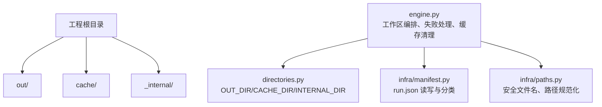
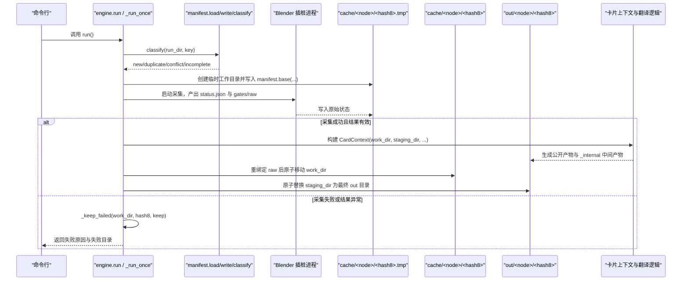
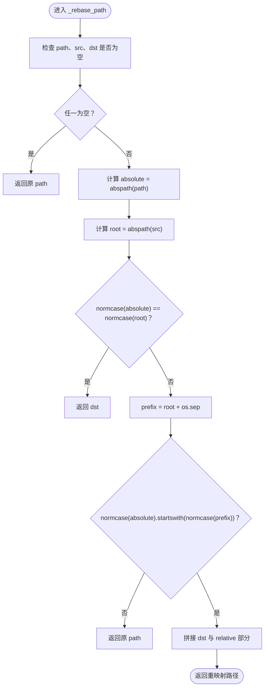
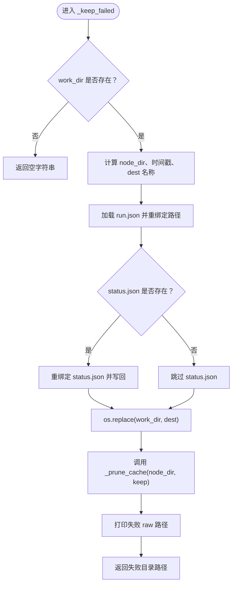
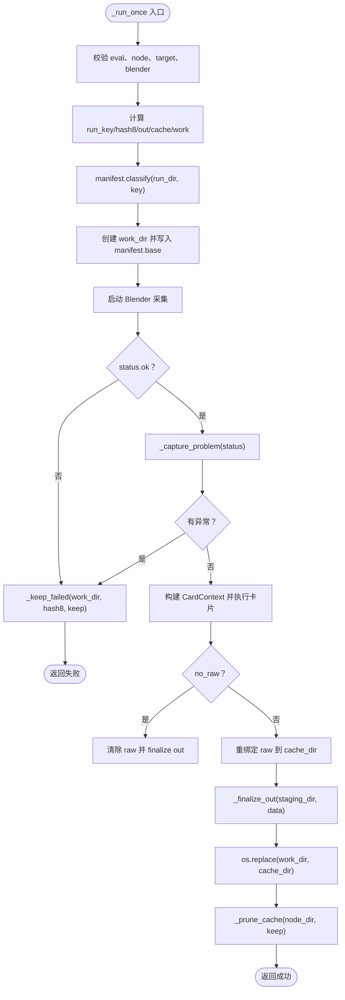
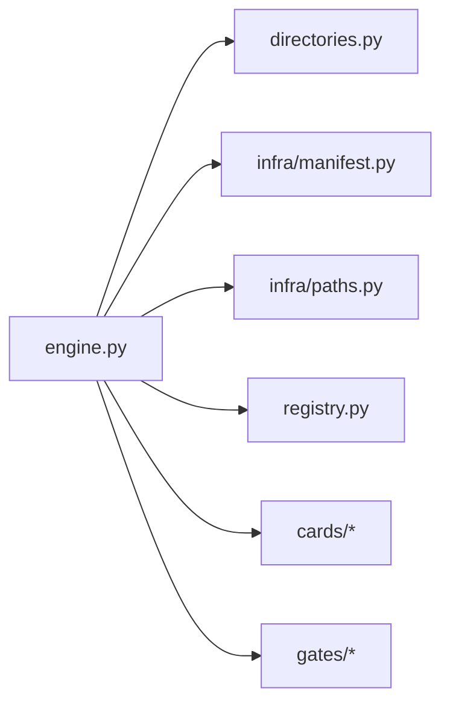
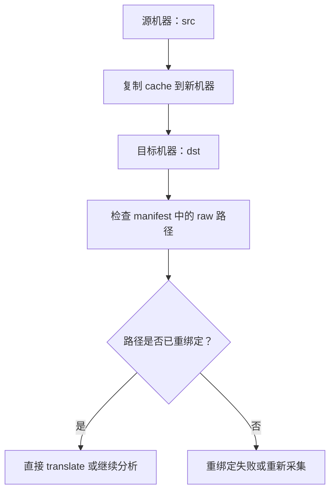

# 工作区规划、缓存与失败现场

<cite>
**本文引用的文件**   
- [engine.py](file://engine.py)
- [directories.py](file://directories.py)
- [infra/manifest.py](file://infra/manifest.py)
- [infra/paths.py](file://infra/paths.py)
</cite>

## 目录
1. [引言](#引言)
2. [项目结构与目录约定](#项目结构与目录约定)
3. [核心组件](#核心组件)
4. [架构总览](#架构总览)
5. [详细组件分析](#详细组件分析)
6. [依赖关系分析](#依赖关系分析)
7. [性能与清理策略](#性能与清理策略)
8. [故障排查指南](#故障排查指南)
9. [结论](#结论)

## 引言
本文面向宿主引擎的工作区规划、缓存布局、失败现场保留以及路径迁移机制。重点解释以下问题：
- `out/<node>/<hash8>/` 作为最终产品目录，`cache/<node>/<hash8>/` 作为 raw 与中间状态目录。
- `_internal` 目录用于隔离 `disasm`、`timing` 等内部产物。
- `_keep_failed(work_dir, hash8, keep)` 如何复制 manifest 与 status.json、执行路径重绑定、生成带时间戳的失败目录并原子迁移。
- `_prune_cache(node_dir, keep)` 如何按修改时间保留最近 `DEFAULT_KEEP_CACHE=5` 个运行结果。
- 典型跨机器迁移场景下，`_rebase_path` 如何将绝对路径从源根映射到目标根。
- 常见陷阱：路径大小写、Windows 盘符、相对路径与 `normcase` 行为。

## 项目结构与目录约定
工程通过 `directories.py` 固定根目录、输出目录、缓存目录与内部目录名；`engine.py` 负责编排运行、raw 采集、卡片翻译、最终产物落盘与缓存清理。

**图表来源**
- [engine.py:1-30](file://engine.py#L1-L30)
- [directories.py:1-25](file://directories.py#L1-L25)
- [infra/manifest.py:1-20](file://infra/manifest.py#L1-L20)
- [infra/paths.py:1-10](file://infra/paths.py#L1-L10)

### 目录角色说明
| 目录或常量 | 含义 | 关键行为 |
|---|---|---|
| `out/<node>/<hash8>/` | 最终产品目录 | 由 `_finalize_out` 原子替换生成；对外暴露卡片公开产物。 |
| `cache/<node>/<hash8>/` | 原始数据与中间状态目录 | 保存 run.json、status.json、raw 路径及闸门原始输出；可被 `translate` 子命令复用。 |
| `out/<node>/<hash8>/_internal/` | 内部中间产物目录 | 非测试模式下会被 `_drop_internal` 删除，默认不对外暴露 disasm/timing 等中间 JSON。 |
| `work_dir = cache/<node>/<hash8>.tmp` | 临时工作目录 | Blender 采集阶段先写入这里，成功后再原子移动到 `cache/<node>/<hash8>`。 |
| `staging_dir` | 产品暂存目录 | 翻译阶段先写入 `.hash.tmp`，成功后原子移动到最终 `out` 目录。 |

**章节来源**
- [directories.py:12-25](file://directories.py#L12-L25)
- [engine.py:300-360](file://engine.py#L300-L360)
- [engine.py:420-520](file://engine.py#L420-L520)

## 核心组件
本节聚焦工作区生命周期中最关键的几个函数：路径重绑定、失败现场保留、缓存修剪、运行流程与 translate 流程。

| 组件 | 职责 | 输入 | 输出/副作用 |
|---|---|---|---|
| `_rebase_path(path, src, dst)` | 将单个路径从 `src` 根重映射到 `dst` 根 | 绝对路径、源根、目标根 | 重映射后的路径或原路径 |
| `_rebase(obj, src, dst)` | 递归重绑定 manifest 和 status 中的 raw 字段 | manifest/status 对象、源根、目标根 | 原地修改对象 |
| `_keep_failed(work_dir, hash8, keep)` | 捕获失败现场、重绑定路径、生成失败目录、清理旧缓存 | 临时工作目录、hash8、保留数量 | 返回失败目录路径 |
| `_prune_cache(node_dir, keep)` | 按修改时间删除超出保留数量的节点子目录 | 节点根目录、保留数量 | 删除多余缓存目录 |
| `_run_once(...)` | 完整运行流程：校验、Blender 采集、卡片翻译、产物落盘、缓存管理 | 命令行参数、上下文 | 成功码或错误信息 |
| `translate(cache_dir, ...)` | 使用已有 cache 重新跑卡片翻译 | cache 目录、输出根 | 新 out 产品 |

**章节来源**
- [engine.py:30-80](file://engine.py#L30-L80)
- [engine.py:80-120](file://engine.py#L80-L120)
- [engine.py:200-260](file://engine.py#L200-L260)
- [engine.py:300-520](file://engine.py#L300-L520)

## 架构总览
下图展示一次 `run` 命令从入口到最终产物的控制流，以及失败时如何进入 `_keep_failed`。

**图表来源**
- [engine.py:200-260](file://engine.py#L200-L260)
- [engine.py:300-520](file://engine.py#L300-L520)
- [infra/manifest.py:10-58](file://infra/manifest.py#L10-L58)

## 详细组件分析

### 路径重绑定：`_rebase_path` 与 `_rebase`
`_rebase_path` 是跨机器迁移的核心工具。它先把传入路径转为绝对路径，再用 `os.path.abspath(src)` 计算源根，最后通过 `os.path.normcase` 比较前缀是否匹配。若完全相等则直接返回目标根；若以 `root + os.sep` 开头，则将前缀替换为目标根拼接剩余相对部分；否则原样返回。

**图表来源**
- [engine.py:30-55](file://engine.py#L30-L55)

`_rebase` 对 manifest 与 status 中的 raw 字段进行递归重绑定：
- 如果 `obj["raw"]` 是字典，则遍历每个值并调用 `_rebase_path`。
- 如果 `obj["gates"]` 存在，则对每个闸门的 `raw` 字典同样处理。
- 该操作原地修改对象，因此 `_keep_failed` 中先修改再持久化，能保证失败目录中的路径指向目标机器上的位置。

**章节来源**
- [engine.py:30-55](file://engine.py#L30-L55)

### 失败现场保留：`_keep_failed`
`_keep_failed` 的目标是在采集失败或结果异常时，把当前 `work_dir` 作为“失败现场”保留下来，而不是直接丢弃临时目录。

主要步骤如下：
1. 如果 `work_dir` 不存在则直接返回空字符串。
2. 计算 `node_dir = dirname(work_dir)`，即 `<cache>/<node>`。
3. 生成时间戳 `stamp`，并构造候选失败目录名：`<hash8>.failed-<timestamp>`。
4. 如果该目录已存在，则追加 `-N` 后缀递增命名，直到找到可用名称。
5. 加载 `work_dir/run.json`（manifest），如果存在则调用 `_rebase(data, work_dir, dest)` 重绑定路径。
6. 读取 `work_dir/status.json`，如果存在则重绑定并写回，同时补一个换行符。
7. 使用 `os.replace(work_dir, dest)` 原子迁移整个失败目录。
8. 调用 `_prune_cache(node_dir, keep)` 清理旧缓存。
9. 打印失败 raw 路径并返回目录名。

**图表来源**
- [engine.py:60-100](file://engine.py#L60-L100)

#### 为什么需要 `_rebase`
当 `cache` 目录从一台机器迁移到另一台机器时，manifest 和 status 中的 raw 路径可能包含原机器的绝对路径。例如：
- 原机器：`D:\blender-src\...`
- 新机器：`E:\blender-src\...`

如果不重绑定，`translate` 会认为 raw 文件缺失，因为路径仍指向旧机器。`_keep_failed` 在迁移失败现场时会主动重绑定，使失败目录可以直接在新机器上诊断。

**章节来源**
- [engine.py:60-100](file://engine.py#L60-L100)
- [engine.py:30-55](file://engine.py#L30-L55)

### 缓存修剪：`_prune_cache`
`_prune_cache(node_dir, keep)` 负责按修改时间保留最近的运行结果：
- 如果 `keep <= 0`，直接返回，不清理。
- 列出 `node_dir` 下所有子项。
- 过滤出目录。
- 按 `os.path.getmtime` 降序排序。
- 删除索引大于等于 `keep` 的条目，使用 `shutil.rmtree(path, ignore_errors=True)` 避免个别目录不可删导致整体失败。

这意味着默认 `DEFAULT_KEEP_CACHE=5` 时，每个 `node` 最多保留最近 5 个 `cache/<node>/<hash8>` 目录。

**章节来源**
- [engine.py:56-79](file://engine.py#L56-L79)
- [engine.py:1-20](file://engine.py#L1-L20)

### 运行流程：`_run_once`
`_run_once` 是引擎主流程，职责包括：
1. 规范化 `eval` 路径并校验存在性。
2. 加载并合并 target，校验 blender 可执行文件。
3. 生成 `run_key` 与 `hash8`，构造 `run_dir`、`cache_dir`、`work_dir`。
4. 使用 `manifest.classify` 判断重复或冲突。
5. 创建 `work_dir` 并写入 `manifest.base(...)`。
6. 启动 Blender 采集，得到 status 与 gates/raw。
7. 如果采集失败或结果异常，调用 `_keep_failed`。
8. 成功后组装 manifest 的 gates、raw、counts。
9. 构建 `CardContext` 执行卡片翻译。
10. 根据 `no_raw` 决定：
    - 删除 raw 或重绑定 raw 到 `cache_dir`。
    - 原子替换 staging_dir 到 `out`。
    - 原子移动 `work_dir` 到 `cache_dir`。
    - 调用 `_prune_cache`。

**图表来源**
- [engine.py:300-520](file://engine.py#L300-L520)
- [engine.py:200-260](file://engine.py#L200-L260)

**章节来源**
- [engine.py:300-520](file://engine.py#L300-L520)

### 翻译流程：`translate`
`translate(cache_dir, ...)` 用于用已有 cache 重新跑卡片翻译，而不重新启动 Blender：
1. 加载 cache 的 manifest。
2. 校验 status.json 为成功状态。
3. 校验 raw 路径存在。
4. 构造 `run_dir` 与 staging_dir。
5. 构建 `CardContext(cache_dir, staging_dir, ...)`。
6. 执行卡片翻译。
7. 删除 `_internal`（非测试模式）。
8. 原子替换 staging_dir 到 `out`。

该流程特别适合：
- 只修改了卡片实现，不想重复采集 raw。
- 在不同机器上仅重新翻译已有 cache。

**章节来源**
- [engine.py:520-562](file://engine.py#L520-L562)

### 内部产物隔离：`_drop_internal` 与 `_internal`
非测试模式下，`_drop_internal(out_dir, test)` 会删除 `out/<node>/<hash8>/_internal`。这意味着：
- `disasm`、`timing` 等内部中间 JSON 默认不会出现在最终产品中。
- 使用 `--test` 可保留这些中间产物供调试。

**章节来源**
- [engine.py:180-200](file://engine.py#L180-L200)
- [directories.py:18-25](file://directories.py#L18-L25)

## 依赖关系分析
引擎依赖 infra 层提供的路径、manifest 与运行键能力，同时依赖 directories 提供固定目录常量。

**图表来源**
- [engine.py:1-30](file://engine.py#L1-L30)
- [directories.py:1-25](file://directories.py#L1-L25)
- [infra/manifest.py:1-20](file://infra/manifest.py#L1-L20)
- [infra/paths.py:1-10](file://infra/paths.py#L1-L10)

**章节来源**
- [engine.py:1-30](file://engine.py#L1-L30)

## 性能与清理策略
- 默认保留最近 5 个缓存结果，避免同一 node 无限增长。
- `ignore_errors=True` 确保单个损坏目录不影响整体清理。
- `no_raw` 模式可在卡片成功后删除 raw，减少磁盘占用，但代价是后续无法重新翻译。
- 失败现场保留与 `_prune_cache` 分离：失败目录不参与正常缓存计数，除非其命名恰好落在 `node_dir` 下并被视作普通目录；实际命名形如 `<hash8>.failed-<timestamp>`，通常不会被误当作成功运行结果，但仍受 `_prune_cache` 的通用清理逻辑影响。

[本节为一般性讨论，未直接分析具体代码段]

## 故障排查指南

### 常见问题与定位方式
| 现象 | 可能原因 | 排查建议 |
|---|---|---|
| 提示“你要的东西已经跑过了” | run_dir 已存在且 manifest 中的 run_key 一致 | 使用 `--force` 覆盖，或确认 node/options 是否变化。 |
| 提示“目录已存在但是另一次运行” | 同名目录存在但 run_key 不同 | 属于 conflict，需 `--force` 或调整输入。 |
| 提示“目录存在但没有完整 manifest” | 上次运行中断，只有部分目录 | 清理或使用 `--force`。 |
| 采集失败后找不到 raw | 失败现场已被清理或未启用 keep_cache | 检查 `--keep-cache` 参数与 `_keep_failed` 输出。 |
| translate 报 raw 缺失 | 跨机器迁移后路径未重绑定 | 使用已在失败现场重绑定的目录，或在迁移后重新运行。 |
| 最终产物没有 disasm/timing | 非测试模式默认删除 `_internal` | 使用 `--test` 保留内部中间产物。 |

**章节来源**
- [engine.py:300-360](file://engine.py#L300-L360)
- [engine.py:60-100](file://engine.py#L60-L100)
- [engine.py:520-562](file://engine.py#L520-L562)

### 典型迁移场景：从一台机器迁移 `out/cache` 到另一台机器
假设源机器路径为 `src`，目标机器路径为 `dst`：
- 原 manifest 中 `blend`、`blender`、`pdb`、raw 路径均为 `src` 下的绝对路径。
- 迁移后，这些路径应映射到 `dst`。
- `_rebase_path` 的行为：
  - 如果 `path` 就是 `src`，返回 `dst`。
  - 如果 `path` 以 `src + os.sep` 开头，返回 `dst + relative_part`。
  - 否则返回原路径。

示例迁移思路：
1. 将整个 `cache` 目录复制到新机器。
2. 如果希望失败现场可直接诊断，优先迁移 `_keep_failed` 生成的失败目录，因为这些目录已经过 `_rebase` 重绑定。
3. 对于成功运行的 cache，若需要重新 translate，请确保 raw 文件也随路径一起迁移，或者重新运行一次采集。

[该图为概念流程，不对应单一源码片段]

### 常见陷阱：路径大小写、Windows 盘符与 `normcase`
1. **路径大小写敏感性与 `normcase`**  
   `_rebase_path` 使用 `os.path.normcase` 做路径前缀比较。Windows 上 `normcase` 通常忽略大小写，而 Linux/macOS 上路径本身区分大小写。因此：
   - 不要依赖大小写差异作为路径区分手段。
   - 迁移时应保持路径大小写一致。

2. **Windows 盘符**  
   如果 `src` 是 `C:\foo`，`dst` 是 `D:\foo`，`_rebase_path` 不会自动把 `C:` 改成 `D:`，除非传入的 `src` 和 `dst` 本身就是这两个根。因此：
   - 迁移时应以实际根目录作为 `src` 和 `dst`。
   - 不要把任意子目录当成根去重映射。

3. **相对路径与 `abspath`**  
   `_rebase_path` 首先调用 `os.path.abspath(path)`，所以即使传入的是相对路径，也会转换为绝对路径后再比较。这意味着：
   - 相对路径本身不会直接作为重映射依据。
   - 如果 `src` 也是相对路径，应先统一解析到同一上下文中。

4. **混合反斜杠与正斜杠**  
   `infra/paths.py` 中的 `file_fingerprint` 会把反斜杠替换为正斜杠，用于指纹计算；但 `_rebase_path` 使用 `os.sep` 拼接前缀。虽然底层 OS API 能处理多数情况，但建议在 Windows 上使用统一路径构造方式，避免人工拼接差异。

5. **失败目录命名冲突**  
   `_keep_failed` 会在同一天内多次失败时追加 `-1`、`-2` 等后缀。迁移时应把所有 `failed-*` 目录都视为独立失败现场，不要只取第一个。

**章节来源**
- [engine.py:30-55](file://engine.py#L30-L55)
- [infra/paths.py:10-32](file://infra/paths.py#L10-L32)

## 结论
宿主引擎通过严格区分 `out`、`cache`、`_internal` 与临时目录，实现了采集、翻译与最终产物之间的清晰边界。`_keep_failed` 保证失败现场可追溯，`_rebase` 支持跨机器迁移时的路径重绑定，`_prune_cache` 控制缓存规模。正确使用这些机制的关键在于：
- 明确 `run_dir` 是最终产品目录，`cache_dir` 是 raw 与中间状态目录。
- 迁移时关注 manifest 与 status 中的绝对路径。
- 使用 `--test` 保留内部中间产物以便诊断。
- 注意操作系统路径语义差异，尤其是 Windows 盘符与大小写行为。