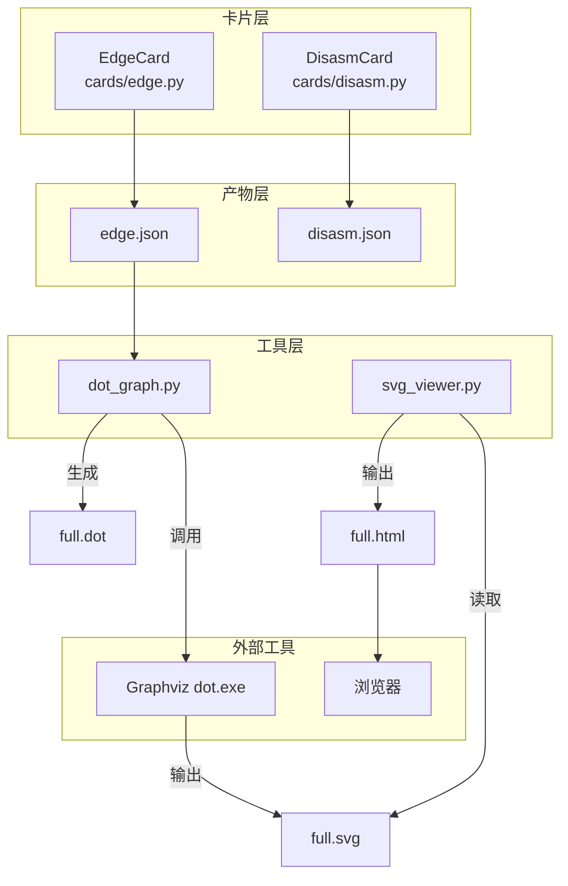
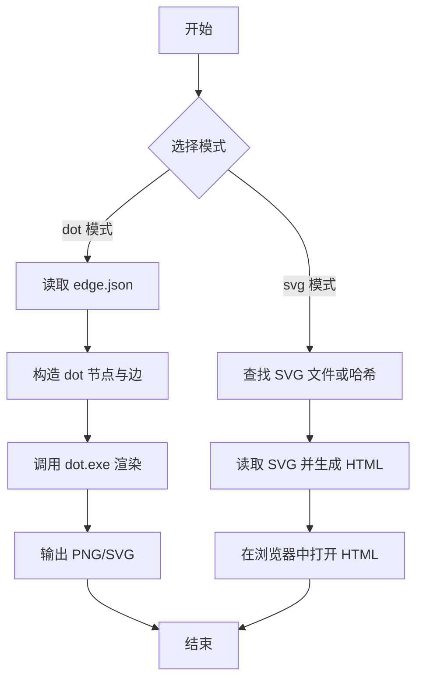
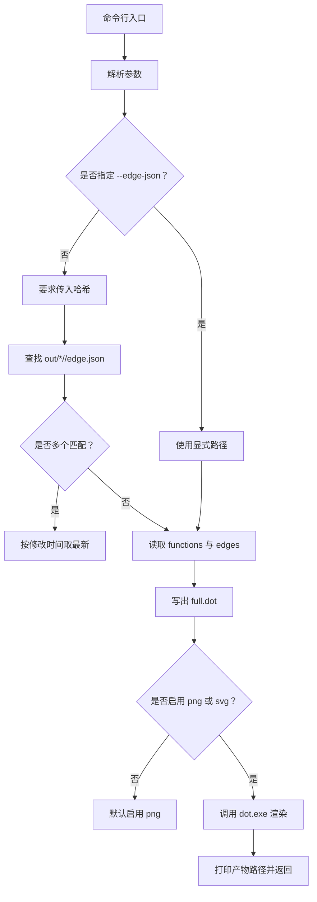
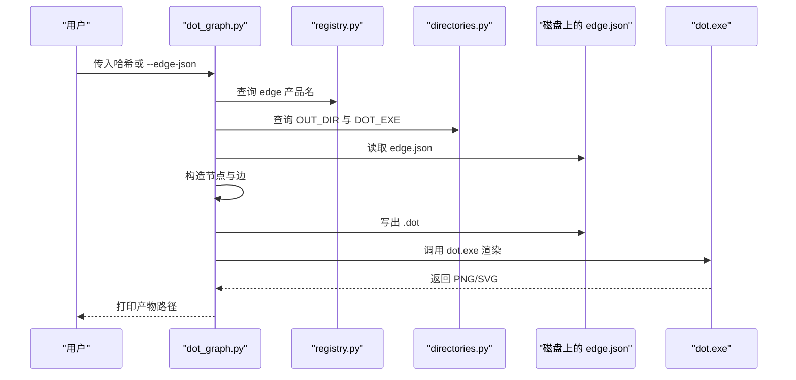
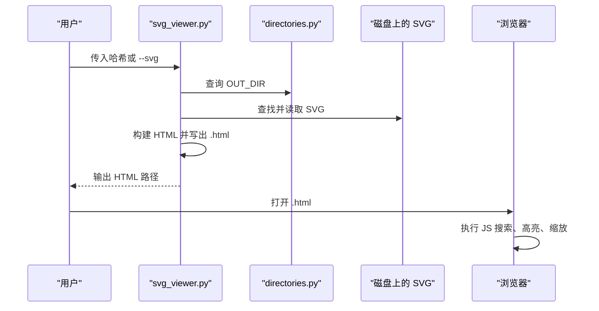
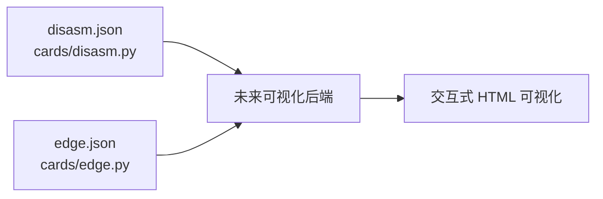
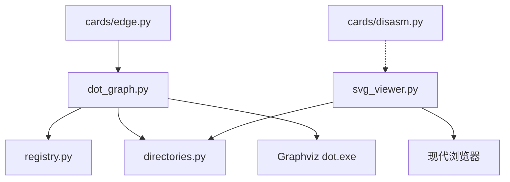

# 工具与可视化

<cite>
**本文引用的文件**
- [tools/dot_graph.py](file://tools/dot_graph.py)
- [tools/svg_viewer.py](file://tools/svg_viewer.py)
- [cards/edge.py](file://cards/edge.py)
- [cards/disasm.py](file://cards/disasm.py)
- [registry.py](file://registry.py)
- [directories.py](file://directories.py)
</cite>

## 目录
1. [引言](#引言)
2. [项目结构定位](#项目结构定位)
3. [核心组件](#核心组件)
4. [架构总览](#架构总览)
5. [详细组件分析](#详细组件分析)
6. [依赖关系分析](#依赖关系分析)
7. [性能与使用限制](#性能与使用限制)
8. [故障排查](#故障排查)
9. [结论与后续建议](#结论与后续建议)

## 引言
`tools/dot_graph.py` 与 `tools/svg_viewer.py` 是两个面向调试和可视化的辅助工具。它们目前尚未完全整合进主运行流程，主要用于查看：
- 调用边产物；
- 反汇编或节点结构；
- Graphviz 生成的 SVG/PNG 图。

`dot_graph.py` 负责从卡片产出的 `edge.json` 生成 Graphviz dot 描述并调用 `dot.exe` 渲染图片；`svg_viewer.py` 则把 Graphviz 输出的 SVG 包装成一个可在浏览器中拖拽、缩放、搜索的独立 HTML 页面。

## 项目结构定位
这两个脚本位于仓库根目录下的 `tools/` 目录，属于“工具层”而非“卡片层”。它们不定义新的卡片，也不直接参与 `cards/` 中的构建管线，而是消费卡片已经写出的中间产物。

**图示来源**
- [cards/edge.py:1-23](file://cards/edge.py#L1-L23)
- [cards/disasm.py:1-200](file://cards/disasm.py#L1-L200)
- [tools/dot_graph.py:1-168](file://tools/dot_graph.py#L1-L168)
- [tools/svg_viewer.py:1-409](file://tools/svg_viewer.py#L1-L409)

**章节来源**
- [cards/edge.py:1-23](file://cards/edge.py#L1-L23)
- [cards/disasm.py:1-200](file://cards/disasm.py#L1-L200)
- [tools/dot_graph.py:1-168](file://tools/dot_graph.py#L1-L168)
- [tools/svg_viewer.py:1-409](file://tools/svg_viewer.py#L1-L409)

## 核心组件
- `tools/dot_graph.py`：从 `edge.json` 提取函数与调用边，写出 dot 文本，再调用 Graphviz 的 `dot.exe` 渲染 PNG/SVG。
- `tools/svg_viewer.py`：读取 Graphviz 输出的 SVG，嵌入一个内嵌 JavaScript 的 HTML 模板，提供搜索、高亮、列表、平移、缩放等功能。

它们都通过项目内的 `directories.py` 获取输出目录、缓存目录以及 `dot.exe` 路径，并通过 `registry.py` 识别产品名（例如 `edge` 对应 `edge.json`）。

**章节来源**
- [tools/dot_graph.py:1-168](file://tools/dot_graph.py#L1-L168)
- [tools/svg_viewer.py:1-409](file://tools/svg_viewer.py#L1-L409)
- [directories.py:1-25](file://directories.py#L1-L25)
- [registry.py:1-49](file://registry.py#L1-L49)

## 架构总览
从数据流角度，两个工具构成一条“卡片产物 → 图形描述 → 图像/交互页面”的辅助链路：

**图示来源**
- [tools/dot_graph.py:60-168](file://tools/dot_graph.py#L60-L168)
- [tools/svg_viewer.py:260-409](file://tools/svg_viewer.py#L260-L409)

## 详细组件分析

### `tools/dot_graph.py` 分析

#### 作用
该脚本用于将 `edge.json` 转换为 Graphviz dot 图，并进一步渲染为 PNG 或 SVG。它支持两种输入方式：
1. 按运行哈希查找 `out/*/<hash>/edge.json`；
2. 显式指定任意 `--edge-json` 路径，适合 diff 产物等不在标准位置的文件。

#### 关键行为
- **查找产物**：根据 `registry.PRODUCTS["edge"].path` 和 `directories.OUT_DIR` 拼接路径，先用精确前缀匹配，再放宽到包含前缀的目录名。
- **加载图数据**：从 JSON 中读取 `functions` 与 `edges`，若字段缺失则退化为空列表。
- **生成 dot**：每个函数作为编号节点，边按 `(caller, callee)` 去重后写入。
- **渲染**：默认开启 PNG；如果同时传入 `-svg`，则同时生成 SVG。
- **dot 路径**：通过 `directories.DOT_EXE` 配置，未找到时返回错误码。

**图示来源**
- [tools/dot_graph.py:60-168](file://tools/dot_graph.py#L60-L168)

#### 命令行参数
| 参数 | 说明 | 默认值或行为 |
|---|---|---|
| `hash8` | 运行哈希，例如 `7343650d` | 可选；未提供且未指定 `--edge-json` 时会提示可用哈希 |
| `--edge-json` | 显式指定 `edge.json` 路径 | 空字符串；适合 diff 或其他非标准位置产物 |
| `--name` | 输出文件名前缀 | `full` |
| `--out` | 输出目录 | 未指定时使用 `edge.json` 所在目录 |
| `-png` / `--png` | 渲染 PNG | 默认启用 |
| `-svg` / `--svg` | 渲染 SVG | 默认关闭 |
| `--dot` | Graphviz `dot.exe` 路径 | 来自 `directories.DOT_EXE` |

#### 典型用法
- 对某个运行哈希生成 PNG：
  - `python tools/dot_graph.py 7343650d`
- 仅生成 SVG：
  - `python tools/dot_graph.py 7343650d -svg`
- 同时生成 PNG 与 SVG：
  - `python tools/dot_graph.py 7343650d -png -svg`
- 使用 diff 或其他位置的 `edge.json`：
  - `python tools/dot_graph.py --edge-json out/diff/edge_diff.json -svg`

#### 与卡片层的关联
`EdgeCard` 会将原始函数与边信息符号化后写入 `edge.json`，因此 `dot_graph.py` 的消费对象正是这个卡片产物。

**图示来源**
- [tools/dot_graph.py:1-168](file://tools/dot_graph.py#L1-L168)
- [registry.py:1-49](file://registry.py#L1-L49)
- [directories.py:1-25](file://directories.py#L1-L25)

**章节来源**
- [tools/dot_graph.py:1-168](file://tools/dot_graph.py#L1-L168)
- [cards/edge.py:1-23](file://cards/edge.py#L1-L23)
- [registry.py:1-49](file://registry.py#L1-L49)
- [directories.py:1-25](file://directories.py#L1-L25)

### `tools/svg_viewer.py` 分析

#### 作用
该脚本不生成 dot 图，而是读取已有 SVG，将其嵌入一个自包含 HTML 页面。HTML 中包含：
- 顶部搜索栏；
- 结果列表面板；
- 当前选中节点信息栏；
- 可拖拽平移、滚轮缩放的 SVG 视口；
- 基于 Graphviz 节点标签的连续子串匹配与高亮。

#### 关键行为
- **查找 SVG**：优先按 `out/*/<hash>/*.svg` 精确匹配；否则回退到所有 SVG，并按父目录名前缀匹配哈希。
- **多 SVG 选择**：如果存在多个同名 SVG，优先使用名为 `full` 的产物；否则使用最近修改的产物。
- **构建 HTML**：移除 SVG 头部的 XML 声明与 DOCTYPE，然后将 SVG 内容注入模板中的占位符。
- **交互逻辑**：JavaScript 部分会遍历 `<g class="node">`，收集显示标签和完整标题，支持：
  - 不区分大小写的连续子串搜索；
  - 上一个/下一个跳转；
  - 列表面板切换；
  - 适应窗口；
  - 恢复 1:1 缩放；
  - 鼠标拖拽平移；
  - 滚轮缩放。

**图示来源**
- [tools/svg_viewer.py:200-409](file://tools/svg_viewer.py#L200-L409)
- [directories.py:1-25](file://directories.py#L1-L25)

#### 命令行参数
| 参数 | 说明 | 默认值或行为 |
|---|---|---|
| `hash8` | 运行哈希，例如 `7343650d` | 可选；未提供时会列出可用的哈希前缀 |
| `--svg` | 显式指定 `.svg` 路径 | 空字符串 |
| `--name` | 当同一运行有多个 SVG 时，选择名称前缀 | 空字符串；未指定时优先 `full` |
| `--out` | 输出 HTML 路径 | 默认与 SVG 同目录同名 `.html` |
| `--title` | HTML 页面标题 | 默认使用 SVG 文件名 |

#### 典型用法
- 自动查找某运行的 SVG 并生成 HTML：
  - `python tools/svg_viewer.py 7343650d`
- 指定名称前缀：
  - `python tools/svg_viewer.py 7343650d --name full`
- 直接处理任意 SVG：
  - `python tools/svg_viewer.py --svg out/diff/full.svg`

#### 与 `cards/disasm.py` 的潜在关联
`svg_viewer.py` 本身只依赖 SVG 和 HTML 模板，并不直接读取 `disasm.json`。但 `cards/disasm.py` 是另一个重要卡片，用于从二进制和 PDB 中提取每函数的反汇编指标、调用数、分支数等信息，其产物是 `disasm.json`。未来如果需要把反汇编视图也接入可视化后端，可以考虑：
- 让可视化模块同时消费 `edge.json` 与 `disasm.json`；
- 在 SVG 或 HTML 中增加函数级统计信息展示；
- 用反汇编指标过滤或排序调用边。

**图示来源**
- [cards/disasm.py:1-200](file://cards/disasm.py#L1-L200)
- [cards/edge.py:1-23](file://cards/edge.py#L1-L23)

**章节来源**
- [tools/svg_viewer.py:1-409](file://tools/svg_viewer.py#L1-L409)
- [cards/disasm.py:1-200](file://cards/disasm.py#L1-L200)
- [cards/edge.py:1-23](file://cards/edge.py#L1-L23)

## 依赖关系分析

### 内部依赖
- `tools/dot_graph.py` 依赖：
  - `registry.PRODUCTS["edge"]` 确定 `edge.json` 的产品名；
  - `directories.OUT_DIR` 定位产物目录；
  - `directories.DOT_EXE` 定位 Graphviz `dot.exe`。
- `tools/svg_viewer.py` 依赖：
  - `directories.OUT_DIR` 定位 SVG；
  - 内置 HTML 模板与 JavaScript 实现交互。

### 外部依赖
- Graphviz：`dot.exe` 必须存在且可执行，否则 `dot_graph.py` 会报错。
- 现代浏览器：`svg_viewer.py` 生成的 HTML 依赖 Canvas/SVG DOM API、Pointer Events、CSS Transform 等特性。

**图示来源**
- [tools/dot_graph.py:1-168](file://tools/dot_graph.py#L1-L168)
- [tools/svg_viewer.py:1-409](file://tools/svg_viewer.py#L1-L409)
- [registry.py:1-49](file://registry.py#L1-L49)
- [directories.py:1-25](file://directories.py#L1-L25)
- [cards/edge.py:1-23](file://cards/edge.py#L1-L23)
- [cards/disasm.py:1-200](file://cards/disasm.py#L1-L200)

**章节来源**
- [tools/dot_graph.py:1-168](file://tools/dot_graph.py#L1-L168)
- [tools/svg_viewer.py:1-409](file://tools/svg_viewer.py#L1-L409)
- [registry.py:1-49](file://registry.py#L1-L49)
- [directories.py:1-25](file://directories.py#L1-L25)

## 性能与使用限制

### 已知局限性
1. **依赖 Graphviz**
   - `dot_graph.py` 需要系统上安装 Graphviz，并且 `directories.DOT_EXE` 指向有效的 `dot.exe`。
   - 如果路径不存在，脚本会返回错误码而不是继续工作。

2. **大型图的渲染性能问题**
   - `dot_graph.py` 会把全部函数作为节点、全部调用边作为边写入 dot 文件，再交给 Graphviz 布局。
   - 对于函数数量或调用边数量较大的程序，dot 布局和 SVG 渲染可能较慢。
   - `svg_viewer.py` 会在 HTML 中扫描所有 `<g class="node">`，并在每次搜索时进行线性匹配，因此在超大图中搜索也可能变慢。

3. **跨平台兼容性注意事项**
   - `directories.py` 中的 `GRAPHVIZ_BIN_DIR` 示例路径使用了 Windows 风格路径；在其他平台上应确保设置正确的 Graphviz 安装目录。
   - 工具本身使用 Python 标准库，但对外部 `dot.exe` 的调用是平台相关的。
   - `svg_viewer.py` 的浏览器交互依赖较新的 Web API，建议在现代桌面浏览器中使用。

### 建议的使用策略
- 先使用较小的哈希或子集产物验证工具链是否正确；
- 对大型图优先使用 SVG 后通过 `svg_viewer.py` 查看，便于局部搜索和缩放；
- 如果发现渲染过慢，可考虑在卡片层或工具层增加过滤条件，例如只保留关键函数或关键边。

**章节来源**
- [directories.py:1-25](file://directories.py#L1-L25)
- [tools/dot_graph.py:60-168](file://tools/dot_graph.py#L60-L168)
- [tools/svg_viewer.py:200-409](file://tools/svg_viewer.py#L200-L409)

## 故障排查

| 现象 | 可能原因 | 处理方法 |
|---|---|---|
| 提示需要指定哈希 | 未传入 `hash8` 且未传入 `--edge-json` 或 `--svg` | 传入运行哈希，或显式指定产物路径 |
| `out/*/<hash>/edge.json` 不存在 | 对应运行没有生成 `edge.json`，或哈希不完整导致无法匹配 | 检查卡片是否成功运行；尝试更精确或更完整的哈希 |
| 多个匹配并使用最新产物 | 多个目录名以相同哈希前缀开头 | 确认哈希唯一性，或使用 `--edge-json` 指定具体文件 |
| `dot.exe not found` | `directories.DOT_EXE` 指向的路径无效或未安装 Graphviz | 修正 `directories.py` 中的 Graphviz 路径，或安装 Graphviz |
| `svg not found` | 没有对应哈希的 SVG，或名称不匹配 | 先运行 `dot_graph.py -svg`，或使用 `--svg` 指定路径 |
| 多个 SVG 但未指定名称 | 同一运行下存在多个 SVG | 使用 `--name full` 或明确指定 `--svg` |
| HTML 中搜索无响应或卡顿 | 图过大，节点过多 | 缩小范围后再查看；必要时减少边数量或函数数量 |

**章节来源**
- [tools/dot_graph.py:80-168](file://tools/dot_graph.py#L80-L168)
- [tools/svg_viewer.py:300-409](file://tools/svg_viewer.py#L300-L409)

## 结论与后续建议

当前 `tools/dot_graph.py` 与 `tools/svg_viewer.py` 是独立的可视化辅助脚本，主要服务于已存在的卡片产物，尤其是 `cards/edge.py` 生成的 `edge.json`。它们尚未成为主运行流程的一部分，也没有直接集成 `cards/disasm.py` 的反汇编产物。

建议的未来方向包括：
1. **统一可视化后端**：抽象出“读取卡片产物 → 构建节点/边/元数据 → 渲染为 SVG/HTML”的通用流程，使 `edge.json`、`disasm.json` 等产物可以复用同一套渲染器。
2. **渐进式集成**：先在 `engine.py` 或 bootstrap 流程中增加可选步骤，在生成 `edge.json` 后自动调用 `dot_graph.py`，并在有 SVG 时自动生成 `svg_viewer.py` 的 HTML。
3. **产物联动**：让可视化模块同时消费 `edge.json` 与 `disasm.json`，在 HTML 中展示调用边与函数指标的联合视图。
4. **性能优化**：为大图引入分页、按需展开、边聚合、采样等能力，避免一次性渲染全部节点。
5. **平台适配**：将 `directories.py` 中的固定路径改为可通过环境变量或配置文件覆盖的方式，提高跨平台可用性。

通过这些改进，当前“手动查看调用边与反汇编结构”的工具链可以逐步演进为项目主流程中的标准可视化环节。