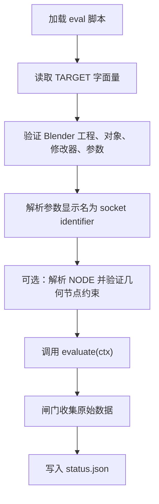
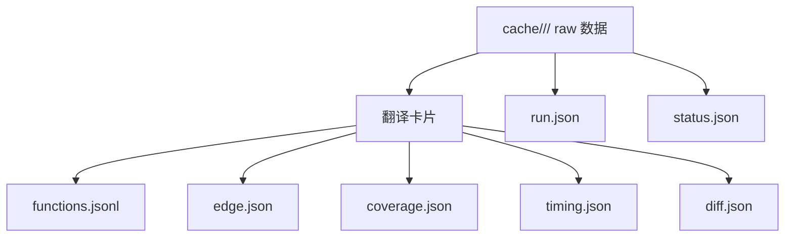
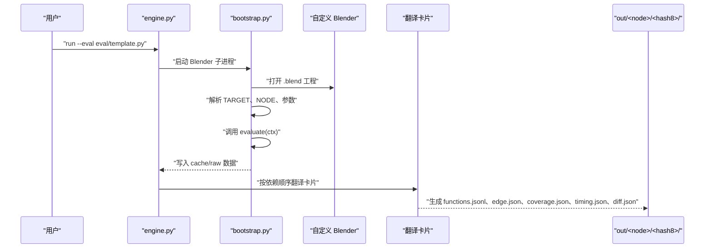
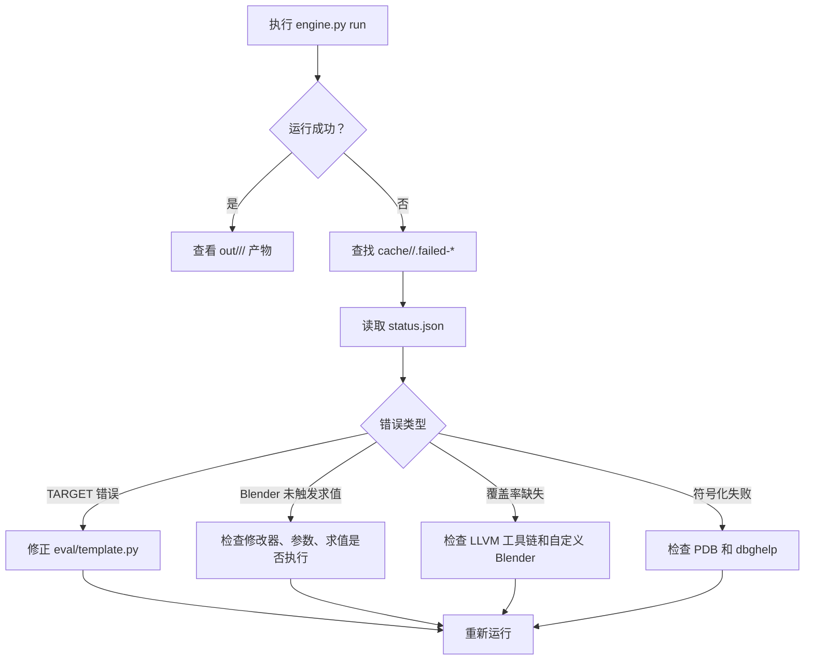
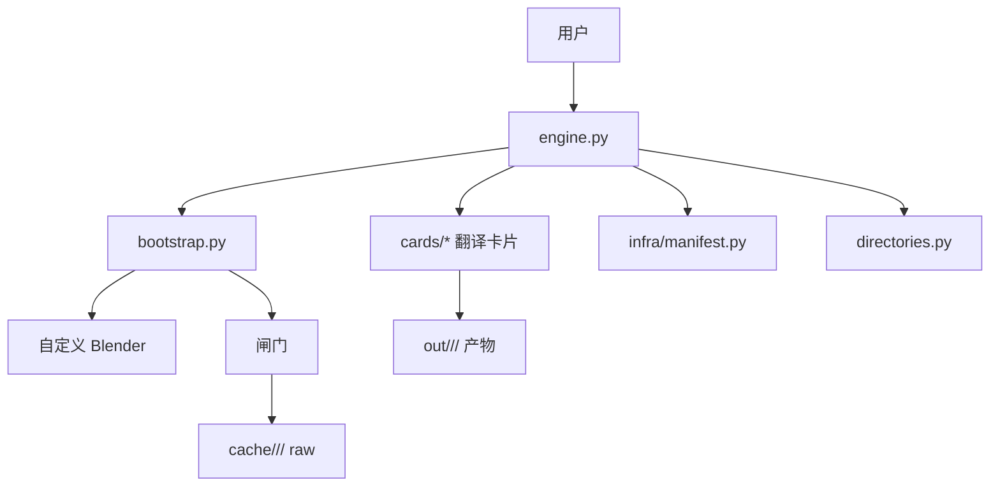
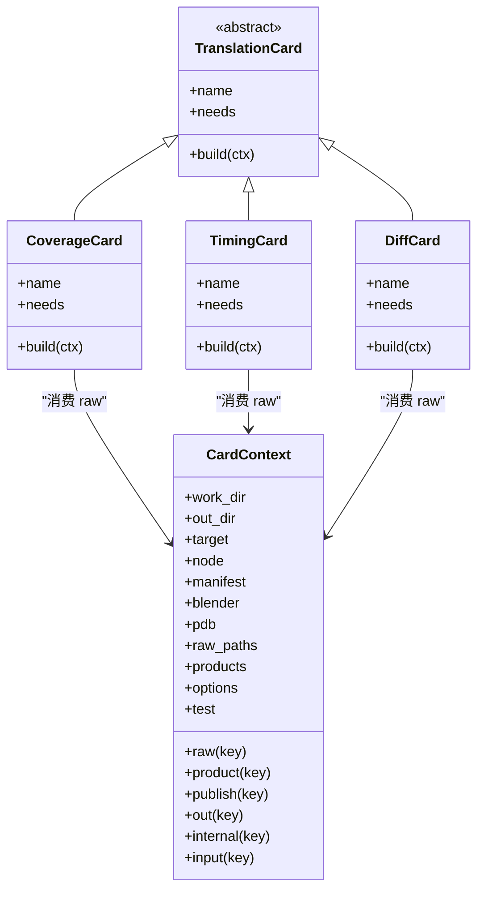

# 快速开始

<cite>
**本文引用的文件**   
- [engine.py](file://engine.py)
- [directories.py](file://directories.py)
- [bootstrap.py](file://bootstrap.py)
- [eval/template.py](file://eval/template.py)
- [infra/manifest.py](file://infra/manifest.py)
- [cards/base.py](file://cards/base.py)
- [cards/coverage.py](file://cards/coverage.py)
- [cards/timing.py](file://cards/timing.py)
- [cards/diff.py](file://cards/diff.py)
- [cards/symbols.py](file://cards/symbols.py)
- [frag/targeting.py](file://frag/targeting.py)
</cite>

## 目录
1. [简介](#简介)
2. [环境准备](#环境准备)
3. [最小示例：编写求值脚本](#最小示例编写求值脚本)
4. [第一次运行](#第一次运行)
5. [产物说明](#产物说明)
6. [常用命令](#常用命令)
7. [失败现场定位](#失败现场定位)
8. [常见问题排查](#常见问题排查)
9. [架构概览](#架构概览)
10. [结论](#结论)

## 简介
CovTrace 是一个面向 Blender 的几何节点修改器求值追踪工具。它通过自定义构建的 Blender、LLVM 覆盖率工具链、Graphviz 以及 Windows dbghelp，把一次 Blender 求值过程记录为原始数据，再翻译生成 `functions.jsonl`、`edge.json`、`coverage.json`、`timing.json`、`diff.json` 等可读产物。本文的目标是让新手在 10 分钟内完成首次运行并看到结果。

## 环境准备
CovTrace 不直接硬编码工具路径，而是由 `directories.py` 统一管理所有外部依赖和目录常量。你需要准备以下依赖：

| 依赖 | 用途 | 关键常量 |
|---|---|---|
| 自定义构建的 Blender（含 `covtrace_*` 导出符号） | 执行 Blender 求值、采集原始覆盖率和调用信息 | `BLENDER_BIN_DIR`、`BLENDER_EXE` |
| LLVM 工具链（`llvm-cov.exe`、`llvm-profdata.exe`） | 合并 `.profraw`、导出 LCOV、解析覆盖率 | `LLVM_BIN_DIR`、`LLVM_COV_EXE`、`LLVM_PROFDATA_EXE` |
| Graphviz `dot` | 生成可视化图（例如边缘图） | `GRAPHVIZ_BIN_DIR`、`DOT_EXE` |
| Windows `dbghelp.dll` | 将 RVA 符号化到函数名、文件和行号 | `cards/symbols.py` 中动态加载 `dbghelp.dll` |
| Blender 源码目录 | 覆盖率报告相对路径归一化 | `SOURCE_DIR` |

这些路径全部集中在 `directories.py`：

- `BLENDER_BIN_DIR`：自定义 Blender 可执行文件所在目录。
- `LLVM_BIN_DIR`：LLVM 工具目录。
- `GRAPHVIZ_BIN_DIR`：Graphviz 的 `dot.exe` 所在目录。
- `SOURCE_DIR`：Blender 源码根目录，用于覆盖率报告中路径归一化。
- `OUT_DIR`、`CACHE_DIR`、`FRAG_DIR`：输出目录、缓存目录、片段目录。
- `BLENDER_EXE`、`LLVM_COV_EXE`、`LLVM_PROFDATA_EXE`、`DOT_EXE`：具体可执行文件路径。
- `ENGINE_SCRIPT`、`BOOTSTRAP_SCRIPT`、`VALIDATE_SCRIPT`：内部脚本路径。

如果你当前机器上的路径与仓库默认值不同，请修改 `directories.py` 中的对应常量，不要复制多份代码。修改后重新运行即可。

**章节来源**
- [directories.py:1-25](file://directories.py#L1-L25)
- [cards/symbols.py:1-80](file://cards/symbols.py#L1-L80)

## 最小示例：编写求值脚本
CovTrace 使用 `eval/*.py` 中的脚本描述你要测量什么目标，以及如何驱动 Blender 求值。模板位于 `eval/template.py`。

### TARGET 字段
`TARGET` 必须是字面量字典。引擎会在宿主侧读取它，不会执行整个脚本，因此 `TARGET` 里不要放副作用逻辑。

| 字段 | 含义 | 是否必填 |
|---|---|---|
| `blend` | Blender 工程文件绝对路径 | 是 |
| `object` | 包含几何节点修改器的对象名称 | 是 |
| `modifier` | 几何节点修改器名称 | 是 |
| `param` | 要变化的参数显示名 | 是 |
| `node_tree` | 可选；如果填写，会校验修改器绑定的节点树名称 | 否 |

注意：`param` 使用 Blender 中显示的参数名，底座负责解析成真正的 socket identifier。

### NODE 字段
`NODE` 是可选的。它指定一个几何节点，用于自动计算 before/after 边界，并在普通 `engine.py run` 时自动生成 `diff.json`。

约束如下：
- 节点必须有且只有一个几何输出。
- v1 最多支持一个几何输入。
- 节点树中不能包含 Repeat、Foreach、Simulation 区域。
- 节点可以通过 name、label 或 bl_idname 匹配。

### evaluate(ctx)
`evaluate(ctx)` 是你需要实现的业务函数。引擎会传入一个上下文对象，常见用法包括：
- `ctx.set_value(value)`：设置参数并触发一次 Blender 求值，返回耗时毫秒数。
- `ctx.instance_count()`：获取当前求值后的实例数量。
- `ctx.target`、`ctx.obj`、`ctx.mod`、`ctx.node_tree`、`ctx.param`：查看目标元数据。

你可以参考 `eval/template.py` 的最小写法：遍历一组参数值，打印参数、实例数量和耗时。



**图表来源**
- [bootstrap.py:1-192](file://bootstrap.py#L1-L192)
- [frag/targeting.py:1-136](file://frag/targeting.py#L1-L136)
- [eval/template.py:1-25](file://eval/template.py#L1-L25)

**章节来源**
- [eval/template.py:1-25](file://eval/template.py#L1-L25)
- [bootstrap.py:1-192](file://bootstrap.py#L1-L192)
- [frag/targeting.py:1-136](file://frag/targeting.py#L1-L136)

## 第一次运行
假设你已经准备好 Blender 工程、自定义 Blender 可执行文件、LLVM 工具链、Graphviz 和 Windows dbghelp，并按自己的环境配置了 `directories.py`，就可以从模板脚本开始。

### 步骤
1. 编辑 `eval/template.py`，把 `blend` 指向你的 `.blend` 工程，并把 `object`、`modifier`、`param` 改成实际值。
2. 如果需要 diff，填写 `NODE`；否则留空。
3. 在 CovTrace 根目录执行：
   ```
   python engine.py run --eval eval/template.py
   ```
4. 等待 Blender 启动并完成求值。成功后你会看到类似“已产出 raw”和最终产物路径的输出。
5. 打开 `out/<node>/<hash8>/` 查看生成的 JSON 产物。

这里的 `<node>` 通常来自 eval 脚本中的 `NODE`，如果没有 NODE 则可能为空或按内部规则命名；`<hash8>` 是本次运行的短哈希，由运行键派生。

### 成功标志
- 终端没有红色错误。
- `cache/<node>/<hash8>.failed-*` 不存在。
- `out/<node>/<hash8>/` 下出现预期产物。
- `status.json` 中 `ok` 为真。

**章节来源**
- [engine.py:1-120](file://engine.py#L1-L120)
- [bootstrap.py:1-192](file://bootstrap.py#L1-L192)
- [infra/manifest.py:1-58](file://infra/manifest.py#L1-L58)

## 产物说明
CovTrace 会把原始数据写入 `cache/<node>/<hash8>/`，再把可读产物写到 `out/<node>/<hash8>/`。核心产物如下：

| 产物 | 位置 | 含义 |
|---|---|---|
| `functions.jsonl` | `out/<node>/<hash8>/` | 被调用的函数清单，每行一个函数记录 |
| `edge.json` | `out/<node>/<hash8>/` | 调用边，caller/callee 关系 |
| `coverage.json` | `out/<node>/<hash8>/` | 源代码覆盖率，包含文件、命中行范围、函数统计 |
| `timing.json` | `out/<node>/<hash8>/` | 性能计时，包含自耗时、包含耗时、平均耗时、调用次数 |
| `diff.json` | `out/<node>/<hash8>/` | 前后两次运行的新增/移除函数与边，需要启用 NODE 或显式 diff 选项 |
| `run.json` | `cache/<node>/<hash8>/` | 本次运行元数据，包括 `run_key`、`hash8`、`node`、`eval`、`blender`、`pdb`、`options` |
| `status.json` | `cache/<node>/<hash8>/` | 运行时状态，`ok=true` 表示成功，`ok=false` 表示失败及错误栈 |

其中 `run.json` 的结构由 `infra/manifest.py` 定义，关键字段包括：
- `schema`：清单模式版本。
- `run_key`：运行唯一键。
- `hash8`：八位短哈希。
- `node`：目标节点名。
- `eval`：eval 脚本路径。
- `blend`：Blender 工程路径。
- `blender`：使用的 Blender 可执行路径。
- `pdb`：PDB 路径。
- `options`：附加选项。
- `created`：创建时间。
- `gates`、`cards`、`counts`：卡片与闸门统计。



**图表来源**
- [engine.py:1-120](file://engine.py#L1-L120)
- [infra/manifest.py:1-58](file://infra/manifest.py#L1-L58)
- [cards/coverage.py:1-120](file://cards/coverage.py#L1-L120)
- [cards/timing.py:1-108](file://cards/timing.py#L1-L108)
- [cards/diff.py:1-141](file://cards/diff.py#L1-L141)

**章节来源**
- [engine.py:1-120](file://engine.py#L1-L120)
- [infra/manifest.py:1-58](file://infra/manifest.py#L1-L58)
- [cards/coverage.py:1-120](file://cards/coverage.py#L1-L120)
- [cards/timing.py:1-108](file://cards/timing.py#L1-L108)
- [cards/diff.py:1-141](file://cards/diff.py#L1-L141)

## 常用命令
CovTrace 的核心入口是 `engine.py`。下面列出最常用的三个命令。

| 命令 | 作用 | 典型用法 |
|---|---|---|
| `run` | 启动 Blender，执行 eval 脚本，收集原始数据，并生成产物 | `python engine.py run --eval eval/template.py` |
| `validate` | 验证目标、节点、节点树约束 | `python engine.py validate --eval eval/template.py` |
| `translate` | 仅从已有 raw 数据重建产物，不重新启动 Blender | `python engine.py translate --work cache/<node>/<hash8>` |

### run
这是首次运行最常用的命令。它会：
1. 解析 eval 脚本中的 `TARGET`。
2. 启动自定义 Blender。
3. 打开 `.blend` 工程。
4. 找到对象和几何节点修改器。
5. 解析参数并可选地测量节点。
6. 执行 `evaluate(ctx)`。
7. 收集闸门原始数据。
8. 生成 `cache/<node>/<hash8>/` raw 数据。
9. 翻译为 `out/<node>/<hash8>/` 下的可读产物。

### validate
适合在正式运行前检查配置是否正确。它不会执行 Blender 求值，但会验证：
- eval 脚本语法。
- `TARGET` 结构。
- 可选的 NODE 和节点树约束。

如果验证失败，可以直接修复 `eval/template.py`，无需反复启动 Blender。

### translate
当你已经有一次成功的 raw 数据，但不想再启动 Blender 时，可以使用 `translate`。它只读取 `cache/<node>/<hash8>/` 中的原始数据，重新生成 `out/<node>/<hash8>/` 产物。这在调试卡片逻辑、修复路径重映射或复现产物时很有用。



**图表来源**
- [engine.py:1-200](file://engine.py#L1-L200)
- [bootstrap.py:1-192](file://bootstrap.py#L1-L192)
- [cards/base.py:1-63](file://cards/base.py#L1-L63)

**章节来源**
- [engine.py:1-200](file://engine.py#L1-L200)
- [bootstrap.py:1-192](file://bootstrap.py#L1-L192)
- [cards/base.py:1-63](file://cards/base.py#L1-L63)

## 失败现场定位
当运行失败时，CovTrace 会自动把失败的原始工作目录移动到 `cache/<node>/<hash8>.failed-时间戳`，并保留一份带重映射路径的副本。你不需要手动搜索日志，直接按这个约定查找即可。

### 失败产物
| 文件或目录 | 含义 |
|---|---|
| `cache/<node>/<hash8>.failed-时间戳/` | 失败时的完整原始数据目录 |
| `status.json` | 失败时 `ok=false`，包含错误信息和 traceback |
| `run.json` | 失败时也可能存在，用于判断是否是重复或冲突运行 |
| `functions.bin`、`edges.bin`、`window.profraw`、`timings.bin` | 各闸门产生的原始二进制或文本数据 |

### 快速定位流程
1. 先看终端输出末尾是否有“`>> failed raw:`”提示。
2. 进入 `cache/<node>/`，按时间排序找最新的 `.failed-*` 目录。
3. 打开 `status.json`，查看 `error` 和 `traceback`。
4. 如果错误是“object not found”“modifier not found”“param not in sockets”，回到 `eval/template.py` 修正 TARGET。
5. 如果错误是“missing exports”，检查闸门模块是否正确暴露所需符号。
6. 如果错误是“functions.bin 为空或缺失”或“edge_count == 0”，说明求值可能没有触发覆盖率采集，需要检查 Blender 是否真的执行了求值。



**图表来源**
- [engine.py:1-120](file://engine.py#L1-L120)
- [bootstrap.py:1-192](file://bootstrap.py#L1-L192)

**章节来源**
- [engine.py:1-120](file://engine.py#L1-L120)
- [bootstrap.py:1-192](file://bootstrap.py#L1-L192)

## 常见问题排查

### 找不到 Blender
现象：引擎无法启动 Blender，或报错路径不正确。

排查：
- 确认 `directories.py` 中的 `BLENDER_BIN_DIR` 和 `BLENDER_EXE` 指向真实存在的自定义 Blender。
- 确认该 Blender 包含 `covtrace_*` 导出符号，否则覆盖率、计时、调用图等原始数据会缺失。
- 如果路径中有空格或反斜杠，优先使用原始字符串形式。

### LLVM 工具链不可用
现象：`coverage.json` 未生成，或翻译阶段报 `llvm-cov`、`llvm-profdata` 相关错误。

排查：
- 确认 `directories.py` 中的 `LLVM_BIN_DIR`、`LLVM_COV_EXE`、`LLVM_PROFDATA_EXE` 正确。
- 在命令行直接运行 `llvm-cov --version` 和 `llvm-profdata merge -h` 验证工具可用。
- 确保自定义 Blender 能产生 `window.profraw`。

### Graphviz dot 不可用
现象：边缘图或可视化图生成失败。

排查：
- 确认 `GRAPHVIZ_BIN_DIR` 和 `DOT_EXE` 正确。
- 在命令行运行 `dot -V`。
- 如果只需要 JSON 产物而不需要图，可以跳过图形生成步骤，但仍需先确保其他产物成功。

### Windows dbghelp 符号化失败
现象：`timing.json` 或 diff 中函数名缺失，或报 `SymInitialize`、`SymLoadModuleEx` 相关错误。

排查：
- 确认正在使用带 PDB 的自定义 Blender。
- 确认 `directories.py` 中的 `SOURCE_DIR` 指向 Blender 源码目录。
- 确认系统能加载 `dbghelp.dll`，即 `cards/symbols.py` 能成功初始化符号解析器。

### eval 脚本报错
现象：`status.json` 中 `ok=false`，`error` 包含 Python 异常。

排查：
- 检查 `TARGET` 是否为字面量字典。
- 检查 `object`、`modifier`、`param` 是否与 Blender 工程一致。
- 如果填写了 `node_tree`，确认其名称与修改器实际绑定的节点树一致。
- 如果填写了 `NODE`，确认节点满足几何输入/输出约束，且不包含 Repeat/Foreach/Simulation 区域。

**章节来源**
- [directories.py:1-25](file://directories.py#L1-L25)
- [bootstrap.py:1-192](file://bootstrap.py#L1-L192)
- [cards/symbols.py:1-120](file://cards/symbols.py#L1-L120)
- [frag/targeting.py:1-136](file://frag/targeting.py#L1-L136)

## 架构概览
CovTrace 的控制流分为两层：

1. **宿主层**：`engine.py` 负责编排运行、管理 `cache` 和 `out` 目录、调用 Blender、协调卡片翻译。
2. **Blender 层**：`bootstrap.py` 在 Blender 进程中加载 eval 脚本，驱动修改器求值，并通过闸门收集原始数据。
3. **翻译层**：`cards/*` 是独立卡片，每个卡片消费 raw 数据并生产最终产物。



**图表来源**
- [engine.py:1-200](file://engine.py#L1-L200)
- [bootstrap.py:1-192](file://bootstrap.py#L1-L192)
- [cards/base.py:1-63](file://cards/base.py#L1-L63)
- [infra/manifest.py:1-58](file://infra/manifest.py#L1-L58)
- [directories.py:1-25](file://directories.py#L1-L25)

### 卡片职责
| 卡片 | 输入 | 输出 | 说明 |
|---|---|---|---|
| coverage | `raw:coverage` | `coverage.json` | 将 `window.profraw` 转为覆盖率报告 |
| timing | `timings.bin` | `timing.json` | 解析计时原始数据并符号化函数 |
| diff | `raw:functions`、`raw:edges` | `diff.json` | 对比前后两次运行，列出新增/移除函数和边 |
| symbols | `blender`、`pdb` | 辅助符号解析 | 使用 Windows dbghelp 将 RVA 转为函数名和文件行号 |



**图表来源**
- [cards/base.py:1-63](file://cards/base.py#L1-L63)
- [cards/coverage.py:1-120](file://cards/coverage.py#L1-L120)
- [cards/timing.py:1-108](file://cards/timing.py#L1-L108)
- [cards/diff.py:1-141](file://cards/diff.py#L1-L141)

**章节来源**
- [cards/base.py:1-63](file://cards/base.py#L1-L63)
- [cards/coverage.py:1-120](file://cards/coverage.py#L1-L120)
- [cards/timing.py:1-108](file://cards/timing.py#L1-L108)
- [cards/diff.py:1-141](file://cards/diff.py#L1-L141)

## 结论
完成 CovTrace 首次运行的关键在于三点：
1. 正确配置 `directories.py`，让引擎能找到自定义 Blender、LLVM、Graphviz 和 dbghelp。
2. 在 `eval/template.py` 中写对 `TARGET`，必要时填写 `NODE`。
3. 先用 `validate` 检查配置，再用 `run` 执行，最后查看 `out/<node>/<hash8>/` 产物。

如果失败，优先看 `cache/<node>/<hash8>.failed-时间戳/status.json`，再根据错误类型修正 eval 脚本、Blender 工程或外部工具路径。这样你可以在 10 分钟内看到 `functions.jsonl`、`edge.json`、`coverage.json`、`timing.json`、`diff.json` 等结果。