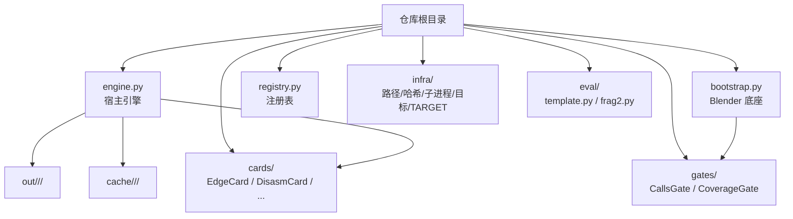
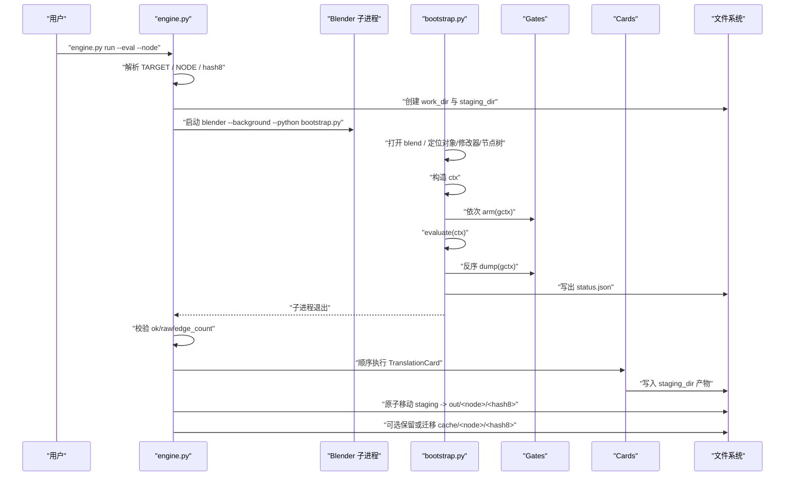
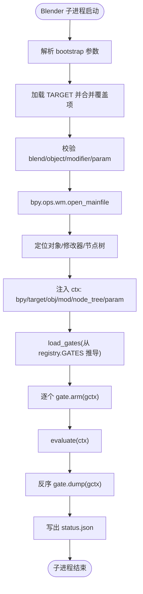
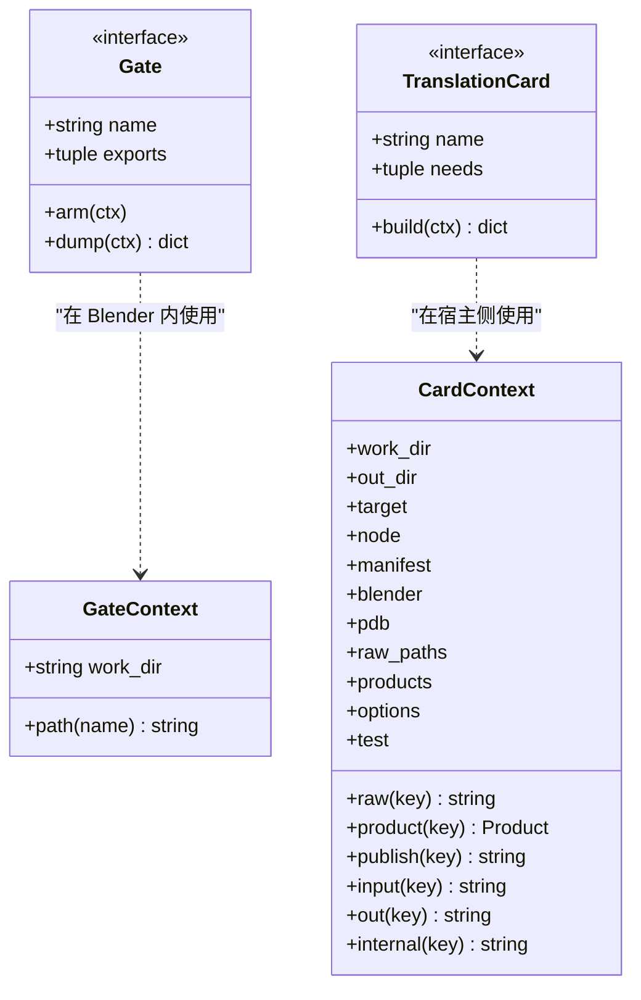
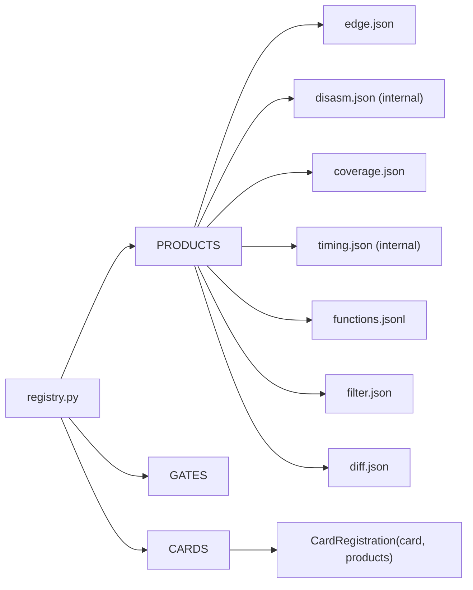
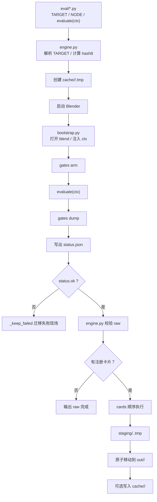
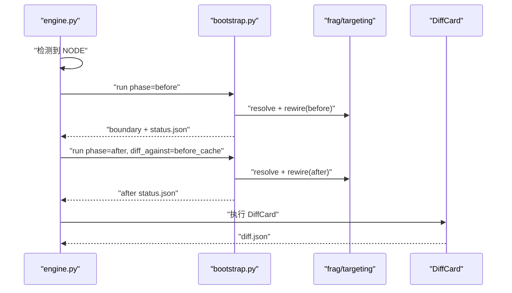
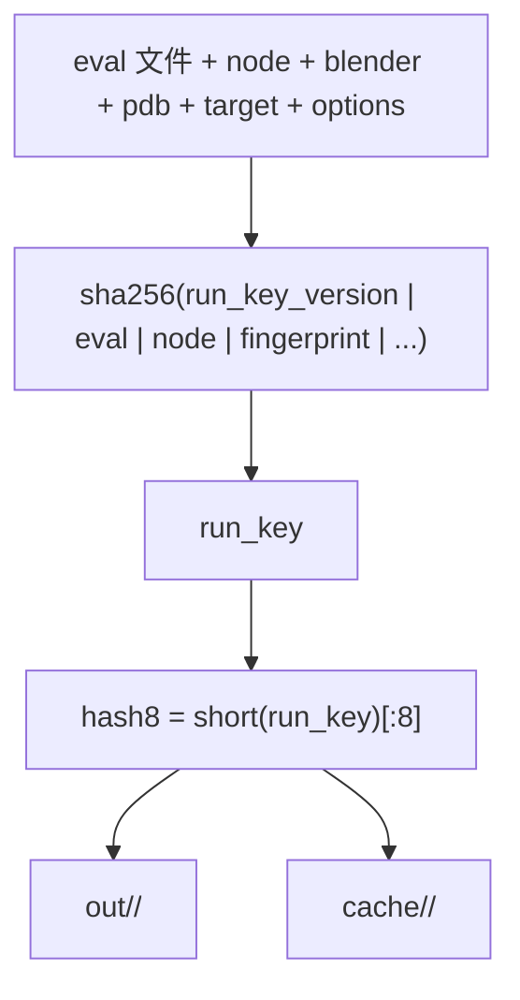
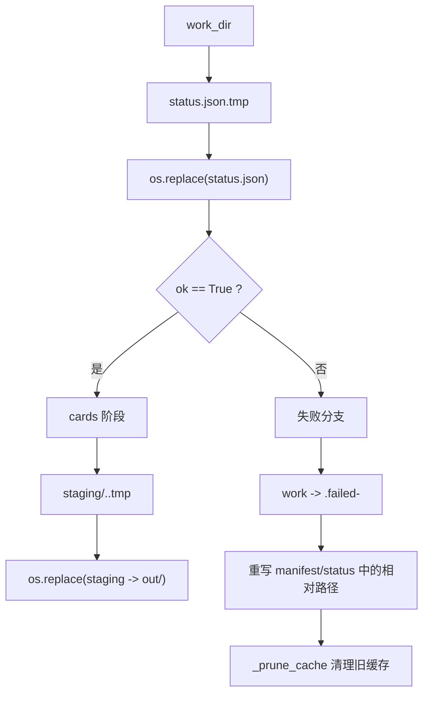
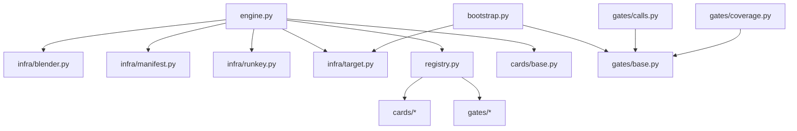

# 总体架构

<cite>
**本文引用的文件**   
- [engine.py](file://engine.py)
- [bootstrap.py](file://bootstrap.py)
- [registry.py](file://registry.py)
- [cards/base.py](file://cards/base.py)
- [gates/base.py](file://gates/base.py)
- [infra/blender.py](file://infra/blender.py)
- [infra/manifest.py](file://infra/manifest.py)
- [infra/runkey.py](file://infra/runkey.py)
- [infra/target.py](file://infra/target.py)
- [eval/template.py](file://eval/template.py)
- [eval/frag2.py](file://eval/frag2.py)
- [gates/calls.py](file://gates/calls.py)
- [gates/coverage.py](file://gates/coverage.py)
</cite>

## 目录
1. [引言](#引言)
2. [项目结构](#项目结构)
3. [核心组件](#核心组件)
4. [架构总览](#架构总览)
5. [详细组件分析](#详细组件分析)
6. [依赖关系分析](#依赖关系分析)
7. [性能与缓存特性](#性能与缓存特性)
8. [故障排查指南](#故障排查指南)
9. [结论](#结论)

## 引言
CovTrace 是一个围绕 Blender 几何节点修改器构建的覆盖与指标采集流水线。它把“宿主引擎”和“Blender 底座”拆成两个进程：宿主侧负责命令行、工作区规划、原子落盘、失败现场迁移和卡片翻译；Blender 子进程负责打开工程、定位对象/修改器/节点树、注入上下文、执行求值脚本，并由闸门采集原始数据后写出 `status.json`。

Gate（闸门）与 TranslationCard（翻译卡片）职责严格分离：Gate 在 Blender 内采集 raw 数据，TranslationCard 在宿主侧消费 raw 和前序产物生成最终 product。`registry.py` 是插件式注册中心，统一管理 GATES、CARDS、PRODUCTS 与 CardRegistration，新增能力只需扩展该文件而不改动既有模块。

## 项目结构
仓库采用按职责分层的组织方式：
- 根目录：引擎入口、Blender 底座、注册表、目录常量。
- `gates/`：Blender 内的数据采集闸门。
- `cards/`：宿主侧的翻译卡片。
- `infra/`：路径、哈希、子进程、TARGET AST 解析、manifest 管理。
- `eval/`：AI 提供的求值脚本模板与示例。
- `docs/`：架构说明文档。

**图表来源**
- [engine.py:201-562](file://engine.py#L201-L562)
- [bootstrap.py:1-192](file://bootstrap.py#L1-L192)
- [registry.py:1-49](file://registry.py#L1-L49)

**章节来源**
- [engine.py:1-120](file://engine.py#L1-L120)
- [bootstrap.py:1-40](file://bootstrap.py#L1-L40)
- [registry.py:1-49](file://registry.py#L1-L49)

## 核心组件
- **宿主引擎 `engine.py`**：CLI 调度、`run`/`translate`/`validate` 三个命令、工作区规划、Blender 子进程启动、失败现场迁移、raw 重定向、卡片线程池编排、产物发布、缓存清理。
- **Blender 底座 `bootstrap.py`**：解析参数、加载 TARGET、打开 blend、校验对象/修改器/节点树、注入 `ctx`、动态导入并实例化 Gate、arm → evaluate → dump、写出 `status.json`。
- **注册表 `registry.py`**：集中定义 GATES、CARDS、PRODUCTS 与 CardRegistration，屏蔽具体实现类名。
- **闸门基类 `gates/base.py`**：定义 Gate 接口、导出符号检测、GateContext 路径工具。
- **卡片基类 `cards/base.py`**：定义 TranslationCard 接口、CardContext 提供 raw/product/out/internal/input/publish 访问。
- **基础设施**：`infra/runkey.py` 计算 run key/hash8；`infra/target.py` 用 AST 读取 TARGET/NODE；`infra/blender.py` 组装 Blender 命令；`infra/manifest.py` 原子写 manifest 并分类重复/冲突。

**章节来源**
- [engine.py:1-120](file://engine.py#L1-L120)
- [bootstrap.py:1-192](file://bootstrap.py#L1-L192)
- [registry.py:1-49](file://registry.py#L1-L49)
- [cards/base.py:1-63](file://cards/base.py#L1-L63)
- [gates/base.py:1-38](file://gates/base.py#L1-L38)
- [infra/runkey.py:1-44](file://infra/runkey.py#L1-L44)
- [infra/target.py:1-81](file://infra/target.py#L1-L81)
- [infra/blender.py:1-39](file://infra/blender.py#L1-L39)
- [infra/manifest.py:1-58](file://infra/manifest.py#L1-L58)

## 架构总览
CovTrace 的双进程边界非常明确：
- 宿主进程运行 `engine.py`，只使用 Python 标准库、文件系统、subprocess 和卡片逻辑。
- Blender 子进程运行 `bootstrap.py`，持有 bpy、ctypes 和编译期注入的 native 符号，负责打开工程、执行 AI 求值代码、驱动闸门采集 raw。

**图表来源**
- [engine.py:201-562](file://engine.py#L201-L562)
- [bootstrap.py:40-192](file://bootstrap.py#L40-L192)
- [infra/blender.py:1-39](file://infra/blender.py#L1-L39)
- [infra/manifest.py:1-58](file://infra/manifest.py#L1-L58)

## 详细组件分析

### 双进程边界：engine.py 与 bootstrap.py
`engine.py` 不直接操作 Blender API，也不解析 Blender 内部结构。它通过 `infra/blender.py.command` 拼装命令行，调用 `subprocess.run` 启动 Blender，并把 gate 规范字符串、phase、measure-node 等元信息传给 `bootstrap.py`。

`bootstrap.py` 是 Blender 内的唯一入口。它先解析 argv，再加载 `infra.target` 中的 TARGET，合并命令行覆盖项，打开 blend，定位 object/modifier/node_group，验证 node_tree 与 param socket，必要时根据 phase 对测量区域进行 before/after 重连，然后动态导入 eval 脚本并执行 `evaluate(ctx)`。最后按注册顺序逆序 dump 所有闸门，合并 raw 并写出 `status.json`。

**图表来源**
- [bootstrap.py:12-192](file://bootstrap.py#L12-L192)
- [infra/target.py:1-81](file://infra/target.py#L1-L81)

**章节来源**
- [engine.py:201-562](file://engine.py#L201-L562)
- [bootstrap.py:12-192](file://bootstrap.py#L12-L192)
- [infra/blender.py:1-39](file://infra/blender.py#L1-L39)

### Gate 与 TranslationCard 的职责分离
Gate 运行在 Blender 内，职责是“准备 + 收集 + 落 raw”：
- `arm` 用于注册钩子、设置窗口 profraw 路径、重置计数器。
- `dump` 用于解除钩子、导出二进制或 JSON 到 work_dir，并返回摘要。
- `exports` 声明需要由编译产物导出的 native 符号，缺失时 bootstrap 直接报错。

TranslationCard 运行在宿主侧，职责是“消费 raw 与前序产物，生成 final product”：
- `needs` 声明依赖，支持 `raw:key` 与公开产物键。
- `build(ctx)` 通过 `ctx.raw()`、`ctx.input()`、`ctx.publish()` 读写文件。
- `CardContext.publish(key)` 会根据 PRODUCT 的 `internal` 标志决定写入 `_internal/` 还是顶层。

**图表来源**
- [gates/base.py:1-38](file://gates/base.py#L1-L38)
- [cards/base.py:1-63](file://cards/base.py#L1-L63)

**章节来源**
- [gates/base.py:1-38](file://gates/base.py#L1-L38)
- [cards/base.py:1-63](file://cards/base.py#L1-L63)

### 注册表：GATES、CARDS、PRODUCTS 与 CardRegistration
`registry.py` 是系统唯一的配置点：
- `PRODUCTS` 定义每个逻辑产物键对应的文件名与是否 internal。
- `GATES` 列出运行时由 bootstrap 加载的闸门实例。
- `CARDS` 以 `CardRegistration` 包装 TranslationCard 与其产物键。
- `CardRegistration.products` 是卡片产物的 tuple，引擎会检查这些文件确实被写出。

这种设计让 Gate 与 Card 互不知道对方，新增能力只需要新增模块并在 `registry.py` 中注册。

**图表来源**
- [registry.py:1-49](file://registry.py#L1-L49)

**章节来源**
- [registry.py:1-49](file://registry.py#L1-L49)

### 运行管线：from eval/*.py → bootstrap → gates → evaluate → gates dump → status.json → cards → out/<node>/<hash8>/
完整数据流如下：

1. 用户调用 `engine.py run`。
2. `engine.py` 用 AST 读取 `eval/*.py` 中的 TARGET 与 NODE。
3. 计算 `run_key` 并取前 8 位作为 `hash8`。
4. 创建 `cache/<node>/<hash8>.tmp` 作为工作区，并写入 manifest。
5. 启动 Blender，传入 `--gates=module:Class,...`。
6. `bootstrap.py` 打开 blend，注入 ctx，arm 闸门，执行 `evaluate(ctx)`，dump 闸门，写出 `status.json`。
7. `engine.py` 校验 status，提取 counts 与 raw。
8. 若注册了卡片，则顺序执行 TranslationCard，产出 staging 目录。
9. 成功后将 staging 原子移动到 `out/<node>/<hash8>`。
10. 可选将 work 重命名为 `cache/<node>/<hash8>` 并裁剪旧缓存。

**图表来源**
- [engine.py:201-562](file://engine.py#L201-L562)
- [bootstrap.py:40-192](file://bootstrap.py#L40-L192)
- [infra/runkey.py:1-44](file://infra/runkey.py#L1-L44)
- [infra/manifest.py:1-58](file://infra/manifest.py#L1-L58)

**章节来源**
- [engine.py:201-562](file://engine.py#L201-L562)
- [bootstrap.py:40-192](file://bootstrap.py#L40-L192)
- [infra/runkey.py:1-44](file://infra/runkey.py#L1-L44)

### before/after 对比机制
当 eval 脚本定义了 NODE，且未显式指定 `--measure-node` 时，`engine.py` 自动启用 diff 模式：
- 第一次以 `phase="before"` 运行，记录 `before_result["cache_dir"]`。
- 第二次以 `phase="after"` 运行，并把 `diff_against` 指向 before 的 cache 目录。
- bootstrap 会在测量区域上执行 `rewire(phase)`，打印 boundary 信息。
- 卡片流程中包含 DiffCard，其输入依赖前序产物，从而生成 `diff.json`。

**图表来源**
- [engine.py:201-248](file://engine.py#L201-L248)
- [bootstrap.py:80-136](file://bootstrap.py#L80-L136)

**章节来源**
- [engine.py:201-248](file://engine.py#L201-L248)
- [bootstrap.py:80-136](file://bootstrap.py#L80-L136)

### run key/hash8 缓存与 translate 重跑
`infra/runkey.py` 将 eval 内容、NODE、Blender 可执行文件与 pdb 指纹、可选 target/options 一起哈希，得到稳定 run key，并截取前 8 位作为 `hash8`。这意味着：
- 同一份 eval、同一 NODE、同一 Blender/PDB 组合会得到相同 `hash8`。
- `engine.py` 使用 `infra/manifest.classify` 判断 new/duplicate/conflict/incomplete。
- `engine.py translate` 可以跳过 Blender 子进程，直接从 cache 中重跑卡片。

**图表来源**
- [infra/runkey.py:1-44](file://infra/runkey.py#L1-L44)
- [engine.py:248-350](file://engine.py#L248-L350)

**章节来源**
- [infra/runkey.py:1-44](file://infra/runkey.py#L1-L44)
- [engine.py:248-562](file://engine.py#L248-L562)

### _internal 与公开产物的设计取舍
PRODUCTS 中部分产物标记为 `internal=True`：
- `disasm.json` 与 `timing.json` 默认写入 `_internal/`。
- `CardContext.publish(key)` 在非 test 模式下走 internal 路径；`--test` 时改为公开路径。
- 全部卡片成功后，`engine._drop_internal` 删除 `_internal/`，除非 `--test`。

这种设计的取舍是：
- 对外产品保持精简，减少无关中间结果污染用户输出。
- 调试时可通过 `--test` 保留中间产物，便于诊断 disassembly 或 timing 问题。
- 卡片内部仍可使用 `ctx.internal(key)` 获取内部路径，保证实现与公开路径解耦。

**章节来源**
- [registry.py:1-49](file://registry.py#L1-L49)
- [cards/base.py:22-63](file://cards/base.py#L22-L63)
- [engine.py:150-200](file://engine.py#L150-L200)

### 原子落盘与失败现场迁移
`bootstrap.py.write_status` 先写 `.tmp` 再 `os.replace`，避免半写状态。  
`engine.py._finalize_out` 同样使用 staging 目录加 `os.replace` 完成 out 目录切换。  
当采集失败或卡片异常时，`_keep_failed` 会把 work 目录改名为 `<hash8>.failed-<timestamp>`，并重写 manifest/status 中的路径引用，同时按 `keep_cache` 清理旧缓存。

**图表来源**
- [bootstrap.py:30-40](file://bootstrap.py#L30-L40)
- [engine.py:120-200](file://engine.py#L120-L200)
- [engine.py:350-562](file://engine.py#L350-L562)

**章节来源**
- [bootstrap.py:30-40](file://bootstrap.py#L30-L40)
- [engine.py:120-200](file://engine.py#L120-L200)
- [engine.py:350-562](file://engine.py#L350-L562)

### 求值脚本约束与示例
求值脚本必须满足：
- 包含字面量字典 `TARGET`，字段包括 blend、object、modifier、param。
- 可选定义 NODE，用于自动 before/after diff。
- 定义 `evaluate(ctx)`，使用 `ctx.set_value`、`ctx.instance_count`、`ctx.bpy`、`ctx.node_tree` 等。
- 不应直接操作 ctypes 或底层采集符号，这些应由 Gate 负责。

`eval/template.py` 展示了最小模板；`eval/frag2.py` 展示了更复杂的参数遍历场景。

**章节来源**
- [eval/template.py:1-25](file://eval/template.py#L1-L25)
- [eval/frag2.py:1-37](file://eval/frag2.py#L1-L37)
- [infra/target.py:1-81](file://infra/target.py#L1-L81)

## 依赖关系分析

**图表来源**
- [engine.py:1-120](file://engine.py#L1-L120)
- [bootstrap.py:1-40](file://bootstrap.py#L1-L40)
- [registry.py:1-49](file://registry.py#L1-L49)
- [gates/calls.py:1-63](file://gates/calls.py#L1-L63)
- [gates/coverage.py:1-39](file://gates/coverage.py#L1-L39)

**章节来源**
- [engine.py:1-120](file://engine.py#L1-L120)
- [bootstrap.py:1-40](file://bootstrap.py#L1-L40)
- [registry.py:1-49](file://registry.py#L1-L49)

## 性能与缓存特性
- **子进程隔离**：Blender 子进程崩溃不会影响宿主引擎；失败现场保留在 `cache/<node>/<hash8>.failed-*`。
- **run key 缓存**：同一组输入复用 `hash8`，避免重复采集。
- **卡片顺序执行但允许并发建模**：当前 `_run_cards` 使用 `ThreadPoolExecutor(max_workers=1)`，实际按注册顺序串行执行，便于控制 raw 与产物依赖。
- **缓存清理**：`_prune_cache` 按最近修改时间保留最近 N 个节点缓存，防止磁盘无限增长。
- **no_raw 模式**：成功后可选择删除原始 raw，仅保留最终产物，适合长期归档。
- **内部产物优化**：disasm/timing 默认放入 `_internal/`，降低普通用户输出体积。

[本节为通用指导，不直接分析具体代码行]

## 故障排查指南
常见错误及定位方式：

| 现象 | 可能原因 | 排查位置 |
|---|---|---|
| “找不到求值脚本” | `--eval` 路径不存在 | `engine.py` run 入口 |
| “TARGET 缺少字段” | eval 中 TARGET 不完整或不是字面量字典 | `infra/target.py` |
| “object not found” | blend 中没有同名对象 | `bootstrap.py` |
| “modifier not found” | 修改器名称错误或类型不符 | `bootstrap.py` |
| “missing exports” | 闸门声明的 native 符号缺失 | `gates/base.missing_exports` |
| “采集失败” | bootstrap 捕获异常并写出 `ok=False` | `bootstrap.py` 异常分支 |
| “采集结果异常” | calls 未产出函数表或 coverage 为空 | `engine._capture_problem` |
| “card missing inputs” | 卡片 `needs` 依赖缺失 | `engine._missing_needs` |
| “card did not produce” | 卡片没有写出登记产物 | `engine._accept_card` |
| “你要的东西已经跑过了” | hash8 已存在且未 `--force` | `infra/manifest.classify` |
| “目录已存在但是另一次运行” | hash8 目录存在但 run_key 不同 | `infra/manifest.classify` |

建议优先查看：
- `cache/<node>/<hash8>/status.json`：采集阶段是否 ok。
- `cache/<node>/<hash8>.failed-*`：失败现场迁移后的原始数据。
- `out/<node>/<hash8>/run.json`：最终 manifest、选项与产物列表。
- `engine.py.translate`：如果 raw 仍在 cache 中，可跳过 Blender 重跑卡片。

**章节来源**
- [engine.py:120-200](file://engine.py#L120-L200)
- [engine.py:248-562](file://engine.py#L248-L562)
- [bootstrap.py:136-192](file://bootstrap.py#L136-L192)
- [infra/manifest.py:20-58](file://infra/manifest.py#L20-L58)

## 结论
CovTrace 的核心价值在于用清晰的进程边界和注册表把“Blender 内采集”和“宿主侧翻译”解耦：Gate 专注 raw，Card 专注 product，engine 专注编排与可靠性，bootstrap 专注 Blender 生命周期。`registry.py` 是扩展点，`infra/runkey.py` 是幂等性基础，`_internal/` 与 `--test` 是调试与生产之间的开关。

对于使用者而言，新增一个能力通常只需要三步：
1. 在 `gates/` 或 `cards/` 新增模块。
2. 在 `registry.py` 注册 Gate/Card/Product。
3. 在 `eval/*.py` 编写 TARGET、NODE 与 evaluate。

这样既能保持 AI 编写的求值脚本简单，又能让引擎承担复杂性与稳定性责任。

[本节为总结性内容，不直接分析具体文件]