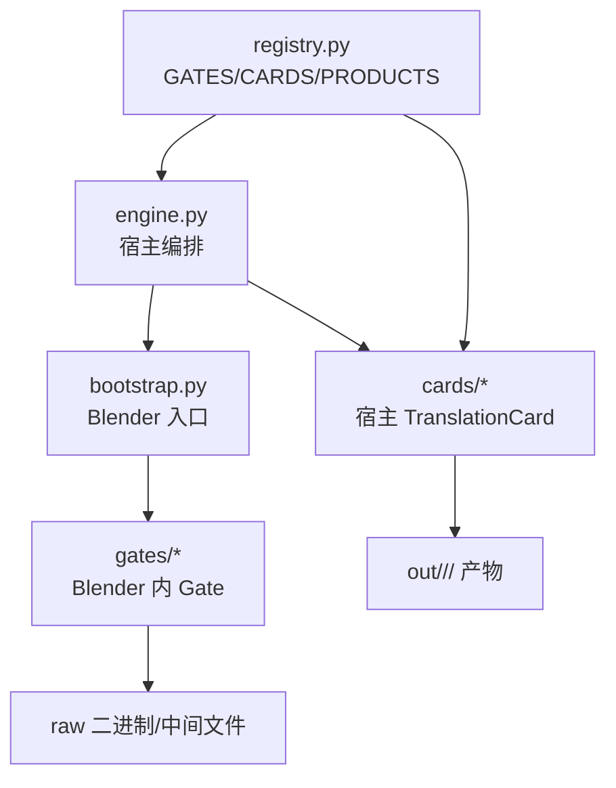
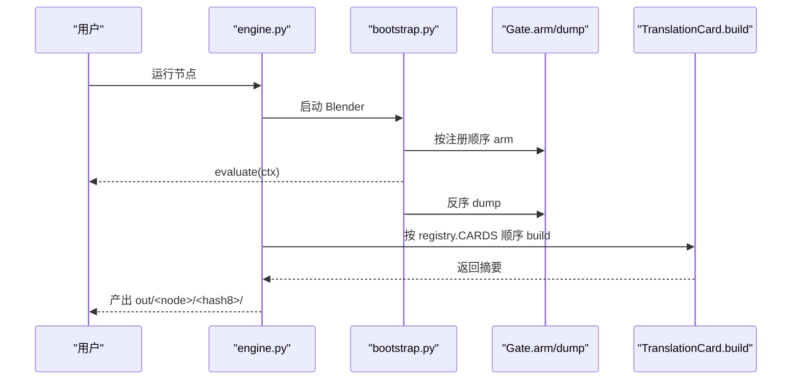
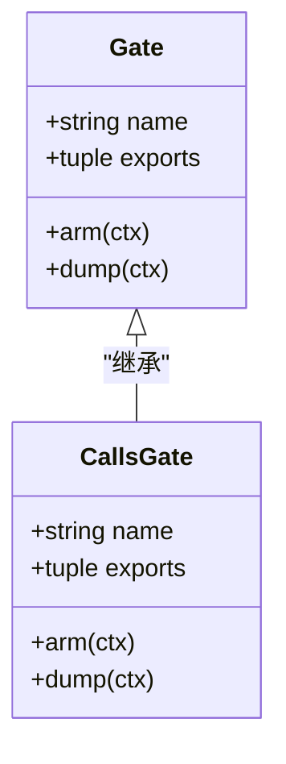
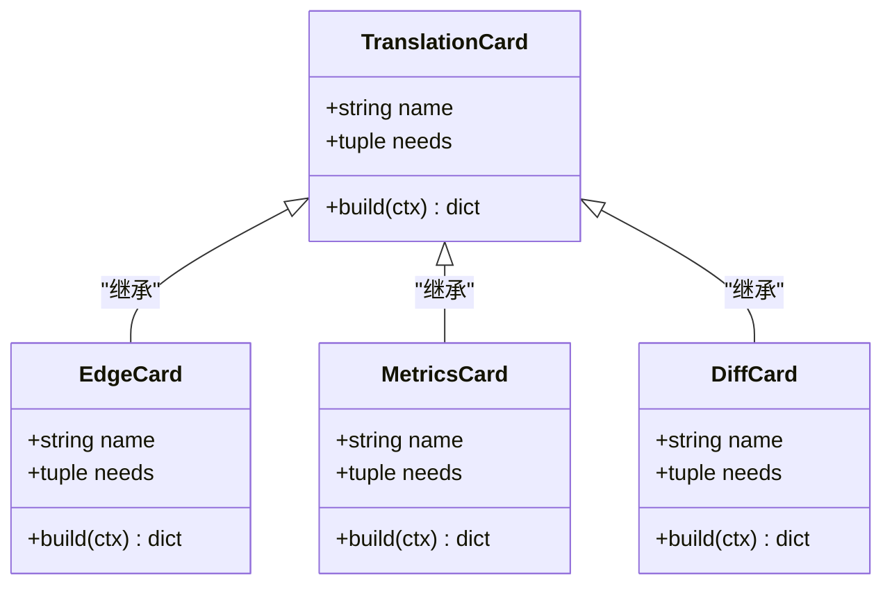
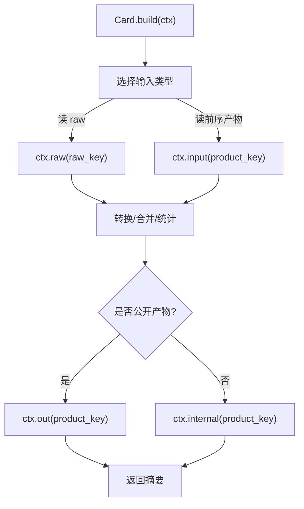
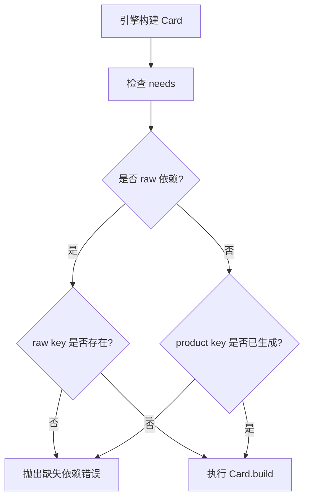
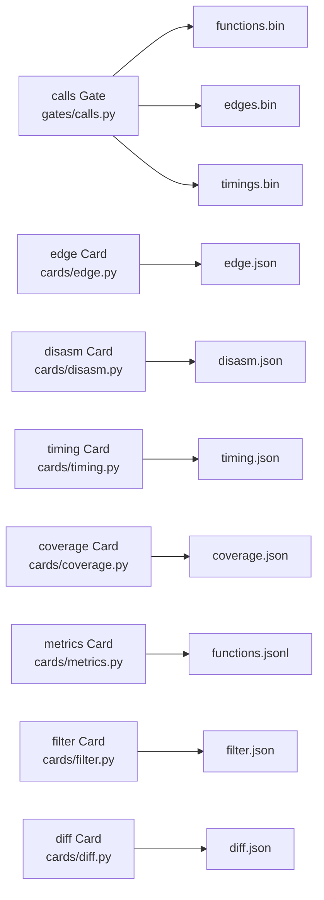

# 扩展指南

<cite>
**本文引用的文件**   
- [registry.py](file://registry.py)
- [gates/base.py](file://gates/base.py)
- [cards/base.py](file://cards/base.py)
- [engine.py](file://engine.py)
- [gates/calls.py](file://gates/calls.py)
- [cards/edge.py](file://cards/edge.py)
- [cards/metrics.py](file://cards/metrics.py)
- [cards/diff.py](file://cards/diff.py)
- [docs/架构.md](file://docs/架构.md)
- [docs/关于card.md](file://docs/关于card.md)
</cite>

## 目录
1. [引言](#引言)
2. [项目结构](#项目结构)
3. [核心组件](#核心组件)
4. [架构总览](#架构总览)
5. [详细组件分析](#详细组件分析)
6. [依赖分析](#依赖分析)
7. [性能考虑](#性能考虑)
8. [故障排查](#故障排查)
9. [结论](#结论)
10. [附录：新增 Gate 与 TranslationCard 的完整步骤](#附录新增-gate-与-translationcard-的完整步骤)

## 引言
本指南面向需要为 CovTrace 新增能力的扩展开发者。CovTrace 把“Blender 内求值”和“宿主侧翻译产物”解耦，并通过 `registry.py` 集中注册 Gate、TranslationCard 与 Product。按照本文方法，你可以新增一个 Gate 和一个 TranslationCard，并让引擎在不修改 `engine.py` 的前提下自动消费它。

核心约束是：
- Gate 在 Blender 中运行，负责插桩入口、求值后 dump raw 数据到工作目录。
- TranslationCard 在宿主 Python 中运行，从 CardContext 读取 raw 或前序卡片产物，生成最终 product。
- 所有 Gate、Card 及其产物都通过 `registry.py` 显式注册；引擎只按注册表执行，不做插件扫描。

**章节来源**
- [docs/架构.md:1-60](file://docs/架构.md#L1-L60)

## 项目结构
CovTrace 的关键目录如下：
- `gates/`：Gate 接口与具体 Gate 实现，运行于 Blender。
- `cards/`：TranslationCard 接口与具体卡片实现，运行于宿主。
- `registry.py`：Gate、Card、Product 的唯一注册中心。
- `engine.py`：编排入口，启动 Blender、顺序执行 Card、写入 manifest。
- `docs/`：架构说明与 Card 行为说明。



**图表来源**
- [engine.py:1-20](file://engine.py#L1-L20)
- [docs/架构.md:60-120](file://docs/架构.md#L60-L120)

**章节来源**
- [docs/架构.md:1-120](file://docs/架构.md#L1-L120)

## 核心组件
本节聚焦扩展开发最关键的三个抽象：

| 抽象 | 位置 | 职责 | 扩展点 |
|---|---|---|---|
| Gate | `gates/base.py` | 定义 Gate 接口、导出符号检查、工作目录路径工具 | 继承 `Gate`，实现 `arm`、`dump` |
| TranslationCard | `cards/base.py` | 定义卡片接口、上下文访问器 | 继承 `TranslationCard`，实现 `build` |
| 注册表 | `registry.py` | 登记 Gate、Card、Product | 新增实例、元组、Product |

关键设计要点：
- Gate 的 `name` 用于日志和状态记录；`exports` 是 C 层导出的函数名集合，缺失会报错。
- Card 的 `name` 标识卡片；`needs` 声明其输入，可以是 raw key 或前序卡片 product key。
- Product 由 `PRODUCTS` 统一描述相对路径和是否 internal；Card 不直接决定落盘路径。

**章节来源**
- [gates/base.py:1-38](file://gates/base.py#L1-L38)
- [cards/base.py:1-63](file://cards/base.py#L1-L63)
- [registry.py:1-49](file://registry.py#L1-L49)

## 架构总览
CovTrace 的执行流程可以概括为：
1. 宿主 `engine.py` 根据 eval 和目标计算 run key。
2. 启动 Blender，加载 `bootstrap.py`。
3. Bootstrap 依次调用已注册 Gate 的 `arm`。
4. 执行用户提供的 `evaluate(ctx)`。
5. Bootstrap 反序调用 Gate 的 `dump`，写出 raw。
6. 宿主按 `registry.CARDS` 的顺序执行各 Card 的 `build`。
7. 引擎校验每个 Card 是否写入了其注册的 product。
8. 非 test 模式下删除 `_internal/`，并把暂存输出改名为最终节点目录。



**图表来源**
- [engine.py:1-120](file://engine.py#L1-L120)
- [docs/架构.md:60-160](file://docs/架构.md#L60-L160)

**章节来源**
- [docs/架构.md:60-160](file://docs/架构.md#L60-L160)

## 详细组件分析

### Gate 扩展模型
Gate 是 Blender 内的能力扩展点。现有 `CallsGate` 展示了典型模式：
- 使用 `ctypes` 动态获取导出符号。
- `arm` 完成插桩初始化。
- `dump` 调用多个导出函数，把 raw 写到 `ctx.path(...)`，然后汇总 raw 路径和统计信息。

新增 Gate 时应遵循：
1. 新建 `gates/xxx.py`。
2. 继承 `gates.base.Gate`。
3. 设置 `name` 和 `exports`。
4. 实现 `arm`：准备运行时所需状态。
5. 实现 `dump`：写出 raw，并返回包含 `raw` 字典的摘要。
6. 在 `registry.py` 的 `GATES` 列表末尾追加 Gate 实例。



**图表来源**
- [gates/base.py:15-38](file://gates/base.py#L15-L38)
- [gates/calls.py:1-63](file://gates/calls.py#L1-L63)

**章节来源**
- [gates/base.py:1-38](file://gates/base.py#L1-L38)
- [gates/calls.py:1-63](file://gates/calls.py#L1-L63)

### TranslationCard 扩展模型
TranslationCard 是宿主侧的数据翻译扩展点。现有卡片展示了三种典型用法：
- `EdgeCard`：消费两个 raw key，生成公开 product。
- `MetricsCard`：同时消费前序 card product 和 raw key。
- `DiffCard`：读取当前 run 的 raw，并与外部 before 目录对比。

新增 Card 时应遵循：
1. 新建 `cards/xxx.py`。
2. 继承 `cards.base.TranslationCard`。
3. 设置 `name` 和 `needs`。
4. 在 `build(ctx)` 中消费 `ctx.raw`、`ctx.out`、`ctx.input`、`ctx.internal`、`ctx.publish`。
5. 将 product 写入 `ctx.out(key)` 或 `ctx.internal(key)`。
6. 返回包含 `name` 的摘要。
7. 在 `registry.py` 的 `PRODUCTS` 和 `CARDS` 中登记。



**图表来源**
- [cards/base.py:40-63](file://cards/base.py#L40-L63)
- [cards/edge.py:1-23](file://cards/edge.py#L1-L23)
- [cards/metrics.py:1-153](file://cards/metrics.py#L1-L153)
- [cards/diff.py:1-141](file://cards/diff.py#L1-L141)

**章节来源**
- [cards/base.py:1-63](file://cards/base.py#L1-L63)
- [cards/edge.py:1-23](file://cards/edge.py#L1-L23)
- [cards/metrics.py:1-153](file://cards/metrics.py#L1-L153)
- [cards/diff.py:1-141](file://cards/diff.py#L1-L141)

### CardContext 的 raw、out、internal、input
`CardContext` 是 Card 的唯一数据访问面。它屏蔽了实际文件系统布局，让 Card 只关心逻辑键名：

| 方法或属性 | 含义 | 使用建议 |
|---|---|---|
| `ctx.raw(key)` | 读取 Gate 写出的 raw 路径 | 仅消费 raw key，如 `raw:functions` |
| `ctx.out(key)` | 写入公开 product 路径 | 默认写入 `out/<node>/<hash8>/<path>` |
| `ctx.internal(key)` | 写入内部 product 路径 | 默认写入 `_internal/<path>` |
| `ctx.input(key)` | 读取前序卡片的 product 路径 | 等价于 `publish(key)`，对 Card 透明 |
| `ctx.publish(key)` | 根据 Product.internal 和 test 标志解析真实路径 | 通常用 `out`/`internal`，较少直接调用 |
| `ctx.test` | 是否为测试模式 | 控制内部产物是否对外可见 |
| `ctx.product(key)` | 查询 Product 元信息 | 一般不需要直接使用 |
| `ctx.options` | 来自 engine 的配置 | diff、measure_node 等选项 |
| `ctx.blender` / `ctx.pdb` | 可访问插桩后的二进制和符号信息 | 适合符号解析类 Card |



**图表来源**
- [cards/base.py:1-63](file://cards/base.py#L1-L63)

**章节来源**
- [cards/base.py:1-63](file://cards/base.py#L1-L63)

### Product 与 internal/public 设计
`registry.py` 中的 `Product` 是一个不可变数据类，字段含义如下：

| 字段 | 类型 | 默认值 | 含义 |
|---|---|---:|---|
| `path` | `str` | 必填 | 相对于卡片输出目录的相对路径 |
| `internal` | `bool` | `False` | 是否内部产物；非 test 模式下会被引擎删除 |

现有 `PRODUCTS` 映射示例：
- `edge.json`：公开产物。
- `disasm.json`：内部产物，test 模式发布。
- `coverage.json`：公开产物。
- `timing.json`：内部产物，test 模式发布。
- `functions.jsonl`：公开产物。
- `filter.json`：公开产物。
- `diff.json`：公开产物。

内部产物的生命周期：
1. Card 在运行期间仍会写入 `_internal/`，因为后续 Card 可能依赖它。
2. 所有 Card 成功后，引擎在非 test 模式下删除 `_internal/`。
3. 若开启 `--test`，内部产物会作为公开产物暴露。

向后兼容建议：
- 新增 Product 时不要修改已有 `path`。
- 新增字段应默认安全：例如给旧产物保留兼容字段，新字段放在可选结构中。
- 如果改变数据结构，应保留旧版本字段或增加版本号字段，便于 diff、metrics 等下游消费方判断。

**章节来源**
- [registry.py:12-49](file://registry.py#L12-L49)
- [engine.py:120-160](file://engine.py#L120-L160)
- [docs/关于card.md:1-70](file://docs/关于card.md#L1-L70)

### CardRegistration 与 CARDS 列表
`CardRegistration` 封装一张卡片与其产物的关系：

| 字段 | 类型 | 含义 |
|---|---|---|
| `card` | `TranslationCard` | 卡片实例 |
| `products` | `tuple[str, ...]` | 该卡片承诺产出的 product key 列表 |

`registry.CARDS` 是有序列表，引擎严格按顺序执行。现有顺序体现依赖关系：
- `edge`、`disasm`、`coverage`、`timing`、`metrics`、`filter`、`diff`。
- `metrics` 依赖 `disasm` 和 `raw:edges`。
- `filter` 依赖 `metrics`。
- `diff` 依赖当前 run 的 raw 和前序 `edge` 产物。

新增 Card 时必须保证：
1. `needs` 指向的 raw 或 product 已经存在。
2. `products` 中的 key 必须在 `PRODUCTS` 中注册。
3. 插入位置必须满足依赖顺序。

**章节来源**
- [registry.py:24-49](file://registry.py#L24-L49)
- [cards/metrics.py:80-153](file://cards/metrics.py#L80-L153)
- [cards/diff.py:1-141](file://cards/diff.py#L1-L141)

### needs 依赖声明方式
`needs` 支持两种形式：

| 形式 | 示例 | 含义 |
|---|---|---|
| raw key | `raw:functions` | 指向 Gate 写出的 raw |
| product key | `edge`、`disasm`、`timing`、`metrics` | 指向前序 Card 的 product |

引擎在运行 Card 前会检查 `needs`：
- 如果是 `raw:` 形式，检查 `ctx.raw_paths`。
- 否则检查已生成的 product 集合。
- 缺少任何依赖会抛出 RuntimeError。

因此，新增 Card 时：
- 如果消费 Gate raw，使用 `raw:key`。
- 如果消费其他 Card 的 product，使用该 Card 在 `PRODUCTS` 中注册的 key。
- 如果某个依赖可选，应在 `build` 中自行处理缺失情况，而不是把它放进 `needs`。



**图表来源**
- [engine.py:80-120](file://engine.py#L80-L120)
- [cards/base.py:40-63](file://cards/base.py#L40-L63)

**章节来源**
- [engine.py:80-120](file://engine.py#L80-L120)
- [cards/base.py:40-63](file://cards/base.py#L40-L63)

## 依赖分析
Gate 与 Card 之间没有直接耦合，它们通过以下机制间接协作：
- Gate 写出 raw 文件，并在摘要中记录 raw key 到路径的映射。
- Card 通过 `ctx.raw` 或 `ctx.input` 消费这些路径。
- `registry.py` 是 Gate、Card、Product 的唯一连接点。



**图表来源**
- [gates/calls.py:1-63](file://gates/calls.py#L1-L63)
- [cards/edge.py:1-23](file://cards/edge.py#L1-L23)
- [cards/metrics.py:1-153](file://cards/metrics.py#L1-L153)
- [cards/diff.py:1-141](file://cards/diff.py#L1-L141)

**章节来源**
- [gates/calls.py:1-63](file://gates/calls.py#L1-L63)
- [registry.py:24-49](file://registry.py#L24-L49)

## 性能考虑
- Gate 在 Blender 中运行，应避免长时间阻塞 UI；dump 应尽量批量写入 raw，减少频繁 I/O。
- Card 在宿主侧运行，应避免重复解析相同 raw；必要时可在 Card 内部缓存。
- 内部产物虽然最终可能被删除，但仍会增加磁盘 I/O；只有确实被后续 Card 使用的数据才应放入 `_internal/`。
- 新增 Card 时应保持 `registry.CARDS` 的依赖最小化，避免引入不必要的串行瓶颈。
- 对于大文件（如 JSONL），优先流式写入，避免一次性构造超大对象。

[本节为通用指导，不直接分析具体代码文件]

## 故障排查
常见错误及定位方式：

| 现象 | 可能原因 | 排查位置 |
|---|---|---|
| Gate 启动时报缺失导出 | `exports` 与实际 C 层导出不一致 | `gates/base.py`、`gates/calls.py` |
| Card 报 missing inputs | `needs` 未声明或未生成对应 raw/product | `engine.py`、`cards/base.py` |
| Card 报 did not produce | Card 未写入其注册的 product | `engine.py`、`registry.py` |
| 内部产物未出现在顶层 | 非 test 模式下的正常行为 | `cards/base.py`、`engine.py` |
| 产物路径不符合预期 | 使用了错误的 `out`/`internal`/`input` | `cards/base.py` |

推荐调试步骤：
1. 先确认 Gate 的 `dump` 确实写出了 raw，并能在工作目录下找到。
2. 再确认 Card 的 `needs` 是否覆盖所有 raw key。
3. 检查 `registry.PRODUCTS` 中是否登记了对应的 product key。
4. 检查 `registry.CARDS` 中是否把 Card 加到正确顺序。
5. 使用 `--test` 打开内部产物，观察 disasm、timing 等中间结果。

**章节来源**
- [engine.py:60-120](file://engine.py#L60-L120)
- [cards/base.py:10-63](file://cards/base.py#L10-L63)
- [registry.py:12-49](file://registry.py#L12-L49)

## 结论
CovTrace 的扩展模型非常明确：
- 新增 Gate：继承 `gates.base.Gate`，实现 `arm`/`dump`，注册到 `registry.GATES`。
- 新增 TranslationCard：继承 `cards.base.TranslationCard`，实现 `build`，注册到 `registry.PRODUCTS` 和 `registry.CARDS`。
- 使用 `CardContext` 的 raw/out/internal/input 抽象，不要直接硬编码文件路径。
- 通过 `registry.py` 扩展能力，而不修改 `engine.py`。
- 谨慎设计 Product 路径和数据结构，保持向后兼容，并为未来版本化预留空间。

[本节为总结性内容，不直接分析具体代码文件]

## 附录：新增 Gate 与 TranslationCard 的完整步骤

### 新增 Gate 的步骤
1. 创建 `gates/mygate.py`。
2. 继承 `gates.base.Gate`。
3. 设置：
   - `name = "mygate"`
   - `exports = ("covtrace_mygate_arm", "covtrace_mygate_dump", ...)`
4. 实现 `arm(ctx)`：
   - 初始化 C 层状态。
   - 可选：保存必要上下文。
5. 实现 `dump(ctx)`：
   - 调用 C 层 dump 函数。
   - 使用 `ctx.path("mydata.bin")` 写出 raw。
   - 在摘要中记录 `raw = {"mydata": path}`。
6. 在 `registry.py` 中：
   - 导入新 Gate。
   - 在 `GATES` 列表末尾添加 `MyGate()`。

### 新增 TranslationCard 的步骤
1. 创建 `cards/mycard.py`。
2. 继承 `cards.base.TranslationCard`。
3. 设置：
   - `name = "mycard"`
   - `needs = ("raw:mydata", ...)` 或前序 product key。
4. 实现 `build(ctx)`：
   - 使用 `ctx.raw("mydata")` 读取 Gate raw。
   - 或使用 `ctx.input("edge")` 读取前序产物。
   - 使用 `ctx.out("mycard")` 写入公开产物。
   - 如需中间产物，使用 `ctx.internal("mycard_internal")`。
   - 返回 `{"name": self.name, ...}`。
5. 在 `registry.py` 中：
   - 添加 `Product("mycard.json")` 或 `Product("_internal/mycard_internal.json", internal=True)`。
   - 在 `CARDS` 中添加 `CardRegistration(MyCard(), ("mycard",))`。
   - 确保插入顺序满足依赖。

### 完整注册表示例
假设新增 Gate `mygate` 和 Card `mycard`：

```text
registry.py 变更：
- PRODUCTS["mycard"] = Product("mycard.json")
- GATES.append(MyGate())
- CARDS.append(CardRegistration(MyCard(), ("mycard",)))
```

执行顺序建议：
- Gate 注册顺序：`CoverageGate()`、`CallsGate()`、`MyGate()`。
- Card 注册顺序：`EdgeCard`、`DisasmCard`、`CoverageCard`、`TimingCard`、`MetricsCard`、`FilterCard`、`DiffCard`、`MyCard()`。
- 若 `MyCard` 依赖 `edge` 或 `metrics`，则必须放在对应 Card 之后。

**章节来源**
- [registry.py:1-49](file://registry.py#L1-L49)
- [gates/base.py:15-38](file://gates/base.py#L15-L38)
- [cards/base.py:40-63](file://cards/base.py#L40-L63)