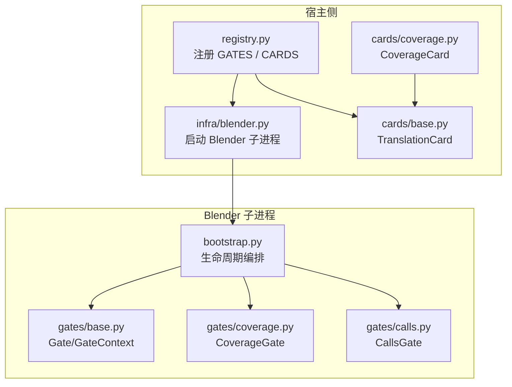
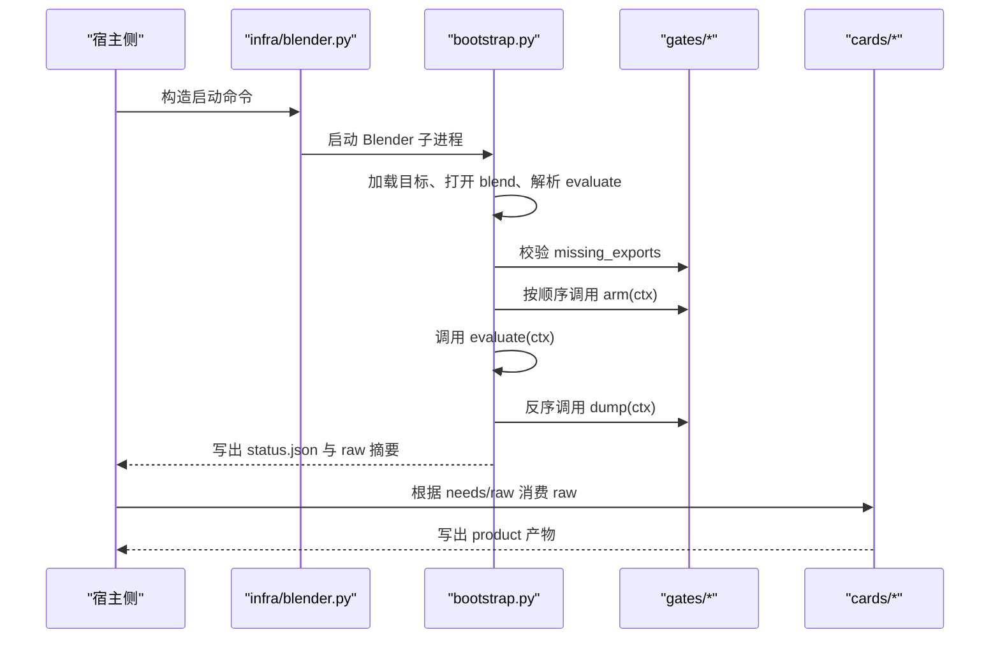
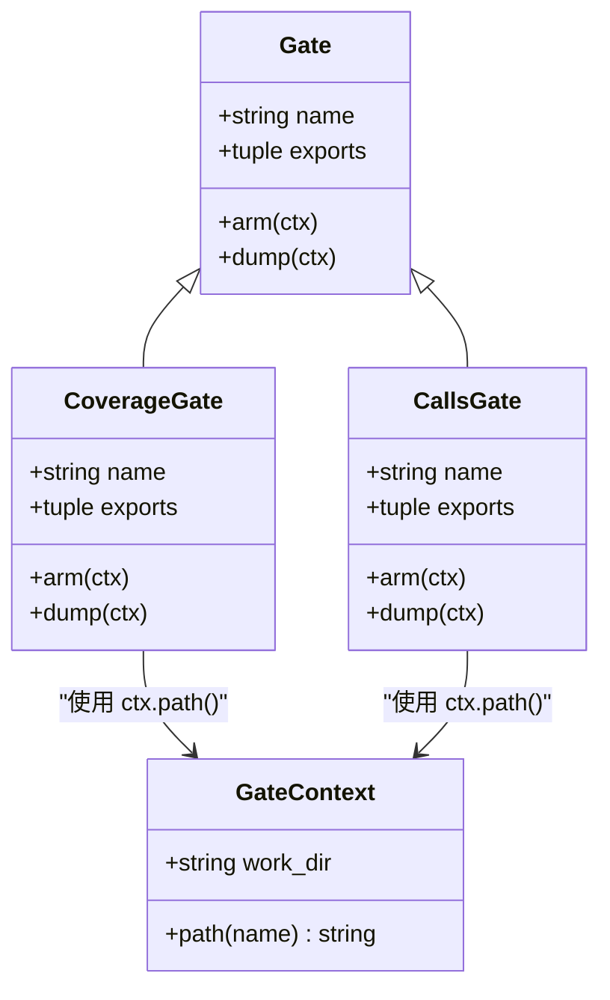
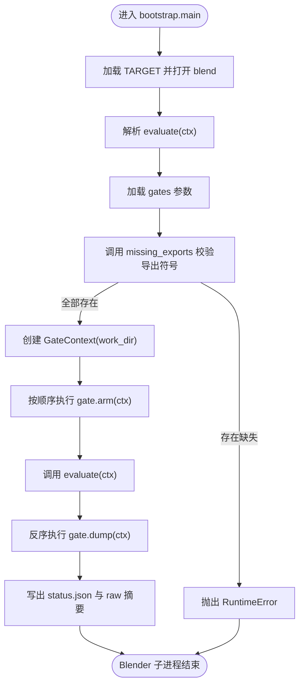
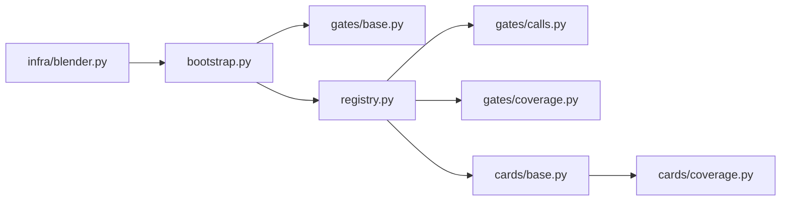

# 新增 Gate

<cite>
**本文引用的文件**
- [gates/base.py](file://gates/base.py)
- [gates/calls.py](file://gates/calls.py)
- [gates/coverage.py](file://gates/coverage.py)
- [registry.py](file://registry.py)
- [bootstrap.py](file://bootstrap.py)
- [cards/base.py](file://cards/base.py)
- [cards/coverage.py](file://cards/coverage.py)
- [infra/blender.py](file://infra/blender.py)
</cite>

## 目录
1. [引言](#引言)
2. [项目结构](#项目结构)
3. [核心组件](#核心组件)
4. [架构总览](#架构总览)
5. [详细组件分析](#详细组件分析)
6. [依赖关系分析](#依赖关系分析)
7. [性能注意事项](#性能注意事项)
8. [故障排查指南](#故障排查指南)
9. [结论](#结论)
10. [附录：快速检查清单](#附录快速检查清单)

## 引言
本文面向需要为现有采集管线新增一个 Gate 的开发者。Gate 在 Blender 子进程内运行，负责把原始数据写入工作目录；宿主侧的 TranslationCard 再消费这些 raw 文件并生成最终产物。新增 Gate 的核心步骤包括：继承 `gates.base.Gate`、声明导出符号、实现 `arm` 与 `dump`、注册到 `registry.GATES`，并确保对应的 TranslationCard 能消费 raw。

## 项目结构
本仓库中与 Gate 和 Card 相关的关键路径如下：
- `gates/`：Blender 侧采集逻辑。`base.py` 定义接口，`calls.py`、`coverage.py` 是已有实现。
- `registry.py`：集中注册 Gate 实例与宿主侧 TranslationCard。
- `bootstrap.py`：Blender 侧入口，按顺序执行 Gate 生命周期。
- `cards/`：宿主侧消费逻辑，`base.py` 提供 `TranslationCard` 基类，`coverage.py` 是典型消费示例。
- `infra/blender.py`：从宿主侧启动 Blender 子进程的命令构造器。

**图表来源**
- [registry.py:1-49](file://registry.py#L1-L49)
- [bootstrap.py:1-192](file://bootstrap.py#L1-L192)
- [gates/base.py:1-38](file://gates/base.py#L1-L38)
- [gates/coverage.py:1-39](file://gates/coverage.py#L1-L39)
- [gates/calls.py:1-63](file://gates/calls.py#L1-L63)
- [cards/base.py:1-63](file://cards/base.py#L1-L63)
- [cards/coverage.py:1-233](file://cards/coverage.py#L1-L233)
- [infra/blender.py:1-39](file://infra/blender.py#L1-L39)

**章节来源**
- [registry.py:1-49](file://registry.py#L1-L49)
- [bootstrap.py:1-192](file://bootstrap.py#L1-L192)
- [gates/base.py:1-38](file://gates/base.py#L1-L38)
- [cards/base.py:1-63](file://cards/base.py#L1-L63)
- [infra/blender.py:1-39](file://infra/blender.py#L1-L39)

## 核心组件
本节说明新增 Gate 必须理解的概念：

| 概念 | 含义 | 位置 |
|---|---|---|
| `Gate` | Blender 侧采集抽象类，要求实现 `arm(ctx)` 与 `dump(ctx)`，并提供 `name`、`exports` | `gates/base.py` |
| `GateContext` | Blender 侧上下文，暴露 `work_dir` 与 `path(name)` | `gates/base.py` |
| `missing_exports(gate)` | 检测 Gate 是否缺少 Blender 自定义构建导出的 `covtrace_*` 符号 | `gates/base.py` |
| `TranslationCard` | 宿主侧消费 raw 的抽象类，要求实现 `build(ctx)`，通过 `ctx.raw(key)` 读取 raw | `cards/base.py` |
| `GATES` | 注册待执行的 Gate 实例列表 | `registry.py` |
| `CARDS` | 注册宿主侧 TranslationCard 及其产品名 | `registry.py` |

新增 Gate 的典型模式：
1. 新建或扩展现有 `gates/*.py`，定义继承自 `Gate` 的类。
2. 设置 `name` 与 `exports`。
3. 在 `arm(ctx)` 中初始化采集状态，必要时打开或准备 raw 输出路径。
4. 在 `dump(ctx)` 中停止采集、写出二进制或紧凑格式 raw，并返回包含 `raw` 键的摘要。
5. 在 `registry.py` 末尾的 `GATES` 列表中追加该 Gate 实例。
6. 如需宿主侧消费，创建对应 TranslationCard，并在 `CARDS` 中注册。

**章节来源**
- [gates/base.py:1-38](file://gates/base.py#L1-L38)
- [cards/base.py:1-63](file://cards/base.py#L1-L63)
- [registry.py:1-49](file://registry.py#L1-L49)

## 架构总览
Gate 的生命周期由 `bootstrap.py` 统一编排，而 TranslationCard 在宿主侧消费 Gate 写出的 raw。

**图表来源**
- [infra/blender.py:1-39](file://infra/blender.py#L1-L39)
- [bootstrap.py:1-192](file://bootstrap.py#L1-L192)
- [cards/base.py:1-63](file://cards/base.py#L1-L63)

**章节来源**
- [bootstrap.py:1-192](file://bootstrap.py#L1-L192)
- [infra/blender.py:1-39](file://infra/blender.py#L1-L39)

## 详细组件分析

### Gate 基类与上下文
`gates/base.py` 定义了 Gate 的契约：
- `name`：用于日志、摘要和调试标识。
- `exports`：元组形式的导出符号名，通常以 `covtrace_` 开头，供 `missing_exports(gate)` 检测。
- `arm(ctx)`：在评估前初始化采集，例如调用底层 `covtrace_arm`、准备 raw 文件名。
- `dump(ctx)`：在评估后停止采集、写出 raw 并返回摘要。
- `GateContext.path(name)`：拼接 `work_dir` 与文件名，避免直接操作绝对路径。

**图表来源**
- [gates/base.py:1-38](file://gates/base.py#L1-L38)
- [gates/coverage.py:1-39](file://gates/coverage.py#L1-L39)
- [gates/calls.py:1-63](file://gates/calls.py#L1-L63)

**章节来源**
- [gates/base.py:1-38](file://gates/base.py#L1-L38)

### 参考实现一：CoverageGate
`gates/coverage.py` 展示了最小可运行的 Gate 模式：
- `name = "coverage"`。
- `exports = ("covtrace_arm", "covtrace_dump")`。
- `arm(ctx)`：
  - 通过 `ctx.path("window.profraw")` 确定 raw 输出路径。
  - 强制路径为 ASCII，避免 Windows 下编码问题。
  - 通过 `ctypes` 调用底层 `covtrace_arm(raw_path)`。
- `dump(ctx)`：
  - 调用底层 `covtrace_dump`，失败时抛出异常。
  - 返回摘要，其中 `raw["coverage"]` 指向 `window.profraw`。
  - 同时写出 `coverage_raw.json`，便于调试。

该实现适合理解“Blender 侧只写紧凑 raw，宿主侧再转换”的分层设计。

**章节来源**
- [gates/coverage.py:1-39](file://gates/coverage.py#L1-L39)

### 参考实现二：CallsGate
`gates/calls.py` 展示了更复杂的 Gate：
- `name = "calls"`。
- `exports` 包含多个 `covtrace_calls_*` 符号。
- `arm(ctx)`：
  - 调用 `covtrace_calls_arm` 和 `covtrace_calls_reset`。
  - 若 `arm` 失败则抛错。
- `dump(ctx)`：
  - 调用 `covtrace_calls_disarm` 停止采集。
  - 依次调用 `covtrace_calls_dump`、`covtrace_calls_dump_edges`、`covtrace_calls_dump_timings`。
  - 将三个二进制 raw 写入 `functions.bin`、`edges.bin`、`timings.bin`。
  - 通过 `edge_count()`、`timing_count()` 写入统计信息。
  - 返回摘要，其中 `raw["functions"]`、`raw["edges"]`、`raw["timings"]` 分别对应三个二进制文件。
  - 额外写出 `calls.json` 作为人类可读摘要。

这个实现适合作为多 raw 输出、多导出符号、以及 host-side card 消费的样板。

**章节来源**
- [gates/calls.py:1-63](file://gates/calls.py#L1-L63)

### 宿主侧消费：TranslationCard 与 CoverageCard
`cards/base.py` 中的 `TranslationCard` 是宿主侧消费 raw 的基类：
- `needs`：声明依赖的 raw key，例如 `"raw:coverage"`。
- `build(ctx)`：从 `ctx.raw(key)` 读取 raw 路径，失败时抛出 `RuntimeError`。
- `ctx.raw_paths`、`ctx.products`、`ctx.out()`、`ctx.publish()` 等辅助方法控制输入输出。

`cards/coverage.py` 中的 `CoverageCard` 消费 CoverageGate 输出的 `window.profraw`：
- `needs = ("raw:coverage",)`。
- `build(ctx)` 读取 `ctx.raw("coverage")`，然后调用外部工具链生成最终 coverage 产物。

新增 Gate 若希望被宿主侧消费，应：
1. 在 Gate 的 `dump(ctx)` 返回摘要中包含 `raw` 映射。
2. 创建 TranslationCard，声明 `needs` 指向该 raw key。
3. 在 `registry.py` 的 `CARDS` 中注册该 Card。

**章节来源**
- [cards/base.py:1-63](file://cards/base.py#L1-L63)
- [cards/coverage.py:1-233](file://cards/coverage.py#L1-L233)

### Gate 生命周期流程图

**图表来源**
- [bootstrap.py:1-192](file://bootstrap.py#L1-L192)
- [gates/base.py:1-38](file://gates/base.py#L1-L38)

**章节来源**
- [bootstrap.py:1-192](file://bootstrap.py#L1-L192)

## 依赖关系分析
- `bootstrap.py` 依赖 `gates.base.GateContext` 与 `missing_exports`。
- `registry.py` 同时依赖 `gates.*` 与 `cards.*`，集中维护 `GATES` 与 `CARDS`。
- `infra/blender.py` 仅负责构造命令行，不感知 Gate 内部细节。
- `cards/coverage.py` 依赖 LLVM 工具链，属于宿主侧重型处理，不应放在 Gate 中。

**图表来源**
- [bootstrap.py:1-192](file://bootstrap.py#L1-L192)
- [registry.py:1-49](file://registry.py#L1-L49)
- [gates/base.py:1-38](file://gates/base.py#L1-L38)
- [gates/calls.py:1-63](file://gates/calls.py#L1-L63)
- [gates/coverage.py:1-39](file://gates/coverage.py#L1-L39)
- [cards/base.py:1-63](file://cards/base.py#L1-L63)
- [cards/coverage.py:1-233](file://cards/coverage.py#L1-L233)
- [infra/blender.py:1-39](file://infra/blender.py#L1-L39)

**章节来源**
- [registry.py:1-49](file://registry.py#L1-L49)
- [bootstrap.py:1-192](file://bootstrap.py#L1-L192)
- [infra/blender.py:1-39](file://infra/blender.py#L1-L39)

## 性能注意事项
- Gate 运行在 Blender 子进程中，且可能影响被测对象的渲染或计算时间，因此 `arm` 与 `dump` 应避免重型 I/O。
- 优先写出二进制或紧凑格式 raw，例如 `*.bin`、`.profraw`，不要写出大段人类可读 JSON。
- 不要在 `arm` 中做完整扫描或聚合；把耗时解析交给宿主侧 TranslationCard。
- 如必须写文本摘要，建议只写必要字段，并放在 `work_dir` 下的临时文件中。
- 对多次调用的 Gate，注意清理状态，避免跨次评测污染 raw。
- 若 raw 很大，尽量在 `dump` 中完成关闭与 flush，减少后续宿主侧开销。

[本节为通用性能建议，不涉及具体代码片段]

## 故障排查指南

### 常见错误一：Blender 缺少导出符号
现象：
- bootstrap 启动时报错，提示 missing exports。
- 原因：Gate 的 `exports` 声明了 `covtrace_*` 符号，但 Blender 自定义构建未导出这些符号。

定位方式：
- 检查 Gate 类的 `exports` 元组。
- 检查 Blender 自定义构建是否链接了对应的 `covtrace_*` 符号。
- `missing_exports(gate)` 会逐个检查 `get_proc(name)`。

修复建议：
- 确保 Blender 自定义构建导出 Gate 所需的 `covtrace_*` 函数。
- 如果某个符号不再需要，从 `exports` 中移除，但不要留下空字符串或无效名称。

**章节来源**
- [gates/base.py:1-38](file://gates/base.py#L1-L38)
- [bootstrap.py:1-192](file://bootstrap.py#L1-L192)

### 常见错误二：raw 文件未写出
现象：
- 宿主侧 TranslationCard 报 `raw not found`。
- `status.json` 中 `raw` 为空或缺少对应 key。

定位方式：
- 检查 Gate 的 `dump(ctx)` 是否调用了 `ctx.path(...)` 写出 raw。
- 检查 `dump` 返回的摘要中是否包含正确的 `raw` 映射。
- 检查 TranslationCard 的 `needs` 是否与 Gate 返回的 key 一致。

修复建议：
- 在 `dump` 中先写出 raw，再写出 JSON 摘要。
- 确保 raw 路径是 ASCII，尤其是 Windows 平台。
- 让 `dump` 返回 `{"raw": {"your_key": path}}`，并在 Card 中声明 `needs = ("raw:your_key",)`。

**章节来源**
- [gates/coverage.py:1-39](file://gates/coverage.py#L1-L39)
- [gates/calls.py:1-63](file://gates/calls.py#L1-L63)
- [cards/base.py:1-63](file://cards/base.py#L1-L63)

### 常见错误三：arm 或 dump 抛出异常导致 status.json 记录失败现场
现象：
- `status.json` 中 `ok` 为 false，并包含错误类型、消息与 traceback。
- 可能发生在 `arm`、`evaluate`、`dump` 任意阶段。

机制：
- `bootstrap.py` 用 try/except 包裹整个流程。
- 异常会被写入 `status.json`，并打印 traceback。
- `finally` 保证即使出错也会尝试执行所有 `dump`。

排查建议：
- 查看 `status.json` 的 `error` 与 `traceback`。
- 区分异常来自 Gate、Blender API、还是被测 evaluate。
- 对于 ctypes 调用失败，建议在 Gate 内部包装为更明确的 `RuntimeError`。

**章节来源**
- [bootstrap.py:1-192](file://bootstrap.py#L1-L192)

### 常见错误四：路径编码问题
现象：
- `coverage` Gate 明确检查 `ctx.path(...)` 是否为 ASCII。
- Windows 下非 ASCII 路径可能导致 ctypes 调用失败。

修复建议：
- 保持 work_dir 与 raw 文件名使用 ASCII。
- 不要把用户可控的非 ASCII 路径直接传给底层 C 接口。

**章节来源**
- [gates/coverage.py:1-39](file://gates/coverage.py#L1-L39)

## 结论
新增 Gate 的本质是在 Blender 子进程中建立一条从“导出符号”到“raw 文件”的采集通道，并把原始数据留给宿主侧 TranslationCard 处理。正确实现 `name`、`exports`、`arm`、`dump`，并在 `registry.py` 中注册，是完成这一流程的最小必要步骤。生产环境应重视导出符号一致性、raw 路径稳定性、异常现场可观测性，以及 Gate 侧的轻量 I/O。

[本节为总结性内容，不涉及具体代码片段]

## 附录：快速检查清单
- [ ] 新增 Gate 继承 `gates.base.Gate`。
- [ ] 设置 `name` 为稳定标识。
- [ ] 列出所有 `covtrace_*` 导出符号到 `exports`。
- [ ] `arm(ctx)` 中调用底层采集接口，必要时准备 raw 路径。
- [ ] `dump(ctx)` 中停止采集、写出二进制或紧凑 raw，并返回 `raw` 摘要。
- [ ] 在 `registry.py` 的 `GATES` 末尾追加新 Gate 实例。
- [ ] 如需宿主侧消费，创建 TranslationCard，声明 `needs`，并在 `CARDS` 中注册。
- [ ] 验证 `status.json` 在成功与失败场景均正确记录。
- [ ] 确认 raw 文件位于 `work_dir`，路径为 ASCII。
- [ ] 避免在 `arm`、`dump` 中进行重型 I/O。

[本节为操作清单，不涉及具体代码片段]