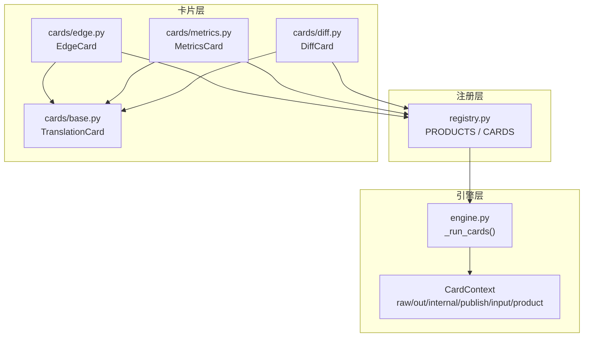
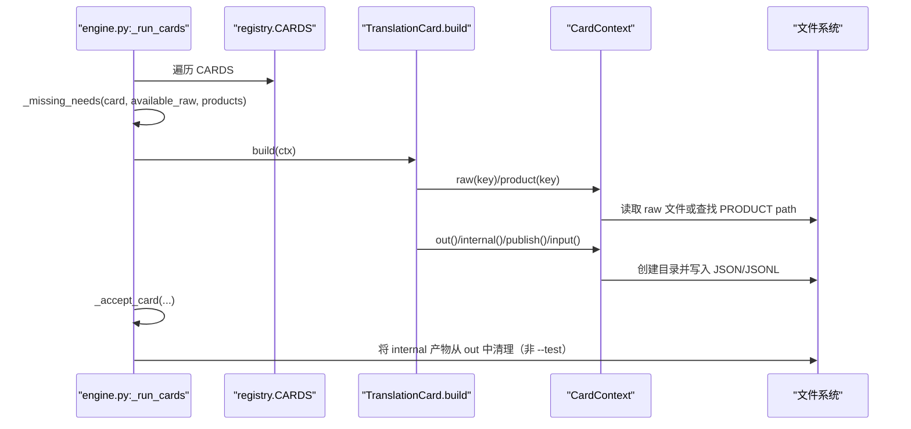
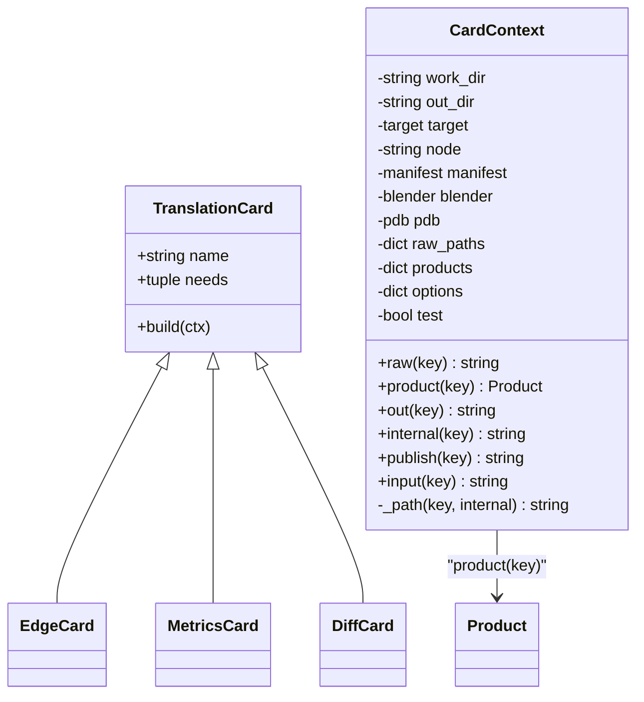
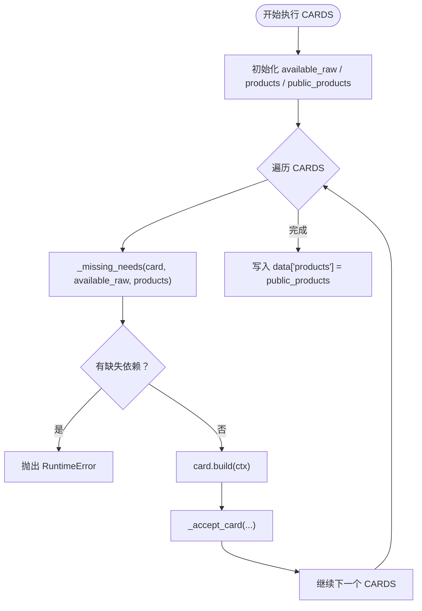
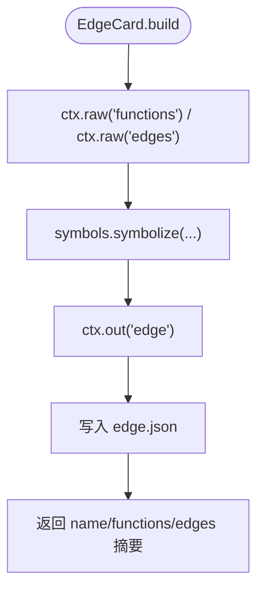
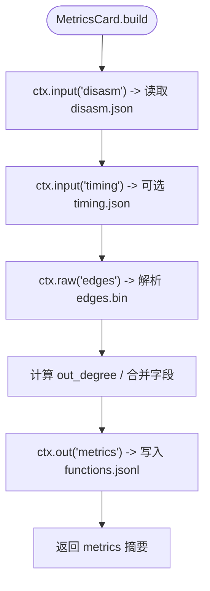
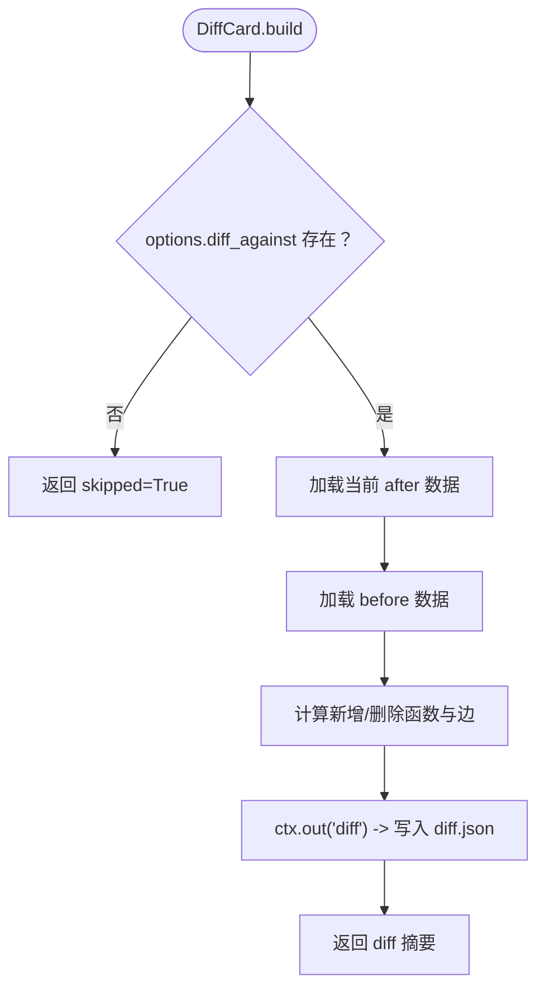
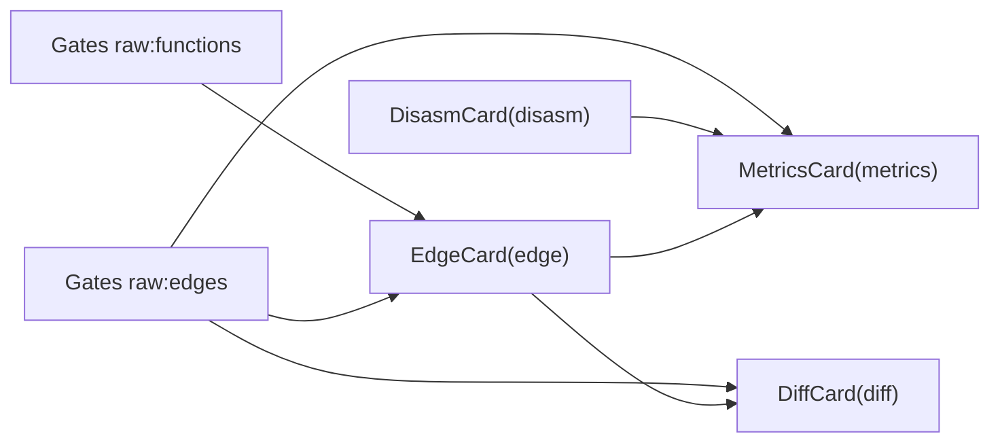
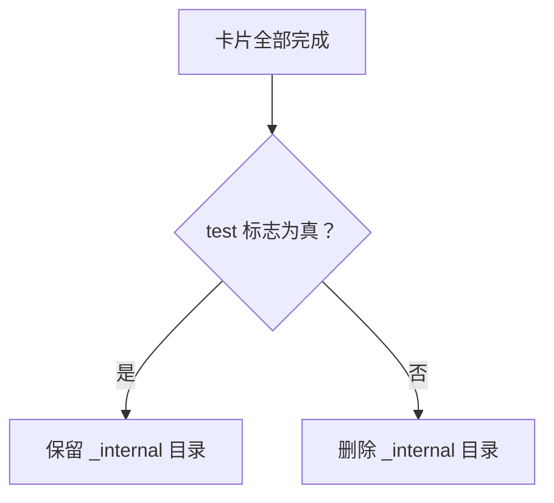

# 新增 TranslationCard

<cite>
**本文引用的文件**   
- [cards/base.py](file://cards/base.py)
- [registry.py](file://registry.py)
- [engine.py](file://engine.py)
- [cards/edge.py](file://cards/edge.py)
- [cards/metrics.py](file://cards/metrics.py)
- [cards/diff.py](file://cards/diff.py)
- [directories.py](file://directories.py)
</cite>

## 目录
1. [简介](#简介)
2. [项目结构与定位](#项目结构与定位)
3. [核心组件](#核心组件)
4. [架构总览](#架构总览)
5. [详细组件分析](#详细组件分析)
6. [依赖关系分析](#依赖关系分析)
7. [性能与输出特性](#性能与输出特性)
8. [常见问题排查](#常见问题排查)
9. [结论](#结论)
10. [附录：向后兼容与迁移建议](#附录向后兼容与迁移建议)

## 简介
本指南面向需要为 CovTrace 新增翻译卡片的开发者。TranslationCard 在宿主引擎中按固定顺序执行，读取 Gates 产出的 raw 文件，消费前序卡片产物，并最终生成 JSON 或 JSONL 产品。文档重点覆盖以下方面：

- 继承 `cards/base.py` 中的 `TranslationCard`，实现 `name`、`needs`、`build(ctx)`。
- 使用 `CardContext.raw(key)` 安全读取 Gates 的 raw 文件，缺失时抛出 `RuntimeError`。
- 理解 `out`、`internal`、`publish`、`input` 的输出路径语义。
- 通过 `product(key)` 访问 `registry.py` 中 `PRODUCTS` 的元数据。
- 用 `needs` 声明对 Gates raw 和前序 card product key 的依赖。
- 结合现有 `EdgeCard`、`MetricsCard`、`DiffCard` 给出完整实现范式。
- 在 `PRODUCTS` 和 `CARDS` 中注册新产品与新卡片。
- 明确 internal/public 设计原则及 `--test` 行为。
- 提供向后兼容建议，避免破坏 `out/<node>/<hash8>/` 结构。

## 项目结构与定位
CovTrace 的翻译阶段由 engine 驱动，按照 `registry.CARDS` 的顺序执行卡片；每个卡片通过 `needs` 声明输入来源，通过 `ctx.out/publish/input/internal` 写入产品，并通过 `registry.PRODUCTS` 暴露给后续卡片和外部消费者。

**图示来源**
- [registry.py:1-49](file://registry.py#L1-L49)
- [engine.py:120-200](file://engine.py#L120-L200)
- [cards/base.py:1-63](file://cards/base.py#L1-L63)
- [cards/edge.py:1-23](file://cards/edge.py#L1-L23)
- [cards/metrics.py:1-153](file://cards/metrics.py#L1-L153)
- [cards/diff.py:1-141](file://cards/diff.py#L1-L141)

**章节来源**
- [registry.py:1-49](file://registry.py#L1-L49)
- [engine.py:1-200](file://engine.py#L1-L200)
- [cards/base.py:1-63](file://cards/base.py#L1-L63)

## 核心组件
本节聚焦新增 TranslationCard 时必须理解的五个核心对象：`TranslationCard`、`CardContext`、`Product`、`CardRegistration`、以及 engine 的执行流程。

| 组件 | 职责 | 关键行为 | 典型位置 |
|---|---|---|---|
| `TranslationCard` | 卡片抽象基类 | 要求子类提供 `name`、`needs`、`build(ctx)` | [cards/base.py:54-63](file://cards/base.py#L54-L63) |
| `CardContext` | 卡片运行上下文 | 提供 `raw`、`product`、`out`、`internal`、`publish`、`input` | [cards/base.py:8-53](file://cards/base.py#L8-L53) |
| `Product` | 产品元数据 | 记录相对路径 `path` 与是否内部 `internal` | [registry.py:14-19](file://registry.py#L14-L19) |
| `CardRegistration` | 卡片注册项 | 绑定卡片实例与其产出的 product key 列表 | [registry.py:21-23](file://registry.py#L21-L23) |
| `_run_cards` | 引擎调度器 | 按 `CARDS` 顺序执行、校验 needs、收集 public products | [engine.py:120-200](file://engine.py#L120-L200) |

**章节来源**
- [cards/base.py:8-63](file://cards/base.py#L8-L63)
- [registry.py:14-49](file://registry.py#L14-L49)
- [engine.py:120-200](file://engine.py#L120-L200)

## 架构总览
TranslationCard 的生命周期如下：

**图示来源**
- [engine.py:120-200](file://engine.py#L120-L200)
- [cards/base.py:8-63](file://cards/base.py#L8-L63)
- [registry.py:25-49](file://registry.py#L25-L49)

## 详细组件分析

### 1. TranslationCard 与 CardContext

`TranslationCard` 是一个极简接口：子类必须定义卡片名称、依赖声明和构建逻辑。`CardContext` 是卡片唯一的数据通道，负责把 raw 输入、product 元数据和输出路径统一起来。

**图示来源**
- [cards/base.py:8-63](file://cards/base.py#L8-L63)
- [cards/edge.py:1-23](file://cards/edge.py#L1-L23)
- [cards/metrics.py:1-153](file://cards/metrics.py#L1-L153)
- [cards/diff.py:1-141](file://cards/diff.py#L1-L141)

#### raw(key) 的行为
- 从 `raw_paths` 中查找 key 对应的绝对路径。
- 如果键不存在或对应文件不是普通文件，直接抛出 `RuntimeError`，消息包含 key。
- 这是 Gate 到 Card 的强契约：如果卡片声明了某个 raw 输入，就必须确保 Gates 能产出该文件。

#### product(key) 的行为
- 从 `self.products` 中查找 `key`。
- 如果未注册，抛出 `RuntimeError`，消息为 `unregistered product`。
- 返回的是 `registry.Product(path, internal=bool)` 对象，而不是最终文件路径。

#### out(key) 与 internal(key)
- `out(key)` 写公开产物，路径基于 `Product.path`。
- `internal(key)` 会把路径放入 `INTERNAL_DIR` 子目录，表示调试或中间结果。
- 两者都会自动创建父目录。

#### publish(key) 与 input(key)
- `publish(key)` 根据 `Product.internal` 和 `ctx.test` 决定最终路径：
  - 如果产品标记为 internal，且当前不是测试模式，则写入 `_internal` 目录。
  - 否则写入公开路径。
- `input(key)` 默认等于 `publish(key)`。
- 这种设计让“内部产物”既能被同一次运行中的其他卡片消费，又不会默认出现在对外输出的 `products` 映射中。

**章节来源**
- [cards/base.py:8-63](file://cards/base.py#L8-L63)

### 2. Product 与 CardRegistration

`Product` 描述一个 product key 对应磁盘上的相对路径，以及它是否属于内部产物。`CardRegistration` 把卡片实例和它产出的多个 product key 绑定在一起。

| 字段 | 类型 | 含义 |
|---|---|---|
| `Product.path` | `str` | 相对于 `out_dir` 的产品相对路径 |
| `Product.internal` | `bool` | 是否为内部产物；默认为 `False` |
| `CardRegistration.card` | `TranslationCard` | 要执行的卡片实例 |
| `CardRegistration.products` | `tuple[str, ...]` | 该卡片产出的 product key 集合 |

**章节来源**
- [registry.py:14-23](file://registry.py#L14-L23)

### 3. 引擎执行顺序与 needs 解析

engine 使用 `_run_cards` 驱动所有卡片：

1. 初始化 `available_raw` 为 gates 产出的 raw key 集合。
2. 初始化 `products` 为已消费的 product key 集合。
3. 初始化 `public_products` 为最终暴露给外部的 product 映射。
4. 对每个 `registration in registry.CARDS`：
   - 调用 `_missing_needs` 检查 `card.needs`。
   - 如果缺少依赖，抛出 `RuntimeError`。
   - 调用 `card.build(ctx)`。
   - 调用 `_accept_card` 检查产物是否存在、登记 products、决定是否公开。
5. coverage 卡片作为并发特例单独处理。
6. 最终把 `public_products` 写入结果数据。

**图示来源**
- [engine.py:120-200](file://engine.py#L120-L200)

#### needs 的两种形式
- `"raw:<gate_key>"`：表示消费 Gates 产出的 raw 文件，例如 `"raw:functions"`、`"raw:edges"`。
- `<product_key>`：表示消费前序卡片的 product key，例如 `"edge"`、`"disasm"`。

引擎在 `_missing_needs` 中分别判断这两种情况：raw 依赖检查 `available_raw`，product 依赖检查 `products`。

**章节来源**
- [engine.py:120-200](file://engine.py#L120-L200)

### 4. 完整示例：EdgeCard

`EdgeCard` 是最基础的卡片之一：从 Gates 的 `functions.bin` 和 `edges.bin` 构造函数与边信息，再写出 `edge.json`。

关键点：
- `name = "edge"`。
- `needs = ("raw:functions", "raw:edges")`，说明它只依赖 Gates raw，不依赖其他卡片。
- `build(ctx)` 中调用 `symbols.symbolize(...)` 解析原始二进制。
- 使用 `ctx.out("edge")` 写出公开 JSON 产品。
- 返回摘要字典，供 engine 记录卡片执行统计。

**图示来源**
- [cards/edge.py:1-23](file://cards/edge.py#L1-L23)

**章节来源**
- [cards/edge.py:1-23](file://cards/edge.py#L1-L23)
- [registry.py:25-49](file://registry.py#L25-L49)

### 5. 完整示例：MetricsCard

`MetricsCard` 展示了如何消费前序卡片产物、可选内部产物，以及生成 JSONL。

关键点：
- `name = "metrics"`。
- `needs = ("disasm", "raw:edges")`，说明它依赖 disasm 的 product 和 edges 的 raw。
- 使用 `ctx.input("disasm")` 读取 disasm 产品。由于 `disasm` 是 internal 产品，`input` 会根据 `publish` 规则选择正确路径。
- 可选读取 timing 产品，因为 timing 也是 internal。
- 使用 `ctx.raw("edges")` 计算函数出度。
- 使用 `ctx.out("metrics")` 写出 JSONL。
- 返回包含函数数量、timing 匹配数、重复 RVA 数等摘要。

**图示来源**
- [cards/metrics.py:1-153](file://cards/metrics.py#L1-L153)
- [registry.py:25-49](file://registry.py#L25-L49)

**章节来源**
- [cards/metrics.py:1-153](file://cards/metrics.py#L1-L153)
- [registry.py:25-49](file://registry.py#L25-L49)

### 6. 完整示例：DiffCard

`DiffCard` 展示了对比场景：比较当前运行与前序运行的 edge 数据。

关键点：
- `name = "diff"`。
- `needs = ("raw:functions", "raw:edges")`。
- 如果未配置 `options["diff_against"]`，直接返回 `skipped=True`。
- 优先加载 `ctx.out("edge")`；若不存在则重新 symbolize。
- 通过 `ctx.product("edge").path` 获取历史运行中 edge 产品的相对文件名。
- 使用 `ctx.out("diff")` 写出对比报告。

**图示来源**
- [cards/diff.py:1-141](file://cards/diff.py#L1-L141)

**章节来源**
- [cards/diff.py:1-141](file://cards/diff.py#L1-L141)

## 依赖关系分析

### 产品与卡片依赖图

**图示来源**
- [cards/edge.py:1-23](file://cards/edge.py#L1-L23)
- [cards/metrics.py:1-153](file://cards/metrics.py#L1-L153)
- [cards/diff.py:1-141](file://cards/diff.py#L1-L141)
- [registry.py:25-49](file://registry.py#L25-L49)

### 产品元数据与输出可见性

| product key | Product.path | internal | 默认对外可见 | 说明 |
|---|---|---:|---:|---|
| `edge` | `edge.json` | 否 | 是 | 主要函数与边产物 |
| `disasm` | `disasm.json` | 是 | 否 | 反汇编中间结果 |
| `coverage` | `coverage.json` | 否 | 是 | 覆盖率产物 |
| `timing` | `timing.json` | 是 | 否 | 时序中间结果 |
| `metrics` | `functions.jsonl` | 否 | 是 | 聚合指标 JSONL |
| `filter` | `filter.json` | 否 | 是 | 过滤产物 |
| `diff` | `diff.json` | 否 | 是 | 对比产物 |

**章节来源**
- [registry.py:25-49](file://registry.py#L25-L49)

## 性能与输出特性

### 内部产物清理
当非测试模式运行时，engine 会删除 `out/<node>/<hash8>/_internal/` 目录。这意味着 internal 产物虽然会被卡片写入，但不会被保留给外部消费者。

**图示来源**
- [engine.py:200-220](file://engine.py#L200-L220)

### 并发执行注意事项
- coverage 卡片通过线程池单独提交。
- 其他卡片在主循环中按顺序执行。
- 新增卡片应尽量避免跨卡片竞态，尽量通过明确的 `needs` 表达依赖。

**章节来源**
- [engine.py:120-200](file://engine.py#L120-L200)

## 常见问题排查

| 问题 | 原因 | 处理方式 |
|---|---|---|
| `RuntimeError: unregistered product 'xxx'` | 使用了尚未在 `PRODUCTS` 中注册的 product key | 在 `registry.py` 中添加 `Product` 和 `CardRegistration` |
| `RuntimeError: raw 'xxx' not found` | Gates 没有产出该 raw，或 raw key 拼写错误 | 检查 Gates 输出和卡片 `needs` 中的 `raw:` 声明 |
| 卡片始终 skipped | `needs` 不满足或 `diff_against` 未配置 | 检查 `available_raw`、`products` 和 `options` |
| 测试无法发现 internal 产物 | 忘记开启 `--test` 或将 internal 写入了 `out` | 使用 `ctx.internal()` 或 `ctx.publish()`，并在测试中启用 test 模式 |
| 旧消费者找不到新 key | 直接替换了 product key | 保留旧 key，逐步迁移消费者 |
| 产物路径异常 | 误用 `out`、`internal`、`publish`、`input` | 公开产品用 `out`，内部中间结果用 `internal`，消费端用 `input` |

**章节来源**
- [cards/base.py:8-63](file://cards/base.py#L8-L63)
- [engine.py:120-200](file://engine.py#L120-L200)

## 结论
新增 TranslationCard 的核心流程可以概括为：

1. 在 `cards/` 下新建卡片模块，继承 `TranslationCard`。
2. 在 `registry.py` 的 `PRODUCTS` 中声明 `Product(path, internal=bool)`。
3. 在 `registry.py` 的 `CARDS` 中追加 `CardRegistration(new_card(), ("product_key",))`。
4. 在 `build(ctx)` 中通过 `ctx.raw()` 读取 Gates raw，通过 `ctx.product()` 查询产品元数据，通过 `ctx.out()` 或 `ctx.internal()` 写入产品。
5. 使用 `needs` 声明对 raw 和前序 product 的依赖。
6. 遵循 internal/public 设计原则：调试、反汇编、时序等中间结果进入 `_internal`，仅 CI 或 `--test` 时暴露。
7. 保持向后兼容：新增 product key 时保留旧键，逐步迁移消费者。

## 附录：向后兼容与迁移建议

### 新增 product key 的步骤
1. 先在 `PRODUCTS` 中新增目标 key，例如 `new_product`。
2. 在 `CARDS` 中将新卡片注册为该 key。
3. 如果已有消费者依赖旧 key，不要立即删除旧 key。
4. 让新卡片同时写入旧路径和新路径，直到所有消费者迁移完成。
5. 最后移除旧 key 和旧路径写入逻辑。

### 为什么不能直接破坏 `out/<node>/<hash8>/`
- engine 和外部工具通常以 `out/<node>/<hash8>/` 为基础结构定位产物。
- `Product.path` 是相对路径，修改它可能影响已有日志、CI 脚本、对比工具和下游分析。
- internal 产物放在 `_internal` 下，天然与公开产物隔离，适合临时中间结果。

### 推荐实践
- 公开产品使用 `ctx.out("key")`。
- 中间调试产物使用 `ctx.internal("key")`。
- 消费端使用 `ctx.input("key")`，这样即使产品被标记为 internal，也能拿到正确的路径。
- 测试中开启 `test` 模式，使 internal 产物可被发现。
- 在 `CardRegistration.products` 中列出所有实际产出的 product key，避免 engine 漏检。

**章节来源**
- [registry.py:25-49](file://registry.py#L25-L49)
- [cards/base.py:8-63](file://cards/base.py#L8-L63)