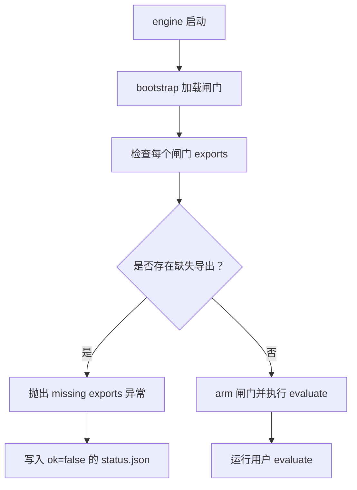
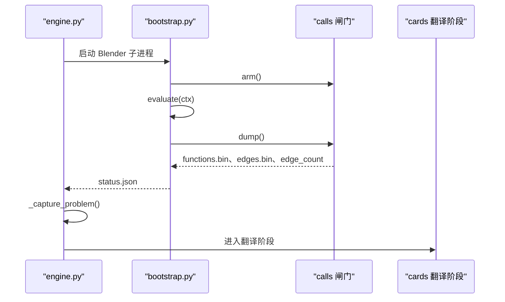
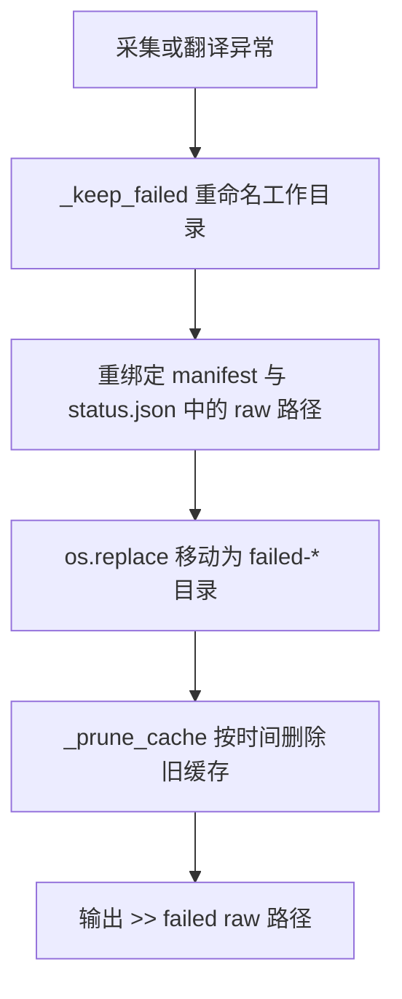
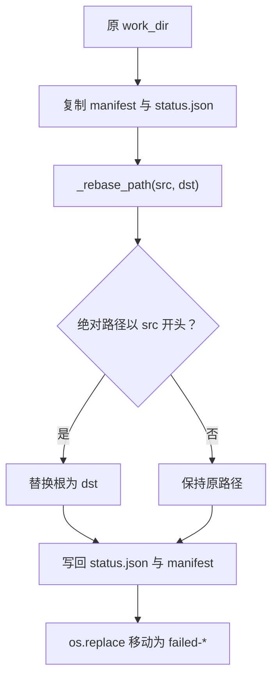
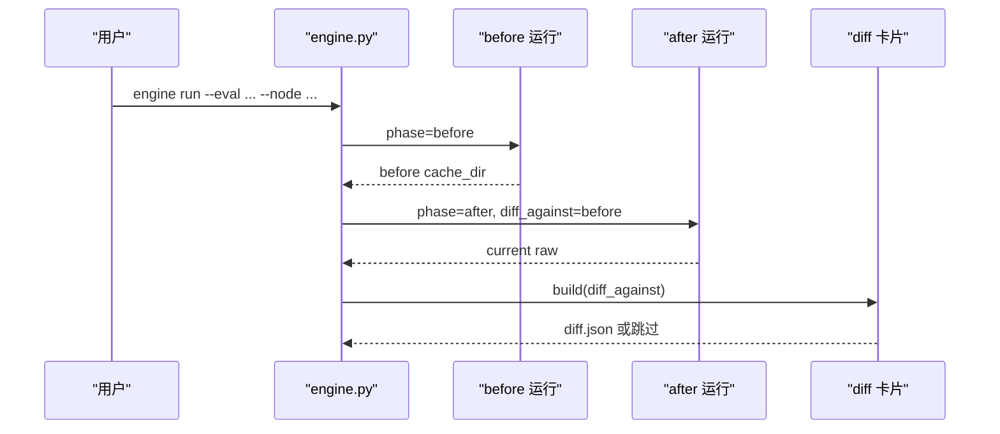
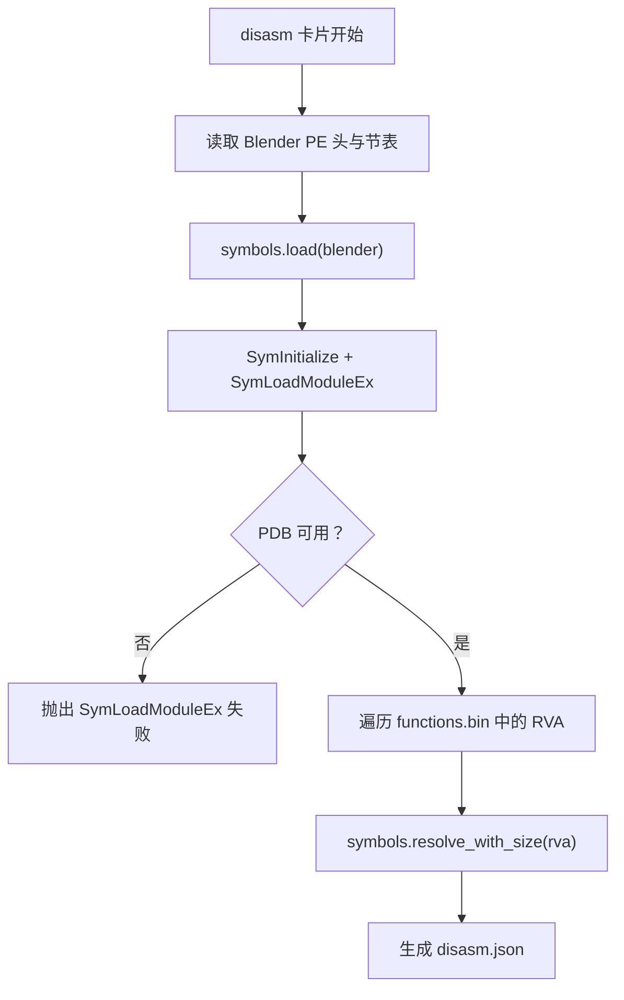
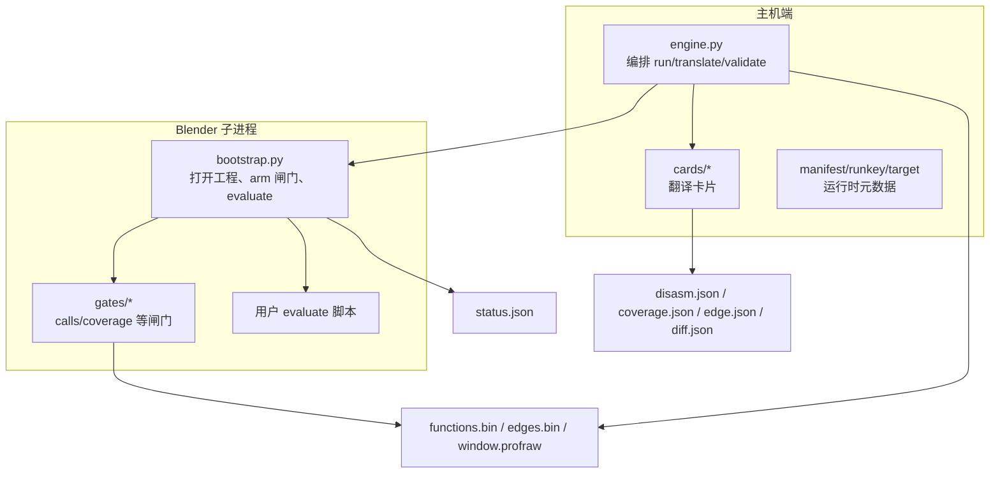

# 故障排查

<cite>
**本文引用的文件**   
- [engine.py](file://engine.py)
- [bootstrap.py](file://bootstrap.py)
- [gates/base.py](file://gates/base.py)
- [gates/calls.py](file://gates/calls.py)
- [cards/base.py](file://cards/base.py)
- [cards/coverage.py](file://cards/coverage.py)
- [cards/disasm.py](file://cards/disasm.py)
- [cards/diff.py](file://cards/diff.py)
- [cards/symbols.py](file://cards/symbols.py)
- [infra/blender.py](file://infra/blender.py)
- [infra/target.py](file://infra/target.py)
</cite>

## 目录
1. [快速定位顺序](#快速定位顺序)
2. [关键产物与状态说明](#关键产物与状态说明)
3. [常见问题与修复路径](#常见问题与修复路径)
4. [架构与调用链总览](#架构与调用链总览)
5. [缓存、现场恢复与清理策略](#缓存现场恢复与清理策略)
6. [诊断清单](#诊断清单)
7. [结论](#结论)

## 快速定位顺序
遇到 CovTrace 问题时，建议按以下顺序检查：

1. 先看 `engine.py` 输出的错误前缀：
   - `采集失败`：Blender 子进程或 bootstrap 阶段异常。
   - `采集结果异常`：raw 数据不完整，最常见是 functions.bin 为空或 edge_count=0。
   - `翻译失败`：卡片解析 raw 或生成产物失败。
   - `cache 的 status.json 不是成功状态` / `cache 没有 raw 数据`：translate 阶段输入无效。
2. 再打开对应 cache 目录下的 `status.json`，查看 `ok`、`error`、`traceback` 和各闸门摘要。
3. 如果问题发生在 Blender 侧，优先检查 bootstrap 抛出的 traceback。
4. 如果问题发生在主机侧翻译阶段，优先检查 cards 的错误日志与 failed-* 目录。
5. 最后核对目标工程、Blender 可执行文件、PDB、LLVM 工具链与 LLVM profraw 是否匹配。

**本节来源**
- [engine.py:201-290](file://engine.py#L201-L290)
- [engine.py:291-562](file://engine.py#L291-L562)

## 关键产物与状态说明

### status.json
`status.json` 是 bootstrap 在 Blender 内写出的运行快照。它包含：

| 字段 | 含义 | 正常值示例 | 异常信号 |
|---|---|---|---|
| `ok` | Blender 阶段是否成功 | `True` | `False` 表示抛出异常 |
| `error` | 异常类型与消息 | 空字符串 | 非空时直接反映 bootstrap 捕获的错误 |
| `traceback` | Python 回溯文本 | 空字符串 | 非空时用于定位 Blender 侧崩溃点 |
| `node` | 本次运行的节点标识 | 由 engine 传入 | 缺失时 manifest 分类可能失败 |
| `target` | TARGET 合并后的工程信息 | 字典 | 字段缺失会导致后续校验失败 |
| `gates` | 已注册闸门的摘要列表 | 至少一个 | 空列表通常意味着闸门未 arm 或未 dump |
| `raw` | 闸门写入的二进制路径映射 | 包含 functions、edges、timings 等 | 缺少 `functions` 会触发 `_capture_problem` |

写入流程由 bootstrap 完成：先写临时文件，再用原子替换生成最终 `status.json`；异常分支也会写入 `ok=False` 并附带 traceback。

**本节来源**
- [bootstrap.py:40-61](file://bootstrap.py#L40-L61)
- [bootstrap.py:158-192](file://bootstrap.py#L158-L192)

### functions.bin、edges.bin、edge_count
- `functions.bin` 是 calls 闸门导出的函数 RVA 序列，由 disasm 卡片和 diff 卡片消费。
- `edges.bin` 是调用边表，diff 卡片依赖它计算 before/after 差异。
- `edge_count` 是 calls 闸门记录的调用边数量。
- 如果 `functions.bin` 不存在、大小为 0，或 `edge_count == 0`，engine 会认为求值没有触发有效代码路径，并把现场标记为“采集结果异常”。

**本节来源**
- [gates/calls.py:13-63](file://gates/calls.py#L13-L63)
- [engine.py:114-139](file://engine.py#L114-L139)

### 其他常见 raw 与产物
- `window.profraw`：覆盖率原始数据，由 coverage 卡片转换为 `coverage.json`。
- `disasm.json`：反汇编统计产物，依赖 functions.bin、Blender PDB 和 symbols 模块。
- `edge.json`：当前运行符号化后的边表，diff 卡片用于比较。
- `diff.json`：before/after 函数与边的差异报告。

**本节来源**
- [cards/coverage.py:1-233](file://cards/coverage.py#L1-L233)
- [cards/disasm.py:1-393](file://cards/disasm.py#L1-L393)
- [cards/diff.py:1-141](file://cards/diff.py#L1-L141)

## 常见问题与修复路径

### 问题一：missing exports（Blender 自定义构建缺少 covtrace_* 符号）

**症状**
- bootstrap 启动后立刻抛出类似 `missing exports: [...]` 的错误。
- 控制台输出中会出现闸门名称和缺失的导出名。
- `status.json` 存在但 `ok=False`，error 字段指向 missing exports。

**可能原因**
- 使用的 Blender 可执行文件没有链接 CovTrace 注入库。
- 自定义构建脚本遗漏了 `covtrace_calls_arm`、`covtrace_calls_dump`、`covtrace_calls_edge_count` 等符号。
- gates 注册了某个闸门，但对应二进制未提供所需导出。

**定位文件**
- `bootstrap.py`：加载闸门并调用 `missing_exports(gate)`。
- `gates/base.py`：通过 Windows API 查询进程导出。
- `gates/calls.py`：声明 calls 闸门需要的全部 `covtrace_*` 导出。

**图表来源**
- [bootstrap.py:63-118](file://bootstrap.py#L63-L118)
- [bootstrap.py:158-192](file://bootstrap.py#L158-L192)
- [gates/base.py:7-20](file://gates/base.py#L7-L20)
- [gates/calls.py:13-63](file://gates/calls.py#L13-L63)

**修复步骤**
1. 确认 `--blender` 指向的是带 CovTrace 注入的自定义 Blender。
2. 检查自定义构建脚本是否把 `covtrace_calls_*` 系列符号链接进 Blender。
3. 用相同的 Blender 重新构建评估工程，避免混用官方发行版和自定义版。
4. 如果只启用部分闸门，确保该闸门的所有导出都存在。

**本节来源**
- [bootstrap.py:118-158](file://bootstrap.py#L118-L158)
- [gates/base.py:7-20](file://gates/base.py#L7-L20)
- [gates/calls.py:13-63](file://gates/calls.py#L13-L63)

### 问题二：functions.bin 为空或 edge_count=0

**症状**
- engine 输出 `采集结果异常: functions.bin 为空或缺失` 或 `edge_count == 0（求值可能没有触发）`。
- failed-* 目录中存在 `calls.json`，其中 `edge_count` 为 0。
- disasm 或 diff 卡片无法继续，因为缺少函数 RVA 表。

**可能原因**
- evaluate 没有被执行，或 evaluate 没有触发 geometry nodes 求值。
- Blender 未更新视图层，导致修改器未求值。
- 测量节点规格无效，`--phase` 没有正确 rewire。
- 闸门 arm 成功但 dump 阶段没有写出二进制文件。
- 求值脚本抛出异常，导致 finally 中的 dump 未能收集到有效数据。

**定位文件**
- `engine.py`：`_capture_problem` 判断 functions.bin 和 edge_count。
- `bootstrap.py`：调用 `evaluate(ctx)` 并在 finally 中 dump 所有闸门。
- `gates/calls.py`：dump 函数写入 functions.bin、edges.bin、timings.bin，并记录 edge_count。

**图表来源**
- [engine.py:201-290](file://engine.py#L201-L290)
- [bootstrap.py:118-192](file://bootstrap.py#L118-L192)
- [gates/calls.py:13-63](file://gates/calls.py#L13-L63)

**修复步骤**
1. 确认 evaluate 是可调用的函数，且最终触发了 `bpy.context.view_layer.update()` 或等效求值。
2. 检查 `--measure-node` 或 eval 中的 NODE 是否指向有效的几何节点。
3. 使用 `engine validate` 仅校验工程和节点，不运行 evaluate。
4. 如果使用了 `--phase before/after`，确认对应的 zone 已经 rewire。
5. 检查 failed-* 中的 `calls.json`，确认 edge_count 是否为 0，以及 raw.functions 路径是否存在。

**本节来源**
- [engine.py:114-139](file://engine.py#L114-L139)
- [engine.py:201-290](file://engine.py#L201-L290)
- [bootstrap.py:118-192](file://bootstrap.py#L118-L192)
- [gates/calls.py:13-63](file://gates/calls.py#L13-L63)

### 问题三：failed-* 现场恢复方法与 cache 清理策略

**症状**
- engine 输出 `raw:` 指向一个以 `failed-时间戳` 结尾的目录。
- 用户想重新运行 translate，但找不到原始 raw 数据。
- cache 目录过多，磁盘空间不足。

**机制说明**
- 当采集失败、采集结果异常或翻译阶段抛出异常时，engine 会把工作目录重命名为 `<hash8>.failed-时间戳[-序号]`。
- 重命名前会尝试复制 manifest 和 status.json，并对其中的 raw 路径执行路径重绑定。
- 默认保留最近 `keep_cache` 个节点缓存；值为 0 时不清理。

**定位文件**
- `engine.py`：`_keep_failed`、`_prune_cache`、run/translate 主流程。
- `directories.py`：缓存目录结构常量（引用处）。
- `manifest.*`：运行时元数据读写（引用处）。

**图表来源**
- [engine.py:74-113](file://engine.py#L74-L113)
- [engine.py:201-290](file://engine.py#L201-L290)

**修复步骤**
1. 从 engine 输出的 `>> failed raw:` 路径找到 failed-* 目录。
2. 查看其中的 `status.json`，确认 `ok=False` 及 error/traceback。
3. 若需手动恢复，可将 failed-* 目录复制回 `cache/<node>/<hash8>`，但必须保证 manifest 中的 run_key、hash8、blender、pdb 与实际一致。
4. 如果 raw 路径已被重绑定，不要直接复制原始 work_dir，应使用 failed-* 中已由 engine 修正过的 manifest 和 status.json。
5. 清理策略：
   - 使用 `--keep-cache N` 控制保留最近 N 个节点缓存。
   - 使用 `--no-raw` 在所有卡片成功后删除 raw cache。
   - 对明显损坏的 hash8 目录，可直接删除对应 `cache/<node>/<hash8>`。
   - 不要删除正在被引擎写入的 `.tmp` 目录。

**本节来源**
- [engine.py:74-113](file://engine.py#L74-L113)
- [engine.py:201-562](file://engine.py#L201-L562)

### 问题四：路径重绑定 _rebase 失败

**症状**
- failed-* 中的 raw 路径指向旧 work_dir 或不存在的位置。
- translate 时报错 raw 文件缺失。
- 手动复制 failed-* 后，cards 读取 raw 失败。

**可能原因**
- 用户移动了 failed-* 目录，但没有同步更新 manifest 和 status.json。
- src 与 dst 不在同一根目录下，`_rebase_path` 不会递归重绑定深层路径。
- 原始 raw 文件本身已被删除，只留下 JSON 引用。

**定位文件**
- `engine.py`：`_rebase_path`、`_rebase`、`_keep_failed`。

**图表来源**
- [engine.py:28-73](file://engine.py#L28-L73)
- [engine.py:74-113](file://engine.py#L74-L113)

**修复步骤**
1. 不要手工编辑 failed-* 中的路径；如需迁移，应重新运行一次相同参数的 `engine run --force`，让 engine 重新生成缓存。
2. 如果只需要翻译产物，可使用 `engine translate <cache_dir>`，但要求 cache 内 manifest 和 raw 都完整。
3. 若 raw 确实丢失，只能重新采集，不能靠 translate 恢复。
4. 避免跨盘移动 failed-* 后直接复用；最稳妥方式是重新运行。

**本节来源**
- [engine.py:28-113](file://engine.py#L28-L113)

### 问题五：LLVM profraw 解析不到 source/intern 模块

**症状**
- coverage 卡片报错，或 `coverage.json` 中文件数量为 0。
- 日志中出现 LLVM COV 或 LLVM PROFDATA 相关错误。
- `window.profraw` 存在但不为空，但解析结果仍无 source/intern 内容。

**可能原因**
- 源码根目录 `SOURCE_DIR` 与编译产物不一致。
- 覆盖范围过滤只保留 `source/` 和 `intern/`，其他模块会被丢弃。
- LLVM 工具链版本与构建环境不匹配。
- 覆盖数据没有包含 C/C++ 模块信息，或 LCOV 导出正则不匹配 `blender-4.5.0/source|intern`。
- `--keep-all` 未开启时，coverage 卡片默认只做评估相关路径过滤。

**定位文件**
- `cards/coverage.py`：LLVM_COV、LLVM_PROFDATA、SOURCE_ROOT、KEEP_PREFIXES、export_lcov、parse_show、build_result。

**修复步骤**
1. 确认 `--blender` 指向的 Blender 是由与源码树匹配的构建系统生成的。
2. 检查 `directories.SOURCE_DIR` 是否指向真实源码根，尤其是 Windows 上的大小写和斜杠。
3. 如果只想验证 LLVM 工具链可用性，可先用 `--keep-all` 运行，看是否能覆盖更多路径。
4. 检查 LLVM 安装路径是否可通过 `directories.LLVM_COV_EXE`、`directories.LLVM_PROFDATA_EXE` 解析。
5. 若 LCOV 导出失败，检查 LLVM COV export 命令中的文件名正则是否匹配实际构建目录名。
6. 若只是调试，保留 coverage 临时目录：coverage 卡片在异常时会打印 `!! coverage work dir kept:` 并输出临时目录路径。

**本节来源**
- [cards/coverage.py:1-233](file://cards/coverage.py#L1-L233)

### 问题六：before/after 节点校验失败

**症状**
- 自动 diff 模式下，before 阶段成功，after 阶段失败。
- `validate` 模式提示没有产出校验结果。
- diff 卡片跳过或报 diff_against 缺少 edge 数据。

**可能原因**
- before 阶段的 evaluate 没有产生有效 raw，导致 after 无法对比。
- `--phase before` 或 `--phase after` 指定的 zone 没有正确 rewire。
- eval 中没有定义 NODE，也没有提供 `--measure-node`。
- 上一次运行产物是 edge.json，而 diff 卡片期望 edge.json 或 functions.bin/edges.bin。

**定位文件**
- `engine.py`：`run`、`_run_once`、`validate`。
- `bootstrap.py`：`rewire` 调用与 boundary 输出。
- `cards/diff.py`：`_load_run`、DiffCard.build。

**图表来源**
- [engine.py:201-290](file://engine.py#L201-L290)
- [cards/diff.py:1-141](file://cards/diff.py#L1-L141)

**修复步骤**
1. 先运行 `engine validate --eval <脚本> --measure-node <节点>`，确认 NODE 可解析。
2. 单独运行 `engine run --phase before`，确认 before 缓存不为空。
3. 再运行 `engine run --phase after`，并指定 `--force` 覆盖冲突目录。
4. 如果 diff_against 是 out 目录，确认其中已有 edge.json；如果是 cache 目录，确认有 functions.bin 和 edges.bin。
5. 检查 before/after 使用的 Blender、TARGET、NODE 是否完全一致。

**本节来源**
- [engine.py:201-350](file://engine.py#L201-L350)
- [bootstrap.py:118-158](file://bootstrap.py#L118-L158)
- [cards/diff.py:1-141](file://cards/diff.py#L1-L141)

### 问题七：Windows dbghelp 无法解析反汇编符号

**症状**
- disasm 卡片抛出 SymInitialize 或 SymLoadModuleEx 相关错误。
- 日志出现 `SymInitialize failed` 或 `SymLoadModuleEx failed (missing PDB?)`。
- disasm.json 中函数数量为 0，或很多函数没有 name/file/line。

**可能原因**
- Blender 可执行文件与 PDB 不匹配。
- PDB 不在 Blender 同级目录或 SymInitialize 搜索路径下。
- 使用了发布版 Blender，没有附带调试符号。
- dbghelp.dll 不可用或被第三方安全软件拦截。
- RVA 到地址转换失败，导致无法定位符号。

**定位文件**
- `cards/disasm.py`：读取 PE 头、反汇编函数体、调用 symbols.resolve_with_size。
- `cards/symbols.py`：dbghelp 初始化、模块加载、RVA 解析。

**图表来源**
- [cards/disasm.py:1-393](file://cards/disasm.py#L1-L393)
- [cards/symbols.py:1-200](file://cards/symbols.py#L1-L200)

**修复步骤**
1. 确认 `--blender` 和 PDB 来自同一构建。
2. 将 PDB 放在 Blender.exe 同级目录，或放在其所在目录的子目录中。
3. 不要用 Release 发布包进行符号分析，需要使用带调试信息的构建。
4. 检查是否有多个同名 PDB，避免 dbghelp 加载错误版本。
5. 如果仍然失败，检查 Windows 符号服务设置和 dbghelp 权限。

**本节来源**
- [cards/disasm.py:1-393](file://cards/disasm.py#L1-L393)
- [cards/symbols.py:1-200](file://cards/symbols.py#L1-L200)

### 问题八：TARGET 或求值脚本配置错误

**症状**
- engine 报 `找不到求值脚本`、`TARGET 必须是字面量字典`、`TARGET 缺少字段`。
- bootstrap 报 `object not found`、`modifier not found`、`node tree mismatch`。
- 参数解析失败，例如 `param %r not in sockets %s`。

**可能原因**
- eval 脚本语法错误或没有定义 `TARGET = {...}`。
- TARGET 缺少 blend、object、modifier、param。
- blender 路径无效。
- 几何节点修改器不是 NODES 类型，或 node_group 与 target.node_tree 不一致。
- 节点组接口参数名与 target.param 不匹配。

**定位文件**
- `infra/target.py`：AST 解析 TARGET 与 NODE。
- `bootstrap.py`：打开工程、查找对象、查找修改器、校验几何节点、解析参数 socket。

**修复步骤**
1. 先运行 `engine validate`，只看 TARGET 和 NODE 校验。
2. 确认 eval 脚本顶部有合法的 `TARGET = {...}`。
3. 确认 blender 可执行文件存在。
4. 确认 Blender 工程中确实存在对应对象、修改器和节点组。
5. 如果修改了节点组接口，同步更新 TARGET['param']。

**本节来源**
- [infra/target.py:1-81](file://infra/target.py#L1-L81)
- [bootstrap.py:63-118](file://bootstrap.py#L63-L118)

### 问题九：raw 未被注册或卡片输入缺失

**症状**
- 翻译阶段抛出 `card xxx missing inputs: [...]`。
- 某卡片没有产出预期产品，engine 报 `card xxx did not produce yyy`。
- translate 报 `unregistered product` 或 `raw 'xxx' not found`。

**可能原因**
- 闸门没有写出需要的 raw key。
- 卡片 needs 声明了不存在的产品。
- 卡片 build 没有返回正确的 products 映射。
- internal 产品在非测试模式下被隐藏，但下游卡片仍期望它。

**定位文件**
- `cards/base.py`：CardContext.raw、product、publish、input。
- `engine.py`：`_missing_needs`、`_accept_card`、`_run_cards`。

**修复步骤**
1. 检查闸门是否在 registry 中注册。
2. 检查闸门 dump 返回的 raw 键是否与下游卡片 needs 一致。
3. 检查卡片 build 是否调用了 ctx.out 或 ctx.publish 并返回产品键。
4. 如果需要调试中间产物，使用 `--test` 保留内部中间文件。

**本节来源**
- [cards/base.py:1-63](file://cards/base.py#L1-L63)
- [engine.py:141-200](file://engine.py#L141-L200)

## 架构与调用链总览

CovTrace 的运行分为两个主要阶段：

1. **采集阶段**：engine 在主机上启动 Blender，bootstrap 打开工程、arm 闸门、执行 evaluate，并写出 status.json 与各闸门 raw。
2. **翻译阶段**：engine 读取 status.json 和 raw，依次执行 cards，生成 disasm、coverage、diff 等产物。

**图表来源**
- [engine.py:201-562](file://engine.py#L201-L562)
- [bootstrap.py:1-192](file://bootstrap.py#L1-L192)
- [infra/blender.py:1-39](file://infra/blender.py#L1-L39)
- [cards/base.py:1-63](file://cards/base.py#L1-L63)

## 缓存、现场恢复与清理策略

### 目录结构语义
- `out/<node>/<hash8>`：最终运行产物目录，供外部消费。
- `cache/<node>/<hash8>`：包含 raw 数据的可重放缓存。
- `cache/<node>/<hash8>.tmp`：运行中的临时工作目录。
- `cache/<node>/<hash8>.failed-时间戳[-序号]`：失败现场。
- 产物中可能包含 `internal/` 中间目录，非测试模式下默认隐藏。

### 推荐清理规则
1. 只删除明确失败的 `failed-*` 目录。
2. 使用 `--keep-cache` 控制历史缓存数量。
3. 使用 `--no-raw` 减少磁盘占用，但代价是不能重新 translate。
4. 不要删除 `cache/<node>/<hash8>.tmp`，除非确认对应运行已结束。
5. 如果要重复运行相同参数，使用 `--force` 覆盖冲突目录，而不是手工删除。
6. 手动恢复 failed-* 时，优先信任 engine 已经重绑定过的 manifest 和 status.json。

**本节来源**
- [engine.py:28-113](file://engine.py#L28-L113)
- [engine.py:201-562](file://engine.py#L201-L562)

## 诊断清单

| 现象 | 首先检查 | 下一步 |
|---|---|---|
| missing exports | bootstrap 错误日志 | 确认 Blender 是否带 CovTrace 符号 |
| status.json 存在但 ok=False | bootstrap traceback | 查看 error 字段，定位 evaluate 或闸门初始化 |
| functions.bin 为空或 edge_count=0 | failed-* 中的 calls.json | 检查 evaluate 是否触发求值、measure_node 是否正确 |
| 找不到 status.json | engine 输出 | 确认 Blender 子进程是否真正执行 bootstrap |
| raw 路径失效 | failed-* 中 manifest/status.json | 不要手工改路径，重新运行 engine run |
| coverage 解析不到 source/intern | cards/coverage.py 日志 | 检查 SOURCE_DIR、LLVM 工具链、--keep-all |
| before/after 校验失败 | engine validate 输出 | 确认 NODE、--phase、--measure-node |
| dbghelp 解析失败 | cards/disasm.py 日志 | 确认 Blender 与 PDB 匹配 |
| card missing inputs | engine 翻译失败日志 | 检查闸门 raw key 与卡片 needs |
| translate 报 unregistered product | cards/base.py 错误 | 检查卡片是否注册产品键 |

## 结论
CovTrace 的问题通常可以按“engine 错误前缀 → status.json → bootstrap traceback → failed-* → 具体卡片”这条路径定位。大多数采集类问题集中在三个层面：

1. **构建层**：Blender 缺少 covtrace_* 导出。
2. **求值层**：evaluate 没有触发 geometry nodes 求值，导致 functions.bin 或 edge_count 为空。
3. **翻译层**：LLVM、PDB、SOURCE_DIR 或 raw 路径不匹配。

排查时应优先阅读 engine.py 的输出，其次查看 bootstrap.py 的 traceback，最后根据失败阶段检查 gates/base.py、gates/calls.py、cards/base.py 和相关卡片。对于需要长期复现的问题，保留 failed-* 目录并配合 `--keep-cache` 和 `--test` 能显著降低定位成本。