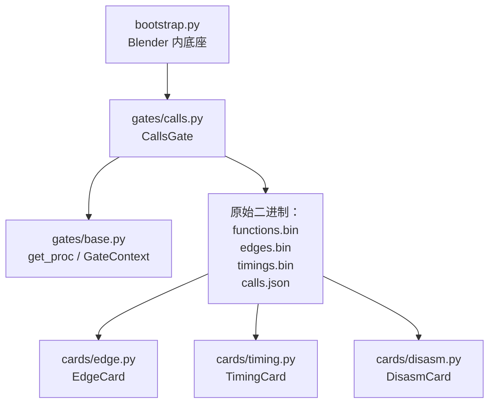
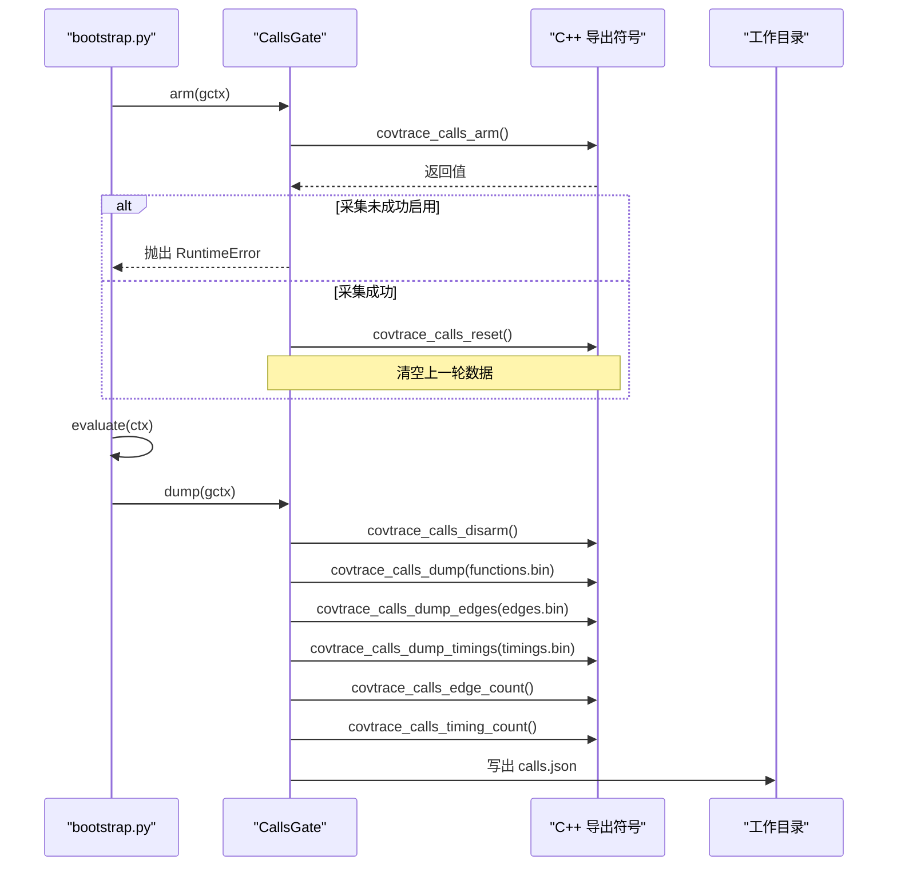
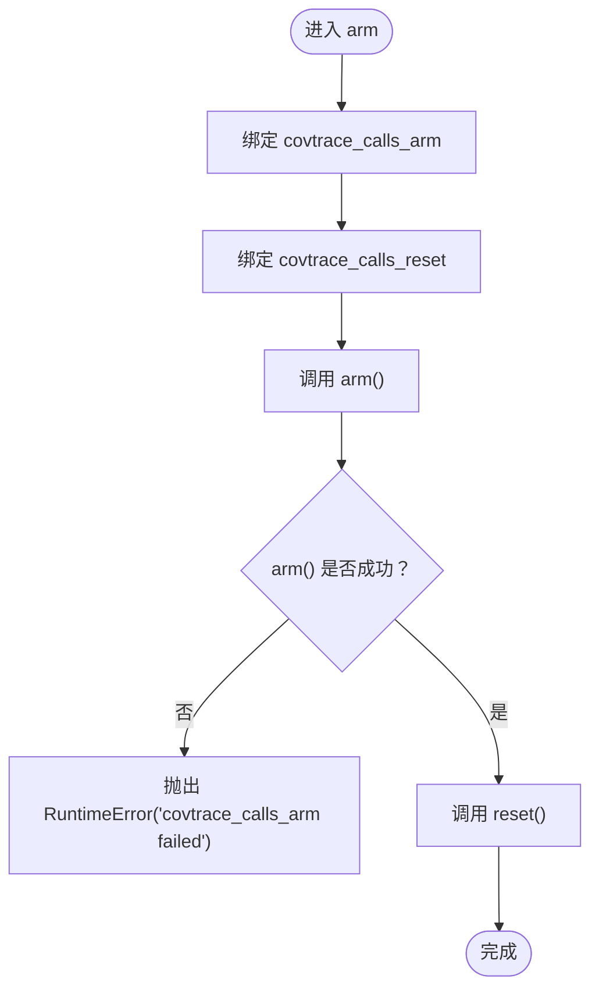
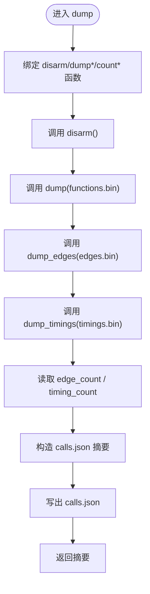
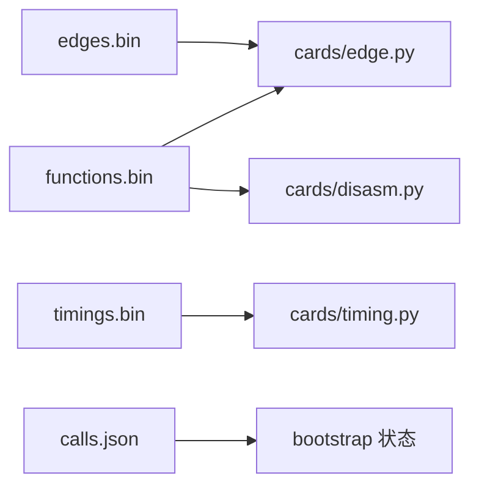
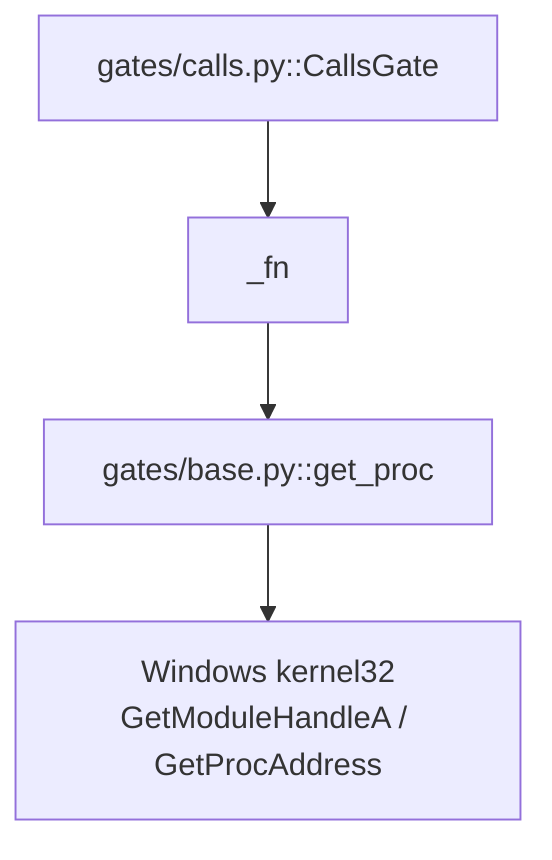
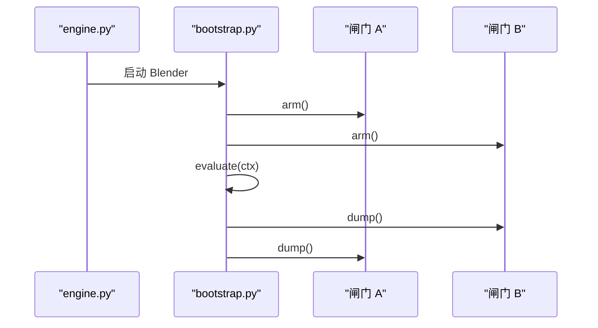

# Calls 闸门：函数调用边与时序

<cite>
**本文引用的文件**   
- [gates/calls.py](file://gates/calls.py)
- [gates/base.py](file://gates/base.py)
- [bootstrap.py](file://bootstrap.py)
- [cards/edge.py](file://cards/edge.py)
- [cards/timing.py](file://cards/timing.py)
- [cards/disasm.py](file://cards/disasm.py)
- [docs/架构.md](file://docs/架构.md)
</cite>

## 目录
1. [简介](#简介)
2. [项目结构中的定位](#项目结构中的定位)
3. [核心组件：CallsGate](#核心组件callsgate)
4. [架构总览](#架构总览)
5. [详细组件分析](#详细组件分析)
6. [依赖关系分析](#依赖关系分析)
7. [性能注意事项](#性能注意事项)
8. [故障排查指南](#故障排查指南)
9. [结论](#结论)

## 简介
本文件围绕 `gates/calls.py` 中的 `CallsGate`，说明其如何桥接 Blender 进程内 C++ 导出符号、在采集阶段启用并清理数据、在 dump 阶段写出原始二进制与摘要，并解释这些原始产物如何被后续卡片消费。

`CallsGate` 是“对接闸门”体系中的一个能力实现：它不负责解析二进制，只负责把底层钩子采集到的函数表、调用边和时序数据落到工作目录；真正的语义化 JSON 由 `cards/edge.py`、`cards/timing.py`、`cards/disasm.py` 等翻译卡片生成。

## 项目结构中的定位
CovTrace 将“Blender 内采集”和“宿主侧翻译”解耦：

| 层次 | 位置 | 职责 |
|---|---|---|
| 底座 | `bootstrap.py` | 打开工程、arm 闸门、执行求值、反序 dump、写状态 |
| 闸门 | `gates/calls.py` | 包装 C++ 导出符号，写入 `functions.bin`、`edges.bin`、`timings.bin`、`calls.json` |
| 基础设施 | `gates/base.py` | `get_proc`、`GateContext`、`Gate` 基类 |
| 翻译卡片 | `cards/edge.py`、`cards/timing.py`、`cards/disasm.py` | 从 raw 产出最终 JSON |
| 架构文档 | `docs/架构.md` | 闸门与卡片的整体契约 |



**图表来源**
- [bootstrap.py:120-192](file://bootstrap.py#L120-L192)
- [gates/calls.py:11-63](file://gates/calls.py#L11-L63)
- [gates/base.py:10-38](file://gates/base.py#L10-L38)
- [cards/edge.py:1-23](file://cards/edge.py#L1-L23)
- [cards/timing.py:1-108](file://cards/timing.py#L1-L108)
- [cards/disasm.py:1-40](file://cards/disasm.py#L1-L40)

**章节来源**
- [docs/架构.md:1-120](file://docs/架构.md#L1-L120)
- [bootstrap.py:120-192](file://bootstrap.py#L120-L192)

## 核心组件：CallsGate
`CallsGate` 继承自 `Gate`，声明一组必须存在于当前模块中的 C++ 导出符号，并通过 `_fn` 辅助函数用 `ctypes.CFUNCTYPE` 动态绑定。

### exports 列表
`exports` 对应以下 C++ 导出符号：

| 导出符号 | 用途 |
|---|---|
| `covtrace_calls_arm` | 启用函数调用采集 |
| `covtrace_calls_reset` | 清空上一轮采集数据 |
| `covtrace_calls_disarm` | 停止采集 |
| `covtrace_calls_dump` | 写出 `functions.bin` |
| `covtrace_calls_dump_edges` | 写出 `edges.bin` |
| `covtrace_calls_dump_timings` | 写出 `timings.bin` |
| `covtrace_calls_edge_count` | 返回已记录的调用边数量 |
| `covtrace_calls_timing_count` | 返回已记录的时序记录数量 |

### _fn 辅助函数
`_fn(name, restype, argtypes=())` 的作用是把一个导出符号包装成 Python 可调用的 C 风格函数：

1. 通过 `get_proc(name)` 获取目标符号地址。
2. 使用 `ctypes.CFUNCTYPE(restype, *argtypes)` 创建函数类型。
3. 把地址实例化为可调用对象。

该封装让 `CallsGate` 以纯 Python 方式调用 C++ 导出函数，而无需直接操作 ctypes 地址。

**章节来源**
- [gates/calls.py:11-26](file://gates/calls.py#L11-L26)
- [gates/base.py:10-22](file://gates/base.py#L10-L22)

## 架构总览
`CallsGate` 的生命周期分为两个阶段：**arm** 和 **dump**。



**图表来源**
- [bootstrap.py:140-192](file://bootstrap.py#L140-L192)
- [gates/calls.py:28-63](file://gates/calls.py#L28-L63)

## 详细组件分析

### arm 阶段：启用采集并清空旧数据
`arm(ctx)` 的执行流程如下：



关键行为：

- 先绑定 `covtrace_calls_arm` 和 `covtrace_calls_reset`。
- 调用 `arm()`，若返回失败，则立即抛出 `RuntimeError("covtrace_calls_arm failed")`。
- 成功后调用 `reset()`，清空上一轮的数据，避免历史采样污染本次结果。

错误处理会中断 bootstrap 的闸门初始化流程，并最终由 `bootstrap.py` 捕获异常，写入失败状态。

**章节来源**
- [gates/calls.py:28-36](file://gates/calls.py#L28-L36)
- [bootstrap.py:150-192](file://bootstrap.py#L150-L192)

### dump 阶段：停止采集并写出原始产物
`dump(ctx)` 负责停止采集、写出三类原始二进制，以及生成 `calls.json` 摘要。



具体职责划分：

| 输出键 | 文件名 | 写出函数 | 下游消费者 |
|---|---|---|---|
| `functions` | `functions.bin` | `covtrace_calls_dump` | `edge.py`、`disasm.py` |
| `edges` | `edges.bin` | `covtrace_calls_dump_edges` | `edge.py` |
| `timings` | `timings.bin` | `covtrace_calls_dump_timings` | `timing.py` |
| 汇总 | `calls.json` | Python 生成 | bootstrap 状态、运行元信息 |

`calls.json` 包含：

| 字段 | 含义 |
|---|---|
| `name` | 闸门名称 `"calls"` |
| `edge_count` | 调用边总数 |
| `timing_count` | 时序记录总数 |
| `raw` | 原始文件路径映射，如 `functions`、`edges`、`timings` |

**章节来源**
- [gates/calls.py:38-63](file://gates/calls.py#L38-L63)

### 原始文件格式与下游消费

#### functions.bin
- 由 `covtrace_calls_dump` 写出。
- 被 `cards/edge.py` 用于构建函数到 RVA 的映射。
- 被 `cards/disasm.py` 用于静态反汇编，统计指令数、调用数、分支数和运行时调用特征。

#### edges.bin
- 由 `covtrace_calls_dump_edges` 写出。
- 被 `cards/edge.py` 与 `functions.bin` 一起解析，生成 `edge.json`。

#### timings.bin
- 由 `covtrace_calls_dump_timings` 写出。
- 被 `cards/timing.py` 解析，将 QPC 时间戳转换为纳秒，并按函数聚合调用次数、自身时间和包含时间。

#### calls.json
- 由 `CallsGate.dump` 生成，作为闸门级摘要。
- 不替代各卡片产出的 JSON，而是提供调用边与时序规模的快速视图。



**图表来源**
- [gates/calls.py:48-63](file://gates/calls.py#L48-L63)
- [cards/edge.py:1-23](file://cards/edge.py#L1-L23)
- [cards/timing.py:1-108](file://cards/timing.py#L1-L108)
- [cards/disasm.py:1-40](file://cards/disasm.py#L1-L40)

**章节来源**
- [cards/edge.py:1-23](file://cards/edge.py#L1-L23)
- [cards/timing.py:1-108](file://cards/timing.py#L1-L108)
- [cards/disasm.py:1-40](file://cards/disasm.py#L1-L40)

## 依赖关系分析

### 符号解析依赖
`CallsGate` 本身不直接调用 `ctypes.windll.GetModuleHandleA` 或 `GetProcAddress`，而是委托给 `gates/base.py` 中的 `get_proc`：

1. `get_proc` 获取当前模块句柄。
2. 查找指定导出符号地址。
3. `_fn` 用该地址构造 `ctypes.CFUNCTYPE` 回调。
4. `CallsGate.arm`/`dump` 通过 `_fn` 调用 C++ 导出。



**图表来源**
- [gates/calls.py:11-26](file://gates/calls.py#L11-L26)
- [gates/base.py:10-22](file://gates/base.py#L10-L22)

### bootstrap 与闸门的关系
`bootstrap.py` 按注册顺序依次调用每个闸门的 `arm`，执行用户求值脚本后，再按**逆序**调用 `dump`。这一设计保证闸门可以维护内部栈或生命周期状态。



**图表来源**
- [bootstrap.py:140-192](file://bootstrap.py#L140-L192)

**章节来源**
- [gates/base.py:10-38](file://gates/base.py#L10-L38)
- [bootstrap.py:140-192](file://bootstrap.py#L140-L192)

## 性能注意事项
`CallsGate` 运行在 Blender 主流程中，因此应遵循以下原则：

- **arm 阶段必须轻量**：只做 `arm()` 和 `reset()`，不要做 I/O、网络请求或复杂计算。
- **dump 阶段尽量快速**：虽然需要调用 C++ 导出写出二进制，但 Python 层不应额外遍历大型数据结构。
- **避免重复解析**：同一闸门多次调用时，避免重复加载符号或重复分配内存。
- **错误要早抛**：如果底层采集不可用，应在 `arm` 或 `dump` 早期失败，而不是在后续卡片阶段才暴露问题。
- **日志成本敏感**：Blender 主循环中的频繁日志可能影响渲染或节点更新性能。

这些约束来自闸门在 Blender 内运行的事实，以及 `bootstrap.py` 在执行求值前后直接调用闸门方法的控制流。

[本节为通用性能指导，不直接分析具体代码片段]

## 故障排查指南

### arm 失败
如果 `covtrace_calls_arm` 返回失败，`CallsGate.arm` 会抛出：

```text
RuntimeError: covtrace_calls_arm failed
```

典型原因：

- C++ 模块未加载。
- 目标符号不存在。
- 采集初始化所需的运行时环境不满足。

排查步骤：

1. 检查 `bootstrap.py` 中 `missing_exports` 校验是否已通过。
2. 确认 C++ 扩展已正确编译并导出 `covtrace_calls_arm`。
3. 查看 `status.json` 中的 `error` 和 `traceback`。

**章节来源**
- [gates/calls.py:28-36](file://gates/calls.py#L28-L36)
- [bootstrap.py:160-192](file://bootstrap.py#L160-L192)

### dump 失败
dump 阶段可能因多种原因失败，例如：

- `covtrace_calls_disarm` 或 dump 导出函数失败。
- 无法写入 `calls.json`。
- 工作目录无写入权限。

此时 `bootstrap.py` 的顶层异常处理器会：

1. 写入 `ok: false`。
2. 记录错误类型和消息。
3. 输出回溯。
4. 重新抛出异常。

**章节来源**
- [gates/calls.py:38-63](file://gates/calls.py#L38-L63)
- [bootstrap.py:170-192](file://bootstrap.py#L170-L192)

### 下游卡片找不到 raw 文件
`cards/timing.py` 对 `timings.bin` 缺失有明确保护：

- 若 `timings.bin` 不存在，返回跳过结果。
- 若文件头截断，抛出 `RuntimeError`。
- 若魔数、版本或记录大小不匹配，抛出 `RuntimeError`。

这说明 `calls.json` 中的 `raw` 只是路径引用，实际文件仍需由 `CallsGate.dump` 成功写出。

**章节来源**
- [cards/timing.py:24-66](file://cards/timing.py#L24-L66)

## 结论
`CallsGate` 是一个简洁而关键的桥梁：它把 Blender 内 C++ 导出的函数调用采集能力，抽象为标准的 `arm`/`dump` 闸门接口。其核心价值在于：

- 用 `_fn` + `get_proc` 安全绑定 C++ 导出符号。
- 在 arm 阶段启用采集并清空历史数据。
- 在 dump 阶段写出 `functions.bin`、`edges.bin`、`timings.bin` 和 `calls.json`。
- 将解析职责交给下游卡片，保持闸门与卡片解耦。
- 通过 `bootstrap.py` 的统一异常处理，确保失败状态可观测。

新增其他采集能力时，应沿用相同模式：定义 `exports`、实现 `arm`/`dump`、写入 raw，并在 `registry.py` 中注册，而不修改现有闸门或卡片。