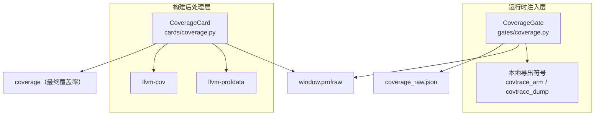
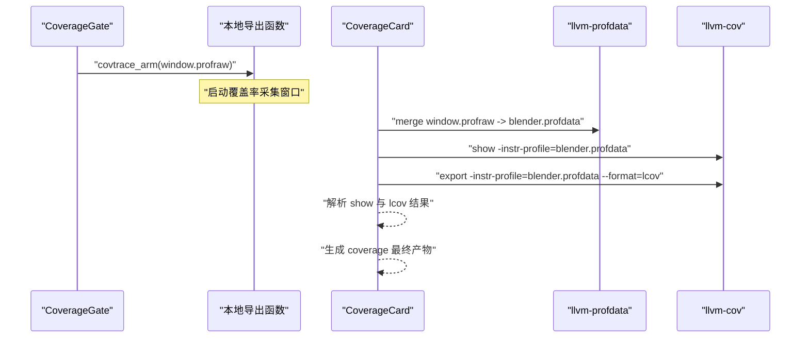
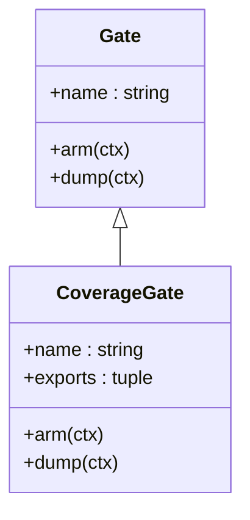
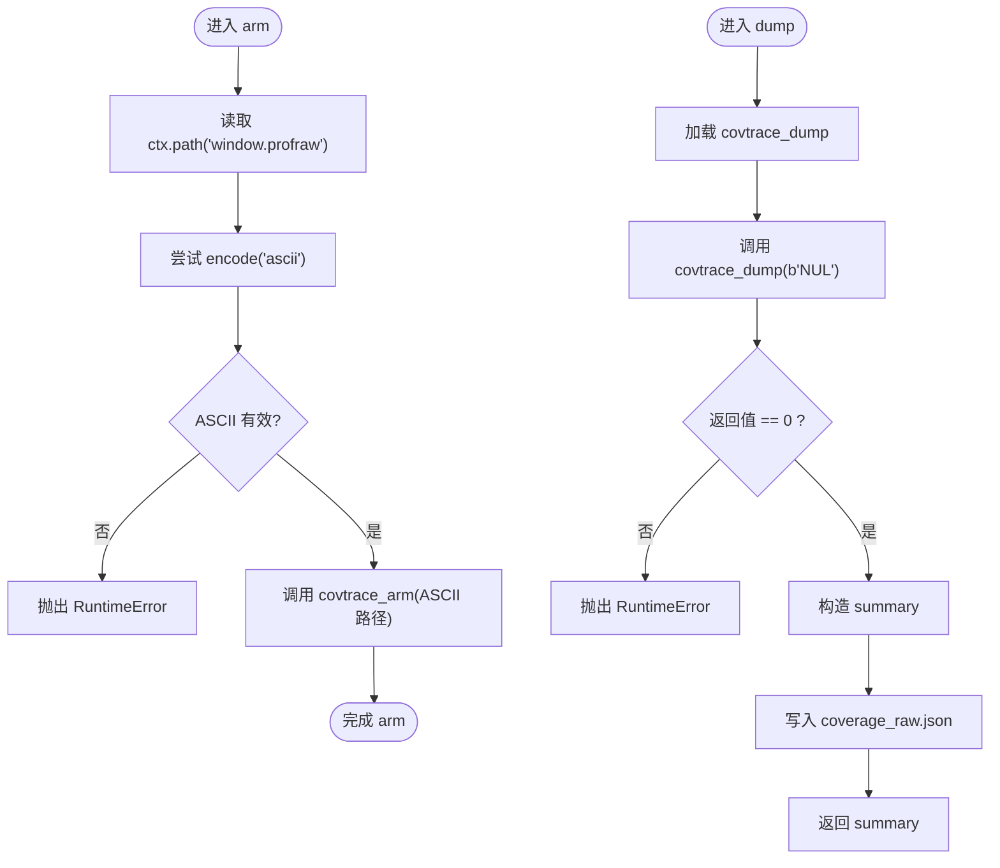
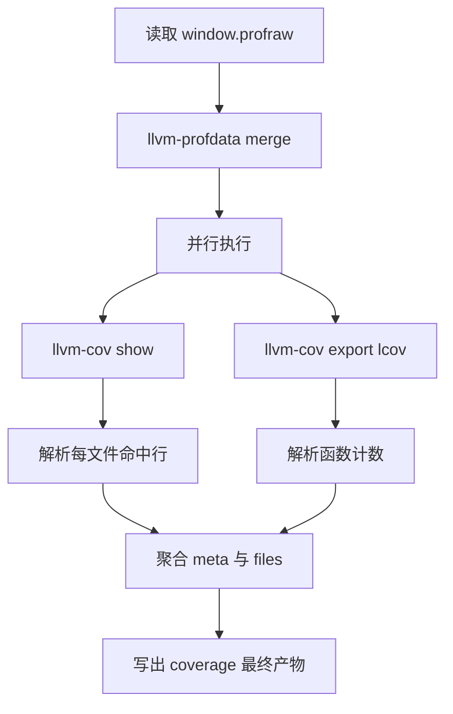
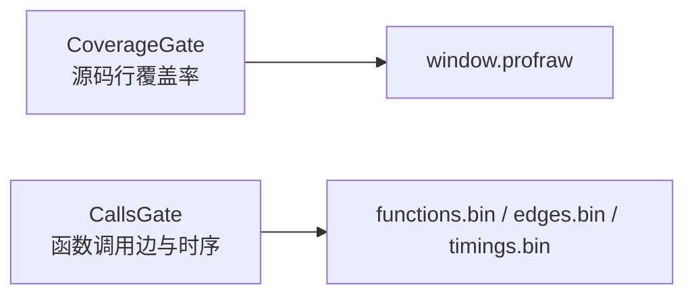
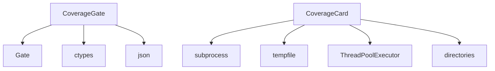

# Coverage 闸门：源码行覆盖率原始数据

<cite>
**本文引用的文件**
- [gates/coverage.py](file://gates/coverage.py)
- [cards/coverage.py](file://cards/coverage.py)
- [gates/calls.py](file://gates/calls.py)
</cite>

## 目录
1. [简介](#简介)
2. [项目结构定位](#项目结构定位)
3. [核心组件](#核心组件)
4. [架构总览](#架构总览)
5. [详细组件分析](#详细组件分析)
6. [依赖关系分析](#依赖关系分析)
7. [性能与行为特征](#性能与行为特征)
8. [故障排查指南](#故障排查指南)
9. [结论](#结论)

## 简介
Coverage 闸门负责在目标程序运行期间采集源码行覆盖率原始数据，并生成可供后续卡片处理的原始产物。其实现基于 `gates/coverage.py` 中的 `CoverageGate`，通过动态链接暴露的 `covtrace_arm` 与 `covtrace_dump` 两个符号，启动和结束一个覆盖采集窗口，最终输出 `window.profraw` 与 `coverage_raw.json`。

该闸门本身不直接调用 LLVM 工具链；它只负责“打开”和“关闭”覆盖率窗口，并把原始 `.profraw` 路径交给下游 `cards/coverage.py` 中的 `CoverageCard` 使用。`CoverageCard` 再使用 `llvm-cov` 与 `llvm-profdata` 将原始数据转换为可读的覆盖率结果。

## 项目结构定位
Coverage 闸门位于 gates 层，属于运行时注入阶段；对应的解析与报告逻辑位于 cards 层，属于构建后处理阶段。二者通过原始产物 `window.profraw` 与描述性 JSON `coverage_raw.json` 衔接。

**图表来源**
- [gates/coverage.py:1-39](file://gates/coverage.py#L1-L39)
- [cards/coverage.py:1-233](file://cards/coverage.py#L1-L233)

**章节来源**
- [gates/coverage.py:1-39](file://gates/coverage.py#L1-L39)
- [cards/coverage.py:1-233](file://cards/coverage.py#L1-L233)

## 核心组件
- `CoverageGate`：覆盖率闸门的实现类，名称为 `coverage`。
- `arm(ctx)`：启动覆盖率采集窗口，写入 `window.profraw`。
- `dump(ctx)`：关闭覆盖率窗口、校验返回值、写出 `coverage_raw.json`，并返回摘要。
- `exports`：仅包含 `covtrace_arm` 与 `covtrace_dump`，表示该闸门只向被注入进程暴露这两个入口。

**章节来源**
- [gates/coverage.py:1-39](file://gates/coverage.py#L1-L39)

## 架构总览
Coverage 闸门与 LLVM 工具链之间是“解耦”的关系：

| 阶段 | 组件 | 职责 | 输入 | 输出 |
|---|---|---|---|---|
| arm | `CoverageGate.arm` | 构造 ASCII 路径，调用 `covtrace_arm` | 上下文对象 `ctx` | 启动覆盖率窗口，产生 `window.profraw` |
| dump | `CoverageGate.dump` | 调用 `covtrace_dump`，校验返回值，写出 `coverage_raw.json` | 上下文对象 `ctx` | `coverage_raw.json`、Python 返回值摘要 |
| 转换 | `CoverageCard.build` | 合并 profraw、调用 llvm-cov 展示与导出 lcov | `window.profraw`、可执行文件 | `coverage_raw.json` 下游使用的原始覆盖率信息 |
| 汇总 | `CoverageCard.build` | 解析 `llvm-cov show` 与 `lcov`，聚合文件与行范围 | 中间文本与 lcov | 最终 `coverage` 产出 |

**图表来源**
- [gates/coverage.py:15-39](file://gates/coverage.py#L15-L39)
- [cards/coverage.py:170-233](file://cards/coverage.py#L170-L233)

**章节来源**
- [gates/coverage.py:15-39](file://gates/coverage.py#L15-L39)
- [cards/coverage.py:170-233](file://cards/coverage.py#L170-L233)

## 详细组件分析

### CoverageGate 类图

- `name = "coverage"`：标识该闸门类型。
- `exports = ("covtrace_arm", "covtrace_dump")`：仅暴露两个本地导出符号。
- `arm(ctx)`：
  - 从 `ctx.path("window.profraw")` 获取工作目录下的原始覆盖率文件路径。
  - 将该路径编码为 ASCII 字节串。
  - 如果路径包含非 ASCII 字符，抛出 `RuntimeError`。
  - 通过 `ctypes.CFUNCTYPE` 加载 `get_proc("covtrace_arm")`，并以 `(c_char_p,)` 参数类型调用。
- `dump(ctx)`：
  - 加载 `covtrace_dump`，签名返回整数。
  - 传入固定字节 `b"NUL"` 关闭覆盖率窗口。
  - 若返回值不为 0，抛出 `RuntimeError`。
  - 构造摘要对象：
    - `name`：闸门名称。
    - `raw.coverage`：原始 `.profraw` 的完整路径。
  - 以 UTF-8 写入 `coverage_raw.json`，末尾追加换行。
  - 返回该摘要字典。

**图表来源**
- [gates/coverage.py:15-39](file://gates/coverage.py#L15-L39)

**章节来源**
- [gates/coverage.py:1-39](file://gates/coverage.py#L1-L39)

### CoverageCard 与 LLVM 工具链的关系
`cards/coverage.py` 中的 `CoverageCard` 消费闸门产出的原始覆盖率数据：

- 从 `ctx.raw("coverage")` 获取 `window.profraw`。
- 调用 `llvm-profdata merge` 将原始数据合并为 `blender.profdata`。
- 并行调用：
  - `llvm-cov show`：按行展示覆盖率，用于统计命中行集合。
  - `llvm-cov export --format=lcov`：导出 lcov，用于函数级统计。
- 解析 `show` 输出与 lcov 输出，过滤保留前缀 `source/` 与 `intern/`，排除头文件等可选策略。
- 构建最终 `coverage` 产出，包含元信息与每个文件的命中行范围。

**图表来源**
- [cards/coverage.py:170-233](file://cards/coverage.py#L170-L233)

**章节来源**
- [cards/coverage.py:1-233](file://cards/coverage.py#L1-L233)

### 与 calls 闸门的关键区别
`gates/calls.py` 中的 `CallsGate` 关注的是函数调用关系与调用边统计，而不是源码行覆盖率：

| 维度 | Coverage 闸门 | Calls 闸门 |
|---|---|---|
| 名称 | `coverage` | `calls` |
| 主要目标 | 源码行是否被执行 | 函数 RVA 与调用边、调用时序 |
| 导出符号 | `covtrace_arm`、`covtrace_dump` | `covtrace_calls_arm`、`covtrace_calls_reset`、`covtrace_calls_disarm`、`covtrace_calls_dump`、`covtrace_calls_dump_edges`、`covtrace_calls_dump_timings`、`covtrace_calls_edge_count`、`covtrace_calls_timing_count` |
| 关键输入 | `window.profraw` | 函数表、边表、时序数据 |
| 关键输出 | `coverage_raw.json`，指向原始 profraw | `calls.json`，包含边数量、时序数量与二进制 raw 路径 |
| 下游处理 | `llvm-cov`、`llvm-profdata` 生成源码行覆盖率 | 调用边与计时数据由对应卡片进一步解析 |

**图表来源**
- [gates/coverage.py:1-39](file://gates/coverage.py#L1-L39)
- [gates/calls.py:1-63](file://gates/calls.py#L1-L63)

**章节来源**
- [gates/calls.py:1-63](file://gates/calls.py#L1-L63)

## 依赖关系分析
- `gates/coverage.py` 依赖：
  - `ctypes`：动态加载本地导出符号。
  - `json`：写出 `coverage_raw.json`。
  - `.base.Gate`：继承闸门基类。
  - `.base.get_proc`：根据符号名获取本地过程地址。
- `cards/coverage.py` 依赖：
  - `subprocess`：调用 `llvm-profdata` 与 `llvm-cov`。
  - `tempfile`：创建临时工作目录。
  - `concurrent.futures.ThreadPoolExecutor`：并行执行 show 与 export。
  - `directories`：定位 LLVM 工具路径与源码根目录。
  - 自定义解析函数：解析 lcov、解析 `llvm-cov show` 输出。

**图表来源**
- [gates/coverage.py:1-39](file://gates/coverage.py#L1-L39)
- [cards/coverage.py:1-233](file://cards/coverage.py#L1-L233)

**章节来源**
- [gates/coverage.py:1-39](file://gates/coverage.py#L1-L39)
- [cards/coverage.py:1-233](file://cards/coverage.py#L1-L233)

## 性能与行为特征
- arm 阶段时间开销极小，主要是字符串编码与一次本地函数调用。
- dump 阶段同样轻量，但会触发底层覆盖率数据落盘。
- 真正的重型操作发生在 `CoverageCard` 中：
  - `llvm-profdata merge` 需要扫描并合并 `.profraw`。
  - `llvm-cov show` 与 `llvm-cov export` 会解析二进制覆盖率数据。
  - 两者默认并行执行，减少等待时间。
- 最终 `coverage` 产物只保留 `source/` 与 `intern/` 相关源码文件，避免无关头文件或第三方代码污染统计。

[本节为通用行为说明，不直接分析具体代码片段]

## 故障排查指南

### LLVM 工具链不可用
- 现象：`CoverageCard` 在执行 `llvm-profdata` 或 `llvm-cov` 时报错。
- 可能原因：
  - `directories.LLVM_PROFDATA_EXE` 或 `directories.LLVM_COV_EXE` 未配置或路径错误。
  - 系统缺少 LLVM 工具链。
- 诊断方式：
  - 确认 `llvm-profdata` 与 `llvm-cov` 命令可在环境中执行。
  - 检查 `directories` 模块提供的路径是否正确。
  - 查看 `cards/coverage.py` 中 subprocess 调用的异常堆栈。

**章节来源**
- [cards/coverage.py:1-233](file://cards/coverage.py#L1-L233)

### window.profraw 为空
- 现象：`CoverageCard` 合并或解析覆盖率数据时失败，或最终覆盖率结果为空。
- 可能原因：
  - 目标程序未真正执行到带覆盖率插桩的代码。
  - `covtrace_arm` 未被正确调用。
  - 运行环境未启用源码行覆盖率。
- 诊断方式：
  - 检查 `coverage_raw.json` 是否存在，且 `raw.coverage` 是否指向预期的 `window.profraw`。
  - 检查 `window.profraw` 文件大小是否为 0。
  - 确认被测程序确实执行了预期路径。

**章节来源**
- [gates/coverage.py:15-39](file://gates/coverage.py#L15-L39)
- [cards/coverage.py:170-233](file://cards/coverage.py#L170-L233)

### 工作目录路径包含非 ASCII 字符
- 现象：`CoverageGate.arm` 抛出 `RuntimeError`，提示覆盖率工作路径必须为 ASCII。
- 原因：`path.encode("ascii")` 失败。
- 解决方式：
  - 将工作目录改为纯 ASCII 路径。
  - 避免中文、空格以外的非英文字符出现在 `ctx.path("window.profraw")` 所依赖的路径中。

**章节来源**
- [gates/coverage.py:18-26](file://gates/coverage.py#L18-L26)

### covtrace_dump 返回值非 0
- 现象：`CoverageGate.dump` 抛出 `RuntimeError`，提示 `covtrace_dump failed`。
- 原因：底层 `covtrace_dump` 返回非零状态码。
- 诊断方式：
  - 检查覆盖率窗口是否正常启动。
  - 检查目标程序是否正常退出或主动关闭覆盖率窗口。
  - 检查是否有权限写入 `window.profraw` 所在目录。
  - 结合其他闸门日志，确认覆盖率生命周期是否被中断。

**章节来源**
- [gates/coverage.py:28-39](file://gates/coverage.py#L28-L39)

### coverage_raw.json 与最终 coverage 的区别
- `coverage_raw.json`：由 `CoverageGate.dump` 写出，只记录闸门名称与原始 `.profraw` 路径。
- 最终 `coverage`：由 `CoverageCard` 经过 LLVM 工具链处理后生成，包含文件数、行数、函数数及逐文件行范围。
- 常见误解：把 `coverage_raw.json` 当作最终覆盖率报告。实际最终报告应参考 `cards/coverage.py` 生成的 `coverage` 产物。

**章节来源**
- [gates/coverage.py:28-39](file://gates/coverage.py#L28-L39)
- [cards/coverage.py:170-233](file://cards/coverage.py#L170-L233)

## 结论
`CoverageGate` 的职责清晰而克制：它不负责解释覆盖率数据，也不直接调用 LLVM 工具链，而是专注于在目标进程生命周期内启动和关闭源码行覆盖率采集窗口，并将原始 `.profraw` 路径以结构化方式暴露给下游。`cards/coverage.py` 承担更重的解析任务，通过 `llvm-profdata` 与 `llvm-cov` 将原始数据转化为人类可读的源码行覆盖率结果。理解这一分层有助于快速定位问题：如果 LLVM 工具链报错，重点看 `cards/coverage.py`；如果路径编码或窗口关闭失败，重点看 `gates/coverage.py`。