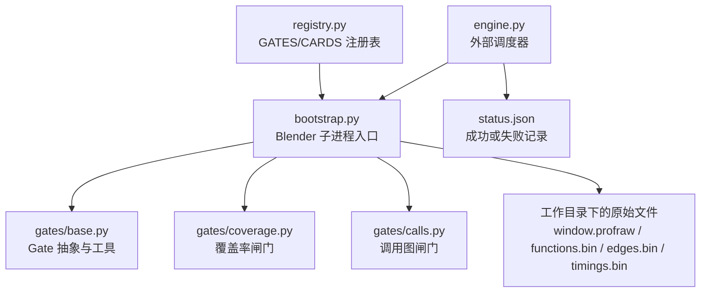
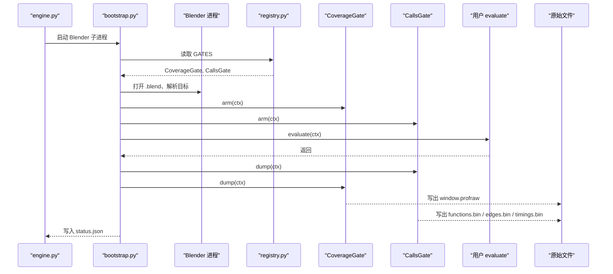
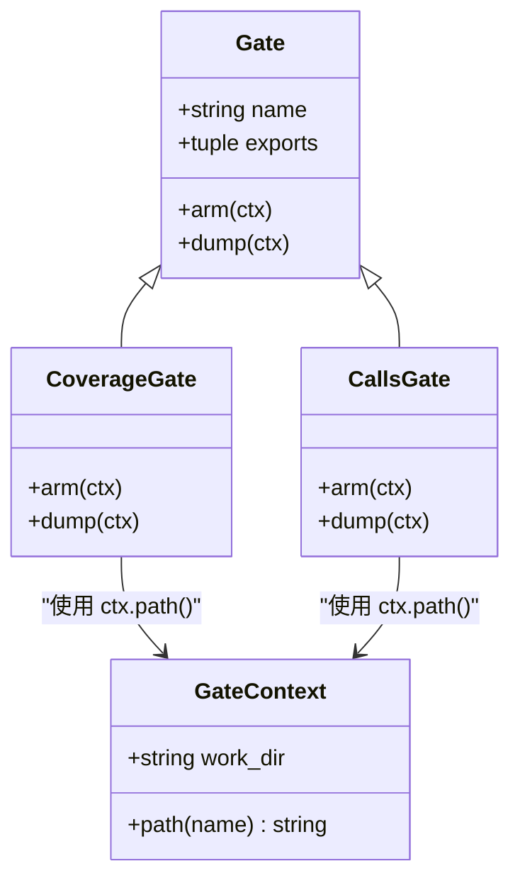
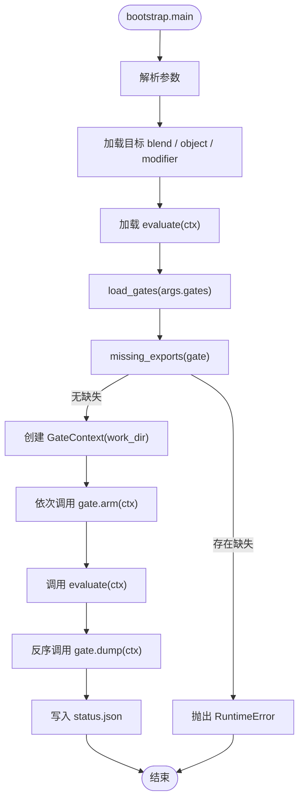
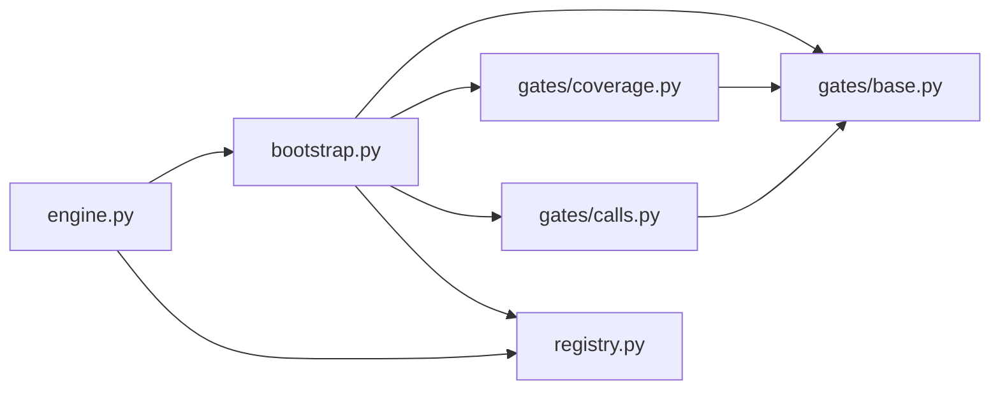

# Gate 接口设计与生命周期

<cite>
**本文引用的文件**
- [gates/base.py](file://gates/base.py)
- [registry.py](file://registry.py)
- [bootstrap.py](file://bootstrap.py)
- [engine.py](file://engine.py)
- [gates/coverage.py](file://gates/coverage.py)
- [gates/calls.py](file://gates/calls.py)
</cite>

## 目录
1. [引言](#引言)
2. [项目结构](#项目结构)
3. [核心组件](#核心组件)
4. [架构总览](#架构总览)
5. [详细组件分析](#详细组件分析)
6. [依赖关系分析](#依赖关系分析)
7. [性能与可靠性考虑](#性能与可靠性考虑)
8. [故障排查指南](#故障排查指南)
9. [结论](#结论)
10. [附录：新增闸门最小步骤](#附录新增闸门最小步骤)

## 引言
Gate（闸门）是 CovTrace 在 Blender 进程内执行的采集阶段抽象。它负责在用户评估函数执行前“安装”采集钩子，在执行后“导出”原始数据。所有闸门共享 `GateContext`，并通过工作目录下的原始文件进行协作，而不是直接共享 Python 对象状态；这样闸门之间保持松耦合，便于后续由 cards 层读取并生成最终产品。

本文重点说明：
- `gates/base.py` 中 `GateContext`、`Gate` 抽象类、`get_proc` 与 `missing_exports` 的设计意图。
- 为什么 Gate 必须运行在 Blender 进程内，以及如何通过 `ctypes.windll.kernel32.GetModuleHandleA` / `GetProcAddress` 解析 C++ 导出的 `covtrace_*` 符号。
- Gate 的生命周期：`arm(ctx)` 在执行用户 `evaluate` 之前调用，`dump(ctx)` 在评估完成后按反序调用。
- 失败时异常如何向上传播，并由 bootstrap/engine 写入 `status.json`。
- `Gate.name`、`Gate.exports` 的元数据作用，以及与 `registry.py` 中 `GATES` 注册表的关系。
- 如何通过 `ctx.work_dir` 和 `ctx.path(name)` 统一 raw 输出路径，使闸门只写原始文件、不互相访问内部状态。

## 项目结构
Gate 相关代码位于 `gates/` 目录，其中：
- `base.py` 定义公共基类与工具。
- `coverage.py`、`calls.py` 是具体闸门实现。
- `registry.py` 集中注册闸门与卡片。
- `bootstrap.py` 在 Blender 进程内加载闸门、编排生命周期。
- `engine.py` 作为外部调度器，负责启动 Blender 子进程、汇总结果、处理失败产物。

**图表来源**
- [engine.py:1-60](file://engine.py#L1-L60)
- [bootstrap.py:1-60](file://bootstrap.py#L1-L60)
- [gates/base.py:1-38](file://gates/base.py#L1-L38)
- [gates/coverage.py:1-39](file://gates/coverage.py#L1-L39)
- [gates/calls.py:1-63](file://gates/calls.py#L1-L63)
- [registry.py:1-49](file://registry.py#L1-L49)

**章节来源**
- [gates/base.py:1-38](file://gates/base.py#L1-L38)
- [gates/coverage.py:1-39](file://gates/coverage.py#L1-L39)
- [gates/calls.py:1-63](file://gates/calls.py#L1-L63)
- [registry.py:1-49](file://registry.py#L1-L49)
- [bootstrap.py:1-192](file://bootstrap.py#L1-L192)
- [engine.py:1-200](file://engine.py#L1-L200)

## 核心组件
本节聚焦 `gates/base.py` 中的四个关键元素：`get_proc`、`missing_exports`、`GateContext`、`Gate`。

### get_proc：解析 C++ 导出符号
`get_proc(name)` 使用 Windows 动态链接库 API 查找当前模块中的导出符号：
- 通过 `ctypes.windll.kernel32.GetModuleHandleA(None)` 获取当前模块句柄。
- 通过 `GetModuleHandleA` / `GetProcAddress` 的返回值类型设置为 `c_void_p`，避免平台差异。
- 将符号名编码为 ASCII 字节传入 `GetProcAddress`。
- 返回 C 函数指针，供上层用 `ctypes.CFUNCTYPE` 包装成可调用的 Python 函数。

该设计把 C++ 侧的 `covtrace_*` 系列导出暴露给 Python 闸门，而不需要额外绑定层。

**章节来源**
- [gates/base.py:8-19](file://gates/base.py#L8-L19)

### missing_exports：检测未实现的导出符号
`missing_exports(gate)` 遍历 `gate.exports`，对每个导出名调用 `get_proc(name)`。如果某个符号不存在，就把它加入缺失列表。bootstrap 在加载闸门后会立即检查缺失项，并在存在缺失时抛出 `RuntimeError`，阻止后续评估。

这个机制保证：
- 闸门声明的导出必须在 C++ 模块中真实存在。
- 开发期即可发现导出名拼写错误或 C++ 端未编译对应功能。
- 运行时不会因找不到符号而崩溃到更深层。

**章节来源**
- [gates/base.py:21-23](file://gates/base.py#L21-L23)
- [bootstrap.py:130-146](file://bootstrap.py#L130-L146)

### GateContext：统一的原始文件路径
`GateContext` 持有 `work_dir`，并提供 `path(name)` 方法，将所有闸门输出的文件名归一化到同一工作目录下。例如：
- `ctx.path("window.profraw")`
- `ctx.path("functions.bin")`
- `ctx.path("edges.bin")`
- `ctx.path("timings.bin")`

这样闸门不需要关心工作目录的具体位置，也不需要互相感知彼此的实现细节；它们只约定输出文件名，由 cards 层再消费这些原始文件。

**章节来源**
- [gates/base.py:25-31](file://gates/base.py#L25-L31)

### Gate：抽象类与生命周期契约
`Gate` 定义了闸门的最小接口：
- `name`：闸门的标识符，用于日志、状态记录和下游卡片选择。
- `exports`：闸门依赖的 C++ 导出符号元组。
- `arm(ctx)`：在执行用户 `evaluate` 之前被调用，用于安装钩子、重置采集状态、准备输出路径等。
- `dump(ctx)`：在用户评估结束后被调用，用于停止采集、写出原始文件、返回摘要。

`arm` 与 `dump` 默认抛出 `NotImplementedError`，强制具体闸门实现这两个阶段。

**章节来源**
- [gates/base.py:33-38](file://gates/base.py#L33-L38)

## 架构总览
Gate 的生命周期由 `bootstrap.py` 管理，并与 `registry.py` 的 `GATES` 注册表配合。

**图表来源**
- [bootstrap.py:80-192](file://bootstrap.py#L80-L192)
- [registry.py:37-49](file://registry.py#L37-L49)
- [gates/coverage.py:13-39](file://gates/coverage.py#L13-L39)
- [gates/calls.py:13-63](file://gates/calls.py#L13-L63)

## 详细组件分析

### Gate 抽象类与上下文
`Gate` 是一个极简抽象类，只约束行为契约；具体闸门通过继承扩展自身逻辑。`GateContext` 则屏蔽了工作目录细节，让闸门只关注“在当前工作目录下写出某个文件”。

**图表来源**
- [gates/base.py:25-38](file://gates/base.py#L25-L38)
- [gates/coverage.py:13-39](file://gates/coverage.py#L13-L39)
- [gates/calls.py:13-63](file://gates/calls.py#L13-L63)

**章节来源**
- [gates/base.py:25-38](file://gates/base.py#L25-L38)

### 覆盖率闸门 CoverageGate
`CoverageGate` 对应行覆盖采集：
- `name = "coverage"`
- `exports = ("covtrace_arm", "covtrace_dump")`
- `arm`：把 `window.profraw` 路径传给 C++ 侧的 `covtrace_arm`。
- `dump`：调用 `covtrace_dump`，检查返回码，写出 `coverage_raw.json`，并返回包含 `coverage` 原始文件路径的摘要。

该闸门通过 `ctx.path("window.profraw")` 统一输出路径，确保 bootstrap 和 engine 能在固定位置找到覆盖率原始文件。

**章节来源**
- [gates/coverage.py:13-39](file://gates/coverage.py#L13-L39)

### 调用图闸门 CallsGate
`CallsGate` 对应函数调用边与时序采集：
- `name = "calls"`
- `exports` 包含多个 `covtrace_calls_*` 符号，如 `covtrace_calls_arm`、`covtrace_calls_reset`、`covtrace_calls_disarm`、`covtrace_calls_dump`、`covtrace_calls_dump_edges`、`covtrace_calls_dump_timings`、`covtrace_calls_edge_count`、`covtrace_calls_timing_count`。
- `arm`：调用 `covtrace_calls_arm` 安装采集钩子，然后调用 `covtrace_calls_reset` 清空上次数据。
- `dump`：先 `disarm`，再分别写出 `functions.bin`、`edges.bin`、`timings.bin`，并查询边数与时序数，最后写出 `calls.json` 摘要。

**章节来源**
- [gates/calls.py:13-63](file://gates/calls.py#L13-L63)

### bootstrap 中的闸门编排
`bootstrap.py` 的核心编排流程如下：
1. 解析命令行参数，包括 `--eval`、`--work`、`--node`、`--gates` 等。
2. 加载目标 `.blend`、对象、修改器与节点树。
3. 解析用户评估脚本中的 `evaluate(ctx)`。
4. 从 `args.gates` 动态导入闸门实例。
5. 调用 `missing_exports(gate)` 检测未实现导出，若存在则抛出异常。
6. 创建 `GateContext(args.work)`。
7. 对所有闸门调用 `arm(ctx)`。
8. 调用用户 `evaluate(ctx)`。
9. 在 `finally` 块中按闸门反序调用 `dump(ctx)`。
10. 合并所有闸门的 `raw` 摘要，写入 `status.json`。
11. 捕获异常，写入失败的 `status.json`，并向上抛出。

**图表来源**
- [bootstrap.py:20-60](file://bootstrap.py#L20-L60)
- [bootstrap.py:80-192](file://bootstrap.py#L80-L192)
- [gates/base.py:21-23](file://gates/base.py#L21-L23)

**章节来源**
- [bootstrap.py:20-60](file://bootstrap.py#L20-L60)
- [bootstrap.py:80-192](file://bootstrap.py#L80-L192)

### registry.py 与 GATES 注册表
`registry.py` 同时注册闸门与卡片：
- `GATES = [CoverageGate(), CallsGate()]`：定义本次运行要启用的闸门顺序。
- `CARDS`：定义后续处理原始文件的卡片序列，例如 edge、disasm、coverage、timing、metrics、filter、diff。
- `PRODUCTS`：定义每个卡片产物的名称及是否公开。

闸门与卡片的职责分离很明确：
- 闸门负责在 Blender 进程内采集原始数据。
- 卡片负责在外部引擎中读取原始数据并生成 JSON 等产品。
- 两者通过 `ctx.work_dir` 下的原始文件间接协作，不直接共享 Python 对象。

**章节来源**
- [registry.py:1-49](file://registry.py#L1-L49)

### 为什么 Gate 必须运行在 Blender 进程内
原因有三点：
1. 闸门需要通过 ctypes 访问当前 Blender 进程中已加载的 C++ 模块导出的 `covtrace_*` 符号。`GetModuleHandleA(None)` 取的是当前进程主模块句柄，因此只有运行在 Blender 进程内才能解析这些符号。
2. 闸门通常需要操作 Blender API，例如 `bpy.ops.wm.open_mainfile`、更新视图层、触发几何节点求值等。
3. 用户评估函数 `evaluate(ctx)` 本身可能依赖 Blender 场景、对象、修改器和节点树。

因此，`bootstrap.py` 在 Blender 子进程中执行闸门逻辑，而 `engine.py` 只在外部协调子进程、汇总结果。

**章节来源**
- [gates/base.py:8-19](file://gates/base.py#L8-L19)
- [bootstrap.py:60-192](file://bootstrap.py#L60-L192)

## 依赖关系分析
Gate 层的依赖方向清晰且单向：

**图表来源**
- [bootstrap.py:1-192](file://bootstrap.py#L1-L192)
- [gates/base.py:1-38](file://gates/base.py#L1-L38)
- [gates/coverage.py:1-39](file://gates/coverage.py#L1-L39)
- [gates/calls.py:1-63](file://gates/calls.py#L1-L63)
- [registry.py:1-49](file://registry.py#L1-L49)
- [engine.py:1-200](file://engine.py#L1-L200)

**章节来源**
- [gates/base.py:1-38](file://gates/base.py#L1-L38)
- [gates/coverage.py:1-39](file://gates/coverage.py#L1-L39)
- [gates/calls.py:1-63](file://gates/calls.py#L1-L63)
- [registry.py:1-49](file://registry.py#L1-L49)
- [bootstrap.py:1-192](file://bootstrap.py#L1-L192)
- [engine.py:1-200](file://engine.py#L1-L200)

## 性能与可靠性考虑
- **符号解析开销**：`get_proc` 每次都会调用 Windows API 解析符号。实际闸门实现通常缓存 `ctypes.CFUNCTYPE` 包装后的函数，避免重复解析。
- **原始文件 I/O**：闸门在 `dump` 中写出二进制或 JSON 文件，应避免频繁小文件写入；已有闸门尽量批量写出。
- **异常隔离**：闸门失败应尽早抛出明确异常，让 bootstrap 写入 `status.json`，便于 engine 识别失败产物。
- **反序 dump**：闸门按注册顺序 arm，按反序 dump，符合资源释放的常见模式，例如先 disarm 再关闭采样器。

[本节为通用指导，不直接分析具体文件]

## 故障排查指南

### 缺失导出符号
现象：bootstrap 抛出类似“missing exports”的错误。
可能原因：
- C++ 模块未导出对应 `covtrace_*` 符号。
- 闸门 `exports` 中声明了符号，但 C++ 端未实现。
- 符号名拼写不一致。

排查步骤：
1. 检查闸门类的 `exports` 元组。
2. 确认 C++ 模块确实导出同名符号。
3. 在 bootstrap 中观察 `missing_exports` 返回的符号列表。

**章节来源**
- [gates/base.py:21-23](file://gates/base.py#L21-L23)
- [bootstrap.py:130-146](file://bootstrap.py#L130-L146)

### coverage 原始文件为空或缺失
现象：engine 或诊断逻辑报告 `window.profraw` 为空或缺失。
可能原因：
- `covtrace_dump` 返回非零错误码。
- 用户评估没有触发覆盖采集。
- `ctx.path("window.profraw")` 路径不是 ASCII。

排查步骤：
1. 查看 `status.json` 中的 error 字段。
2. 检查 `coverage_raw.json` 是否存在。
3. 确认评估过程触发了 Blender 几何节点更新。

**章节来源**
- [gates/coverage.py:23-39](file://gates/coverage.py#L23-L39)
- [engine.py:80-120](file://engine.py#L80-L120)

### calls 闸门边数为零
现象：诊断指出 `edge_count == 0`，提示求值可能没有触发。
可能原因：
- `covtrace_calls_arm` 返回失败。
- 评估函数没有实际触发目标几何节点更新。
- 数据采集钩子未被正确安装或复位。

排查步骤：
1. 检查 `calls.json` 与 `functions.bin`。
2. 确认 `arm` 中 `covtrace_calls_arm()` 返回成功。
3. 确认 `dump` 中 `disarm` 成功。

**章节来源**
- [gates/calls.py:13-63](file://gates/calls.py#L13-L63)
- [engine.py:80-120](file://engine.py#L80-L120)

### 异常如何写入 status.json
bootstrap 使用 `try/finally` 包裹闸门调用和用户评估：
- 正常路径：合并闸门摘要，写入 `ok=true` 的 `status.json`。
- 异常路径：写入 `ok=false`、error 消息与 traceback，然后重新抛出异常。
engine 在失败时会把原始工作目录重命名为带 `.failed-*` 后缀的路径，并保留 `status.json` 以便诊断。

**章节来源**
- [bootstrap.py:140-192](file://bootstrap.py#L140-L192)
- [engine.py:40-80](file://engine.py#L40-L80)

## 结论
Gate 接口以最小抽象统一了 Blender 进程内的采集行为：
- `get_proc` 与 `missing_exports` 把 C++ 导出符号的发现与校验前置到 bootstrap 阶段。
- `GateContext.path` 提供统一原始文件路径，使闸门之间只通过文件系统协作。
- `arm` 与 `dump` 明确划分采集安装与采集导出两个阶段，并由 bootstrap 保证执行顺序与异常处理。
- `registry.py` 的 `GATES` 是闸门启用清单，与 `CARDS` 解耦，前者负责采集，后者负责产品生成。

这种设计使得新增闸门成本很低，同时保持闸门与后续卡片之间的稳定契约。

[本节为总结性内容，不直接分析具体文件]

## 附录：新增闸门最小步骤

### 第一步：继承 Gate
新建闸门类，继承 `gates.base.Gate`。

**章节来源**
- [gates/base.py:33-38](file://gates/base.py#L33-L38)

### 第二步：声明 name 与 exports
- `name`：用于状态记录与下游卡片定位。
- `exports`：列出 C++ 侧需要导出的 `covtrace_*` 符号。

**章节来源**
- [gates/base.py:33-38](file://gates/base.py#L33-L38)
- [gates/coverage.py:17-20](file://gates/coverage.py#L17-L20)
- [gates/calls.py:17-28](file://gates/calls.py#L17-L28)

### 第三步：实现 arm(ctx)
在 `arm` 中完成：
- 解析或准备原始文件路径。
- 调用 C++ 导出的安装函数。
- 必要时重置采集状态。

**章节来源**
- [gates/coverage.py:22-28](file://gates/coverage.py#L22-L28)
- [gates/calls.py:30-37](file://gates/calls.py#L30-L37)

### 第四步：实现 dump(ctx)
在 `dump` 中完成：
- 停止采集。
- 写出原始文件。
- 返回包含 `name` 与 `raw` 的摘要字典。

**章节来源**
- [gates/coverage.py:29-39](file://gates/coverage.py#L29-L39)
- [gates/calls.py:38-63](file://gates/calls.py#L38-L63)

### 第五步：在 registry.py 中注册
将新闸门实例加入 `GATES` 列表。如果需要生成新的产品，还要在 `PRODUCTS` 中声明产品名称，并在 `CARDS` 中添加对应卡片注册。

**章节来源**
- [registry.py:37-49](file://registry.py#L37-L49)

### 第六步：验证生命周期
运行后检查：
- `status.json` 中是否有闸门摘要。
- `ctx.work_dir` 下是否写出预期原始文件。
- bootstrap 是否正常打印 raw 信息。
- 若失败，`status.json` 是否包含错误与回溯。

**章节来源**
- [bootstrap.py:140-192](file://bootstrap.py#L140-L192)
- [engine.py:40-80](file://engine.py#L40-L80)