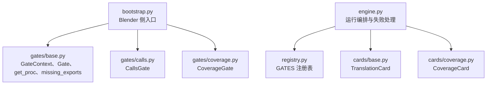
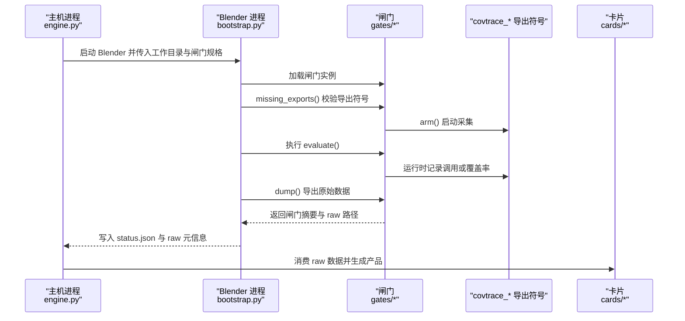
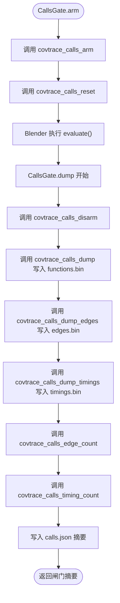
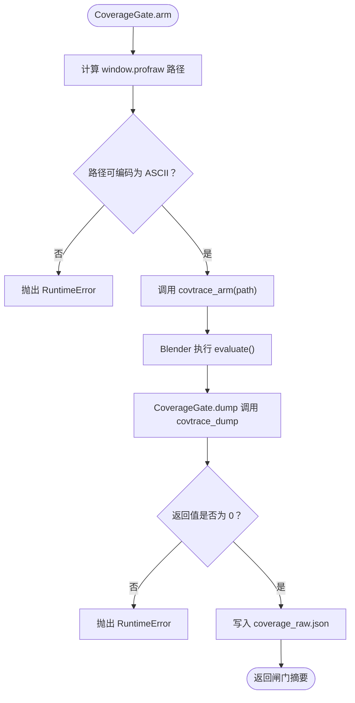
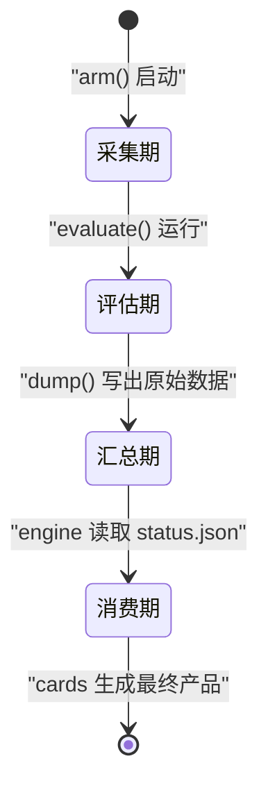
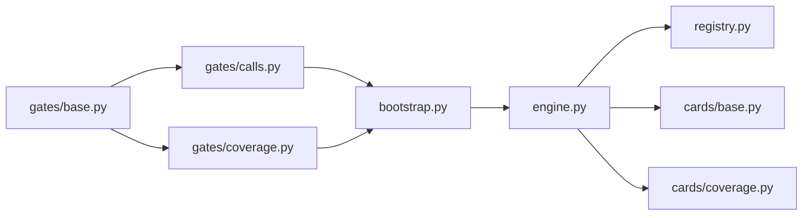

# 数据采集闸门

<cite>
**本文引用的文件**   
- [gates/base.py](file://gates/base.py)
- [gates/calls.py](file://gates/calls.py)
- [gates/coverage.py](file://gates/coverage.py)
- [registry.py](file://registry.py)
- [bootstrap.py](file://bootstrap.py)
- [engine.py](file://engine.py)
- [cards/base.py](file://cards/base.py)
- [cards/coverage.py](file://cards/coverage.py)
</cite>

## 目录
1. [引言](#引言)
2. [项目结构](#项目结构)
3. [核心组件](#核心组件)
4. [架构总览](#架构总览)
5. [详细组件分析](#详细组件分析)
6. [依赖关系分析](#依赖关系分析)
7. [性能考虑](#性能考虑)
8. [故障排查指南](#故障排查指南)
9. [结论](#结论)
10. [附录：新增闸门扩展步骤](#附录新增闸门扩展步骤)

## 引言
本文件面向数据采集 Gate 体系，重点说明 Blender 进程内运行的闸门抽象、calls 与 coverage 两个具体闸门的设计、原始数据生命周期、错误传播到 `status.json` 的方式，以及与后续 cards 的解耦关系。Gate 负责在 Blender 内部采集二进制或源码级覆盖率原始数据；cards 负责在外部引擎中消费这些原始数据并生成最终产物。两者通过 JSON 摘要和 raw 路径约定解耦，避免互相感知实现细节。

## 项目结构
Gate 相关代码集中在 `gates/` 目录下，由 `bootstrap.py` 在 Blender 进程中加载执行，由 `engine.py` 编排运行并持久化状态，再由 `cards/` 中的翻译卡片消费原始数据。

**图表来源**
- [bootstrap.py:1-192](file://bootstrap.py#L1-L192)
- [gates/base.py:1-38](file://gates/base.py#L1-L38)
- [gates/calls.py:1-63](file://gates/calls.py#L1-L63)
- [gates/coverage.py:1-39](file://gates/coverage.py#L1-L39)
- [engine.py:1-200](file://engine.py#L1-L200)
- [registry.py:1-49](file://registry.py#L1-L49)
- [cards/base.py:1-63](file://cards/base.py#L1-L63)
- [cards/coverage.py:1-233](file://cards/coverage.py#L1-L233)

**章节来源**
- [bootstrap.py:1-192](file://bootstrap.py#L1-L192)
- [engine.py:1-200](file://engine.py#L1-L200)
- [registry.py:1-49](file://registry.py#L1-L49)

## 核心组件
- `GateContext`：为闸门提供工作目录访问能力，封装相对路径拼接逻辑，使闸门输出统一落在 work_dir。
- `Gate`：闸门抽象类，定义 `name`、`exports`、`arm(ctx)` 与 `dump(ctx)` 四个关键成员。
- `get_proc(name)`：通过 Windows kernel32 获取当前模块句柄后查找导出函数地址，是 ctypes 调用 covtrace_* 符号的基础。
- `missing_exports(gate)`：检查闸门声明的 exports 是否全部存在，用于启动前诊断缺失导出。

上述组件位于 `gates/base.py`，是所有闸门共享的基础设施。

**章节来源**
- [gates/base.py:1-38](file://gates/base.py#L1-L38)

## 架构总览
Gate 体系分为三层：
1. **Blender 进程层**：由 `bootstrap.py` 打开目标工程、注入被测对象与参数、加载闸门、执行 evaluate、采集原始数据，并将结果写入 `status.json`。
2. **闸门层**：每个闸门实现自己的 arm/dump 流程，通过 ctypes 调用协程追踪导出的 C/C++ 函数，把二进制原始数据写入 work_dir。
3. **卡片层**：由 `engine.py` 在外部进程读取 `status.json` 中的 raw 路径，驱动 cards 消费原始数据并生成最终 JSON 产品。

**图表来源**
- [bootstrap.py:1-192](file://bootstrap.py#L1-L192)
- [gates/base.py:1-38](file://gates/base.py#L1-L38)
- [gates/calls.py:1-63](file://gates/calls.py#L1-L63)
- [gates/coverage.py:1-39](file://gates/coverage.py#L1-L39)
- [engine.py:1-200](file://engine.py#L1-L200)
- [cards/base.py:1-63](file://cards/base.py#L1-L63)

## 详细组件分析

### Gate 抽象层设计
`Gate` 抽象类定义了统一的闸门契约：
- `name`：闸门标识，用于 `status.json` 中的 gates 列表区分不同采集器。
- `exports`：声明该闸门依赖的协程追踪导出符号名称。
- `arm(ctx)`：在 Blender 进程内启用采集，通常设置输出窗口或缓冲区。
- `dump(ctx)`：停止采集并写出原始数据，同时返回包含 `raw` 字段的摘要。

`GateContext` 仅暴露 `work_dir` 和 `path(name)`，避免闸门直接操作绝对路径，从而便于后续缓存重定向与路径重建。

`get_proc` 使用 `ctypes.windll.kernel32` 的 `GetModuleHandleA` 与 `GetProcAddress` 在当前 Blender 进程中解析导出符号。`missing_exports` 基于该函数检查所有声明的 exports 是否可用。

**章节来源**
- [gates/base.py:1-38](file://gates/base.py#L1-L38)

### calls 闸门：函数表、调用边与计时
`CallsGate` 依赖一组 `covtrace_calls_*` 导出符号，包括：
- 启停控制：`covtrace_calls_arm`、`covtrace_calls_reset`、`covtrace_calls_disarm`。
- 数据导出：`covtrace_calls_dump`、`covtrace_calls_dump_edges`、`covtrace_calls_dump_timings`。
- 计数查询：`covtrace_calls_edge_count`、`covtrace_calls_timing_count`。

#### arm 阶段
`arm` 先构造 ctypes 函数包装器，调用 `covtrace_calls_arm` 初始化采集，再调用 `covtrace_calls_reset` 清空历史数据。如果 `arm()` 返回非真值，会抛出运行时错误，阻止后续评估执行。

#### dump 阶段
`dump` 依次调用 disarmed、dump functions/edges/timings，并把三个二进制文件名映射到 `ctx.path` 生成的路径。随后通过 `edge_count` 与 `timing_count` 获取统计信息，写入 `calls.json`，摘要中包含：
- `name`：闸门名称。
- `edge_count`：记录的调用边数量。
- `timing_count`：记录的计时条目数量。
- `raw.functions`、`raw.edges`、`raw.timings`：原始二进制文件路径。

#### 调用边语义
从实现看，`edges.bin` 对应调用边集合，`functions.bin` 对应函数表，`timings.bin` 对应计时采样。虽然文档注释提到 RVA，但当前 `calls.py` 实现没有显式打印或验证 RVA 字段；实际 RVA 或偏移量应由底层 `covtrace_calls_*` 导出符号在二进制格式中编码。上层闸门只负责调用导出接口并写出文件路径。

**图表来源**
- [gates/calls.py:1-63](file://gates/calls.py#L1-L63)

**章节来源**
- [gates/calls.py:1-63](file://gates/calls.py#L1-L63)

### coverage 闸门：配合 LLVM profraw 的源码行覆盖率
`CoverageGate` 依赖 `covtrace_arm` 与 `covtrace_dump` 两个导出符号，用于启用 LLVM 工具链所需的 `.profraw` 覆盖数据收集。

#### arm 阶段
- 从 `ctx.path("window.profraw")` 获取预期输出路径。
- 将路径编码为 ASCII 字节传给 `covtrace_arm`。
- 若路径无法编码为 ASCII，则抛出运行时错误，要求 work_dir 必须使用 ASCII 路径。

#### dump 阶段
- 调用 `covtrace_dump`，其返回值作为退出码。
- 若返回值非零，抛出运行时错误，携带底层返回码。
- 成功后写入 `coverage_raw.json`，摘要包含 `raw.coverage`，指向 `window.profraw`。

#### 与 LLVM 的关系
coverage 闸门本身不解析 `.profraw`，而是交由 `cards/coverage.py` 中的 `CoverageCard` 调用 `LLVM_PROFDATA merge` 与 `LLVM_COV export/show` 等工具，将原始数据转换为最终覆盖率 JSON。

**图表来源**
- [gates/coverage.py:1-39](file://gates/coverage.py#L1-L39)

**章节来源**
- [gates/coverage.py:1-39](file://gates/coverage.py#L1-L39)
- [cards/coverage.py:1-233](file://cards/coverage.py#L1-L233)

### 缺失导出符号的诊断
`bootstrap.py` 在加载闸门后会遍历所有闸门，对每个闸门的 `exports` 调用 `missing_exports`，得到 `(gate.name, export_name)` 对。如果存在缺失项，会抛出 `RuntimeError`，消息包含缺失的闸门名与导出符号名。这样可以在 Blender 进程早期发现链接或构建问题，而不是等到运行时 ctypes 调用失败。

**章节来源**
- [bootstrap.py:1-192](file://bootstrap.py#L1-L192)
- [gates/base.py:1-38](file://gates/base.py#L1-L38)

### 原始数据生命周期
原始数据生命周期分为三个阶段：
1. **采集期**：闸门在 Blender 进程内通过 ctypes 调用底层导出符号，将二进制或原始覆盖率数据写入 `work_dir`。
2. **汇总期**：`bootstrap.py` 收集各闸门摘要，合并 `raw` 字典，并写入 `status.json`。
3. **消费期**：`engine.py` 读取 `status.json`，将 raw 路径交给 cards；cards 根据 `needs` 声明消费所需 raw 键，如 `raw:coverage`。

**图表来源**
- [bootstrap.py:1-192](file://bootstrap.py#L1-L192)
- [engine.py:1-200](file://engine.py#L1-L200)
- [cards/base.py:1-63](file://cards/base.py#L1-L63)

**章节来源**
- [bootstrap.py:1-192](file://bootstrap.py#L1-L192)
- [engine.py:1-200](file://engine.py#L1-L200)
- [cards/base.py:1-63](file://cards/base.py#L1-L63)

### 错误传播到 status.json
`bootstrap.py` 的 `main` 函数使用 try/except 包裹整个采集流程。任何未捕获异常都会写入 `status.json`，字段包括：
- `ok`: false
- `error`: 异常类型名与消息
- `traceback`: 完整回溯字符串

成功路径写入：
- `ok`: true
- `node`、`target`
- `gates`: 各闸门 dump 返回的摘要列表
- `raw`: 各闸门 `raw` 字段的合并结果

此外，`engine.py` 在失败时还会把 work_dir 迁移到带时间戳的 `.failed-*` 目录，并对已存在的 `status.json` 做路径重基处理，便于离线分析与重试。

**章节来源**
- [bootstrap.py:1-192](file://bootstrap.py#L1-L192)
- [engine.py:1-200](file://engine.py#L1-L200)

### 与 cards 的解耦关系
Gate 与 cards 的职责边界清晰：
- Gate 只关心如何在 Blender 进程内触发采集并写出原始数据，不关心原始数据如何被解析。
- Card 只关心如何从 `ctx.raw(key)` 消费原始数据，并通过 `ctx.publish` 写出最终产品。
- 两者通过 `status.json` 中的 `raw` 字典与 card 的 `needs` 字段建立松耦合契约。例如 `CoverageCard.needs = ("raw:coverage",)`，表示它需要 coverage 闸门产出的 `coverage` 原始路径。

这种设计允许新增闸门而不修改现有 cards，也允许新增 cards 而不影响已有闸门。

**章节来源**
- [cards/base.py:1-63](file://cards/base.py#L1-L63)
- [cards/coverage.py:1-233](file://cards/coverage.py#L1-L233)
- [registry.py:1-49](file://registry.py#L1-L49)

## 依赖关系分析

**图表来源**
- [gates/base.py:1-38](file://gates/base.py#L1-L38)
- [gates/calls.py:1-63](file://gates/calls.py#L1-L63)
- [gates/coverage.py:1-39](file://gates/coverage.py#L1-L39)
- [bootstrap.py:1-192](file://bootstrap.py#L1-L192)
- [engine.py:1-200](file://engine.py#L1-L200)
- [registry.py:1-49](file://registry.py#L1-L49)
- [cards/base.py:1-63](file://cards/base.py#L1-L63)
- [cards/coverage.py:1-233](file://cards/coverage.py#L1-L233)

**章节来源**
- [registry.py:1-49](file://registry.py#L1-L49)
- [engine.py:1-200](file://engine.py#L1-L200)

## 性能考虑
- Gate 应在 `arm` 中尽量轻量地启用采集，避免阻塞 Blender 主线程。
- `dump` 应尽快写出原始数据并释放底层资源，因为它是按逆序调用的 finally 清理阶段。
- `calls` 闸门记录函数表、调用边与计时，数据量可能较大，应避免在 Python 层重复解析二进制内容；解析职责交给下游 cards 或外部工具。
- `coverage` 闸门依赖 LLVM 工具链，解析发生在 cards 阶段，因此闸门只需保证 `.profraw` 路径正确且底层返回码为零。

[本节为通用性能建议，不直接分析具体文件]

## 故障排查指南

### 缺失导出符号
症状：Bootstrap 启动时报错，提示 missing exports。
原因：Blender 进程中没有链接到包含 `covtrace_*` 导出符号的目标，或导出名称不一致。
处理：
- 检查闸门声明的 `exports` 是否与底层构建产物一致。
- 查看 bootstrap 抛出的异常消息，确认具体缺失的闸门名与导出符号名。

**章节来源**
- [bootstrap.py:1-192](file://bootstrap.py#L1-L192)
- [gates/base.py:1-38](file://gates/base.py#L1-L38)

### calls 闸门无调用边
症状：`status.json` 中 `calls.edge_count == 0`，或 `functions.bin` 为空。
原因：评估过程未触发被测代码路径，或底层调用追踪未生效。
处理：
- 检查被测对象、修饰器与节点树是否正确加载。
- 确认 `evaluate` 确实调用了包含 covtrace 钩子的代码路径。
- 使用 engine 提供的 `_capture_problem` 诊断逻辑定位空文件或零边计数。

**章节来源**
- [engine.py:1-200](file://engine.py#L1-L200)
- [gates/calls.py:1-63](file://gates/calls.py#L1-L63)

### coverage 原始路径非 ASCII
症状：coverage gate 抛出 RuntimeError，提示 work path must be ASCII。
原因：work_dir 包含非 ASCII 字符。
处理：
- 确保工作目录路径完全由 ASCII 字符组成。
- 检查系统临时目录或用户路径配置。

**章节来源**
- [gates/coverage.py:1-39](file://gates/coverage.py#L1-L39)

### coverage 底层 dump 失败
症状：coverage gate 抛出 RuntimeError，提示 `covtrace_dump failed` 并附带返回码。
原因：底层覆盖率采集器返回非零退出码，常见于 LLVM 工具链不可用或配置错误。
处理：
- 检查 LLVM 工具链安装与路径。
- 确认 `cards/coverage.py` 能正常调用 `LLVM_PROFDATA` 与 `LLVM_COV`。

**章节来源**
- [gates/coverage.py:1-39](file://gates/coverage.py#L1-L39)
- [cards/coverage.py:1-233](file://cards/coverage.py#L1-L233)

### 最终产品缺失
症状：card 构建失败，提示未产出指定产品或未满足 needs。
原因：card 未写入 `publish` 路径，或上游 raw 数据缺失。
处理：
- 检查 card 的 `needs` 与 `ctx.raw(key)` 调用。
- 检查 `ctx.publish` 输出的文件是否存在。

**章节来源**
- [cards/base.py:1-63](file://cards/base.py#L1-L63)
- [engine.py:1-200](file://engine.py#L1-L200)

## 结论
Gate 体系通过 `GateContext` 与 `Gate` 抽象将 Blender 进程内的数据采集与外部引擎解耦。`calls` 闸门负责函数表、调用边与计时原始数据；`coverage` 闸门负责 LLVM `.profraw` 原始数据。两者都通过 ctypes 调用协程追踪导出符号，并由 `bootstrap.py` 统一负责导出检测、错误传播与 `status.json` 写入。cards 通过 `needs` 与 `raw` 路径契约消费原始数据，形成清晰的“采集层”与“解析层”分层架构。

## 附录：新增闸门扩展步骤

### 第一步：继承 Gate 并实现 arm 与 dump
新建闸门类，继承 `Gate`，填写 `name` 与 `exports`。在 `arm` 中启用采集，在 `dump` 中写出原始数据并返回包含 `raw` 字段的摘要。

**参考路径**
- [gates/base.py:1-38](file://gates/base.py#L1-L38)
- [gates/calls.py:1-63](file://gates/calls.py#L1-L63)
- [gates/coverage.py:1-39](file://gates/coverage.py#L1-L39)

### 第二步：通过 get_proc 访问协程追踪导出符号
使用 `get_proc` 获取导出函数地址，再用 ctypes 包装后调用。注意：
- 导出符号必须在 Blender 进程内可见。
- 如果导出缺失，会在 bootstrap 阶段被 `missing_exports` 捕获。

**参考路径**
- [gates/base.py:1-38](file://gates/base.py#L1-L38)
- [bootstrap.py:1-192](file://bootstrap.py#L1-L192)

### 第三步：将闸门加入 registry.py 的 GATES
在 `registry.py` 中将新闸门实例添加到 `GATES` 列表。engine 与 bootstrap 会通过该注册表加载闸门。

**参考路径**
- [registry.py:1-49](file://registry.py#L1-L49)

### 第四步：让卡片消费原始数据
如果需要对外部展示该闸门的产物，新增一个 card：
- 继承 `TranslationCard`。
- 在 `needs` 中声明需要的 raw 键，例如 `"raw:mydata"`。
- 在 `build` 中通过 `ctx.raw("mydata")` 读取路径，并写入 `ctx.publish` 目标。
- 在 `registry.py` 的 `CARDS` 中注册该 card。

**参考路径**
- [cards/base.py:1-63](file://cards/base.py#L1-L63)
- [cards/coverage.py:1-233](file://cards/coverage.py#L1-L233)
- [registry.py:1-49](file://registry.py#L1-L49)

### 第五步：验证原始数据与 status.json
运行评估后检查：
- `status.json` 中 gates 列表是否包含新闸门。
- `status.json` 中 raw 字典是否包含新闸门的 raw 键。
- 若失败，检查 `error` 与 `traceback`，并根据故障排查指南定位问题。

**参考路径**
- [bootstrap.py:1-192](file://bootstrap.py#L1-L192)
- [engine.py:1-200](file://engine.py#L1-L200)