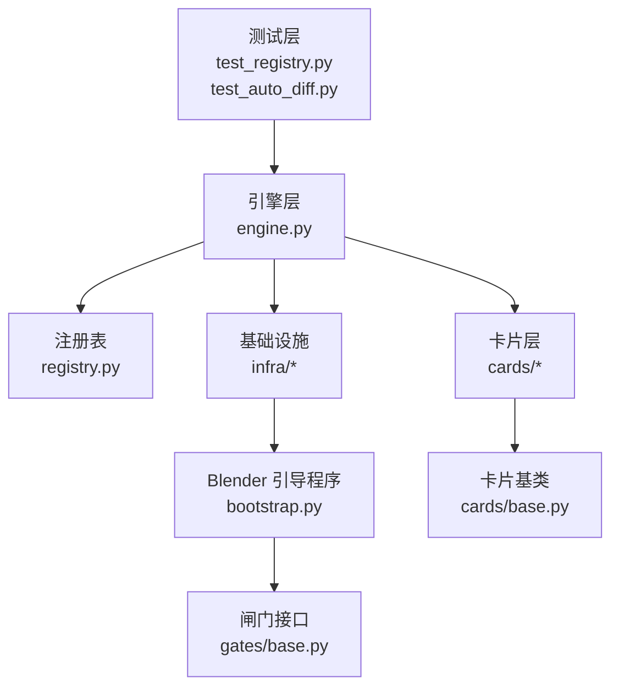
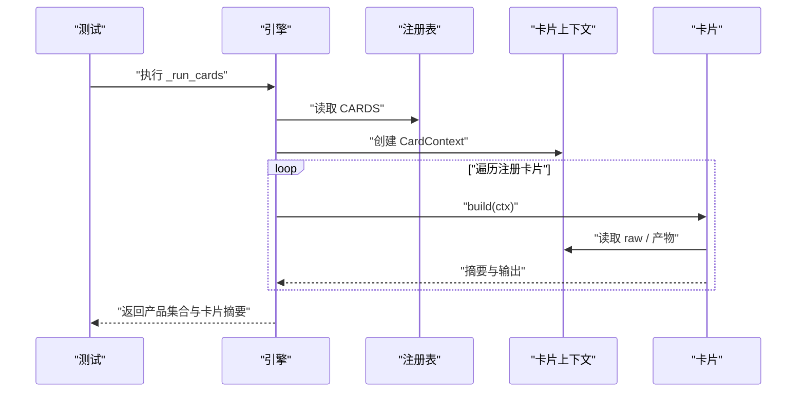
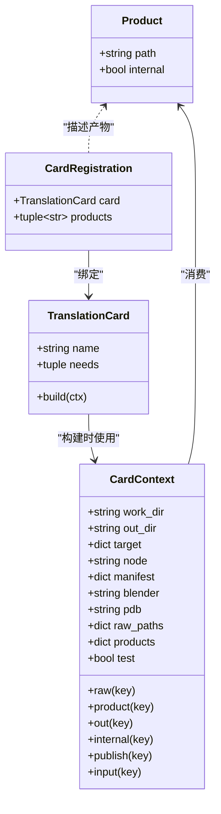
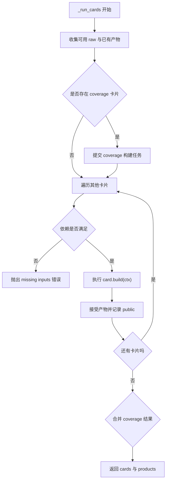
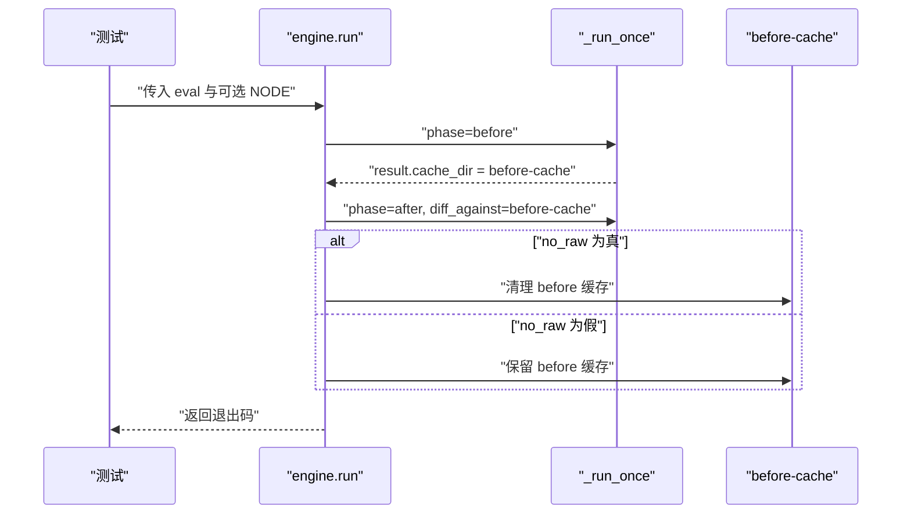
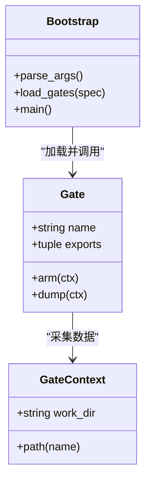
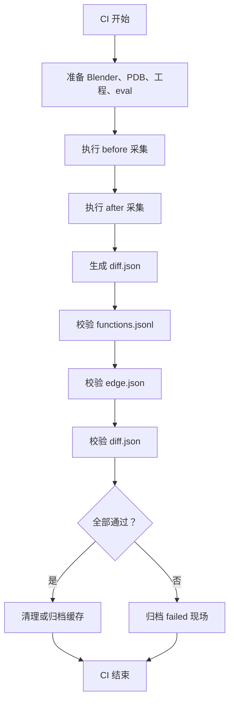

# 测试与质量保障

<cite>
**本文引用的文件**   
- [test_registry.py](file://tests/test_registry.py)
- [test_auto_diff.py](file://tests/test_auto_diff.py)
- [registry.py](file://registry.py)
- [engine.py](file://engine.py)
- [bootstrap.py](file://bootstrap.py)
- [cards/base.py](file://cards/base.py)
- [gates/base.py](file://gates/base.py)
- [infra/blender.py](file://infra/blender.py)
- [infra/manifest.py](file://infra/manifest.py)
- [infra/target.py](file://infra/target.py)
- [directories.py](file://directories.py)
</cite>

## 目录
1. [引言](#引言)
2. [现有测试范围](#现有测试范围)
3. [项目结构与测试入口](#项目结构与测试入口)
4. [架构总览：测试视角](#架构总览测试视角)
5. [详细组件分析](#详细组件分析)
6. [扩充分支测试指南](#扩充分支测试指南)
7. [CI 集成与回归判定](#ci-集成与回归判定)
8. [平台差异处理](#平台差异处理)
9. [性能与稳定性建议](#性能与稳定性建议)
10. [故障排查](#故障排查)
11. [结论](#结论)

## 引言
本文件面向 CovTrace 的测试与质量保障工作，目标是说明现有测试如何覆盖注册表声明、卡片流水线以及 before/after 自动化 diff 流程，并给出后续扩展卡片单元测试、闸门 mock 测试、before/after fixture 设计、CI 回归策略和避免启动真实 Blender 的建议。

CovTrace 的核心运行模型是“引擎 + 卡片”：引擎负责编排工作区、产物路径、失败现场保留和产物发布；卡片根据声明的依赖读取原始数据或逻辑产物，写出新的逻辑产物；闸门在 Blender 内部采集调用、覆盖率等原始数据。测试应围绕这三个层次展开：注册表契约、卡片流水线行为、before/after 生命周期。

## 现有测试范围
当前仓库包含两个测试模块，分别覆盖不同的质量维度。

### `tests/test_registry.py`：注册表与卡片流水线契约
该模块主要验证以下契约：

| 测试目标 | 断言内容 |
|---|---|
| 注册表完整性 | 所有卡片产物的键不重复，且都出现在全局产物映射中。 |
| 产物路径合法性 | 所有注册产物路径不是绝对路径，也不包含 `..` 段。 |
| 上下文路径生成 | `CardContext.out` 与 `publish` 按是否 internal、是否 test 模式输出不同路径。 |
| 逻辑产物消费 | 卡片通过 `needs` 消费前序卡片产物，最终产物写入预期位置。 |
| 测试模式内部产物可见 | test 模式下 internal 产物仍会公开到 `out`。 |
| 缺失依赖中断流水线 | 未满足的 `needs` 会抛出带明确提示的运行时错误。 |
| 未产出产物报错 | 卡片没有写出生效产物时，引擎抛出运行时错误。 |

这些用例直接依赖 `registry.CARDS`、`registry.PRODUCTS`、`engine._run_cards` 和 `cards.base.CardContext`，属于对系统静态声明与执行契约的最小化验证。

**章节来源**
- [test_registry.py:1-135](file://tests/test_registry.py#L1-L135)
- [registry.py:1-49](file://registry.py#L1-L49)
- [cards/base.py:1-63](file://cards/base.py#L1-L63)
- [engine.py:120-200](file://engine.py#L120-L200)

### `tests/test_auto_diff.py`：before/after 自动化 diff 流程
该模块不启动 Blender，而是用 `unittest.mock.patch.object` 替换 `engine._run_once`，验证引擎外层生命周期：

| 测试场景 | 期望行为 |
|---|---|
| 含 `NODE` 的求值脚本 | 先执行 before，再执行 after，并把 before 缓存目录传给 after。 |
| 不含 `NODE` 的求值脚本 | 只执行一次普通采集，不调用 before/after。 |
| dry_run 模式 | 跳过实际采集，只走一次空阶段。 |
| no_raw 模式 | after 完成后清理 before 缓存目录。 |
| before 失败 | 不再执行 after，返回非零退出码。 |

这个测试的重点是“外部编排行为”，而不是 Blender 内部状态或反汇编结果。它保证评估脚本中的 `TARGET` 和可选 `NODE` 能正确驱动引擎分支。

**章节来源**
- [test_auto_diff.py:1-124](file://tests/test_auto_diff.py#L1-L124)
- [engine.py:1-120](file://engine.py#L1-L120)

## 项目结构与测试入口
从测试角度，CovTrace 可划分为四层：

**图表来源**
- [test_registry.py:1-135](file://tests/test_registry.py#L1-L135)
- [test_auto_diff.py:1-124](file://tests/test_auto_diff.py#L1-L124)
- [engine.py:1-200](file://engine.py#L1-L200)
- [registry.py:1-49](file://registry.py#L1-L49)
- [cards/base.py:1-63](file://cards/base.py#L1-L63)
- [gates/base.py:1-38](file://gates/base.py#L1-L38)
- [bootstrap.py:1-192](file://bootstrap.py#L1-L192)

当前测试入口是 Python unittest 标准入口，每个测试文件末尾都有 `if __name__ == "__main__": unittest.main()`。新增测试文件应遵循相同结构，并通过 `unittest.TestCase` 组织用例。

**章节来源**
- [test_registry.py:133-135](file://tests/test_registry.py#L133-L135)
- [test_auto_diff.py:122-124](file://tests/test_auto_diff.py#L122-L124)

## 架构总览：测试视角
从测试角度看，CovTrace 的关键边界如下：

1. **引擎边界**：负责参数解析、Blender 进程启动、工作区管理、卡片调度、产物发布和失败现场保留。
2. **注册表边界**：集中声明产物、卡片实例、闸门列表，是所有卡片消费的单一事实来源。
3. **卡片边界**：基于 `TranslationCard` 接口，依赖 `CardContext` 读写逻辑产物，不应关心 Blender 具体实现。
4. **闸门边界**：在 Blender 内部运行，暴露 `arm` 和 `dump` 接口，向外提供 `raw` 数据。
5. **Bootstrap 边界**：解析 TARGET、加载闸门、执行评估脚本、收集 gates 原始数据并写入 status。

**图表来源**
- [engine.py:120-200](file://engine.py#L120-L200)
- [registry.py:1-49](file://registry.py#L1-L49)
- [cards/base.py:1-63](file://cards/base.py#L1-L63)

## 详细组件分析

### 注册表与产物模型
注册表使用 frozen dataclass 定义产物和卡片注册项：

- `Product(path, internal=False)`：描述逻辑产物键对应的相对路径，以及是否 internal。
- `CardRegistration(card, products)`：绑定一个 `TranslationCard` 与其产出的逻辑产物键。
- `PRODUCTS`：全局产物映射，键名如 `edge`、`disasm`、`coverage`、`timing`、`metrics`、`filter`、`diff`。
- `CARDS`：卡片注册列表，顺序影响执行顺序，尤其是 `coverage` 被特殊处理。
- `GATES`：Blender 侧闸门列表，当前为 `CoverageGate` 和 `CallsGate`。

**图表来源**
- [registry.py:10-49](file://registry.py#L10-L49)
- [cards/base.py:1-63](file://cards/base.py#L1-L63)

关键点：
- 产物键是卡片间通信的抽象键，不是硬编码路径。
- internal 产物默认写入 `_internal` 目录，并在非 test 模式下删除。
- test 模式会把 internal 产物作为公共产物公开，便于测试断言。
- `CardContext.publish` 与 `input` 指向同一位置，使卡片可以通过 `ctx.input(key)` 消费其他卡片产物。

**章节来源**
- [registry.py:1-49](file://registry.py#L1-L49)
- [cards/base.py:1-63](file://cards/base.py#L1-L63)
- [test_registry.py:25-79](file://tests/test_registry.py#L25-L79)

### 引擎与卡片调度
引擎的 `_run_cards` 承担以下职责：

1. 收集已可用的 raw 路径和已接受产物。
2. 识别 coverage 卡片并优先提交线程池任务。
3. 遍历其余卡片，检查依赖、执行 build、接受产物。
4. 汇总卡片摘要和公共产物映射。
5. 将 coverage 结果合并回结果集。

**图表来源**
- [engine.py:120-200](file://engine.py#L120-L200)

需要注意：
- 依赖缺失会立即抛出 `RuntimeError`，且测试已验证调用顺序为空，防止部分执行污染。
- 未产出产物也会抛出 `RuntimeError`，消息中包含卡片名、产物键和路径，便于定位。
- coverage 卡片与其他卡片解耦，避免其阻塞主流水线。

**章节来源**
- [engine.py:120-200](file://engine.py#L120-L200)
- [test_registry.py:81-132](file://tests/test_registry.py#L81-L132)

### Before/After 自动化 Diff 流程
当评估脚本包含 `NODE` 时，引擎会在普通运行之外自动执行 before 和 after 两个阶段：

**图表来源**
- [test_auto_diff.py:24-124](file://tests/test_auto_diff.py#L24-L124)
- [engine.py:1-120](file://engine.py#L1-L120)

断言重点：
- 调用顺序必须是 before 在前、after 在后。
- after 必须收到 before 的缓存目录。
- dry_run 不会触发 before/after。
- no_raw 必须在 after 后清理 before 缓存。
- before 失败时应短路，不再执行 after。

**章节来源**
- [test_auto_diff.py:1-124](file://tests/test_auto_diff.py#L1-L124)

### Blender 与闸门交互
Blender 侧由 `bootstrap.py` 负责打开工程、解析 TARGET、配置边界节点、执行评估脚本、加载闸门并收集原始数据。闸门接口定义在 `gates/base.py`：

| 接口 | 用途 |
|---|---|
| `Gate.name` | 闸门标识。 |
| `Gate.exports` | 需要查找的导出符号列表。 |
| `Gate.arm(ctx)` | 准备采集，例如安装钩子。 |
| `Gate.dump(ctx)` | 输出原始数据，供引擎卡片消费。 |
| `missing_exports(gate)` | 检测未解析的导出符号。 |

**图表来源**
- [gates/base.py:1-38](file://gates/base.py#L1-L38)
- [bootstrap.py:1-192](file://bootstrap.py#L1-L192)

**章节来源**
- [gates/base.py:1-38](file://gates/base.py#L1-L38)
- [bootstrap.py:1-192](file://bootstrap.py#L1-L192)

## 扩充分支测试指南

### 为 `cards/*` 增加单元测试
卡片测试应关注“输入 → 输出”的确定性关系，而不依赖真实 Blender。推荐方式：

1. 构造临时工作区和输出目录。
2. 预写 `ctx.raw(key)` 需要的原始文件或 JSON。
3. 构造 `CardContext`，设置 `products` 映射。
4. 直接调用目标卡片的 `build(ctx)`。
5. 断言产物文件存在、关键字段一致、内部字段符合预期。
6. 对异常路径断言错误消息，而非仅断言异常类型。

断言建议：

| 类别 | 建议 |
|---|---|
| 文件存在性 | 使用 `os.path.isfile` 断言产物路径。 |
| 结构一致性 | 读取产物 JSON/JSONL，断言元数据、主键、字段集合。 |
| 数值稳定性 | 对计数、RVA、时间等数值使用容差或严格相等，取决于数据来源。 |
| 平台无关性 | 不要断言 Windows 绝对路径；应断言相对路径或规范化后的路径。 |
| 失败语义 | 断言错误消息包含关键信息，例如缺失 raw、无效 RVA、空函数表。 |
| 临时目录 | 使用 `tempfile.TemporaryDirectory`，避免测试泄漏。 |

参考现有测试结构：
- 使用 `FakeCard` 模拟卡片行为，注入 `calls` 列表验证执行顺序。
- 使用 `make_context` 统一创建 `CardContext`。
- 使用 `patch.object(registry, "CARDS", ...)` 隔离注册表。

**章节来源**
- [test_registry.py:13-24](file://tests/test_registry.py#L13-L24)
- [test_registry.py:25-48](file://tests/test_registry.py#L25-L48)
- [test_registry.py:49-132](file://tests/test_registry.py#L49-L132)
- [cards/base.py:1-63](file://cards/base.py#L1-L63)

### 为 `gates/*` 增加 Mock Blender 上下文测试
闸门运行在 Blender 内部，但测试可以聚焦于闸门接口契约：

1. 构造 `GateContext(work_dir)`。
2. 使用 `unittest.mock` 替换 `ctypes.windll.kernel32.GetModuleHandleA` 和 `GetProcAddress`，让 `missing_exports` 可控。
3. 断言闸门导出的符号能被正确检测。
4. 对 `arm` 和 `dump` 的行为进行最小断言，例如是否写入预期文件名、是否抛出非法参数错误。
5. 不要依赖真实 Blender 进程；如果需要模拟 Blender API，应使用更高层 mock。

注意：`gates/base.py` 直接使用 `ctypes.windll.kernel32`，因此 Windows 平台 mock 更自然；跨平台测试应屏蔽该平台相关实现或使用条件导入。

**章节来源**
- [gates/base.py:1-38](file://gates/base.py#L1-L38)

### 为 before/after 节点边界增加 Fixture
before/after 的边界逻辑在 `bootstrap.py` 中通过 `--phase`、`--measure-node` 控制。可新增夹具：

| Fixture | 作用 |
|---|---|
| `mock_bootstrap_run` | 替换 `subprocess.run` 或引擎内部的 `_run_once`，返回预设 exit code。 |
| `fake_eval_with_node` | 生成包含 `TARGET` 和 `NODE` 的临时 eval 脚本。 |
| `fake_eval_without_node` | 生成只有 `TARGET` 的临时 eval 脚本。 |
| `before_cache_fixture` | 提供 before 阶段的 `cache_dir` 和必要原始数据。 |
| `diff_input_fixture` | 提供 before 和 after 的 `functions.bin`、`edges.bin` 或 `edge.json`。 |

这些 fixture 应避免真实文件系统竞争，优先使用 `tempfile` 命名空间。

**章节来源**
- [test_auto_diff.py:1-124](file://tests/test_auto_diff.py#L1-L124)
- [bootstrap.py:1-192](file://bootstrap.py#L1-L192)

## CI 集成与回归判定

### 回归数据源
CI 应消费三类核心产物：

| 文件 | 用途 | 回归策略 |
|---|---|---|
| `functions.jsonl` | 函数汇总表，用于筛选、统计和下游工具。 | 校验行数、元数据、主键集合、关键派生字段稳定。 |
| `diff.json` | before/after 的函数与边差异。 | 仅在启用 NODE 时比较；期望为空或已知差异集合。 |
| `edge.json` | 函数调用边图。 | 校验结构、RVA 主键、caller/callee 数量。 |

这些文件对应 registry 中的逻辑产物键：

- `metrics` → `functions.jsonl`
- `diff` → `diff.json`
- `edge` → `edge.json`

**章节来源**
- [registry.py:30-49](file://registry.py#L30-L49)
- [docs/关于card.md:24-45](file://docs/关于card.md#L24-L45)
- [docs/架构.md:293-305](file://docs/架构.md#L293-L305)

### CI 建议流程
1. **准备阶段**：固定 Blender 版本、PDB 版本、Blender 工程、评估脚本。
2. **Before 阶段**：执行一次 before 采集，保存 `before-cache`。
3. **After 阶段**：执行 after 采集，对比 before 缓存，生成 `diff.json`。
4. **产物验证**：
   - 解析 `functions.jsonl`，断言首行 `_meta` 和函数主键集合。
   - 解析 `edge.json`，断言函数数、边数、RVA 主键集合。
   - 解析 `diff.json`，断言新增/删除集合不超过白名单。
5. **失败现场**：如果采集失败，保留 `cache/<node>/<hash8>.failed-*` 目录，上传工件。
6. **清理策略**：成功运行后可按 `DEFAULT_KEEP_CACHE` 清理旧缓存。

[此图为概念流程，不直接映射具体源码]

### 避免直接启动真实 Blender 的优化方案
当前 `infra/blender.py` 通过 `subprocess.run` 启动真实 Blender。测试应尽量避免这种依赖：

| 优化点 | 建议 |
|---|---|
| 引擎外层流程 | 使用 `unittest.mock.patch.object(engine, "_run_once", fake_run)`，如现有 `test_auto_diff.py`。 |
| 卡片行为 | 直接调用 `card.build(ctx)`，不经过引擎完整编排。 |
| 闸门行为 | 使用 mock `GateContext` 和 mock ctypes，不进入 Blender。 |
| Bootstrap 行为 | 如需测试 TARGET 解析，直接调用 `infra.target.load` 和 `merge`。 |
| 产物路径 | 使用 `CardContext` 和 `registry.Product`，确保路径规则不变。 |
| 平台相关代码 | 使用 `pytest.mark.skipif` 或条件导入，避免在非 Windows 环境失败。 |

**章节来源**
- [infra/blender.py:1-39](file://infra/blender.py#L1-L39)
- [test_auto_diff.py:14-22](file://tests/test_auto_diff.py#L14-L22)
- [infra/target.py:1-81](file://infra/target.py#L1-L81)

## 平台差异处理

### PDB 与 dbghelp 反汇编差异
CovTrace 在 Windows 上使用 PDB 和 `dbghelp.dll` 解析 RVA 到函数名、文件、行号。相关风险包括：

- 不同 Blender 构建版本产生不同 PDB。
- 不同编译器或链接器可能改变 RVA。
- `dbghelp` 的符号名称、行号信息可能与构建环境相关。
- `gates/base.py` 使用 `ctypes.windll.kernel32`，属于 Windows 专属实现。

建议策略：

1. **以 run_key 区分平台**：引擎已经通过 Blender 和 PDB 的文件指纹参与 `run_key` 计算，不同平台会产生不同缓存键。
2. **不比较二进制细节**：回归应比较结构化产物（RVA、函数名、边集合），而不是原始二进制。
3. **允许平台白名单**：对 `diff.json` 的新增/删除集合按平台维护白名单。
4. **标记平台敏感测试**：对依赖 Windows API 的用例添加平台跳过标记。
5. **固定 PDB 版本**：CI 中锁定 Blender 和 PDB 的版本哈希，避免上游变化导致误报。
6. **日志辅助**：保留 `pdb` 路径和 manifest，便于失败时判断是否因 PDB 不匹配导致。

**章节来源**
- [infra/manifest.py:43-58](file://infra/manifest.py#L43-L58)
- [infra/runkey.py:20-33](file://infra/runkey.py#L20-L33)
- [cards/symbols.py:48-145](file://cards/symbols.py#L48-L145)
- [gates/base.py:1-38](file://gates/base.py#L1-L38)

## 性能与稳定性建议

### 测试性能
- 卡片单元测试应尽量小，只构造必要的 raw 数据和产物映射。
- 避免在测试中复制大型 Blender 工程或 PDB。
- 使用内存中的临时文件，必要时限制文件大小。
- 并行运行测试时，确保每个用例使用独立临时目录。

### 稳定性
- 对随机性或时间相关输出，使用稳定键或归一化后再比较。
- 对路径比较使用规范路径，避免 Windows `/` 与 `\` 差异。
- 对 JSON 输出使用结构化断言，而不是整文件字符串比较。
- 对失败用例保留 `work_dir` 快照，便于复现。

**章节来源**
- [engine.py:40-119](file://engine.py#L40-L119)

## 故障排查

### 常见错误与定位
| 现象 | 可能原因 | 排查步骤 |
|---|---|---|
| `card did not produce ...` | 卡片没有写入生效产物。 | 检查 `ctx.publish(key)` 路径、internal 标志、test 模式。 |
| `card missing inputs: ...` | 依赖的 raw 或产物未就绪。 | 检查 `needs` 声明和前序卡片是否正确执行。 |
| `raw not found` | 卡片读取了未提供的 raw key。 | 检查 `ctx.raw(key)` 调用和上游 gate dump。 |
| before 成功但 after 失败 | after 阶段缺少 before cache 或 diff 输入。 | 检查 `result.cache_dir` 是否写入，以及 no_raw 是否提前清理。 |
| diff 波动较大 | PDB、Blender 版本或评估对象变化。 | 核对 manifest 中的 blender、pdb、blend、target。 |
| Windows 测试在其他平台失败 | 使用了 `ctypes.windll` 或 Windows 路径假设。 | 添加平台跳过或 mock。 |

### 失败现场保留
引擎的 `_keep_failed` 会在采集失败时将工作目录重命名为 `hash8.failed-timestamp`，并尝试重写 manifest 和 status 中的原始路径。CI 应：

1. 扫描 `cache/<node>/` 下 `.failed-*` 目录。
2. 上传失败现场工件。
3. 打印失败原始路径，方便本地复现。
4. 结合 `DEFAULT_KEEP_CACHE` 控制历史失败目录数量。

**章节来源**
- [engine.py:40-119](file://engine.py#L40-L119)
- [directories.py:1-25](file://directories.py#L1-L25)

## 结论
CovTrace 的测试体系目前覆盖了注册表契约、卡片流水线和 before/after 编排三个关键层面。未来扩展应以“不启动真实 Blender”为原则：

- 卡片测试聚焦逻辑产物与数据结构。
- 闸门测试聚焦接口契约与符号导出检测。
- before/after 测试聚焦引擎生命周期与缓存策略。
- CI 回归以 `functions.jsonl`、`edge.json`、`diff.json` 为核心，并结合 run_key 与平台白名单处理 PDB/dbghelp 差异。
- 失败时保留 cache 现场，提高调试效率。

这样可以在保持回归稳定性的同时，逐步扩大对 `cards/*`、`gates/*` 和边界节点的测试覆盖。