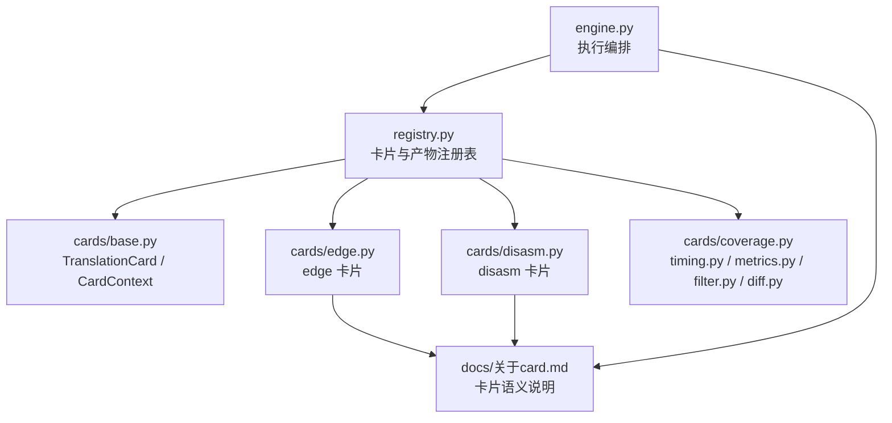
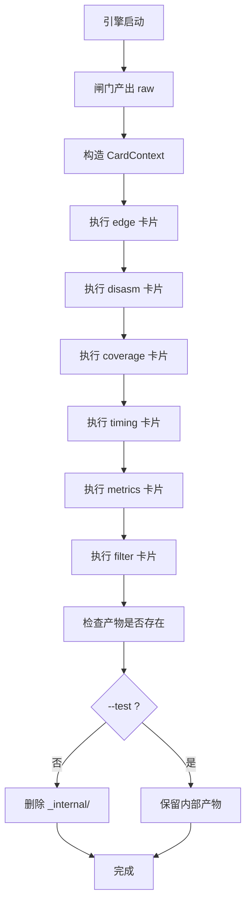
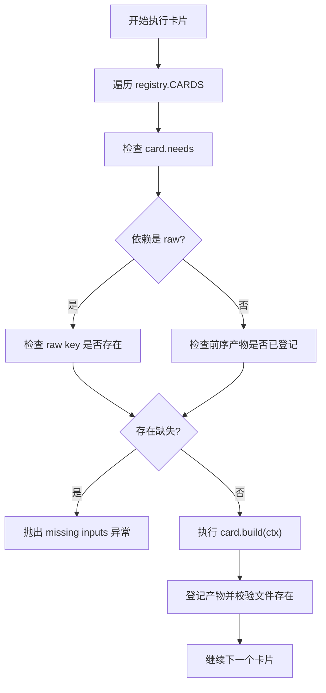

# TranslationCard 接口与 CardContext

<cite>
**本文引用的文件**   
- [cards/base.py](file://cards/base.py)
- [engine.py](file://engine.py)
- [registry.py](file://registry.py)
- [cards/edge.py](file://cards/edge.py)
- [cards/disasm.py](file://cards/disasm.py)
- [docs/关于card.md](file://docs/关于card.md)
- [docs/架构.md](file://docs/架构.md)
</cite>

## 目录
1. [简介](#简介)
2. [项目结构中的卡片位置](#项目结构中的卡片位置)
3. [核心概念：TranslationCard 与 CardContext](#核心概念translationcard-与-cardcontext)
4. [方法签名与返回值约定](#方法签名与返回值约定)
5. [CardContext 属性与生命周期](#cardcontext-属性与生命周期)
6. [产物、输入与内部路径规则](#产物输入与内部路径规则)
7. [依赖模型与执行顺序](#依赖模型与执行顺序)
8. [新增 TranslationCard 的最小实现步骤](#新增translationcard的最小实现步骤)
9. [常见错误与排查](#常见错误与排查)
10. [结论](#结论)

## 简介
本文面向需要为 CovTrace 系统编写翻译卡片的开发者，聚焦以下两个抽象层：

- `TranslationCard`：定义一张卡片的最小契约，包括名称、前序依赖和构建逻辑。
- `CardContext`：引擎在执行卡片时注入的上下文对象，负责读取原始数据、定位输出路径、访问前序产物，以及区分公开产物与内部中间产物。

文档同时解释卡片如何消费前序产物（例如 `edge.json`、`disasm.json`），并说明 `needs` 字段在 `engine.py` 中如何控制执行顺序和缺失输入检查。最后给出最小实现示例和常见错误清单。

## 项目结构中的卡片位置
当前仓库把“翻译卡片”放在 `cards/` 目录下：

- `base.py`：定义 `TranslationCard` 与 `CardContext`。
- `edge.py`、`disasm.py`、`coverage.py`、`timing.py`、`metrics.py`、`filter.py`、`diff.py`：具体卡片实现。
- `registry.py`：集中注册所有卡片与其产物键名。
- `engine.py`：编排闸门、按顺序执行卡片、校验产物并生成最终运行结果。
- `docs/关于card.md`、`docs/架构.md`：补充卡片语义、目录约定与整体数据流。



**图示来源**
- [engine.py:1-60](file://engine.py#L1-L60)
- [registry.py:1-49](file://registry.py#L1-L49)
- [cards/base.py:1-63](file://cards/base.py#L1-L63)
- [cards/edge.py:1-23](file://cards/edge.py#L1-L23)
- [cards/disasm.py:1-60](file://cards/disasm.py#L1-L60)
- [docs/关于card.md:1-70](file://docs/关于card.md#L1-L70)

**章节来源**
- [cards/base.py:1-63](file://cards/base.py#L1-L63)
- [registry.py:1-49](file://registry.py#L1-L49)
- [docs/架构.md:1-120](file://docs/架构.md#L1-L120)

## 核心概念：TranslationCard 与 CardContext

### TranslationCard
`TranslationCard` 是每张翻译卡的基类。它只规定三个关键点：

| 成员 | 类型 | 含义 |
|---|---|---|
| `name` | 字符串 | 卡片名称，用于日志、摘要和调试。 |
| `needs` | 元组 | 卡片依赖的前序输入；可以是 raw key，也可以是其他卡片的产物键名。 |
| `build(ctx)` | 方法 | 接收 `CardContext`，读取输入、写入产物，返回描述本次运行的字典。 |

默认实现中，`build` 会抛出未实现异常，因此子类必须重写该方法。

### CardContext
`CardContext` 由引擎构造并传入每个卡片的 `build` 方法。它封装了工作目录、输出目录、目标信息、Blender 可执行路径、PDB 路径、raw 映射、已登记产品集合以及测试标志。卡片不应直接拼文件名，而应通过 `ctx.raw`、`ctx.product`、`ctx.out`、`ctx.publish`、`ctx.internal`、`ctx.input` 等 API 访问路径。

**章节来源**
- [cards/base.py:1-63](file://cards/base.py#L1-L63)

## 方法签名与返回值约定

### build(ctx) 签名
```python
def build(self, ctx):
    raise NotImplementedError
```

参数：

- `ctx`：`CardContext` 实例。

返回：

- 一个 Python 字典。
- 字典内容供引擎写入运行摘要，例如卡片名、函数数、边数等统计信息。
- 返回值的键名没有严格 schema 约束，但已有卡片通常包含 `name` 和若干计数字段。

注意：

- 返回值不是产物本身；产物是通过 `ctx.out`、`ctx.publish`、`ctx.internal` 写出的文件。
- 如果卡片失败，应抛出异常；引擎会捕获并处理失败现场。
- 如果卡片不需要产生任何文件，仍应返回一个有意义的摘要字典，否则后续 `_accept_card` 可能无法正确判断是否产出。

**章节来源**
- [cards/base.py:58-63](file://cards/base.py#L58-L63)
- [engine.py:120-180](file://engine.py#L120-L180)

## CardContext 属性与生命周期

### 构造参数
`CardContext.__init__` 接收以下参数：

| 参数 | 用途 |
|---|---|
| `work_dir` | 当前卡片的工作目录。 |
| `out_dir` | 当前 run 的输出目录，所有 `out/internal/publish/input` 都基于此目录解析相对路径。 |
| `target` | 求值脚本中的目标信息。 |
| `node` | 节点标识。 |
| `manifest` | 运行清单对象。 |
| `blender` | Blender 可执行文件或二进制路径，常用于反汇编或 PDB 解析。 |
| `pdb` | PDB 文件路径。 |
| `raw` | raw key 到原始文件路径的映射。 |
| `products` | 已登记产品的映射，键名来自 `registry.py` 的 `PRODUCTS`。 |
| `options` | 可选配置字典。 |
| `test` | 是否为测试模式；影响内部产物是否发布。 |

### 常用属性与方法

| 名称 | 行为 | 典型用法 |
|---|---|---|
| `ctx.raw(key)` | 从 raw 映射查找文件路径，不存在则抛 `RuntimeError`。 | 读取 `functions.bin`、`edges.bin`、`window.profraw` 等原始数据。 |
| `ctx.product(key)` | 根据 registry 中的 `Product` 获取产物元信息，找不到则抛 `RuntimeError`。 | 获取产物相对路径与 internal 标记。 |
| `ctx.out(key)` | 返回公开输出路径；内部产物也落盘，但不会被发布。 | 临时写出内部中间文件。 |
| `ctx.internal(key)` | 明确写出内部路径，等价于 `out` 但语义更清晰。 | 写 `_internal/disasm.json`、`_internal/timing.json`。 |
| `ctx.publish(key)` | 根据 `--test` 决定内部产物是否写到顶层公开位置。 | 正式模式下内部产物写 `_internal/`；测试模式下可写顶层。 |
| `ctx.input(key)` | 别名方法，调用 `publish`。 | 读取前序卡片的产物。 |

### 生命周期
1. 引擎先执行 Blender 求值，收集闸门 raw。
2. 引擎按 `registry.CARDS` 的顺序创建 `CardContext` 并调用每个卡片的 `build`。
3. 每个卡片通过 `ctx.out`/`ctx.publish`/`ctx.internal` 写出文件。
4. 引擎检查每个卡片声明的产物是否真实存在。
5. 非测试模式下，引擎删除 `_internal/` 目录；测试模式下保留内部产物。



**图示来源**
- [engine.py:140-200](file://engine.py#L140-L200)
- [docs/关于card.md:40-70](file://docs/关于card.md#L40-L70)
- [docs/架构.md:60-120](file://docs/架构.md#L60-L120)

**章节来源**
- [cards/base.py:10-57](file://cards/base.py#L10-L57)
- [engine.py:120-200](file://engine.py#L120-L200)
- [docs/关于card.md:1-70](file://docs/关于card.md#L1-L70)

## 产物、输入与内部路径规则

### 产物键名与 Product
`registry.py` 用 `PRODUCTS` 统一声明产物键名及其相对路径和 internal 标记：

| 产物键 | 默认路径 | internal | 说明 |
|---|---|---:|---|
| `edge` | `edge.json` | 否 | 公开产物。 |
| `disasm` | `disasm.json` | 是 | 默认内部产物。 |
| `coverage` | `coverage.json` | 否 | 公开产物。 |
| `timing` | `timing.json` | 是 | 默认内部产物。 |
| `metrics` | `functions.jsonl` | 否 | 公开产物。 |
| `filter` | `filter.json` | 否 | 公开产物。 |
| `diff` | `diff.json` | 否 | 对比产物。 |

### 路径选择策略
- `ctx.out(key)`：始终返回 `out_dir` 下的相对路径，不会自动判断是否内部。
- `ctx.internal(key)`：语义上表示内部中间产物；当前实现仍返回 `out_dir` 下路径，但由引擎在结束后清理 `_internal/`。
- `ctx.publish(key)`：若该 product 被标记为 internal 且不是测试模式，则路径会落入 `directories.INTERNAL_DIR`；测试模式则按公开路径发布。
- `ctx.input(key)`：只是 `publish` 的别名，用于表达“读取前序产物”。

### 消费前序产物
卡片可以通过两种方式消费前序数据：

1. **raw 输入**：使用 `ctx.raw("raw:key")` 读取闸门产出的原始二进制或文本文件。
2. **逻辑产物**：使用 `ctx.input("edge")`、`ctx.input("disasm")`、`ctx.input("timing")` 等读取前序卡片生成的 JSON。

例如：

- `EdgeCard` 消费 `raw:functions` 与 `raw:edges`，输出 `edge.json`。
- `DisasmCard` 消费 `raw:functions`、Blender 二进制与 PDB，输出内部 `disasm.json`。
- `metrics` 消费 `disasm.json`、`timing.json` 与 `raw:edges`，输出 `functions.jsonl`。

**章节来源**
- [registry.py:14-49](file://registry.py#L14-L49)
- [cards/base.py:28-57](file://cards/base.py#L28-L57)
- [cards/edge.py:1-23](file://cards/edge.py#L1-L23)
- [cards/disasm.py:1-60](file://cards/disasm.py#L1-L60)
- [docs/关于card.md:1-70](file://docs/关于card.md#L1-L70)

## 依赖模型与执行顺序

### needs 的两种形式
`needs` 支持两类依赖：

| 形式 | 含义 | 示例 |
|---|---|---|
| `raw:key` | 依赖某个闸门 raw 产物。 | `"raw:functions"`、`"raw:edges"` |
| `product_key` | 依赖某个已注册逻辑产物。 | `"edge"`、`"disasm"`、`"timing"` |

### 执行顺序控制
引擎不通过拓扑排序动态调度，而是按 `registry.CARDS` 列表顺序执行：

1. 对每个卡片，引擎检查其 `needs`。
2. 如果是 `raw:` 依赖，检查 raw key 是否在 `ctx.raw_paths` 中。
3. 如果是普通产物依赖，检查该键是否已被之前卡片登记到 `products`。
4. 有缺失依赖则抛出 `RuntimeError`。
5. 正常执行后，把该卡片的所有登记产物加入 `products`。
6. 覆盖率卡片 `coverage` 有特殊并行处理逻辑，但最终仍参与产物校验。



**图示来源**
- [engine.py:120-180](file://engine.py#L120-L180)
- [registry.py:30-49](file://registry.py#L30-L49)

### 实际执行顺序
当前 `registry.CARDS` 的顺序大致为：

1. `edge`
2. `disasm`
3. `coverage`
4. `timing`
5. `metrics`
6. `filter`
7. `diff`

其中 `coverage` 在引擎中有单独提交逻辑，但其余卡片严格按注册顺序串行执行。

**章节来源**
- [engine.py:120-180](file://engine.py#L120-L180)
- [registry.py:30-49](file://registry.py#L30-L49)
- [docs/架构.md:100-160](file://docs/架构.md#L100-L160)

## 新增 TranslationCard 的最小实现步骤

### 第一步：新建卡片模块
在 `cards/` 下新建一个模块，例如 `mycard.py`，继承 `TranslationCard`。

最小实现要点：

- 设置 `name`。
- 设置 `needs`，写明 raw 或前序产物键。
- 实现 `build(ctx)`，读取输入、写出产物、返回摘要字典。

参考现有卡片：

- `EdgeCard` 展示了 raw 输入 + 写出 JSON 的最小写法。
- `DisasmCard` 展示了读取 raw、Blender 二进制、PDB 并写出内部产物的复杂写法。

**章节来源**
- [cards/base.py:58-63](file://cards/base.py#L58-L63)
- [cards/edge.py:1-23](file://cards/edge.py#L1-L23)
- [cards/disasm.py:1-60](file://cards/disasm.py#L1-L60)

### 第二步：声明产物
在 `registry.py` 的 `PRODUCTS` 中添加新产物键，指定相对路径和 internal 标记。

例如：

- 公开产物：`"mymetric": Product("mymetric.json")`
- 内部产物：`"mystats": Product("mystats.json", internal=True)`

### 第三步：注册卡片
在 `registry.py` 的 `CARDS` 列表中追加 `CardRegistration`，并把卡片实例和产物键元组绑定。

例如：

```text
CardRegistration(MyCard(), ("mymetric", "mystats")),
```

注意：

- `products` 必须是元组，包含该卡片负责产出的所有键。
- 引擎会逐个检查这些键对应的文件是否存在。

**章节来源**
- [registry.py:14-49](file://registry.py#L14-L49)

### 第四步：消费前序产物
在 `build(ctx)` 中使用：

- `ctx.raw("raw:key")` 读取原始数据。
- `ctx.input("edge")`、`ctx.input("disasm")`、`ctx.input("timing")` 读取前序 JSON。
- `ctx.out(key)`、`ctx.internal(key)`、`ctx.publish(key)` 写出新产物。
- 如果产物是内部中间数据，优先使用 `ctx.internal(key)` 或 `ctx.publish(key)`，让引擎决定是否清理。

### 第五步：验证执行顺序
确认新卡片的 `needs` 和 `registry.CARDS` 位置满足依赖关系。例如：

- 如果依赖 `edge.json`，则卡片应在 `edge` 之后。
- 如果依赖 `disasm.json`，则卡片应在 `disasm` 之后。
- 如果依赖 `functions.jsonl`，则卡片应在 `metrics` 之后。

**章节来源**
- [engine.py:120-180](file://engine.py#L120-L180)
- [docs/关于card.md:40-70](file://docs/关于card.md#L40-L70)

## 常见错误与排查

### 忘记写 product
现象：

- 卡片成功执行但没有被引擎识别为产出。
- 运行时可能报“卡片未产出某产物”，因为 `_accept_card` 会检查 `registration.products` 中每个键对应的文件是否存在。

排查：

- 确认 `registry.py` 的 `PRODUCTS` 中定义了该键。
- 确认 `CARDS` 中卡片注册的 `products` 包含该键。
- 确认 `build` 确实调用了 `ctx.out`、`ctx.publish` 或 `ctx.internal` 写出对应文件。

相关代码路径：

- [registry.py:14-49](file://registry.py#L14-L49)
- [engine.py:150-180](file://engine.py#L150-L180)

**章节来源**
- [registry.py:14-49](file://registry.py#L14-L49)
- [engine.py:150-180](file://engine.py#L150-L180)

### 误读 internal 路径
现象：

- 在正式模式下读取 `_internal/` 下的中间文件失败。
- 卡片间互相读取内部产物时路径不一致。

原因：

- `ctx.publish(key)` 在非测试模式下会把 internal 产物路由到 `directories.INTERNAL_DIR`。
- `ctx.out(key)` 不自动切换 internal 目录，适合显式写出临时文件。
- `ctx.input(key)` 等价于 `publish`，更适合“消费前序产物”的语义。

建议：

- 写内部中间产物时使用 `ctx.internal(key)` 或 `ctx.publish(key)`。
- 读前序产物时使用 `ctx.input(key)`。
- 不要把硬编码的 `_internal/` 路径混入业务逻辑。

**章节来源**
- [cards/base.py:28-57](file://cards/base.py#L28-L57)
- [engine.py:180-200](file://engine.py#L180-L200)

### 未处理缺失前序产物
现象：

- 运行时报 `card xxx missing inputs`。
- raw key 不在 `available_raw` 中。
- 产物键不在已登记 `products` 中。

原因：

- `needs` 中声明了尚未存在的 raw key。
- `needs` 中引用了尚未执行的产物键。
- 卡片顺序不正确。
- 上游卡片没有注册对应产物。

排查：

- 检查 `needs` 是否写错 raw key 或产物键。
- 检查 `registry.CARDS` 顺序。
- 检查上游卡片是否正确写出并注册产物。

**章节来源**
- [engine.py:120-180](file://engine.py#L120-L180)
- [registry.py:30-49](file://registry.py#L30-L49)

### 误用 ctx.product 与 ctx.input
区别：

- `ctx.product(key)` 只返回 `Product(path, internal)`，不拼接 `out_dir`。
- `ctx.input(key)` 返回完整路径，并根据 internal 与 test 模式选择目录。
- 如果直接拿 `ctx.product(key).path` 当绝对路径，会在多节点或多 run 场景出错。

建议：

- 读取完整文件路径时用 `ctx.input`、`ctx.out`、`ctx.publish`、`ctx.internal`。
- 只有需要知道相对路径或 internal 标记时才用 `ctx.product`。

**章节来源**
- [cards/base.py:28-57](file://cards/base.py#L28-L57)

### 混淆 raw 与逻辑产物
- `raw:functions`、`raw:edges`、`raw:coverage`、`raw:timings` 是闸门原始数据。
- `edge`、`disasm`、`timing`、`metrics`、`filter`、`diff`、`coverage` 是逻辑产物键。
- 不要把 raw key 直接当成产物键传给 `ctx.input`。

**章节来源**
- [docs/关于card.md:1-40](file://docs/关于card.md#L1-L40)
- [registry.py:14-49](file://registry.py#L14-L49)

## 结论
`TranslationCard` 是一个极简抽象：只需提供名称、依赖和构建逻辑。真正的工程能力集中在 `CardContext` 和 `registry.py` 的产物注册表中。开发新卡片时，应遵循以下原则：

1. 只在 `build` 中读写文件，不关心底层路径细节。
2. 通过 `ctx.raw` 读取闸门 raw，通过 `ctx.input` 消费前序逻辑产物。
3. 通过 `ctx.out`、`ctx.publish`、`ctx.internal` 写出产物，并使用 `registry.py` 统一声明。
4. 在 `needs` 中声明 raw 或产物依赖，并在 `registry.CARDS` 中保证正确顺序。
5. 避免硬编码 `_internal/` 路径，避免忽略缺失前序产物和未注册产物的情况。

这样，新增卡片可以保持低耦合、高内聚，并与现有 edge、disasm、coverage、timing、metrics、filter、diff 等卡片协同工作。