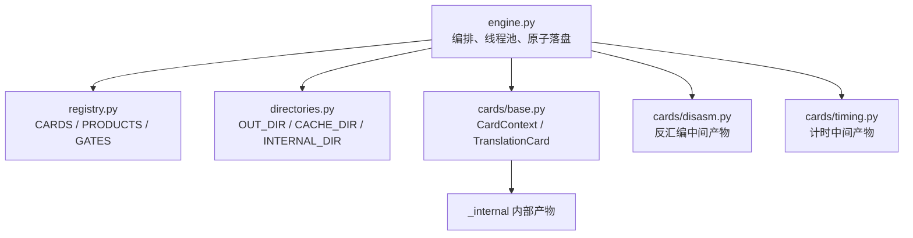
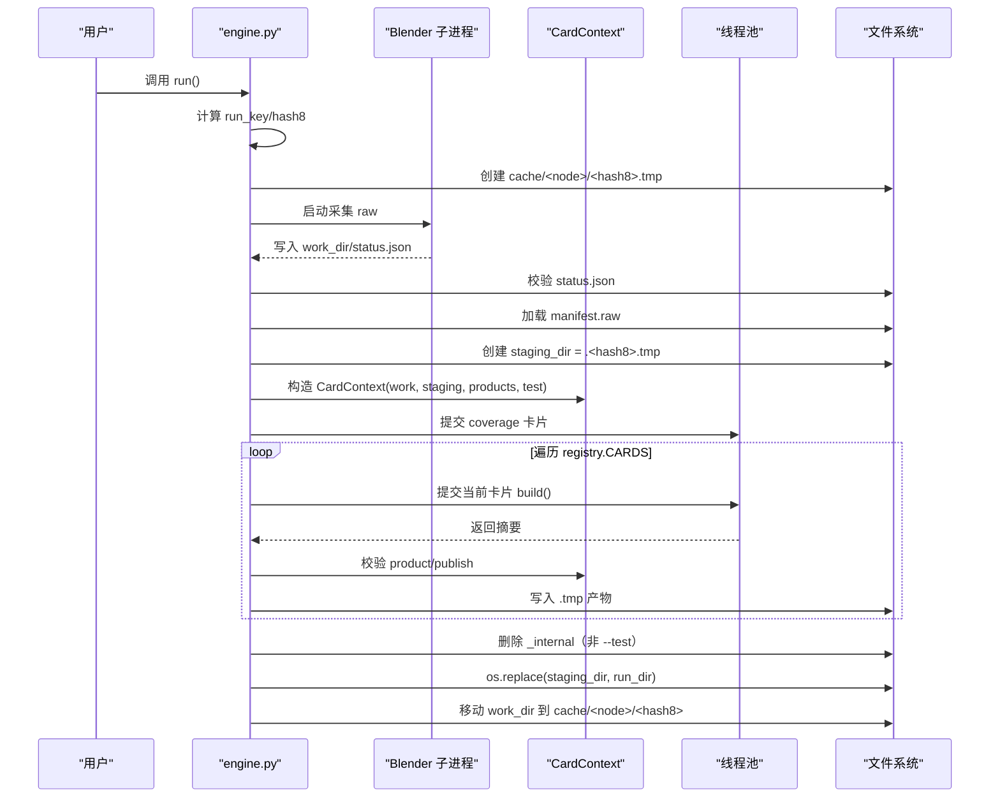
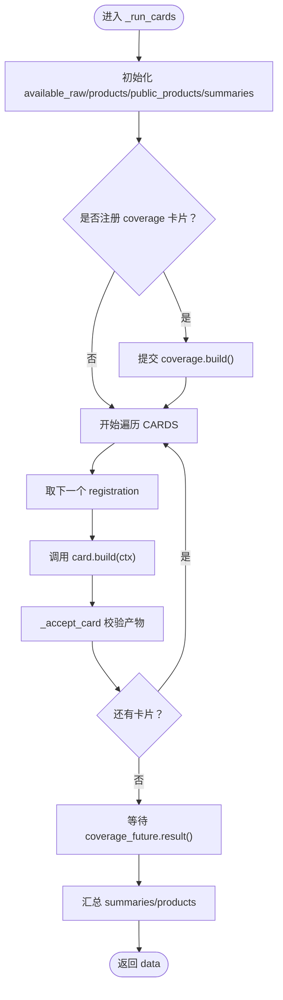
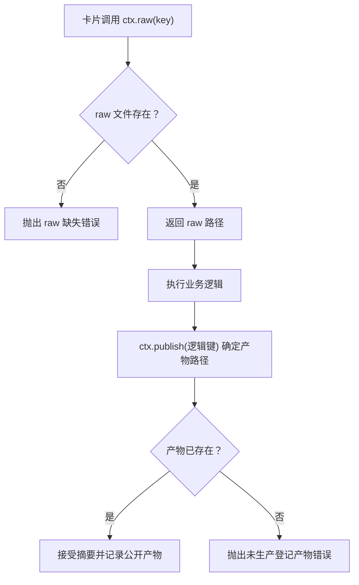
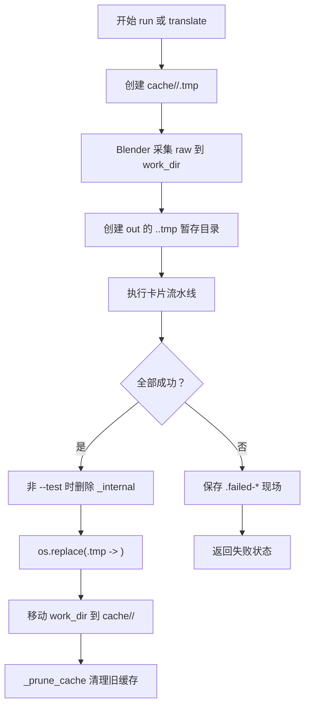
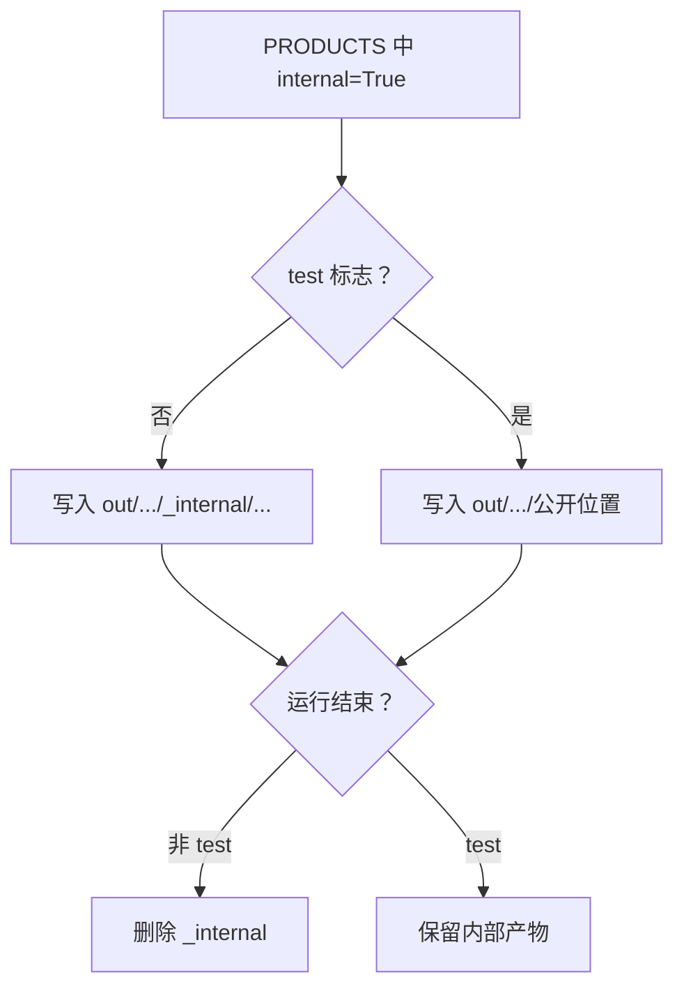
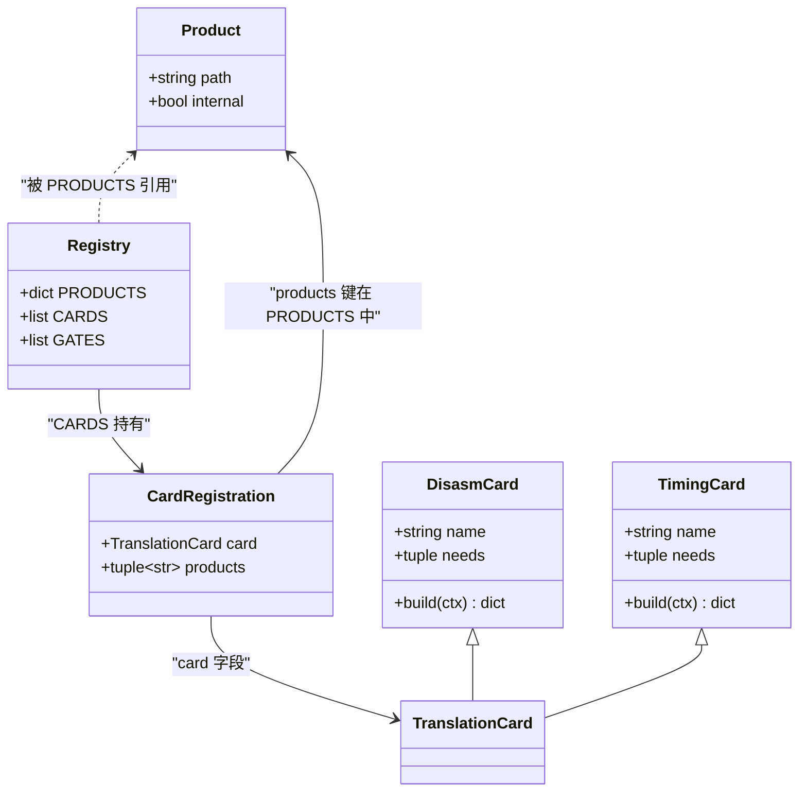
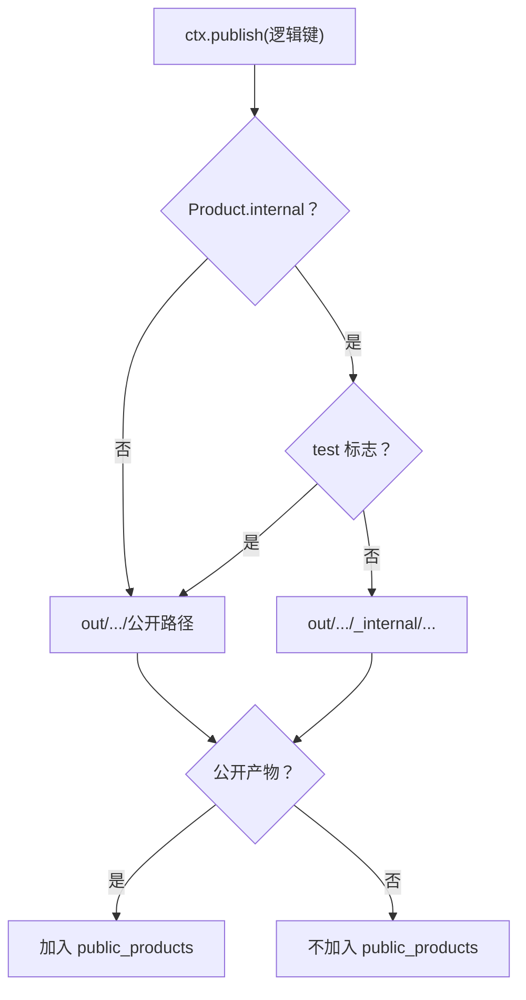
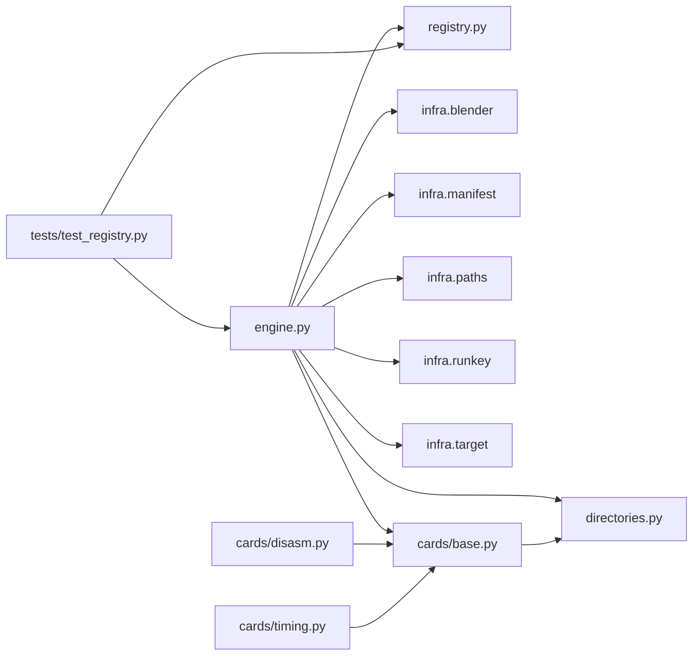

# 卡片流水线执行与产物管理

<cite>
**本文引用的文件**   
- [engine.py](file://engine.py)
- [directories.py](file://directories.py)
- [registry.py](file://registry.py)
- [cards/base.py](file://cards/base.py)
- [cards/disasm.py](file://cards/disasm.py)
- [cards/timing.py](file://cards/timing.py)
- [tests/test_registry.py](file://tests/test_registry.py)
- [docs/架构.md](file://docs/架构.md)
</cite>

## 目录
1. [引言](#引言)
2. [项目结构](#项目结构)
3. [核心组件](#核心组件)
4. [架构总览](#架构总览)
5. [详细组件分析](#详细组件分析)
6. [依赖关系分析](#依赖关系分析)
7. [性能注意事项](#性能注意事项)
8. [故障排查指南](#故障排查指南)
9. [扩展新卡片的完整清单](#扩展新卡片的完整清单)
10. [结论](#结论)

## 引言
本文围绕 CovTrace 的“卡片流水线”解释执行流程、产物路径规则与并发安全，重点说明：
- `engine.py` 如何按注册表固定顺序调度卡片线程池。
- 如何读取 `input/raw`、跳过已存在产物、原子写入 `.tmp` 后重命名。
- `directories.py` 中 `out/cache/_internal` 的路径语义。
- `registry.py` 中 `CardRegistration`、`PRODUCTS`、`CARDS` 的注册规范。
- 新增卡片时必须同步更新注册表的约束。
- 并发下避免外部重型进程、复用数据、处理文件竞争。

## 项目结构
CovTrace 的核心由四层组成：
- 引擎层：`engine.py` 负责编排运行、构建上下文、调度卡片、落盘与缓存清理。
- 目录与工具层：`directories.py` 集中定义输出根目录、缓存根目录、内部产物子目录名 `_internal` 以及 Blender、LLVM、Graphviz 等工具路径。
- 注册表层：`registry.py` 声明产品映射 `PRODUCTS`、卡片实例列表 `CARDS`、闸门列表 `GATES`。
- 卡片层：`cards/` 下的每个模块实现一个 `TranslationCard`，只消费逻辑产物键，不直接决定公开路径。

**图示来源**
- [engine.py:1-40](file://engine.py#L1-L40)
- [directories.py:1-25](file://directories.py#L1-L25)
- [registry.py:1-49](file://registry.py#L1-L49)
- [cards/base.py:1-63](file://cards/base.py#L1-L63)
- [cards/disasm.py:1-60](file://cards/disasm.py#L1-L60)
- [cards/timing.py:1-40](file://cards/timing.py#L1-L40)

**章节来源**
- [docs/架构.md:1-80](file://docs/架构.md#L1-L80)

## 核心组件
- **引擎**：解析参数、校验求值脚本与目标、计算 run key 和 hash8、启动 Blender 采集 raw、构造 `CardContext`、按固定顺序执行卡片、写 manifest、最终把暂存目录原子替换为 `out/<node>/<hash8>`。
- **目录常量**：统一提供 `OUT_DIR`、`CACHE_DIR`、`INTERNAL_DIR="_internal"`，并包含 Blender、LLVM、Graphviz 可执行文件路径。
- **注册表**：用 frozen dataclass 定义 `Product` 和 `CardRegistration`；`PRODUCTS` 是逻辑键到物理相对路径及是否内部的映射；`CARDS` 是卡片实例与其产出的逻辑键元组的有序列表。
- **卡片上下文**：`CardContext` 暴露 `raw`、`product`、`out`、`internal`、`publish`、`input` 等能力，使卡片只操作逻辑键而不关心具体文件位置。

**章节来源**
- [engine.py:1-40](file://engine.py#L1-L40)
- [directories.py:1-25](file://directories.py#L1-L25)
- [registry.py:1-49](file://registry.py#L1-L49)
- [cards/base.py:1-63](file://cards/base.py#L1-L63)

## 架构总览
下图描述一次 `run` 命令的主流程：从求值脚本到 raw 采集，再到卡片流水线与最终产物落盘。

**图示来源**
- [engine.py:201-360](file://engine.py#L201-L360)
- [engine.py:360-562](file://engine.py#L360-L562)
- [cards/base.py:1-63](file://cards/base.py#L1-L63)

## 详细组件分析

### 卡片线程池执行流程
`engine._run_cards` 是流水线调度核心：
- 维护 `available_raw`、`products`、`public_products`、`summaries`。
- 先查找 `coverage` 卡片并提前提交到线程池。
- 然后按 `registry.CARDS` 的顺序依次提交每个卡片。
- 使用 `ThreadPoolExecutor(max_workers=1)`，因此尽管使用线程池 API，实际仍是串行执行。
- 所有卡片提交完成后，再等待 `coverage_future.result()`，确保 coverage 在所有其他卡片之后完成。
- 每次 `build` 返回摘要后，通过 `_accept_card` 校验该卡片必须产出其注册的逻辑产物，并把公开产物写入 `public_products`。

**图示来源**
- [engine.py:100-160](file://engine.py#L100-L160)

**章节来源**
- [engine.py:100-160](file://engine.py#L100-L160)

### 输入读取与已存在产物跳过
- 卡片通过 `ctx.raw(key)` 读取 raw 输入。若 raw 不存在或文件缺失，会抛出运行时错误。
- `ctx.input(key)` 等价于 `ctx.publish(key)`，即卡片读取前序产物时，也遵循同一套路径规则。
- 对“已存在的 product”，引擎并非在 `build` 内部判断；而是通过 `_accept_card` 检查 `ctx.publish(key)` 对应文件是否存在。如果卡片没有产出，会抛出“未生产登记产物”的错误。
- 对于 raw 的重复运行，`_run_once` 使用 `manifest.classify(run_dir, key)` 区分 duplicate/conflict/incomplete，并在非 `--force` 情况下直接报错，从而避免覆盖已有结果。

**图示来源**
- [cards/base.py:12-38](file://cards/base.py#L12-L38)
- [engine.py:60-99](file://engine.py#L60-L99)

**章节来源**
- [cards/base.py:12-38](file://cards/base.py#L12-L38)
- [engine.py:60-99](file://engine.py#L60-L99)
- [engine.py:240-360](file://engine.py#L240-L360)

### 原子写入与重命名策略
- 正式输出目录 `run_dir` 是 `out/<node>/<hash8>`。
- 卡片阶段先把产物写到临时目录 `staging_dir`，即 `.<hash8>.tmp`。
- 全部卡片成功后，调用 `_finalize_out`，内部使用 `os.replace(staging_dir, run_dir)` 做原子替换。
- 如果失败，捕获异常后删除 `staging_dir`，并把 `work_dir` 保留为 `<hash8>.failed-时间戳` 现场。
- raw 缓存目录 `cache_dir` 是 `cache/<node>/<hash8>`，成功时工作目录会被移动到该位置，并由 `_prune_cache` 按最近修改时间裁剪。

**图示来源**
- [engine.py:201-210](file://engine.py#L201-L210)
- [engine.py:240-360](file://engine.py#L240-L360)
- [engine.py:20-59](file://engine.py#L20-L59)

**章节来源**
- [engine.py:20-59](file://engine.py#L20-L59)
- [engine.py:201-210](file://engine.py#L201-L210)
- [engine.py:240-360](file://engine.py#L240-L360)

### directories.py 中 `_internal` 的路径规则
- `INTERNAL_DIR = "_internal"` 是内部产物子目录名称。
- `out` 根目录是 `OUT_DIR`，`cache` 根目录是 `CACHE_DIR`。
- 当 `Product.internal=True` 且 `CardContext.test=False` 时，`ctx.publish(key)` 会把相对路径放到 `out/<node>/<hash8>/_internal/...`。
- 当 `test=True` 时，内部产物被当作公开产物，路径回到 `out/<node>/<hash8>/...`。
- 非测试模式下，引擎在全部卡片完成后调用 `_drop_internal`，删除 `staging_dir/_internal`，避免污染最终公开产物。

**图示来源**
- [directories.py:1-25](file://directories.py#L1-L25)
- [cards/base.py:22-38](file://cards/base.py#L22-L38)
- [engine.py:160-170](file://engine.py#L160-L170)

**章节来源**
- [directories.py:1-25](file://directories.py#L1-L25)
- [cards/base.py:22-38](file://cards/base.py#L22-L38)
- [engine.py:160-170](file://engine.py#L160-L170)

### registry.py 中的注册规范
`registry.py` 定义了三个关键概念：
- `Product(path, internal=False)`：描述逻辑产物键对应的相对路径及是否内部产物。
- `CardRegistration(card, products)`：绑定卡片实例及其产出的逻辑键元组。
- `PRODUCTS`：全局逻辑键到 `Product` 的映射，例如 `edge`、`disasm`、`coverage`、`timing`、`metrics`、`filter`、`diff`。
- `CARDS`：按固定顺序排列的卡片注册列表，顺序即为流水线调度顺序。

当前默认顺序是：
1. edge
2. disasm
3. coverage
4. timing
5. metrics
6. filter
7. diff

其中 `disasm` 和 `timing` 的 `Product` 标记为 `internal=True`，因此默认进入 `_internal`，只有 `--test` 才公开。

**图示来源**
- [registry.py:1-49](file://registry.py#L1-L49)
- [cards/base.py:40-63](file://cards/base.py#L40-L63)

**章节来源**
- [registry.py:1-49](file://registry.py#L1-L49)
- [cards/base.py:40-63](file://cards/base.py#L40-L63)

### disasm 与 timing 的内部产物语义
- `cards/disasm.DisasmCard` 需要 `raw:functions`，用于解析 PE 符号、反汇编函数体并生成 `disasm.json`。
- `cards/timing.TimingCard` 读取 `raw:timings`，若缺失则返回 `skipped` 摘要，不会阻塞后续卡片。
- 两者在 `registry.PRODUCTS` 中都被标记为 `internal=True`，因此默认写入 `_internal`。
- 在 `--test` 模式下，`CardContext.publish` 把内部产物视为公开产物，并保留到最终 `out/<node>/<hash8>`。

**章节来源**
- [cards/disasm.py:1-60](file://cards/disasm.py#L1-L60)
- [cards/timing.py:1-108](file://cards/timing.py#L1-L108)
- [registry.py:17-49](file://registry.py#L17-L49)

### --test 标志如何改变公开产物策略
- `CardContext.__init__` 接收 `test` 参数。
- `publish(key)` 根据 `product.internal and not self.test` 决定路径：
  - 非测试模式：内部产物走 `_internal`。
  - 测试模式：内部产物走公开位置。
- `_accept_card` 中，只有非内部产物或 `ctx.test` 为真时，才会把产物加入 `public_products`。
- 测试模式下，引擎也不会删除 `_internal`，因为 `_drop_internal` 只在非测试模式生效。

**图示来源**
- [cards/base.py:22-38](file://cards/base.py#L22-L38)
- [engine.py:60-99](file://engine.py#L60-L99)
- [engine.py:160-170](file://engine.py#L160-L170)

**章节来源**
- [cards/base.py:22-38](file://cards/base.py#L22-L38)
- [engine.py:60-99](file://engine.py#L60-L99)
- [engine.py:160-170](file://engine.py#L160-L170)

## 依赖关系分析
- `engine.py` 依赖 `directories`、`registry`、`infra.blender`、`infra.manifest`、`infra.paths`、`infra.runkey`、`infra.target`。
- `engine.py` 通过 `registry.CARDS` 控制调度顺序，通过 `registry.PRODUCTS` 控制产物路径。
- `cards/base.py` 依赖 `directories.INTERNAL_DIR` 来决定内部产物子目录。
- `cards/disasm.py`、`cards/timing.py` 是具体卡片实现，依赖 `symbols` 辅助解析二进制信息。
- 单元测试 `tests/test_registry.py` 验证了注册完整性、上下文路径行为、逻辑产物消费、测试模式发布行为以及缺失依赖时的错误路径。

**图示来源**
- [engine.py:1-40](file://engine.py#L1-L40)
- [cards/base.py:1-63](file://cards/base.py#L1-L63)
- [tests/test_registry.py:1-135](file://tests/test_registry.py#L1-L135)

**章节来源**
- [engine.py:1-40](file://engine.py#L1-L40)
- [tests/test_registry.py:1-135](file://tests/test_registry.py#L1-L135)

## 性能注意事项
1. **避免在 `build` 中启动重型外部进程**  
   卡片在单线程池中串行执行。若在 `build` 内启动 Blender、LLVM、capstone 重型子进程，会显著拖慢整条流水线。应优先在宿主侧预处理数据，或在卡片内部只做轻量解析与 JSON 序列化。

2. **尽量复用已加载数据**  
   `cards/disasm.py` 已经打开 Blender 二进制并解析 PE section，同时复用 capstone 解码器与 runtime 名称缓存；`cards/timing.py` 一次性读取 `timings.bin` 并按频率换算纳秒。新增卡片应遵循同样模式：减少重复 I/O、避免重复解析 PDB/PE/symbols。

3. **正确处理并发线程下的文件竞争**  
   虽然当前 `ThreadPoolExecutor(max_workers=1)` 保证卡片串行，但代码仍使用线程池 API。未来若改为并行，必须确保：
   - 不同卡片不写入相同逻辑键。
   - 同一路径写操作通过 `.tmp` 原子替换完成。
   - 共享外部资源（如 capstone、PDB 解析器）有正确加锁或隔离。
   - 不要假设 `registry.CARDS` 的顺序等于线程提交顺序；当前依赖显式循环顺序与单 worker 保证。

4. **raw 与缓存生命周期**  
   成功运行后，`work_dir` 会被移动到 `cache/<node>/<hash8>`，并通过 `_prune_cache` 按最近修改时间裁剪。若使用 `--no-raw`，则在卡片成功后删除 raw，减少磁盘占用。

5. **跳过已存在产物不等于跳过 build**  
   引擎在 `_accept_card` 中检查 `ctx.publish(key)` 是否已存在；但 `card.build(ctx)` 会在检查前被调用。若 `build` 有副作用或昂贵成本，应在卡片内部自行检测输入与产物，避免无意义计算。

[本节为通用性能建议，不直接分析特定代码片段]

## 故障排查指南
常见错误与定位方式：

| 现象 | 可能原因 | 排查步骤 |
|---|---|---|
| “raw ... not found” | 求值阶段未导出所需 raw，或 raw 路径无效 | 检查 `status.json` 中的 `raw` 字段，确认对应文件存在 |
| “unregistered product ...” | 卡片使用了未在 `PRODUCTS` 登记的逻辑键 | 检查 `registry.PRODUCTS` 与卡片 `needs` |
| “missing inputs” | 卡片 `needs` 指定的 raw 或前序产物缺失 | 检查上游卡片是否成功、`PRODUCTS` 是否匹配 |
| “did not produce ...” | 卡片未写入其登记产物 | 检查 `ctx.publish(...)` 路径是否写入 |
| “采集失败” | Blender 子进程未生成成功 `status.json` | 查看 `work_dir` 中的 `status.json` 和 `error` 字段 |
| “采集结果异常” | calls 或 coverage raw 为空 | 检查 `functions.bin`、`window.profraw` 是否有效 |
| “你要的东西已经跑过了” | 已有完整 `run_dir` 且未传 `--force` | 使用 `--force` 覆盖或更换 node/hash |
| 内部产物未出现在 `out/<node>/<hash8>` | 非 `--test` 模式下内部产物默认进 `_internal` 并被删除 | 使用 `--test` 保留内部产物 |

**章节来源**
- [engine.py:60-99](file://engine.py#L60-L99)
- [engine.py:240-360](file://engine.py#L240-L360)
- [cards/base.py:12-38](file://cards/base.py#L12-L38)

## 扩展新卡片的完整清单
新增一张卡片时，请按以下清单逐项确认：

1. **实现卡片模块**
   - 新建 `cards/xxx.py`。
   - 继承 `TranslationCard`。
   - 设置 `name` 与 `needs`。
   - 实现 `build(self, ctx)`，返回包含 `name` 的摘要字典。
   - 通过 `ctx.publish("xxx")` 写入产物，而不是直接拼接路径。

2. **登记产物**
   - 在 `registry.PRODUCTS` 中添加逻辑键到 `Product` 的映射。
   - 如果产物是调试中间产物，设置 `internal=True`。
   - 如果产物需要公开，保持 `internal=False`。

3. **登记卡片**
   - 在 `registry.CARDS` 末尾添加 `CardRegistration(XxxCard(), ("xxx",))`。
   - 确认 `CARDS` 顺序符合依赖关系。
   - 确认 `XxxCard().needs` 指向的 raw 或前序产物键存在于 `PRODUCTS` 或上游卡片。

4. **验证路径规则**
   - 如果产物是内部产物，确认非 `--test` 时写入 `_internal`。
   - 如果产物需要公开，确认 `--test` 能正确发布到顶层。
   - 使用 `tests/test_registry.py` 的思路编写或补充测试：
     - 注册键唯一。
     - 产物路径相对且不越级。
     - 测试模式能改变内部产物发布行为。
     - 缺失依赖会抛出预期错误。

5. **并发与安全**
   - 确保新卡片不会与其他卡片写入相同路径。
   - 如果卡片需要外部进程，评估是否影响单线程流水线的整体吞吐。
   - 如需并行化，必须引入明确的任务图与锁机制，不能仅依赖 `CARDS` 列表顺序。

6. **文档与维护**
   - 在 `docs/架构.md` 或相关文档中说明新卡片的输入、输出与依赖。
   - 更新 README 或变更日志，记录新增卡片与行为变化。
   - 若改变默认顺序，需评估下游 `metrics`、`filter`、`diff` 等卡片是否受影响。

**章节来源**
- [registry.py:1-49](file://registry.py#L1-L49)
- [cards/base.py:40-63](file://cards/base.py#L40-L63)
- [tests/test_registry.py:1-135](file://tests/test_registry.py#L1-L135)
- [docs/架构.md:80-200](file://docs/架构.md#L80-L200)

## 结论
CovTrace 的卡片流水线以 `registry.py` 为唯一事实源：`PRODUCTS` 定义产物语义，`CARDS` 定义执行顺序。`engine.py` 通过单 worker 线程池按固定顺序调度卡片，配合 `CardContext` 将逻辑键与物理路径解耦；内部产物默认进入 `_internal`，`--test` 可将其提升为公开产物；最终通过 `.tmp` 原子重命名保证输出一致性。新增卡片必须同步更新 `PRODUCTS` 与 `CARDS`，并遵循“读 raw、写 publish、不直接拼路径”的契约，才能在现有架构下可靠扩展。