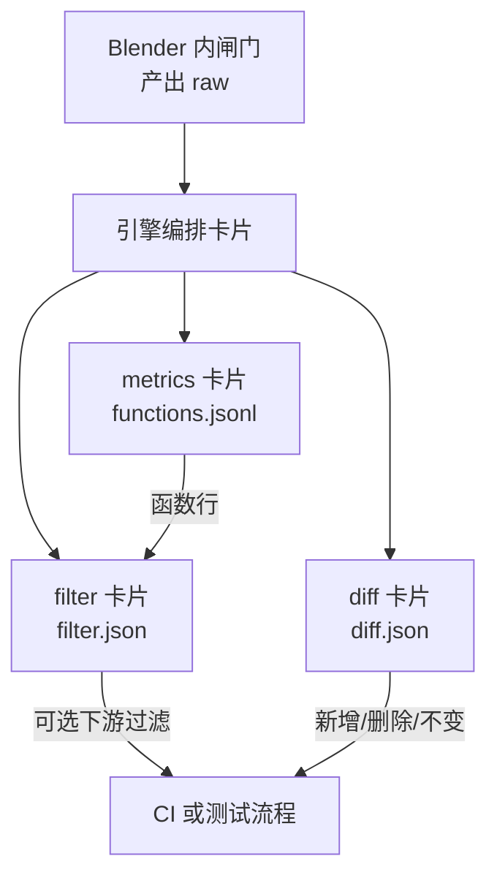
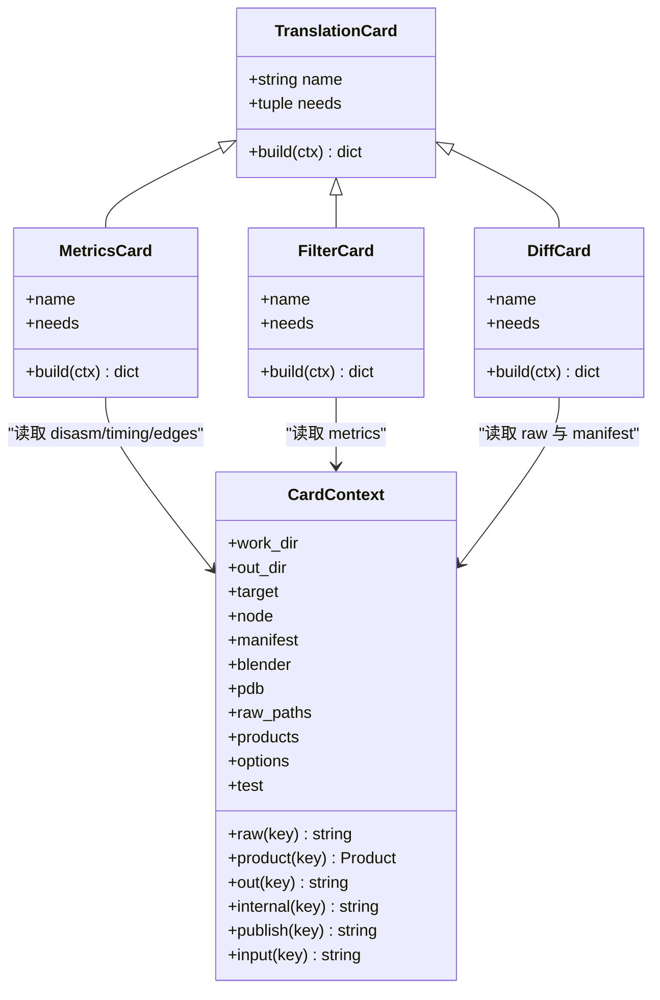
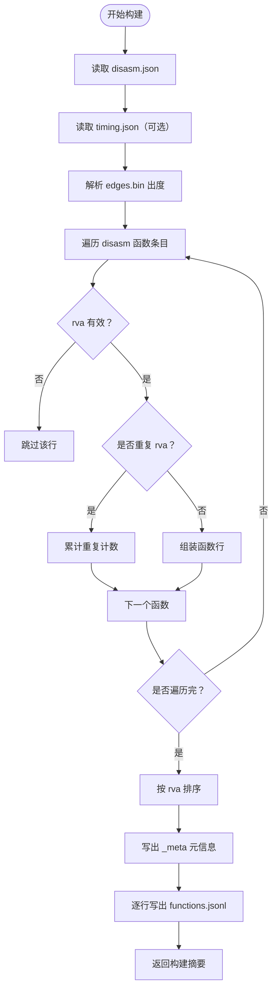
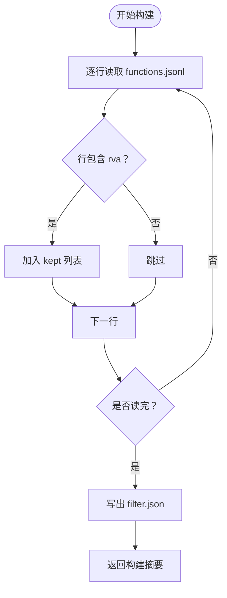
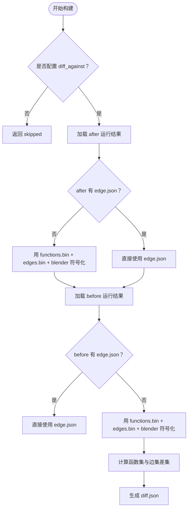
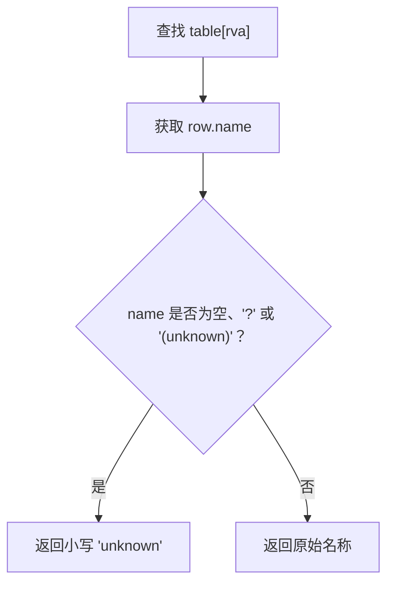
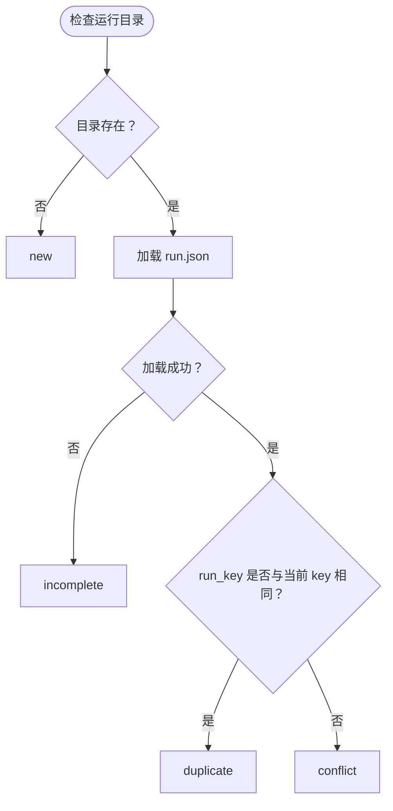
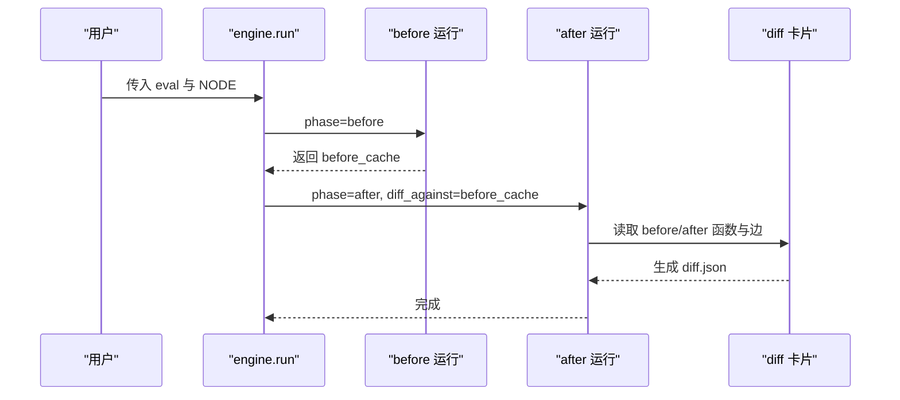
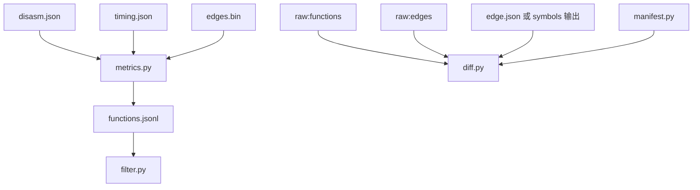

# 指标汇总、筛选与差异卡片

<cite>
**本文引用的文件**   
- [cards/metrics.py](file://cards/metrics.py)
- [cards/filter.py](file://cards/filter.py)
- [cards/diff.py](file://cards/diff.py)
- [cards/base.py](file://cards/base.py)
- [cards/symbols.py](file://cards/symbols.py)
- [infra/manifest.py](file://infra/manifest.py)
- [engine.py](file://engine.py)
- [tests/test_auto_diff.py](file://tests/test_auto_diff.py)
- [.gitignore](file://.gitignore)
- [docs/架构.md](file://docs/架构.md)
</cite>

## 更新摘要
**已做变更**   
- 明确 diff.py 中未知函数名归一化规则：空字符串、'?'、'(unknown)' 统一为小写 'unknown'，消费者不应再看到这三种形式。
- 在“差异卡片”和“自动化测试判定示例”中补充 _name 对 added/removed 函数名、caller/callee 名称的影响。
- 在“常见问题诊断”中新增“未知符号导致 added/removed 数量异常”的诊断建议，并说明如何区分符号一致性差异与普通业务回归。
- 在忽略规则小节补充 cov_show.txt 与 .qoder 的用途。

## 目录
1. [引言](#引言)
2. [项目结构中的定位](#项目结构中的定位)
3. [核心组件总览](#核心组件总览)
4. [指标汇总卡片：metrics.py](#指标汇总卡片metricspy)
5. [筛选卡片：filter.py](#筛选卡片filterpy)
6. [差异卡片：diff.py](#差异卡片diffpy)
7. [运行清单与 new/duplicate/conflict/incomplete 分类](#运行清单与-newduplicateconflictincomplete-分类)
8. [NODE 参数对 before/after 定位的影响](#node-参数对-beforeafter-定位的影响)
9. [面向自动化测试的 diff.json 判定示例](#面向自动化测试的-diffjson-判定示例)
10. [依赖关系分析](#依赖关系分析)
11. [性能与数据规模特征](#性能与数据规模特征)
12. [常见问题诊断](#常见问题诊断)
13. [结论](#结论)

## 引言

本文件聚焦三个翻译卡片的职责与协作方式：

| 卡片 | 输入 | 输出 | 主要用途 |
|---|---|---|---|
| metrics | 反汇编产物、计时产物、原始边数据 | functions.jsonl | 聚合函数级指标，作为 CI 与测试流程的主要消费入口 |
| filter | functions.jsonl | filter.json | 基于函数身份做筛选决策，当前默认保留全部函数 |
| diff | before/after 两次运行的函数集与调用边 | diff.json | 对比两次运行，生成新增、删除函数及调用边的差异报告 |

这三个卡片在引擎的固定执行顺序中位于反汇编、覆盖率、计时之后，属于“从 raw 到可消费 JSON”的关键环节。CI 通常不直接消费 edge.json 或 disasm.json，而是消费 functions.jsonl 和 filter.json；diff.json 则用于回归检测与人工复核。

**章节来源**
- [docs/架构.md:120-170](file://docs/架构.md#L120-L170)

## 项目结构中的定位

CovTrace 的整体数据流是：Blender 内的闸门产出 raw，宿主侧引擎按注册顺序执行翻译卡片，最终把公开产物写入 `out/<node>/<hash8>/`。metrics、filter、diff 属于该流水线后端的纯 Python 处理层，不依赖 Blender API。

**图示来源**
- [docs/架构.md:120-170](file://docs/架构.md#L120-L170)
- [cards/metrics.py:1-30](file://cards/metrics.py#L1-L30)
- [cards/filter.py:1-20](file://cards/filter.py#L1-L20)
- [cards/diff.py:1-20](file://cards/diff.py#L1-L20)

**章节来源**
- [docs/架构.md:120-170](file://docs/架构.md#L120-L170)

## 核心组件总览

三个卡片都继承自 `TranslationCard`，并通过 `CardContext` 访问 raw、前序产物、工作目录、manifest 和选项。

**图示来源**
- [cards/base.py:10-63](file://cards/base.py#L10-L63)
- [cards/metrics.py:31-153](file://cards/metrics.py#L31-L153)
- [cards/filter.py:17-59](file://cards/filter.py#L17-L59)
- [cards/diff.py:55-141](file://cards/diff.py#L55-L141)

**章节来源**
- [cards/base.py:10-63](file://cards/base.py#L10-L63)

## 指标汇总卡片：metrics.py

### 职责与输入输出

metrics 卡片负责把三块信息合并成一行一个函数的 functions.jsonl：

1. **disasm.json**：函数反汇编统计，包括大小、指令数、钩子计数、跳转、基本块等字段。
2. **timing.json**：函数计时统计，包含调用次数、平均耗时、自身占比等。
3. **edges.bin**：原始边数据，用于计算每个函数的出度，即不同被调者数量。

它不是简单拼接，而是以函数入口 RVA 为键进行聚合。

### 关键处理逻辑

**图示来源**
- [cards/metrics.py:31-153](file://cards/metrics.py#L31-L153)

### 关键字段与派生含义

- `rva`：函数入口相对虚拟地址，是主键。
- `out_degree`：来自 edges.bin 的不同被调者集合大小。
- `hook_enter` / `hook_exit`：来自 disasm 的 hook_balance 字段。
- `_meta.derived_removed`：记录未存储但可由其他列推导出的逻辑字段，例如真实调用数、尾调用 thunk、解码错误、钩子平衡等。
- `_meta.derived_kept.self_share`：保留的派生列，表示自身耗时占包含耗时的比例。
- `_meta.edge_callers_not_in_disasm`：出现在边数据中但没有对应 disasm 函数的调用方数量，可用于判断边与函数表不一致。

### 为什么 functions.jsonl 是主要消费入口

- 一行一个函数，便于脚本按 RVA 或名称过滤。
- 合并了反汇编统计、计时统计和边出度，减少下游消费多个文件的成本。
- 元信息暴露生成时间、函数总数、匹配计数的计时行数、重复 rva 数等质量信号。
- filter.json 和 diff.json 都可以基于这个稳定格式消费，而不需要直接解析二进制边文件或内部中间产物。

**章节来源**
- [cards/metrics.py:1-153](file://cards/metrics.py#L1-L153)

## 筛选卡片：filter.py

### 职责与输出

filter 卡片目前是一个占位实现：它读取 metrics 输出的 functions.jsonl，并输出 filter.json，其中 kept 列表包含所有带 rva 的行，dropped 为空。文档说明其目标是提供一个“rva 决策列表”，让下游工具可以只根据 filter.json 过滤 functions.jsonl，而不必再读 edge.json。

### 数据处理流程

**图示来源**
- [cards/filter.py:17-59](file://cards/filter.py#L17-L59)

### 使用建议

当前 keep all 的行为适合基线验证。未来扩展时，应：

- 保持 kept 和 dropped 都是 rva 列表。
- 保证 kept 中的 rva 能在 functions.jsonl 中找到。
- 在回归判定中区分“指标本身变化”和“筛选策略变化”。

**章节来源**
- [cards/filter.py:1-59](file://cards/filter.py#L1-L59)

## 差异卡片：diff.py

### 职责与输入输出

diff 卡片用于比较当前运行结果与另一个运行结果。它对比两类对象：

1. **函数集**：按 rva 去重后的函数映射。
2. **调用边集**：由 `(caller_rva, callee_rva)` 组成的边集合。

输出 diff.json 包含 meta、added、removed 三部分，分别描述新增和删除的函数及边。

### 加载 after 与 before 的逻辑

**图示来源**
- [cards/diff.py:21-141](file://cards/diff.py#L21-L141)

### 基线缺失处理

如果 diff_against 指向的目录既没有 edge.json，也没有 functions.bin 与 edges.bin，_load_run 会抛出异常。这意味着：

- CI 必须确保 baseline 至少提供 edge.json 或 raw 函数/边产物。
- 若只想比较 edge.json，应显式提供该文件。
- 若只提供 raw，symbols.symbolize 会根据 blender 路径解析符号。

### 重复 hash8 与节点边界

diff.json 的 meta.after 路径并不是简单使用当前 work_dir，而是尝试根据 manifest.hash8 定位缓存目录：

- 如果 manifest 中有 hash8，after 路径变为 `cache_root/hash8`。
- 否则回退到当前 work_dir。

这使 diff 能反映“成功缓存的节点输出位置”，而不是临时工作目录。对于 before，路径就是用户提供的 diff_against 绝对路径。

因此，如果 before/after 的 NODE 不同，即使同一 TARGET，也可能落在不同节点目录；如果 hash8 相同但节点不同，diff 比较的是不同节点下的两个 hash8 目录，可能产生大量无业务意义的差异。

### 新增、删除与去重

- added.functions / removed.functions：按 rva 集合差集生成的函数列表。
- added.edges / removed.edges：由 caller/callee rpa 对生成，并按函数名去重后展示。
- edge_count_raw：原始边差集大小。
- edge_count_dedup：去重后的边数量。

这种设计允许测试同时关注“具体边是否变化”和“函数级接口是否变化”。

### 未知符号名称归一化

diff.py 中的 `_name(table, rva)` 会把空字符串、'?'、'(unknown)' 三种缺失符号归一化为小写 `'unknown'`。也就是说，当符号解析失败或缺失时，diff.json 的 added 与 removed 函数名、以及边的 caller/callee 名称不会分散成多种空白或问号形式，而是统一聚合为同一个 unknown 名称。

**图示来源**
- [cards/diff.py:61-68](file://cards/diff.py#L61-L68)

这一改动对 diff.json 的影响包括：

- 如果 before 和 after 都无法解析某个 RVA 的名称，它们会以相同的 'unknown' 名称出现在边列表中，从而更容易被去重聚合。
- 如果 one side 能解析名称而另一侧是未知符号，diff 仍可能显示不同名称，测试应把这类差异视为“符号一致性差异”，而不是普通业务回归。
- 自动化测试在断言 added.function_count 或 removed.function_count 时，不应仅凭名称判断语义变化；需要结合 rva 集合与符号完整性共同评估。
- 消费者不应再看到空串、'?' 或 '(unknown)' 作为函数名或边端点名称，这些情况都会统一显示为 'unknown'。

**章节来源**
- [cards/diff.py:1-153](file://cards/diff.py#L1-L153)

## 运行清单与 new/duplicate/conflict/incomplete 分类

run.json 由 infra/manifest.py 管理。classify 函数根据 run_dir 是否存在、是否能加载 manifest、以及 run_key 是否一致，返回四种状态：

| 状态 | 条件 | 含义 |
|---|---|---|
| new | 目录不存在 | 这是首次运行该节点+哈希组合 |
| incomplete | 目录存在但无法加载 manifest | 运行中断或未完整落盘 |
| duplicate | 目录存在且 run_key 相同 | 已有相同运行键的结果 |
| conflict | 目录存在但 run_key 不同 | 同名目录里存在不同运行，属于冲突 |

**图示来源**
- [infra/manifest.py:26-45](file://infra/manifest.py#L26-L45)

### 与 diff 结果的关联

manifest 的状态本身不会直接写入 diff.json，但它影响 CI 如何解释一次运行：

- **incomplete**：不应视为正常 diff 基线。如果 before 是 incomplete，diff 很可能失败或不可信。
- **duplicate**：说明本次运行键已经存在，CI 可选择复用已有结果，避免重复构建。
- **conflict**：说明目录内已有不同 run_key 的产物，必须先清理或改用新目录，否则后续产物归属不明确。
- **new**：正常首次运行，后续可作为 after 或 future baseline。

**章节来源**
- [infra/manifest.py:1-58](file://infra/manifest.py#L1-L58)

## NODE 参数对 before/after 定位的影响

当 eval 脚本定义了 NODE 时，engine 会自动执行 before 与 after 两次运行，并在 after 阶段生成 diff。测试用例确认了这一行为：

- 有 NODE：先 before，再 after，并把 before 的 cache_dir 传给 after 的 diff_against。
- 无 NODE：只做单次捕获。
- dry_run：不做实际运行，只走流程。

**图示来源**
- [tests/test_auto_diff.py:37-56](file://tests/test_auto_diff.py#L37-L56)
- [cards/diff.py:75-141](file://cards/diff.py#L75-L141)

### 关键影响

1. **before 是 base cache 目录**，after 的 diff_against 指向该目录。
2. diff.json.meta.before 是该目录的绝对路径。
3. diff.json.meta.after 可能指向 `cache/<node>/<hash8>`，取决于 manifest.hash8。
4. 如果 NODE 不同，before 与 after 可能属于不同节点目录，diff 会比较两个独立运行，而不是同节点的前后版本。
5. 如果 NODE 为空，diff 不会自动执行，因为 engine 不会触发 before/after 流程。

**章节来源**
- [tests/test_auto_diff.py:17-124](file://tests/test_auto_diff.py#L17-L124)
- [cards/diff.py:75-118](file://cards/diff.py#L75-L118)

## 面向自动化测试的 diff.json 判定示例

### diff.json 的基本结构

| 字段 | 类型 | 含义 |
|---|---|---|
| meta.before | 字符串 | before 运行目录绝对路径 |
| meta.after | 字符串 | after 运行目录绝对路径 |
| meta.before_functions | 整数 | before 函数数 |
| meta.after_functions | 整数 | after 函数数 |
| meta.before_edges | 整数 | before 边数 |
| meta.after_edges | 整数 | after 边数 |
| added.functions | 数组 | 新增函数列表 |
| added.function_count | 整数 | 新增函数数量 |
| added.edges | 数组 | 新增边列表 |
| added.edge_count_raw | 整数 | 原始新增边数 |
| added.edge_count_dedup | 整数 | 去重后新增边数 |
| removed.functions | 数组 | 删除函数列表 |
| removed.function_count | 整数 | 删除函数数量 |
| removed.edges | 数组 | 删除边列表 |
| removed.edge_count_raw | 整数 | 原始删除边数 |
| removed.edge_count_dedup | 整数 | 去重后删除边数 |

### 回归判定规则建议

| 场景 | 建议判定 | 理由 |
|---|---|---|
| added.function_count > 0 | 回归 | 出现了新的函数入口，可能是代码注入、模板展开或重构导致 |
| removed.function_count > 0 | 回归 | 原有函数消失，可能是链接裁剪、符号丢失或构建产物不完整 |
| added.edge_count_dedup > 0 | 回归 | 新增了函数间调用关系 |
| removed.edge_count_dedup > 0 | 回归 | 删除了函数间调用关系 |
| meta.before_functions == 0 或 meta.after_functions == 0 | 基线或运行无效 | 至少一侧缺少函数，应拒绝 diff |
| added.function_count 很小但 removed.function_count 很大 | 重点核查 | 可能是函数重命名、RVA 漂移或前后构建不一致 |
| edge 数量变化但函数数量不变 | 中等严重 | 可能是调用目标变化，需结合函数名判断 |
| diff_against 不存在或产物缺失 | 失败 | 不属于回归，应视为基础设施问题 |

### 未知符号对回归判定的影响

由于 `_name` 将空字符串、'?'、'(unknown)' 统一为小写 'unknown'，以下情况需要特别注意：

- 如果 diff.json.added.edges 中出现 caller 或 callee 为 'unknown'，应优先检查 before 与 after 两侧的符号解析是否一致。
- 如果两侧都能解析符号，则 'unknown' 通常代表真实的未知 RVA，不应轻易忽略。
- 如果一侧能解析而另一侧不能，应将这类差异标记为“符号一致性差异”，而不是普通业务回归。
- 自动化测试可以在基础断言之外增加“unknown 数量阈值”检查，防止因符号缺失放大 diff 噪声。
- 消费者断言函数名时，不应假设会出现空串、'?' 或 '(unknown)'；若出现未知符号，应统一按 'unknown' 处理。

### 可忽略差异的条件

以下情况可在严格回归测试中放宽，但应在 CI 日志中明确标记：

- 仅函数名或源文件路径变化，而业务语义未变，且不在回归范围清单内。
- 由无关模块变更导致的间接调用变化，且已通过白名单排除。
- 因调试符号、PDB 路径或路径规范化造成的元数据差异，不影响函数与边集合。
- filter.json 的筛选策略发生变化，导致 downstream 消费集合变化，但底层 functions.jsonl 未变。
- 仅出现少量 'unknown' 名称变化，且经检查确认两侧符号解析能力一致。

### 最小回归断言示例

在自动化测试中，可优先断言：

- diff.json.added.function_count 为 0。
- diff.json.removed.function_count 为 0。
- diff.json.added.edge_count_dedup 为 0。
- diff.json.removed.edge_count_dedup 为 0。
- meta.before_functions 与 meta.after_functions 均大于 0。
- meta.before 与 meta.after 均存在且不为空。
- 可选：diff.json.added.edges 与 removed.edges 中 'unknown' 的数量不超过预期阈值。

如果允许有限差异，可改为断言新增/删除函数不超过阈值，并输出具体函数名供人工审查。

**章节来源**
- [cards/diff.py:75-141](file://cards/diff.py#L75-L141)
- [tests/test_auto_diff.py:37-56](file://tests/test_auto_diff.py#L37-L56)

## 依赖关系分析

三个卡片之间的依赖如下：

**图示来源**
- [cards/metrics.py:31-60](file://cards/metrics.py#L31-L60)
- [cards/filter.py:23-40](file://cards/filter.py#L23-L40)
- [cards/diff.py:55-118](file://cards/diff.py#L55-L118)
- [infra/manifest.py:26-45](file://infra/manifest.py#L26-L45)

### 耦合与内聚

- metrics 对内部分解产物（disasm、timing、edges.bin）耦合较强，但对下游提供稳定的 functions.jsonl。
- filter 当前几乎不耦合业务逻辑，内聚性高，扩展点清晰。
- diff 耦合 engine 的运行目录约定、manifest 结构和 symbols 符号化能力，是最容易受运行环境变化影响的卡片。

**章节来源**
- [cards/metrics.py:31-153](file://cards/metrics.py#L31-L153)
- [cards/filter.py:17-59](file://cards/filter.py#L17-L59)
- [cards/diff.py:21-141](file://cards/diff.py#L21-L141)

## 性能与数据规模特征

- metrics 会遍历 disasm 的所有函数条目，并用 set 去重 rva。时间复杂度近似 O(n)，空间复杂度也近似 O(n)。
- edges.bin 通过 8 字节小端整数流解析 caller/callee，并维护 caller 到 callee 集合的映射。去重集合的大小取决于边密度。
- filter 是线性扫描 functions.jsonl，时间复杂度 O(m)。
- diff 对 before/after 的函数集和边集做集合差运算，复杂度与函数数和边数线性相关；边输出还会按函数名去重。

优化机会包括：

- 对超大规模产物，可考虑增量 diff，但当前 diff 以完整集合为主，更利于正确性。
- 若 CI 只需函数级差异，可先比较 added/removed function_count，再决定是否展开 edges。
- 符号解析依赖 PDB，应避免在无必要情况下重复调用 symbols.symbolize。

[本节为通用性能讨论，不直接分析具体代码片段]

## 常见问题诊断

### manifest 状态错误

| 现象 | 可能原因 | 处理建议 |
|---|---|---|
| classify 返回 incomplete | run_dir 存在但 run.json 损坏或缺失 | 清理该节点目录，重新运行；检查引擎是否在失败现场保存了 manifest |
| classify 返回 duplicate | 多次运行使用了相同 run_key 和节点哈希 | 复用已有结果或删除旧目录后再运行 |
| classify 返回 conflict | 目录中存在不同 run_key 的产物 | 清理冲突目录，确保每次运行有唯一输出位置 |

**章节来源**
- [infra/manifest.py:26-45](file://infra/manifest.py#L26-L45)

### before/after 运行结果不完整

| 现象 | 可能原因 | 处理建议 |
|---|---|---|
| diff 报错找不到 edge.json 或 functions.bin/edges.bin | before 目录不完整 | 确保 baseline 至少提供 edge.json 或 raw 函数/边产物 |
| after 侧 diff_against 为空 | 未设置 NODE 或未进入 after 流程 | 检查 eval 是否定义 NODE，以及 engine.run 是否被调用 |
| before 失败后 still 执行 after | engine 前置失败时应停止 | 参考测试用例，before 返回非零时应阻止 after |

**章节来源**
- [cards/diff.py:21-40](file://cards/diff.py#L21-L40)
- [tests/test_auto_diff.py:97-124](file://tests/test_auto_diff.py#L97-L124)

### diff 为空但实际存在差异

常见原因：

1. **before/after 不是同一 NODE**：不同节点目录下的相同 hash8 会被当作不同运行，diff 可能比较错位置。
2. **manifest.hash8 缺失**：after 路径回退到 work_dir，而不是缓存目录，导致比较临时目录而非稳定输出。
3. **before 只提供了 edge.json，after 使用了 symbols 解析**：两边数据结构不一致，可能导致函数或边解析差异。
4. **functions.jsonl 与 edge.json 不一致**：metrics 只聚合 disasm 函数，edges.bin 中可能存在不在 disasm 的 caller，此时 edge_callers_not_in_disasm 会大于 0。
5. **filter 策略变化**：filter.json 变了，但 functions.jsonl 没变，下游消费结果变化但不一定体现在 diff.json 中。

诊断步骤：

- 检查 diff.json.meta.before 与 meta.after 是否为预期目录。
- 检查 before 是否包含 edge.json 或 functions.bin/edges.bin。
- 检查 manifest.hash8 是否与期望缓存目录一致。
- 比较 before/after 的 functions.jsonl 行数与重复 rva 数。
- 若怀疑边解析问题，先对齐双方输入形式，要么都用 edge.json，要么都用 raw 产物。

### 未知符号导致 added/removed 数量异常

diff.py 已将空字符串、'?'、'(unknown)' 统一为小写 'unknown'，诊断时应注意：

- 如果 diff.json.added.function_count 或 removed.function_count 突然增大，先检查 diff.json.added.functions 与 removed.functions 中是否出现大量 'unknown'。
- 如果 diff.json.added.edges 或 removed.edges 中出现大量 caller/callee 为 'unknown' 的行，说明至少一侧的符号解析未能识别这些 RVA。
- 应比较 before 与 after 两侧是否都使用 edge.json，还是都通过 symbols.symbolize 解析 raw 产物；混合方式容易造成名称不一致。
- 若两侧都依赖符号解析，应检查 blender 路径、PDB 路径和 symbols 输入是否一致。
- 如果 'unknown' 集中在同一批 RVA，可进一步检查该批次是否属于动态生成、延迟初始化或未被反汇编覆盖的区域。
- 断言 diff.json 时，不要假设函数名或边端点名称可能出现空串、'?' 或 '(unknown)'；如果出现未知符号，应以 'unknown' 作为稳定标识进行比对。

**章节来源**
- [cards/diff.py:41-118](file://cards/diff.py#L41-L118)
- [cards/metrics.py:43-113](file://cards/metrics.py#L43-L113)

## 忽略规则与产物管理

.gitignore 中除 Python 缓存、编译产物、out、cache、测试输出、性能采样数据外，还新增了：

- **cov_show.txt**：覆盖率可视化或覆盖率查看器产生的文本产物，不应纳入版本控制。
- **.qoder**：编辑器或辅助工具产生的本地目录，不应纳入版本控制。

这些规则有助于避免 CI 误检本地临时产物，也能让 diff.json 的差异更贴近真实构建与符号行为。

**章节来源**
- [.gitignore:1-10](file://.gitignore#L1-L10)

## 结论

metrics、filter、diff 共同构成从 raw 到可消费指标再到回归判定的链路：

- metrics 把反汇编、计时和边信息统一为 functions.jsonl，是 CI 的主要消费入口。
- filter 提供稳定的 rva 筛选接口，当前默认保留全部函数，便于扩展筛选策略。
- diff 对比 before/after 的函数集与调用边，输出结构化 diff.json，适合自动化回归检测。
- diff.py 的 `_name` 将空字符串、'?'、'(unknown)' 统一为小写 'unknown'，使未知符号在差异报告中按同一名称聚合，降低符号缺失带来的噪声。
- manifest 的 new/duplicate/conflict/incomplete 分类帮助 CI 识别运行质量。
- NODE 决定引擎是否执行 before/after 流程，并影响 diff 的路径定位。
- .gitignore 新增 cov_show.txt 与 .qoder 忽略规则，有助于减少本地临时产物干扰。

在 CI 中，建议将 diff.json 的新增/删除函数与边作为硬性回归门槛，同时配合 manifest 状态检查、产物完整性校验和 unknown 符号诊断，避免误报或漏报。

[本节为总结性内容，不直接分析具体文件]