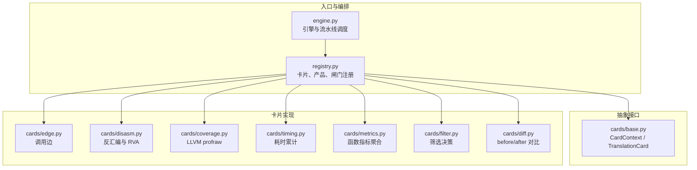
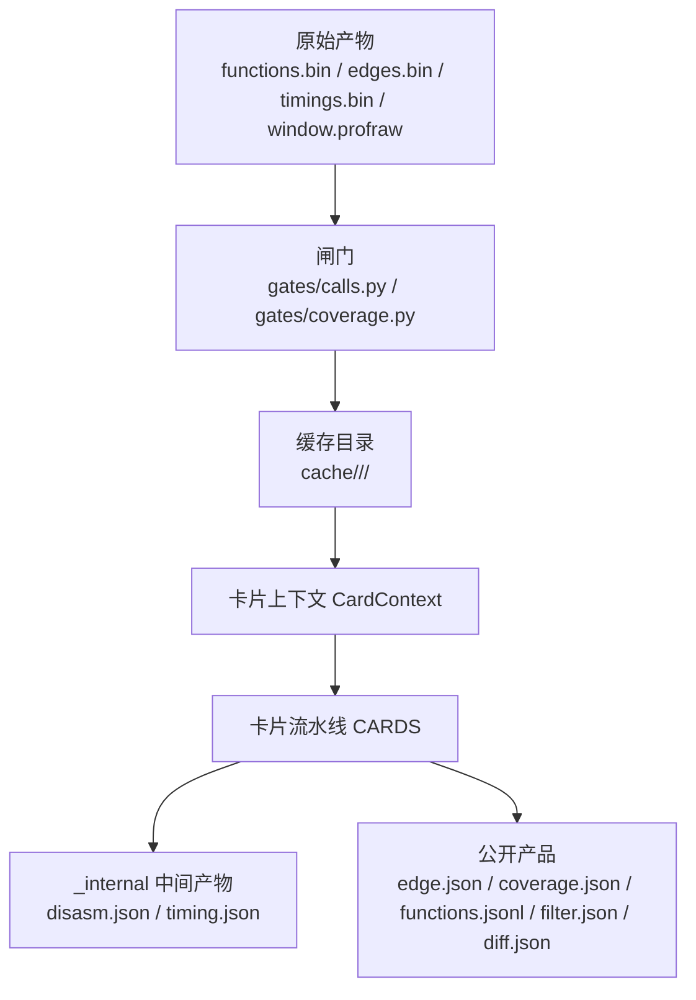
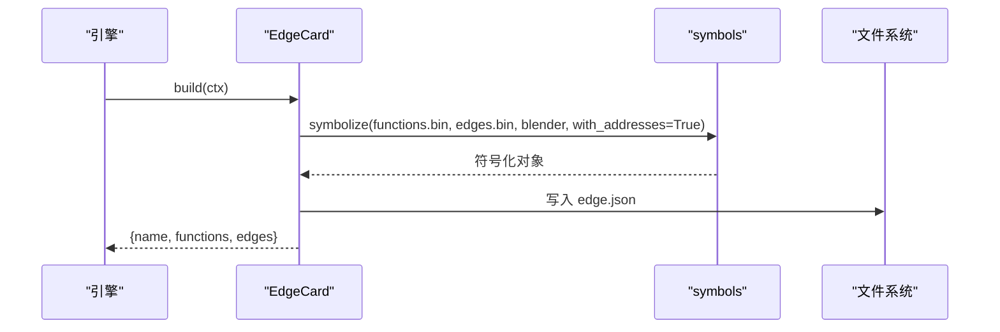
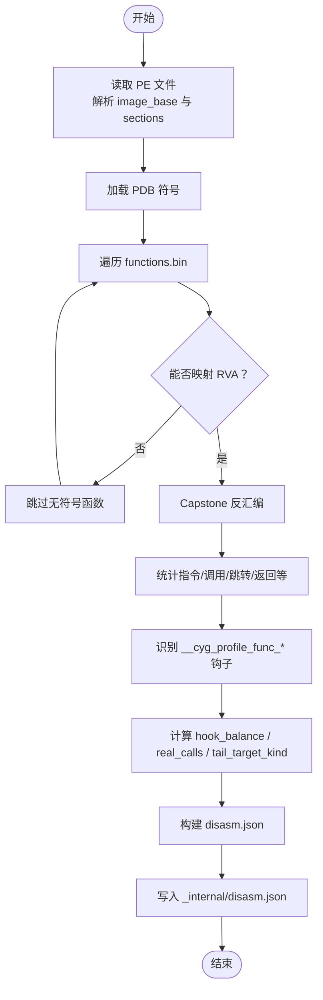
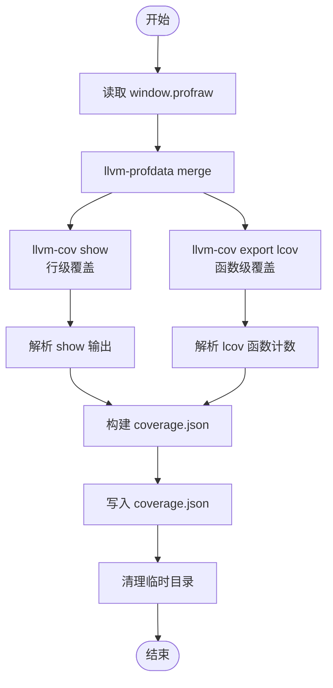
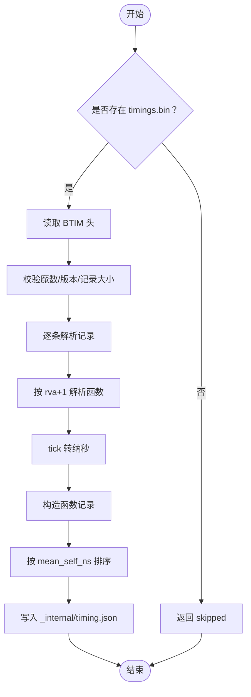
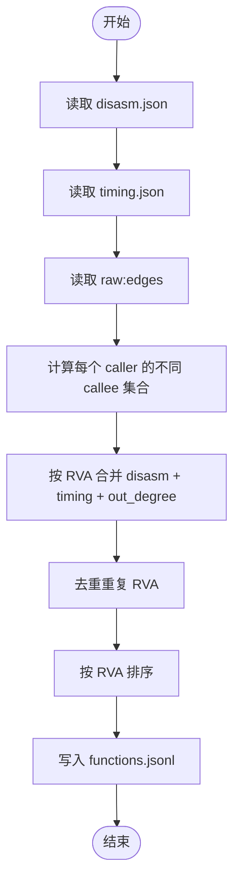
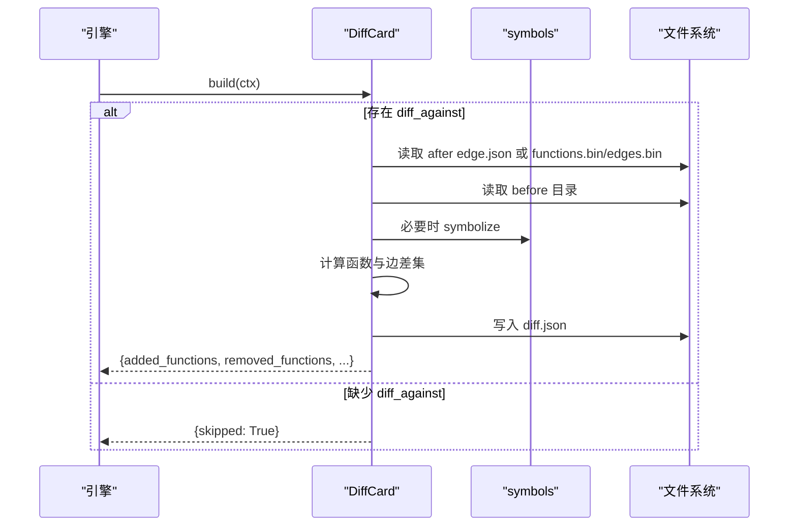
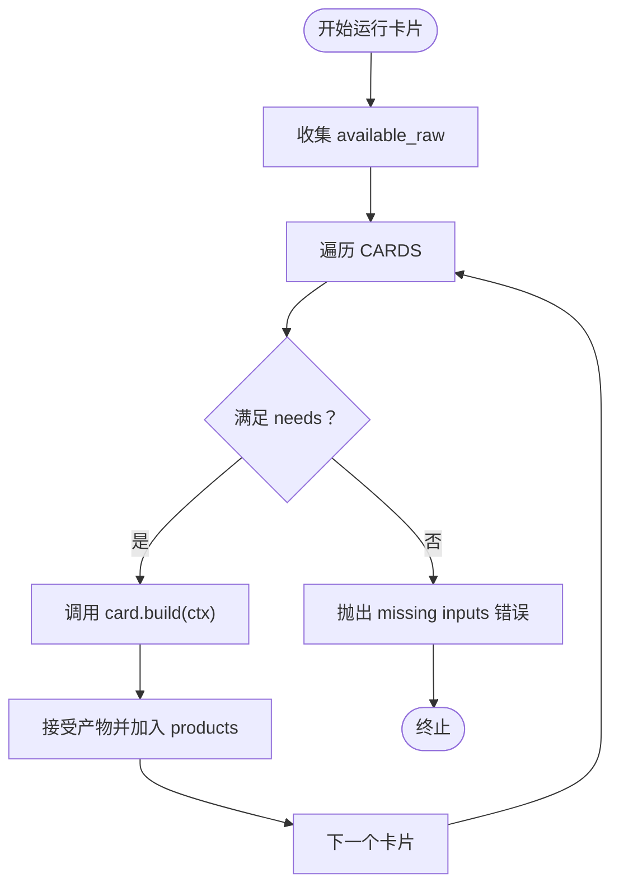
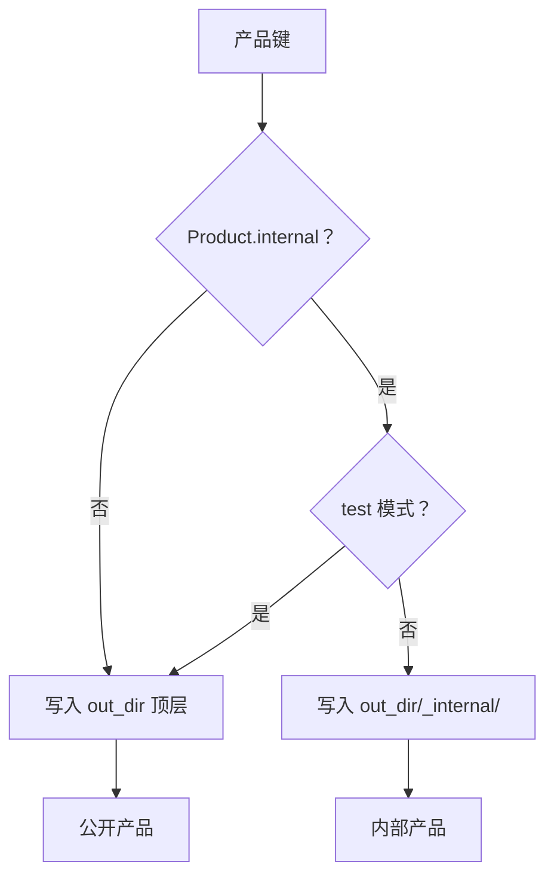

# 翻译卡片流水线

<cite>
**本文引用的文件**   
- [cards/base.py](file://cards/base.py)
- [registry.py](file://registry.py)
- [engine.py](file://engine.py)
- [cards/edge.py](file://cards/edge.py)
- [cards/disasm.py](file://cards/disasm.py)
- [cards/coverage.py](file://cards/coverage.py)
- [cards/timing.py](file://cards/timing.py)
- [cards/metrics.py](file://cards/metrics.py)
- [cards/filter.py](file://cards/filter.py)
- [cards/diff.py](file://cards/diff.py)
- [docs/关于card.md](file://docs/关于card.md)
- [tests/test_registry.py](file://tests/test_registry.py)
</cite>

## 目录

1. [引言](#引言)
2. [项目结构](#项目结构)
3. [核心组件](#核心组件)
4. [架构总览](#架构总览)
5. [详细组件分析](#详细组件分析)
6. [依赖与执行顺序分析](#依赖与执行顺序分析)
7. [产品注册与扩展流程](#产品注册与扩展流程)
8. [内部产物与公开产物](#内部产物与公开产物)
9. [性能考虑](#性能考虑)
10. [故障排查](#故障排查)
11. [结论](#结论)

## 引言

翻译卡片流水线把运行期采集到的原始二进制产物和 LLVM 覆盖率数据，转换成可分析、可对比、可筛选的 JSON 产品。其设计围绕两个抽象概念展开：

- **卡片上下文** `CardContext`：为卡片提供 raw 输入路径、产品注册表、输出目录、blender 可执行文件、PDB 路径等运行时环境。
- **翻译卡片** `TranslationCard`：定义卡片名称、输入依赖 `needs`，以及通过 `build(ctx)` 生成最终产品的逻辑。

默认流水线依次生成 `edge.json`、`disasm.json`、`coverage.json`、`timing.json`、`functions.jsonl`、`filter.json`、`diff.json`。其中 `disasm.json` 与 `timing.json` 默认进入 `_internal` 子目录，作为中间产物；`edge.json`、`coverage.json`、`functions.jsonl`、`filter.json`、`diff.json` 是面向下游工具的公开产品。

## 项目结构

**图表来源**
- [engine.py:1-200](file://engine.py#L1-L200)
- [registry.py:1-49](file://registry.py#L1-L49)
- [cards/base.py:1-63](file://cards/base.py#L1-L63)

**章节来源**
- [engine.py:1-200](file://engine.py#L1-L200)
- [registry.py:1-49](file://registry.py#L1-L49)

## 核心组件

### 卡片上下文 `CardContext`

`CardContext` 是卡片消费输入、写入产物的唯一通道。它保存以下关键状态：

| 属性 | 含义 |
|---|---|
| `work_dir` | 当前工作目录，用于定位缓存和失败产物 |
| `out_dir` | 最终输出根目录 |
| `target` | 目标信息对象 |
| `node` | 当前节点标识 |
| `manifest` | 运行清单，可能包含 `eval`、`hash8` 等信息 |
| `blender` | 插桩后的可执行文件路径 |
| `pdb` | PDB 路径 |
| `raw_paths` | raw key 到物理文件的映射 |
| `products` | 产品键到 `Product` 对象的映射 |
| `options` | 外部选项，如 `diff_against` |
| `test` | 测试模式标志 |

`CardContext` 提供四类路径访问方法：

| 方法 | 行为 |
|---|---|
| `raw(key)` | 读取 raw key，缺失或文件不存在时抛出错误 |
| `product(key)` | 查询产品注册，未注册则抛出错误 |
| `out(key)` | 返回公开输出路径 |
| `internal(key)` | 返回内部输出路径 |
| `publish(key)` | 根据 `Product.internal` 与 `test` 决定写入 `_internal` 还是顶层 |
| `input(key)` | 等价于 `publish(key)`，表示“该卡片需要消费的产品路径” |

**章节来源**
- [cards/base.py:1-63](file://cards/base.py#L1-L63)

### 翻译卡片抽象 `TranslationCard`

所有卡片继承 `TranslationCard`，必须声明：

- `name`：卡片名称，用于日志、统计和排序。
- `needs`：依赖元组，元素可以是 `raw:key` 或已注册的 product key。
- `build(ctx)`：接收 `CardContext`，写入产品文件并返回摘要字典。

卡片不应直接操作文件系统以外的全局状态；其副作用应限于通过 `ctx.publish(...)` 写入的路径。

**章节来源**
- [cards/base.py:1-63](file://cards/base.py#L1-L63)

## 架构总览

**图表来源**
- [engine.py:1-200](file://engine.py#L1-L200)
- [registry.py:1-49](file://registry.py#L1-L49)
- [cards/base.py:1-63](file://cards/base.py#L1-L63)

## 详细组件分析

### Edge 卡片：生成调用边

Edge 卡片负责把 `functions.bin` 中的函数 RVA 与 `edges.bin` 中的调用关系符号化，产出 `edge.json`。

- **输入**：`raw:functions`、`raw:edges`。
- **工具链**：通过 `symbols.symbolize(..., with_addresses=True)` 解析函数名、文件、行号、模块及虚拟地址。
- **输出**：`edge.json`，包含函数列表与边列表。
- **返回值**：函数数量与边数量摘要。

**图表来源**
- [cards/edge.py:1-23](file://cards/edge.py#L1-L23)

**章节来源**
- [cards/edge.py:1-23](file://cards/edge.py#L1-L23)

### Disasm 卡片：反汇编与 RVA 身份

Disasm 卡片以 `functions.bin` 为起点，结合 PE 头部与 Capstone 反汇编器，对每个函数进行静态分析。

- **输入**：`raw:functions`。
- **辅助输入**：`ctx.blender`（PE 文件）与 PDB。
- **主要职责**：
  - 解析 PE 可选头与节表。
  - 将 `rva+1` 还原为真实 RVA。
  - 按 PDB `Size` 限制最大读取字节数。
  - 统计指令数、调用、跳转、返回、栈帧、RIP 相对引用、全局引用、FP/SIMD 指令、锁指令等。
  - 识别钩子调用 `__cyg_profile_func_enter` 与 `__cyg_profile_func_exit`。
  - 计算基本块、回边、switch 表、尾跳转形态。
  - 推导 `hook_balance`、`real_calls`、`logic_calls`、`tiny`、`branchless`、`forwarder_candidate`、`tail_thunk` 等标记。
- **输出**：`_internal/disasm.json`（测试模式发布）。
- **关键点**：指令计数包含覆盖插桩指令；`real_calls` 会扣除钩子调用。

**图表来源**
- [cards/disasm.py:1-200](file://cards/disasm.py#L1-L200)
- [cards/disasm.py:201-393](file://cards/disasm.py#L201-L393)

**章节来源**
- [cards/disasm.py:1-200](file://cards/disasm.py#L1-L200)
- [cards/disasm.py:201-393](file://cards/disasm.py#L201-L393)

### Coverage 卡片：处理 LLVM profraw

Coverage 卡片把 `window.profraw` 转换为 `coverage.json`。

- **输入**：`raw:coverage`。
- **外部工具**：`llvm-profdata` 与 `llvm-cov`。
- **处理步骤**：
  1. 使用 `llvm-profdata merge -sparse` 合并 profraw。
  2. 并发执行 `llvm-cov show` 与 `llvm-cov export -format=lcov`。
  3. 解析 show 输出得到行命中集合。
  4. 解析 lcov 输出得到函数计数。
  5. 默认只保留 `source/` 与 `intern/` 前缀源码。
  6. 可通过 `coverage_keep_all` 选项关闭过滤。
- **输出**：`coverage.json`。
- **异常处理**：临时目录在异常时会打印提示，便于后续人工清理。

**图表来源**
- [cards/coverage.py:1-200](file://cards/coverage.py#L1-L200)
- [cards/coverage.py:201-233](file://cards/coverage.py#L201-L233)

**章节来源**
- [cards/coverage.py:1-200](file://cards/coverage.py#L1-L200)
- [cards/coverage.py:201-233](file://cards/coverage.py#L201-L233)

### Timing 卡片：累计耗时

Timing 卡片解析 `timings.bin`，把 QPC tick 换算成纳秒，并按 RVA 解析到函数。

- **输入**：可选的 `raw:timings`。
- **格式校验**：检查魔数 `BTIM`、版本、记录大小。
- **转换逻辑**：
  - 每条记录包含 `key(rva+1)`、调用次数、self ticks、inclusive ticks。
  - 通过 `symbols.resolve` 解析函数名、文件、行号、模块。
  - 计算平均耗时与 self/inclusive 占比。
- **输出**：`_internal/timing.json`（测试模式发布）。
- **跳过语义**：如果 `timings.bin` 缺失，返回 `skipped` 摘要，不报错。

**图表来源**
- [cards/timing.py:1-108](file://cards/timing.py#L1-L108)

**章节来源**
- [cards/timing.py:1-108](file://cards/timing.py#L1-L108)

### Metrics 卡片：聚合 functions.jsonl

Metrics 卡片是流水线中最重要的聚合点，把 disasm、timing 与 edges 统一到函数级行模型。

- **输入**：`disasm`、`raw:edges`。
- **时间信息**：从 `timing.json` 中按 RVA 匹配。
- **出度来源**：直接从 `edges.bin` 统计 caller 的不同 callee 数量。
- **去重策略**：同一 RVA 只保留一行。
- **字段分类**：
  - 源字段：RVA、函数名、文件、行号、模块。
  - timing 字段：调用次数、平均耗时、占比。
  - disasm 字段：指令、调用、跳转、栈帧、FP/SIMD、尾部跳转形态等。
  - 派生字段：说明位于 meta 中，但不落盘。
- **输出**：`functions.jsonl`，首行为 `_meta`，其后每行一个函数。

**图表来源**
- [cards/metrics.py:1-153](file://cards/metrics.py#L1-L153)

**章节来源**
- [cards/metrics.py:1-153](file://cards/metrics.py#L1-L153)

### Filter 卡片：筛选决策

Filter 卡片当前是一个占位实现，保留全部函数，但定义了以 RVA 为核心的决策产品。

- **输入**：`metrics`，即 `functions.jsonl`。
- **当前行为**：`kept` 等于全部函数 RVA，`dropped` 为空。
- **输出**：`filter.json`。
- **设计目的**：下游工具可以基于 `filter.json` 中的 RVA 列表筛选 `functions.jsonl`，而不必重新解析 `edge.json`。

**章节来源**
- [cards/filter.py:1-59](file://cards/filter.py#L1-L59)

### Diff 卡片：before/after 对比

Diff 卡片在当前运行结果与历史运行之间做集合差分析。

- **输入**：`raw:functions`、`raw:edges`，以及 `options.diff_against`。
- **Before 来源**：
  - 可以是另一个缓存目录中的 `functions.bin` 与 `edges.bin`。
  - 也可以是已有 `edge.json`。
- **After 来源**：
  - 优先使用当前运行生成的 `edge.json`。
  - 若不存在，则重新调用 `symbols.symbolize`。
- **对比内容**：
  - 新增函数、删除函数。
  - 新增边、删除边。
  - 边按调用方与被调方符号名去重。
- **元数据**：包含 measure node、阶段、before/after 路径、函数与边数量。
- **输出**：`diff.json`。
- **跳过条件**：未设置 `diff_against` 时返回 `skipped`。

**图表来源**
- [cards/diff.py:1-141](file://cards/diff.py#L1-L141)

**章节来源**
- [cards/diff.py:1-141](file://cards/diff.py#L1-L141)

## 依赖与执行顺序分析

### 固定执行顺序

`registry.CARDS` 定义了卡片的固定顺序：

1. `EdgeCard`
2. `DisasmCard`
3. `CoverageCard`
4. `TimingCard`
5. `MetricsCard`
6. `FilterCard`
7. `DiffCard`

这个顺序不仅是 Python 列表顺序，也是产品生命周期的一部分。例如 `metrics` 依赖 `disasm`，`filter` 依赖 `metrics`，`diff` 通常作为最后一步消费 `edge.json` 或原始边。

### needs 依赖模型

`needs` 支持两类依赖：

| 依赖形式 | 含义 |
|---|---|
| `raw:functions` | 要求 `CardContext.raw_paths` 中存在对应 raw key |
| `disasm` | 要求前序卡片已注册并成功输出该 product |

引擎在运行卡片前会检查：

- raw 依赖是否出现在 `available_raw`。
- 产品依赖是否已进入 `products` 集合。
- 任一缺失都会抛出错误。

**图表来源**
- [engine.py:1-200](file://engine.py#L1-L200)
- [registry.py:1-49](file://registry.py#L1-L49)

### 特殊并行处理

Coverage 卡片会在独立线程中执行，其余卡片按顺序串行执行。这样做的原因是 coverage 处理涉及外部工具，且与其他卡片没有严格先后依赖。

**章节来源**
- [engine.py:1-200](file://engine.py#L1-L200)
- [registry.py:1-49](file://registry.py#L1-L49)

## 产品注册与扩展流程

### 产品注册表

`registry.PRODUCTS` 定义每个产品键的物理路径与是否内部：

| 产品键 | 路径 | 是否内部 |
|---|---|---|
| `edge` | `edge.json` | 否 |
| `disasm` | `disasm.json` | 是 |
| `coverage` | `coverage.json` | 否 |
| `timing` | `timing.json` | 是 |
| `metrics` | `functions.jsonl` | 否 |
| `filter` | `filter.json` | 否 |
| `diff` | `diff.json` | 否 |

### 卡片注册表

`registry.CARDS` 使用 `CardRegistration(card, products)` 绑定卡片实例与其产出的产品键。例如：

- `EdgeCard` 产出 `("edge",)`。
- `DisasmCard` 产出 `("disasm",)`。
- `MetricsCard` 产出 `("metrics",)`。
- `FilterCard` 产出 `("filter",)`。
- `DiffCard` 产出 `("diff",)`。

### 扩展新卡片的标准流程

1. 在 `cards/` 下新建卡片模块。
2. 继承 `TranslationCard`，声明 `name`、`needs` 与 `build(ctx)`。
3. 如需写文件，使用 `ctx.out(key)`、`ctx.internal(key)` 或 `ctx.publish(key)`。
4. 如需读 raw，使用 `ctx.raw(key)`。
5. 如需读其他卡片产品，使用 `ctx.input(key)`。
6. 在 `registry.py` 中：
   - 在 `PRODUCTS` 中添加产品键与路径。
   - 在 `CARDS` 末尾追加 `CardRegistration(YourCard(), ("your_product",))`。
7. 确保 `build` 返回摘要字典，包含 `name`。

### 向后兼容注意事项

- **不要改变现有 product 路径**：`PRODUCTS` 中的路径会被引擎验证，且下游工具可能硬编码这些文件名。
- **不要改变现有卡片顺序**：`CARDS` 的顺序影响依赖解析与产品可用性。
- **不要直接使用绝对路径**：测试断言要求产品路径不是绝对路径，且不包含 `..`。
- **保持 `name` 稳定**：卡片名称用于 `data["cards"]` 汇总与引擎日志。
- **raw key 由闸门约定**：新增 raw 输入应放在 `gates/` 中，而不是直接修改 `cards/` 的 raw 假设。
- **内部产物要谨慎公开**：只有 `--test` 模式才会发布 `disasm.json` 与 `timing.json`；普通运行结束后 `_internal` 目录会被删除。

**章节来源**
- [registry.py:1-49](file://registry.py#L1-L49)
- [tests/test_registry.py:1-135](file://tests/test_registry.py#L1-L135)

## 内部产物与公开产物

### 区分规则

`CardContext.publish(key)` 的判断逻辑如下：

- 如果 `Product.internal` 为真，且不在测试模式，则写入 `_internal/`。
- 否则写入 `out_dir` 顶层。
- `out()` 始终返回公开路径。
- `internal()` 始终返回内部路径。
- `input()` 等价于 `publish()`，表示“下游消费该产品的实际路径”。

### 默认行为

| 类别 | 产品 |
|---|---|
| 公开 | `edge.json`、`coverage.json`、`functions.jsonl`、`filter.json`、`diff.json` |
| 内部 | `disasm.json`、`timing.json` |
| 运行期间中间产物 | `_internal/` 目录下的内部产品 |
| 运行后清理 | 非测试模式下删除 `_internal/` |

### 测试模式差异

测试模式下，内部产品不会被隐藏：

- `disasm.json` 与 `timing.json` 会写入顶层而非 `_internal/`。
- 测试用例验证了 `ctx.out`、`ctx.publish`、`ctx.input` 的行为一致性。

**图表来源**
- [cards/base.py:1-63](file://cards/base.py#L1-L63)
- [tests/test_registry.py:1-135](file://tests/test_registry.py#L1-L135)

**章节来源**
- [cards/base.py:1-63](file://cards/base.py#L1-L63)
- [tests/test_registry.py:1-135](file://tests/test_registry.py#L1-L135)

## 性能考虑

- **反汇编上限**：Disasm 卡片对单个函数最多读取 256 KiB，避免极大函数导致内存膨胀。
- **并发处理**：Coverage 卡片使用线程池并发执行 `llvm-cov show` 与 `llvm-cov export`。
- **外部工具成本**：Coverage 卡片依赖 `llvm-profdata` 与 `llvm-cov`，属于 I/O 与进程启动密集型步骤。
- **时序数据跳过**：Timing 卡片在无 `timings.bin` 时快速返回，不会阻塞流水线。
- **JSONL 压缩式存储**：`functions.jsonl` 使用紧凑分隔符，减少磁盘占用。
- **RVA 去重**：Metrics 卡片显式跟踪重复 RVA，并在 meta 中报告数量。
- **缓存裁剪**：引擎会对失败运行与旧缓存进行清理，默认保留最近若干节点。

[本节为通用性能讨论，不直接分析具体代码行]

## 故障排查

### 常见错误

| 现象 | 可能原因 | 处理建议 |
|---|---|---|
| `raw not found` | raw key 不存在或文件缺失 | 检查闸门是否生成 `functions.bin`、`edges.bin`、`timings.bin` 或 `window.profraw` |
| `unregistered product` | 使用了未在 `PRODUCTS` 中注册的产品键 | 在 `registry.PRODUCTS` 中添加键 |
| `missing inputs` | 卡片 `needs` 依赖未满足 | 检查 `needs` 顺序与上游卡片是否成功 |
| `did not produce` | 卡片声明了产品但未写入 | 确认 `ctx.publish(key)` 对应的文件存在 |
| `not a PE file` | blender 路径无效或非 PE 格式 | 检查 `ctx.blender` 是否正确指向插桩后可执行文件 |
| `missing PE signature` | PE 文件损坏 | 重新编译目标程序 |
| `timings.bin magic mismatch` | 计时文件格式不匹配 | 检查 `timings.bin` 版本与魔数 |
| `coverage work dir kept` | llvm-cov 或 llvm-profdata 失败 | 手动清理临时目录，检查 LLVM 工具链 |
| `diff_against 里没有 edge.json 或 functions.bin/edges.bin` | 对比目录缺少必要产物 | 确保 before 目录包含 `edge.json` 或 `functions.bin`/`edges.bin` |

### 调试建议

- 使用 `--test` 模式查看 `disasm.json` 与 `timing.json`。
- 检查 `data["cards"]` 中各卡片摘要，确认 `output`、`public`、`skipped`。
- 检查 `data["products"]`，确认公开产品路径是否符合预期。
- 对 diff 问题，先确认 before 与 after 的 `functions.bin` 与 `edges.bin` 是否完整。
- 对 coverage 问题，先确认 `window.profraw` 是否为空，再检查 LLVM 工具路径。

**章节来源**
- [cards/base.py:1-63](file://cards/base.py#L1-L63)
- [cards/coverage.py:201-233](file://cards/coverage.py#L201-L233)
- [cards/timing.py:1-108](file://cards/timing.py#L1-L108)
- [cards/diff.py:1-141](file://cards/diff.py#L1-L141)
- [tests/test_registry.py:1-135](file://tests/test_registry.py#L1-L135)

## 结论

翻译卡片流水线通过 `CardContext` 与 `TranslationCard` 把原始运行产物转化为结构化产品。其核心优势在于：

- **输入解耦**：raw 与产品分离，卡片只关心逻辑键。
- **产物分层**：内部产物供分析使用，公开产物供下游工具消费。
- **依赖明确**：`needs` 与 `CARDS` 顺序共同保证执行稳定性。
- **可扩展**：新产品与新卡片可通过注册机制加入，而无需修改引擎主循环。
- **可诊断**：每张卡片返回摘要，引擎记录输出、公开性与跳过原因。

扩展新卡片时，应优先遵循现有命名、路径、RVA 口径与产品类型约定；新增产品应放入 `PRODUCTS`，新增卡片应追加到 `CARDS`，并确保 `build` 正确调用 `ctx.publish`。对于兼容性敏感场景，应避免改动默认产品路径、卡片顺序与 raw key 语义。